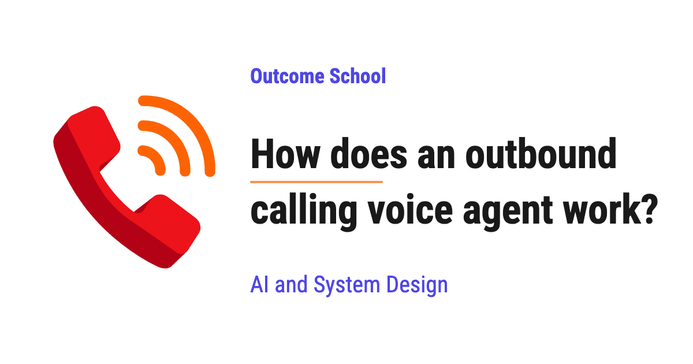

# How does an outbound calling voice agent work?

> Archived from <https://outcomeschool.com/blog/outbound-calling-voice-agent> on 2026-11-25.

An outbound calling voice agent is an AI voice agent that dials a phone number by itself, talks to the person who picks up, and saves the result of the call. Instead of waiting for people to call in, it starts the call.

In this blog, we will learn about how an outbound calling voice agent works. We will also see how it differs from an inbound call, how it decides whom to call and when, how a call reaches a phone, how it knows whether a human or a voicemail picked up, how every call ends with a saved outcome and a plan for the next try, and where it is used.

We will cover the following:
<ul><li>What is an outbound calling voice agent?</li><li>Inbound vs Outbound calls</li><li>The big picture of an outbound call</li><li>Step 1: Deciding whom to call and when</li><li>Step 2: Placing the call through the phone network</li><li>Step 3: Ringing, busy, or no answer</li><li>Step 4: Human or voicemail?</li><li>Step 5: Starting the conversation</li><li>Step 6: Running the conversation</li><li>Step 7: Ending the call and saving the outcome</li><li>Where outbound calling voice agents are used</li></ul>
I am <strong>Amit Shekhar</strong>, Founder @ <a target="_blank" rel="noopener noreferrer" href="https://outcomeschool.com">Outcome School</a>, I have taught and mentored many developers, and their efforts landed them high-paying tech jobs, helped many tech companies in solving their unique problems, and created many open-source libraries being used by top companies. I am passionate about sharing knowledge through open-source, blogs, and videos.

I teach <a target="_blank" rel="noopener noreferrer" href="https://outcomeschool.com/program/ai-and-machine-learning">AI and Machine Learning</a> at Outcome School.

Let&#x27;s get started.
<h2 id="what-is-an-outbound-calling-voice-agent">What is an outbound calling voice agent?</h2>
<strong>An outbound calling voice agent is an AI voice agent that places phone calls on its own, holds a spoken conversation with the person who answers, and saves the result of each call.</strong>

Let&#x27;s say a clinic has 500 patients with appointments tomorrow. Someone has to call each patient and ask, &quot;Can you confirm your appointment for tomorrow?&quot; A small team of humans can take the whole day to do this.

An outbound calling voice agent can do the same job. It picks a patient from the list, dials the number, waits for the patient to answer, asks the question, understands the reply, marks the appointment as confirmed or cancelled, and moves to the next patient. It can also run many such calls at the same time.
<h2 id="inbound-vs-outbound-calls">Inbound vs Outbound calls</h2>
Before jumping into how it works, we must know how an outbound call is different from an inbound call.

In an <strong>inbound</strong> call, the customer calls us. The customer already knows why they are calling, and they expect someone to answer.

In an <strong>outbound</strong> call, we call the customer. The person does not know who is calling or why, so the agent must explain quickly. The phone can also ring with no answer, the line can be busy, or a voicemail can pick up instead of a human.

Let me tabulate the differences between inbound and outbound calls for your better understanding.
<table><thead><tr><th>Point</th><th>Inbound call</th><th>Outbound call</th></tr></thead><tbody><tr><td>Who starts the call</td><td>The customer</td><td>The agent</td></tr><tr><td>Who speaks first</td><td>The agent greets the caller</td><td>Usually the person says &quot;Hello?&quot;</td></tr><tr><td>Voicemail possible</td><td>No</td><td>Yes</td></tr><tr><td>Unanswered calls</td><td>No retry needed</td><td>Must be retried later</td></tr><tr><td>Choosing the time</td><td>The customer chooses</td><td>We must choose a good time</td></tr></tbody></table>
So, the conversation part is almost the same. The extra work is everything around it: dialing, waiting, detecting voicemail, and retrying.

We have a detailed blog on <a target="_blank" rel="noopener noreferrer" href="phone-calls-in-voice-agents.md">how a voice AI agent answers a phone call</a> that explains the inbound side step by step.
<h2 id="the-big-picture-of-an-outbound-call">The big picture of an outbound call</h2>
Let&#x27;s first see the complete journey of one outbound call in a diagram.

<pre><code class="code-highlight">+----------------------------------+
| Step 1: Pick a contact and time  |
+----------------------------------+
                 ↓
+----------------------------------+
| Step 2: Place the call           |
+----------------------------------+
                 ↓
+----------------------------------+
| Step 3: Ringing, busy, no answer |
+----------------------------------+
                 ↓
+----------------------------------+
| Step 4: Human or voicemail?      |
+----------------------------------+
                 ↓
+----------------------------------+
| Step 5: Start the conversation   |
+----------------------------------+
                 ↓
+----------------------------------+
| Step 6: Run the conversation     |
+----------------------------------+
                 ↓
+----------------------------------+
| Step 7: Save outcome, plan retry |
+----------------------------------+
</code></pre>

Now, let&#x27;s understand each step one by one.
<h2 id="step-1-deciding-whom-to-call-and-when">Step 1: Deciding whom to call and when</h2>
Every outbound calling system starts with a list of people to call. This list is called a <strong>campaign</strong>. A campaign has a goal, for example &quot;confirm tomorrow&#x27;s appointments&quot;, and a list of contacts with their phone numbers and some details about each one.

The part of the system that picks the next contact and starts the call is called the <strong>dialer</strong>. Before dialing, the dialer checks a few things:
<ul><li><strong>Is it a good time for this person?</strong> The dialer looks at the person&#x27;s time zone and only calls within allowed calling hours. For example, it does not call anyone at 6 AM in their local time.</li><li><strong>Is this person allowed to be called?</strong> Many countries have rules about phone calls. For example, people can add their number to a &quot;Do Not Call&quot; list, and some calls need the person&#x27;s consent first. The dialer must skip anyone who should not be called.</li><li><strong>How many calls can we run at once?</strong> Each live call needs its own speech recognition, LLM, and speech generation running at the same time, and the telephony account often has a limit on how many calls can run at once. So, the dialer limits how many calls run in parallel.</li><li><strong>Has this person been tried before?</strong> If we already called this person three times today, we must not call again right now.</li></ul>
Once a contact passes all these checks, the dialer prepares the details for this call, for example the patient&#x27;s name, the appointment time, and the clinic name. These details go into <a target="_blank" rel="noopener noreferrer" href="voice-agent-system-prompt.md">the instructions for the LLM</a>, so that the agent can greet the patient by name, for example Rahul, and talk about his exact appointment.

Now, the dialer is ready to place the call.
<h2 id="step-2-placing-the-call-through-the-phone-network">Step 2: Placing the call through the phone network</h2>
An AI agent runs on a server. A phone sits in someone&#x27;s pocket. So, how does a call from a server reach a phone? The answer is a <strong>telephony provider</strong>.

A telephony provider is a company that connects the internet to the phone network. The phone network that all normal phones use is called the <strong>PSTN</strong>, which stands for Public Switched Telephone Network.

The flow is as below:

<pre><code class="code-highlight">+------------------------+
| Our voice agent server |
+------------------------+
            ↓
+------------------------+
| Telephony provider     |
+------------------------+
            ↓
+------------------------+
| PSTN (phone network)   |
+------------------------+
            ↓
+------------------------+
| The person&#x27;s phone     |
+------------------------+
</code></pre>

Our server asks the telephony provider to call a number. This request is often made through a web API, or through a protocol called <strong><a target="_blank" rel="noopener noreferrer" href="sip-and-rtp.md">SIP</a></strong>.

<strong>SIP</strong> stands for Session Initiation Protocol. It is the standard set of messages used to start and end internet phone calls. When a call starts, an <code>INVITE</code> message is sent, which means &quot;I want to call this number.&quot; The other side replies with messages that tell us what is happening with the call.

The call also needs a <strong>caller ID</strong>, the number that shows up on the person&#x27;s screen. Outbound systems use a real phone number that the business owns, so that the person can call back if needed.

Once the call is connected, the audio travels both ways. The person&#x27;s voice comes to our server, and our agent&#x27;s voice goes to the person&#x27;s phone. Many telephony providers stream this audio to our server over a <a target="_blank" rel="noopener noreferrer" href="webrtc-vs-websocket-for-voice-ai.md">WebSocket</a> connection. Phone audio is usually <a target="_blank" rel="noopener noreferrer" href="sample-rates-for-voice-agents.md">sampled at 8 kHz</a>, which is lower quality than the 16 kHz or higher audio used in most apps, so the speech recognition model must <a target="_blank" rel="noopener noreferrer" href="phone-audio-and-speech-recognition.md">work well with phone audio</a>.

<strong>Planning your move into AI?</strong>

No matter which tech domain you work in today, with your effort, you can transition to these roles:
<ul><li>AI Engineer</li><li>Forward Deployed Engineer</li><li>AI Agent Engineer</li><li>Harness Engineer</li><li>Voice AI Engineer</li><li>AI Architect</li><li>LLM Engineer</li><li>LLM Inference Engineer</li><li>Gen AI Engineer</li><li>MLOps Engineer</li><li>ML Engineer</li><li>Deep Learning Engineer</li></ul>
Our <a target="_blank" rel="noopener noreferrer" href="https://outcomeschool.com/program/ai-and-machine-learning">AI and Machine Learning Program</a> at Outcome School takes you there.
<h2 id="step-3-ringing-busy-or-no-answer">Step 3: Ringing, busy, or no answer</h2>
After the call is placed, the phone does not answer right away. A few different things can happen, and the system must handle each of them.

The telephony provider keeps sending updates about the call. These updates are called <strong>call progress</strong> events. With SIP, they come as reply messages with codes, as below:
<ul><li><code>180 Ringing</code> means the phone is ringing.</li><li><code>200 OK</code> means someone or something picked up the call.</li><li><code>486 Busy Here</code> means the line is busy.</li><li>If nobody answers for a set time, for example 30 seconds, the call is treated as <strong>no answer</strong> and is ended.</li><li>The number can also be invalid or disconnected, and the network tells us that too, for example with <code>404 Not Found</code>.</li></ul>
Here, we must notice that <code>200 OK</code> only tells us that the call was picked up. It does not tell us <strong>who</strong> picked up. It can be a human, or it can be a voicemail system. Both look exactly the same at this point.

So, how does the agent know who picked up? Let&#x27;s see the next step.
<h2 id="step-4-human-or-voicemail">Step 4: Human or voicemail?</h2>
This step is called <strong><a target="_blank" rel="noopener noreferrer" href="answering-machine-detection.md">Answering Machine Detection</a></strong>, or <strong>AMD</strong> for short.

Let&#x27;s say the agent starts talking the moment the call is picked up. If a voicemail picked up, the agent talks over the voicemail greeting, and only half of the message gets recorded. On the other hand, if the agent stays silent for too long to be sure, a human will say &quot;Hello? Hello?&quot; and hang up.

So, the system must decide quickly. The best way to learn this is by taking an example.

When a human picks up, the audio usually sounds like this:

<pre><code class="code-highlight">&quot;Hello?&quot;  ... (silence, waiting for us to speak)
</code></pre>

When a voicemail picks up, the audio usually sounds like this:

<pre><code class="code-highlight">&quot;Hi, you have reached Rahul. I am not available right now.
 Please leave a message after the beep.&quot;  ... (beep)
</code></pre>

Here, we can notice the difference:
<ul><li>A human greeting is short, usually one or two words, followed by silence.</li><li>A voicemail greeting is long and continuous, and it often ends with a beep.</li></ul>
So, AMD listens to the first few seconds of audio and looks at these patterns: how long the first speech lasts, how long the silence after it is, and whether there is a beep. Some systems also turn the greeting into text and check for phrases like &quot;leave a message&quot; or &quot;not available&quot;.

Based on this, AMD gives one of the following results:
<ul><li><strong>Human</strong>: the agent starts the conversation.</li><li><strong>Machine</strong>: the agent waits for the greeting to end, with a beep or with silence, and then leaves a short, pre-written message, or hangs up and tries again later. Leaving a recorded message like this is called a <strong>voicemail drop</strong>.</li><li><strong>Unknown</strong>: the system follows a default rule that we set, for example, treating it as a human.</li></ul>
AMD is never perfect. It is a tradeoff between speed and accuracy, and the result also changes from one phone network to another. If it decides too fast, it does more mistakes. If it waits too long, the human hangs up. So, we must tune the waiting time based on our use case.

<strong>A quick note for you</strong>

No matter which tech domain you work in, get familiar with these topics:
<ul><li>LLM</li><li>RAG</li><li>MCP</li><li>Agent</li><li>Fine-tuning</li><li>Quantization</li></ul>
We put it all together in one video:

<a target="_blank" rel="noopener noreferrer" href="https://www.youtube.com/watch?v=lnfWvX66FUk">AI Engineering Explained: LLM, RAG, MCP, Agent, Fine-Tuning, and Quantization</a>

No need to stop reading - bookmark it and watch later when you get time. Future you will thank you.

Now, let&#x27;s get back to the topic.
<h2 id="step-5-starting-the-conversation">Step 5: Starting the conversation</h2>
Now, a human has picked up. Here comes a question that is special to outbound calls: <a target="_blank" rel="noopener noreferrer" href="what-is-turn-taking-in-a-voice-ai-agent.md">who speaks first</a>?

In an inbound call, the agent greets the caller. In an outbound call, the person who picks up usually says &quot;Hello?&quot; first. This is the same short greeting that AMD used in Step 4 to detect a human. So, a common rule is as below:
<ul><li>Once AMD says human, the agent speaks its opening line right away.</li><li>If the person stays silent for a short time, the agent speaks first anyway.</li></ul>
The opening line matters a lot in an outbound call, because the person does not know who is calling. A good opening line answers three questions in a few seconds: who is calling, from where, and why.

For example:

<pre><code class="code-highlight">&quot;Hi, am I speaking with Rahul? This is an AI assistant calling
 from City Clinic about your appointment tomorrow at 10 AM.&quot;
</code></pre>

Here, we can see that the agent:
<ul><li>Confirms it is talking to the right person.</li><li>Says that it is an AI assistant. Some places require this by law, and it also builds trust.</li><li>Says the reason for the call immediately.</li></ul>
To make the opening fast, this first line can be generated and turned into audio before the call even connects. So, the moment AMD says human, the agent can start speaking with no delay.
<h2 id="step-6-running-the-conversation">Step 6: Running the conversation</h2>
From here, the call works like any other <a target="_blank" rel="noopener noreferrer" href="design-a-real-time-voice-ai-agent.md">voice agent</a> conversation. The audio goes through the voice pipeline as below:

<pre><code class="code-highlight">+------------------------------+
| Person speaks on the phone   |
+------------------------------+
               ↓
+------------------------------+
| Speech-to-Text (STT)         |
+------------------------------+
               ↓
+------------------------------+
| LLM decides the reply        |
+------------------------------+
               ↓
+------------------------------+
| Text-to-Speech (TTS)         |
+------------------------------+
               ↓
+------------------------------+
| Agent&#x27;s voice on the phone   |
+------------------------------+
</code></pre>

Here, we have:
<ul><li><strong>Speech-to-Text (STT)</strong>: turns the person&#x27;s voice into text.</li><li><strong>LLM (Large Language Model)</strong>: reads the text, along with the instructions and the contact details from Step 1, and decides what to say next.</li><li><strong>Text-to-Speech (TTS)</strong>: turns the reply into a voice and sends it down the phone line.</li></ul>
Some systems replace these three parts with a single <a target="_blank" rel="noopener noreferrer" href="cascaded-vs-speech-to-speech.md">speech-to-speech model</a>, and the rest of the call flow stays the same.

The agent also needs tools to get real work done. For example, if the patient says, &quot;Can I move it to Friday?&quot;, the LLM <a target="_blank" rel="noopener noreferrer" href="how-does-function-calling-work-in-llms.md">recommends calling a tool</a> like <code>reschedule_appointment</code> with the new day, and our code runs it on the clinic&#x27;s booking system. Then, the agent tells the patient the result.

A few situations come up often in outbound calls, and the agent must handle them:
<ul><li><strong>Wrong person</strong>: &quot;Rahul is not home.&quot; The agent can ask for a better time to call back.</li><li><strong>Not interested</strong>: the agent must <a target="_blank" rel="noopener noreferrer" href="call-ending-in-voice-agents.md">end the call politely</a> and mark the person so that we do not call again.</li><li><strong>Interruptions</strong>: people often cut in with &quot;Yes, yes, I know.&quot; The agent must <a target="_blank" rel="noopener noreferrer" href="stopping-speech-on-interruption.md">stop speaking and listen</a>.</li><li><strong>Transfer to a human</strong>: if the person asks for a real person, or the problem is too complex, the agent hands the call over to a human team member. When the human first gets a short summary of the call before being connected, it is called a <strong><a target="_blank" rel="noopener noreferrer" href="call-transfer-with-context.md">warm transfer</a></strong>, so the person does not have to repeat everything.</li></ul>
To learn Tool use in Agents, Agent Architecture, and how to Design a Real-Time Voice AI Agent, and to build an AI Coding Agent from scratch, check out our <a target="_blank" rel="noopener noreferrer" href="https://outcomeschool.com/program/ai-and-machine-learning">AI and Machine Learning Program</a> at Outcome School.
<h2 id="step-7-ending-the-call-and-saving-the-outcome">Step 7: Ending the call and saving the outcome</h2>
Every call must end with a saved result. This result is called the <strong>call outcome</strong> or <strong>disposition</strong>.

Some common call outcomes are as below:
<ul><li><code>confirmed</code>: the patient confirmed the appointment.</li><li><code>rescheduled</code>: the appointment was moved to a new time.</li><li><code>not_interested</code>: the person said no.</li><li><code>callback_requested</code>: the person asked us to call at another time.</li><li><code>voicemail_left</code>: a voicemail picked up and we left a message.</li><li><code>no_answer</code> or <code>busy</code>: nobody talked to us.</li><li><code>transferred</code>: the call was handed to a human.</li></ul>
For <code>no_answer</code>, <code>busy</code>, and <code>voicemail_left</code>, the outcome comes straight from Step 3 and Step 4. For a real conversation, the LLM is often asked at the end of the call to read the full transcript and pick one outcome from a fixed list. It also pulls out useful details, as below:

<pre><code class="code-highlight language-json">{ &quot;outcome&quot;: &quot;rescheduled&quot;, &quot;new_time&quot;: &quot;Friday 11 AM&quot;, &quot;notes&quot;: &quot;Prefers mornings&quot; }
</code></pre>

Here, we can see that the outcome is in a fixed format that our code can read and save into the clinic&#x27;s system.

Now, the outcome decides what the dialer does next, as below:
<ul><li>For <code>no_answer</code>, <code>busy</code>, or <code>voicemail_left</code>, the dialer schedules a <strong>retry</strong>, often a few hours later or on another day, up to a maximum number of tries.</li><li>For <code>callback_requested</code>, the dialer schedules a call at the time the person asked for.</li><li>For <code>confirmed</code>, <code>rescheduled</code>, or <code>not_interested</code>, the contact is marked as done and is never called again for this campaign.</li></ul>
The system also saves the recording and the transcript, which teams use to check the quality of calls and to improve the agent&#x27;s instructions.

<strong>Stay updated:</strong> Subscribe to our <a target="_blank" rel="noopener noreferrer" href="https://outcomeschool.substack.com/subscribe">newsletter</a> to get our latest AI and Machine Learning blogs straight to your inbox.
<h2 id="where-outbound-calling-voice-agents-are-used">Where outbound calling voice agents are used</h2>
Outbound calling voice agents are used wherever a business needs to make many similar phone calls. Some common use cases are as below:
<ul><li><strong>Appointment reminders</strong>: clinics, salons, and service centers confirming or rescheduling bookings.</li><li><strong>Payment reminders</strong>: reminding customers about a due bill and sending them a link to pay.</li><li><strong>Delivery updates</strong>: confirming an address or a delivery time slot.</li><li><strong>Lead follow-up</strong>: calling people who filled a form on a website and asked to be contacted.</li><li><strong>Surveys and feedback</strong>: asking a few questions after a purchase or a service visit.</li></ul>
Now we must have understood what an outbound calling voice agent is, how it decides whom to call, how the call reaches a phone, how it tells a human from a voicemail, how it runs the conversation, and how every call ends with a saved outcome and a retry plan.
<h2 id="frequently-asked-questions">Frequently Asked Questions</h2><h3 id="does-an-outbound-calling-voice-agent-tell-people-it-is-an-ai">Does an outbound calling voice agent tell people it is an AI?</h3>
Yes, a good one does. Its opening line says who is calling, from where, and why, and it says that it is an AI assistant. Some places require this by law, and it also builds trust with the person who picked up the call.
<h3 id="how-many-calls-can-an-outbound-calling-voice-agent-run-at-the-same-time">How many calls can an outbound calling voice agent run at the same time?</h3>
It can run many calls at the same time, but the dialer limits how many run in parallel. Each live call needs its own speech recognition, LLM, and speech generation running at the same time, and the telephony account often has a limit on how many calls can run at once.
<h3 id="what-is-a-voicemail-drop">What is a voicemail drop?</h3>
A voicemail drop is a short, pre-written message that the agent leaves when a voicemail picks up. The agent waits for the voicemail greeting to end, with a beep or with silence, and then plays the message, so that the full message gets recorded.
<h3 id="can-an-outbound-calling-voice-agent-transfer-the-call-to-a-human">Can an outbound calling voice agent transfer the call to a human?</h3>
Yes. If the person asks for a real person, or the problem is too complex, the agent hands the call over to a human team member. In a warm transfer, the human first gets a short summary of the call, so the person does not have to repeat everything.

That&#x27;s it for now.

Thanks

<strong>Amit Shekhar</strong> Founder @ <a target="_blank" rel="noopener noreferrer" href="https://outcomeschool.com">Outcome School</a>

You can connect with me on:
<ul><li><a target="_blank" rel="noopener noreferrer" href="https://x.com/amitiitbhu">X</a></li><li><a target="_blank" rel="noopener noreferrer" href="https://www.linkedin.com/in/amit-shekhar-iitbhu">LinkedIn</a></li><li><a target="_blank" rel="noopener noreferrer" href="https://github.com/amitshekhariitbhu">GitHub</a></li></ul>
Follow Outcome School on:
<ul><li><a target="_blank" rel="noopener noreferrer" href="https://x.com/outcome_school">X</a></li><li><a target="_blank" rel="noopener noreferrer" href="https://youtube.com/@OutcomeSchool">YouTube</a></li><li><a target="_blank" rel="noopener noreferrer" href="https://www.linkedin.com/company/outcomeschool">LinkedIn</a></li><li><a target="_blank" rel="noopener noreferrer" href="http://github.com/OutcomeSchool">GitHub</a></li></ul>
<a target="_blank" rel="noopener noreferrer" href="https://outcomeschool.com/blog"><strong>Read all of our high-quality blogs here.</strong></a>

