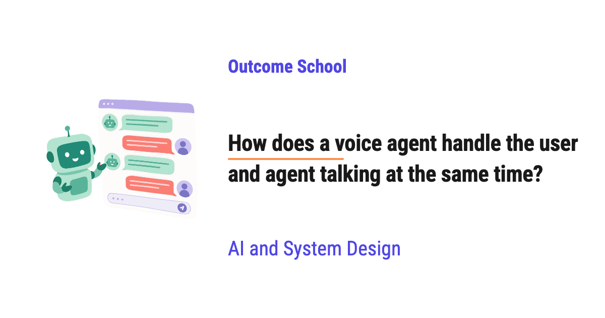

# How does a voice agent handle the user and agent talking at the same time?

> Archived from <https://outcomeschool.com/blog/overlapping-speech-in-voice-agents> on 2026-11-25.

A voice agent handles the user and agent talking at the same time by listening even while it speaks, removing its own voice from what it hears, deciding what kind of overlap it is, and then either continuing to speak or stopping to give the turn to the user.

In this blog, we will learn about how a voice agent handles the user and agent talking at the same time. We will also see why overlapping speech is a hard problem, the different kinds of overlap, how the agent hears the user over its own voice and decides whether to stop or continue, how it keeps the conversation history correct after it stops, how full-duplex models handle overlap in a different way, and where it works well and where it fails.

We will cover the following:
<ul><li>What is overlapping speech?</li><li>Why is overlapping speech a hard problem for a voice agent?</li><li>The different kinds of overlap</li><li>Step 1: Keep listening while speaking</li><li>Step 2: Remove the agent&#x27;s own voice</li><li>Step 3: Decide what kind of overlap it is</li><li>Step 4: Act on the decision</li><li>Step 5: Keep the conversation history correct</li><li>What if both start speaking at the same moment?</li><li>How full-duplex models handle overlap</li><li>A complete example</li><li>Where it works well and where it fails</li></ul>
I am <strong>Amit Shekhar</strong>, Founder @ <a target="_blank" rel="noopener noreferrer" href="https://outcomeschool.com">Outcome School</a>, I have taught and mentored many developers, and their efforts landed them high-paying tech jobs, helped many tech companies in solving their unique problems, and created many open-source libraries being used by top companies. I am passionate about sharing knowledge through open-source, blogs, and videos.

I teach <a target="_blank" rel="noopener noreferrer" href="https://outcomeschool.com/program/ai-and-machine-learning">AI and Machine Learning</a> at Outcome School.

Let&#x27;s get started.
<h2 id="what-is-overlapping-speech">What is overlapping speech?</h2>
<strong>Overlapping speech is the moment when the user and the voice agent are both speaking at the same time.</strong>

Let&#x27;s say we call a voice agent to check our order. The agent says, &quot;Your order has three items: a phone case, a charger, and a pair of headphones, and it will arrive on...&quot; Right after &quot;a charger&quot;, we say, &quot;Wait, I want to cancel the charger.&quot; For a short time, two voices are on the line together.

Humans do this all the time. One person starts speaking a little before the other finishes, or says &quot;yeah&quot; while the other is talking.

A voice agent must learn to do the same.
<h2 id="why-is-overlapping-speech-a-hard-problem-for-a-voice-agent">Why is overlapping speech a hard problem for a voice agent?</h2>
Before jumping into the solution, we must know <a target="_blank" rel="noopener noreferrer" href="design-a-real-time-voice-ai-agent.md">how a simple voice agent works</a>.

Many voice agents work like a relay race with three runners:
<ul><li><strong>Speech-to-Text (STT)</strong> turns the user&#x27;s voice into text.</li><li><strong>LLM (Large Language Model)</strong> reads that text and writes a reply.</li><li><strong>Text-to-Speech (TTS)</strong> turns the reply into voice.</li></ul>
In the simplest version, the agent and the user <a target="_blank" rel="noopener noreferrer" href="what-is-turn-taking-in-a-voice-ai-agent.md">take turns</a>. It listens, then it thinks, then it speaks. While it speaks, it does not listen. This is called <a target="_blank" rel="noopener noreferrer" href="half-duplex-vs-full-duplex-voice-agents.md"><strong>half-duplex</strong></a>, which means only one side can talk at a time.

<pre><code class="code-highlight">User speaks
     ↓
STT: voice to text
     ↓
LLM: writes the reply
     ↓
TTS: text to voice
     ↓
Agent speaks (not listening)
</code></pre>

Here, we can see the problem. If the user speaks while the agent is speaking, nobody is listening. The agent keeps talking over the user, and the user&#x27;s words are lost.

So, the agent must listen while it speaks. But the moment it does that, three new problems come into the picture:
<ul><li>The microphone also picks up the agent&#x27;s own voice from the speaker.</li><li>Not every sound from the user means &quot;stop&quot;. A &quot;hmm&quot; or &quot;okay&quot; means &quot;keep going&quot;.</li><li>After the agent stops, it must know exactly how much of its reply the user actually heard.</li></ul>
Let&#x27;s understand the kinds of overlap first, and then we will see how the agent solves each problem.
<h2 id="the-different-kinds-of-overlap">The different kinds of overlap</h2>
The best way to learn this is by taking an example.

Suppose the agent is reading out the steps to reset a router.

<strong>Kind 1: Interruption.</strong> The user says, &quot;Wait, I already did that.&quot; The user wants the agent to stop and listen. This is called <a target="_blank" rel="noopener noreferrer" href="what-is-barge-in-in-a-voice-ai-agent.md"><strong>barge-in</strong></a>.

<strong>Kind 2: Backchannel.</strong> The user says, &quot;uh-huh&quot; or &quot;okay&quot; or &quot;right&quot;. The user is only saying &quot;I am following you, please continue&quot;. The agent must not stop.

<strong>Kind 3: Noise and echo.</strong> A cough, a dog barking, a TV in the background, or the agent&#x27;s own voice coming back through the microphone. The agent must ignore all of these.

<strong>Kind 4: Both start together.</strong> The agent finishes a sentence, takes a short pause, and starts the next sentence. At the same moment, the user also starts speaking. Both voices collide at the start.

Let me tabulate the kinds of overlap and what the agent must do for your better understanding.
<table><thead><tr><th>Kind of overlap</th><th>Example</th><th>What the agent must do</th></tr></thead><tbody><tr><td>Interruption</td><td>&quot;Wait, I already did that.&quot;</td><td>Stop and listen</td></tr><tr><td>Backchannel</td><td>&quot;uh-huh&quot;, &quot;okay&quot;, &quot;right&quot;</td><td>Keep speaking</td></tr><tr><td>Noise and echo</td><td>Cough, TV, its own voice</td><td>Ignore</td></tr><tr><td>Both start together</td><td>Both begin at the same time</td><td>Stop and give the turn to the user</td></tr></tbody></table>
Now, let&#x27;s see step by step how the agent handles all of these.
<h2 id="step-1-keep-listening-while-speaking">Step 1: Keep listening while speaking</h2>
The agent keeps the microphone open the whole time, even while it is speaking.

So, now there are two streams of audio flowing at the same time:
<ul><li>The <strong>output stream</strong>: the agent&#x27;s voice going to the speaker.</li><li>The <strong>input stream</strong>: whatever the microphone hears.</li></ul>
The agent keeps sending the input stream to a small detector, which we will see in Step 3, even while the output stream is playing.

<strong>Planning your move into AI?</strong>

No matter which tech domain you work in today, with your effort, you can transition to these roles:
<ul><li>AI Engineer</li><li>Forward Deployed Engineer</li><li>AI Agent Engineer</li><li>Harness Engineer</li><li>Voice AI Engineer</li><li>AI Architect</li><li>LLM Engineer</li><li>LLM Inference Engineer</li><li>Gen AI Engineer</li><li>MLOps Engineer</li><li>ML Engineer</li><li>Deep Learning Engineer</li></ul>
Our <a target="_blank" rel="noopener noreferrer" href="https://outcomeschool.com/program/ai-and-machine-learning">AI and Machine Learning Program</a> at Outcome School takes you there.
<h2 id="step-2-remove-the-agents-own-voice">Step 2: Remove the agent&#x27;s own voice</h2>
Now, here is the first problem. When the agent&#x27;s voice plays from the user&#x27;s phone speaker, the user&#x27;s microphone also picks up that sound. If the agent does not handle this, it hears its own voice and thinks the user is talking. It then stops itself in the middle of every sentence.

So, here comes <strong>Acoustic Echo Cancellation (AEC)</strong> to the rescue.

The agent knows exactly what it is playing, because it produced that audio itself. So, AEC takes the audio that was sent to the speaker, predicts how that audio will sound when it comes back through the microphone, and subtracts it from what the microphone heard.

<pre><code class="code-highlight">Microphone hears: user voice + agent voice (echo)
     ↓
AEC subtracts: agent voice (known copy)
     ↓
Clean audio: user voice
</code></pre>

Here, we can see that what remains after the subtraction is mostly the user&#x27;s voice. The prediction is not perfect, because the sound bounces around the room and changes a little, but it removes most of the echo.

On phone calls, the phone or the calling platform often does this echo cancellation. In browser apps, the browser often provides it. Either way, the agent must make sure it is turned on.
<h2 id="step-3-decide-what-kind-of-overlap-it-is">Step 3: Decide what kind of overlap it is</h2>
Now, the agent has clean audio from the user. The next big question is: &quot;Is this sound a real interruption, a backchannel, or noise?&quot;

The agent answers this question in layers.

<strong>Layer 1: Is there any human speech?</strong> A small, fast model called <strong>Voice Activity Detection (VAD)</strong> checks each short piece of audio, usually a few tens of milliseconds long, and gives a score for how likely it is to contain human speech. A door slam or a beep gets a low score. A voice gets a high score.

<strong>Layer 2: Is it long enough?</strong> A cough or a short &quot;hmm&quot; lasts a very short time, and the agent must keep speaking for both. So, the agent waits until the speech has lasted for a minimum time before reacting, for example around 200 to 300 milliseconds. Short bursts are ignored.

<strong>Layer 3: What are the words?</strong> The agent sends the audio to STT and looks at the words. If the words are only &quot;uh-huh&quot;, &quot;yeah&quot;, &quot;okay&quot;, or &quot;right&quot;, it is a <a target="_blank" rel="noopener noreferrer" href="backchannels-in-voice-agents.md">backchannel</a>. If the words are &quot;wait&quot;, &quot;no&quot;, &quot;stop&quot;, or a real sentence, it is an interruption. Getting the words takes a little extra time, so this layer adds some delay.

<strong>Layer 4: Context.</strong> Some voice agents also use a small model that looks at what the agent was saying and what the user said, and predicts whether the user wants the turn. Let&#x27;s say the agent just asked, &quot;Is that correct?&quot; and the user says &quot;yeah&quot;. That &quot;yeah&quot; is a real answer, not a backchannel.

We can write the decision logic as below:

<pre><code class="code-highlight language-python">def classify_overlap(audio, agent_is_speaking):
    if not agent_is_speaking:
        return &quot;normal_turn&quot;

    if vad_score(audio) &lt; 0.5:
        return &quot;noise&quot;  # no human speech

    if speech_duration(audio) &lt; 0.3:  # in seconds
        return &quot;noise&quot;  # too short, like a cough

    words = transcribe(audio).lower().strip()

    if words in [&quot;uh-huh&quot;, &quot;yeah&quot;, &quot;okay&quot;, &quot;right&quot;, &quot;mm-hmm&quot;]:
        return &quot;backchannel&quot;

    return &quot;interruption&quot;
</code></pre>

Here, we have:
<ul><li>First, if the agent is not speaking, there is no overlap at all, so it is a normal turn.</li><li>Then, if VAD says there is no human speech, it is noise.</li><li>After that, if the speech is too short, it is treated as noise, like a cough.</li><li>Then, we look at the words. If they are only a backchannel word, the agent keeps speaking.</li><li>Finally, anything else is treated as a real interruption.</li></ul>
<strong>Note:</strong> The numbers here, like 0.5 and 0.3 seconds, are only for the sake of example. Real systems tune these values based on their use case. Layer 4 is left out of this code for the sake of understanding.

We have a detailed blog on <a target="_blank" rel="noopener noreferrer" href="interruption-vs-background-noise.md">how a voice agent tells a real interruption from a cough or background noise</a> that explains these layers in depth.

<strong>A quick note for you</strong>

No matter which tech domain you work in, get familiar with these topics:
<ul><li>LLM</li><li>RAG</li><li>MCP</li><li>Agent</li><li>Fine-tuning</li><li>Quantization</li></ul>
We put it all together in one video:

<a target="_blank" rel="noopener noreferrer" href="https://www.youtube.com/watch?v=lnfWvX66FUk">AI Engineering Explained: LLM, RAG, MCP, Agent, Fine-Tuning, and Quantization</a>

No need to stop reading - bookmark it and watch later when you get time. Future you will thank you.

Now, let&#x27;s get back to the topic.
<h2 id="step-4-act-on-the-decision">Step 4: Act on the decision</h2>
Now, the agent knows what kind of overlap it is. It acts as below:
<ul><li><strong>Noise:</strong> Do nothing. Keep speaking.</li><li><strong>Backchannel:</strong> Keep speaking. Do not add &quot;okay&quot; as a new user turn, so that the LLM does not reply to it.</li><li><strong>Interruption:</strong> Stop right away.</li></ul>
<a target="_blank" rel="noopener noreferrer" href="stopping-speech-on-interruption.md">Stopping right away</a> needs care, because at the moment of interruption, the runners of our relay race are often still busy:
<ul><li>The TTS is playing audio, and some more audio is already waiting in a buffer to be played.</li><li>The LLM is still writing the rest of the reply.</li></ul>
So, the agent must do the following, quickly:
<ul><li>Stop the audio that is playing and throw away the audio waiting in the buffer.</li><li>Cancel the LLM so that it stops writing the old reply.</li><li>Cancel the TTS so that it stops making new audio.</li><li>Start listening to the user&#x27;s full sentence as a new turn.</li></ul>
If the agent stops the speaker but forgets to <a target="_blank" rel="noopener noreferrer" href="tts-audio-buffering.md">clear the buffer</a>, the user hears a few more words after they interrupted. A good agent stops within a few hundred milliseconds of the user starting to speak.

Some agents also do a <strong>soft stop</strong>. When the user first starts speaking, the agent lowers its volume or pauses, instead of fully cancelling. If the sound turns out to be a cough or a backchannel, it continues. If it turns out to be a real interruption, it cancels. This way, a <a target="_blank" rel="noopener noreferrer" href="false-interruption-recovery.md">false alarm</a> does not throw away the reply, and the agent still reacts quickly while it waits for the words from Layer 3.
<h2 id="step-5-keep-the-conversation-history-correct">Step 5: Keep the conversation history correct</h2>
The LLM usually writes the full reply as text much faster than the TTS can speak it. So, when the user interrupts, the LLM has written the full sentence, but the user has only heard part of it.

Let&#x27;s say the LLM wrote:

&quot;Your order has three items: a phone case, a charger, and a pair of headphones.&quot;

But the user said, &quot;Wait, I want to cancel the charger,&quot; right after hearing &quot;Your order has three items: a phone case, a charger&quot;. If the agent saves the full text in the conversation history, the LLM believes that the user also heard about the headphones. Later, it says, &quot;As I mentioned, the headphones...&quot; The user never heard that.

So, the agent must <a target="_blank" rel="noopener noreferrer" href="truncating-context-on-interruption.md">cut the saved reply down to only the part that was actually played</a>. It does this by tracking how much audio was played before it stopped, and matching that to the words. Many TTS systems give a timestamp for each word, which makes this matching easier.

<pre><code class="code-highlight">LLM wrote:   &quot;Your order has three items: a phone case, a charger, and a pair of headphones.&quot;
User heard:  &quot;Your order has three items: a phone case, a charger&quot;
Saved:       &quot;Your order has three items: a phone case, a charger&quot;
</code></pre>

Some systems also add a small note in the history that the agent was interrupted. Now, the LLM knows exactly where the conversation stands, and its next reply makes sense.

If we want to go deep into Memory in Agents, Context Engineering, and how to Design a Real-Time Voice AI Agent, our <a target="_blank" rel="noopener noreferrer" href="https://outcomeschool.com/program/ai-and-machine-learning">AI and Machine Learning Program</a> at Outcome School covers them in depth.
<h2 id="what-if-both-start-speaking-at-the-same-moment">What if both start speaking at the same moment?</h2>
Now, let&#x27;s discuss Kind 4, where both voices begin at the same moment. The agent detects it with the same steps as an interruption, because it hears user speech while it is speaking.

A common rule for a voice agent is: <strong>the user always wins.</strong> The agent stops, and the user gets the turn.

This rule makes sense because the user&#x27;s words are new information, while the agent can always repeat what it was going to say. Once the user finishes, the agent can reply to what the user said, and continue its old point only if it is still needed.

To reduce these collisions, the agent can also wait a little longer after a natural pause before it starts its next sentence. This gives the user a small window to jump in.
<h2 id="how-full-duplex-models-handle-overlap">How full-duplex models handle overlap</h2>
Now, it&#x27;s time to learn about a different design, where <a target="_blank" rel="noopener noreferrer" href="cascaded-vs-speech-to-speech.md">one model replaces the many separate parts of the relay race</a>.

A <strong>full-duplex speech model</strong> is a single model that listens and speaks at the same time. Full-duplex means both sides can talk at once, just like a phone call between two people.

Moshi, a speech model from Kyutai, is an example. It models the user&#x27;s audio and its own audio as two parallel streams, and at every small time step, about every 80 milliseconds, it processes both streams together. Because of this, it has no explicit speaker turns, and it does not need a separate VAD or a hand-written rule to decide when to stop.

Instead, the model learns from conversation data when people stop, when they say &quot;uh-huh&quot; and keep going, and when they speak over each other. So, overlap becomes a normal part of the conversation for the model, not a special case.

Let me tabulate the differences between the two designs for your better understanding.
<table><thead><tr><th>Point</th><th>Relay race design (STT + LLM + TTS)</th><th>Full-duplex model</th></tr></thead><tbody><tr><td>Listening while speaking</td><td>Added on top with AEC and VAD</td><td>Built in</td></tr><tr><td>Deciding stop or continue</td><td>Rules and small models</td><td>Learned by the model</td></tr><tr><td>Backchannels</td><td>Detected with word lists or a model</td><td>Learned as part of the conversation</td></tr><tr><td>Control</td><td>Easy to control and debug each part</td><td>Harder to control and debug</td></tr></tbody></table>
<strong>Stay updated:</strong> Subscribe to our <a target="_blank" rel="noopener noreferrer" href="https://outcomeschool.substack.com/subscribe">newsletter</a> to get our latest AI and Machine Learning blogs straight to your inbox.
<h2 id="a-complete-example">A complete example</h2>
Now, let&#x27;s put everything together with one call.

The agent is reading the router reset steps: &quot;First, unplug the router. Then, wait for thirty seconds. After that, plug it back in and...&quot;
<ul><li>The agent&#x27;s own voice comes back through the microphone. AEC subtracts it, so the agent does not stop itself.</li><li>After &quot;wait for thirty seconds&quot;, the user says &quot;okay&quot;. VAD finds speech, STT gives &quot;okay&quot;, and the agent marks it as a backchannel. It keeps speaking, and &quot;okay&quot; is not added as a new turn.</li><li>During &quot;plug it back in&quot;, the user says, &quot;Wait, which light should be green?&quot; VAD finds speech, it lasts long enough, and the words are a real question. The agent marks it as an interruption.</li><li>The agent stops the audio, clears the buffer, and cancels the LLM and TTS.</li><li>The agent saves only &quot;First, unplug the router. Then, wait for thirty seconds. After that, plug it back in&quot; in the history.</li><li>The agent listens to the full question and replies, &quot;The power light should be green.&quot;</li></ul>
This is how a voice agent handles the user and the agent talking at the same time.
<h2 id="where-it-works-well-and-where-it-fails">Where it works well and where it fails</h2>
It works well when:
<ul><li>The audio is clean and AEC is working properly.</li><li>The user&#x27;s interruptions are clear, like &quot;wait&quot; or &quot;no, not that&quot;.</li><li>The backchannels are common words like &quot;okay&quot; and &quot;yeah&quot;.</li></ul>
It fails when:
<ul><li>AEC is weak, for example on a loud speakerphone, and the agent hears its own voice and stops itself.</li><li>Another person in the room talks, and the agent thinks the user is interrupting.</li><li>The user says &quot;yeah&quot; as a real answer, and the agent treats it as a backchannel and keeps talking.</li><li>The minimum speech time is set too high, so the agent feels slow to stop, or too low, so it stops for every cough.</li><li>The agent forgets to cut the history, and later talks about things the user never heard.</li></ul>
Now we must have understood how a voice agent handles the user and agent talking at the same time, what kinds of overlap exist, and how the agent decides whether to keep speaking or stop.
<h2 id="frequently-asked-questions">Frequently Asked Questions</h2><h3 id="is-yeah-always-a-backchannel-in-a-voice-agent">Is &quot;yeah&quot; always a backchannel in a voice agent?</h3>
No. A &quot;yeah&quot; is not always a backchannel. If the agent just asked, &quot;Is that correct?&quot; and the user says &quot;yeah&quot;, it is a real answer. This is why some voice agents use a small model that looks at what the agent was saying and what the user said. If the agent treats such a &quot;yeah&quot; as a backchannel, it keeps talking when it should stop.
<h3 id="why-should-a-backchannel-not-be-added-to-the-conversation-history-as-a-new-user-turn">Why should a backchannel not be added to the conversation history as a new user turn?</h3>
A backchannel should not be added as a new user turn because the LLM would then reply to it. When the user says &quot;okay&quot; or &quot;uh-huh&quot; while the agent is speaking, the user only means &quot;I am following you, please continue&quot;. So, the agent keeps speaking and does not treat it as something to answer.
<h3 id="what-is-a-soft-stop-in-a-voice-agent">What is a soft stop in a voice agent?</h3>
A soft stop is when the agent lowers its volume or pauses as soon as the user starts speaking, instead of fully cancelling its reply. If the sound turns out to be a cough or a backchannel, it continues. If it is a real interruption, it cancels. This way, a false alarm does not throw away the reply, and the agent still reacts quickly.
<h3 id="how-fast-should-a-voice-agent-stop-when-the-user-interrupts">How fast should a voice agent stop when the user interrupts?</h3>
A good voice agent stops within a few hundred milliseconds of the user starting to speak. To do this, it must stop the audio that is playing and also throw away the audio waiting in the buffer. If it stops the speaker but forgets to clear the buffer, the user hears a few more words after they interrupted.

That&#x27;s it for now.

Thanks

<strong>Amit Shekhar</strong> Founder @ <a target="_blank" rel="noopener noreferrer" href="https://outcomeschool.com">Outcome School</a>

You can connect with me on:
<ul><li><a target="_blank" rel="noopener noreferrer" href="https://x.com/amitiitbhu">X</a></li><li><a target="_blank" rel="noopener noreferrer" href="https://www.linkedin.com/in/amit-shekhar-iitbhu">LinkedIn</a></li><li><a target="_blank" rel="noopener noreferrer" href="https://github.com/amitshekhariitbhu">GitHub</a></li></ul>
Follow Outcome School on:
<ul><li><a target="_blank" rel="noopener noreferrer" href="https://x.com/outcome_school">X</a></li><li><a target="_blank" rel="noopener noreferrer" href="https://youtube.com/@OutcomeSchool">YouTube</a></li><li><a target="_blank" rel="noopener noreferrer" href="https://www.linkedin.com/company/outcomeschool">LinkedIn</a></li><li><a target="_blank" rel="noopener noreferrer" href="http://github.com/OutcomeSchool">GitHub</a></li></ul>
<a target="_blank" rel="noopener noreferrer" href="https://outcomeschool.com/blog"><strong>Read all of our high-quality blogs here.</strong></a>

