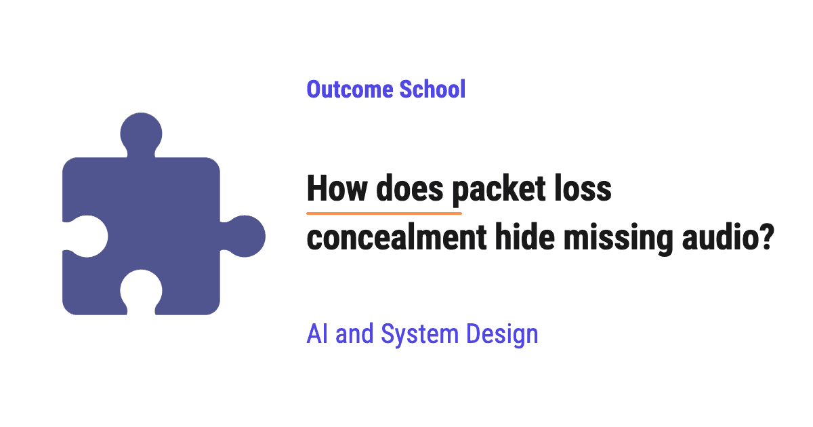

# How does packet loss concealment hide missing audio?

> Archived from <https://outcomeschool.com/blog/packet-loss-concealment> on 2026-11-25.

Packet loss concealment is a method that a voice app uses to fill a missing piece of audio with a believable sound, so that the listener does not hear a gap or a click when a piece of audio gets lost on the internet.

In this blog, we will learn about how packet loss concealment hides missing audio. We will also see what packet loss is, why a gap in audio sounds so bad, how the approaches evolved from playing silence to repeating the pitch of the voice, how codecs like Opus and neural networks make a better guess, where it fits in a voice AI agent, and where it works well and where it fails.

We will cover the following:
<ul><li>What is packet loss?</li><li>Why does a gap in audio sound so bad?</li><li>What is packet loss concealment?</li><li>Approach 1: Play silence</li><li>Approach 2: Repeat the last packet</li><li>Approach 3: Repeat one pitch cycle and fade out</li><li>Approach 4: Let the codec guess</li><li>Approach 5: Let a neural network guess</li><li>Where does packet loss concealment fit in a voice AI agent?</li><li>Where it works well and where it fails</li></ul>
I am <strong>Amit Shekhar</strong>, Founder @ <a target="_blank" rel="noopener noreferrer" href="https://outcomeschool.com">Outcome School</a>, I have taught and mentored many developers, and their efforts landed them high-paying tech jobs, helped many tech companies in solving their unique problems, and created many open-source libraries being used by top companies. I am passionate about sharing knowledge through open-source, blogs, and videos.

I teach <a target="_blank" rel="noopener noreferrer" href="https://outcomeschool.com/program/ai-and-machine-learning">AI and Machine Learning</a> at Outcome School.

Let&#x27;s get started.
<h2 id="what-is-packet-loss">What is packet loss?</h2>
When we talk on a <a target="_blank" rel="noopener noreferrer" href="voice-and-video-call.md">voice call</a>, or when we talk to a <a target="_blank" rel="noopener noreferrer" href="design-a-real-time-voice-ai-agent.md">voice AI agent</a>, our voice does not travel as one long stream. The app cuts our voice into <a target="_blank" rel="noopener noreferrer" href="audio-frames-and-chunk-sizes.md">tiny pieces</a>. Each piece usually holds 20 milliseconds of audio. Each piece is put inside a <strong>packet</strong>, and the packet is sent over the internet.

So, one second of our voice becomes 50 packets, one after another.

Now, the internet does not promise that every packet will reach. A busy Wi-Fi router, a weak mobile signal, or a crowded network can drop a packet on the way.

<strong>Packet loss is when some of the audio packets never reach the other side.</strong>

For voice calls, the app usually does not wait for the lost packet to be sent again. By the time a fresh copy comes back, it is too late to play it, because the conversation has already moved forward. So, the receiver must play something in place of the missing 20 milliseconds, right now.

We have a detailed blog on <a target="_blank" rel="noopener noreferrer" href="webrtc-vs-websocket-for-voice-ai.md">how WebRTC and WebSocket differ for voice AI agents</a> that explains why waiting for a lost packet hurts a live conversation.

The diagram below shows a stream of packets where packet 3 got lost.

<pre><code class="code-highlight">Sent:      [P1] [P2] [P3] [P4] [P5]
                       ↓
                lost on the way
                       ↓
Received:  [P1] [P2] [??] [P4] [P5]
</code></pre>

Now, the question is: what should the receiver play in the place of the question marks?
<h2 id="why-does-a-gap-in-audio-sound-so-bad">Why does a gap in audio sound so bad?</h2>
Before jumping into the solutions, we must understand why the gap is a problem at all.

Sound is a wave. When we speak, the air moves up and down smoothly, again and again. The app stores this wave as a long list of numbers called <strong><a target="_blank" rel="noopener noreferrer" href="sample-rates-for-voice-agents.md">samples</a></strong>. Each sample tells how high or low the wave is at that tiny moment.

Let&#x27;s say the wave is at a high point when packet 2 ends. If the next 20 milliseconds are suddenly zero, the wave jumps from high to zero in one step. Our ear hears this sudden jump as a sharp <strong>click</strong> or <strong>pop</strong>.

Then, when packet 4 arrives, the wave jumps again from zero back to some value. Another click.

So, a single lost packet creates two clicks and a hole in the middle of a word. If the network loses packets often, the voice starts sounding broken and robotic. Words become hard to understand.

Our ear is very sensitive to sudden jumps, but very forgiving when the sound stays smooth. Hence, whatever we play in the gap must connect smoothly with the audio before it and the audio after it.
<h2 id="what-is-packet-loss-concealment">What is packet loss concealment?</h2>
<strong>Packet loss concealment (PLC) is a method that creates a believable replacement for a lost audio packet, using the audio that has already arrived, so that the listener does not notice the loss.</strong>

The word <strong>concealment</strong> means hiding. We are not getting the lost audio back. We are hiding the fact that it is missing.

Let&#x27;s say we are reading a printed page and one word is smudged with ink. In most cases, we can still guess the word from the words just before it, and we keep reading without stopping. Packet loss concealment does the same thing for sound. It looks at the audio just before the gap and makes a good guess of what was most likely there.

Now, let&#x27;s see how this guess is made. We will start with the simplest approach and improve it step by step.
<h2 id="approach-1-play-silence">Approach 1: Play silence</h2>
The simplest approach is to play silence in the place of the lost packet. This is also called <strong>zero insertion</strong>, because we fill the gap with zeros.

<pre><code class="code-highlight">Received:  [P1] [P2] [silence] [P4] [P5]
</code></pre>

It is very easy to build.

But, as we saw above, the wave jumps from a high value to zero and back. This creates clicks. And the listener clearly hears a hole in the voice.

The issue with this approach is that the gap is very easy to hear. Let&#x27;s see how the next approach solve this issue.
<h2 id="approach-2-repeat-the-last-packet">Approach 2: Repeat the last packet</h2>
Speech does not change much in 20 milliseconds. So, the sound of packet 3 is most likely close to the sound of packet 2. Hence, we can just play packet 2 one more time.

<pre><code class="code-highlight">Received:  [P1] [P2] [P2 again] [P4] [P5]
</code></pre>

This is much better than silence. There is no hole, and the voice keeps going.

But the following issues arise:
<ul><li>Where packet 2 ends and its copy starts, the wave does not line up. The end of packet 2 is at one value, and the start of the copy is at another value. So, we still get a small click at the join.</li><li>If several packets are lost in a row, we repeat the same 20 milliseconds again and again. This sounds like a buzzing or a stuck robotic tone.</li></ul>
The issue with this approach is that the joins are rough and long repeats sound unnatural. Let&#x27;s see how the next approach solve this issue.
<h2 id="approach-3-repeat-one-pitch-cycle-and-fade-out">Approach 3: Repeat one pitch cycle and fade out</h2>
To fix this, we must use a special property of the human voice.

When we say a vowel like &quot;aaa&quot;, our voice is not random. It repeats a small pattern again and again. The length of one such repeating pattern is called the <strong>pitch period</strong>. For a typical male voice, the pitch period is about 8 to 10 milliseconds. For a typical female voice, it is shorter, around 4 to 6 milliseconds.

<strong>Planning your move into AI?</strong>

No matter which tech domain you work in today, with your effort, you can transition to these roles:
<ul><li>AI Engineer</li><li>Forward Deployed Engineer</li><li>AI Agent Engineer</li><li>Harness Engineer</li><li>Voice AI Engineer</li><li>AI Architect</li><li>LLM Engineer</li><li>LLM Inference Engineer</li><li>Gen AI Engineer</li><li>MLOps Engineer</li><li>ML Engineer</li><li>Deep Learning Engineer</li></ul>
Our <a target="_blank" rel="noopener noreferrer" href="https://outcomeschool.com/program/ai-and-machine-learning">AI and Machine Learning Program</a> at Outcome School takes you there.

So, instead of copying the whole last packet, the receiver does the following.

<strong>Step 1:</strong> The receiver keeps a short history of the most recent audio that it has received.

<strong>Step 2:</strong> It looks at this history and finds the pitch period. It does this by checking how far back the wave starts to look like itself again.

<strong>Step 3:</strong> It copies exactly one pitch cycle from the end of the history and repeats it to fill the gap. Because one pitch cycle ends where the next one begins, the repeats join much more smoothly than whole packets do. For example, if the pitch period is 8 milliseconds, the receiver repeats that 8 millisecond cycle two and a half times to fill the 20 millisecond gap.

<strong>Step 4:</strong> At the start of the gap, it blends the old audio and the new copy together for a very short time. This blending is called <strong>overlap-add</strong>. Means, the old audio slowly fades out while the copy slowly fades in, so there is no sudden jump and no click.

<strong>Step 5:</strong> If the loss continues, it starts using a few more pitch cycles from the history, not just the last one, so the repeat sounds less buzzy. It also slowly lowers the volume of the repeated sound. After enough time, it fades to silence. This is important, because a long, steady, repeated tone sounds fake. A slow fade sounds like a natural drop in the voice.

<strong>Step 6:</strong> When the next real packet arrives, it again blends the guessed audio into the real audio, so the return is also smooth.

The diagram below shows the full flow.

<pre><code class="code-highlight">+-----------------------------+
| History of recent audio     |
+-----------------------------+
               ↓
+-----------------------------+
| Find the pitch period       |
+-----------------------------+
               ↓
+-----------------------------+
| Repeat one pitch cycle      |
+-----------------------------+
               ↓
+-----------------------------+
| Blend at the start (fade)   |
+-----------------------------+
               ↓
+-----------------------------+
| Lower volume if loss lasts  |
+-----------------------------+
               ↓
+-----------------------------+
| Blend into next real packet |
+-----------------------------+
</code></pre>

This is the idea behind the packet loss concealment method described in Appendix I of the G.711 standard. G.711 is one of the oldest audio formats used in telephone calls, and this appendix gives a pitch-based repetition method for hiding lost packets.

The best way to learn this is by taking an example. Suppose the user is saying the word &quot;hello&quot; and the packet in the middle of the &quot;e&quot; sound gets lost. The receiver finds the pitch of the &quot;e&quot; sound from the audio it already has, repeats that pitch cycle for 20 milliseconds, and blends it in. The listener hears a slightly longer &quot;e&quot;, and in most cases does not notice anything.

This works very well for short losses. But it only copies the past. It cannot guess that the voice was about to change from &quot;e&quot; to &quot;l&quot;. So, for long losses, it still sounds wrong.

The issue with this approach is that it only repeats, it does not truly predict. Let&#x27;s see how the next approach solve this issue.
<h2 id="approach-4-let-the-codec-guess">Approach 4: Let the codec guess</h2>
Before we go further, we must know what a codec is.

A <strong>codec</strong> is the part of the app that compresses audio into a smaller size before sending it, and decompresses it back on the other side. Codec = Coder + Decoder.

An older codec like G.711 sends each sample almost as it is, only in a smaller form. But modern voice codecs, like <strong><a target="_blank" rel="noopener noreferrer" href="opus-codec.md">Opus</a></strong>, do not send raw samples. They send a description of the sound. For speech, this description includes things like the pitch of the voice and the shape of the mouth and throat that produced the sound. The decoder uses this description to rebuild the voice.

<strong>A quick note for you</strong>

No matter which tech domain you work in, get familiar with these topics:
<ul><li>LLM</li><li>RAG</li><li>MCP</li><li>Agent</li><li>Fine-tuning</li><li>Quantization</li></ul>
We put it all together in one video:

<a target="_blank" rel="noopener noreferrer" href="https://www.youtube.com/watch?v=lnfWvX66FUk">AI Engineering Explained: LLM, RAG, MCP, Agent, Fine-Tuning, and Quantization</a>

No need to stop reading - bookmark it and watch later when you get time. Future you will thank you.

Now, let&#x27;s get back to the topic.

Here comes the codec into the picture for packet loss concealment.

Since the decoder already knows the description of the last good packet, it does not need to copy raw audio. It can continue the description itself. It keeps the same pitch, keeps the same mouth shape, and slowly lets them drift and fade. Then it rebuilds fresh audio from this continued description.

This gives a more natural result than copying samples, because the guessed sound is rebuilt the same way real speech is rebuilt. Opus has this kind of concealment built into its decoder. When the app tells the decoder that a packet is missing, the decoder produces the concealed audio for that gap.

Opus also has a related feature called <strong>in-band forward error correction (FEC)</strong>. When the sender turns it on, each speech packet also carries a small, lower-quality copy of the previous packet. If packet 3 is lost but packet 4 arrives, the decoder can take the small copy of packet 3 from inside packet 4 and use it. This is not a guess anymore, it is a rough version of the real audio. When this backup copy is also missing, packet loss concealment is the fallback.

The issue with this approach is that the guess is still built from fixed rules written by engineers, and long gaps still sound flat. Let&#x27;s see how the next approach solve this issue.
<h2 id="approach-5-let-a-neural-network-guess">Approach 5: Let a neural network guess</h2>
A newer approach is to use a <a target="_blank" rel="noopener noreferrer" href="neural-network.md">neural network</a> for packet loss concealment.

A neural network is an AI model that learns patterns from examples. Here, it is trained on many hours of real speech. During training, we remove small pieces of audio on purpose, and the network learns to fill them. Over time, it learns how human speech usually continues: how a vowel moves into the next sound, how the pitch rises and falls, and how a word usually ends.

So, when a packet is lost, the neural network looks at the recent audio, predicts what the next piece of speech most likely sounds like, and then generates that sound. This guess can follow the natural movement of the voice instead of only repeating the past.

A real example is Opus 1.5, released in March 2024. It added a feature called <strong>Deep PLC</strong>, which replaces the hand-tuned rules for concealment with a neural network. Like the other new neural features in Opus 1.5, it is off by default, and the app must turn it on. Opus 1.5 also added <strong>DRED (Deep REDundancy)</strong>, which uses a neural network to pack a compact backup of many earlier packets into each new packet, so that even a longer loss can be recovered when a later packet arrives.

Let me tabulate the differences between all these approaches for your better understanding.
<table><thead><tr><th>Approach</th><th>How it fills the gap</th><th>Short loss</th><th>Long loss</th></tr></thead><tbody><tr><td>Play silence</td><td>Zeros</td><td>Clicks</td><td>Clear hole</td></tr><tr><td>Repeat the last packet</td><td>Copy of the last packet</td><td>Small click</td><td>Buzzing tone</td></tr><tr><td>Repeat one pitch cycle</td><td>Pitch cycle with blending and fading</td><td>Smooth</td><td>Fades to quiet</td></tr><tr><td>Let the codec guess</td><td>Continues the sound description</td><td>Smooth</td><td>Flat, fades</td></tr><tr><td>Let a neural network guess</td><td>Predicts the next piece of speech</td><td>Smooth</td><td>More natural</td></tr></tbody></table>
<strong>Stay updated:</strong> Subscribe to our <a target="_blank" rel="noopener noreferrer" href="https://outcomeschool.substack.com/subscribe">newsletter</a> to get our latest AI and Machine Learning blogs straight to your inbox.
<h2 id="where-does-packet-loss-concealment-fit-in-a-voice-ai-agent">Where does packet loss concealment fit in a voice AI agent?</h2>
In a voice AI agent, audio moves in two directions. The user&#x27;s voice goes from the phone to the server, and the agent&#x27;s voice comes back from the server to the phone. Packets can be lost in both directions. So, packet loss concealment runs on whichever side is receiving the audio.

On the receiving side, packets first go into a <strong><a target="_blank" rel="noopener noreferrer" href="jitter-buffer.md">jitter buffer</a></strong>. The jitter buffer holds packets for a very short time and puts them back in the right order, because packets do not always arrive on time or in order. When it is time to play or use the next packet and that packet is not there, the receiver creates concealed audio, either by itself from the recent audio or by asking the decoder. In WebRTC, this logic lives in a part called <strong>NetEq</strong>, and its operation for creating replacement audio is called <strong>expand</strong>. When real audio arrives again, another operation called <strong>merge</strong> blends the replacement audio into the real audio.

The diagram below shows this flow on the receiving side.

<pre><code class="code-highlight">+--------------------+
| Packets arrive     |
+--------------------+
          ↓
+--------------------+
| Jitter buffer      |
+--------------------+
          ↓
+--------------------+
| Is packet present? |
+--------------------+
     ↓           ↓
    yes          no
     ↓           ↓
+---------+ +---------+
| Decode  | | Conceal |
+---------+ +---------+
     ↓           ↓
+--------------------+
| Play or use audio  |
+--------------------+
</code></pre>

For a voice AI agent, packet loss concealment matters on the server side too. On the server, the user&#x27;s audio goes into a speech recognition model that turns speech into text. If that audio has clicks and holes, the <a target="_blank" rel="noopener noreferrer" href="phone-audio-and-speech-recognition.md">model can hear a word wrongly</a>. A smooth concealed gap often helps the model keep the word right, because the sound around the gap is not broken.

Concealment only guesses. It cannot bring back a word that was never received. If a whole word is lost and no backup copy has arrived, no method can recover the exact word.

To learn AI and ML System Design and how to Design a Real-Time Voice AI Agent, we can explore our <a target="_blank" rel="noopener noreferrer" href="https://outcomeschool.com/program/ai-and-machine-learning">AI and Machine Learning Program</a> at Outcome School, which covers them end to end.
<h2 id="where-it-works-well-and-where-it-fails">Where it works well and where it fails</h2>
It works well when:
<ul><li>The loss is short, like one or two packets, which means 20 to 40 milliseconds of audio.</li><li>The lost audio is in the middle of a steady sound, like a vowel, where the voice repeats a pattern.</li><li>Losses are spread out, so the receiver gets real audio again quickly.</li></ul>
It fails when:
<ul><li>Many packets are lost in a row. The guess drifts away from the real voice, and older methods fade to silence.</li><li>The lost packet holds the start of a new sound, like the &quot;t&quot; in &quot;top&quot;. A short, sharp sound like this does not repeat, so the past audio gives no hint about it.</li><li>The lost audio is music or several people talking at once, where the pattern is not a single, simple voice.</li></ul>
So, packet loss concealment is not a replacement for a good network. It is a backup step that hides the small, frequent losses that happen on real networks.

Now we must have understood how packet loss concealment hides missing audio, how it evolved from silence to neural networks, and where it works well and where it fails.
<h2 id="frequently-asked-questions">Frequently Asked Questions</h2><h3 id="can-packet-loss-concealment-recover-the-exact-lost-audio">Can packet loss concealment recover the exact lost audio?</h3>
No. Packet loss concealment only guesses what the missing audio most likely sounded like, using the audio that has already arrived. It hides the gap, but it cannot bring back a word that was never received. If a whole word is lost and no backup copy has arrived, no method can recover the exact word.
<h3 id="what-is-the-difference-between-packet-loss-concealment-and-forward-error-correction">What is the difference between packet loss concealment and forward error correction?</h3>
Packet loss concealment makes a guess of the missing audio, while forward error correction sends real backup data. With in-band forward error correction in Opus, each speech packet also carries a small, lower-quality copy of the previous packet. If a packet is lost but the next one arrives, the decoder uses that rough copy, and packet loss concealment is the fallback when the copy is also missing.
<h3 id="why-do-voice-calls-not-resend-a-lost-packet">Why do voice calls not resend a lost packet?</h3>
Voice calls usually do not wait for a lost packet to be sent again because a fresh copy would come back too late to play. The conversation has already moved forward by then. So, the receiver must play something in place of the missing 20 milliseconds right away, and packet loss concealment fills that gap.
<h3 id="is-deep-plc-in-opus-turned-on-by-default">Is Deep PLC in Opus turned on by default?</h3>
No. Deep PLC was added in Opus 1.5, released in March 2024, and it replaces the hand-tuned concealment rules with a neural network. Like the other new neural features in Opus 1.5, it is off by default, and the app must turn it on.

That&#x27;s it for now.

Thanks

<strong>Amit Shekhar</strong> Founder @ <a target="_blank" rel="noopener noreferrer" href="https://outcomeschool.com">Outcome School</a>

You can connect with me on:
<ul><li><a target="_blank" rel="noopener noreferrer" href="https://x.com/amitiitbhu">X</a></li><li><a target="_blank" rel="noopener noreferrer" href="https://www.linkedin.com/in/amit-shekhar-iitbhu">LinkedIn</a></li><li><a target="_blank" rel="noopener noreferrer" href="https://github.com/amitshekhariitbhu">GitHub</a></li></ul>
Follow Outcome School on:
<ul><li><a target="_blank" rel="noopener noreferrer" href="https://x.com/outcome_school">X</a></li><li><a target="_blank" rel="noopener noreferrer" href="https://youtube.com/@OutcomeSchool">YouTube</a></li><li><a target="_blank" rel="noopener noreferrer" href="https://www.linkedin.com/company/outcomeschool">LinkedIn</a></li><li><a target="_blank" rel="noopener noreferrer" href="http://github.com/OutcomeSchool">GitHub</a></li></ul>
<a target="_blank" rel="noopener noreferrer" href="https://outcomeschool.com/blog"><strong>Read all of our high-quality blogs here.</strong></a>

