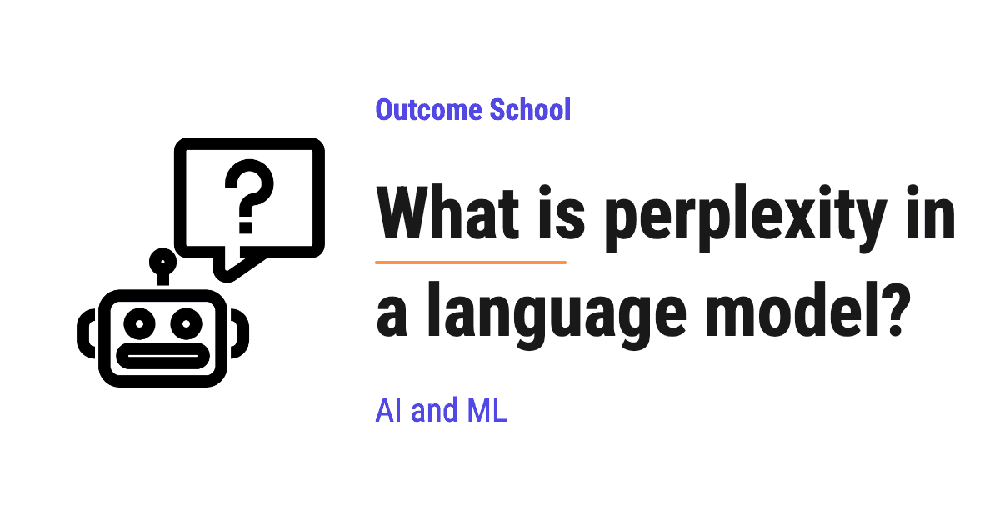

# What is perplexity in a language model?

> Archived from <https://outcomeschool.com/blog/perplexity-in-language-models> on 2026-11-25.

Perplexity is a number that measures how confused a language model is when it predicts the next word. Lower perplexity means the model predicts text better.

In this blog, we will learn about perplexity in a language model. We will also see how a model predicts the next word, why we need a number to grade a model, how perplexity works like a guessing game, a step-by-step example with its formula and code, and why it is called an intrinsic metric.

We will cover the following:
<ul><li>What does &quot;predicting the next word&quot; mean?</li><li>The problem: how do we grade a model?</li><li>What is perplexity?</li><li>Perplexity as a guessing game</li><li>A simple step-by-step example</li><li>The formula behind perplexity</li><li>Low perplexity vs high perplexity</li><li>Why perplexity is called an intrinsic metric</li></ul>
I am <strong>Amit Shekhar</strong>, Founder @ <a target="_blank" rel="noopener noreferrer" href="https://outcomeschool.com">Outcome School</a>, I have taught and mentored many developers, and their efforts landed them high-paying tech jobs, helped many tech companies in solving their unique problems, and created many open-source libraries being used by top companies. I am passionate about sharing knowledge through open-source, blogs, and videos.

I teach <a target="_blank" rel="noopener noreferrer" href="https://outcomeschool.com/program/ai-and-machine-learning">AI and Machine Learning</a> at Outcome School.

Let&#x27;s get started.
<h2 id="what-does-predicting-the-next-word-mean">What does &quot;predicting the next word&quot; mean?</h2>
A <a target="_blank" rel="noopener noreferrer" href="large-language-model-llm.md">language model</a> predicts the next word in a sentence. When it reads a sentence, it does not just pick one single word. Instead, it gives <a target="_blank" rel="noopener noreferrer" href="softmax-function.md">a probability to every possible next word</a>.

A probability is a number between 0 and 1 that tells us how likely something is. A probability of 1 means &quot;fully sure&quot;, and a probability close to 0 means &quot;very unlikely&quot;.

Consider the sentence &quot;The sky is ___&quot;. The model gives probabilities like below:
<table><thead><tr><th>Next word</th><th>Probability</th></tr></thead><tbody><tr><td>blue</td><td>0.70</td></tr><tr><td>clear</td><td>0.15</td></tr><tr><td>falling</td><td>0.05</td></tr><tr><td>banana</td><td>0.001</td></tr></tbody></table>
Here, we can see that the model gives &quot;blue&quot; a high probability of 0.70, and it gives &quot;banana&quot; a tiny probability of 0.001.

This makes sense. &quot;The sky is blue&quot; is common, and &quot;The sky is banana&quot; is not.

So, the model is confident about &quot;blue&quot;. It is not confused. Perplexity measures this confusion.
<h2 id="the-problem-how-do-we-grade-a-model">The problem: how do we grade a model?</h2>
Now, suppose we build ten different language models. Some are good and some are bad.

The big question is: how do we measure which model is better?

We need a single number that tells us how good a model is at predicting text. A low number should mean a good model, and a high number should mean a bad model.

So, here comes perplexity to the rescue.
<h2 id="what-is-perplexity">What is perplexity?</h2>
<strong>Perplexity is a number that measures how confused a language model is when it predicts the next word.</strong>

It tells us how &quot;surprised&quot; the model is when it sees the real next word.

To &quot;perplex&quot; someone means to confuse them. So, perplexity is a measure of confusion.
<ul><li>A low perplexity means the model is confident and rarely surprised. This is good.</li><li>A high perplexity means the model is confused and often surprised. This is bad.</li></ul>
So, we want perplexity to be as low as possible.
<h2 id="perplexity-as-a-guessing-game">Perplexity as a guessing game</h2>
The best way to learn this is by taking an example.

Let&#x27;s say we are playing a guessing game. I show a sentence and hide the next word. We have to guess it.

Now, imagine perplexity as the number of options we are stuck between when we guess.

<pre><code class="language-text code-highlight">Perplexity = 1     -&gt;  We know the exact answer. No confusion.
Perplexity = 2     -&gt;  We are stuck between 2 equally likely words.
Perplexity = 10    -&gt;  We are stuck between 10 equally likely words.
Perplexity = 1000  -&gt;  We are stuck between 1000 words. Very confused.
</code></pre>

Here, we can see that perplexity is like the average number of choices the model feels stuck between at each step.

If the model always knows the answer, its perplexity is close to 1. If the model is guessing between thousands of words, its perplexity is huge.

So, lower perplexity means fewer choices to be confused about, which means a better model.

<strong>Planning your move into AI?</strong>

No matter which tech domain you work in today, with your effort, you can transition to these roles:
<ul><li>AI Engineer</li><li>Forward Deployed Engineer</li><li>AI Agent Engineer</li><li>Harness Engineer</li><li>Voice AI Engineer</li><li>AI Architect</li><li>LLM Engineer</li><li>LLM Inference Engineer</li><li>Gen AI Engineer</li><li>MLOps Engineer</li><li>ML Engineer</li><li>Deep Learning Engineer</li></ul>
Our <a target="_blank" rel="noopener noreferrer" href="https://outcomeschool.com/program/ai-and-machine-learning">AI and Machine Learning Program</a> at Outcome School takes you there.
<h2 id="a-simple-step-by-step-example">A simple step-by-step example</h2>
Let&#x27;s take a real sentence and see how the model reacts. Consider the sentence &quot;I love my dog&quot;.

The model reads it word by word. At each step, it gives a probability to the real next word.

Assume that our model gives these probabilities:
<table><thead><tr><th>Step</th><th>Predicting next word</th><th>Probability</th></tr></thead><tbody><tr><td>Step 1</td><td>I</td><td>0.5</td></tr><tr><td>Step 2</td><td>love</td><td>0.5</td></tr><tr><td>Step 3</td><td>my</td><td>0.5</td></tr><tr><td>Step 4</td><td>dog</td><td>0.5</td></tr></tbody></table>
Here, we can see that the model gave every real word a probability of 0.5. This means the model was, on average, choosing between 2 words at each step.

So, the perplexity here is 2.

Now, let&#x27;s take a better model that gives each real word a probability of 1.0. That model is never surprised. Its perplexity is 1. This is a perfect model.

And, a very bad model that gives each real word a probability of 0.01 would be extremely surprised. Its perplexity would be 100. This model is very confused.

<strong>A quick note for you</strong>

No matter which tech domain you work in, get familiar with these topics:
<ul><li>LLM</li><li>RAG</li><li>MCP</li><li>Agent</li><li>Fine-tuning</li><li>Quantization</li></ul>
We put it all together in one video:

<a target="_blank" rel="noopener noreferrer" href="https://www.youtube.com/watch?v=lnfWvX66FUk">AI Engineering Explained: LLM, RAG, MCP, Agent, Fine-Tuning, and Quantization</a>

No need to stop reading - bookmark it and watch later when you get time. Future you will thank you.

Now, let&#x27;s get back to the topic.
<h2 id="the-formula-behind-perplexity">The formula behind perplexity</h2>
Perplexity is built on one idea: take the probability the model gave to the real words, and turn it into a &quot;number of choices&quot;.

The formula is written like below:

<strong>Perplexity = (1 / P)^(1/N)</strong>

Here:
<ul><li><code>P</code> is the probability the model gave to the whole real text.</li><li><code>N</code> is the number of words (<a target="_blank" rel="noopener noreferrer" href="tokenization-in-llms.md">tokens</a>) in the text.</li></ul>
Here, we can see two parts.

First, <code>1 / P</code> flips the probability. If the probability is small, then <code>1 / P</code> becomes large. A small probability means the model was surprised, so a large value is correct.

Second, the <code>^(1/N)</code> part takes a kind of average across all the words. This is why perplexity feels like an &quot;average number of choices per word&quot;, no matter how long the text is.

In practice, we can compute it in code like below:

<pre><code class="code-highlight language-python">import math

# probabilities the model gave to each real next word
probs = [0.5, 0.5, 0.5, 0.5]

n = len(probs)

# add up the log of each probability
log_sum = 0
for p in probs:
    log_sum = log_sum + math.log(p)

# average log probability, then undo the log
avg_log = log_sum / n
perplexity = math.exp(-avg_log)

print(perplexity)   # prints 2.0
</code></pre>

Here, we have taken the four probabilities. We add their <a target="_blank" rel="noopener noreferrer" href="logprobs-in-llms.md">logarithms</a>, take the average, and flip the sign. Then <code>math.exp</code> turns it back into a normal number.

It prints <code>2.0</code>, which matches our earlier example. The model was choosing between 2 words on average. It works perfectly.

To learn LLM Fundamentals and LLM Internals, and build a Large Language Model (LLM) from scratch, check out our <a target="_blank" rel="noopener noreferrer" href="https://outcomeschool.com/program/ai-and-machine-learning">AI and Machine Learning Program</a> at Outcome School.
<h2 id="low-perplexity-vs-high-perplexity">Low perplexity vs high perplexity</h2>
Let me tabulate the difference between low perplexity and high perplexity for your better understanding.
<table><thead><tr><th>Property</th><th>Low Perplexity</th><th>High Perplexity</th></tr></thead><tbody><tr><td>Model confidence</td><td>High</td><td>Low</td></tr><tr><td>Model surprise</td><td>Rare</td><td>Often</td></tr><tr><td>Prediction skill</td><td>Strong</td><td>Weak</td></tr><tr><td>Meaning</td><td>Good model</td><td>Bad model</td></tr></tbody></table>
So, when we compare two models on the same text, the model with the lower perplexity is the better one at predicting that text. The comparison is fair only when both models are tested on the same text and split the text into the same pieces.

For example, if Model A has a perplexity of 20 and Model B has a perplexity of 45 on the same test text, then Model A is better. It is less confused.

A low perplexity does not always mean the model is good at a real task like answering questions. For that, we also use <a target="_blank" rel="noopener noreferrer" href="llm-evaluation.md">task-based tests</a>, which we will see in the next section.
<h2 id="why-perplexity-is-called-an-intrinsic-metric">Why perplexity is called an intrinsic metric</h2>
Now, let&#x27;s understand one more important word. Perplexity is called an intrinsic metric.

<strong>An intrinsic metric measures the model by itself, without using any outside task.</strong>

In simple words, we do not ask the model to answer questions or write emails to judge it. We only check one thing: how well does it predict the text we give it.

Let&#x27;s compare the two kinds of testing like below:

<pre><code class="language-text code-highlight">Intrinsic test (perplexity):
   Model  -&gt;  predict the next word  -&gt;  measure confusion
   No real-world task needed.

Extrinsic test (task based):
   Model  -&gt;  do a real task (translation, chat)  -&gt;  measure task score
   A real-world task is needed.
</code></pre>

Here, we can see the difference. An intrinsic test looks inside the model at its core skill of prediction. An extrinsic test checks how the model performs on a real job.

Perplexity is intrinsic because it only measures the prediction skill.

Now we must have understood what perplexity is, how it is calculated, and why a lower value means a model predicts text better.

<strong>Stay updated:</strong> Subscribe to our <a target="_blank" rel="noopener noreferrer" href="https://outcomeschool.substack.com/subscribe">newsletter</a> to get our latest AI and Machine Learning blogs straight to your inbox.
<h2 id="frequently-asked-questions">Frequently Asked Questions</h2><h3 id="is-a-lower-perplexity-always-better">Is a lower perplexity always better?</h3>
Yes, when we compare models on the same text. A lower perplexity means the model is less confused and rarely surprised, so it predicts that text better. For example, if Model A has a perplexity of 20 and Model B has a perplexity of 45 on the same test text, then Model A is better.
<h3 id="what-is-the-lowest-possible-perplexity">What is the lowest possible perplexity?</h3>
The lowest possible perplexity is 1. A perplexity of 1 means the model gives every real word a probability of 1.0, so it is never surprised. This is a perfect model that always knows the exact next word.
<h3 id="can-we-compare-perplexity-across-any-two-models">Can we compare perplexity across any two models?</h3>
No. The comparison is fair only when both models are tested on the same text and split the text into the same pieces. If the test text or the way it is split into pieces is different, the perplexity numbers cannot be compared directly.
<h3 id="does-a-low-perplexity-mean-the-model-is-good-at-real-tasks">Does a low perplexity mean the model is good at real tasks?</h3>
No. A low perplexity does not always mean the model is good at a real task like answering questions. Perplexity is an intrinsic metric that only measures the prediction skill. To check real jobs like translation or chat, we also use extrinsic, task-based tests that measure a task score.

That&#x27;s it for now.

Thanks

<strong>Amit Shekhar</strong> Founder @ <a target="_blank" rel="noopener noreferrer" href="https://outcomeschool.com">Outcome School</a>

You can connect with me on:
<ul><li><a target="_blank" rel="noopener noreferrer" href="https://x.com/amitiitbhu">X</a></li><li><a target="_blank" rel="noopener noreferrer" href="https://www.linkedin.com/in/amit-shekhar-iitbhu">LinkedIn</a></li><li><a target="_blank" rel="noopener noreferrer" href="https://github.com/amitshekhariitbhu">GitHub</a></li></ul>
Follow Outcome School on:
<ul><li><a target="_blank" rel="noopener noreferrer" href="https://x.com/outcome_school">X</a></li><li><a target="_blank" rel="noopener noreferrer" href="https://youtube.com/@OutcomeSchool">YouTube</a></li><li><a target="_blank" rel="noopener noreferrer" href="https://www.linkedin.com/company/outcomeschool">LinkedIn</a></li><li><a target="_blank" rel="noopener noreferrer" href="http://github.com/OutcomeSchool">GitHub</a></li></ul>
<a target="_blank" rel="noopener noreferrer" href="https://outcomeschool.com/blog"><strong>Read all of our high-quality blogs here.</strong></a>

