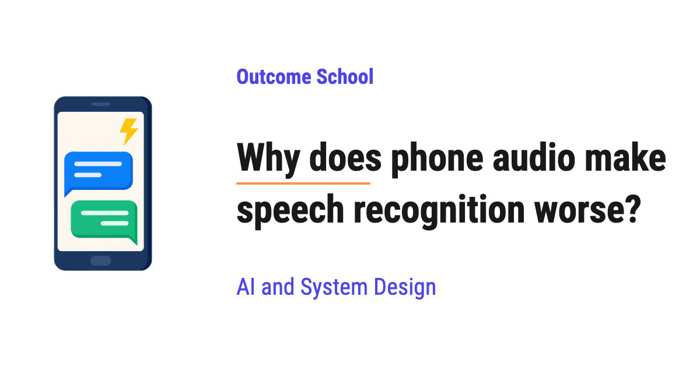

# Why does phone audio make speech recognition worse?

> Archived from <https://outcomeschool.com/blog/phone-audio-and-speech-recognition> on 2026-11-25.

Phone audio makes speech recognition worse because a phone call throws away a big part of our voice before it reaches the model. The call cuts off the high sounds, compresses the audio heavily, loses small pieces on a bad network, and picks up background noise, so the model gets a thinner, damaged version of what we said.

In this blog, we will learn about why phone audio makes speech recognition worse. We will also see how our voice travels over a phone call, why the phone cuts off the high sounds of our voice, how compression and lost packets damage the audio further, how noise and echo add to the problem, why a model trained on clean audio struggles with phone audio, and what we can do to make speech recognition work better on phone calls.

We will cover the following:
<ul><li>What is Speech Recognition?</li><li>How Does Our Voice Travel Over a Phone Call?</li><li>Reason 1: The Phone Cuts Off the High Sounds</li><li>Reason 2: Compression Throws Away More Detail</li><li>Reason 3: Lost Packets Leave Holes in the Audio</li><li>Reason 4: Noise, Echo, and Small Microphones</li><li>Reason 5: The Model Learned From Different Audio</li><li>How All the Problems Stack Up</li><li>How to Make Speech Recognition Work Better on Phone Audio</li></ul>
I am <strong>Amit Shekhar</strong>, Founder @ <a target="_blank" rel="noopener noreferrer" href="https://outcomeschool.com">Outcome School</a>, I have taught and mentored many developers, and their efforts landed them high-paying tech jobs, helped many tech companies in solving their unique problems, and created many open-source libraries being used by top companies. I am passionate about sharing knowledge through open-source, blogs, and videos.

I teach <a target="_blank" rel="noopener noreferrer" href="https://outcomeschool.com/program/ai-and-machine-learning">AI and Machine Learning</a> at Outcome School.

Let&#x27;s get started.
<h2 id="what-is-speech-recognition">What is Speech Recognition?</h2>
<strong>Speech Recognition is the task of turning spoken audio into written text.</strong> It is also called <strong>ASR</strong>, which stands for Automatic Speech Recognition.

When we talk to a <a target="_blank" rel="noopener noreferrer" href="design-a-real-time-voice-ai-agent.md">voice agent</a>, the first thing the agent does is run speech recognition on our voice. It converts &quot;I want to book a table for two&quot; from sound into text. Then, the rest of the agent reads that text and decides what to do.

So, if speech recognition gets a word wrong, the rest of the agent works with the wrong text. If the model hears &quot;sixty&quot; when we said &quot;fifty&quot;, the agent acts on the wrong number.

The model only sees the numbers that represent the sound wave. If those numbers are missing some information, the model has less to work with. Now, the question is: what happens to those numbers on a phone call?
<h2 id="how-does-our-voice-travel-over-a-phone-call">How Does Our Voice Travel Over a Phone Call?</h2>
Let&#x27;s say we <a target="_blank" rel="noopener noreferrer" href="phone-calls-in-voice-agents.md">call a voice agent from our mobile phone</a>. Our voice goes through many steps before the model sees it.

The journey of our voice looks like below:

<pre><code class="code-highlight">+-----------------------------+
| We speak into the phone     |
+-----------------------------+
              ↓
+-----------------------------+
| Small microphone picks it   |
| up, with background noise   |
+-----------------------------+
              ↓
+-----------------------------+
| Phone keeps only the        |
| 300 Hz to 3400 Hz sounds    |
+-----------------------------+
              ↓
+-----------------------------+
| Codec squeezes the audio    |
| into very few bits          |
+-----------------------------+
              ↓
+-----------------------------+
| Network carries it, and     |
| some pieces get lost        |
+-----------------------------+
              ↓
+-----------------------------+
| Speech recognition model    |
| receives the damaged audio  |
+-----------------------------+
</code></pre>

Here, we can see that the audio is changed at almost every step. Let&#x27;s understand each of these steps one by one.
<h2 id="reason-1-the-phone-cuts-off-the-high-sounds">Reason 1: The Phone Cuts Off the High Sounds</h2>
Before jumping into this, we must know what a frequency is.

Our voice is made of many vibrations happening together. Some vibrations are slow, and we hear them as low sounds, like a deep hum. Some vibrations are fast, and we hear them as high sounds, like a hiss. The speed of a vibration is called its <strong>frequency</strong>, and it is measured in <strong>Hz</strong> (Hertz), which means vibrations per second. 1 kHz is 1000 Hz.

Human speech has sounds spread from below 100 Hz all the way up to around 8000 Hz and beyond.

Now, a traditional phone call keeps only the sounds between about <strong>300 Hz and 3400 Hz</strong>. Everything below 300 Hz and everything above 3400 Hz is cut off. This is called <strong>narrowband</strong> audio.

The phone network was designed decades ago, when sending sound was expensive. People can still understand each other with only this middle band, so the network kept only this band and saved a lot of space.

This band is also tied to the <strong><a target="_blank" rel="noopener noreferrer" href="sample-rates-for-voice-agents.md">sample rate</a></strong>. The sample rate is how many times per second the sound wave is measured and stored as a number. A phone call uses a sample rate of <strong>8 kHz</strong>, which means 8000 measurements per second. A sample rate can only hold sounds up to half of itself. So, 8 kHz can hold sounds only up to 4 kHz, and the phone band stops a little before that, at 3400 Hz.

Speech recognition models usually expect <strong>16 kHz</strong> audio, which holds sounds up to 8 kHz. So, a phone call gives the model less than half of the range of sounds it expects.

Let me tabulate the difference between phone audio and the audio a model usually expects for your better understanding.
<table><thead><tr><th>Property</th><th>Phone audio (narrowband)</th><th>Typical model input (wideband)</th></tr></thead><tbody><tr><td>Sample rate</td><td>8 kHz</td><td>16 kHz</td></tr><tr><td>Highest sound kept</td><td>about 3.4 kHz</td><td>about 8 kHz</td></tr><tr><td>Lowest sound kept</td><td>about 300 Hz</td><td>close to 0 Hz</td></tr><tr><td>Sounds like &quot;s&quot;, &quot;f&quot;</td><td>mostly lost</td><td>kept</td></tr></tbody></table>
Now, the next big question is: which parts of our speech live above 3400 Hz?

The answer is: many of the consonants. Sounds like &quot;s&quot;, &quot;f&quot;, &quot;th&quot;, &quot;sh&quot;, and &quot;z&quot; are hissing sounds. A large part of their energy sits above 4000 Hz. The &quot;s&quot; sound especially has most of its energy in the high range.

When the phone cuts off the high range, these sounds become weak and sound similar to each other. Let&#x27;s say we say &quot;fat&quot; and &quot;sat&quot; on the phone. The &quot;f&quot; and the &quot;s&quot; both lose their high part, and what remains in both is a faint noise. The two words become hard to tell apart.

This is why on a phone call, we often say &quot;S as in Sugar&quot; or &quot;F as in Frank&quot;. People struggle with the same problem. The model struggles too, but it cannot ask &quot;Did you say F or S?&quot; unless we build that into the agent.

Some common confusions on phone audio:
<ul><li>&quot;fifty&quot; and &quot;sixty&quot;</li><li>&quot;f&quot; and &quot;s&quot; when spelling a name or an email</li><li>&quot;fin&quot; and &quot;thin&quot;</li><li>&quot;mass&quot; and &quot;math&quot;</li></ul>
These are exactly the words that matter most for a voice agent: numbers, names, email addresses, and account IDs. The model can use context to guess a word, but for a random name or a number, there is no context to help.

<strong>Planning your move into AI?</strong>

No matter which tech domain you work in today, with your effort, you can transition to these roles:
<ul><li>AI Engineer</li><li>Forward Deployed Engineer</li><li>AI Agent Engineer</li><li>Harness Engineer</li><li>Voice AI Engineer</li><li>AI Architect</li><li>LLM Engineer</li><li>LLM Inference Engineer</li><li>Gen AI Engineer</li><li>MLOps Engineer</li><li>ML Engineer</li><li>Deep Learning Engineer</li></ul>
Our <a target="_blank" rel="noopener noreferrer" href="https://outcomeschool.com/program/ai-and-machine-learning">AI and Machine Learning Program</a> at Outcome School takes you there.
<h2 id="reason-2-compression-throws-away-more-detail">Reason 2: Compression Throws Away More Detail</h2>
Cutting the band is only the first step. After that, the audio is compressed by a <strong>codec</strong>.

A <strong>codec</strong> is a piece of software that shrinks audio so that it takes less space on the network, and then expands it back on the other side. Codec = Coder + Decoder.

Let&#x27;s see how much space the audio takes. One second of 16 kHz audio, stored with 16 bits per sample, takes 256,000 bits. The classic phone codec, called <strong>G.711</strong>, uses 8 kHz and 8 bits per sample, which comes to 64,000 bits per second. Mobile calls squeeze it even more. The <strong>AMR</strong> codec used on many mobile calls runs at only about 4,750 to 12,200 bits per second.
<table><thead><tr><th>Audio type</th><th>Bits per second</th></tr></thead><tbody><tr><td>16 kHz, 16-bit (model input)</td><td>256,000</td></tr><tr><td>G.711 phone call</td><td>64,000</td></tr><tr><td>AMR mobile call</td><td>about 4,750 to 12,200</td></tr></tbody></table>
Here, we can see that a mobile call carries about 20 to 50 times less data than the audio the model is used to.

To shrink the audio this much, the codec has to throw away details. Mobile codecs like AMR are designed so that a person can still understand the speech. They keep what the human ear cares about and drop the rest. But, small details that help the model tell two sounds apart can disappear.

The codec also adds its own small distortions, called <strong>artifacts</strong>. The voice can sound a little robotic, buzzy, or muffled. A person easily ignores this. A model that never heard this kind of sound during training gets confused by it.

Now, there is one more problem. A call often crosses more than one network. For example, our mobile call can go from a mobile network to a landline network and then to the voice agent&#x27;s server. At each boundary, the audio can be decoded and encoded again with a different codec. This is called <strong>transcoding</strong>. Each round of transcoding adds a little more damage, just like making a photocopy of a photocopy.
<h2 id="reason-3-lost-packets-leave-holes-in-the-audio">Reason 3: Lost Packets Leave Holes in the Audio</h2>
Now, let&#x27;s understand what happens on the network.

On a modern mobile or internet call, the audio is cut into small pieces, usually <a target="_blank" rel="noopener noreferrer" href="audio-frames-and-chunk-sizes.md">20 milliseconds each</a>, and each piece is sent as a <strong>packet</strong>. A packet is a small bundle of data that travels across the network by itself. We have a detailed blog on <a target="_blank" rel="noopener noreferrer" href="sip-and-rtp.md">how SIP and RTP carry a phone call to a voice agent</a> that explains how these packets travel step by step.

On a weak mobile signal, <a target="_blank" rel="noopener noreferrer" href="jitter-buffer.md">some packets arrive late</a>, and some never arrive at all. A packet that arrives too late is treated as lost, because the call cannot wait for it.

When a packet is lost, there is a hole in the audio. The phone system does not leave silence there, because sudden silence sounds like the call has dropped. Instead, it uses <strong><a target="_blank" rel="noopener noreferrer" href="packet-loss-concealment.md">packet loss concealment</a></strong>, which means it makes up a guess of what the missing sound was, usually by stretching or repeating the sound just before the hole.

Let&#x27;s say we say &quot;My account number is 4 7 2 9&quot;, and two packets in the middle of the &quot;7&quot; are lost. The system fills those 40 milliseconds with a stretched copy of the sound just before the gap. A person hears a tiny glitch. The model hears a broken &quot;7&quot;, and it can write &quot;4 1 2 9&quot; or skip the digit completely.

So, the model is now not only getting less information. It is also getting made-up sound that was added to fill the gaps.

<strong>A quick note for you</strong>

No matter which tech domain you work in, get familiar with these topics:
<ul><li>LLM</li><li>RAG</li><li>MCP</li><li>Agent</li><li>Fine-tuning</li><li>Quantization</li></ul>
We put it all together in one video:

<a target="_blank" rel="noopener noreferrer" href="https://www.youtube.com/watch?v=lnfWvX66FUk">AI Engineering Explained: LLM, RAG, MCP, Agent, Fine-Tuning, and Quantization</a>

No need to stop reading - bookmark it and watch later when you get time. Future you will thank you.

Now, let&#x27;s get back to the topic.
<h2 id="reason-4-noise-echo-and-small-microphones">Reason 4: Noise, Echo, and Small Microphones</h2>
Phone calls happen everywhere: on the street, in a car, in a busy shop. A phone microphone is small and it picks up everything around us.

So, along with our voice, the model receives:
<ul><li><strong>Background noise:</strong> traffic, fans, other people talking, music.</li><li><strong>Echo:</strong> on a speakerphone, the agent&#x27;s voice comes out of the speaker and goes back into the microphone, mixed with ours.</li><li><strong>Distance:</strong> when the phone is far from the mouth, our voice becomes quieter and the room&#x27;s sound becomes louder.</li></ul>
Phones also clean up the audio before sending it with <a target="_blank" rel="noopener noreferrer" href="interruption-vs-background-noise.md">noise suppression, echo cancellation</a>, and automatic volume control. These help the person on the other side, but they also change the voice. Strong noise suppression can cut off the start or end of a soft word, or remove a quiet &quot;s&quot; because it looks like noise.

The phone band has already removed the high part of &quot;s&quot; and &quot;f&quot;, so what is left is weak and noise-like. The noise suppression then removes it too.
<h2 id="reason-5-the-model-learned-from-different-audio">Reason 5: The Model Learned From Different Audio</h2>
Now, let&#x27;s understand the last reason. A speech recognition model learns by listening to a huge amount of audio along with the correct text. It becomes good at the kind of audio it hears during training.

Many large speech recognition models are trained mostly on wideband audio: podcasts, videos, audiobooks, and recordings made with good microphones. This audio is usually clean and full, with the high sounds present.

When such a model gets phone audio, the audio looks unfamiliar to it. The difference between the audio a model was trained on and the audio it gets in real use is called a <strong>domain mismatch</strong>.

Suppose a person learned English only by watching movies with clear sound. Now, we put the same person on a crackly phone line with traffic in the background. The person knows English very well, but the sound is so different from what they practiced on that they miss many words. The model has the same problem.

Here, we often do a mistake. Many models expect 16 kHz input, so we <strong>upsample</strong> the 8 kHz phone audio to 16 kHz before giving it to the model, and we expect it to become as good as real 16 kHz audio. Upsampling means adding extra in-between samples so that the audio has 16,000 samples per second.

But, upsampling does not bring back the lost sounds. The audio now has the right sample rate, but everything above 4 kHz is still empty, because that information was thrown away at the start of the call. The model gets 16 kHz audio with the top half silent, which is not what most of its training audio looks like.

<strong>No processing step can recover the sounds that the phone call has already thrown away.</strong>

To learn AI and ML System Design and how to Design a Real-Time Voice AI Agent, from the audio that reaches the model to the reply it speaks back, check out our <a target="_blank" rel="noopener noreferrer" href="https://outcomeschool.com/program/ai-and-machine-learning">AI and Machine Learning Program</a> at Outcome School.
<h2 id="how-all-the-problems-stack-up">How All the Problems Stack Up</h2>
On a real call, all of these reasons happen together, one after another.

Let&#x27;s follow the word &quot;fifty&quot; through a phone call as below:

<pre><code class="code-highlight">+------------------------------------------+
| We say &quot;fifty&quot; clearly                   |
+------------------------------------------+
                     ↓
+------------------------------------------+
| Phone band cuts the high part of &quot;f&quot;     |
| The &quot;f&quot; becomes faint                    |
+------------------------------------------+
                     ↓
+------------------------------------------+
| Noise suppression treats the faint &quot;f&quot;   |
| like noise and weakens it further        |
+------------------------------------------+
                     ↓
+------------------------------------------+
| Codec drops more detail                  |
| The weak &quot;f&quot; gets fuzzier                |
+------------------------------------------+
                     ↓
+------------------------------------------+
| A packet is lost in the middle           |
| A guessed sound fills the gap            |
+------------------------------------------+
                     ↓
+------------------------------------------+
| Model trained on clean audio hears       |
| something between &quot;fifty&quot; and &quot;sixty&quot;    |
+------------------------------------------+
</code></pre>

Here, we can notice that no single step destroyed the word. Each step made it a little worse, and together they made it hard to recognize. This is why the same model can work very well on a clean laptop recording and much worse on a phone call, even for the same person saying the same sentence.

<strong>Stay updated:</strong> Subscribe to our <a target="_blank" rel="noopener noreferrer" href="https://outcomeschool.substack.com/subscribe">newsletter</a> to get our latest AI and Machine Learning blogs straight to your inbox.
<h2 id="how-to-make-speech-recognition-work-better-on-phone-audio">How to Make Speech Recognition Work Better on Phone Audio</h2>
Now, let&#x27;s see what we can do about it. We cannot bring back the lost sounds. But, we can make the model better at handling phone audio, and we can design the agent around the weak spots.

<strong>Use a model that is trained on phone audio.</strong> Many speech recognition providers offer models tuned for phone calls. If we train our own model, we can take clean training audio and make it sound like phone audio: cut it to the 300 Hz to 3400 Hz band, pass it through a phone codec, and add noise. This is called <strong><a target="_blank" rel="noopener noreferrer" href="data-augmentation.md">data augmentation</a></strong>, and it teaches the model what phone audio sounds like.

<strong>Send the audio in the right format.</strong> If the model supports 8 kHz input directly, we must send 8 kHz and tell the model the correct sample rate. If the model needs 16 kHz, we must upsample properly with a good resampler. Telling the model the wrong sample rate makes the voice sound too fast or too slow, and recognition fails badly.

<strong>Use wideband audio when we can.</strong> Many mobile networks now support <strong>HD Voice</strong>, which uses a wideband codec called <strong>AMR-WB</strong> at 16 kHz and keeps sounds up to about 7000 Hz. But, HD Voice works only when both phones and every network on the way support it. Otherwise, the call falls back to narrowband. If the user talks to our agent through an <a target="_blank" rel="noopener noreferrer" href="webrtc-vs-websocket-for-voice-ai.md">app or a web page</a> instead of a normal phone number, we can use a codec like <strong><a target="_blank" rel="noopener noreferrer" href="opus-codec.md">Opus</a></strong>, which can keep even more of the voice. More of the voice reaches the model, and recognition improves.

<strong>Give the model hints.</strong> Many speech recognition systems let us pass a list of words we expect, such as product names, city names, or menu items. The model then prefers those words when the audio is unclear. This is often called <strong>keyword boosting</strong>.

<strong>Design the conversation for the weak spots.</strong> <a target="_blank" rel="noopener noreferrer" href="structured-inputs-in-voice-agents.md">Numbers, names, and email addresses</a> suffer the most on phone audio. So, we can do the following:
<ul><li>Read important numbers back to the user and <a target="_blank" rel="noopener noreferrer" href="confirm-and-correct-in-voice-agents.md">ask them to confirm</a>.</li><li>Ask the user to say digits one by one instead of as a big number.</li><li>Ask for spelling with a word for each letter, like &quot;S as in Sugar&quot;.</li><li>Use the <a target="_blank" rel="noopener noreferrer" href="dtmf-in-voice-agents.md">keypad</a> for things like account numbers and PINs when possible.</li></ul>
<strong>Be careful with extra cleanup.</strong> Strong noise suppression before the model can remove parts of the speech, as we saw in Reason 4. We must test the model with and without it on real phone calls and keep whichever gives fewer mistakes.

<strong>Test on real phone audio.</strong> We must measure accuracy on real phone recordings, from real networks, with real background noise, not only on a clean test set.

Now we must have understood why phone audio makes speech recognition worse, how each step of a phone call damages our voice, and what we can do to make speech recognition work better on phone calls.
<h2 id="frequently-asked-questions">Frequently Asked Questions</h2><h3 id="what-sample-rate-does-a-phone-call-use">What sample rate does a phone call use?</h3>
A traditional phone call uses a sample rate of 8 kHz, which means 8000 measurements of the sound wave per second. An 8 kHz sample rate can hold sounds only up to 4 kHz, and the phone band keeps only the sounds between about 300 Hz and 3400 Hz. This is called narrowband audio.
<h3 id="does-upsampling-phone-audio-to-16-khz-improve-speech-recognition">Does upsampling phone audio to 16 kHz improve speech recognition?</h3>
No. Upsampling 8 kHz phone audio to 16 kHz does not bring back the lost sounds. It only adds extra in-between samples, so the audio has the right sample rate, but everything above 4 kHz is still empty. The model gets 16 kHz audio with the top half silent, which is not what most of its training audio looks like.
<h3 id="why-do-voice-agents-confuse-fifty-and-sixty-on-phone-calls">Why do voice agents confuse &quot;fifty&quot; and &quot;sixty&quot; on phone calls?</h3>
Voice agents confuse &quot;fifty&quot; and &quot;sixty&quot; because the &quot;f&quot; and &quot;s&quot; sounds keep a large part of their energy in the high range that the phone cuts off. What remains of both is a faint noise, so the two sounds become hard to tell apart. Noise suppression, the codec, and lost packets can weaken them further.
<h3 id="does-hd-voice-fix-speech-recognition-on-phone-calls">Does HD Voice fix speech recognition on phone calls?</h3>
HD Voice helps, but only when both phones and every network on the way support it. It uses a wideband codec called AMR-WB at 16 kHz and keeps sounds up to about 7000 Hz, so more of the voice reaches the model. If any part of the path does not support it, the call falls back to narrowband.
<h3 id="should-we-use-noise-suppression-before-speech-recognition-on-phone-audio">Should we use noise suppression before speech recognition on phone audio?</h3>
Not always. Strong noise suppression can cut off the start or end of a soft word, or remove a quiet &quot;s&quot; because it looks like noise. We must test the model with and without it on real phone calls and keep whichever gives fewer mistakes.

That&#x27;s it for now.

Thanks

<strong>Amit Shekhar</strong> Founder @ <a target="_blank" rel="noopener noreferrer" href="https://outcomeschool.com">Outcome School</a>

You can connect with me on:
<ul><li><a target="_blank" rel="noopener noreferrer" href="https://x.com/amitiitbhu">X</a></li><li><a target="_blank" rel="noopener noreferrer" href="https://www.linkedin.com/in/amit-shekhar-iitbhu">LinkedIn</a></li><li><a target="_blank" rel="noopener noreferrer" href="https://github.com/amitshekhariitbhu">GitHub</a></li></ul>
Follow Outcome School on:
<ul><li><a target="_blank" rel="noopener noreferrer" href="https://x.com/outcome_school">X</a></li><li><a target="_blank" rel="noopener noreferrer" href="https://youtube.com/@OutcomeSchool">YouTube</a></li><li><a target="_blank" rel="noopener noreferrer" href="https://www.linkedin.com/company/outcomeschool">LinkedIn</a></li><li><a target="_blank" rel="noopener noreferrer" href="http://github.com/OutcomeSchool">GitHub</a></li></ul>
<a target="_blank" rel="noopener noreferrer" href="https://outcomeschool.com/blog"><strong>Read all of our high-quality blogs here.</strong></a>

