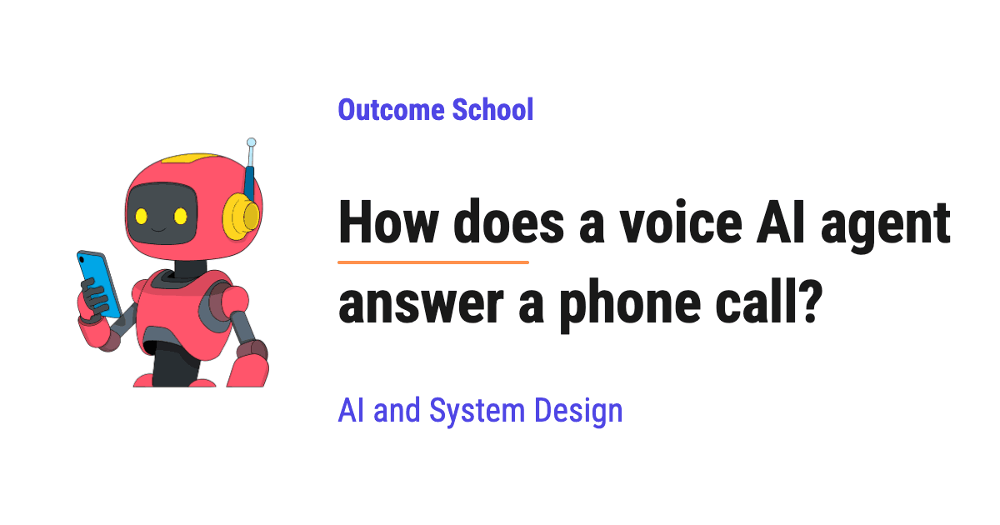

# How does a voice AI agent answer a phone call?

> Archived from <https://outcomeschool.com/blog/phone-calls-in-voice-agents> on 2026-11-25.

A voice AI agent answers a phone call by receiving the call from the phone network through a telephony provider and getting the caller&#x27;s voice as a live stream of small audio chunks. It turns that voice into text, decides on a reply with an LLM, turns the reply back into voice, and sends it back into the same call.

In this blog, we will learn about how a voice AI agent answers a phone call. We will also see how a call travels from the caller&#x27;s phone to our server, what the phone number and the telephony provider do, how the caller&#x27;s voice reaches our agent as a stream of audio chunks, how the agent listens, thinks, and speaks back into the call, how it handles interruptions, and how the call ends or gets transferred to a human.

We will cover the following:
<ul><li>What is a voice AI agent on a phone call?</li><li>The journey of a phone call</li><li>Step 1: The caller dials a phone number</li><li>Step 2: The telephony provider receives the call</li><li>Step 3: Our server decides what to do with the call</li><li>Step 4: The caller&#x27;s voice reaches our agent</li><li>Step 5: The agent listens, thinks, and speaks</li><li>Step 6: The agent&#x27;s voice goes back into the call</li><li>Handling interruptions on a phone call</li><li>How the call ends</li></ul>
I am <strong>Amit Shekhar</strong>, Founder @ <a target="_blank" rel="noopener noreferrer" href="https://outcomeschool.com">Outcome School</a>, I have taught and mentored many developers, and their efforts landed them high-paying tech jobs, helped many tech companies in solving their unique problems, and created many open-source libraries being used by top companies. I am passionate about sharing knowledge through open-source, blogs, and videos.

I teach <a target="_blank" rel="noopener noreferrer" href="https://outcomeschool.com/program/ai-and-machine-learning">AI and Machine Learning</a> at Outcome School.

Let&#x27;s get started.
<h2 id="what-is-a-voice-ai-agent-on-a-phone-call">What is a voice AI agent on a phone call?</h2>
<strong>A voice AI agent on a phone call is a system that picks up a real phone call, listens to the caller, understands what they want, and talks back in a natural voice, without any human on our side of the call.</strong>

Let&#x27;s say we call a clinic to book an appointment. A voice says, &quot;Hello, thank you for calling. How can I help you?&quot; We say, &quot;I want to book an appointment for tomorrow.&quot; The voice replies, &quot;Sure, I have a slot at 11 AM. Does that work?&quot;

There is no receptionist here. The one talking to us is a voice AI agent.

From the caller&#x27;s side, it feels like a normal phone call. But, behind that call, the caller&#x27;s voice leaves their phone, travels through the phone network, reaches our server, gets understood by AI models, and a reply comes back, often in around a second. We have a detailed blog on <a target="_blank" rel="noopener noreferrer" href="design-a-real-time-voice-ai-agent.md">how to design a real-time voice AI agent</a> that covers the full system end to end.

So, the question is: how does a normal phone call, which was built for humans talking to humans, reach an AI agent running on our server?

The best way to learn this is by following one phone call from start to end.
<h2 id="the-journey-of-a-phone-call">The journey of a phone call</h2>
Let&#x27;s see the full journey in one diagram.

<pre><code class="code-highlight">+----------------------------+
|  Caller&#x27;s phone            |
+----------------------------+
              ↓
+----------------------------+
|  Phone network             |
+----------------------------+
              ↓
+----------------------------+
|  Telephony provider        |
+----------------------------+
              ↓
+----------------------------+
|  Our server (the agent)    |
|  Listen -&gt; Think -&gt; Speak  |
+----------------------------+
              ↓
+----------------------------+
|  Telephony provider        |
+----------------------------+
              ↓
+----------------------------+
|  Phone network             |
+----------------------------+
              ↓
+----------------------------+
|  Caller&#x27;s phone            |
+----------------------------+
</code></pre>

Here, we can see that the caller&#x27;s voice travels through the phone network and the telephony provider to our server. Then, the agent&#x27;s voice travels back through the same provider and the same phone network to the caller. Both directions stay open at the same time for the whole call.

Now, let&#x27;s understand each step one by one.
<h2 id="step-1-the-caller-dials-a-phone-number">Step 1: The caller dials a phone number</h2>
When we build a voice AI agent for phone calls, we first buy a phone number from a <strong>telephony provider</strong>.

<strong>A telephony provider is a company that connects the normal phone network to the internet, so that our software can make and receive real phone calls.</strong>

The normal phone network is the traditional network that connects landline and mobile phones around the world. It is called the <strong>PSTN</strong>, which stands for Public Switched Telephone Network. Our server, on the other hand, lives on the internet. These two worlds do not talk to each other directly.

Here comes the telephony provider into the picture. It sits between the phone network and the internet, and it translates between them.

Now, a caller dials that number from their mobile phone. The phone network looks at the number and finds out that this number belongs to our telephony provider. So, the phone network sends the call to the telephony provider.
<h2 id="step-2-the-telephony-provider-receives-the-call">Step 2: The telephony provider receives the call</h2>
Now, the call has reached the telephony provider. The provider does not know what to do with this call yet. It can play a message, forward the call, or connect it to an AI agent. So, the provider asks our server.

When we set up the phone number, we give the provider a URL of our server. This URL is called a <strong>webhook</strong>.

<strong>A webhook is a URL on our server to which the provider sends a request automatically whenever something happens, like a new incoming call.</strong>

So, when the call arrives, the provider sends a web request to our webhook. This request carries details about the call, like the number of the caller, the number that was dialed, and a unique ID for this call.

Let&#x27;s say the request looks like below:

<pre><code class="language-json code-highlight">{ &quot;call_id&quot;: &quot;CA123&quot;, &quot;from&quot;: &quot;+15551234567&quot;, &quot;to&quot;: &quot;+15559876543&quot; }
</code></pre>

Here, we can see that the provider tells us who is calling, which of our numbers they dialed, and the ID it will use for this call from now on.

There is a second common way to connect a call to our system. Instead of a webhook, the call can be sent over <strong><a target="_blank" rel="noopener noreferrer" href="sip-and-rtp.md">SIP</a></strong>, which stands for Session Initiation Protocol. SIP is the standard way to start, manage, and end voice calls over the internet. In this setup, the provider forwards the call to a SIP server on our side, which turns the call audio into a stream for our agent. The rest of the idea stays the same. For the sake of understanding, we will follow the webhook path in this blog.

<strong>Planning your move into AI?</strong>

No matter which tech domain you work in today, with your effort, you can transition to these roles:
<ul><li>AI Engineer</li><li>Forward Deployed Engineer</li><li>AI Agent Engineer</li><li>Harness Engineer</li><li>Voice AI Engineer</li><li>AI Architect</li><li>LLM Engineer</li><li>LLM Inference Engineer</li><li>Gen AI Engineer</li><li>MLOps Engineer</li><li>ML Engineer</li><li>Deep Learning Engineer</li></ul>
Our <a target="_blank" rel="noopener noreferrer" href="https://outcomeschool.com/program/ai-and-machine-learning">AI and Machine Learning Program</a> at Outcome School takes you there.
<h2 id="step-3-our-server-decides-what-to-do-with-the-call">Step 3: Our server decides what to do with the call</h2>
Now, our server has received the webhook request. It must reply with instructions for the provider. For a voice AI agent, our server replies with two instructions:
<ul><li>Answer the call.</li><li>Open a live audio connection to an address on our server, like <code>wss://example.com/call-audio</code>.</li></ul>
This live audio connection is usually a <a target="_blank" rel="noopener noreferrer" href="webrtc-vs-websocket-for-voice-ai.md"><strong>WebSocket</strong></a>.

<strong>A WebSocket is a connection between two computers that stays open, so that both sides can keep sending data to each other at any time.</strong>

A normal web request is like sending a letter and waiting for a reply. A WebSocket is like an open phone line between two computers. This is exactly what we need for a live call, because the caller keeps talking, and the agent keeps replying.

So, the provider answers the call, and opens a WebSocket connection to our server. Now, the caller is connected to our agent.
<h2 id="step-4-the-callers-voice-reaches-our-agent">Step 4: The caller&#x27;s voice reaches our agent</h2>
Now, the caller starts speaking. Let&#x27;s see how their voice reaches our agent.

The provider does not wait for the caller to finish a sentence. It sends the voice to us as it happens, in small pieces. Each piece is called an <a target="_blank" rel="noopener noreferrer" href="audio-frames-and-chunk-sizes.md"><strong>audio chunk</strong></a> or an <strong>audio frame</strong>.

On a phone call, each chunk usually carries <strong>20 milliseconds</strong> of sound. Means, every second of the call arrives as 50 small chunks, one after another, even when the caller is silent.

Let&#x27;s say the caller says, &quot;I want to book an appointment.&quot; This takes around 2 seconds to say. So, our server receives around 100 small chunks, one every 20 milliseconds, while the caller is still talking.

Now, the next question is: what does each chunk look like?

The audio that reaches our server is usually in an old and simple phone format. The sound is measured <strong>8,000 times per second</strong>, which is called a <a target="_blank" rel="noopener noreferrer" href="sample-rates-for-voice-agents.md">sample rate</a> of <strong>8 kHz</strong>. Each measured value is squeezed into <strong>1 byte</strong> using a method called <strong>mu-law</strong> (written as μ-law). This format is part of a standard called <strong>G.711</strong>, and it has been used in telephone networks for decades. Some networks use a very similar method called <strong>A-law</strong>, but the idea is the same.

So, the math for one chunk is as below:

<strong>8,000 samples per second * 0.02 seconds = 160 samples = 160 bytes</strong>

Means, each 20-millisecond chunk is just 160 bytes of audio.

The provider wraps each chunk inside a small message and sends it over the WebSocket. Before that, it converts the audio bytes into text using <strong>base64</strong> encoding, so that they can travel inside a text message.

A media message looks like below:

<pre><code class="language-json code-highlight">{ &quot;event&quot;: &quot;media&quot;, &quot;call_id&quot;: &quot;CA123&quot;, &quot;payload&quot;: &quot;fn5+fn5+...&quot; }
</code></pre>

Here, we can see that:
<ul><li><code>event</code> tells us that this message carries audio.</li><li><code>call_id</code> tells us which call this audio belongs to.</li><li><code>payload</code> is the 20 milliseconds of caller audio, encoded as base64 text.</li></ul>
Apart from the audio messages, the provider also sends a message when the stream starts and when it stops. We have a detailed blog on <a target="_blank" rel="noopener noreferrer" href="dtmf-in-voice-agents.md">how DTMF keypad input works in a voice agent</a> that explains how the key presses of the caller reach our agent.

Now, our server has a steady stream of the caller&#x27;s voice.

<strong>A quick note for you</strong>

No matter which tech domain you work in, get familiar with these topics:
<ul><li>LLM</li><li>RAG</li><li>MCP</li><li>Agent</li><li>Fine-tuning</li><li>Quantization</li></ul>
We put it all together in one video:

<a target="_blank" rel="noopener noreferrer" href="https://www.youtube.com/watch?v=lnfWvX66FUk">AI Engineering Explained: LLM, RAG, MCP, Agent, Fine-Tuning, and Quantization</a>

No need to stop reading - bookmark it and watch later when you get time. Future you will thank you.

Now, let&#x27;s get back to the topic.
<h2 id="step-5-the-agent-listens-thinks-and-speaks">Step 5: The agent listens, thinks, and speaks</h2>
Before the AI models can use the audio, our server prepares it. First, it decodes the base64 text back into bytes. Then, it converts the mu-law bytes back into normal audio values. After that, it often converts the 8 kHz audio to <strong>16 kHz</strong>, because many speech-to-text models expect 16 kHz audio. This conversion is called <strong>resampling</strong>.

<strong>Note:</strong> Resampling from 8 kHz to 16 kHz does not bring back the <a target="_blank" rel="noopener noreferrer" href="phone-audio-and-speech-recognition.md">sound details that were lost in the 8 kHz phone audio</a>. It only puts the audio in the shape that the model expects.

Now, the prepared audio goes through a pipeline with a few parts. A common pipeline looks like below:

<pre><code class="code-highlight">+---------------------------------+
|  Caller audio (16 kHz)          |
+---------------------------------+
                ↓
+---------------------------------+
|  VAD: Is someone speaking?      |
+---------------------------------+
                ↓
+---------------------------------+
|  STT: Speech -&gt; Text            |
+---------------------------------+
                ↓
+---------------------------------+
|  LLM: Text -&gt; Reply text        |
+---------------------------------+
                ↓
+---------------------------------+
|  TTS: Reply text -&gt; Speech      |
+---------------------------------+
                ↓
+---------------------------------+
|  Agent audio                    |
+---------------------------------+
</code></pre>

Let&#x27;s understand each part.

<strong>VAD (Voice Activity Detection):</strong> It looks at each small chunk and decides whether it contains human speech or just silence and noise. It helps the agent find out when the caller starts speaking and when the caller stops.

<strong>STT (Speech-to-Text):</strong> It converts the caller&#x27;s speech into text. For phone calls, STT usually works in streaming mode. It gives partial text while the caller is still talking, and final text once the caller stops.

<strong>LLM (Large Language Model):</strong> It reads the text, along with the conversation so far and <a target="_blank" rel="noopener noreferrer" href="voice-agent-system-prompt.md">the instructions we gave it</a>, like &quot;You are a receptionist for a clinic.&quot; Then, it writes the reply text. If the reply needs real data, like free appointment slots, the LLM <a target="_blank" rel="noopener noreferrer" href="how-does-function-calling-work-in-llms.md">recommends a tool and its input</a>, and our code runs that tool and gives the result back to the LLM.

<strong>TTS (Text-to-Speech):</strong> It converts the reply text into a natural voice.

We have a detailed blog on <a target="_blank" rel="noopener noreferrer" href="cascaded-vs-speech-to-speech.md">cascaded vs speech-to-speech voice agents</a> that explains how this pipeline compares with a single speech-to-speech model.

Let&#x27;s see this with our clinic example:
<ul><li>The caller says, &quot;I want to book an appointment for tomorrow.&quot;</li><li>VAD notices that the caller started speaking, and later notices around half a second of silence. So, the agent <a target="_blank" rel="noopener noreferrer" href="endpointing-in-voice-agents.md">decides that the caller has finished the turn</a>.</li><li>STT gives the text: &quot;I want to book an appointment for tomorrow.&quot;</li><li>The LLM recommends a tool to check free slots for tomorrow. Our code runs it, finds a slot at 11 AM, and gives this result back to the LLM. Then, the LLM writes: &quot;Sure, I have a slot at 11 AM. Does that work?&quot;</li><li>TTS turns that sentence into voice.</li></ul>
To keep the delay low, these parts do not wait for each other to fully finish. The LLM <a target="_blank" rel="noopener noreferrer" href="how-does-token-streaming-work.md">sends out the reply in small pieces</a> while it is still writing it, and <a target="_blank" rel="noopener noreferrer" href="sentence-chunking-for-tts.md">as soon as the first sentence is ready</a>, TTS starts turning it into voice. So, the caller starts hearing the reply while the rest of the reply is still being written.

One more thing to notice: in many agents, the agent speaks first. As soon as the call connects, it plays a greeting like &quot;Hello, thank you for calling. How can I help you?&quot; This greeting is TTS audio sent right at the start of the call.

To learn Tool use in Agents, Agent Architecture, and how to Design a Real-Time Voice AI Agent, and to build an AI Coding Agent from scratch, check out our <a target="_blank" rel="noopener noreferrer" href="https://outcomeschool.com/program/ai-and-machine-learning">AI and Machine Learning Program</a> at Outcome School.
<h2 id="step-6-the-agents-voice-goes-back-into-the-call">Step 6: The agent&#x27;s voice goes back into the call</h2>
Now, the agent has a reply in voice. But this voice is in the format of the TTS model, which is often 16 kHz, 24 kHz, or higher. It is not in the 8 kHz mu-law format of the phone call.

So, our server does the same preparation in the reverse direction as below:
<ul><li>First, it resamples the TTS audio down to 8 kHz.</li><li>Then, it encodes the audio into mu-law, so that each sample becomes 1 byte.</li><li>After that, it cuts the audio into small chunks and encodes each chunk as base64.</li><li>Finally, it sends each chunk to the provider over the same WebSocket.</li></ul>
The message going back looks like below:

<pre><code class="language-json code-highlight">{ &quot;event&quot;: &quot;media&quot;, &quot;call_id&quot;: &quot;CA123&quot;, &quot;payload&quot;: &quot;//7+/v7+...&quot; }
</code></pre>

Here, we can see that it has the same shape as the message we received. Only the direction is different.

The provider takes these chunks, in order, and plays them into the phone call. The phone network carries the sound to the caller&#x27;s phone, and the caller hears, &quot;Sure, I have a slot at 11 AM. Does that work?&quot;

Then, the caller replies, and the whole loop runs again for every turn until the call ends.

<strong>Stay updated:</strong> Subscribe to our <a target="_blank" rel="noopener noreferrer" href="https://outcomeschool.substack.com/subscribe">newsletter</a> to get our latest AI and Machine Learning blogs straight to your inbox.
<h2 id="handling-interruptions-on-a-phone-call">Handling interruptions on a phone call</h2>
Callers do not always wait for the agent to finish. Many times, they start speaking while the agent is still talking. This is called <a target="_blank" rel="noopener noreferrer" href="what-is-barge-in-in-a-voice-ai-agent.md"><strong>barge-in</strong></a>.

Let&#x27;s say the agent is saying, &quot;Sure, I have a slot at 11 AM, and I also have a slot at...&quot; and the caller says, &quot;11 AM is fine.&quot;

The agent must stop talking right away. But, our server has already sent many audio chunks to the provider. The provider <a target="_blank" rel="noopener noreferrer" href="tts-audio-buffering.md">keeps these chunks in a queue</a>, called a buffer, and plays them in the order they arrived. Even if our server stops sending new chunks, the caller keeps hearing the old ones.

So, how can we <a target="_blank" rel="noopener noreferrer" href="stopping-speech-on-interruption.md">stop the agent instantly</a>? The answer is a <strong>clear</strong> message. Many telephony providers support a message like this, and the exact name can differ from provider to provider.

Our server <a target="_blank" rel="noopener noreferrer" href="half-duplex-vs-full-duplex-voice-agents.md">keeps listening to the caller even while the agent is speaking</a>. When VAD finds that the caller has really started speaking, and it is <a target="_blank" rel="noopener noreferrer" href="interruption-vs-background-noise.md">not just a short noise</a>, our server does three things:
<ul><li>It stops the LLM and TTS from producing more of the reply.</li><li>It sends a clear message to the provider, like <code>{ &quot;event&quot;: &quot;clear&quot;, &quot;call_id&quot;: &quot;CA123&quot; }</code>, which tells the provider to throw away all the agent audio that is waiting to be played.</li><li>It <a target="_blank" rel="noopener noreferrer" href="truncating-context-on-interruption.md">updates the conversation history</a>, so that the LLM knows that the caller heard only part of the reply.</li></ul>
Now, the agent goes quiet and listens to what the caller is saying.
<h2 id="how-the-call-ends">How the call ends</h2>
There are three common ways in which a call ends.

<strong>The caller hangs up:</strong> The provider notices that the call has ended. It sends a stop event to our server and closes the WebSocket. Our server stops the pipeline and saves the details of the call, like the transcript and the duration.

<strong>The agent hangs up:</strong> When the task is done, the agent says something like, &quot;Your appointment is booked. Have a nice day.&quot; Then, our server tells the provider to end the call. In many agents, the LLM recommends an &quot;<a target="_blank" rel="noopener noreferrer" href="call-ending-in-voice-agents.md">end call</a>&quot; tool, and our code runs it after the goodbye has finished playing.

<strong>The agent transfers the call to a human:</strong> Sometimes, the caller asks for a real person, or the request is too complex for the agent. In this case, the LLM recommends a &quot;<a target="_blank" rel="noopener noreferrer" href="call-transfer-with-context.md">transfer call</a>&quot; tool, and our code tells the provider to connect the caller to another phone number, like the clinic&#x27;s front desk. The provider moves the call to that number, and our agent leaves the call.

Now we must have understood how a voice AI agent answers a phone call, how the call travels from the phone network to our server, how the caller&#x27;s voice arrives as small audio chunks, how the agent listens, thinks, and speaks back into the call, how it handles interruptions, and how the call ends.
<h2 id="frequently-asked-questions">Frequently Asked Questions</h2><h3 id="what-does-a-telephony-provider-do-for-a-voice-ai-agent">What does a telephony provider do for a voice AI agent?</h3>
A telephony provider connects the normal phone network to the internet, so that our software can make and receive real phone calls. It gives us a phone number, receives the call from the phone network, asks our server what to do through a webhook, and then streams the caller&#x27;s voice to our agent and plays the agent&#x27;s voice back into the call.
<h3 id="how-big-is-one-audio-chunk-on-a-phone-call">How big is one audio chunk on a phone call?</h3>
One audio chunk on a phone call usually carries 20 milliseconds of sound. Phone audio is measured 8,000 times per second and each value is squeezed into 1 byte using mu-law, so one chunk is 160 samples, which is 160 bytes. The provider encodes these bytes as base64 text before sending them over the WebSocket.
<h3 id="why-does-a-voice-ai-agent-convert-phone-audio-to-16-khz">Why does a voice AI agent convert phone audio to 16 kHz?</h3>
A voice AI agent converts the 8 kHz phone audio to 16 kHz because many speech-to-text models expect 16 kHz audio. This conversion is called resampling. It does not bring back the sound details that were lost in the 8 kHz phone audio. It only puts the audio in the shape that the model expects.
<h3 id="can-a-phone-call-reach-a-voice-ai-agent-without-a-webhook">Can a phone call reach a voice AI agent without a webhook?</h3>
Yes. Instead of a webhook, the call can be sent over SIP, which stands for Session Initiation Protocol. SIP is the standard way to start, manage, and end voice calls over the internet. In this setup, the provider forwards the call to a SIP server on our side, which turns the call audio into a stream for our agent.

That&#x27;s it for now.

Thanks

<strong>Amit Shekhar</strong> Founder @ <a target="_blank" rel="noopener noreferrer" href="https://outcomeschool.com">Outcome School</a>

You can connect with me on:
<ul><li><a target="_blank" rel="noopener noreferrer" href="https://x.com/amitiitbhu">X</a></li><li><a target="_blank" rel="noopener noreferrer" href="https://www.linkedin.com/in/amit-shekhar-iitbhu">LinkedIn</a></li><li><a target="_blank" rel="noopener noreferrer" href="https://github.com/amitshekhariitbhu">GitHub</a></li></ul>
Follow Outcome School on:
<ul><li><a target="_blank" rel="noopener noreferrer" href="https://x.com/outcome_school">X</a></li><li><a target="_blank" rel="noopener noreferrer" href="https://youtube.com/@OutcomeSchool">YouTube</a></li><li><a target="_blank" rel="noopener noreferrer" href="https://www.linkedin.com/company/outcomeschool">LinkedIn</a></li><li><a target="_blank" rel="noopener noreferrer" href="http://github.com/OutcomeSchool">GitHub</a></li></ul>
<a target="_blank" rel="noopener noreferrer" href="https://outcomeschool.com/blog"><strong>Read all of our high-quality blogs here.</strong></a>

