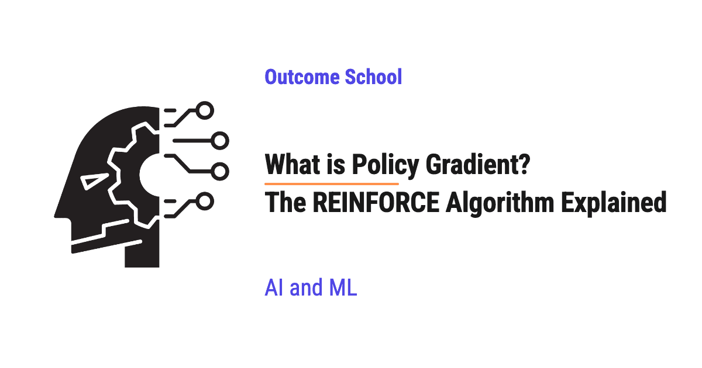

# What is Policy Gradient? The REINFORCE Algorithm Explained

> Archived from <https://outcomeschool.com/blog/policy-gradient-reinforce> on 2026-11-25.

Policy Gradient is a way to train an AI agent by directly making the actions that led to good results more likely, and the actions that led to bad results less likely. REINFORCE is the simplest algorithm that does this.

In this blog, we will learn about Policy Gradient and the REINFORCE algorithm. We will also see how it differs from value-based methods, how a neural network acts as a policy, why the formula has a log probability in it, how REINFORCE works step by step with a small worked example, how a baseline fixes its high variance, and how all of this connects to training LLMs.

We will cover the following:
<ul><li>Value-based vs Policy-based methods</li><li>What is a Policy?</li><li>What is Policy Gradient?</li><li>The Policy Gradient Formula</li><li>Why does the log probability appear?</li><li>The REINFORCE Algorithm</li><li>A Worked Example</li><li>The Problem of High Variance</li><li>Baseline Subtraction</li><li>Connection to LLM Training</li></ul>
I am <strong>Amit Shekhar</strong>, Founder @ <a target="_blank" rel="noopener noreferrer" href="https://outcomeschool.com">Outcome School</a>, I have taught and mentored many developers, and their efforts landed them high-paying tech jobs, helped many tech companies in solving their unique problems, and created many open-source libraries being used by top companies. I am passionate about sharing knowledge through open-source, blogs, and videos.

I teach <a target="_blank" rel="noopener noreferrer" href="https://outcomeschool.com/program/ai-and-machine-learning">AI and Machine Learning</a> at Outcome School.

Let&#x27;s get started.

In <a target="_blank" rel="noopener noreferrer" href="reinforcement-learning.md">Reinforcement Learning</a>, an <strong>agent</strong> looks at the current situation, called the <strong>state</strong>, takes an <strong>action</strong>, and gets a <strong>reward</strong>. One full game, from start to end, is called an <strong>episode</strong>. The total reward the agent collects from a step till the end of the episode is called the <strong>return</strong>. The goal of the agent is to collect as much return as possible. We have a detailed blog on <a target="_blank" rel="noopener noreferrer" href="markov-decision-process-mdp.md">Markov Decision Process (MDP)</a> that explains how states, actions, rewards, and the return fit together.
<h2 id="value-based-vs-policy-based-methods">Value-based vs Policy-based methods</h2>
There are two main families of methods to teach an agent.

<strong>Value-based methods</strong> learn a score for every action in every state. For example, <a target="_blank" rel="noopener noreferrer" href="value-function-and-q-learning.md">Q-learning</a> learns &quot;how good is it to take this action in this state&quot;. Then, the agent picks the action with the highest score. Here, the agent decides indirectly, through the scores.

<strong>Policy-based methods</strong> skip the scores. They directly learn &quot;what action should I take in this state&quot;. Here, the agent decides directly.

Policy Gradient belongs to the second family.

Let&#x27;s see this as a diagram:

<pre><code class="language-text code-highlight">Value-based                  Policy-based
┌─────────────────────┐      ┌─────────────────────┐
│ State               │      │ State               │
└─────────────────────┘      └─────────────────────┘
           ↓                            ↓
┌─────────────────────┐      ┌─────────────────────┐
│ Score each action   │      │ Probability of each │
│ Left:  4.2          │      │ Left:  0.7          │
│ Right: 1.5          │      │ Right: 0.3          │
└─────────────────────┘      └─────────────────────┘
           ↓                            ↓
┌─────────────────────┐      ┌─────────────────────┐
│ Pick the highest    │      │ Sample one          │
│ Action: Left        │      │ Action: Left (70%)  │
└─────────────────────┘      └─────────────────────┘
</code></pre>

Here, we can see that the value-based method picks the action with the highest score, while the policy-based method samples an action from the probabilities.

Policy-based methods are useful when there are too many possible actions to score one by one, or when the best behavior is to pick between actions with some probability, instead of always picking the same one.
<h2 id="what-is-a-policy">What is a Policy?</h2>
<strong>A policy is the rule that tells the agent which action to take in a given state.</strong>

In Policy Gradient, the policy is a <a target="_blank" rel="noopener noreferrer" href="neural-network.md">neural network</a>. It takes the state as input and gives a probability for each possible action as output.

Let&#x27;s say our agent is playing a simple game where it can move either Left or Right. Let&#x27;s see how the policy network picks an action as a diagram:

<pre><code class="language-text code-highlight">┌─────────────────────┐
│ State (game screen) │
└─────────────────────┘
           ↓
┌─────────────────────┐
│ Policy network      │
│ (its weights)       │
└─────────────────────┘
           ↓
┌─────────────────────┐
│ Raw scores          │
│ Left:  0.85         │
│ Right: 0.00         │
└─────────────────────┘
           ↓
┌─────────────────────┐
│ Softmax             │
│ Left:  0.7          │
│ Right: 0.3          │
└─────────────────────┘
           ↓
┌─────────────────────┐
│ Sample one action   │
│ Action: Left        │
└─────────────────────┘
</code></pre>

Here, we can see that the network looks at the game screen and first produces a raw score for each action. Then, a <strong><a target="_blank" rel="noopener noreferrer" href="softmax-function.md">softmax</a></strong> function turns these raw scores into probabilities that add up to 1. In our example, the raw scores 0.85 and 0.00 become 0.7 and 0.3.

Then, the agent samples an action from these probabilities. Means, it picks Left 70% of the time and Right 30% of the time. This randomness lets the agent <a target="_blank" rel="noopener noreferrer" href="exploration-vs-exploitation.md">keep trying different actions</a>.

We write the policy as <strong>pi(a|s)</strong>, which we read as &quot;the probability of taking action <code>a</code> in state <code>s</code>&quot;. The parameters of the network, which are its weights, are written as <strong>theta</strong>.

Now, the question is: how do we change theta so that the agent gets better? Here comes the Policy Gradient into the picture.
<h2 id="what-is-policy-gradient">What is Policy Gradient?</h2>
<strong>Policy Gradient is a method that trains the policy network directly, by changing its weights in the direction that increases the expected return.</strong>

Here, the <strong>expected return</strong> is the average return the agent gets over many episodes.

The central idea of Policy Gradient is:
<ul><li>If an action led to a high return, make that action more likely in the future.</li><li>If an action led to a low return, make that action less likely in the future.</li></ul>
Let&#x27;s take an example. Suppose the agent was in some state, picked Left, and finally won the game. Then, we nudge the weights so that next time, in the same state, the probability of Left goes up a little.

If the agent picked Left and lost the game, we nudge the weights so that the probability of Left goes down a little.

Let&#x27;s understand the word <strong>Gradient</strong> in the name. A gradient tells us the direction in which we must change the weights to increase something. Here, we want to increase the expected return.

One more thing to notice. In normal neural network training, we <a target="_blank" rel="noopener noreferrer" href="math-behind-gradient-descent.md">go down the gradient</a> to reduce the loss. Here, we go up the gradient to increase the return. This is called <strong>gradient ascent</strong>.

<strong>Planning your move into AI?</strong>

No matter which tech domain you work in today, with your effort, you can transition to these roles:
<ul><li>AI Engineer</li><li>Forward Deployed Engineer</li><li>AI Agent Engineer</li><li>Harness Engineer</li><li>Voice AI Engineer</li><li>AI Architect</li><li>LLM Engineer</li><li>LLM Inference Engineer</li><li>Gen AI Engineer</li><li>MLOps Engineer</li><li>ML Engineer</li><li>Deep Learning Engineer</li></ul>
Our <a target="_blank" rel="noopener noreferrer" href="https://outcomeschool.com/program/ai-and-machine-learning">AI and Machine Learning Program</a> at Outcome School takes you there.
<h2 id="the-policy-gradient-formula">The Policy Gradient Formula</h2>
We cannot calculate the exact gradient of the expected return, because that would need every possible game. So, we estimate it from the games the agent actually plays. For one step, the estimate is as below:

<strong>gradient of J(theta) is estimated by: gradient of log pi(a|s) * G</strong>

Here,
<ul><li><code>J(theta)</code> is the expected return of the policy. We want to make it as large as possible.</li><li><code>pi(a|s)</code> is the probability that the policy gave to the action <code>a</code> it actually took in state <code>s</code>.</li><li><code>log pi(a|s)</code> is the log of that probability.</li><li><code>gradient of log pi(a|s)</code> is the direction in which we must change the weights to make that action more likely.</li><li><code>G</code> is the return the agent got after taking that action.</li></ul>
Then, we update the weights like below:

<strong>theta = theta + learning_rate * gradient of log pi(a|s) * G</strong>

Let&#x27;s read this formula in plain words.

&quot;Push the weights in the direction that makes this action more likely, and push harder if the return was bigger.&quot;
<ul><li>If <code>G</code> is large and positive, we push strongly towards this action.</li><li>If <code>G</code> is small, we push only a little.</li><li>If <code>G</code> is negative, the push goes in the opposite direction, and the action becomes less likely.</li></ul>
This is how the formula captures the central idea.

<strong>Note:</strong> For a full episode, we add this term for every step of the episode, each step with its own return. Over many episodes, the average of these estimates points in the true gradient direction.
<h2 id="why-does-the-log-probability-appear">Why does the log probability appear?</h2>
A natural question is: why <code>log pi(a|s)</code> and not just <code>pi(a|s)</code>?

We will skip the full derivation and focus on the intuition. From calculus, the gradient of <code>log pi(a|s)</code> is equal to the gradient of <code>pi(a|s)</code> divided by <code>pi(a|s)</code>.

<strong>gradient of log pi(a|s) = gradient of pi(a|s) / pi(a|s)</strong>

The agent samples actions from its own policy. So, actions that already have a high probability get picked very often, and they get updated again and again. Actions with a low probability get picked rarely.

If we used only the gradient of <code>pi(a|s)</code>, the frequent actions would get far more updates just because they are picked more often, and not because they are better.

Dividing by <code>pi(a|s)</code> balances this. A rare action gets a bigger push when it is picked, and a common action gets a smaller push each time. For example, if an action has a probability of 0.1, its push is multiplied by 1 / 0.1 = 10. If an action has a probability of 0.9, its push is multiplied by only 1 / 0.9, which is about 1.1. This way, every action is judged by its return, and not by how often it was picked.

There is one more benefit. Probabilities of many steps get multiplied together, and the product becomes a very tiny number. The log turns this multiplication into addition, which is much easier for a computer to handle. We have a detailed blog on <a target="_blank" rel="noopener noreferrer" href="logprobs-in-llms.md">Log Probabilities (Logprobs) in LLMs</a> that explains how this works step by step.

<strong>A quick note for you</strong>

No matter which tech domain you work in, get familiar with these topics:
<ul><li>LLM</li><li>RAG</li><li>MCP</li><li>Agent</li><li>Fine-tuning</li><li>Quantization</li></ul>
We put it all together in one video:

<a target="_blank" rel="noopener noreferrer" href="https://www.youtube.com/watch?v=lnfWvX66FUk">AI Engineering Explained: LLM, RAG, MCP, Agent, Fine-Tuning, and Quantization</a>

No need to stop reading - bookmark it and watch later when you get time. Future you will thank you.

Now, let&#x27;s get back to the topic.
<h2 id="the-reinforce-algorithm">The REINFORCE Algorithm</h2>
<strong>REINFORCE</strong> is the simplest Policy Gradient algorithm. It was introduced by Ronald Williams in 1992.

It repeats three steps again and again.

<strong>Step 1:</strong> Play an episode. The agent plays one full game using the current policy. We record every state, every action, and every reward.

<strong>Step 2:</strong> Compute the returns. For every step <code>t</code> of the episode, we calculate the return <code>G_t</code>, which is the total reward from that step till the end of the episode.

<strong>G_t = r_t + gamma * G_(t+1)</strong>

Here, <code>r_t</code> is the reward at step <code>t</code>, and <code>gamma</code> is a number between 0 and 1 called the <strong>discount factor</strong>. It makes rewards that come far in the future count a little less.

For example, suppose an episode has 3 steps with rewards 1, 0, and 10, and gamma is 0.9. We calculate the returns from the last step backwards:

<pre><code class="language-text code-highlight">G_3 = 10
G_2 = 0 + 0.9 * 10  = 9.0
G_1 = 1 + 0.9 * 9.0 = 9.1
</code></pre>

<strong>Step 3:</strong> Update the policy. For every step, we compute <code>gradient of log pi(a_t|s_t) * G_t</code>, add them all up, and move the weights a small step in that direction.

Then, we go back to Step 1 with the updated policy.

Let&#x27;s see the REINFORCE loop as a diagram:

<pre><code class="language-text code-highlight">┌──────────────────────────────┐
│ Step 1: Play one episode     │
│ Record every state,          │
│ action, and reward           │
└──────────────────────────────┘
                ↓
┌──────────────────────────────┐
│ Step 2: Compute returns      │
│ G_t for every step t         │
└──────────────────────────────┘
                ↓
┌──────────────────────────────┐
│ Step 3: Update the policy    │
│ theta = theta + lr * sum of  │
│ grad log pi(a_t|s_t) * G_t   │
└──────────────────────────────┘
                ↓
┌──────────────────────────────┐
│ Updated policy               │
│ Go back to Step 1            │
└──────────────────────────────┘
</code></pre>

Here, we can see that one round of the loop uses exactly one episode. The policy plays, we score every step with its return, we update the weights, and the updated policy plays the next episode.

REINFORCE is called a <strong>Monte Carlo</strong> method. Means, it waits for the full episode to finish and uses the real returns. It does not use a second model to guess any values.

To learn Reinforcement Learning and how an agent improves its policy from rewards from the ground up, check out our <a target="_blank" rel="noopener noreferrer" href="https://outcomeschool.com/program/ai-and-machine-learning">AI and Machine Learning Program</a> at Outcome School.
<h2 id="a-worked-example">A Worked Example</h2>
The best way to learn this is by taking an example.

Let&#x27;s take the simplest possible policy. There is only one state, and the agent has two actions: Left and Right. Just for the sake of understanding, instead of a full neural network, our policy is only two raw scores, one for each action, and softmax turns them into probabilities. These two scores are our theta.

At the start, both scores are 0. So, the probabilities are 0.5 and 0.5.

Now, the agent picks Left and gets a return <code>G = 10</code>. We use a learning rate of 0.1.

For a softmax policy, the gradient of <code>log pi(Left)</code> with respect to the scores has a simple form:

<strong>gradient of log pi(Left) = one_hot(Left) - probabilities</strong>

Here, <code>one_hot(Left)</code> is <code>[1, 0]</code>, which means 1 for the action that was picked and 0 for the other. So, the gradient is <code>[1, 0] - [0.5, 0.5] = [0.5, -0.5]</code>.

Let&#x27;s see the code for this one update step:

<pre><code class="code-highlight language-python">import numpy as np

def softmax(z):
    e = np.exp(z - z.max())
    return e / e.sum()

theta = np.array([0.0, 0.0])   # scores for [Left, Right]
probs = softmax(theta)
print(&quot;Before:&quot;, probs.round(3))

action = 0                     # the agent picked Left
G = 10                         # the return it got
lr = 0.1                       # learning rate

grad_log_pi = np.eye(2)[action] - probs   # gradient of log pi(Left)
theta = theta + lr * G * grad_log_pi
print(&quot;Gradient:&quot;, grad_log_pi.round(3))
print(&quot;After:&quot;, softmax(theta).round(3))
</code></pre>

It will print the following:

<pre><code class="language-text code-highlight">Before: [0.5 0.5]
Gradient: [ 0.5 -0.5]
After: [0.731 0.269]
</code></pre>

Here, we can see that:
<ul><li><code>np.eye(2)[action]</code> gives <code>[1, 0]</code>, which is the one-hot vector for Left.</li><li>Inside <code>softmax</code>, we subtract the largest score only to avoid very large numbers. The result stays the same.</li><li>The update is <code>0.1 * 10 * [0.5, -0.5] = [0.5, -0.5]</code>.</li><li>The new scores become <code>[0.5, -0.5]</code>.</li><li>After softmax, the probability of Left goes up from 0.5 to 0.731.</li></ul>
The agent picked Left, got a high return, and now Left is more likely. This is exactly the central idea of Policy Gradient.

Now, suppose the return was <code>G = -10</code> instead. The update becomes <code>[-0.5, 0.5]</code>, and the new probabilities become 0.269 for Left and 0.731 for Right. Left becomes less likely. It works perfectly.

<strong>Stay updated:</strong> Subscribe to our <a target="_blank" rel="noopener noreferrer" href="https://outcomeschool.substack.com/subscribe">newsletter</a> to get our latest AI and Machine Learning blogs straight to your inbox.
<h2 id="the-problem-of-high-variance">The Problem of High Variance</h2>
REINFORCE works, but it has a big problem: <strong>high variance</strong>. Variance means how much the result jumps around from one try to another.

The return <code>G</code> comes from one full episode. One episode depends on many random action choices and many random events in the game. So, the same action in the same state can get a return of 50 in one episode and 5 in the next one, just because of luck later in the game.

Since the update is multiplied by <code>G</code>, the updates also jump around a lot. The policy gets pushed one way, then another way. Learning becomes slow and unstable, and we need a very large number of episodes.

There is one more issue. Suppose all the returns in our game are positive, for example between 8 and 12. Then, every action that was taken gets pushed up, even the bad ones. The policy still improves, because good actions get pushed a little more, but very slowly.
<h2 id="baseline-subtraction">Baseline Subtraction</h2>
So, here comes the baseline to the rescue.

Instead of multiplying by <code>G</code>, we multiply by <code>G - b</code>, where <code>b</code> is a <strong>baseline</strong>. A simple choice for the baseline is the average return of recent episodes.

<strong>theta = theta + learning_rate * gradient of log pi(a|s) * (G - b)</strong>

Let&#x27;s say we have 3 episodes with returns 8, 10, and 12. The average is 10, so we use 10 as the baseline.
<table><thead><tr><th>Return</th><th>Return - baseline</th><th>Effect on that action</th></tr></thead><tbody><tr><td>8</td><td>8 - 10 = -2</td><td>push down</td></tr><tr><td>10</td><td>10 - 10 = 0</td><td>no push</td></tr><tr><td>12</td><td>12 - 10 = +2</td><td>push up</td></tr></tbody></table>
Here, we can see that the action that did better than average gets pushed up, the action that did worse than average gets pushed down, and the average one does not move.

The best part is that subtracting a baseline does not change the average direction of the update, so the algorithm still learns the right thing. It only reduces the variance, so the learning becomes more stable.

A better baseline is the expected return from the current state, learned by a second neural network. A policy network together with this second network that judges the states is the core idea behind <strong><a target="_blank" rel="noopener noreferrer" href="actor-critic.md">Actor-Critic</a></strong> methods, and <code>G</code> minus this state baseline is an estimate of the <strong>advantage</strong>, which tells how much better an action was than the usual result from that state.

If we want to go deep into Reinforcement Learning and the critic-based methods like Proximal Policy Optimization (PPO), our <a target="_blank" rel="noopener noreferrer" href="https://outcomeschool.com/program/ai-and-machine-learning">AI and Machine Learning Program</a> at Outcome School covers them in depth.
<h2 id="connection-to-llm-training">Connection to LLM Training</h2>
Policy Gradient is not only for games. It is a core part of how LLMs are trained with Reinforcement Learning.

We can map an LLM to the same picture:
<ul><li><strong>Policy</strong>: the LLM itself.</li><li><strong>State</strong>: the prompt plus the tokens generated so far.</li><li><strong>Action</strong>: the next token.</li><li><strong>Action probabilities</strong>: the probability the LLM gives to every token in its vocabulary.</li><li><strong>Return</strong>: a score for the full answer, for example from a <a target="_blank" rel="noopener noreferrer" href="reinforcement-learning-from-human-feedback-rlhf.md">reward model</a> or from checking whether a math answer is correct.</li></ul>
Each token is one action. When an answer gets a high score, we make all the tokens in that answer a little more likely. When an answer gets a low score, we make them a little less likely. This is exactly the REINFORCE idea.

Popular methods used to train LLMs, like <strong><a target="_blank" rel="noopener noreferrer" href="proximal-policy-optimization-ppo.md">PPO</a></strong> (Proximal Policy Optimization) and <strong><a target="_blank" rel="noopener noreferrer" href="group-relative-policy-optimization-grpo.md">GRPO</a></strong> (Group Relative Policy Optimization), are built on top of this same Policy Gradient idea.
<ul><li>PPO adds a learned baseline (a critic) and limits how much the policy can change in one update, so that training stays stable.</li><li>GRPO generates a group of answers for the same prompt and uses the average score of the group as the baseline, so it does not need a critic network. This is the same baseline subtraction idea that we learned above.</li></ul>
Now we must have understood what Policy Gradient is, how the REINFORCE algorithm works, why it has high variance, how a baseline fixes it, and how it connects to training LLMs.
<h2 id="frequently-asked-questions">Frequently Asked Questions</h2><h3 id="who-introduced-the-reinforce-algorithm">Who introduced the REINFORCE algorithm?</h3>
Ronald Williams introduced the REINFORCE algorithm in 1992. It is the simplest Policy Gradient algorithm. It plays a full episode with the current policy, computes the return for every step, and then updates the policy so that actions with a high return become more likely.
<h3 id="why-is-reinforce-called-a-monte-carlo-method">Why is REINFORCE called a Monte Carlo method?</h3>
REINFORCE is called a Monte Carlo method because it waits for the full episode to finish and uses the real returns. It does not use a second model to guess any values. This is also why its updates have high variance, since one episode depends on many random action choices and random events.
<h3 id="why-does-policy-gradient-use-gradient-ascent-instead-of-gradient-descent">Why does Policy Gradient use gradient ascent instead of gradient descent?</h3>
Policy Gradient uses gradient ascent because it wants to increase the expected return, not reduce a loss. In normal neural network training, we go down the gradient to reduce the loss. In Policy Gradient, we go up the gradient, so the weights move in the direction that makes high-return actions more likely.
<h3 id="does-subtracting-a-baseline-change-what-the-policy-learns">Does subtracting a baseline change what the policy learns?</h3>
No. Subtracting a baseline does not change the average direction of the update, so the algorithm still learns the right thing. It only reduces the variance, so the learning becomes more stable. Actions that did better than the baseline get pushed up, and actions that did worse get pushed down.
<h3 id="how-does-grpo-get-its-baseline-without-a-critic-network">How does GRPO get its baseline without a critic network?</h3>
GRPO generates a group of answers for the same prompt and uses the average score of the group as the baseline. So, it does not need a critic network. This is the same baseline subtraction idea used to reduce the high variance of REINFORCE, where the update is multiplied by the return minus the baseline.

That&#x27;s it for now.

Thanks

<strong>Amit Shekhar</strong> Founder @ <a target="_blank" rel="noopener noreferrer" href="https://outcomeschool.com">Outcome School</a>

You can connect with me on:
<ul><li><a target="_blank" rel="noopener noreferrer" href="https://x.com/amitiitbhu">X</a></li><li><a target="_blank" rel="noopener noreferrer" href="https://www.linkedin.com/in/amit-shekhar-iitbhu">LinkedIn</a></li><li><a target="_blank" rel="noopener noreferrer" href="https://github.com/amitshekhariitbhu">GitHub</a></li></ul>
Follow Outcome School on:
<ul><li><a target="_blank" rel="noopener noreferrer" href="https://x.com/outcome_school">X</a></li><li><a target="_blank" rel="noopener noreferrer" href="https://youtube.com/@OutcomeSchool">YouTube</a></li><li><a target="_blank" rel="noopener noreferrer" href="https://www.linkedin.com/company/outcomeschool">LinkedIn</a></li><li><a target="_blank" rel="noopener noreferrer" href="http://github.com/OutcomeSchool">GitHub</a></li></ul>
<a target="_blank" rel="noopener noreferrer" href="https://outcomeschool.com/blog"><strong>Read all of our high-quality blogs here.</strong></a>

