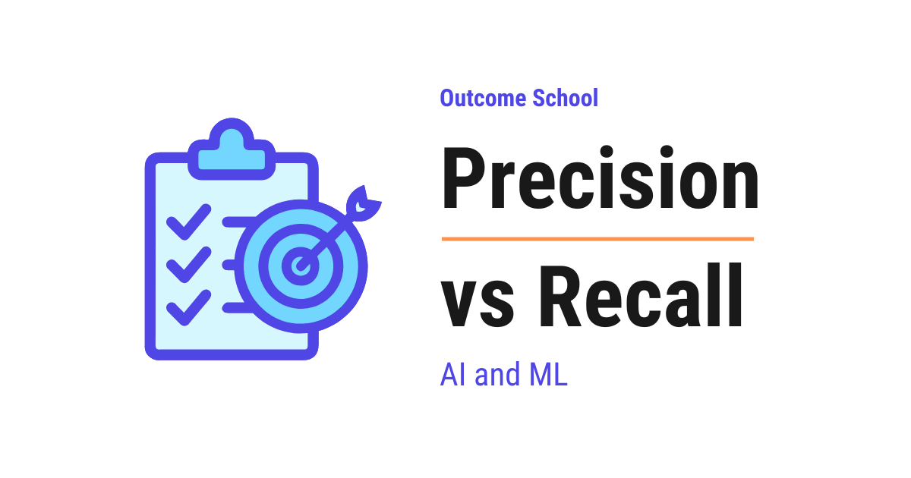

# Precision vs Recall

> Archived from <https://outcomeschool.com/blog/precision-vs-recall> on 2026-11-25.

Precision tells us how many of the items we flagged were actually correct, whereas Recall tells us how many of all the real items we actually managed to catch.

In this blog, we will learn about Precision vs Recall, the two numbers we use to measure how good a system is at making yes-or-no decisions. We will also see how Precision and Recall differ from each other and when to use which one, what the four possible outcomes of any such decision are, why these two numbers pull against each other, and how the cost of a mistake decides which one we must care about more.

We will cover the following:
<ul><li>The problem we are trying to solve</li><li>The four possible outcomes</li><li>What is Precision?</li><li>What is Recall?</li><li>Precision vs Recall</li><li>When to use which one?</li><li>A quick recap of the formulas</li><li>Summary</li></ul>
I am <strong>Amit Shekhar</strong>, Founder @ <a target="_blank" rel="noopener noreferrer" href="https://outcomeschool.com">Outcome School</a>, I have taught and mentored many developers, and their efforts landed them high-paying tech jobs, helped many tech companies in solving their unique problems, and created many open-source libraries being used by top companies. I am passionate about sharing knowledge through open-source, blogs, and videos.

I teach <a target="_blank" rel="noopener noreferrer" href="https://outcomeschool.com/program/ai-and-machine-learning">AI and Machine Learning</a> at Outcome School.

Let&#x27;s get started.
<h2 id="the-problem-we-are-trying-to-solve">The problem we are trying to solve</h2>
Before jumping into Precision and Recall, we must understand where they are used.

Let&#x27;s say we have built a system that answers a simple yes-or-no question. For example, a spam filter that looks at an email and decides, &quot;Is this email spam or not?&quot;

A yes-or-no system like this is a classification model, and classification comes under supervised learning. We have a detailed blog on <a target="_blank" rel="noopener noreferrer" href="supervised-vs-unsupervised-learning.md">Supervised vs Unsupervised Learning</a> that explains this in depth.

Now, our system will make some correct decisions and some wrong decisions. We need a way to measure how good our system really is. Just saying &quot;it works fine&quot; is not enough. We need proper numbers.

This is where Precision and Recall come into the picture. They are two numbers that tell us how good our system is, but they measure two different things.

The best way to learn this is by taking an example. So, for this whole blog, we will use one simple example: a spam filter that flags spam emails.
<h2 id="the-four-possible-outcomes">The four possible outcomes</h2>
Before we understand Precision and Recall, we must first understand the four outcomes. Every decision our spam filter makes falls into one of four boxes.

Let&#x27;s say an email comes in. There are two truths: the email is really spam, or it is really not spam. And there are two decisions: our filter flags it as spam, or it does not. When we mix these, we get four outcomes.
<ul><li><strong>True Positive:</strong> The email was really spam, and our filter correctly flagged it as spam. This is a correct catch.</li><li><strong>False Positive:</strong> The email was not spam, but our filter wrongly flagged it as spam. This is a false alarm. A real email got sent to the spam folder.</li><li><strong>False Negative:</strong> The email was really spam, but our filter missed it and let it into the inbox. This is a miss.</li><li><strong>True Negative:</strong> The email was not spam, and our filter correctly let it into the inbox. This is a correct pass.</li></ul>
Let&#x27;s understand these four boxes with a simple table like below:

<pre><code class="code-highlight">                         Really Spam         Really Not Spam
                   +---------------------+---------------------+
   Flagged as      |   True Positive     |   False Positive    |
   spam            |   (correct catch)   |   (false alarm)     |
                   +---------------------+---------------------+
   Not flagged     |   False Negative    |   True Negative     |
   as spam         |   (missed spam)     |   (correct pass)    |
                   +---------------------+---------------------+
</code></pre>

Here, we can see all four outcomes clearly. The True Positive and the True Negative boxes are the correct decisions. The False Positive and the False Negative boxes are the mistakes.

Now that we know these four boxes, understanding Precision and Recall becomes very easy. Let&#x27;s start with Precision.
<h2 id="what-is-precision">What is Precision?</h2>
<strong>Precision answers this question: Out of all the emails we flagged as spam, how many were actually spam?</strong>

In simple words, Precision checks how often our filter was correct when it raised an alarm. It looks only at the emails we flagged, and it asks how many of those were truly spam.

Let&#x27;s say our filter flagged 10 emails as spam. Out of these 10, only 8 were really spam, and 2 were actually good emails. So, our Precision is 8 out of 10, which is 80%.

The formula is simple:

<pre><code class="code-highlight">                       True Positive
   Precision = ------------------------------
               True Positive + False Positive
</code></pre>

Here, we can see that Precision only cares about the emails we flagged. The bottom part of the formula is all the flagged emails (correct catches plus false alarms). The top part is only the correct catches.

So, high Precision means that when our filter says &quot;this is spam&quot;, we can trust it. Very few good emails get wrongly flagged.

<strong>When Precision is low:</strong> It means our filter is flagging too many good emails as spam. This is annoying, because an important email can get lost in the spam folder.

<strong>Planning your move into AI?</strong>

No matter which tech domain you work in today, with your effort, you can transition to these roles:
<ul><li>AI Engineer</li><li>Forward Deployed Engineer</li><li>AI Agent Engineer</li><li>Harness Engineer</li><li>Voice AI Engineer</li><li>AI Architect</li><li>LLM Engineer</li><li>LLM Inference Engineer</li><li>Gen AI Engineer</li><li>MLOps Engineer</li><li>ML Engineer</li><li>Deep Learning Engineer</li></ul>
Our <a target="_blank" rel="noopener noreferrer" href="https://outcomeschool.com/program/ai-and-machine-learning">AI and Machine Learning Program</a> at Outcome School takes you there.
<h2 id="what-is-recall">What is Recall?</h2>
Now that we have learned about Precision, it&#x27;s time to learn about Recall.

<strong>Recall answers this question: Out of all the emails that were really spam, how many did we actually catch?</strong>

In simple words, Recall checks how many of the real spam emails our filter managed to find. It looks at all the true spam that exists, and it asks how much of it we caught.

Let&#x27;s say there were 20 real spam emails in total. Our filter caught 8 of them and missed 12. So, our Recall is 8 out of 20, which is 40%.

The formula is simple:

<pre><code class="code-highlight">                    True Positive
   Recall = ------------------------------
            True Positive + False Negative
</code></pre>

Here, we can see that Recall cares about all the real spam. The bottom part of the formula is all the actual spam emails (the ones we caught plus the ones we missed). The top part is only the ones we caught.

So, high Recall means our filter catches most of the spam. Very little spam slips into the inbox.

<strong>When Recall is low:</strong> It means a lot of spam is getting past our filter and landing in the inbox. Our filter is missing too much.

<strong>A quick note for you</strong>

No matter which tech domain you work in, get familiar with these topics:
<ul><li>LLM</li><li>RAG</li><li>MCP</li><li>Agent</li><li>Fine-tuning</li><li>Quantization</li></ul>
We put it all together in one video:

<a target="_blank" rel="noopener noreferrer" href="https://www.youtube.com/watch?v=lnfWvX66FUk">AI Engineering Explained: LLM, RAG, MCP, Agent, Fine-Tuning, and Quantization</a>

No need to stop reading - bookmark it and watch later when you get time. Future you will thank you.

Now, let&#x27;s get back to the topic.
<h2 id="precision-vs-recall">Precision vs Recall</h2>
Now, here is the most interesting part. Precision and Recall usually pull against each other. When we try to increase one, the other often goes down. It is like a tug of war.

Let&#x27;s understand why.

Suppose we make our filter very strict, so it flags an email as spam only when it is 100% sure. Now it will rarely make a false alarm. So, our Precision goes up. But because it is so strict, it will also miss many spam emails that it was not fully sure about. So, our Recall goes down.

Now, suppose we make our filter very relaxed, so it flags an email as spam even on a small doubt. Now it will catch almost all the spam. So, our Recall goes up. But it will also wrongly flag many good emails. So, our Precision goes down.

We can picture this tug of war like below:

<pre><code class="code-highlight">   Very strict filter                     Very relaxed filter

   Flags only when 100% sure              Flags on any small doubt
          |                                        |
          v                                        v
   Precision goes UP                       Recall goes UP
   Recall goes DOWN                        Precision goes DOWN
</code></pre>

Here, we can clearly see the trade-off. We usually cannot get both very high at the same time. So, we must decide which one matters more for our problem.

Let me tabulate the differences between Precision and Recall for your better understanding.
<table><thead><tr><th>Point</th><th>Precision</th><th>Recall</th></tr></thead><tbody><tr><td>Main question</td><td>Of the ones we flagged, how many were correct?</td><td>Of all the real ones, how many did we catch?</td></tr><tr><td>Focus</td><td>Being correct when we raise an alarm</td><td>Not missing the real ones</td></tr><tr><td>Formula bottom</td><td>True Positive + False Positive</td><td>True Positive + False Negative</td></tr><tr><td>Low value means</td><td>Too many false alarms</td><td>Too many misses</td></tr><tr><td>We care about</td><td>Avoiding false alarms</td><td>Avoiding misses</td></tr></tbody></table>
To learn Supervised and Unsupervised Learning, Linear Regression and Logistic Regression, and Evaluation and Testing from the ground up, we cover all three in our <a target="_blank" rel="noopener noreferrer" href="https://outcomeschool.com/program/ai-and-machine-learning">AI and Machine Learning Program</a> at Outcome School.
<h2 id="when-to-use-which-one">When to use which one?</h2>
This is the real question. Whether we care more about Precision or more about Recall depends on the cost of the mistake. Let&#x27;s understand with two examples.

<strong>When Precision matters more:</strong> Think about our spam filter. Here, wrongly flagging a good email as spam is very costly. An important message from our boss or bank can get lost in the spam folder. So, we want to be very sure before flagging. Here, we care more about Precision. A false alarm is worse than a small miss.

<strong>When Recall matters more:</strong> Now, think about a medical test that checks for a serious disease. Here, missing a sick patient is very dangerous. If we tell a sick person they are healthy, they will not get treatment, and that can cost a life. So, we want to catch every possible case, even if it means a few false alarms. Here, we care more about Recall. A miss is far worse than a false alarm.

So, the rule is simple:
<ul><li>If a false alarm is costly, we care more about Precision.</li><li>If a miss is costly, we care more about Recall.</li></ul>
The same two numbers are how we measure modern AI systems as well. A <a target="_blank" rel="noopener noreferrer" href="retrieval-augmented-generation-rag.md">RAG pipeline</a>, for example, is scored on Context Precision and Context Recall in exactly this way. We have a detailed blog on <a target="_blank" rel="noopener noreferrer" href="llm-evaluation.md">LLM Evaluation</a> that covers this end to end.

<strong>Note:</strong> Sometimes we want a good balance of both. In that case, we use a single combined score called the <a target="_blank" rel="noopener noreferrer" href="confusion-matrix.md">F1 Score</a>, which mixes Precision and Recall into one number. We can explore that in another blog.

<strong>Stay updated:</strong> Subscribe to our <a target="_blank" rel="noopener noreferrer" href="https://outcomeschool.substack.com/subscribe">newsletter</a> to get our latest AI and Machine Learning blogs straight to your inbox.
<h2 id="a-quick-recap-of-the-formulas">A quick recap of the formulas</h2>
Let&#x27;s keep both formulas together so that we never forget them.

<pre><code class="code-highlight">                       True Positive
   Precision = ------------------------------
               True Positive + False Positive

                    True Positive
   Recall = ------------------------------
            True Positive + False Negative
</code></pre>

Here, we can notice one thing. Both formulas have True Positive on the top. The only difference is the bottom part. Precision adds False Positive, and Recall adds False Negative.
<h2 id="summary">Summary</h2>
Let&#x27;s quickly recap what we have learned.
<ul><li>Every yes-or-no decision falls into four boxes: True Positive, False Positive, False Negative, and True Negative.</li><li>Precision asks: of all the ones we flagged, how many were correct?</li><li>Recall asks: of all the real ones, how many did we catch?</li><li>Precision and Recall usually pull against each other, like a tug of war.</li><li>We care more about Precision when a false alarm is costly.</li><li>We care more about Recall when a miss is costly.</li></ul>
This is how Precision and Recall help us measure our system in two different ways.

Now, we must have understood Precision vs Recall.
<h2 id="frequently-asked-questions">Frequently Asked Questions</h2><h3 id="can-a-model-have-both-high-precision-and-high-recall">Can a model have both high Precision and high Recall?</h3>
Usually not at the same time. Precision and Recall pull against each other like a tug of war. A very strict filter raises Precision but lowers Recall, while a very relaxed filter raises Recall but lowers Precision. So, we must decide which one matters more for our problem.
<h3 id="what-should-we-use-when-we-want-a-balance-of-precision-and-recall">What should we use when we want a balance of Precision and Recall?</h3>
We use the F1 Score. It is a single combined score that mixes Precision and Recall into one number. It is useful when we do not want to favor one over the other and need a good balance of both.
<h3 id="do-precision-and-recall-use-true-negatives">Do Precision and Recall use True Negatives?</h3>
No. Neither formula includes True Negatives. Both formulas have True Positive on the top. The only difference is the bottom part, where Precision adds False Positive and Recall adds False Negative.
<h3 id="why-does-recall-matter-more-for-a-medical-test">Why does Recall matter more for a medical test?</h3>
Recall matters more because missing a sick patient is very dangerous. If we tell a sick person they are healthy, they will not get treatment. So, we want to catch every possible case, even if it means a few false alarms.
<h3 id="are-precision-and-recall-used-to-evaluate-rag-pipelines">Are Precision and Recall used to evaluate RAG pipelines?</h3>
Yes. The same two ideas are used to measure modern AI systems. A RAG pipeline, for example, is scored on Context Precision and Context Recall in exactly the same way.

That&#x27;s it for now.

Thanks

<strong>Amit Shekhar</strong> Founder @ <a target="_blank" rel="noopener noreferrer" href="https://outcomeschool.com">Outcome School</a>

You can connect with me on:
<ul><li><a target="_blank" rel="noopener noreferrer" href="https://x.com/amitiitbhu">X</a></li><li><a target="_blank" rel="noopener noreferrer" href="https://www.linkedin.com/in/amit-shekhar-iitbhu">LinkedIn</a></li><li><a target="_blank" rel="noopener noreferrer" href="https://github.com/amitshekhariitbhu">GitHub</a></li></ul>
Follow Outcome School on:
<ul><li><a target="_blank" rel="noopener noreferrer" href="https://x.com/outcome_school">X</a></li><li><a target="_blank" rel="noopener noreferrer" href="https://youtube.com/@OutcomeSchool">YouTube</a></li><li><a target="_blank" rel="noopener noreferrer" href="https://www.linkedin.com/company/outcomeschool">LinkedIn</a></li><li><a target="_blank" rel="noopener noreferrer" href="https://github.com/OutcomeSchool">GitHub</a></li></ul>
<a target="_blank" rel="noopener noreferrer" href="https://outcomeschool.com/blog"><strong>Read all of our high-quality blogs here.</strong></a>

