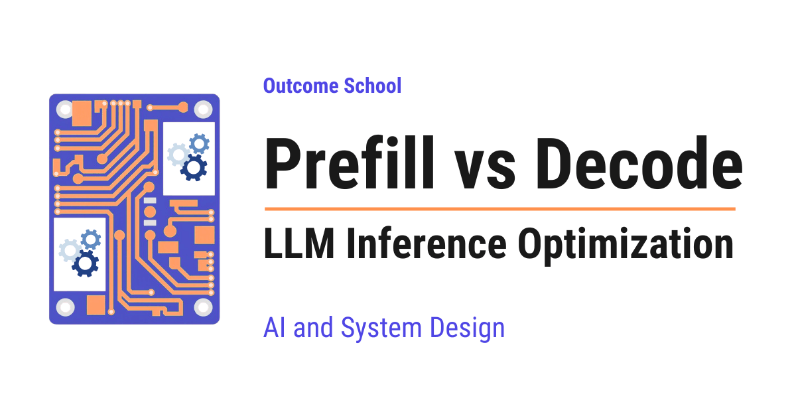

# Prefill vs Decode: LLM Inference Optimization

> Archived from <https://outcomeschool.com/blog/prefill-vs-decode-llm-inference-optimization> on 2026-11-25.

Prefill and Decode are the two phases of LLM inference. Prefill reads the entire prompt in one single pass and produces the first token, whereas Decode generates the rest of the tokens one at a time, reusing the KV cache that prefill prepared.

In this blog, we will learn about Prefill vs Decode, the two phases of LLM inference, and how understanding them helps us optimize the speed of an LLM. We will also see how the prefill and decode phases work, how the KV cache connects them, how they differ and when to use which one based on our use case, and how we optimize each phase to make an LLM faster.

We will cover the following:
<ul><li>What is LLM inference?</li><li>The two phases: Prefill and Decode</li><li>Prefill explained in simple words</li><li>Decode explained in simple words</li><li>A diagram of the two phases and the KV cache flow</li><li>The KV cache as the bridge between the two phases</li><li>A step-by-step walkthrough of a few decode steps</li><li>Prefill vs Decode comparison table</li><li>Why this split matters: compute-bound vs memory-bound</li><li>The key metrics: TTFT, TPOT, throughput, and end-to-end latency</li><li>Optimization techniques mapped to each phase</li><li>Conclusion</li></ul>
I am <strong>Amit Shekhar</strong>, Founder @ <a target="_blank" rel="noopener noreferrer" href="https://outcomeschool.com">Outcome School</a>, I have taught and mentored many developers, and their efforts landed them high-paying tech jobs, helped many tech companies in solving their unique problems, and created many open-source libraries being used by top companies. I am passionate about sharing knowledge through open-source, blogs, and videos.

I teach <a target="_blank" rel="noopener noreferrer" href="https://outcomeschool.com/program/ai-and-machine-learning">AI and Machine Learning</a> at Outcome School.

Let&#x27;s get started.
<h2 id="what-is-llm-inference">What is LLM inference?</h2>
Before we learn about prefill and decode, we must understand what LLM inference means.

An <strong>LLM</strong> is a Large Language Model. It is the model that powers chat assistants like the ones we use every day.

<strong>Inference</strong> is the act of using a trained model to produce an answer. In simple words, inference is the model actually doing its job, which means reading your question and writing back a reply.

Here is the most important thing to understand. An LLM does not write out the whole answer at once. It writes the answer one small piece at a time. Each small piece is called a <strong>token</strong>. A token is a small chunk of text, like a word or a part of a word.

So, the model generates one token, then the next token, then the next, until the full answer is complete. This is why, when you use a chat assistant, you can see the words appear one after another like someone typing. This live, token-by-token appearance is called <a target="_blank" rel="noopener noreferrer" href="how-does-token-streaming-work.md"><strong>streaming</strong></a>.

To get a feel for scale, a short sentence is roughly 15 to 20 tokens. So, a 1,000 token prompt is about a page of text, and a 200 token answer is a few sentences.

A <strong>request</strong> is simply one user&#x27;s question sent to the model. When we say the server handles many requests, we mean it answers many users&#x27; questions.

Now, we have understood what LLM inference is. It is the model generating text token by token.
<h2 id="the-two-phases-prefill-and-decode">The two phases: Prefill and Decode</h2>
Every time an LLM answers a request, it goes through two distinct phases.
<ul><li><strong>Prefill</strong> is the first phase. It reads and processes the whole input prompt that you sent.</li><li><strong>Decode</strong> is the second phase. It generates the output tokens one at a time.</li></ul>
In simple words, prefill is the model reading your question, and decode is the model writing the answer.

Both phases use the exact same model. They do not use different models or different weights. The <strong>weights</strong> are the millions of numbers the model learned during training. They are what the model &quot;knows&quot;, and there are so many of them that they take up a large part of the GPU&#x27;s memory. We will use this fact soon. Only the way the two phases work is different, and that small difference changes everything, as we will see.

Let&#x27;s understand each phase deeply.
<h2 id="prefill-explained-in-simple-words">Prefill explained in simple words</h2>
<strong>Prefill is the phase where the model reads and processes your entire input prompt in one single pass and produces the very first output token.</strong>

The best way to learn this is by taking an example.

Suppose you paste a question that is 1,000 tokens long. In the prefill phase, the model does not read these 1,000 tokens one by one. It reads all 1,000 tokens together, at the same time.

Let&#x27;s say a student walks into an exam hall. Before writing anything, the student silently reads the entire question paper. The student scans every question at once and jots down quick notes about what matters. This reading-the-whole-paper part is prefill.

Because the whole prompt is already known up front, there is no need to wait. The model can process every input token at the same time. This is called <strong>parallel processing</strong>. Means, many things happen together instead of one after another.

While reading the prompt, the model also prepares some notes for later. For every input token, it computes and stores two special pieces of data, called the <strong>Key (K)</strong> and the <strong>Value (V)</strong>. All of these stored Keys and Values together form the <a target="_blank" rel="noopener noreferrer" href="kv-cache-in-llms.md"><strong>KV cache</strong></a>. Do not worry about what exactly Key and Value mean right now. For now, just understand that the KV cache is the model&#x27;s memory of your prompt. We will learn about it in detail soon.

So, prefill fills up this KV cache with the model&#x27;s notes about every input token. And at the end of prefill, the model produces the very first output token.

Here is a very important point. <strong>Prefill produces only the first output token, not the whole answer.</strong> All the remaining tokens come later, in the decode phase.

<strong>Prefill is compute-bound.</strong> The compute-bound means the speed is held back by the math, nothing else. A <a target="_blank" rel="noopener noreferrer" href="how-does-a-gpu-work-for-deep-learning.md"><strong>GPU</strong></a> is the powerful chip that runs the model. Inside the GPU there are <strong>math units</strong>, which are the parts that actually do the multiplication. During prefill, these math units are kept very busy doing heavy math. On a high-end GPU, the math units can stay highly used during prefill, often approaching 90 percent or more on large prompts. The GPU is well used.

Why is prefill so heavy on math? Because when many tokens are processed together, the work becomes very large multiplication of big tables of numbers. A big table of numbers like this is called a matrix, and multiplying two big tables together is exactly what GPUs are built for. So, the GPU runs near its full power.

There is one more thing to know. Longer prompts mean longer prefill. A short question feels almost instant. But if we paste a huge document in front of the model, prefill takes longer, and we wait longer before the first word appears.

In fact, part of the prefill work grows even faster than the prompt length. Inside the model there is a step, called <a target="_blank" rel="noopener noreferrer" href="self-attention-in-transformers.md"><strong>attention</strong></a>, where every token must look at every other token to understand the context. So, doubling the prompt roughly quadruples this part of the work. For a concrete number, doubling the prompt from 100 to 200 tokens makes this part of the work about 4 times bigger, not 2 times. Means, very long prompts can feel slow before the first word appears. Here is a simple picture. In a room of 10 people, everyone shaking hands with everyone is manageable. But in a room of 100 people, the number of handshakes explodes. The bigger the room, which means the longer the prompt, the much faster the work piles up.

This wait before the first word is so important that it has its own name, which we will learn in the metrics section. For now, remember this simple line.
<blockquote>
Faster prefill means sooner you see the first token.
</blockquote>
Now, we have understood prefill. Let&#x27;s move to decode.
<h2 id="decode-explained-in-simple-words">Decode explained in simple words</h2>
<strong>Decode is the phase where the model generates the output tokens one at a time, reusing the KV cache that prefill prepared.</strong>

Let&#x27;s continue our exam example. Reading the question paper was prefill. Now the student starts writing the answer, word by word. The student writes one word, thinks about it, then writes the next word, and so on. This slow, word-by-word writing is decode.

In decode, the model generates only one new token per step. Then it feeds that token back into itself to help produce the next token. Because each new token depends on the token just produced, the tokens must come strictly one after another. This is called <a target="_blank" rel="noopener noreferrer" href="autoregressive-models.md"><strong>autoregressive</strong></a> generation. In simple words, the model keeps feeding its own output back as new input.

So, decode is sequential. It cannot process all the output tokens at once the way prefill processes all the input tokens at once. Each token must wait for the one before it.

Now, here is the clever part. At each decode step, the model does not re-read and re-process your whole prompt again. That would be very slow and wasteful. Instead, it reads the KV cache, which is the memory that prefill already prepared. It computes the Key and Value for just the one new token, reads all the older Keys and Values from the cache, produces the next token, and then appends the new token&#x27;s Key and Value to the cache.

So, at each decode step, the cache grows by exactly one entry.

<strong>Decode is memory-bandwidth-bound.</strong> This is the opposite of prefill. The speed of decode is held back by how fast data can be moved from the GPU&#x27;s memory into its math units, not by the math itself.

Let&#x27;s understand why, one small step at a time.

In decode, only one token is processed per step. So, instead of multiplying two big tables together like prefill does, decode multiplies the big table by a single thin row of numbers, which is the one new token. A single thin row like this is called a vector. So, the math for one token is tiny.

But to produce even that one token, the GPU must still read the entire model&#x27;s weights and the whole growing KV cache from its memory. Remember, the weights are huge, so this is a lot of data to move. <strong>Memory bandwidth</strong> is the speed at which data can be moved out of the GPU&#x27;s memory. Here is the key fact to hold on to. Inside a GPU, doing the math is very fast, but fetching a large amount of data from its memory is comparatively slow.

So, the GPU spends most of its time waiting for data to arrive, and its math units sit mostly idle. During decode, the math units of a high-end GPU can sit only around 20 to 40 percent busy for a single request.

Here is a simple analogy. Think of a chef who must walk into a giant pantry, grab one ingredient, walk back, chop it, and repeat, one ingredient per trip. The walking back and forth (moving data from memory) takes far longer than the chopping (the tiny math). The knives (the GPU&#x27;s math units) sit unused most of the time.

So, prefill keeps the GPU busy with math, but decode keeps the GPU waiting on memory.

Here is one more interesting point. For a typical request, prefill often finishes in a fraction of a second, but decode can run for several seconds, because it produces many tokens one after another. So, decode usually takes most of the total time, even though it uses only a small part of the GPU&#x27;s math power. This is exactly why so many optimizations focus on the decode phase.

Remember this simple line.
<blockquote>
Faster decode means faster you see the rest of the answer.
</blockquote>
Now, we have understood both prefill and decode. Let&#x27;s visualize them together.
<h2 id="a-diagram-of-the-two-phases-and-the-kv-cache-flow">A diagram of the two phases and the KV cache flow</h2>
Let&#x27;s see a clean diagram of how a request flows through prefill and then decode.

<pre><code class="code-highlight">INPUT PROMPT (for example, 1,000 tokens)
        |
        v
+-----------------------------+
|   PREFILL  (one big step)   |
|  - reads ALL input tokens   |
|    in parallel              |
|  - writes the KV cache      |
|  - GPU compute very busy    |
+-----------------------------+
        |
        | produces the FIRST output token
        v
+-----------------------------+        +------------------+
|   DECODE  (many small steps)| &lt;----&gt; |     KV CACHE     |
|  - one token per step       |  read  |  (the memory of  |
|  - reads the KV cache       |  and   |   all tokens so  |
|  - appends one new entry    |  grow  |   far)           |
|  - GPU mostly waits on      |        +------------------+
|    memory                   |
+-----------------------------+
        |
        | token 2, token 3, token 4, ... token N
        v
   FULL ANSWER
</code></pre>

Here, we can see the timeline clearly. There is exactly one prefill pass, and then there are many decode steps. If your answer is 200 tokens long, that is 1 prefill pass plus 200 sequential decode steps. The KV cache is written once by prefill, and then it is read and extended by every single decode step.

This is how the two phases work together.

<strong>Planning your move into AI?</strong>

No matter which tech domain you work in today, with your effort, you can transition to these roles:
<ul><li>AI Engineer</li><li>Forward Deployed Engineer</li><li>AI Agent Engineer</li><li>Harness Engineer</li><li>Voice AI Engineer</li><li>AI Architect</li><li>LLM Engineer</li><li>LLM Inference Engineer</li><li>Gen AI Engineer</li><li>MLOps Engineer</li><li>ML Engineer</li><li>Deep Learning Engineer</li></ul>
Our <a target="_blank" rel="noopener noreferrer" href="https://outcomeschool.com/program/ai-and-machine-learning">AI and Machine Learning Program</a> at Outcome School takes you there.
<h2 id="the-kv-cache-as-the-bridge-between-the-two-phases">The KV cache as the bridge between the two phases</h2>
The KV cache is the bridge that connects prefill and decode. So, we must understand it well.

Let&#x27;s understand the problem it solves first.

Inside the model, to produce the next token, the model must look back at every previous token. For every token, the model computes three things: a <a target="_blank" rel="noopener noreferrer" href="math-behind-attention-qkv.md"><strong>Query (Q)</strong>, a <strong>Key (K)</strong>, and a <strong>Value (V)</strong></a>. The new token compares its Query against the Keys of all previous tokens, and then it mixes their Values to decide what to say next.

Here is the key observation. A past token&#x27;s Key and Value never change once they are computed. They do not depend on tokens that come after. So, instead of computing them again and again at every step, we can compute them once and store them. This store of Keys and Values is the KV cache.

<strong>The KV cache stores only the Keys and the Values of past tokens. It does not store the Queries.</strong> The Query is freshly computed for the current token at every step, so there is no need to store it.

Now, let&#x27;s see why this matters so much with a small numeric walkthrough. For the sake of understanding, think of one entry in the cache as one token&#x27;s stored Key and Value.

Suppose prefill has already processed a 3-token prompt. So, the KV cache already has 3 entries. Now decode begins.

<strong>Step 1:</strong> The model takes the first output token&#x27;s input, computes its Key and Value, and reads the 3 cached entries to look back. It produces token 4. Then it appends token 4&#x27;s Key and Value to the cache. The cache now has 4 entries.

<strong>Step 2:</strong> The model takes token 4, computes its Key and Value, and reads the 4 cached entries to look back. It produces token 5. Then it appends token 5&#x27;s Key and Value to the cache. The cache now has 5 entries.

<strong>Step 3:</strong> The model takes token 5, computes its Key and Value, and reads the 5 cached entries to look back. It produces token 6. Then it appends token 6&#x27;s Key and Value to the cache. The cache now has 6 entries.

Let&#x27;s visualize how the cache grows across these steps.

<pre><code class="code-highlight">After prefill   |P1|P2|P3|           -&gt;  cache has 3 entries
Decode step 1   |P1|P2|P3|T4|        -&gt;  append T4, now 4 entries
Decode step 2   |P1|P2|P3|T4|T5|     -&gt;  append T5, now 5 entries
Decode step 3   |P1|P2|P3|T4|T5|T6|  -&gt;  append T6, now 6 entries
</code></pre>

Here, the boxes P1, P2, and P3 are the prompt tokens written by prefill, and T4, T5, and T6 are appended by decode, one box per step.

Here, we can notice the pattern. At every step, the model computes the Key and Value for only one new token. It reads all the older Keys and Values from the cache instead of computing them again. And the cache grows by exactly one entry per step.

<strong>Note:</strong> Without the KV cache, every decode step would recompute the Keys and Values of all previous tokens from scratch. Since step N redoes the work for all N earlier tokens, the total work summed over the whole answer grows roughly with the square of the length, which is very slow. The KV cache reduces this so that each token&#x27;s Key and Value is computed exactly once. This is why the KV cache is not just a small optimization. Without it, decode would be much slower.

But there is a catch. The KV cache keeps growing. It starts at the size of the prompt after prefill, and it grows by one entry for every generated token. It also grows with the number of users being served together, because each user needs their own cache. In extreme cases, such as very long contexts combined with many concurrent users, the total KV cache can even exceed the size of the model weights and fill up the GPU&#x27;s memory. This growing cache is the reason many of the optimizations we will see later exist. It is also why a whole family of <a target="_blank" rel="noopener noreferrer" href="kv-cache-compression.md">KV Cache Compression</a> techniques exists to shrink the cache itself.

This is how the KV cache works as the bridge between prefill and decode.

To master the KV Cache, the Q, K, and V matrices, and build a Large Language Model (LLM) from scratch, check out our <a target="_blank" rel="noopener noreferrer" href="https://outcomeschool.com/program/ai-and-machine-learning">AI and Machine Learning Program</a> at Outcome School.
<h2 id="prefill-vs-decode-comparison-table">Prefill vs Decode comparison table</h2>
Let me tabulate the differences between Prefill and Decode for your better understanding.
<table><thead><tr><th>Aspect</th><th>Prefill</th><th>Decode</th></tr></thead><tbody><tr><td>What it does</td><td>Processes the whole input prompt</td><td>Generates output tokens one by one</td></tr><tr><td>Parallelism</td><td>Parallel (all prompt tokens at once)</td><td>Sequential (one token at a time)</td></tr><tr><td>Steps</td><td>One big step</td><td>Many small steps (N of them)</td></tr><tr><td>Math shape</td><td>Big table times big table</td><td>Big table times a thin vector</td></tr><tr><td>Bottleneck</td><td>Compute-bound (limited by math speed)</td><td>Memory-bandwidth-bound (limited by data movement)</td></tr><tr><td>GPU utilization</td><td>High (math units busy, can approach 90 percent or more)</td><td>Low (math units mostly idle, around 20 to 40 percent)</td></tr><tr><td>KV cache action</td><td>Writes the cache</td><td>Reads and extends the cache</td></tr><tr><td>Latency metric</td><td>Time To First Token (TTFT)</td><td>Time Per Output Token (TPOT)</td></tr><tr><td>Cost driver</td><td>Grows with prompt length</td><td>Streams full weights plus KV cache every step</td></tr></tbody></table>
This table sums up the whole story. Prefill and decode are mirror images of each other.
<h2 id="why-this-split-matters-compute-bound-vs-memory-bound">Why this split matters: compute-bound vs memory-bound</h2>
Now, the question is: why do we care so much about this split into two phases?

The answer is that the two phases have opposite bottlenecks, and almost every optimization comes from this single fact. A <strong>bottleneck</strong> is the one slow part that holds back the whole process, like the narrow neck of a bottle that limits how fast water pours out.

<strong>Prefill is compute-bound.</strong> It does heavy math on many tokens at once, so it keeps the GPU&#x27;s math units very busy. The work becomes large table-times-table multiplication, which GPUs love.

<strong>Decode is memory-bandwidth-bound.</strong> It does tiny math on one token, but it must stream the whole model plus the growing KV cache from memory at every step. So, the GPU spends most of its time waiting on memory, and the math units sit idle.

Here is a simple way to remember the difference. Prefill is like a chef chopping a whole pile of vegetables at once, where the hands are fully busy. Decode is like plating one finished dish at a time while walking to the fridge for every single dish, where the trips to the fridge are the slow part, not the plating.

Let&#x27;s put the two phases side by side.

<pre><code class="code-highlight">PREFILL (compute-bound)           DECODE (memory-bound)
many tokens processed at once     one token processed at a time

GPU math units: [#########-]      GPU math units: [##--------]
  about 90% busy                    about 20 to 40% busy

held back by: doing the MATH      held back by: MOVING DATA
                                  (model weights + KV cache)
</code></pre>

Here, we can see the mirror image clearly. Prefill keeps the math units almost full, while decode leaves them mostly idle and waits on memory instead.

This single difference explains two big things.

First, it explains why long prompts make us wait longer before the answer starts. Long prompts mean more prefill math.

Second, it explains why we can serve many users at the same time during decode without much extra cost. Since one decode step barely uses the GPU&#x27;s math, we can run many users&#x27; decode steps together. We will see this idea, called batching, in the optimization section.

Because the two phases want different things from the hardware, some serving systems even run prefill and decode on separate GPUs. We will cover that too.

<strong>A quick note for you</strong>

No matter which tech domain you work in, get familiar with these topics:
<ul><li>LLM</li><li>RAG</li><li>MCP</li><li>Agent</li><li>Fine-tuning</li><li>Quantization</li></ul>
We put it all together in one video:

<a target="_blank" rel="noopener noreferrer" href="https://www.youtube.com/watch?v=lnfWvX66FUk">AI Engineering Explained: LLM, RAG, MCP, Agent, Fine-Tuning, and Quantization</a>

No need to stop reading - bookmark it and watch later when you get time. Future you will thank you.

Now, let&#x27;s get back to the topic.
<h2 id="the-key-metrics-ttft-tpot-throughput-and-end-to-end-latency">The key metrics: TTFT, TPOT, throughput, and end-to-end latency</h2>
To optimize anything, we must first measure it. There are a few key metrics, and each one maps cleanly to a phase. So, this section ties everything together.

<strong>TTFT (Time To First Token)</strong> is the time from sending your request until the very first output token appears. It is set mainly by prefill, because prefill must finish before the first token can be produced. Roughly, TTFT is the prefill time plus one decode step. So, longer prompts mean larger TTFT. In simple words, TTFT is how fast the answer starts appearing.

<strong>TPOT (Time Per Output Token)</strong> is the average time to produce each token after the first one. It is also called <strong>ITL (Inter-Token Latency)</strong>, which means the time gap between two tokens. TPOT is set by decode, because decode produces these tokens one at a time. In simple words, TPOT is the typing speed of the answer once it has started. For intuition, a TPOT of 50 milliseconds means 20 tokens per second, and a TPOT of 25 milliseconds means 40 tokens per second. So, halving the TPOT doubles the streaming speed each user feels.

<strong>Note:</strong> For a single request, you can treat TPOT and ITL as the same idea, which is the per-token gap. Across many requests they are measured slightly differently, but for understanding they mean the same thing.

<strong>Throughput</strong> is the total number of tokens generated per second across all users being served at the same time. This is a system-wide metric, not a single-user metric. In simple words, throughput is how many users the server can serve together. Batching, which means running many requests through the GPU together, raises throughput. The group of requests run together is called a <strong>batch</strong>, and the number of requests in it is the <strong>batch size</strong>.

<strong>End-to-end latency</strong> is the total time from sending the request to receiving the final token. We can build an intuition for it with a simple formula:

<pre><code class="code-highlight">End-to-end latency = TTFT + (number of output tokens - 1) x TPOT
</code></pre>

Here, we have the first token already counted inside TTFT, which is why we use the number of output tokens minus one. First the prompt is processed (TTFT), then each remaining output token adds one TPOT.

Let&#x27;s do a quick worked example. Suppose TTFT is 400 milliseconds, the answer is 200 tokens long, and TPOT is 25 milliseconds per token. The answer is 200 tokens, but the first token is already counted in the TTFT, so 199 tokens remain, each taking 25 milliseconds. Then the end-to-end latency is roughly 400 milliseconds plus 199 multiplied by 25 milliseconds, which is about 5.4 seconds.

Let&#x27;s visualize this timeline.

<pre><code class="code-highlight">request
  sent
    |
    v
    |&lt;------ TTFT -----&gt;|  TPOT  |  TPOT  |  TPOT  |  ...  |  TPOT  |
    | prefill + token 1 | token 2| token 3| token 4|  ...  | token N|

End-to-end latency  =  TTFT  +  (N - 1) x TPOT
</code></pre>

Here, we can see that TTFT covers everything up to the first token, and then each later token arrives one TPOT apart. So, the answer starts after TTFT and then streams at the speed of TPOT.

Also, we must understand one core trade-off. TTFT and TPOT are per-user latencies, where smaller is better. Throughput is a system metric, where bigger is better. They pull against each other. Bigger batches push more tokens per second through the GPU (higher throughput) but make each user wait longer (worse TTFT and TPOT). Smaller batches feel snappier but waste GPU capacity. We tune the batch size based on our use case. A chatbot wants low TTFT and low TPOT, while a bulk document-summarization job wants high throughput.

Now, we know which metric each phase owns. Prefill owns TTFT. Decode owns TPOT and throughput. So, when we optimize, we always ask which metric we are trying to improve.

If we want to go deep into LLM Inference Performance Metrics, LLM Inference Bottleneck Analysis, and Model Deployment and Serving, we cover it end to end in our <a target="_blank" rel="noopener noreferrer" href="https://outcomeschool.com/program/ai-and-machine-learning">AI and Machine Learning Program</a> at Outcome School.
<h2 id="optimization-techniques-mapped-to-each-phase">Optimization techniques mapped to each phase</h2>
Now, it&#x27;s time to learn about the main optimization techniques. The beautiful thing is that each one targets a specific phase. So, we will say in plain words what each technique does and which phase or metric it helps.
<h3 id="kv-cache-the-foundation-targets-decode">KV cache (the foundation, targets decode)</h3>
We have already learned this one. The KV cache stores the Keys and Values of all past tokens so that each decode step only does work for the one new token. This is what makes decode fast in the first place. But the cache grows with every token and fills GPU memory, which is exactly why all the other techniques below exist to manage it.
<h3 id="continuous-batching-targets-throughput">Continuous batching (targets throughput)</h3>
Let&#x27;s first see the old approach and its problem.

In the old approach, called static batching, the server groups several requests together and then waits for the slowest one in the group to finish before starting the next group. The issue with this approach is that short requests finish early and their slots sit empty, wasting the GPU. Let&#x27;s see how the next approach solves this issue.

<a target="_blank" rel="noopener noreferrer" href="continuous-batching-in-llms.md"><strong>Continuous batching</strong></a> makes the batching decision every single decode step instead of once per group. The moment one request finishes, its slot is freed, and a waiting request joins the batch on the very next step. So, the batch stays full and the GPU stays busy.

Let&#x27;s visualize the difference.

<pre><code class="code-highlight">STATIC BATCHING  (finished slots sit empty -&gt; GPU wasted)
  slot 1: R1=====                  (idle, wasted) .........
  slot 2: R2==========================
  slot 3: R3==========       (idle, wasted) ...............
          |------- whole batch waits for the slowest -------|

CONTINUOUS BATCHING  (a finished slot is refilled at once -&gt; GPU busy)
  slot 1: R1=====R4====================
  slot 2: R2==========================
  slot 3: R3==========R5================
          (R4 enters the moment R1 ends, R5 enters when R3 ends)
</code></pre>

Here, we can see that static batching leaves empty slots when short requests finish early, while continuous batching fills those slots right away.

Here is a simple analogy. It is like a shared taxi that, the moment one passenger gets out, immediately picks up the next person waiting at the curb, instead of driving around empty until everyone&#x27;s trip is over. The taxi never runs with empty seats.

Continuous batching typically gives a large jump in throughput compared to the old static approach.
<h3 id="chunked-prefill-targets-smooth-streaming-for-other-users">Chunked prefill (targets smooth streaming for other users)</h3>
Let&#x27;s see the problem first. A very long prompt&#x27;s prefill runs as one giant step. While that giant step runs, it hogs the GPU and freezes the token streaming of other users who are already in their decode phase. So, their answers stutter.

<strong>Chunked prefill</strong> splits one long prompt&#x27;s prefill into several smaller chunks instead of one giant step. The model then slips small decode steps in between the chunks. So, no single long prefill blocks everyone else. This protects the token streaming of the other users so their answers do not stutter. As a bonus, mixing compute-heavy prefill with memory-heavy decode in one batch uses the hardware better.

Let&#x27;s visualize this.

<pre><code class="code-highlight">WITHOUT chunked prefill:
  long prompt: [============= ONE BIG PREFILL =============]
  other users: tok ....... (frozen, stuttering) ....... tok

WITH chunked prefill:
  long prompt: [chunk 1][chunk 2][chunk 3][chunk 4][chunk 5]
  other users: tok   tok   tok   tok   tok   tok
                  ^ a decode step slips in between the chunks
</code></pre>

Here, we can see that one giant prefill freezes the other users, while chunked prefill lets their tokens keep flowing between the chunks.

Here is a simple analogy. It is like a chef with one stove. If a customer orders a huge banquet, cooking it all at once freezes every other table&#x27;s food. Instead, the chef cooks the banquet in small batches, slipping in the quick single dishes between them, so nobody&#x27;s plate goes cold.

<strong>Note:</strong> Chunked prefill mainly protects ongoing answers from stalling. It does not change the total math, so it does not by itself make prefill faster.
<h3 id="prefix-caching-also-called-prompt-caching-targets-prefill-and-ttft">Prefix caching, also called prompt caching (targets prefill and TTFT)</h3>
Many requests start with the same long beginning. For example, the same fixed system instructions, the same document for a question, or the same earlier turns of a chat. This shared beginning is called a <strong>prefix</strong>.

<a target="_blank" rel="noopener noreferrer" href="how-does-prompt-caching-work.md"><strong>Prefix caching</strong></a> reuses the KV cache for this shared prefix across requests. The prefill for that shared part is computed once and then reused, instead of being recomputed for every request. So, it skips redundant work and shrinks TTFT.

Here is a simple analogy. It is like a teacher who writes the same long instructions on the board at the start of every class. Instead of rewriting them each time, the teacher keeps a photo of the board and reuses it, spending the saved time only on each student&#x27;s new question.

In production, this can give very high cache hit rates and large cost savings on repeated prompts. A high cache hit rate means most requests found their shared beginning already stored and ready, so that work was skipped. <strong>Note:</strong> Prefix caching only helps when requests actually share a common beginning. If there is no shared prefix, it falls back to a full prefill.
<h3 id="disaggregated-serving-also-called-prefill-decode-separation-targets-both-ttft-and-tpot">Disaggregated serving, also called prefill-decode separation (targets both TTFT and TPOT)</h3>
We learned that prefill is compute-bound and decode is memory-bandwidth-bound. When one GPU does both, a heavy prefill burst stalls the ongoing decodes of other users, and we cannot tune each phase separately.

<a target="_blank" rel="noopener noreferrer" href="prefill-decode-disaggregation.md"><strong>Disaggregated serving</strong></a> runs prefill on one pool of GPUs and decode on another pool of GPUs. A pool just means a group of GPUs working together. The KV cache produced by the prefill GPU is transferred over a fast link to the decode GPU. Now each pool is set up for its own bottleneck, and each can meet its own latency target independently.

Let&#x27;s visualize the two pools.

<pre><code class="code-highlight">           PREFILL POOL                             DECODE POOL
   +-------------------------+              +-------------------------+
   | GPUs tuned for heavy    |              | GPUs tuned for fast     |
   | math (compute-bound)    |   KV cache   | memory (memory-bound)   |
   |                         |  ========&gt;   |                         |
   | reads prompt, writes    |  fast link   | reads cache, streams    |
   | the KV cache, makes     |              | the answer token by     |
   | the first token         |              | token                   |
   +-------------------------+              +-------------------------+
</code></pre>

Here, we can see that the prefill pool builds the KV cache and passes it over a fast link to the decode pool, and each pool is tuned for its own bottleneck.

Here is a simple analogy. It is like a restaurant that puts the heavy prep kitchen in one room and the steady plating-and-serving line in another. Each room is staffed and equipped for its own kind of work, and the prepped food (the KV cache) is passed between them, so neither slows the other down.

<strong>Note:</strong> Disaggregation is not free. It adds the cost of moving the KV cache over the network, and it duplicates the model across pools. It pays off mainly at large scale when we must hit strict TTFT and TPOT targets at the same time. For smaller setups, continuous batching plus chunked prefill on a single GPU is often enough.

The SGLang serving system supports this prefill-decode disaggregation, along with chunked prefill and prefix caching. We have a detailed blog on <a target="_blank" rel="noopener noreferrer" href="how-does-sglang-work.md">how SGLang works</a> that covers these in depth. <a target="_blank" rel="noopener noreferrer" href="how-does-tensorrt-llm-work.md">TensorRT-LLM</a> supports chunked prefill too, slicing a long prompt so it never blocks the decode steps of the other users.

<strong>Stay updated:</strong> Subscribe to our <a target="_blank" rel="noopener noreferrer" href="https://outcomeschool.substack.com/subscribe">newsletter</a> to get our latest AI and Machine Learning blogs straight to your inbox.
<h3 id="speculative-decoding-targets-decode-and-tpot">Speculative decoding (targets decode and TPOT)</h3>
This one is clever, and it works because decode is memory-bound.

<a target="_blank" rel="noopener noreferrer" href="speculative-decoding.md"><strong>Speculative decoding</strong></a> uses a small fast model, called the draft model, to guess the next several tokens cheaply. Then the big model, called the target model, checks all of those guesses in one single parallel pass. The correct guesses are kept. The first wrong guess and everything after it is thrown away and corrected by the big model.

Why does this help? Because decode is memory-bound, the big model&#x27;s weights must be read from memory anyway. Checking 5 guessed tokens at once moves almost the same amount of data from memory as producing 1 token. So, every correct guess is almost free. This turns a slow one-at-a-time process into a faster parallel one.

Let&#x27;s visualize one round of speculative decoding.

<pre><code class="code-highlight">Draft model (small, fast) proposes 5 tokens in one cheap pass:
        g1   g2   g3   g4   g5

Target model (big) verifies ALL of them in ONE parallel pass:
        ok   ok   ok   X    -
                       ^
                       first wrong guess: corrected by the big model,
                       g5 is thrown away

Result: 3 guesses accepted + 1 fix, for about the cost of 1 normal step
</code></pre>

Here, we can see that the big model accepts the correct guesses and fixes the first wrong one in a single pass, so several tokens are produced for about the cost of one.

Here is a simple analogy. A fast junior assistant guesses the next few words of the boss&#x27;s sentence, and the boss reads the whole guess in one glance, then either nods at the correct part or fixes the first mistake. Checking a guess is far quicker than composing from scratch.

<strong>Very important:</strong> Speculative decoding is designed to preserve the model&#x27;s output quality, and it only changes the speed. When the model picks the single most likely token every time, the tokens are exactly what the big model would have produced on its own. When the model <a target="_blank" rel="noopener noreferrer" href="how-does-temperature-control-llm-output.md">picks tokens with some randomness</a>, the output is drawn from the very same set of probabilities the big model uses, so the quality is preserved even though the exact wording can differ run to run. Typical speedups are around 2 to 3 times for decode, depending on how often the small model&#x27;s guesses are accepted.

The draft model is not the only way to make those guesses. We have a detailed blog on <a target="_blank" rel="noopener noreferrer" href="decoding-medusa.md">Medusa</a> that explains how extra heads on the big model itself guess the next few tokens, one on <a target="_blank" rel="noopener noreferrer" href="decoding-eagle.md">EAGLE</a> that drafts at the model&#x27;s internal feature level to get more of those guesses accepted, and one on <a target="_blank" rel="noopener noreferrer" href="n-gram-speculation-in-llms.md">N-gram Speculation</a> that needs no model for drafting at all and simply copies the guesses from the prompt.
<h3 id="pagedattention-targets-kv-cache-memory-efficiency">PagedAttention (targets KV cache memory efficiency)</h3>
Let&#x27;s see the problem first. In a naive system, the KV cache for each request is stored as one big continuous block of memory, sized for the longest possible answer. The issue with this approach is that most of that reserved space stays empty and is wasted. This waste can be very large.

<a target="_blank" rel="noopener noreferrer" href="paged-attention-in-llms.md"><strong>PagedAttention</strong></a> stores the KV cache in small fixed-size blocks, typically 16 tokens each, that can live anywhere in GPU memory, instead of one big continuous chunk per request. A small table, called the block table, remembers which scattered blocks belong to which request. A new block is added only when the sequence actually grows.

Let&#x27;s visualize the difference.

<pre><code class="code-highlight">WITHOUT paging (one big contiguous block reserved up front):
  Request A: [used][used][used][------ reserved but empty ------]
  Request B: [used][used][--------- reserved but empty ---------]
             wasted empty space sits unused inside each block

WITH paging (small fixed-size blocks, given only when needed):
  Request A -&gt; block 7, block 2, block 9     (scattered anywhere)
  Request B -&gt; block 4, block 1
  a block table remembers which blocks belong to which request
  shared prefix? two requests can point to the SAME block
</code></pre>

Here, we can see that the contiguous approach reserves a big block and wastes the empty part, while paging hands out small blocks only as the sequence grows.

This borrows an old, proven computer trick, called paging, where memory is handed out in small equal pieces only when they are actually needed.

Here is a simple analogy. Instead of demanding one big empty parking lot for each car&#x27;s luggage, the valet uses many small numbered lockers scattered around the building and keeps a slip saying which lockers belong to whom. No space is wasted on empty reserved lots. And if two people have identical luggage (a shared prefix), they can simply share the same locker.

PagedAttention nearly removes the wasted memory, lets us fit bigger batches, and raises throughput. It is also the foundation that makes prefix caching possible, because shared prefix blocks can simply point to the same physical block.

<strong>Note:</strong> PagedAttention is the memory layout that prevents waste, while prefix caching is the reuse of already-computed KV across requests. They are distinct ideas, but PagedAttention is what makes prefix caching&#x27;s block sharing possible.

PagedAttention was introduced by the vLLM serving system. We have a detailed blog on <a target="_blank" rel="noopener noreferrer" href="how-does-vllm-work.md">how vLLM works</a> that covers this end to end.
<h3 id="a-quick-map-of-which-technique-helps-which-phase">A quick map of which technique helps which phase</h3>
Let me tabulate these techniques and the phase or metric they target for your better understanding.
<table><thead><tr><th>Technique</th><th>Main target</th><th>What it improves</th></tr></thead><tbody><tr><td>KV cache</td><td>Decode</td><td>Makes decode fast by avoiding recomputation</td></tr><tr><td>Continuous batching</td><td>Both phases</td><td>Throughput (more users served together)</td></tr><tr><td>Chunked prefill</td><td>Serving smoothness for other users</td><td>Prevents long prefills from stalling ongoing token streaming (protects others&#x27; ITL)</td></tr><tr><td>Prefix caching</td><td>Prefill</td><td>TTFT (skips redundant prompt processing)</td></tr><tr><td>Disaggregated serving</td><td>Both phases</td><td>TTFT and TPOT independently, at scale</td></tr><tr><td>Speculative decoding</td><td>Decode</td><td>TPOT (faster token generation)</td></tr><tr><td>PagedAttention</td><td>KV cache memory</td><td>Throughput (bigger batches, less waste)</td></tr></tbody></table>
This table is a handy mental map. When we want a faster first word, we look at the prefill side. When we want faster streaming or more users at once, we look at the decode side.
<h2 id="conclusion">Conclusion</h2>
Now, let&#x27;s recap everything in a simple timeline.

An LLM answers in two phases. <strong>Prefill</strong> reads your whole prompt in one parallel pass, fills the KV cache, and produces the first token. It is compute-bound, and it sets TTFT, which is how fast the answer starts. <strong>Decode</strong> then generates the rest of the answer one token at a time, reading and extending the KV cache at each step. It is memory-bandwidth-bound, and it sets TPOT, which is how fast the answer streams.

The <strong>KV cache</strong> is the bridge between the two phases. Prefill writes it, and decode reads and grows it. It saves us from recomputing the past at every step, but it grows with every token and fills GPU memory.

Because the two phases have opposite bottlenecks, each optimization targets one of them. Continuous batching and PagedAttention raise throughput. Prefix caching and chunked prefill help prefill and smooth streaming. Speculative decoding speeds up decode. Disaggregated serving splits the two phases so each can hit its own target.

Each of these optimization techniques has its own dedicated deep-dive, collected in our <a target="_blank" rel="noopener noreferrer" href="llm-inference-optimization.md">LLM Inference Optimization</a> blog.

This was all about Prefill vs Decode.
<h2 id="frequently-asked-questions">Frequently Asked Questions</h2><h3 id="do-prefill-and-decode-use-different-models">Do prefill and decode use different models?</h3>
No. Both phases use the exact same model with the same weights. Only the way the two phases work is different. Prefill reads the whole prompt in one parallel pass, while decode writes the answer one token at a time, and that small difference changes everything about their bottlenecks.
<h3 id="why-does-decode-take-most-of-the-total-response-time">Why does decode take most of the total response time?</h3>
Decode takes most of the time because it produces many tokens one after another. For a typical request, prefill often finishes in a fraction of a second, but decode can run for several seconds. This is why so many optimizations focus on the decode phase, even though decode uses only a small part of the GPU&#x27;s math power.
<h3 id="does-the-kv-cache-store-the-queries-too">Does the KV cache store the Queries too?</h3>
No. The KV cache stores only the Keys and the Values of past tokens. The Query is freshly computed for the current token at every step, so there is no need to store it. A past token&#x27;s Key and Value never change once computed, which is why they can be stored and reused.
<h3 id="does-speculative-decoding-reduce-the-quality-of-the-output">Does speculative decoding reduce the quality of the output?</h3>
No. Speculative decoding is designed to preserve the model&#x27;s output quality and only changes the speed. When the model picks the single most likely token every time, the tokens are exactly what the big model would produce on its own. With some randomness, the output is drawn from the same probabilities, so quality is preserved even if the wording differs.
<h3 id="does-chunked-prefill-make-prefill-faster">Does chunked prefill make prefill faster?</h3>
No. Chunked prefill does not change the total math, so it does not by itself make prefill faster. It mainly protects ongoing answers from stalling. It splits a long prefill into smaller chunks and slips decode steps in between, so the token streaming of other users does not stutter.

That&#x27;s it for now.

Thanks

<strong>Amit Shekhar</strong> Founder @ <a target="_blank" rel="noopener noreferrer" href="https://outcomeschool.com">Outcome School</a>

You can connect with me on:
<ul><li><a target="_blank" rel="noopener noreferrer" href="https://x.com/amitiitbhu">X</a></li><li><a target="_blank" rel="noopener noreferrer" href="https://www.linkedin.com/in/amit-shekhar-iitbhu">LinkedIn</a></li><li><a target="_blank" rel="noopener noreferrer" href="https://github.com/amitshekhariitbhu">GitHub</a></li></ul>
Follow Outcome School on:
<ul><li><a target="_blank" rel="noopener noreferrer" href="https://x.com/outcome_school">X</a></li><li><a target="_blank" rel="noopener noreferrer" href="https://youtube.com/@OutcomeSchool">YouTube</a></li><li><a target="_blank" rel="noopener noreferrer" href="https://www.linkedin.com/company/outcomeschool">LinkedIn</a></li><li><a target="_blank" rel="noopener noreferrer" href="https://github.com/OutcomeSchool">GitHub</a></li></ul>
<a target="_blank" rel="noopener noreferrer" href="https://outcomeschool.com/blog"><strong>Read all of our high-quality blogs here.</strong></a>

