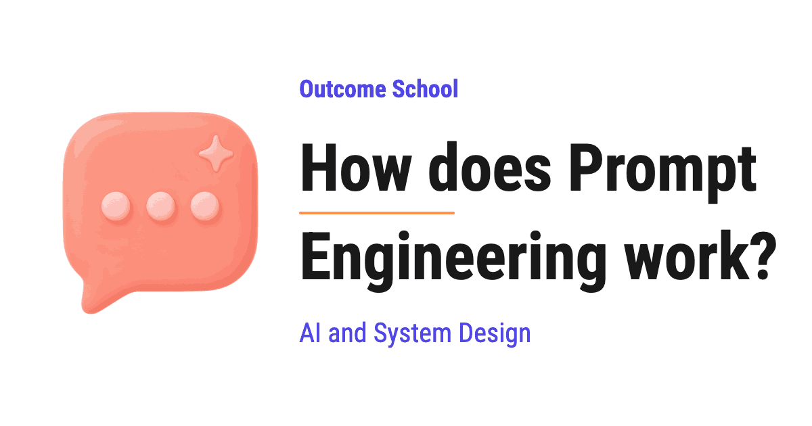

# How does Prompt Engineering work?

> Archived from <https://outcomeschool.com/blog/prompt-engineering> on 2026-11-25.

Prompt Engineering is the skill of writing clear and well-structured prompts, the instructions we give an AI model, so that the model gives us the exact output we want.

In this blog, we will learn about how Prompt Engineering works. We will also see why we need it, how a prompt shapes the answer of the model, the building blocks of a good prompt, how zero-shot, few-shot, and chain-of-thought prompting work, how system and user prompts work together, and the best practices to follow.

We will cover the following:
<ul><li>What is Prompt Engineering?</li><li>Why do we need Prompt Engineering?</li><li>How does Prompt Engineering work?</li><li>The building blocks of a good prompt</li><li>Zero-shot prompting</li><li>Few-shot prompting</li><li>Chain-of-Thought prompting</li><li>System prompt and user prompt</li><li>A step-by-step example</li><li>Best practices for Prompt Engineering</li></ul>
I am <strong>Amit Shekhar</strong>, Founder @ <a target="_blank" rel="noopener noreferrer" href="https://outcomeschool.com">Outcome School</a>, I have taught and mentored many developers, and their efforts landed them high-paying tech jobs, helped many tech companies in solving their unique problems, and created many open-source libraries being used by top companies. I am passionate about sharing knowledge through open-source, blogs, and videos.

I teach <a target="_blank" rel="noopener noreferrer" href="https://outcomeschool.com/program/ai-and-machine-learning">AI and Machine Learning</a> at Outcome School.

Let&#x27;s get started.
<h2 id="what-is-prompt-engineering">What is Prompt Engineering?</h2>
<strong>Prompt Engineering</strong> is the skill of writing clear and well-structured prompts so that the AI model gives us the exact output we want.

Consider two people asking the same friend for help. One says &quot;Help me&quot;. The other says &quot;Help me fix the flat tire on my bicycle, I have a pump but no patch kit&quot;. The second person gets better help because the request is clear and complete. Prompt Engineering is exactly this skill, but for talking to an AI model.
<h2 id="why-do-we-need-prompt-engineering">Why do we need Prompt Engineering?</h2>
The AI model does not read our mind. It only reads our words.

The model is <a target="_blank" rel="noopener noreferrer" href="llm-pretraining.md">trained on a huge amount of text</a>, and it <a target="_blank" rel="noopener noreferrer" href="large-language-model-llm.md">predicts the next word</a> based on what we give it. If our input is vague, the model has to guess, and the guess is often wrong.

Let&#x27;s say we type &quot;Tell me about apple&quot;. The model does not know if we mean the fruit, the company, or something else. So, it may pick the wrong one.

Now, suppose we type &quot;Tell me about the apple fruit and its health benefits&quot;. The model now knows exactly what we want. The answer becomes accurate and useful.

This is why we need Prompt Engineering. It removes the guessing. It helps the model give us the right answer sooner, instead of going back and forth many times.
<h2 id="how-does-prompt-engineering-work">How does Prompt Engineering work?</h2>
When we send a prompt, the AI model does not &quot;think&quot; like a human. It looks at our words and predicts the most likely next words, one after another, to form a complete response.

The model has read a massive amount of text during its training. From that text, it has learned patterns. When we give it a prompt, it tries to continue our text in the most likely and most relevant way.

<strong>The model continues the pattern we start.</strong>

So, if we start a clear and detailed pattern, the model continues it in a clear and detailed way. If we start a messy pattern, the model continues it in a messy way.

Prompt Engineering works by shaping that starting pattern on purpose. We give the model enough context, clear instructions, and sometimes a few examples. The model then has a strong pattern to follow, so the response matches what we want.

We can picture the flow as below:

<pre><code class="language-text code-highlight">     Clear Prompt                 Vague Prompt
+--------------------+       +--------------------+
| Clear words        |       | Few words,         |
| and context        |       | no context         |
+--------------------+       +--------------------+
          ↓                            ↓
+--------------------+       +--------------------+
| AI Model predicts  |       | AI Model has to    |
| the next words     |       | guess what we mean |
+--------------------+       +--------------------+
          ↓                            ↓
+--------------------+       +--------------------+
| Clear, useful      |       | Random, often      |
| answer             |       | wrong answer       |
+--------------------+       +--------------------+
</code></pre>

Here, we can see that the same model gives a very different response based on the prompt. A clear prompt gives the model a strong pattern to continue, so the answer is useful. A vague prompt forces the model to guess, so the answer is often wrong.

Let&#x27;s understand this with the building blocks of a good prompt.
<h2 id="the-building-blocks-of-a-good-prompt">The building blocks of a good prompt</h2>
A strong prompt usually has a few clear parts. We do not always need all of them, but knowing them helps us.

The main parts are:
<ul><li><strong>Instruction:</strong> what we want the model to do. For example, &quot;Summarize this paragraph&quot;.</li><li><strong>Context:</strong> the background information the model needs. For example, &quot;The reader is a 10-year-old child&quot;.</li><li><strong>Input data:</strong> the actual content the model must work on. For example, the paragraph we want summarized.</li><li><strong>Output format:</strong> how we want the answer to look. For example, &quot;Give the answer in three bullet points&quot;.</li></ul>
The structure looks like below:

<pre><code class="language-text code-highlight">+--------------------------------------------+
|                A Good Prompt               |
+--------------------------------------------+
|  Instruction   -&gt;  what to do              |
|  Context       -&gt;  background info         |
|  Input data    -&gt;  the content to work on  |
|  Output format -&gt;  how the answer looks    |
+--------------------------------------------+
                     |
                     ↓
              +-------------+
              |  AI Model   |
              +-------------+
                     |
                     ↓
              +-------------+
              |   Answer    |
              +-------------+
</code></pre>

Here, we can see that the four parts stack together to form one complete prompt. When all four parts are present, the model knows what to do, what to work on, and how the answer must look, so there is no guessing left.

Let&#x27;s see a simple prompt that uses these parts as below:

<pre><code class="language-text code-highlight">Instruction: Summarize the text below.
Context: The reader is a beginner with no technical background.
Input data: &quot;A database is a place where applications store and organize their data so it can be found quickly later.&quot;
Output format: Answer in one short sentence.
</code></pre>

Here, we can see that the prompt clearly tells the model what to do, who the reader is, what to work on, and how the answer must look. The model now has everything it needs.

<strong>Planning your move into AI?</strong>

No matter which tech domain you work in today, with your effort, you can transition to these roles:
<ul><li>AI Engineer</li><li>Forward Deployed Engineer</li><li>AI Agent Engineer</li><li>Harness Engineer</li><li>Voice AI Engineer</li><li>AI Architect</li><li>LLM Engineer</li><li>LLM Inference Engineer</li><li>Gen AI Engineer</li><li>MLOps Engineer</li><li>ML Engineer</li><li>Deep Learning Engineer</li></ul>
Our <a target="_blank" rel="noopener noreferrer" href="https://outcomeschool.com/program/ai-and-machine-learning">AI and Machine Learning Program</a> at Outcome School takes you there.
<h2 id="zero-shot-prompting">Zero-shot prompting</h2>
Now, let&#x27;s learn about the different ways of prompting. The first one is <strong>Zero-shot prompting</strong>.

<strong>Zero-shot prompting</strong> means we ask the model to do a task without giving any example.

Let&#x27;s see an example as below:

<pre><code class="language-text code-highlight">Classify this review as Positive or Negative.

Review: &quot;The food was cold and the service was very slow.&quot;
</code></pre>

Here, we have given no example of what Positive or Negative looks like. We simply asked the model to classify. The model uses its training knowledge to answer &quot;Negative&quot;.

Zero-shot prompting works well for simple and common tasks. For tricky or unusual tasks, the model may not know exactly what we want. Let&#x27;s see how the next approach solves this issue.
<h2 id="few-shot-prompting">Few-shot prompting</h2>
Now, it&#x27;s time to learn about <strong>Few-shot prompting</strong>.

<strong>Few-shot prompting</strong> means we give the model a few examples inside the prompt, and then ask it to follow the same pattern.

We show the model how the task is done, and then it follows that style for our new input.

Let&#x27;s see an example as below:

<pre><code class="language-text code-highlight">Classify the review as Positive or Negative.

Review: &quot;I loved the warm and tasty pizza.&quot; -&gt; Positive
Review: &quot;The room was dirty and smelled bad.&quot; -&gt; Negative
Review: &quot;The staff was friendly and helpful.&quot; -&gt;
</code></pre>

Here, we have given two complete examples first. The model sees the pattern, which means &quot;Review followed by an arrow followed by the label&quot;. For the third review, the model continues the same pattern and answers &quot;Positive&quot;.

By showing examples, we teach the model exactly how we want the answer, without any extra training.

So, when the task is unusual or needs a specific format, we use Few-shot prompting.

<strong>A quick note for you</strong>

No matter which tech domain you work in, get familiar with these topics:
<ul><li>LLM</li><li>RAG</li><li>MCP</li><li>Agent</li><li>Fine-tuning</li><li>Quantization</li></ul>
We put it all together in one video:

<a target="_blank" rel="noopener noreferrer" href="https://www.youtube.com/watch?v=lnfWvX66FUk">AI Engineering Explained: LLM, RAG, MCP, Agent, Fine-Tuning, and Quantization</a>

No need to stop reading - bookmark it and watch later when you get time. Future you will thank you.

Now, let&#x27;s get back to the topic.
<h2 id="chain-of-thought-prompting">Chain-of-Thought prompting</h2>
Now, let&#x27;s understand a very useful technique called <strong><a target="_blank" rel="noopener noreferrer" href="how-does-chain-of-thought-prompting-work.md">Chain-of-Thought prompting</a></strong>.

<strong>Chain-of-Thought prompting</strong> means we ask the model to explain its reasoning step by step before giving the final answer.

Let&#x27;s say we have a small math problem with more than one step. When a model jumps straight to the answer, it can make mistakes. When it writes out each step first, it is more likely to get the answer right.

Let&#x27;s see an example as below:

<pre><code class="language-text code-highlight">Question: A shop has 12 apples. It sells 5 in the morning and 3 in the evening.
How many apples are left? Let&#x27;s think step by step.
</code></pre>

Here, we have added the line &quot;Let&#x27;s think step by step&quot;. This small line tells the model to show its working. The model now answers like below:

<pre><code class="language-text code-highlight">Step 1: The shop starts with 12 apples.
Step 2: It sells 5 in the morning, so 12 - 5 = 7 apples are left.
Step 3: It sells 3 in the evening, so 7 - 3 = 4 apples are left.
Final answer: 4 apples are left.
</code></pre>

Here, we can see that the model breaks the problem into small steps. Each step is simple, so the final answer is more likely to be correct. This is how Chain-of-Thought prompting improves accuracy for reasoning tasks.
<h2 id="system-prompt-and-user-prompt">System prompt and user prompt</h2>
Now, let&#x27;s learn about two types of prompts that work together.

The <a target="_blank" rel="noopener noreferrer" href="system-prompt.md"><strong>system prompt</strong></a> is the instruction, usually hidden from the user, that sets the overall behavior and role of the AI model.

The <strong>user prompt</strong> is the actual message that we, the users, type.

Means, the system prompt sets the role and the rules, and the user prompt asks the question.

We can picture how they work together as below:

<pre><code class="language-text code-highlight">+----------------------+       +----------------------+
|     System Prompt    |       |      User Prompt     |
| (role and the rules) |       | (the typed question) |
+----------------------+       +----------------------+
                 ↓                   ↓
             +----------------------------+
             |          AI Model          |
             +----------------------------+
                           ↓
             +----------------------------+
             |           Answer           |
             +----------------------------+
</code></pre>

Here, we can see that the system prompt is set once and shapes the overall behavior, while the user prompt changes with every message. The model reads both together, so each answer follows the fixed rules and still replies to the new question.

Let&#x27;s say a company builds a support assistant. They set a system prompt like below:

<pre><code class="language-text code-highlight">You are a polite customer support assistant for a shoe store.
Always answer in a friendly tone. Never discuss other topics.
</code></pre>

Here, we can see that the system prompt fixes the role and the rules once. After that, every user message is answered in that polite, on-topic style. So, the system prompt shapes the behavior, and the user prompt drives each conversation.

This is how real AI products control the model&#x27;s tone and keep it focused. We have a detailed blog on <a target="_blank" rel="noopener noreferrer" href="prompt-injection-in-llms.md">Prompt Injection</a> that explains how attackers try to break these rules and how we defend against it.

<strong>Stay updated:</strong> Subscribe to our <a target="_blank" rel="noopener noreferrer" href="https://outcomeschool.substack.com/subscribe">newsletter</a> to get our latest AI and Machine Learning blogs straight to your inbox.
<h2 id="a-step-by-step-example">A step-by-step example</h2>
The best way to learn this is by taking an example. Let&#x27;s improve a weak prompt step by step and watch the output get better.

<strong>Step 1:</strong> We start with a weak prompt.

<pre><code class="language-text code-highlight">Write about dogs.
</code></pre>

The issue with this prompt is that it is too open. The model does not know the length, the audience, or the purpose. The answer will be random and may not help us. Let&#x27;s see how the next step solves this issue.

<strong>Step 2:</strong> We add a clear instruction and an audience.

<pre><code class="language-text code-highlight">Write a short paragraph about dogs for a 7-year-old child.
</code></pre>

This is better. Now the model knows the length and the reader. But, we can have a better prompt than this too.

<strong>Step 3:</strong> We add the output format and the tone.

<pre><code class="language-text code-highlight">Write a short and cheerful paragraph about dogs for a 7-year-old child.
Use simple words. Keep it under four sentences.
</code></pre>

Here, we can see that the prompt now controls the topic, the audience, the tone, the simplicity, and the length. The model has a strong pattern to follow, so the output is much closer to what we want.

This is how Prompt Engineering works in practice. We start simple, then we keep adding clarity until the prompt fully describes what we want.

To master Prompt Engineering, Chain of Thought (CoT) Prompting, and Context Engineering from the ground up, check out our <a target="_blank" rel="noopener noreferrer" href="https://outcomeschool.com/program/ai-and-machine-learning">AI and Machine Learning Program</a> at Outcome School.
<h2 id="best-practices-for-prompt-engineering">Best practices for Prompt Engineering</h2>
Now that we have understood how it works, let me share a few best practices that help us write strong prompts.
<ul><li><strong>Be specific:</strong> clearly state the task, the audience, and the format. Vague prompts give vague answers.</li><li><strong>Give context:</strong> tell the model the background it needs to answer well.</li><li><strong>Show examples:</strong> when the task is tricky, use Few-shot prompting to demonstrate the pattern.</li><li><strong>Ask for steps:</strong> for reasoning and math, use Chain-of-Thought prompting with &quot;Let&#x27;s think step by step&quot;.</li><li><strong>Set the format:</strong> tell the model whether we want bullet points, a table, or a single sentence.</li><li><strong>Iterate:</strong> if the answer is not perfect, refine the prompt and try again. Prompt Engineering is a cycle of small improvements.</li></ul>
<strong>Note:</strong> A common mistake we do is writing a long but unclear prompt. A prompt does not need to be long. It needs to be clear.

We have a detailed blog on <a target="_blank" rel="noopener noreferrer" href="context-engineering.md">Context Engineering</a> that covers how to design everything the model sees, beyond the wording of one prompt.

Now, we have understood how Prompt Engineering works.
<h2 id="frequently-asked-questions">Frequently Asked Questions</h2><h3 id="does-a-longer-prompt-give-a-better-answer">Does a longer prompt give a better answer?</h3>
No. A prompt does not need to be long, it needs to be clear. A common mistake is writing a long but unclear prompt. A short prompt that clearly states the task, the audience, and the format gives the model a strong pattern to follow, so the answer matches what we want.
<h3 id="when-should-we-use-few-shot-prompting-instead-of-zero-shot-prompting">When should we use few-shot prompting instead of zero-shot prompting?</h3>
We use few-shot prompting when the task is tricky, unusual, or needs a specific format. Zero-shot prompting works well for simple and common tasks, where the model can answer from its training knowledge alone. For harder tasks, a few examples inside the prompt show the model exactly how the answer must look.
<h3 id="does-few-shot-prompting-train-the-model">Does few-shot prompting train the model?</h3>
No. Few-shot prompting does not change the model. We only put a few examples inside the prompt, and the model follows the same pattern for our new input. This way, we teach the model exactly how we want the answer, without any extra training.
<h3 id="can-the-user-see-the-system-prompt">Can the user see the system prompt?</h3>
Usually, no. The system prompt is usually hidden from the user. It is set once and sets the overall role and rules of the AI model, while the user prompt is the message the user types. The model reads both together, so every answer follows the fixed rules.
<h3 id="what-should-we-do-if-the-answer-from-the-model-is-not-good-enough">What should we do if the answer from the model is not good enough?</h3>
We should refine the prompt and try again. Prompt Engineering is a cycle of small improvements. We start with a simple prompt, then we keep adding clarity, such as the audience, the tone, and the output format, until the prompt fully describes what we want.

That&#x27;s it for now.

Thanks

<strong>Amit Shekhar</strong> Founder @ <a target="_blank" rel="noopener noreferrer" href="https://outcomeschool.com">Outcome School</a>

You can connect with me on:
<ul><li><a target="_blank" rel="noopener noreferrer" href="https://x.com/amitiitbhu">X</a></li><li><a target="_blank" rel="noopener noreferrer" href="https://www.linkedin.com/in/amit-shekhar-iitbhu">LinkedIn</a></li><li><a target="_blank" rel="noopener noreferrer" href="https://github.com/amitshekhariitbhu">GitHub</a></li></ul>
Follow Outcome School on:
<ul><li><a target="_blank" rel="noopener noreferrer" href="https://x.com/outcome_school">X</a></li><li><a target="_blank" rel="noopener noreferrer" href="https://youtube.com/@OutcomeSchool">YouTube</a></li><li><a target="_blank" rel="noopener noreferrer" href="https://www.linkedin.com/company/outcomeschool">LinkedIn</a></li><li><a target="_blank" rel="noopener noreferrer" href="http://github.com/OutcomeSchool">GitHub</a></li></ul>
<a target="_blank" rel="noopener noreferrer" href="https://outcomeschool.com/blog"><strong>Read all of our high-quality blogs here.</strong></a>

