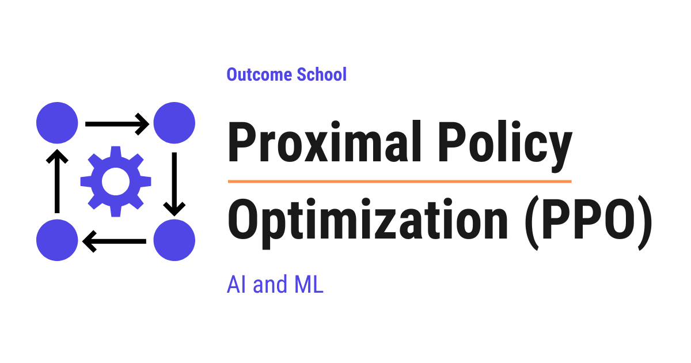

# What is Proximal Policy Optimization (PPO) and How Does It Work?

> Archived from <https://outcomeschool.com/blog/proximal-policy-optimization-ppo> on 2026-11-25.

Proximal Policy Optimization (PPO) is a reinforcement learning algorithm that improves the policy in small, safe steps, so that the new policy stays close to the old one. It is used to train Large Language Models with RLHF.

In this blog, we are going to learn about Proximal Policy Optimization (PPO). We will also see how PPO works step-by-step and how it is used in training Large Language Models with RLHF.

We will cover the following:
<ul><li>What is Reinforcement Learning?</li><li>What is a Policy?</li><li>The problem with simple policy updates.</li><li>What is Proximal Policy Optimization (PPO)?</li><li>The key idea behind PPO: Clipping.</li><li>The PPO objective function in simple words.</li><li>How PPO works step-by-step.</li><li>PPO in Large Language Models (RLHF).</li><li>Advantages of PPO.</li><li>Disadvantages of PPO.</li></ul>
I am <strong>Amit Shekhar</strong>, Founder @ <a target="_blank" rel="noopener noreferrer" href="https://outcomeschool.com">Outcome School</a>, I have taught and mentored many developers, and their efforts landed them high-paying tech jobs, helped many tech companies in solving their unique problems, and created many open-source libraries being used by top companies. I am passionate about sharing knowledge through open-source, blogs, and videos.

I teach <a target="_blank" rel="noopener noreferrer" href="https://outcomeschool.com/program/ai-and-machine-learning">AI and Machine Learning</a> at Outcome School.

Let&#x27;s get started.

Before jumping into PPO, we must know a few basic concepts of <a target="_blank" rel="noopener noreferrer" href="reinforcement-learning.md">reinforcement learning</a>. Do not worry, we will learn about each of them in detail.
<h3 id="what-is-reinforcement-learning">What is Reinforcement Learning?</h3>
<strong>Reinforcement Learning</strong> is a way of teaching a model by giving it rewards for good actions and penalties for bad actions. The model learns by trial and error, and that too without being explicitly programmed.

Let&#x27;s say we are teaching a dog a new trick. When the dog does the trick correctly, we give it a treat. When the dog does it wrong, we do not give a treat. Over time, the dog learns which actions lead to treats. This is exactly how reinforcement learning works.

In simple words, the model tries different actions, sees the rewards, and slowly learns which actions are better.

This was about Reinforcement Learning. Now, let&#x27;s move to the next concept.
<h3 id="what-is-a-policy">What is a Policy?</h3>
A <strong>policy</strong> is the strategy that the model follows to decide what action to take in a given situation.

For the sake of understanding, let&#x27;s take an example. Suppose we have a robot in a room. The room has many doors. The policy tells the robot which door to open in which situation. If the policy is good, the robot picks the right door. If the policy is bad, the robot picks the wrong door.

So, the goal of reinforcement learning is to find the best policy. The best policy gives the highest total reward over time.

Now that we have learned about a policy, it&#x27;s time to learn about the problem we face while improving it.
<h3 id="the-problem-with-simple-policy-updates">The Problem with Simple Policy Updates</h3>
Now, the question is: how do we improve the policy?

The simple idea is to update the policy in the direction that gives more reward. This is called <strong><a target="_blank" rel="noopener noreferrer" href="policy-gradient-reinforce.md">policy gradient</a></strong>. We compute how the policy should change to get a higher reward, and then we apply that change.

But, here is the catch.

If we update the policy too much in one step, the new policy becomes very different from the old policy. The model suddenly behaves in a strange way. The training becomes unstable. Sometimes the model gets worse and never recovers.

If we update the policy too little, the training becomes very slow. The model takes forever to learn.

For the sake of understanding, let&#x27;s take an example. Suppose we are learning to ride a bicycle. If we turn the handle too much, we fall. If we turn the handle too little, we cannot steer. We need to turn the handle by just the right amount. This is the same problem in policy updates.

So, we need a balance. We need to update the policy enough to make progress, but not so much that the training breaks.

What is the solution to this problem? Answer: <strong>Proximal Policy Optimization (PPO)</strong>.

So, here comes PPO to the rescue.
<h3 id="what-is-proximal-policy-optimization-ppo">What is Proximal Policy Optimization (PPO)?</h3>
<strong>Proximal Policy Optimization</strong> is a reinforcement learning algorithm that improves the policy in small, safe steps. It makes sure that the new policy stays close to the old policy.

Let&#x27;s decompose the name:

<strong>PPO = Proximal + Policy + Optimization</strong>
<ul><li><strong>Proximal</strong> means close or nearby.</li><li><strong>Policy</strong> is the strategy the model follows.</li><li><strong>Optimization</strong> means making it better.</li></ul>
So, PPO is an algorithm that makes the policy better while keeping the new policy close to the old policy.

In simple words, PPO improves the model step by step, and each step is small and safe.

<strong>Planning your move into AI?</strong>

No matter which tech domain you work in today, with your effort, you can transition to these roles:
<ul><li>AI Engineer</li><li>Forward Deployed Engineer</li><li>AI Agent Engineer</li><li>Harness Engineer</li><li>Voice AI Engineer</li><li>AI Architect</li><li>LLM Engineer</li><li>LLM Inference Engineer</li><li>Gen AI Engineer</li><li>MLOps Engineer</li><li>ML Engineer</li><li>Deep Learning Engineer</li></ul>
Our <a target="_blank" rel="noopener noreferrer" href="https://outcomeschool.com/program/ai-and-machine-learning">AI and Machine Learning Program</a> at Outcome School takes you there.
<h3 id="the-key-idea-behind-ppo-clipping">The Key Idea Behind PPO: Clipping</h3>
The key idea behind PPO is <strong>clipping</strong>.

In simple words, clipping means cutting off the extreme values. If a value tries to go too high or too low, we cut it down to a safe range.

Let&#x27;s say we have an old policy and a new policy. We measure how much the new policy differs from the old policy by computing a <strong>ratio</strong>.
<ul><li>If the ratio is 1, the new policy is the same as the old policy.</li><li>If the ratio is greater than 1, the new policy is more likely to take this action.</li><li>If the ratio is less than 1, the new policy is less likely to take this action.</li></ul>
Now, PPO says: if this ratio goes too far from 1, we will clip it. We will not allow the update to push the policy too far.

In practice, PPO uses a small number called <strong>epsilon</strong>, which is usually 0.2. This means the ratio is allowed to stay between 0.8 and 1.2. If the ratio tries to go above 1.2 or below 0.8, PPO clips it.

Let&#x27;s understand this with a simple number example. Suppose the new policy wants to take an action 3 times more than the old policy. Means, the ratio is 3. This is too far from 1. PPO will clip this ratio down to 1.2. So, the policy update is limited to a small change, even when the data wants to push it further.

This is how PPO keeps the new policy close to the old policy.
<h3 id="the-ppo-objective-function-in-simple-words">The PPO Objective Function in Simple Words</h3>
The PPO objective function looks complex in math, but the idea is simple. Let&#x27;s understand it in plain words.

The objective function is as below:

<pre><code class="code-highlight">L = min( ratio * advantage, clipped_ratio * advantage )
</code></pre>

Here, we have used the following:
<ul><li><code>ratio</code> is how much the new policy differs from the old policy.</li><li><code>advantage</code> tells us how much better or worse the action was compared to what was expected. The expected value comes from a separate <strong><a target="_blank" rel="noopener noreferrer" href="value-function-and-q-learning.md">value model</a></strong> that we train alongside the policy. A positive advantage means the action was better than expected, and a negative advantage means it was worse.</li><li><code>clipped_ratio</code> is the ratio clipped to stay between <code>1 - epsilon</code> and <code>1 + epsilon</code>.</li><li><code>min</code> means we take the smaller of the two values.</li></ul>
In simple words, PPO says: take the smaller value between the normal update and the clipped update. This makes sure that the policy does not change too much in one step.

Let&#x27;s see a quick example. Suppose the advantage is positive, which means the action was good. The normal update would multiply the ratio by the advantage. If the ratio is very high, the policy would jump too much. The clipped value becomes the smaller one, and PPO uses that. The policy moves in the right direction, but in a small step.

<strong>Note:</strong> The <code>min</code> operation is what makes PPO safe. It prevents the policy from making large jumps even if the data suggests a big change.

<strong>A quick note for you</strong>

No matter which tech domain you work in, get familiar with these topics:
<ul><li>LLM</li><li>RAG</li><li>MCP</li><li>Agent</li><li>Fine-tuning</li><li>Quantization</li></ul>
We put it all together in one video:

<a target="_blank" rel="noopener noreferrer" href="https://www.youtube.com/watch?v=lnfWvX66FUk">AI Engineering Explained: LLM, RAG, MCP, Agent, Fine-Tuning, and Quantization</a>

No need to stop reading - bookmark it and watch later when you get time. Future you will thank you.

Now, let&#x27;s get back to the topic.
<h3 id="how-ppo-works-step-by-step">How PPO Works Step-by-Step</h3>
Now, let&#x27;s see how PPO works step-by-step.

<strong>Step 1:</strong> Start with an initial policy. This is our old policy.

<strong>Step 2:</strong> Let the model interact with the environment using the old policy. Collect data about the actions taken and the rewards received.

<strong>Step 3:</strong> Compute the advantage for each action using the value model. The advantage tells us how much better or worse each action was compared to what the value model expected.

<strong>Step 4:</strong> Update the policy using the PPO objective function. The clipping makes sure the new policy stays close to the old policy.

<strong>Step 5:</strong> Repeat the same data multiple times to make full use of it. PPO can use the same data for many small updates, which makes it efficient.

<strong>Step 6:</strong> Replace the old policy with the new policy. Go back to Step 2 and repeat.

This is how PPO improves the policy step by step in a safe and stable way. The problem of unstable updates is solved.

To master Reinforcement Learning, PPO, and Reward Models, check out our <a target="_blank" rel="noopener noreferrer" href="https://outcomeschool.com/program/ai-and-machine-learning">AI and Machine Learning Program</a> at Outcome School.
<h3 id="ppo-in-large-language-models-rlhf">PPO in Large Language Models (RLHF)</h3>
Now, let&#x27;s take a real use case. PPO is famously used in training Large Language Models like ChatGPT. This process is called <strong><a target="_blank" rel="noopener noreferrer" href="reinforcement-learning-from-human-feedback-rlhf.md">Reinforcement Learning from Human Feedback (RLHF)</a></strong>.

The paper that made this pipeline famous is OpenAI&#x27;s InstructGPT. We have a detailed blog on <a target="_blank" rel="noopener noreferrer" href="decoding-instructgpt.md">Decoding InstructGPT</a> that explains all three of its steps in depth.

Let me explain how this works.

First, we have a Large Language Model that has been trained on a lot of text. This model can generate responses, but the responses are not always helpful or safe.

Then, humans rank different responses from the model. For example, for the same question, humans say which response is better.

After that, a <strong><a target="_blank" rel="noopener noreferrer" href="reward-model.md">reward model</a></strong> is trained on these human rankings. This idea of <a target="_blank" rel="noopener noreferrer" href="decoding-deep-rl-from-human-preferences.md">learning a reward from human comparisons</a> goes back to a 2017 paper on games and robots. The reward model can give a score to any response. The higher the score, the better the response.

Once we&#x27;ve done that, PPO is used to update the Language Model. Here, the Language Model is the policy. The Language Model generates responses, the reward model scores them, and PPO updates the Language Model to generate higher-scoring responses.

Along with the policy, PPO also trains a <strong>value model</strong>, also called the <strong><a target="_blank" rel="noopener noreferrer" href="actor-critic.md">critic</a></strong>. The value model predicts how good a response is expected to be before we see the actual reward. PPO uses the difference between the actual reward from the reward model and the value model&#x27;s prediction to compute the <strong>advantage</strong>. The advantage tells us how much better or worse the response was compared to what was expected. This advantage is what PPO uses inside the clipped objective to update the policy.

So, in RLHF with PPO, we have four models working together. The policy model is the Language Model being trained. The value model predicts expected rewards. The reward model scores responses based on human preferences. The reference model is a frozen copy of the original Language Model.

We have a detailed blog on <a target="_blank" rel="noopener noreferrer" href="direct-preference-optimization-dpo.md">Direct Preference Optimization (DPO)</a> that explains a simpler alternative for LLM alignment which avoids PPO and the reward model entirely.

Here is the important part. The updated Language Model must not become very different from the original Language Model. This is very important. If we update the model too much, it can start writing strange text or forget its language skills. Two things keep the model safe. First, PPO&#x27;s clipping prevents large policy changes in any single update. Second, in RLHF we keep a frozen copy of the original model called the <strong>reference model</strong>. A <a target="_blank" rel="noopener noreferrer" href="kl-divergence.md"><strong>KL penalty</strong></a> is added to the reward, which grows when the new model drifts away from the reference model. This pulls the new model back toward what it already knew.

That&#x27;s the beauty of PPO. It improves the model while protecting what the model already knows.

This is how PPO helps in training models like ChatGPT to be more helpful and aligned with human preferences.

We have a complete program on RLHF, Fine-tuning, and LLM Internals - check out our <a target="_blank" rel="noopener noreferrer" href="https://outcomeschool.com/program/ai-and-machine-learning">AI and Machine Learning Program</a> at Outcome School.
<h3 id="advantages-of-ppo">Advantages of PPO</h3><ul><li><strong>Stable training.</strong> PPO does not make big jumps in policy updates. The training is smooth and reliable.</li><li><strong>Simple to implement.</strong> Compared to other advanced reinforcement learning methods, PPO is easier to code and understand.</li><li><strong>Sample efficient.</strong> PPO can use the same collected data for multiple updates, which saves time and computation.</li><li><strong>Works well in many domains.</strong> PPO has been used in robotics, games, and language models.</li><li><strong>Widely adopted.</strong> PPO is one of the most popular reinforcement learning algorithms in the industry.</li></ul><h3 id="disadvantages-of-ppo">Disadvantages of PPO</h3><ul><li><strong>Hyperparameter sensitive.</strong> The value of epsilon and other settings can affect performance.</li><li><strong>Needs a value model.</strong> PPO trains a separate value model to estimate the advantage at each step. The value model is almost the same size as the policy, which adds significant memory and compute cost.</li><li><strong>Slower than some newer methods.</strong> Methods like <a target="_blank" rel="noopener noreferrer" href="group-relative-policy-optimization-grpo.md">GRPO</a> are designed to be more efficient for specific tasks like training Language Models.</li><li><strong>Can still be unstable in some cases.</strong> Even with clipping, training can fail if the reward signal is noisy.</li></ul>
<strong>Stay updated:</strong> Subscribe to our <a target="_blank" rel="noopener noreferrer" href="https://outcomeschool.substack.com/subscribe">newsletter</a> to get our latest AI and Machine Learning blogs straight to your inbox.
<h3 id="conclusion">Conclusion</h3>
Now, we have understood Proximal Policy Optimization.

PPO is a reinforcement learning algorithm that improves the policy in small, safe steps. The key idea is clipping, which keeps the new policy close to the old policy. This makes the training stable and reliable.

PPO is used in many areas, including training Large Language Models like ChatGPT through RLHF. Hence, it is one of the most important algorithms in modern AI.
<h2 id="frequently-asked-questions">Frequently Asked Questions</h2><h3 id="what-value-of-epsilon-does-ppo-usually-use">What value of epsilon does PPO usually use?</h3>
PPO usually uses an epsilon of 0.2. This means the ratio between the new policy and the old policy is allowed to stay between 0.8 and 1.2. If the ratio tries to go above 1.2 or below 0.8, PPO clips it, so the policy update stays small.
<h3 id="how-many-models-are-used-in-rlhf-with-ppo">How many models are used in RLHF with PPO?</h3>
Four models work together. The policy model is the Language Model being trained. The value model predicts expected rewards. The reward model scores responses based on human preferences. The reference model is a frozen copy of the original Language Model.
<h3 id="is-clipping-the-only-thing-that-keeps-an-llm-close-to-the-original-model-in-rlhf">Is clipping the only thing that keeps an LLM close to the original model in RLHF?</h3>
No. Clipping prevents large policy changes in any single update. On top of that, RLHF keeps a frozen reference model and adds a KL penalty to the reward, which grows when the new model drifts away from the reference model. This pulls the new model back toward what it already knew.
<h3 id="can-ppo-reuse-the-same-data-for-more-than-one-update">Can PPO reuse the same data for more than one update?</h3>
Yes. PPO can use the same collected data for many small updates, which makes it sample efficient. This saves time and computation.
<h3 id="is-ppo-the-only-way-to-align-a-large-language-model">Is PPO the only way to align a Large Language Model?</h3>
No. Direct Preference Optimization (DPO) is a simpler alternative for LLM alignment that avoids PPO and the reward model entirely. Methods like GRPO are also designed to be more efficient than PPO for specific tasks like training Language Models.

That&#x27;s it for now.

Thanks

<strong>Amit Shekhar</strong> Founder @ <a target="_blank" rel="noopener noreferrer" href="https://outcomeschool.com">Outcome School</a>

You can connect with me on:
<ul><li><a target="_blank" rel="noopener noreferrer" href="https://x.com/amitiitbhu">X</a></li><li><a target="_blank" rel="noopener noreferrer" href="https://www.linkedin.com/in/amit-shekhar-iitbhu">LinkedIn</a></li><li><a target="_blank" rel="noopener noreferrer" href="https://github.com/amitshekhariitbhu">GitHub</a></li></ul>
Follow Outcome School on:
<ul><li><a target="_blank" rel="noopener noreferrer" href="https://x.com/outcome_school">X</a></li><li><a target="_blank" rel="noopener noreferrer" href="https://youtube.com/@OutcomeSchool">YouTube</a></li><li><a target="_blank" rel="noopener noreferrer" href="https://www.linkedin.com/company/outcomeschool">LinkedIn</a></li><li><a target="_blank" rel="noopener noreferrer" href="https://github.com/OutcomeSchool">GitHub</a></li></ul>
<a target="_blank" rel="noopener noreferrer" href="https://outcomeschool.com/blog"><strong>Read all of our high-quality blogs here.</strong></a>

