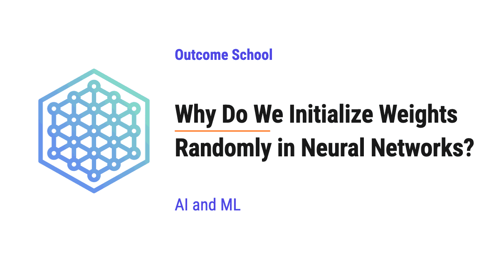

# Why Do We Initialize Weights Randomly in Neural Networks?

> Archived from <https://outcomeschool.com/blog/random-weight-initialization> on 2026-11-25.

We initialize weights randomly in neural networks so that every neuron starts a little different from the others and can learn something different. If all the weights start with the same value, all the neurons in a layer learn the exact same thing, and the network wastes most of its neurons.

In this blog, we will learn about why we initialize weights randomly in neural networks. We will also see what weights are and why training needs starting values, what goes wrong when all the weights start the same, why plain random values can be too big or too small, how Xavier and He initialization pick the right size, what we do with the biases, and why we fix a random seed.

We will cover the following:
<ul><li>What are weights?</li><li>Approach 1: Start all the weights with the same value</li><li>Approach 2: Start the weights with random values</li><li>Approach 3: Start the weights with scaled random values</li><li>What about the biases?</li><li>Why do we fix the random seed?</li></ul>
I am <strong>Amit Shekhar</strong>, Founder @ <a target="_blank" rel="noopener noreferrer" href="https://outcomeschool.com">Outcome School</a>, I have taught and mentored many developers, and their efforts landed them high-paying tech jobs, helped many tech companies in solving their unique problems, and created many open-source libraries being used by top companies. I am passionate about sharing knowledge through open-source, blogs, and videos.

I teach <a target="_blank" rel="noopener noreferrer" href="https://outcomeschool.com/program/ai-and-machine-learning">AI and Machine Learning</a> at Outcome School.

Let&#x27;s get started.
<h2 id="what-are-weights">What are weights?</h2>
A <a target="_blank" rel="noopener noreferrer" href="neural-network.md">neural network</a> is made of layers of small units called <strong>neurons</strong>. Each neuron takes some numbers as input, multiplies each input by a number, adds them up, and passes the result forward.

The numbers that the neuron multiplies with are called <strong>weights</strong>. A weight decides how much one input matters to that neuron.

Let&#x27;s say a neuron gets two inputs, <code>x1 = 1</code> and <code>x2 = 2</code>, and its weights are <code>w1 = 0.5</code> and <code>w2 = 0.5</code>. Then, the neuron computes:

<strong>output = w1 * x1 + w2 * x2 = 0.5 * 1 + 0.5 * 2 = 1.5</strong>

Training is the process of slowly changing these weights so that the network gives better answers. In every training step, the network makes a guess, checks how wrong the guess is, and then nudges every weight a little in the direction that reduces the error. The amount by which each weight is to blame for the error is called its <strong>gradient</strong>.

We have a detailed blog on <a target="_blank" rel="noopener noreferrer" href="math-behind-backpropagation.md">how backpropagation works</a> that explains step by step how these gradients are calculated.

But, training changes the weights. It does not create them. Before the very first training step, every weight must already have some value. So, the question is: what values should the weights start with?

This step of picking the starting values is called <strong>weight initialization</strong>. It decides whether the network learns well, learns slowly, or does not learn at all.

Let&#x27;s see this as a diagram:

<pre><code class="language-text code-highlight">┌──────────────────────────────┐
│ Weight initialization        │
│ pick starting values (once)  │
└──────────────────────────────┘
               │
               ↓
┌──────────────────────────────┐
│ Training step 1              │
│ guess, error, update weights │
└──────────────────────────────┘
               │
               ↓
┌──────────────────────────────┐
│ Training step 2              │
│ guess, error, update weights │
└──────────────────────────────┘
               │
               ↓
┌──────────────────────────────┐
│ ... thousands more steps     │
└──────────────────────────────┘
</code></pre>

Here, we can see that weight initialization happens only once, at the very beginning. Every training step after that starts from the weights that the previous step left behind.

The best way to learn this is by taking an example. Let&#x27;s try different approaches one by one.
<h2 id="approach-1-start-all-the-weights-with-the-same-value">Approach 1: Start all the weights with the same value</h2>
The simplest idea is to start every weight with the same value, for example <code>0</code> or <code>0.5</code>. It looks fair, because no weight gets any special treatment.

Let&#x27;s take a tiny network for the sake of understanding:
<ul><li>2 inputs: <code>x1 = 1</code> and <code>x2 = 2</code></li><li>1 hidden layer with 2 neurons: <code>h1</code> and <code>h2</code></li><li>1 output neuron: <code>y</code></li><li>The correct answer (target) is <code>3</code></li></ul>
We start all 6 weights with the same value <code>0.5</code>. We also skip the <a target="_blank" rel="noopener noreferrer" href="activation-functions.md">activation function</a> here just for the sake of understanding.

<strong>Step 1:</strong> Both hidden neurons compute their output.

<strong>h1 = 0.5 * 1 + 0.5 * 2 = 1.5</strong>

<strong>h2 = 0.5 * 1 + 0.5 * 2 = 1.5</strong>

Both neurons see the same inputs and have the same weights. So, both give the same output, <code>1.5</code>.

<strong>Step 2:</strong> The output neuron computes the final answer.

<strong>y = 0.5 * h1 + 0.5 * h2 = 0.5 * 1.5 + 0.5 * 1.5 = 1.5</strong>

<strong>Step 3:</strong> We find the error.

<strong>error = y - target = 1.5 - 3 = -1.5</strong>

<strong>Step 4:</strong> We find the gradient of each incoming weight of the hidden neurons. For a weight going from input <code>x</code> into a hidden neuron, the gradient is:

<strong>gradient = x * error * (weight from that hidden neuron to the output)</strong>

For <code>h1</code>, the weight from <code>x1</code> gets <code>1 * -1.5 * 0.5 = -0.75</code> and the weight from <code>x2</code> gets <code>2 * -1.5 * 0.5 = -1.5</code>.

For <code>h2</code>, we get the exact same numbers: <code>-0.75</code> and <code>-1.5</code>. This is because <code>h2</code> has the same inputs, the same outgoing weight, and the same error as <code>h1</code>.

<strong>Step 5:</strong> We update the weights with a <a target="_blank" rel="noopener noreferrer" href="math-behind-gradient-descent.md">learning rate</a> of <code>0.01</code>.

<strong>new weight = old weight - 0.01 * gradient</strong>

Both <code>h1</code> and <code>h2</code> move from <code>[0.5, 0.5]</code> to <code>[0.5075, 0.515]</code>.

Let&#x27;s see this as a diagram:

<pre><code class="language-text code-highlight">┌────────────────────────────────────────────┐
│ inputs: x1 = 1, x2 = 2                     │
└────────────────────────────────────────────┘
          │                       │
          ↓                       ↓
┌────────────────────┐  ┌────────────────────┐
│ h1                 │  │ h2                 │
│ weights: 0.5, 0.5  │  │ weights: 0.5, 0.5  │
│ output: 1.5        │  │ output: 1.5        │
└────────────────────┘  └────────────────────┘
          │                       │
          ↓                       ↓
┌────────────────────────────────────────────┐
│ y = 1.5, target = 3, error = -1.5          │
└────────────────────────────────────────────┘
          │                       │
          ↓                       ↓
┌────────────────────┐  ┌────────────────────┐
│ h1 gradients:      │  │ h2 gradients:      │
│ -0.75, -1.5        │  │ -0.75, -1.5        │
│ new: 0.5075, 0.515 │  │ new: 0.5075, 0.515 │
└────────────────────┘  └────────────────────┘
</code></pre>

Here, we can see that the two neurons start the same, give the same output, receive the same update, and end up the same again. The next step repeats the same thing, so they stay identical forever.

<strong>Planning your move into AI?</strong>

No matter which tech domain you work in today, with your effort, you can transition to these roles:
<ul><li>AI Engineer</li><li>Forward Deployed Engineer</li><li>AI Agent Engineer</li><li>Harness Engineer</li><li>Voice AI Engineer</li><li>AI Architect</li><li>LLM Engineer</li><li>LLM Inference Engineer</li><li>Gen AI Engineer</li><li>MLOps Engineer</li><li>ML Engineer</li><li>Deep Learning Engineer</li></ul>
Our <a target="_blank" rel="noopener noreferrer" href="https://outcomeschool.com/program/ai-and-machine-learning">AI and Machine Learning Program</a> at Outcome School takes you there.

Let&#x27;s verify this with code. We train this tiny network for 50 steps as below:

<pre><code class="code-highlight language-python">import numpy as np

x = np.array([1.0, 2.0])     # 2 inputs
target = 3.0

W1 = np.full((2, 2), 0.5)    # inputs -&gt; 2 hidden neurons
W2 = np.full(2, 0.5)         # 2 hidden neurons -&gt; output

for step in range(50):
    h = x @ W1               # hidden neuron outputs
    y = h @ W2               # final output
    error = y - target
    grad_W2 = error * h               # blame for each outgoing weight
    grad_W1 = np.outer(x, error * W2) # blame for each incoming weight
    W2 -= 0.01 * grad_W2
    W1 -= 0.01 * grad_W1

print(&quot;Prediction:&quot;, round(float(y), 4))
print(&quot;Neuron 1 weights:&quot;, W1[:, 0].round(4))
print(&quot;Neuron 2 weights:&quot;, W1[:, 1].round(4))
</code></pre>

Here, <code>W1</code> holds the weights going into the hidden neurons (column 0 for neuron 1, column 1 for neuron 2), and <code>W2</code> holds the weights going to the output. In each step, we compute the output, find the error, compute the gradients, and update the weights.

It will print the following:

<pre><code class="language-text code-highlight">Prediction: 2.9975
Neuron 1 weights: [0.5942 0.6884]
Neuron 2 weights: [0.5942 0.6884]
</code></pre>

Here, we can see that the network did learn to predict close to <code>3</code>, but the two hidden neurons still have the exact same weights after 50 steps.

This is called the <strong>symmetry problem</strong>. <strong>When all the neurons in a layer start with the same weights, they compute the same output, get the same gradient, and receive the same update. So, they stay the same forever.</strong>

Means, a layer with 512 neurons behaves like a layer with just 1 neuron copied 512 times. All that extra capacity is wasted, because every neuron learns the same thing.

Starting all the weights at <code>0</code> is even worse. In our tiny network, the hidden neurons output <code>0</code>, and every gradient also becomes <code>0</code>, so the weights do not move at all.

The issue with this approach is that identical starting values give identical neurons. Let&#x27;s see how the next approach solve this issue.
<h2 id="approach-2-start-the-weights-with-random-values">Approach 2: Start the weights with random values</h2>
So, here comes the randomness to the rescue. If every weight starts with a different random value, then every neuron computes a different output from the very first step. Different outputs give different gradients, and different gradients push each neuron in its own direction.

This is called <strong>breaking the symmetry</strong>.

Let&#x27;s run the same tiny network again, but this time with random starting weights:

<pre><code class="code-highlight language-python">np.random.seed(42)
W1 = np.random.randn(2, 2)   # random starting weights
W2 = np.random.randn(2)
</code></pre>

Here, <code>np.random.randn</code> gives random numbers from a bell-shaped curve centered at <code>0</code>. Most of the numbers are between <code>-1</code> and <code>1</code>, and a few are larger. We will learn about <code>np.random.seed</code> at the end of this blog. Everything else in the training code stays the same.

It will print the following:

<pre><code class="language-text code-highlight">Prediction: 2.999
Neuron 1 weights: [0.507  0.6682]
Neuron 2 weights: [-0.0702  1.6593]
</code></pre>

Here, we can see that the network again predicts close to <code>3</code>, but now the two neurons have different weights. Each neuron has learned its own way of looking at the inputs. The symmetry is broken.

<strong>A quick note for you</strong>

No matter which tech domain you work in, get familiar with these topics:
<ul><li>LLM</li><li>RAG</li><li>MCP</li><li>Agent</li><li>Fine-tuning</li><li>Quantization</li></ul>
We put it all together in one video:

<a target="_blank" rel="noopener noreferrer" href="https://www.youtube.com/watch?v=lnfWvX66FUk">AI Engineering Explained: LLM, RAG, MCP, Agent, Fine-Tuning, and Quantization</a>

No need to stop reading - bookmark it and watch later when you get time. Future you will thank you.

Now, let&#x27;s get back to the topic.

Random values solve the symmetry problem, but the size of those random values matters a lot.

Let&#x27;s understand why. In a real network, a neuron often has hundreds of inputs, and a deep network has many layers. The output of one layer becomes the input of the next layer. So, whatever happens in one layer gets multiplied again and again.
<ul><li>If the weights are a bit too big, every layer makes the numbers bigger. After many layers, the numbers become huge. This is called <strong>exploding</strong>.</li><li>If the weights are a bit too small, every layer makes the numbers smaller. After many layers, the numbers become almost zero. This is called <strong>vanishing</strong>.</li></ul>
Let&#x27;s see this with an experiment. We pass 1000 inputs through 10 layers of 512 neurons each. We use the ReLU activation function, which simply turns every negative number into <code>0</code> and keeps positive numbers as they are. We try random weights with two sizes: normal size (<code>1.0</code>) and very small size (<code>0.01</code>).

<pre><code class="code-highlight language-python">import numpy as np

np.random.seed(42)
x = np.random.randn(1000, 512)  # 1000 inputs, 512 numbers each

for scale in [1.0, 0.01]:
    h = x
    for layer in range(1, 11):
        W = np.random.randn(512, 512) * scale
        h = np.maximum(0, h @ W)  # ReLU
    print(f&quot;scale = {scale}: average size at layer 10 = {h.mean():.3g}&quot;)
</code></pre>

Here, <code>scale</code> controls the size of the random weights. In each layer, we multiply the current numbers by a new random weight matrix and apply ReLU. After 10 layers, we print the average size of the numbers.

It will print the following:

<pre><code class="language-text code-highlight">scale = 1.0: average size at layer 10 = 6.13e+11
scale = 0.01: average size at layer 10 = 6.88e-09
</code></pre>

Here, <code>6.13e+11</code> means about 613 billion, and <code>6.88e-09</code> means about 0.00000000688. The input numbers we started with were around <code>1</code> in size. So, with plain random weights, the numbers either blow up or die out after only 10 layers. Many real networks have far more layers than this.

Both cases break training:
<ul><li><strong>Exploding:</strong> The numbers and the gradients become so large that each update throws the weights far away. Training jumps around wildly or the numbers overflow.</li><li><strong>Vanishing:</strong> The numbers and the gradients become almost zero. The early layers get almost no update, so they barely learn.</li></ul>
We have a detailed blog on <a target="_blank" rel="noopener noreferrer" href="vanishing-and-exploding-gradients.md">why vanishing and exploding gradients happen</a> that covers this end to end.

There is one more problem for activation functions like <code>tanh</code> and <code>sigmoid</code>, which squash every input into a fixed range. For example, <code>tanh</code> squashes everything between <code>-1</code> and <code>1</code>. When the weights are too big, almost every output gets stuck near <code>-1</code> or <code>1</code>. This is called <strong>saturation</strong>. In a stuck region, the curve is almost flat, so the gradient is almost zero, and the neuron stops learning. If we run the same experiment with <code>tanh</code> instead of ReLU and <code>scale = 1.0</code>, about 91 percent of the outputs of the very first layer are already stuck above <code>0.99</code> or below <code>-0.99</code>.

To learn Neural Networks, Activation Functions, and Backpropagation from the ground up, check out our <a target="_blank" rel="noopener noreferrer" href="https://outcomeschool.com/program/ai-and-machine-learning">AI and Machine Learning Program</a> at Outcome School.

The issue with this approach is that random values break the symmetry, but the wrong size makes the signal explode or vanish. Let&#x27;s see how the next approach solve this issue.
<h2 id="approach-3-start-the-weights-with-scaled-random-values">Approach 3: Start the weights with scaled random values</h2>
Now, the question is: what is the right size?

The answer is: a size that keeps the numbers roughly the same from one layer to the next.

The key observation is that a neuron adds up many inputs. The more inputs it has, the bigger the sum gets. So, a neuron with many inputs needs smaller weights, and a neuron with few inputs can have bigger weights. Means, the size of the random weights must depend on the number of inputs.

The number of inputs to a neuron is called <strong>fan-in</strong>, and we will write it as <code>n_in</code>. The number of outputs of a layer is called <strong>fan-out</strong>, and we will write it as <code>n_out</code>.

We still pick random numbers centered at <code>0</code>. We only control their spread, which is measured by the <strong>standard deviation</strong>. A small standard deviation means the random numbers stay close to <code>0</code>. A large standard deviation means they spread far from <code>0</code>.

There are two popular ways to pick this standard deviation.
<h3 id="xavier-glorot-initialization">Xavier (Glorot) initialization</h3>
<strong>Xavier initialization</strong>, also called <strong>Glorot initialization</strong>, was proposed by Xavier Glorot and Yoshua Bengio. It is designed for activation functions like <code>tanh</code> and <code>sigmoid</code>.

<strong>std = sqrt(2 / (n_in + n_out))</strong>

Here, it looks at both the number of inputs and the number of outputs, so that the numbers stay stable both when going forward and when the gradients flow backward.

For our layer with 512 inputs and 512 outputs, the standard deviation is <code>sqrt(2 / 1024) = sqrt(1 / 512)</code>, which is about <code>0.044</code>.
<h3 id="he-kaiming-initialization">He (Kaiming) initialization</h3>
<strong>He initialization</strong>, also called <strong>Kaiming initialization</strong>, was proposed by Kaiming He and his co-authors. It is designed for the ReLU activation function.

<strong>std = sqrt(2 / n_in)</strong>

Here, the extra <code>2</code> comes from ReLU itself. ReLU turns roughly half of the numbers into <code>0</code>. So, the signal loses about half of its strength in every layer. The <code>2</code> doubles the spread of the weights to make up for that loss.

For our layer with 512 inputs, the standard deviation is <code>sqrt(2 / 512)</code>, which is <code>0.0625</code>.

Let&#x27;s run our experiment again with He initialization:

<pre><code class="code-highlight language-python">import numpy as np

np.random.seed(42)
x = np.random.randn(1000, 512)

h = x
for layer in range(1, 11):
    W = np.random.randn(512, 512) * np.sqrt(2 / 512)  # He
    h = np.maximum(0, h @ W)  # ReLU
    if layer in (1, 5, 10):
        print(f&quot;layer {layer}: average size = {h.mean():.3f}&quot;)
</code></pre>

Here, the only change is the size of the weights. Instead of <code>1.0</code> or <code>0.01</code>, we multiply them by <code>np.sqrt(2 / 512)</code>.

It will print the following:

<pre><code class="language-text code-highlight">layer 1: average size = 0.563
layer 5: average size = 0.532
layer 10: average size = 0.557
</code></pre>

Here, we can see that the numbers stay around <code>0.55</code> from layer 1 to layer 10. They do not explode and they do not vanish. The signal travels through the whole network in good shape, and the gradients can travel back in good shape too.

If we want to go deep into Deep Learning and Gradient Descent, and build a Neural Network from scratch, we have a complete program - check out our <a target="_blank" rel="noopener noreferrer" href="https://outcomeschool.com/program/ai-and-machine-learning">AI and Machine Learning Program</a> at Outcome School.

Let&#x27;s compare all three experiments as a diagram:

<pre><code class="language-text code-highlight">┌─────────────────┐  ┌─────────────────┐  ┌─────────────────┐
│ input: about 1  │  │ input: about 1  │  │ input: about 1  │
│ scale = 1.0     │  │ scale = 0.01    │  │ He scale: 0.0625│
└─────────────────┘  └─────────────────┘  └─────────────────┘
         │                    │                    │
         ↓                    ↓                    ↓
┌─────────────────┐  ┌─────────────────┐  ┌─────────────────┐
│ 10 ReLU layers  │  │ 10 ReLU layers  │  │ 10 ReLU layers  │
└─────────────────┘  └─────────────────┘  └─────────────────┘
         │                    │                    │
         ↓                    ↓                    ↓
┌─────────────────┐  ┌─────────────────┐  ┌─────────────────┐
│ layer 10:       │  │ layer 10:       │  │ layer 10:       │
│ 613 billion     │  │ 0.00000000688   │  │ 0.557           │
│ exploding       │  │ vanishing       │  │ stable          │
└─────────────────┘  └─────────────────┘  └─────────────────┘
</code></pre>

Here, we can see that the same 10 layers give completely different results, and the only difference is the size of the starting weights.

We must match the method with the activation function. If we use the Xavier size with ReLU in the same experiment, the average size at layer 10 drops to about <code>0.017</code>, because Xavier does not make up for the half of the numbers that ReLU turns into <code>0</code>.

Let me tabulate the differences between Xavier and He initialization for your better understanding.
<table><thead><tr><th>Property</th><th>Xavier (Glorot)</th><th>He (Kaiming)</th></tr></thead><tbody><tr><td>Formula</td><td>std = sqrt(2 / (n_in + n_out))</td><td>std = sqrt(2 / n_in)</td></tr><tr><td>Best for</td><td><code>tanh</code> and <code>sigmoid</code></td><td>ReLU and its variants</td></tr><tr><td>Size for 512 inputs</td><td>about 0.044</td><td>0.0625</td></tr></tbody></table>
Popular libraries such as PyTorch and Keras already use a scaled random initialization by default for their layers, so most of the time we do not need to write it ourselves.

<strong>Stay updated:</strong> Subscribe to our <a target="_blank" rel="noopener noreferrer" href="https://outcomeschool.substack.com/subscribe">newsletter</a> to get our latest AI and Machine Learning blogs straight to your inbox.
<h2 id="what-about-the-biases">What about the biases?</h2>
Each neuron also has one extra number called the <strong><a target="_blank" rel="noopener noreferrer" href="bias-in-artificial-neural-network.md">bias</a></strong>, which is added after the weighted sum. It lets the neuron shift its output up or down.

<strong>output = w1 * x1 + w2 * x2 + bias</strong>

Biases usually start at <code>0</code>.

The question is: does this not bring back the symmetry problem? The answer is no. The symmetry is already broken by the random weights. Since every neuron has different weights, every neuron gets a different gradient for its bias too. So, the biases become different after the first update.
<h2 id="why-do-we-fix-the-random-seed">Why do we fix the random seed?</h2>
Random weights have one side effect. Every time we run the training, the starting weights are different, so the final result can also be a little different. This makes it hard to compare two experiments or to find a bug.

To solve this, we fix the <strong>random seed</strong>. A random seed is a starting number for the random number generator. With the same seed, the computer produces the exact same sequence of &quot;random&quot; numbers every time.

<pre><code class="code-highlight language-python">import numpy as np

np.random.seed(42)
print(np.random.randn(3).round(4))

np.random.seed(42)
print(np.random.randn(3).round(4))
</code></pre>

It will print the following:

<pre><code class="language-text code-highlight">[ 0.4967 -0.1383  0.6477]
[ 0.4967 -0.1383  0.6477]
</code></pre>

Here, we can see that both runs give the same three numbers because we used the same seed <code>42</code>. The weights still look random to the network, so they still break the symmetry, but now our experiment can be repeated exactly.

Now we must have understood why we initialize weights randomly in neural networks, what goes wrong with the same values, why the size of the random values matters, and how Xavier and He initialization pick the right size.
<h2 id="frequently-asked-questions">Frequently Asked Questions</h2><h3 id="what-happens-if-we-initialize-all-the-weights-to-zero">What happens if we initialize all the weights to zero?</h3>
The weights do not move at all. When every weight starts at 0, the hidden neurons output 0 and every gradient also becomes 0, so training cannot change anything. Even a non-zero value that is the same for every weight is a problem, because all the neurons in a layer stay identical forever.
<h3 id="should-we-use-xavier-or-he-initialization">Should we use Xavier or He initialization?</h3>
We should match the method with the activation function. Xavier initialization is designed for <code>tanh</code> and <code>sigmoid</code>, and He initialization is designed for ReLU and its variants. If we use the Xavier size with ReLU, the signal keeps shrinking, because Xavier does not make up for the half of the numbers that ReLU turns into 0.
<h3 id="why-not-just-use-very-small-random-weights">Why not just use very small random weights?</h3>
Very small random weights make the signal vanish. Every layer makes the numbers smaller, and with a scale of 0.01, the average size drops to about 0.00000000688 after only 10 layers. The gradients also become almost zero, so the early layers barely learn.
<h3 id="do-we-need-to-write-weight-initialization-code-ourselves">Do we need to write weight initialization code ourselves?</h3>
Most of the time, no. Popular libraries such as PyTorch and Keras already use a scaled random initialization by default for their layers. We still need to understand it, because the right size of the starting weights decides whether the network learns well, learns slowly, or does not learn at all.
<h3 id="does-fixing-the-random-seed-bring-back-the-symmetry-problem">Does fixing the random seed bring back the symmetry problem?</h3>
No. A fixed seed only makes the computer produce the same sequence of random numbers every time we run the training. The weights still look random to the network and are still different from each other, so the symmetry is still broken. The seed only makes our experiment repeatable.

That&#x27;s it for now.

Thanks

<strong>Amit Shekhar</strong> Founder @ <a target="_blank" rel="noopener noreferrer" href="https://outcomeschool.com">Outcome School</a>

You can connect with me on:
<ul><li><a target="_blank" rel="noopener noreferrer" href="https://x.com/amitiitbhu">X</a></li><li><a target="_blank" rel="noopener noreferrer" href="https://www.linkedin.com/in/amit-shekhar-iitbhu">LinkedIn</a></li><li><a target="_blank" rel="noopener noreferrer" href="https://github.com/amitshekhariitbhu">GitHub</a></li></ul>
Follow Outcome School on:
<ul><li><a target="_blank" rel="noopener noreferrer" href="https://x.com/outcome_school">X</a></li><li><a target="_blank" rel="noopener noreferrer" href="https://youtube.com/@OutcomeSchool">YouTube</a></li><li><a target="_blank" rel="noopener noreferrer" href="https://www.linkedin.com/company/outcomeschool">LinkedIn</a></li><li><a target="_blank" rel="noopener noreferrer" href="http://github.com/OutcomeSchool">GitHub</a></li></ul>
<a target="_blank" rel="noopener noreferrer" href="https://outcomeschool.com/blog"><strong>Read all of our high-quality blogs here.</strong></a>

