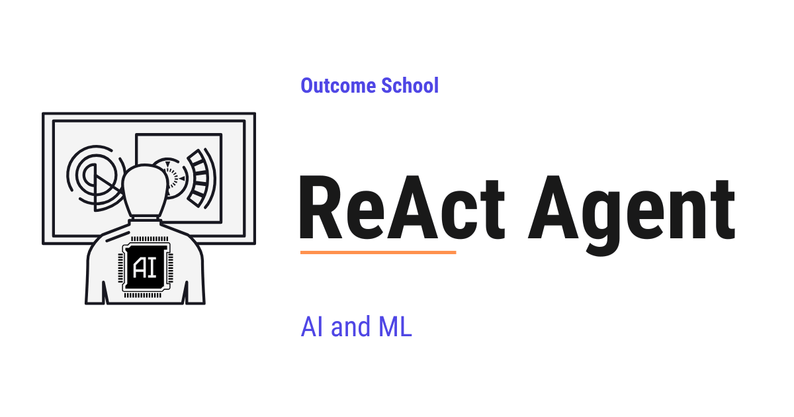

# What is a ReAct Agent? How It Thinks and Acts, Explained

> Archived from <https://outcomeschool.com/blog/react-agent> on 2026-11-25.

A ReAct Agent is an AI Agent built using the ReAct (Reasoning + Acting) pattern, the most common pattern for building AI Agents. It runs in a loop where the LLM thinks, takes an action, observes the result, and repeats until the task is done.

In this blog, we will learn about the ReAct Agent - what it is, how it is built, its anatomy, how it thinks and acts, and how to handle its common failure modes.

When we hear <strong>ReAct Agent</strong>, it sounds complex. But do not worry. If we break it down into its individual parts, every single piece is simple.

We will cover the following:
<ul><li>What is a ReAct Agent?</li><li>ReAct Agent vs AI Agent</li><li>Anatomy of a ReAct Agent</li><li>The ReAct Prompt Template</li><li>How a ReAct Agent Thinks and Acts</li><li>A Full Trace Example</li><li>Implementing a ReAct Agent</li><li>Common Failure Modes and How to Fix Them</li><li>Quick Summary</li></ul>
I am <strong>Amit Shekhar</strong>, Founder @ <a target="_blank" rel="noopener noreferrer" href="https://outcomeschool.com">Outcome School</a>, I have taught and mentored many developers, and their efforts landed them high-paying tech jobs, helped many tech companies in solving their unique problems, and created many open-source libraries being used by top companies. I am passionate about sharing knowledge through open-source, blogs, and videos.

I teach <a target="_blank" rel="noopener noreferrer" href="https://outcomeschool.com/program/ai-and-machine-learning">AI and Machine Learning</a> at Outcome School.

Let&#x27;s get started.
<h2 id="what-is-a-react-agent">What is a ReAct Agent?</h2>
A <strong>ReAct Agent</strong> is an <a target="_blank" rel="noopener noreferrer" href="ai-agent.md"><strong>AI Agent</strong></a> built using the <strong>ReAct (Reasoning + Acting)</strong> pattern - the most common pattern for building AI Agents. It is not a single LLM call. It is <a target="_blank" rel="noopener noreferrer" href="ai-agent-loop.md">a loop around an LLM</a>, where the LLM is given a list of tools it can recommend. At each step, the LLM reasons about what to do and recommends a tool. The loop runs the tool, appends the result back to the memory, and the LLM reasons over it on the next turn.

Let&#x27;s decompose the term:

<strong>ReAct Agent = Reasoning + Acting + Agent</strong>

<strong>Reasoning</strong> is the thinking part - the LLM figures out what to do next. <strong>Acting</strong> is the doing part - the LLM picks a tool, and the loop calls it. <strong>Agent</strong> is the wrapper around the LLM that runs this loop, executes the tools, and feeds the results back.

In simple words:

<strong>ReAct Agent = LLM + Tools + A loop that lets the LLM think, act, and observe until the task is done.</strong>

Think of a ReAct Agent like a new intern on their first day. They do not solve every problem in their head. They think about what they need, open a tool, read the result, think again, and repeat. A ReAct Agent works the exact same way - but at the speed of a machine.

A plain LLM call gives us one response and stops. A ReAct Agent gives us a response, runs tools, reads results, and keeps going - until it has a final answer. So, here comes the ReAct Agent to the rescue whenever a task is too big to solve in a single LLM call.
<h2 id="react-agent-vs-ai-agent">ReAct Agent vs AI Agent</h2>
Now, a natural question arises - if a ReAct Agent is an LLM in a loop with tools, isn&#x27;t that just an AI Agent? Let&#x27;s clear this up.

<strong>ReAct is a pattern to build AI Agents. It is not a different category.</strong>

<a target="_blank" rel="noopener noreferrer" href="ai-agent.md"><strong>AI Agent</strong></a> is the category - any system where an LLM is wrapped in a loop with tools and memory. It does not say <em>how</em> the loop is structured, <em>how</em> the LLM picks the next action, or <em>whether</em> the reasoning is visible.

<strong>ReAct</strong> is a pattern for building that loop, where the LLM follows a <strong>Thought - Action - Observation</strong> cycle. At every step, the LLM first writes its reasoning (the Thought), then picks a tool (the Action), then reads the result (the Observation), then thinks again. The reasoning is explicit, step by step, and visible at every turn. That explicit step-by-step reasoning is <a target="_blank" rel="noopener noreferrer" href="how-does-chain-of-thought-prompting-work.md">Chain-of-Thought (CoT) Prompting</a> surfaced inside the agent loop.

So when we say &quot;ReAct Agent,&quot; we mean an AI Agent built with the ReAct pattern. Other patterns like <a target="_blank" rel="noopener noreferrer" href="plan-and-execute-agent.md">Plan-and-Execute</a>, <a target="_blank" rel="noopener noreferrer" href="reflection-agent.md">Reflection</a>, and <a target="_blank" rel="noopener noreferrer" href="agentic-rag.md">Agentic RAG</a> also build AI Agents - they just shape the loop differently.

In simple words:

<strong>ReAct is a way to build an AI Agent. Not all AI Agents are built this way, but most are.</strong>

Let me tabulate the differences between an AI Agent and a ReAct Agent for your better understanding.
<table><thead><tr><th>Property</th><th>AI Agent (the category)</th><th>ReAct Agent (built with the ReAct pattern)</th></tr></thead><tbody><tr><td>Definition</td><td>Any LLM in a loop with tools</td><td>LLM that loops through Thought, Action, Observation</td></tr><tr><td>Reasoning</td><td>May or may not be visible</td><td>Surfaced as an explicit Thought step (in the classic form)</td></tr><tr><td>Loop pattern</td><td>Not specified</td><td>Thought -&gt; Action -&gt; Observation -&gt; repeat</td></tr><tr><td>Examples</td><td>ReAct, Plan-and-Execute, Reflection, Agentic RAG</td><td>Just the ReAct pattern</td></tr><tr><td>When to use the term</td><td>When speaking generally about agents</td><td>When you mean the Thought - Action - Observation loop specifically</td></tr></tbody></table>
A computer-use agent is another type of AI Agent that runs this same think-act loop, but it operates a computer the way a human does - looking at the screen and clicking. We have a detailed blog on <a target="_blank" rel="noopener noreferrer" href="how-do-computer-use-agents-work.md">How do Computer-Use Agents work?</a> that covers this in depth.

<strong>Planning your move into AI?</strong>

No matter which tech domain you work in today, with your effort, you can transition to these roles:
<ul><li>AI Engineer</li><li>Forward Deployed Engineer</li><li>AI Agent Engineer</li><li>Harness Engineer</li><li>Voice AI Engineer</li><li>AI Architect</li><li>LLM Engineer</li><li>LLM Inference Engineer</li><li>Gen AI Engineer</li><li>MLOps Engineer</li><li>ML Engineer</li><li>Deep Learning Engineer</li></ul>
Our <a target="_blank" rel="noopener noreferrer" href="https://outcomeschool.com/program/ai-and-machine-learning">AI and Machine Learning Program</a> at Outcome School takes you there.
<h2 id="anatomy-of-a-react-agent">Anatomy of a ReAct Agent</h2>
A ReAct Agent has five parts. Let&#x27;s decode each one.

<pre><code class="code-highlight">+------------------------------------------------+
|                Loop Controller                 |
|                                                |
|   System Prompt ---&gt;  +-------+                |
|                       |       |                |
|   Memory        ---&gt;  |  LLM  | &lt;-----+        |
|                       +-------+       |        |
|                           |           |        |
|                           | pick      | obs    |
|                           v           |        |
|                       +-------+       |        |
|                       | Tools | ------+        |
|                       +-------+                |
+------------------------------------------------+
</code></pre>

<strong>1. The LLM.</strong> This is the brain. It does the reasoning. It reads the conversation history and decides the next step - either pick a tool for the loop to call, or produce the final answer.

<strong>2. The System Prompt.</strong> This tells the LLM how to behave. It explains the ReAct pattern, lists the available tools, and sets the rules. Without a good <a target="_blank" rel="noopener noreferrer" href="system-prompt.md">system prompt</a>, the LLM may not think, act, or stop reliably.

<strong>3. The Tools.</strong> These are the actions the agent can take - search the web, query a database, run a calculator, send an email, read a file, and etc. Each tool has a name, a description, and an input schema.

<strong>4. The <a target="_blank" rel="noopener noreferrer" href="ai-agent-memory.md">Memory</a>.</strong> This is the running history of the conversation - the user&#x27;s question, every thought, every action, every observation. The LLM reads this memory at every step to decide what to do next.

<strong>5. The Loop Controller.</strong> This is the code that runs the loop. It sends the memory to the LLM, executes any <a target="_blank" rel="noopener noreferrer" href="how-does-function-calling-work-in-llms.md">tool calls</a>, appends the results back to the memory, and checks if the agent is done. It also handles the stop conditions - like a maximum number of steps. Designing this controller well - the budget, the observations, and the exits - is <a target="_blank" rel="noopener noreferrer" href="what-is-loop-engineering.md">Loop Engineering</a>.

All five parts work together. Remove any one of them, and it is no longer a ReAct Agent.

To master the ReAct pattern, tool use, agent memory, and agent architecture in depth, check out our <a target="_blank" rel="noopener noreferrer" href="https://outcomeschool.com/program/ai-and-machine-learning">AI and Machine Learning Program</a> at Outcome School.
<h2 id="the-react-prompt-template">The ReAct Prompt Template</h2>
A good system prompt is what makes a plain LLM behave reliably as a ReAct Agent. Without one, the LLM may answer too early, skip the reasoning, or use the tools poorly. With one, the LLM knows to think, act, observe, and loop.

Here is a simple ReAct prompt template:

<pre><code class="code-highlight">You are a helpful assistant that solves problems by thinking step by step and recommending tools when needed.

You have access to the following tools:
- search(query): Search the web for information.
- calculator(expression): Evaluate a math expression.

At each step, respond in one of these two formats:

Format 1 - When you need to recommend a tool:
Thought: &lt;your reasoning about what to do next&gt;
Action: &lt;tool_name&gt;(&lt;tool_input&gt;)

Format 2 - When you have the final answer:
Thought: &lt;your final reasoning&gt;
Final Answer: &lt;the answer to the user&#x27;s question&gt;

Rules:
- Always start with a Thought.
- Recommend one tool per turn, unless multiple independent tools would clearly help in parallel.
- Wait for the Observation before continuing.
- Stop as soon as you have the final answer.
</code></pre>

Here, we can see that the prompt does three things:
<ul><li>Explains the ReAct pattern (Thought, Action, Observation, Final Answer).</li><li>Lists the available tools with their inputs.</li><li>Sets rules to keep the agent from going off the rails.</li></ul>
<strong>Note:</strong> The literal <code>Action: tool(input)</code> string format above is the classic ReAct string format - the original paper used square brackets like <code>Action: search[Apple Remote]</code>, and later versions and tutorials use parentheses. Either way, if we are using Claude, GPT, or Gemini, we must not copy this string format - we must define our tools using the API&#x27;s tool/function-calling schema instead. The API handles the action format for us, validates the inputs, and parses the tool call. The core idea is the same - the prompt tells the LLM when to think, when to act, and when to stop - but the wiring is cleaner.

If we want to go deep into prompt engineering, the ReAct pattern, and tool use end to end, we have a complete program on this - check out our <a target="_blank" rel="noopener noreferrer" href="https://outcomeschool.com/program/ai-and-machine-learning">AI and Machine Learning Program</a> at Outcome School.
<h2 id="how-a-react-agent-thinks-and-acts">How a ReAct Agent Thinks and Acts</h2>
Now, let&#x27;s put all the parts together to see how a ReAct Agent runs end to end.

Here is the shape of the loop:

<pre><code class="code-highlight">        +-----------------+
        |  User Question  |
        +-----------------+
                 |
                 v
        +-----------------+
        |    Thought      |  &lt;-- LLM reasons about the next step
        +-----------------+
                 |
        +--------+--------+
        |                 |
        v                 v
  +-----------+    +---------------+
  |  Action   |    | Final Answer  | ---&gt; back to user
  +-----------+    +---------------+
        |
        v
  +-----------+
  |   Tool    |
  +-----------+
        |
        v
  +-------------+
  | Observation | --+
  +-------------+   |
                    |
                    +---&gt; back to Thought (loop continues)
</code></pre>

The user&#x27;s question goes in at the top. The LLM produces a Thought, and from that Thought it picks one of two paths - either an Action that the loop turns into a tool call, or a Final Answer that ends the loop. When the LLM picks an Action, the loop runs the tool, the result comes back as an Observation, and the Observation feeds into the next Thought. This Thought - Action - Observation cycle keeps going until the LLM produces the Final Answer.

<strong>Note:</strong> The classic ReAct form runs one tool per Thought, which is what the diagram shows. Modern APIs like Claude, GPT, and Gemini can return multiple independent tool calls from a single Thought, and the loop runs them in parallel before the next Thought. The shape is the same - we just process a list of Actions instead of a single Action.

Here are the steps the agent follows:

<strong>Step 1:</strong> The user sends a question. The Loop Controller adds it to the Memory.

<strong>Step 2:</strong> The Loop Controller sends the Memory (system prompt + user question + history) to the LLM.

<strong>Step 3:</strong> The LLM responds with either a Thought + Action, or a Final Answer.

<strong>Step 4:</strong> If the response is a Final Answer, the Loop Controller returns it to the user. The agent is done.

<strong>Step 5:</strong> If the response is a Thought + Action, the Loop Controller executes the tool and gets the result. This result is the Observation.

<strong>Step 6:</strong> The Loop Controller appends the Thought, Action, and Observation to the Memory.

<strong>Step 7:</strong> Go back to Step 2.

This loop continues until the LLM produces a Final Answer or the maximum step limit is reached.

<strong>A quick note for you</strong>

No matter which tech domain you work in, get familiar with these topics:
<ul><li>LLM</li><li>RAG</li><li>MCP</li><li>Agent</li><li>Fine-tuning</li><li>Quantization</li></ul>
We put it all together in one video:

<a target="_blank" rel="noopener noreferrer" href="https://www.youtube.com/watch?v=lnfWvX66FUk">AI Engineering Explained: LLM, RAG, MCP, Agent, Fine-Tuning, and Quantization</a>

No need to stop reading - bookmark it and watch later when you get time. Future you will thank you.

Now, let&#x27;s get back to the topic.
<h2 id="a-full-trace-example">A Full Trace Example</h2>
Let&#x27;s trace through a real example to see every part in action.

<strong>User:</strong> &quot;What is 15% of the population of Tokyo?&quot;

<pre><code class="code-highlight">Thought 1: I need to find the population of Tokyo first. I do not know the exact current number, so I will search for it.
Action 1: search(&quot;current population of Tokyo&quot;)
Observation 1: The population of Tokyo is approximately 14 million.

Thought 2: Now I need to calculate 15% of 14 million. Let me use the calculator to be accurate.
Action 2: calculator(&quot;14000000 * 0.15&quot;)
Observation 2: 2100000

Thought 3: I now have the answer. 15% of the population of Tokyo (14 million) is 2.1 million.
Final Answer: 15% of the population of Tokyo is approximately 2.1 million people.
</code></pre>

Here, we can see how the agent:
<ul><li>Recognized that it did not have the population data and reached for a tool.</li><li>Chained the output of the search into the input of the calculator.</li><li>Stopped as soon as it had the final answer.</li></ul>
That&#x27;s the beauty of a ReAct Agent. Each step is small and simple, but the loop lets it solve problems that a single LLM call cannot.

Now, let&#x27;s see how to build this in code.
<h2 id="implementing-a-react-agent">Implementing a ReAct Agent</h2>
Now, here is the important realization:

<strong>If we write code that takes the user&#x27;s question, sends it to an LLM, runs the tools the LLM picks, feeds the observations back, and repeats this loop until the LLM has a final answer - our piece of code is a ReAct Agent.</strong>

That is all a ReAct Agent is. No magic. No black box. Just a loop, an LLM, some tools, and memory - all wired together in code.

Let&#x27;s see what this looks like in real Python code, as below. Here, <code>call_llm</code> is any function that sends the messages and the list of tools to the LLM of our choice - Claude, GPT, Gemini, or any other - and returns its response. And <code>call_tool</code> is any function that runs a tool by name with the given arguments and returns the result. The code below is independent of any specific provider, so the message shapes are the conceptual form - real APIs use slightly different fields (OpenAI uses <code>tool_call_id</code>, Anthropic wraps the result in a <code>tool_result</code> block) and we adapt the shape to match.

<pre><code class="code-highlight language-python">REACT_SYSTEM_PROMPT = &quot;...&quot;  # the ReAct prompt template from the previous section

async def run_react_agent(user_question, tools, max_steps=10):
    messages = [
        {&quot;role&quot;: &quot;system&quot;, &quot;content&quot;: REACT_SYSTEM_PROMPT},
        {&quot;role&quot;: &quot;user&quot;, &quot;content&quot;: user_question},
    ]
    step = 0

    while True:
        # Safety stop: bail out if we hit the step limit
        if step &gt;= max_steps:
            return &quot;Reached step limit without a final answer.&quot;
        step += 1

        # Ask the LLM to think, then either act or give the final answer
        response = await call_llm(messages, tools)

        # If the LLM has the final answer, stop the loop and return it
        if response.is_done:
            return response.final_answer

        # Otherwise, run each tool the LLM picked and feed the observation back
        for tool_call in response.tool_calls:
            observation = await call_tool(tool_call.name, tool_call.arguments)
            messages.append({
                &quot;role&quot;: &quot;tool&quot;,
                &quot;name&quot;: tool_call.name,
                &quot;content&quot;: str(observation),
            })
</code></pre>

Here, we have the entire ReAct Agent in about 20 lines of Python. Let&#x27;s walk through the important parts:
<ul><li><strong>The initial messages.</strong> We seed the memory with the ReAct system prompt and the user&#x27;s question. The system prompt is what makes the LLM follow the Thought - Action - Observation pattern, so it must be the first message in the memory.</li><li><strong>The <code>while True</code> loop.</strong> This is the Loop Controller. It keeps going until either the LLM has the final answer or we hit the step limit.</li><li><strong>The step limit.</strong> We bail out after <code>max_steps</code> iterations. This protects us from infinite loops - one of the most common failure modes for ReAct Agents.</li><li><strong>The LLM call.</strong> We send the full memory (the conversation history) along with the list of tools. The LLM does the Thought step here - it reasons about the next move and either picks an Action or returns the Final Answer.</li><li><strong>The stop check.</strong> If <code>response.is_done</code> is <code>True</code>, the LLM is telling us <strong>&quot;I am done, here is the final answer.&quot;</strong> We return that answer and exit the loop.</li><li><strong>The tool-call branch.</strong> If the LLM picked one or more tools, we run each one with <code>call_tool</code> using the arguments the LLM gave, append the observation back to the memory, and the loop continues.</li></ul>
That is the complete skeleton of a ReAct Agent - a <code>while</code> loop, an LLM call inside it, a check for the final answer, and a tool-call branch that feeds observations back. Everything else we add on top - structured tracing of Thoughts, retries, reflection, parallel tool calls - is polish around this core loop.

Now, let&#x27;s look at what can go wrong.

To build an AI Coding Agent from scratch using the ReAct pattern, check out our <a target="_blank" rel="noopener noreferrer" href="https://outcomeschool.com/program/ai-and-machine-learning">AI and Machine Learning Program</a> at Outcome School.
<h2 id="common-failure-modes-and-how-to-fix-them">Common Failure Modes and How to Fix Them</h2>
ReAct Agents are powerful, but they can fail in specific ways. Let&#x27;s decode each one.

<strong>1. Infinite loops.</strong> The agent keeps calling the same tool with the same input and never produces a final answer.

<strong>How to fix:</strong> Set a hard <code>max_steps</code> limit. Also, detect repeated identical actions and either stop or inject a message telling the agent to try a different approach.

<strong>2. Wrong tool selection.</strong> The agent calls the wrong tool for the job - like using search for a math problem.

<strong>How to fix:</strong> Write very clear tool descriptions. The description is what the LLM uses to pick the tool, so every word matters. Say exactly what the tool does and when to use it.

<strong>3. Hallucinated tool calls.</strong> The agent calls a tool that does not exist or passes invalid arguments.

<strong>How to fix:</strong> Use an LLM with native tool-use support (like Claude, GPT, or Gemini) so the schema is enforced. Always validate tool inputs before executing, and return a clear error message as the Observation if they are invalid.

<strong>4. Context explosion.</strong> After many steps, the conversation history becomes too long for the LLM&#x27;s <a target="_blank" rel="noopener noreferrer" href="context-window.md">context window</a>.

<strong>How to fix:</strong> Summarize older steps, drop stale observations, or use a separate memory store. For long-running agents, we must actively manage the context - this is the discipline of <a target="_blank" rel="noopener noreferrer" href="context-engineering.md">Context Engineering</a>. We have a detailed blog on <a target="_blank" rel="noopener noreferrer" href="recursive-language-models.md">Recursive Language Models (RLMs)</a> that takes a different angle - keeping the main context small by recursively offloading work to sub-models.

<strong>5. Premature stopping.</strong> The agent gives a final answer before gathering enough information.

<strong>How to fix:</strong> Add a critic step that reviews the final answer before it is returned, or require the agent to check its answer against a checklist (Did I cover all the parts of the question? Did I cite a source? Did I verify the math?) before emitting the Final Answer. The system prompt should make this verification step explicit, not optional.

<strong>6. Getting stuck after a tool error.</strong> A tool fails, and the agent does not know how to recover.

<strong>How to fix:</strong> Catch tool errors, convert them into natural-language Observations (e.g., &quot;Error: the search API timed out. Try again or use a different query.&quot;), and let the LLM reason its way out.

<strong>Stay updated:</strong> Subscribe to our <a target="_blank" rel="noopener noreferrer" href="https://outcomeschool.substack.com/subscribe">newsletter</a> to get our latest AI and Machine Learning blogs straight to your inbox.

Now, we have understood what a ReAct Agent is and how to handle the common failure modes. Let&#x27;s wrap up with a quick recap.
<h2 id="quick-summary">Quick Summary</h2>
Let&#x27;s recap what we have learned:
<ul><li><strong>A ReAct Agent</strong> is an AI Agent that loops through Thought, Action, and Observation until the task is done. It is an LLM wrapped in a loop with tools and memory.</li><li><strong>The anatomy</strong> has five parts: the LLM, the System Prompt, the Tools, the Memory, and the Loop Controller. Remove any one, and it is no longer a ReAct Agent.</li><li><strong>The system prompt</strong> is what makes a plain LLM behave reliably as a ReAct Agent. It explains the pattern, lists the tools, and sets the rules.</li><li><strong>The loop</strong> is simple: send memory to LLM -&gt; if tool call, execute and append observation -&gt; if final answer, return.</li><li><strong>Common failure modes</strong> include infinite loops, wrong tool selection, hallucinated tool calls, context explosion, premature stopping, and errors after tool failures. Handling these is the real work of building a production agent.</li><li>ReAct or a ReAct-style loop is the most common pattern under the hood of modern AI agents - from coding assistants to customer support bots to research assistants.</li></ul><h2 id="frequently-asked-questions">Frequently Asked Questions</h2><h3 id="can-a-react-agent-call-more-than-one-tool-in-a-single-step">Can a ReAct Agent call more than one tool in a single step?</h3>
Yes, with modern APIs. The classic ReAct form runs one tool per Thought. But modern APIs like Claude, GPT, and Gemini can return multiple independent tool calls from a single Thought, and the loop runs them in parallel before the next Thought. The shape of the loop stays the same.
<h3 id="should-we-copy-the-action-string-format-from-the-react-prompt-when-using-claude-gpt-or-gemini">Should we copy the Action string format from the ReAct prompt when using Claude, GPT, or Gemini?</h3>
No. The literal Action string format is the classic ReAct format. With Claude, GPT, or Gemini, we must define our tools using the API&#x27;s tool or function-calling schema instead. The API handles the action format, validates the inputs, and parses the tool call for us.
<h3 id="how-is-react-related-to-chain-of-thought-prompting">How is ReAct related to Chain-of-Thought prompting?</h3>
In a ReAct Agent, the LLM writes its reasoning as a Thought at every step, before it picks an Action. That explicit step-by-step reasoning is Chain-of-Thought (CoT) Prompting surfaced inside the agent loop. On top of that reasoning, ReAct also acts with tools and reads the results between thoughts.
<h3 id="how-does-a-react-agent-recover-when-a-tool-fails">How does a ReAct Agent recover when a tool fails?</h3>
We catch the tool error and convert it into a natural-language Observation, such as a message saying the search API timed out and suggesting a retry or a different query. Then we let the LLM reason its way out on the next turn, instead of leaving the agent stuck.

That&#x27;s it for now.

Thanks

<strong>Amit Shekhar</strong> Founder @ <a target="_blank" rel="noopener noreferrer" href="https://outcomeschool.com">Outcome School</a>

You can connect with me on:
<ul><li><a target="_blank" rel="noopener noreferrer" href="https://x.com/amitiitbhu">X</a></li><li><a target="_blank" rel="noopener noreferrer" href="https://www.linkedin.com/in/amit-shekhar-iitbhu">LinkedIn</a></li><li><a target="_blank" rel="noopener noreferrer" href="https://github.com/amitshekhariitbhu">GitHub</a></li></ul>
Follow Outcome School on:
<ul><li><a target="_blank" rel="noopener noreferrer" href="https://x.com/outcome_school">X</a></li><li><a target="_blank" rel="noopener noreferrer" href="https://youtube.com/@OutcomeSchool">YouTube</a></li><li><a target="_blank" rel="noopener noreferrer" href="https://www.linkedin.com/company/outcomeschool">LinkedIn</a></li><li><a target="_blank" rel="noopener noreferrer" href="https://github.com/OutcomeSchool">GitHub</a></li></ul>
<a target="_blank" rel="noopener noreferrer" href="https://outcomeschool.com/blog"><strong>Read all of our high-quality blogs here.</strong></a>

