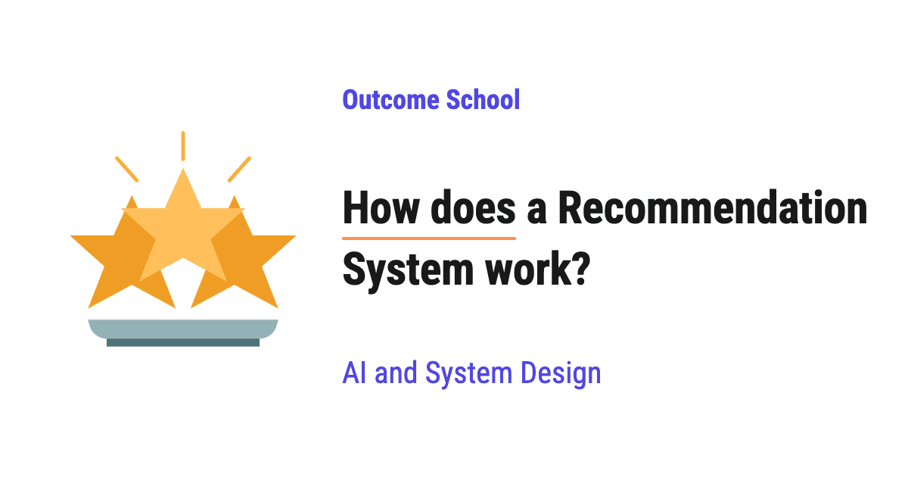

# How does a Recommendation System work?

> Archived from <https://outcomeschool.com/blog/recommendation-system> on 2026-11-25.

A Recommendation System is software that looks at what we like and suggests other things we are likely to enjoy, using methods like content-based and collaborative filtering.

In this blog, we will learn about how a Recommendation System works. We will also see the main techniques behind it, the problems that arise, and how big platforms like Netflix and YouTube put it all together.

We will cover the following:
<ul><li>What is a Recommendation System?</li><li>The goal of a Recommendation System</li><li>Content-based filtering</li><li>Collaborative filtering</li><li>The user-item interaction matrix</li><li>Explicit vs implicit feedback</li><li>Matrix factorization and embeddings</li><li>The cold-start problem</li><li>The modern two-stage design: candidate generation and ranking</li><li>How big platforms combine everything</li></ul>
I am <strong>Amit Shekhar</strong>, Founder @ <a target="_blank" rel="noopener noreferrer" href="https://outcomeschool.com">Outcome School</a>, I have taught and mentored many developers, and their efforts landed them high-paying tech jobs, helped many tech companies in solving their unique problems, and created many open-source libraries being used by top companies. I am passionate about sharing knowledge through open-source, blogs, and videos.

I teach <a target="_blank" rel="noopener noreferrer" href="https://outcomeschool.com/program/ai-and-machine-learning">AI and Machine Learning</a> at Outcome School.

Let&#x27;s get started.
<h2 id="what-is-a-recommendation-system">What is a Recommendation System?</h2>
<strong>A Recommendation System is software that looks at what we like and suggests other things we are likely to enjoy.</strong>

It picks items for us from a very large list, so that we do not have to search through everything ourselves.

We use recommendation systems every day, even when we do not notice them.
<ul><li>When we open <strong>Netflix</strong>, the rows of movies and shows are picked for us.</li><li>When we watch one video on <strong>YouTube</strong>, the next suggestions appear on the side.</li><li>When we shop on <strong>Amazon</strong>, we see &quot;Customers who bought this also bought&quot; sections.</li><li>When we listen to <strong>Spotify</strong>, it builds a playlist of songs we have never heard but end up enjoying.</li></ul>
In all of these cases, no human is sitting and choosing items for us one by one. A recommendation system is doing the work behind the scenes.

So, why do we even need this? Let&#x27;s understand the real problem first.

Suppose a platform has more than ten thousand movies and shows. If we had to scroll through all of them to find one good movie, we would give up before we even started. There are simply too many choices.

This is called the problem of <strong>too much choice</strong>. When there are thousands or millions of items, finding the right one becomes very hard.

So, here comes the Recommendation System to the rescue. Instead of showing us everything, it shows us the few items that we are most likely to enjoy. It saves our time and makes the experience pleasant.
<h2 id="the-goal-of-a-recommendation-system">The goal of a Recommendation System</h2>
Before we go into the techniques, we must be very clear about the goal.

<strong>The goal of a Recommendation System is to predict what a user will like, and then show the most relevant items at the top.</strong>

Let&#x27;s break this into two parts.

<strong>Step 1:</strong> Predict. The system tries to guess how much we will like an item that we have not seen yet. For example, it tries to guess that we will give a particular movie 4.5 stars out of 5, even though we have never watched it.

<strong>Step 2:</strong> Rank and show. Once it has guessed a score for many items, it sorts them from highest score to lowest score. Then it shows the top few to us.

Now, the question is: how does the system predict what we will like? It all starts with two classic ideas, and we will build on top of them from there. Let&#x27;s learn each one in detail.
<h2 id="content-based-filtering">Content-based filtering</h2>
<strong>Content-based filtering recommends items that are similar to the items we already liked, based on the features of those items.</strong>

Here, the key word is <strong>features</strong>. A feature is a property that describes an item.

Let&#x27;s say we are talking about movies. The features of a movie can be:
<ul><li>Its genre, such as action, comedy, or horror.</li><li>Its actors.</li><li>Its director.</li><li>Its language.</li><li>Its release year.</li></ul>
Now, suppose we watched and loved an action movie starring a particular actor. Content-based filtering will look at the features of that movie. It will then search for other movies that share those features, such as other action movies with the same actor. It will recommend those to us.

Let&#x27;s see this with a tiny example. Assume that we describe each movie using just two features, &quot;action level&quot; and &quot;romance level&quot;, each scored from 0 to 1.

<pre><code class="language-text code-highlight">Movie A (we loved it):  action = 0.9, romance = 0.1
Movie B:                action = 0.8, romance = 0.2   -&gt; very similar
Movie C:                action = 0.1, romance = 0.9   -&gt; very different
</code></pre>

Here, we can see that Movie B has feature values close to Movie A. So, the system recommends Movie B. Movie C is very far in its features, so it is not recommended.

This idea of &quot;how close are two items&quot; is called <strong>similarity</strong>. The system measures how similar two items are by comparing their feature values. Items that are close are similar. Items that are far apart are different. We have a detailed blog on <a target="_blank" rel="noopener noreferrer" href="cosine-similarity.md">Cosine Similarity</a> that explains one popular way to measure this closeness.

<strong>Advantage:</strong> Content-based filtering works even if no other user has interacted with an item. As long as we know the features of the item, we can recommend it.

<strong>Disadvantage:</strong> It tends to keep recommending the same type of thing. If we only watched action movies, it will keep showing action movies, and we may never discover a great comedy. This problem is called being stuck in a <strong>filter bubble</strong>, which means we only see more of what we already know.

Now, it&#x27;s time to learn about a very different idea.
<h2 id="collaborative-filtering">Collaborative filtering</h2>
<strong>Collaborative filtering recommends items by using the behavior of many users, not the features of the items.</strong>

The word &quot;collaborative&quot; means working together. Here, the system uses the combined behavior of a huge crowd of users to help each single user.

The best part is that it does not need to know anything about the item itself. It does not need to know the genre, the actor, or the director. It only needs to know who liked what.

There are two types of collaborative filtering. Let&#x27;s understand both.

<strong>User-based collaborative filtering</strong> is the idea of &quot;people like you also liked this&quot;.

Let&#x27;s say there are two users, Riya and Sam. They have both watched and liked the same nine movies. So, Riya and Sam have very similar taste.

Now, Sam has also watched and liked one more movie that Riya has not seen yet. Since Riya and Sam are so similar, the system guesses that Riya will like that movie too. So, it recommends it to Riya.

This is the meaning of &quot;people like you also liked this&quot;. The system finds users similar to us and recommends what they enjoyed.

We can visualize this as below:

<pre><code class="language-text code-highlight">   Riya liked:  [Movie1] [Movie2] ... [Movie9]
   Sam  liked:  [Movie1] [Movie2] ... [Movie9] [Movie10]
                              ↓
             Same nine movies, so same taste
                              ↓
              Riya has not seen Movie10 yet
                              ↓
               Recommend [Movie10] to Riya
</code></pre>

Here, we can see that Riya and Sam liked the same nine movies, so the system treats them as similar users. Sam liked one extra movie, Movie10, that Riya has not seen. Since their taste matches, the system recommends Movie10 to Riya.

<strong>Item-based collaborative filtering</strong> is the idea of &quot;people who liked this also liked that&quot;.

Here, instead of finding similar users, we find similar items based on how people behave.

Let&#x27;s say a large number of people who bought a phone also bought a particular phone cover. The system notices this pattern. So, when a new customer buys that phone, it recommends the same phone cover, because people who liked one thing also liked the other.

<strong>Note:</strong> Item-based collaborative filtering does not look at the features of the phone or the cover. It only notices that the same people tend to like both. This is what makes it different from content-based filtering, which compares actual item features.

Let me tabulate the differences between these approaches for your better understanding.
<table><thead><tr><th>Approach</th><th>What it uses</th><th>Core idea</th></tr></thead><tbody><tr><td>Content-based filtering</td><td>Features of items</td><td>Recommend items similar to what we liked</td></tr><tr><td>User-based collaborative</td><td>Behavior of similar users</td><td>People like us also liked this</td></tr><tr><td>Item-based collaborative</td><td>Behavior across items</td><td>People who liked this also liked that</td></tr></tbody></table>
Now, the next question is: how does the system actually store all this &quot;who liked what&quot; information? For this, we must learn about a structure.
<h2 id="the-user-item-interaction-matrix">The user-item interaction matrix</h2>
To do collaborative filtering, the system needs to record every interaction between users and items in an organized way. This is done using a <strong>user-item interaction matrix</strong>.

<strong>A user-item interaction matrix is a big table where each row is a user, each column is an item, and each cell tells us how that user interacted with that item.</strong>

Let&#x27;s see a tiny example with four users and four movies. A number means the rating the user gave. A dash means the user has not interacted with that movie yet.

<pre><code class="language-text code-highlight">            Movie1   Movie2   Movie3   Movie4
Riya          5        4        -        -
Sam           5        -        4        -
Aman          -        -        5        4
Neha          1        2        -        5
</code></pre>

Here, we can see that Riya rated Movie1 with 5 stars and Movie2 with 4 stars. The dash means we simply do not have that information yet.

In the real world, this matrix is enormous. A big platform can have millions of users and thousands of titles. Most users have watched only a tiny fraction of all titles.

This means almost all the cells in the matrix are blank. A matrix that is mostly empty is called a <strong>sparse matrix</strong>. &quot;Sparse&quot; simply means &quot;mostly empty&quot;.

So, the real job of a recommendation system becomes very clear now. <strong>The system must fill in the blank cells.</strong> If it can guess the rating Aman would give to Movie1, then it can decide whether to recommend Movie1 to Aman.

This is how the abstract goal of &quot;predicting preference&quot; turns into a very concrete task: fill in the empty cells of the matrix.

<strong>Planning your move into AI?</strong>

No matter which tech domain you work in today, with your effort, you can transition to these roles:
<ul><li>AI Engineer</li><li>Forward Deployed Engineer</li><li>AI Agent Engineer</li><li>Harness Engineer</li><li>Voice AI Engineer</li><li>AI Architect</li><li>LLM Engineer</li><li>LLM Inference Engineer</li><li>Gen AI Engineer</li><li>MLOps Engineer</li><li>ML Engineer</li><li>Deep Learning Engineer</li></ul>
Our <a target="_blank" rel="noopener noreferrer" href="https://outcomeschool.com/program/ai-and-machine-learning">AI and Machine Learning Program</a> at Outcome School takes you there.
<h2 id="explicit-vs-implicit-feedback">Explicit vs implicit feedback</h2>
Before we learn how to fill the matrix, we must understand where the numbers in the matrix come from. The data comes in two types of feedback.

<strong>Explicit feedback</strong> is when the user directly tells us their opinion.

For example, giving a movie 5 stars, clicking a thumbs up, or writing a review. The user has clearly and intentionally expressed how they feel. This data is very clean and accurate.

But, here is the problem. Most users never bother to rate anything. We watch many videos but rarely click like or dislike. So, explicit feedback is rare and the matrix stays very empty.

So, here comes implicit feedback into the picture.

<strong>Implicit feedback</strong> is what we learn from the user&#x27;s behavior, without the user telling us anything directly.

For example:
<ul><li>Did the user watch the full movie or stop after two minutes?</li><li>How long did they listen to a song?</li><li>Did they click on the item?</li><li>Did they add it to the cart?</li></ul>
Here, the user never said &quot;I like this&quot;. But their behavior gives us a strong hint. If someone watched a whole movie twice, they most likely enjoyed it. If they skipped it after one minute, they did not.

Implicit feedback is not always reliable. We call such data <strong>noisy</strong>, which means it can sometimes point us in the wrong direction. For example, someone may have left a video playing while they walked away from the screen.

Let me tabulate the differences between explicit and implicit feedback for your better understanding.
<table><thead><tr><th>Feedback type</th><th>What it is</th><th>Example</th><th>Quality</th></tr></thead><tbody><tr><td>Explicit</td><td>User states their opinion</td><td>Rating, like, review</td><td>Accurate but rare</td></tr><tr><td>Implicit</td><td>We infer from behavior</td><td>Watch time, clicks, purchases</td><td>Plenty but noisy</td></tr></tbody></table>
So, implicit feedback is plentiful but we must be careful with it. Many modern systems rely mostly on implicit feedback, because there is so much more of it.

<strong>A quick note for you</strong>

No matter which tech domain you work in, get familiar with these topics:
<ul><li>LLM</li><li>RAG</li><li>MCP</li><li>Agent</li><li>Fine-tuning</li><li>Quantization</li></ul>
We put it all together in one video:

<a target="_blank" rel="noopener noreferrer" href="https://www.youtube.com/watch?v=lnfWvX66FUk">AI Engineering Explained: LLM, RAG, MCP, Agent, Fine-Tuning, and Quantization</a>

No need to stop reading - bookmark it and watch later when you get time. Future you will thank you.

Now, let&#x27;s get back to the topic.

Now that we understand the matrix and the feedback, it&#x27;s time to learn a technique that fills the blank cells.
<h2 id="matrix-factorization-and-embeddings">Matrix factorization and embeddings</h2>
Earlier we saw that the system must fill the blank cells of a huge, mostly empty matrix. A popular technique to do this is called <strong>matrix factorization</strong>.

<strong>Matrix factorization breaks the big user-item matrix into two smaller tables, one describing users and one describing items, in a way that lets us rebuild the original ratings.</strong>

Imagine that every person&#x27;s taste can be described by a few hidden traits. For the sake of understanding, let&#x27;s say there are just two traits: how much someone likes &quot;action&quot; and how much someone likes &quot;romance&quot;.

So, we can describe each user with two numbers, like below:

<pre><code class="language-text code-highlight">Riya  -&gt; [action: 0.9, romance: 0.1]
Neha  -&gt; [action: 0.2, romance: 0.9]
</code></pre>

A small list of numbers like this is called a <strong>vector</strong>. And in machine learning, when this vector captures the hidden meaning of something, we call it an <strong><a target="_blank" rel="noopener noreferrer" href="what-are-embeddings.md">embedding</a></strong>. So, an embedding is a list of numbers that captures the hidden traits of a user or an item.

In the same way, we can describe each movie with the same two traits, like below:

<pre><code class="language-text code-highlight">Movie1 (action film)   -&gt; [action: 0.95, romance: 0.05]
Movie4 (love story)    -&gt; [action: 0.1,  romance: 0.9]
</code></pre>

To guess how much a user will like a movie, we multiply the matching numbers and add them up. This operation is called the <strong>dot product</strong>.

Let&#x27;s calculate how much Riya will like Movie1.

<pre><code class="language-text code-highlight">Riya    = [0.9, 0.1]
Movie1  = [0.95, 0.05]

dot product = (0.9 x 0.95) + (0.1 x 0.05)
            = 0.855 + 0.005
            = 0.86   (high score -&gt; recommend it)
</code></pre>

Now let&#x27;s calculate how much Riya will like Movie4, the love story.

<pre><code class="language-text code-highlight">Riya    = [0.9, 0.1]
Movie4  = [0.1, 0.9]

dot product = (0.9 x 0.1) + (0.1 x 0.9)
            = 0.09 + 0.09
            = 0.18   (low score -&gt; do not recommend it)
</code></pre>

Here, we can see that the dot product is high when the user&#x27;s tastes and the item&#x27;s traits point in the same direction, and low when they do not. <strong>When the user embedding and the item embedding are aligned, the user is likely to like the item.</strong>

So, the whole trick of matrix factorization is to learn one embedding for each user and one embedding for each item, such that their dot product matches the known ratings. The two smaller tables we mentioned in the definition are exactly these: one table holding every user embedding, and one table holding every item embedding.

We can picture this split as below:

<pre><code class="language-text code-highlight">        Big user-item matrix (mostly empty)
        +---------------------------------+
        |   M1    M2    M3    M4   ...    |
        |  ----------------------------   |
        |   5     4     -     -    ...    |
        |   5     -     4     -    ...    |
        |   -     -     5     4    ...    |
        +---------------------------------+
                        ↓
             broken into two small tables
                        ↓
   User embeddings              Item embeddings
   +-------------------+        +-------------------+
   | Riya -&gt; [.9, .1]  |        | M1 -&gt; [.95, .05]  |
   | Neha -&gt; [.2, .9]  |        | M4 -&gt; [.1,  .9 ]  |
   +-------------------+        +-------------------+
                 \                  /
                  \                /
                   ↓              ↓
            dot product fills the blank cell
</code></pre>

Here, we can see that the big and mostly empty matrix is replaced by two compact tables, one for users and one for items. To find any rating, even a blank one, we take the dot product of that user&#x27;s embedding and that item&#x27;s embedding. So, two small tables can approximately rebuild the entire huge matrix.

In our example we hand-picked &quot;action&quot; and &quot;romance&quot;. In reality, the system does not know these traits in advance. It learns them automatically from the data.

The system starts with random numbers in every embedding. Then it looks at the ratings we already know, checks how wrong its guesses are, and slowly adjusts the numbers to reduce the error. After many rounds, the embeddings become meaningful on their own. We have a detailed blog on <a target="_blank" rel="noopener noreferrer" href="math-behind-gradient-descent.md">Gradient Descent</a> that explains this step by step.

The system discovers hidden patterns of taste by itself, and that too without being explicitly programmed with what those patterns are. The traits it finds may not even have names we can describe, but they work.

Once the embeddings are learned, filling a blank cell is easy. We take the dot product of that user&#x27;s embedding and that item&#x27;s embedding.

To learn Embeddings, Gradient Descent, and Loss Functions in depth, check out our <a target="_blank" rel="noopener noreferrer" href="https://outcomeschool.com/program/ai-and-machine-learning">AI and Machine Learning Program</a> at Outcome School.
<h2 id="the-cold-start-problem">The cold-start problem</h2>
Now, there is one big problem that every recommendation system must face. It is called the <strong>cold-start problem</strong>.

<strong>The cold-start problem happens when we have a brand new user or a brand new item with no interaction history, so the system has nothing to learn from.</strong>

There are two cases here.

<strong>New user:</strong> A person just signed up. They have not watched, rated, or clicked anything. Collaborative filtering cannot help, because it works on past behavior, and there is none. We do not know who is similar to this user.

<strong>New item:</strong> A new movie was just added. Nobody has watched it yet. So, item-based collaborative filtering cannot help, because no behavior pattern exists for it.

Now, how do real systems handle this? Let&#x27;s see the common ways.

For a <strong>new user</strong>, the system can do the following:
<ul><li>Ask a few quick questions when signing up, such as &quot;pick three genres you enjoy&quot;. This gives some starting signal.</li><li>Show the most popular items to everyone at first. Popular items are a safe guess for anybody.</li><li>Use whatever we know, such as the country, the device, or the age group, to guess rough preferences.</li></ul>
For a <strong>new item</strong>, the system can do the following:
<ul><li>Use content-based filtering, because even a brand new movie has features such as genre, actor, and director. We can recommend it to people who liked similar movies.</li><li>Show it to a small group of users first to gather some early behavior, and then expand if the response is good.</li></ul>
Here, we can notice something important. Content-based filtering and collaborative filtering help each other. Collaborative filtering is powerful once we have data, and content-based filtering helps us when we have no data. <strong>This is why real systems combine both. A system that uses more than one technique together is called a hybrid system.</strong>

<strong>Stay updated:</strong> Subscribe to our <a target="_blank" rel="noopener noreferrer" href="https://outcomeschool.substack.com/subscribe">newsletter</a> to get our latest AI and Machine Learning blogs straight to your inbox.
<h2 id="the-modern-two-stage-design-candidate-generation-and-ranking">The modern two-stage design: candidate generation and ranking</h2>
Now, let&#x27;s move to how big platforms run their recommendations. Everything we learned so far is the foundation. Modern systems put it all together using a two-stage design.

Why two stages? Let&#x27;s understand the problem first.

YouTube has a huge number of videos. When we open the app, the system cannot carefully score every single video for us. That would take far too long.

So, the work is split into two stages, like below:

<pre><code class="language-text code-highlight">Billions of items
        ↓
[ Stage 1: Candidate Generation ]
  narrow down to a few hundred
        ↓
[ Stage 2: Ranking ]
  carefully order the few hundred
        ↓
Top items shown to the user
</code></pre>

Let&#x27;s understand each stage.

<strong>Stage 1 is candidate generation.</strong> The job of this stage is to quickly narrow down from millions or billions of items to just a few hundred reasonable candidates.

This stage values speed over perfection. It does not need to find the perfect order. It only needs to throw away the huge mass of clearly irrelevant items and keep a small pile of promising ones.

Here, embeddings are very useful. The system takes the user&#x27;s embedding and quickly finds items whose embeddings are close to it, using fast <a target="_blank" rel="noopener noreferrer" href="how-does-approximate-nearest-neighbor-ann-search-work.md">similarity search</a>. In a fraction of a second, billions become a few hundred.

<strong>Note:</strong> A big platform often runs several candidate generators at once. One fetches items based on collaborative filtering, another based on what is trending, and another based on the user&#x27;s recent activity. All their results are pooled together into one candidate list.

<strong>Stage 2 is ranking.</strong> Now we have a small shortlist of a few hundred candidates. The job of this stage is to carefully score and order them, so the very best items appear at the top.

Because the list is now small, we can afford to use a much more powerful and expensive model here. This is usually a <strong>deep learning model</strong>, which means a large <a target="_blank" rel="noopener noreferrer" href="neural-network.md">neural network</a> that can learn very complex patterns.

The ranking model looks at many signals together for each candidate, such as:
<ul><li>The user&#x27;s embedding and the item&#x27;s embedding.</li><li>The time of day and the device being used.</li><li>How fresh or popular the item is.</li><li>The user&#x27;s recent watch history.</li><li>How long similar users watched this item.</li></ul>
It combines all of these and predicts a final score, often the chance that we will click and stay engaged. Then it sorts the candidates by this score and shows us the top few.

This two-stage idea is the key to scale. <strong>The first stage is fast and rough to handle huge numbers. The second stage is slow and precise to handle a small shortlist.</strong> Together they give us results that are both quick and accurate. We have a detailed blog on <a target="_blank" rel="noopener noreferrer" href="how-does-a-reranker-work.md">how a Reranker works</a> that covers the same two-stage idea in search.

This is how modern recommendation systems serve a huge number of people in real time.

If we want to go deep into Neural Networks, Model Deployment and Serving, and AI and ML System Design, we can explore our <a target="_blank" rel="noopener noreferrer" href="https://outcomeschool.com/program/ai-and-machine-learning">AI and Machine Learning Program</a> at Outcome School, where we learn them from the ground up.
<h2 id="how-big-platforms-combine-everything">How big platforms combine everything</h2>
Now, let&#x27;s tie everything together and see the full picture in a real platform.

A big platform does not pick only one technique. It uses all of them together, each where it is strongest.

Let&#x27;s walk through one quick real-world flow. Suppose we open YouTube.

<strong>First,</strong> several candidate generators run together and pull a few hundred videos, some from our watch history, some trending, some from similar users.

<strong>Then,</strong> the deep-learning ranker scores each of those few hundred videos using our embedding, the time, the device, and many other signals.

<strong>After that,</strong> the videos are sorted from highest score to lowest score.

<strong>Finally,</strong> the top videos appear on our home screen, freshly chosen for us in a fraction of a second.

Every person sees a different home screen, because every person has a different embedding and a different history.

This is how a Recommendation System works.
<h2 id="frequently-asked-questions">Frequently Asked Questions</h2><h3 id="what-is-the-difference-between-content-based-filtering-and-item-based-collaborative-filtering">What is the difference between content-based filtering and item-based collaborative filtering?</h3>
Content-based filtering compares the actual features of items, such as genre, actor, and director. Item-based collaborative filtering does not look at item features at all. It only notices that the same people tend to like both items, as in &quot;people who liked this also liked that&quot;.
<h3 id="what-is-a-hybrid-recommendation-system">What is a hybrid recommendation system?</h3>
A hybrid recommendation system uses more than one technique together, usually content-based filtering and collaborative filtering. Collaborative filtering is powerful once we have data, and content-based filtering helps when we have no data, such as for a brand new item. This is why real systems combine both.
<h3 id="why-do-recommendation-systems-rely-mostly-on-implicit-feedback">Why do recommendation systems rely mostly on implicit feedback?</h3>
Recommendation systems rely mostly on implicit feedback because there is so much more of it. Most users never bother to rate anything, so explicit feedback like ratings and reviews is rare. Implicit feedback such as watch time, clicks, and purchases is plentiful, but it is noisy, so we must be careful with it.
<h3 id="what-is-a-filter-bubble-in-a-recommendation-system">What is a filter bubble in a recommendation system?</h3>
A filter bubble means we only see more of what we already know. It happens with content-based filtering, which tends to keep recommending the same type of thing. If we only watched action movies, it will keep showing action movies, and we may never discover a great comedy.

That&#x27;s it for now.

Thanks

<strong>Amit Shekhar</strong> Founder @ <a target="_blank" rel="noopener noreferrer" href="https://outcomeschool.com">Outcome School</a>

You can connect with me on:
<ul><li><a target="_blank" rel="noopener noreferrer" href="https://x.com/amitiitbhu">X</a></li><li><a target="_blank" rel="noopener noreferrer" href="https://www.linkedin.com/in/amit-shekhar-iitbhu">LinkedIn</a></li><li><a target="_blank" rel="noopener noreferrer" href="https://github.com/amitshekhariitbhu">GitHub</a></li></ul>
Follow Outcome School on:
<ul><li><a target="_blank" rel="noopener noreferrer" href="https://x.com/outcome_school">X</a></li><li><a target="_blank" rel="noopener noreferrer" href="https://youtube.com/@OutcomeSchool">YouTube</a></li><li><a target="_blank" rel="noopener noreferrer" href="https://www.linkedin.com/company/outcomeschool">LinkedIn</a></li><li><a target="_blank" rel="noopener noreferrer" href="http://github.com/OutcomeSchool">GitHub</a></li></ul>
<a target="_blank" rel="noopener noreferrer" href="https://outcomeschool.com/blog"><strong>Read all of our high-quality blogs here.</strong></a>

