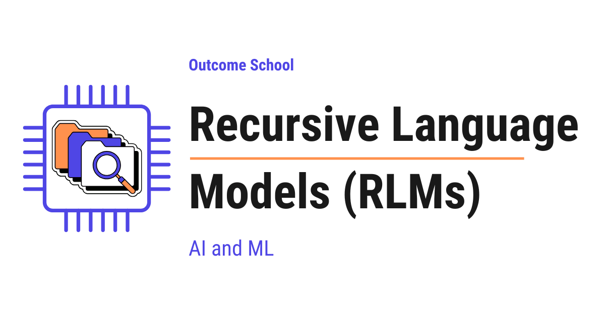

# What are Recursive Language Models (RLMs) and How Do They Work?

> Archived from <https://outcomeschool.com/blog/recursive-language-models> on 2026-11-25.

A Recursive Language Model (RLM) is a way of using a language model where the model can call another language model, or itself, on smaller parts of the input. This lets it handle very large inputs that do not fit in the context window.

In this blog, we will learn about <strong>Recursive Language Models (RLMs)</strong>, a new way of using language models to handle very large inputs that do not fit in the model&#x27;s <a target="_blank" rel="noopener noreferrer" href="context-window.md">context window</a>.

We will cover the following:
<ul><li>What is a Recursive Language Model (RLM)?</li><li>Why do we need RLMs?</li><li>How an RLM works</li><li>How the model writes and runs code</li><li>Why RLMs work better</li><li>Recursion inside RLMs</li><li>How RLMs differ from simple chunking</li><li>Advantages of RLMs</li><li>Limitations of RLMs</li><li>When to use RLMs</li><li>RLM vs RAG</li><li>A real use case</li></ul>
I am <strong>Amit Shekhar</strong>, Founder @ <a target="_blank" rel="noopener noreferrer" href="https://outcomeschool.com">Outcome School</a>, I have taught and mentored many developers, and their efforts landed them high-paying tech jobs, helped many tech companies in solving their unique problems, and created many open-source libraries being used by top companies. I am passionate about sharing knowledge through open-source, blogs, and videos.

I teach <a target="_blank" rel="noopener noreferrer" href="https://outcomeschool.com/program/ai-and-machine-learning">AI and Machine Learning</a> at Outcome School.

Let&#x27;s get started.
<h2 id="what-is-a-recursive-language-model-rlm">What is a Recursive Language Model (RLM)?</h2>
A <strong>Recursive Language Model (RLM)</strong> is a way of using a language model where the model can call another language model (or itself) on smaller parts of the input to solve a bigger problem.

In simple words, instead of putting the entire input into the model at once, the model breaks the input into smaller pieces and calls another language model (or itself) on those smaller pieces.

<strong>RLM = Recursive + Language Model</strong>

Here, <strong>Recursive</strong> means the model can call itself (or another model) again and again on smaller parts of the problem. <strong>Language Model</strong> is the LLM that understands and generates text.
<h2 id="why-do-we-need-rlms">Why do we need RLMs?</h2>
The best way to learn this is by taking an example.

Let&#x27;s say we have a very long document with 1 million tokens, and we want to ask a question about it.

When we put a lot of text into a language model, the following issues arise:
<ul><li>The model has a context window limit. It cannot accept too many tokens at once.</li><li>The quality of the answer goes down as the context gets longer. The model gets confused with too much information and misses important details in the middle. This is called <a target="_blank" rel="noopener noreferrer" href="context-engineering.md"><strong>context rot</strong></a>.</li><li>The cost of running the model goes up.</li><li>The speed of the model goes down.</li></ul>
This means, just making the context window bigger does not solve the problem. We need a better approach.

We have a detailed blog on <a target="_blank" rel="noopener noreferrer" href="lost-in-the-middle-problem-in-llms.md">The Lost in the Middle Problem in LLMs</a> that covers this problem end to end.

So, here comes the Recursive Language Model to the rescue.
<h2 id="how-an-rlm-works">How an RLM works</h2>
In an RLM, the main model does not directly read the full input. Instead, the full input stays inside a Python environment as a variable. The model gets a small prompt that only names this variable and explains how to use it. The model then writes code to read parts of the input and call other language models on those parts. The smaller calls return short answers, which the main model combines into the final answer.

The next section walks through this with a concrete example.

Now, the question is: why is this called recursive? The answer is, the model can call another model, which can again call another model, and so on. Each call works on a smaller piece. This is just like recursion in programming.

<strong>Planning your move into AI?</strong>

No matter which tech domain you work in today, with your effort, you can transition to these roles:
<ul><li>AI Engineer</li><li>Forward Deployed Engineer</li><li>AI Agent Engineer</li><li>Harness Engineer</li><li>Voice AI Engineer</li><li>AI Architect</li><li>LLM Engineer</li><li>LLM Inference Engineer</li><li>Gen AI Engineer</li><li>MLOps Engineer</li><li>ML Engineer</li><li>Deep Learning Engineer</li></ul>
Our <a target="_blank" rel="noopener noreferrer" href="https://outcomeschool.com/program/ai-and-machine-learning">AI and Machine Learning Program</a> at Outcome School takes you there.
<h2 id="how-the-model-writes-and-runs-code">How the model writes and runs code</h2>
Let&#x27;s understand this with a real example. Suppose we have a long meeting transcript and we want to ask: &quot;What were the action items?&quot;

The model only generates text. It cannot run code by itself. So, we wrap the model with a Python environment. This environment has a variable <code>context</code> that stores the full transcript, and a function <code>call_llm(prompt)</code> that calls another language model.

Now, we send a short prompt to the main model:

<pre><code class="code-highlight">Question: What were the action items?
Write Python code to answer this. The Python environment has:
- A variable named `context` that stores the full transcript.
- A function `call_llm(prompt)` that calls another language model.
</code></pre>

<strong>Very important:</strong> The full transcript is never sent to the main model. Only the variable <strong>name</strong> <code>context</code> is sent in the prompt, not its actual content. The transcript stays inside the Python environment. The model can read parts of it through code, but the model never reads the whole thing. This is what keeps the main model&#x27;s context small even when the input is huge.

Now, the loop runs as below:

<strong>Step 1:</strong> The model writes Python code as its response:

<pre><code class="code-highlight language-python">turns = context.split(&quot;\n&quot;)
results = [call_llm(f&quot;Find action items in: {turn}&quot;) for turn in turns]
print(results)
</code></pre>

Here, the model decides to split <code>context</code> by turn and call <code>call_llm</code> on each one.

<strong>Step 2:</strong> The code runs in the Python environment. Each <code>call_llm</code> call sends one turn to another language model and gets back a short answer. All answers are collected into a list.

<strong>Step 3:</strong> The list is sent back to the model. The model now sees only the short answers, not the full transcript.

<strong>Step 4:</strong> The model reads the list and returns the final list of action items as the answer. If the answer was not clear yet, the model would write more code and the loop would continue.

This back-and-forth between the model and the Python environment is called an <a target="_blank" rel="noopener noreferrer" href="ai-agent.md"><strong>agentic loop</strong></a>.

So, the model is only generating text. The text just happens to be Python code. The Python environment runs the code. And <code>call_llm</code> is just an API call to another language model.

If we want to go deep into AI Agent, Tool use in Agents, and Agentic AI, check out our <a target="_blank" rel="noopener noreferrer" href="https://outcomeschool.com/program/ai-and-machine-learning">AI and Machine Learning Program</a> at Outcome School.
<h2 id="why-rlms-work-better">Why RLMs work better</h2>
Here, we can notice that each smaller call gets a small input. In our transcript example, each <code>call_llm</code> call works on just one turn, not the full meeting. A small input is easy for the model to handle. The model can focus on the small piece and give a good answer.

Also, the main model only sees the small answers, not the full input. So, the main model has a clean and small context.

This way, we avoid context rot. The problem is solved.
<h2 id="recursion-inside-rlms">Recursion inside RLMs</h2>
Now, let&#x27;s understand the recursive part more clearly.

Let&#x27;s say one piece is still too long for the smaller call. The smaller call can also act as an RLM. It can again split its piece into even smaller parts and call another language model on each part.

So, the structure looks like below:
<ul><li>The main RLM works on the full input.</li><li>The main RLM calls sub-RLMs on each big piece.</li><li>Each sub-RLM can again call sub-RLMs on each smaller piece.</li><li>The smallest calls work on tiny pieces of text.</li></ul>
This is just like a tree. The top of the tree handles the big problem. The leaves of the tree handle the small pieces. Each level passes its answer up to the next level.

<strong>Note:</strong> The depth of recursion depends on the size of the input and the type of question. The model itself decides how deep to go.

That&#x27;s the beauty of Recursive Language Models.

<strong>A quick note for you</strong>

No matter which tech domain you work in, get familiar with these topics:
<ul><li>LLM</li><li>RAG</li><li>MCP</li><li>Agent</li><li>Fine-tuning</li><li>Quantization</li></ul>
We put it all together in one video:

<a target="_blank" rel="noopener noreferrer" href="https://www.youtube.com/watch?v=lnfWvX66FUk">AI Engineering Explained: LLM, RAG, MCP, Agent, Fine-Tuning, and Quantization</a>

No need to stop reading - bookmark it and watch later when you get time. Future you will thank you.

Now, let&#x27;s get back to the topic.
<h2 id="how-rlms-differ-from-simple-chunking">How RLMs differ from simple chunking</h2>
Now, the next big question is: how is this different from just splitting the input into <a target="_blank" rel="noopener noreferrer" href="chunking-strategies-for-rag.md">chunks</a> and processing each chunk?

In <strong>simple chunking</strong>, we fix the chunk size beforehand. We send each chunk to the model, get an answer, and combine the answers. The split is fixed, and we always do the same steps.

In an <strong>RLM</strong>, the model itself decides how to split the input. The model also decides what to ask for each piece. The model can change its strategy based on the question.

So, how can we say RLM is smarter? The answer is, the RLM is more like a human reader. A human reader does not chunk a book into fixed pages. A human reader skims, jumps, reads carefully, and decides on the fly. An RLM works in a similar way.

This makes RLMs more flexible than simple chunking.
<h2 id="advantages-of-rlms">Advantages of RLMs</h2><ul><li><strong>Handles very long inputs.</strong> RLMs can work with inputs much larger than the model&#x27;s context window.</li><li><strong>Better accuracy on long context.</strong> Since each call works on a small piece, the model can focus and give better answers.</li><li><strong>Lower cost in some cases.</strong> We do not need to send the full input every time. We only send small pieces when needed.</li><li><strong>Modular thinking.</strong> The model can break a big problem into small problems, just like a human would.</li><li><strong>Flexible.</strong> The model decides how to split the input based on the question.</li></ul><h2 id="limitations-of-rlms">Limitations of RLMs</h2><ul><li><strong>More complex to build.</strong> We need to set up a code environment and <a target="_blank" rel="noopener noreferrer" href="how-does-function-calling-work-in-llms.md">tool calls</a>.</li><li><strong>Many model calls.</strong> One question can lead to many small calls. This can be slow.</li><li><strong>Errors can stack up.</strong> If a smaller call gives a wrong answer, the final answer can also become wrong.</li><li><strong>Hard to debug.</strong> Since the model writes its own code, it can be hard to know what went wrong.</li></ul>
So, RLMs are powerful, but we must use them carefully.
<h2 id="when-to-use-rlms">When to use RLMs</h2>
I will highly recommend using RLMs for the following cases:
<ul><li>We have a very long document and need to ask questions about it.</li><li>We need to analyze a large codebase.</li><li>We need to summarize a long meeting or transcript.</li><li>We need to compare many files at once.</li><li>The task can be broken into smaller, independent sub-tasks.</li></ul>
For short inputs, we do not need RLMs. A simple language model call is enough. We must choose the approach based on our use case.

<strong>Stay updated:</strong> Subscribe to our <a target="_blank" rel="noopener noreferrer" href="https://outcomeschool.substack.com/subscribe">newsletter</a> to get our latest AI and Machine Learning blogs straight to your inbox.
<h2 id="rlm-vs-rag">RLM vs RAG</h2>
Now that we have learned about RLMs, it&#x27;s time to compare RLMs with another popular approach called <a target="_blank" rel="noopener noreferrer" href="retrieval-augmented-generation-rag.md">RAG (Retrieval-Augmented Generation)</a>.

In <strong>RAG</strong>, we first search for the most relevant parts of a document and then send only those parts to the language model.

In <strong>RLM</strong>, the model itself decides how to explore the input. The model can write code, split the input, and call smaller models.

Let me tabulate the differences between RAG and RLM for your better understanding so that you can decide which one to use based on your use case.
<table><thead><tr><th>Feature</th><th>RAG</th><th>RLM</th></tr></thead><tbody><tr><td>How it picks data</td><td>A search step picks relevant parts first</td><td>The model itself explores the data</td></tr><tr><td>Flexibility</td><td>Less flexible, depends on the search step</td><td>More flexible, model decides what to do</td></tr><tr><td>Code execution</td><td>No code execution by the model</td><td>The model can write and run code</td></tr><tr><td>Best for</td><td>Question answering on a fixed knowledge base</td><td>Complex tasks on long inputs</td></tr><tr><td>Complexity</td><td>Easier to build</td><td>Harder to build</td></tr></tbody></table>
For simple question answering, RAG is enough. For complex analysis on long inputs, RLM is a better fit.

To master RAG, Context Engineering, and Orchestration and Routing, check out our <a target="_blank" rel="noopener noreferrer" href="https://outcomeschool.com/program/ai-and-machine-learning">AI and Machine Learning Program</a> at Outcome School.
<h2 id="a-real-use-case">A real use case</h2>
A real use case in software development:

Let&#x27;s say we want to find all the security issues in a large codebase. The codebase has hundreds of files. The total size is much bigger than what a normal model can read in one go.

With an RLM, we can do the following:
<ul><li>Store the codebase as a variable.</li><li>Ask the RLM: &quot;Find all security issues.&quot;</li><li>The RLM writes code to loop through each file.</li><li>For each file, the RLM calls a smaller language model to find security issues in that file.</li><li>The smaller calls return short lists of issues.</li><li>The RLM combines all the issues into a final report.</li></ul>
Here, we can see that the main RLM does not read the full codebase. The main RLM only sees small summaries from each file. This keeps the main context clean and small.

This way we can use RLMs to solve the interesting problem of large codebase analysis.
<h2 id="summary">Summary</h2>
We have learned the following:
<ul><li>A Recursive Language Model (RLM) is a way of using a language model that can recursively call other language models on smaller parts of the input.</li><li>RLMs solve the problem of long context and context rot.</li><li>The main model writes code to split the input and call smaller models.</li><li>RLMs are powerful for long documents, codebases, and complex tasks.</li><li>We must use RLMs carefully because they have more complexity and more model calls.</li></ul>
Now, we have understood Recursive Language Models (RLMs).

This way we can use RLMs to solve any problem on long inputs in a very simple way.
<h2 id="frequently-asked-questions">Frequently Asked Questions</h2><h3 id="does-a-bigger-context-window-solve-the-long-input-problem">Does a bigger context window solve the long input problem?</h3>
No. Just making the context window bigger does not solve the problem. As the context gets longer, the quality of the answer goes down because of context rot, the cost goes up, and the speed goes down. An RLM avoids this by keeping each call&#x27;s input small.
<h3 id="does-the-main-model-in-an-rlm-ever-read-the-full-input">Does the main model in an RLM ever read the full input?</h3>
No. The full input stays inside a Python environment as a variable, and only the variable name is sent in the prompt. The main model reads parts of the input through code and sees only the short answers from the smaller calls. This keeps its context clean and small even when the input is huge.
<h3 id="can-the-language-model-run-the-python-code-by-itself">Can the language model run the Python code by itself?</h3>
No. The model only generates text, and that text just happens to be Python code. The Python environment wrapped around the model runs the code. The <code>call_llm</code> function inside that code is simply an API call to another language model.
<h3 id="who-decides-how-deep-the-recursion-goes-in-an-rlm">Who decides how deep the recursion goes in an RLM?</h3>
The model itself decides how deep to go. The depth depends on the size of the input and the type of question. If one piece is still too long, the smaller call can act as an RLM and split its piece again into even smaller parts.
<h3 id="do-we-need-an-rlm-for-short-inputs">Do we need an RLM for short inputs?</h3>
No. For short inputs, a simple language model call is enough. RLMs make sense for very long documents, large codebases, long transcripts, comparing many files, or tasks that can be broken into smaller independent sub-tasks.

That&#x27;s it for now.

Thanks

<strong>Amit Shekhar</strong> Founder @ <a target="_blank" rel="noopener noreferrer" href="https://outcomeschool.com">Outcome School</a>

You can connect with me on:
<ul><li><a target="_blank" rel="noopener noreferrer" href="https://x.com/amitiitbhu">X</a></li><li><a target="_blank" rel="noopener noreferrer" href="https://www.linkedin.com/in/amit-shekhar-iitbhu">LinkedIn</a></li><li><a target="_blank" rel="noopener noreferrer" href="https://github.com/amitshekhariitbhu">GitHub</a></li></ul>
Follow Outcome School on:
<ul><li><a target="_blank" rel="noopener noreferrer" href="https://x.com/outcome_school">X</a></li><li><a target="_blank" rel="noopener noreferrer" href="https://youtube.com/@OutcomeSchool">YouTube</a></li><li><a target="_blank" rel="noopener noreferrer" href="https://www.linkedin.com/company/outcomeschool">LinkedIn</a></li><li><a target="_blank" rel="noopener noreferrer" href="https://github.com/OutcomeSchool">GitHub</a></li></ul>
<a target="_blank" rel="noopener noreferrer" href="https://outcomeschool.com/blog"><strong>Read all of our high-quality blogs here.</strong></a>

