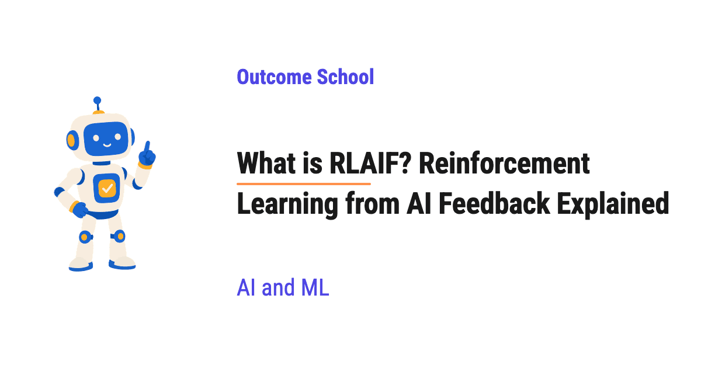

# What is RLAIF? Reinforcement Learning from AI Feedback Explained

> Archived from <https://outcomeschool.com/blog/reinforcement-learning-from-ai-feedback-rlaif> on 2026-11-25.

RLAIF (Reinforcement Learning from AI Feedback) is a way to train an LLM where another AI model, and not a human, decides which of two answers is better. These AI decisions are then used to teach the LLM to give better answers.

In this blog, we will learn about RLAIF (Reinforcement Learning from AI Feedback). We will also see a quick recap of RLHF and its problem with human labelers, how an AI labeler guided by written principles gives the preference labels, the full RLAIF pipeline step by step, the direct RLAIF variant and its link to Constitutional AI, what research has found, and where it works well and where it fails.

We will cover the following:
<ul><li>A Quick Recap of RLHF</li><li>The Problem with Human Labelers</li><li>What is RLAIF?</li><li>The AI Labeler and Its Principles</li><li>How RLAIF Works Step by Step</li><li>Direct RLAIF</li><li>RLAIF and Constitutional AI</li><li>What Does the Research Say?</li><li>Advantages of RLAIF</li><li>Disadvantages of RLAIF</li><li>RLHF vs RLAIF</li></ul>
I am <strong>Amit Shekhar</strong>, Founder @ <a target="_blank" rel="noopener noreferrer" href="https://outcomeschool.com">Outcome School</a>, I have taught and mentored many developers, and their efforts landed them high-paying tech jobs, helped many tech companies in solving their unique problems, and created many open-source libraries being used by top companies. I am passionate about sharing knowledge through open-source, blogs, and videos.

I teach <a target="_blank" rel="noopener noreferrer" href="https://outcomeschool.com/program/ai-and-machine-learning">AI and Machine Learning</a> at Outcome School.

Let&#x27;s get started.
<h2 id="a-quick-recap-of-rlhf">A Quick Recap of RLHF</h2>
Before jumping into RLAIF, we must know about <a target="_blank" rel="noopener noreferrer" href="reinforcement-learning-from-human-feedback-rlhf.md">RLHF</a>, because RLAIF is built on top of it.

<strong>RLHF (Reinforcement Learning from Human Feedback)</strong> is a way to make an <a target="_blank" rel="noopener noreferrer" href="large-language-model-llm.md">LLM (Large Language Model)</a> give answers that people like.

It works in four steps:
<ul><li>The LLM writes two answers for the same prompt.</li><li>A human reads both answers and picks the better one. This choice is called a <strong>preference label</strong>.</li><li>We collect many such labels and train a <strong><a target="_blank" rel="noopener noreferrer" href="reward-model.md">reward model</a></strong>. A reward model is a model that reads an answer and gives it a score. A higher score means a better answer.</li><li>Finally, we use <strong><a target="_blank" rel="noopener noreferrer" href="reinforcement-learning.md">reinforcement learning</a></strong>, which means learning by trying and getting a reward. It is usually done with an algorithm called <strong><a target="_blank" rel="noopener noreferrer" href="proximal-policy-optimization-ppo.md">PPO (Proximal Policy Optimization)</a></strong>, which updates the LLM so that it writes answers that get higher scores.</li></ul>
Let&#x27;s see this as a diagram:

<pre><code class="language-text code-highlight">┌──────────────────────────────────┐
│ Prompt: &quot;Explain gravity simply&quot; │
└────────────────┬─────────────────┘
                 ↓
┌──────────────────────────────────┐
│ LLM writes Answer A and Answer B │
└────────────────┬─────────────────┘
                 ↓
┌──────────────────────────────────┐
│ Human labeler picks the better   │
│ one: &quot;A is better than B&quot;        │
└────────────────┬─────────────────┘
                 ↓
┌──────────────────────────────────┐
│ Reward model learns from 100,000 │
│ such human labels                │
└────────────────┬─────────────────┘
                 ↓
┌──────────────────────────────────┐
│ PPO updates the LLM to get       │
│ higher reward scores             │
└──────────────────────────────────┘
</code></pre>

Here, we can see that the human sits in the middle of the pipeline. Every preference label comes from a person.

To learn RLHF, Reward Models, and Proximal Policy Optimization (PPO) end to end, check out our <a target="_blank" rel="noopener noreferrer" href="https://outcomeschool.com/program/ai-and-machine-learning">AI and Machine Learning Program</a> at Outcome School.
<h2 id="the-problem-with-human-labelers">The Problem with Human Labelers</h2>
RLHF works very well. But, the human part creates three problems.

<strong>Problem 1: Cost.</strong> A good reward model needs tens of thousands to hundreds of thousands of preference labels. Each label needs a trained person to read two answers carefully. Paying for so many labels is very expensive.

<strong>Problem 2: Speed.</strong> A human takes time to read two long answers and decide. Collecting a large set of labels can take weeks. And if we change our model or our rules, we must collect labels again.

<strong>Problem 3: Consistency.</strong> Different people have different tastes. One labeler likes short answers, another likes detailed answers. Even the same person can decide differently when tired. So, the labels become noisy.

Now, the question is: can we replace the human with something cheaper, faster, and more consistent?

The answer is yes. Here comes the RLAIF into the picture.
<h2 id="what-is-rlaif">What is RLAIF?</h2>
<strong>RLAIF (Reinforcement Learning from AI Feedback) is a way to train an LLM where the preference labels come from an AI model instead of humans.</strong>

Everything else stays almost the same as RLHF. We only swap the human labeler with an <strong>AI labeler</strong>.

Let&#x27;s say we have a new employee who writes reports. In RLHF, the manager reads every report and gives feedback. In RLAIF, we give a senior employee a written checklist of what a good report looks like, and the senior employee gives the feedback instead of the manager. The manager only writes the checklist once.

In RLAIF, this checklist is called a rubric. Let&#x27;s understand how it works.
<h2 id="the-ai-labeler-and-its-principles">The AI Labeler and Its Principles</h2>
The <strong>AI labeler</strong> is usually a strong, already trained LLM. We do not train it again for this job. We just give it a prompt.

We have a detailed blog on <a target="_blank" rel="noopener noreferrer" href="llm-as-a-judge.md">LLM as a Judge</a> that explains how one LLM evaluates the output of another LLM.

The prompt contains a written set of principles, which is the <strong>rubric</strong>. The rubric tells the AI labeler what &quot;better&quot; means for us.

For example, the rubric can say:
<ul><li>The answer must be correct.</li><li>The answer must be easy to understand.</li><li>The answer must not contain harmful content.</li><li>The answer must not be longer than needed.</li></ul>
Then, we give the AI labeler the prompt, the two answers, and the question &quot;Which answer is better?&quot; as below:

<pre><code class="language-text code-highlight">You are judging two answers. Follow these principles:
1. The answer must be correct.
2. The answer must be easy to understand.
3. The answer must not contain harmful content.

Question: Explain gravity simply.

Answer 1: Gravity is the force that pulls objects toward each other...
Answer 2: Gravity is described by the curvature of spacetime in...

Which answer is better? Reply with 1 or 2.
</code></pre>

Here, the AI labeler reads both answers, checks them against the principles, and replies with &quot;1&quot; or &quot;2&quot;. That reply is our preference label.

In practice, we do not only take the final &quot;1&quot; or &quot;2&quot;. We look at how likely the AI labeler thinks &quot;1&quot; is and how likely it thinks &quot;2&quot; is. For example, 0.8 for &quot;1&quot; and 0.2 for &quot;2&quot;. This gives a soft label, which carries more information than a plain yes or no. Researchers also often ask the AI labeler to first explain its reasoning and then give the answer, because this improves the quality of the labels in many cases.

The best part is that if we want to change what &quot;better&quot; means, we just edit the rubric. We do not need to hire and retrain a team of people.

<strong>Planning your move into AI?</strong>

No matter which tech domain you work in today, with your effort, you can transition to these roles:
<ul><li>AI Engineer</li><li>Forward Deployed Engineer</li><li>AI Agent Engineer</li><li>Harness Engineer</li><li>Voice AI Engineer</li><li>AI Architect</li><li>LLM Engineer</li><li>LLM Inference Engineer</li><li>Gen AI Engineer</li><li>MLOps Engineer</li><li>ML Engineer</li><li>Deep Learning Engineer</li></ul>
Our <a target="_blank" rel="noopener noreferrer" href="https://outcomeschool.com/program/ai-and-machine-learning">AI and Machine Learning Program</a> at Outcome School takes you there.
<h2 id="how-rlaif-works-step-by-step">How RLAIF Works Step by Step</h2>
Now, let&#x27;s see the full RLAIF pipeline step by step.

<strong>Step 1:</strong> We generate two answers. We take a prompt and ask the LLM that we want to improve to write two different answers for it. We do this for thousands of prompts.

<strong>Step 2:</strong> The AI labeler compares the two answers using the principles. For each pair, the AI labeler reads the rubric, the prompt, and both answers, and decides which one is better.

<strong>Step 3:</strong> We train a reward model on the AI labels. We take all the AI preference labels and train a reward model, exactly like in RLHF. The reward model learns to give a higher score to the kind of answers the AI labeler preferred.

<strong>Step 4:</strong> We run reinforcement learning with PPO. The LLM writes answers, the reward model scores them, and PPO updates the LLM to get higher scores. During this step, we also keep the LLM close to its original version, so that it does not drift into strange answers just to chase the score. We have a detailed blog on <a target="_blank" rel="noopener noreferrer" href="reward-hacking.md">Reward Hacking</a> that covers why chasing the score goes wrong and how we prevent it.

Let&#x27;s see RLHF and RLAIF side by side as a diagram:

<pre><code class="language-text code-highlight">          RLHF                         RLAIF

┌──────────────────────┐     ┌──────────────────────┐
│ LLM writes 2 answers │     │ LLM writes 2 answers │
└──────────┬───────────┘     └──────────┬───────────┘
           ↓                            ↓
┌──────────────────────┐     ┌──────────────────────┐
│ Human labeler picks  │     │ AI labeler + rubric  │
│ the better answer    │     │ picks the better one │
└──────────┬───────────┘     └──────────┬───────────┘
           ↓                            ↓
┌──────────────────────┐     ┌──────────────────────┐
│ Train reward model   │     │ Train reward model   │
│ on human labels      │     │ on AI labels         │
└──────────┬───────────┘     └──────────┬───────────┘
           ↓                            ↓
┌──────────────────────┐     ┌──────────────────────┐
│ PPO updates the LLM  │     │ PPO updates the LLM  │
└──────────────────────┘     └──────────────────────┘
</code></pre>

Here, we can see that both pipelines are the same except for the second box. Only the source of the preference label changes.
<h2 id="direct-rlaif">Direct RLAIF</h2>
There is one more variant called <strong>direct RLAIF</strong>.

In normal RLAIF, the AI labels go into a separate reward model, and the reward model gives the scores during training. But, we can skip the reward model completely.

In direct RLAIF, the AI labeler itself gives the reward score during reinforcement learning. For each answer that the LLM writes, we ask the AI labeler: &quot;Rate this answer from 1 to 10 based on these principles.&quot; That score is used directly as the reward for reinforcement learning.

Let&#x27;s see this as a diagram:

<pre><code class="language-text code-highlight">┌──────────────────────────────────┐
│ LLM writes one answer            │
└────────────────┬─────────────────┘
                 ↓
┌──────────────────────────────────┐
│ AI labeler + rubric gives a      │
│ score: 7 out of 10               │
└────────────────┬─────────────────┘
                 ↓
┌──────────────────────────────────┐
│ RL uses 7/10 as the reward and   │
│ updates the LLM                  │
└──────────────────────────────────┘
</code></pre>

Here, we can see that there is no separate reward model. The AI labeler plays the role of the reward model.

<strong>Advantage:</strong> We do not need to train and maintain a reward model. Also, a separate reward model slowly becomes outdated as the LLM changes during training, but the AI labeler judges every new answer fresh.

<strong>Disadvantage:</strong> Calling a large AI labeler for every answer during training is slow and costly, because the AI labeler is often a much larger model than a reward model.

<strong>A quick note for you</strong>

No matter which tech domain you work in, get familiar with these topics:
<ul><li>LLM</li><li>RAG</li><li>MCP</li><li>Agent</li><li>Fine-tuning</li><li>Quantization</li></ul>
We put it all together in one video:

<a target="_blank" rel="noopener noreferrer" href="https://www.youtube.com/watch?v=lnfWvX66FUk">AI Engineering Explained: LLM, RAG, MCP, Agent, Fine-Tuning, and Quantization</a>

No need to stop reading - bookmark it and watch later when you get time. Future you will thank you.

Now, let&#x27;s get back to the topic.
<h2 id="rlaif-and-constitutional-ai">RLAIF and Constitutional AI</h2>
RLAIF is closely connected to <strong>Constitutional AI</strong>, a method introduced by Anthropic in 2022.

In Constitutional AI, the written set of principles is called a <strong>constitution</strong>. It is a list of rules like &quot;Choose the response that is least harmful.&quot;

Constitutional AI has two stages:
<ul><li><strong>Stage 1 (supervised learning):</strong> The model writes an answer, then critiques its own answer using a principle from the constitution, and then rewrites it. The model is then trained further on these improved answers.</li><li><strong>Stage 2 (reinforcement learning):</strong> The model writes two answers, and an AI model picks the better one using the constitution. These AI labels train a preference model, which is another name for a reward model, and then reinforcement learning is done on top of it.</li></ul>
Stage 2 is RLAIF. In fact, the Constitutional AI paper used the term &quot;RLAIF&quot; for this stage. In that work, AI feedback was used for harmlessness, while the labels for helpfulness still came from humans.

So, Constitutional AI is one well-known method that uses RLAIF as one of its parts, with the constitution playing the role of the rubric.
<h2 id="what-does-the-research-say">What Does the Research Say?</h2>
A well-known comparison comes from a 2023 paper by researchers at Google, titled &quot;RLAIF vs. RLHF: Scaling Reinforcement Learning from Human Feedback with AI Feedback&quot;.

They tested on tasks like summarization, helpful dialogue, and harmless dialogue. Human evaluators compared the outputs. The paper reported that RLAIF performed comparably to RLHF on these tasks.

For example, in summarization, human evaluators preferred both the RLAIF and the RLHF outputs over the starting model at similar rates. And when the evaluators compared RLAIF and RLHF outputs directly, they preferred each one about equally often.

On harmless dialogue, RLAIF did even better than RLHF in their tests.

The same paper also reported that direct RLAIF performed better than the normal RLAIF with a reward model in their setup.

We must keep in mind that these results are for specific tasks and specific models. They do not mean that AI feedback can replace human feedback everywhere.

<strong>Stay updated:</strong> Subscribe to our <a target="_blank" rel="noopener noreferrer" href="https://outcomeschool.substack.com/subscribe">newsletter</a> to get our latest AI and Machine Learning blogs straight to your inbox.
<h2 id="advantages-of-rlaif">Advantages of RLAIF</h2><ul><li><strong>Cheap:</strong> An AI label costs much less than a human label.</li><li><strong>Fast:</strong> An AI labeler can produce thousands of labels in the time a human produces a few.</li><li><strong>Consistent:</strong> The same rubric is applied the same way every time. There is no tiredness and no mood.</li><li><strong>Easy to change:</strong> To change what &quot;better&quot; means, we edit the rubric and label again.</li><li><strong>Scales well:</strong> We can label millions of pairs, which is not practical with humans.</li></ul><h2 id="disadvantages-of-rlaif">Disadvantages of RLAIF</h2><ul><li><strong>Bias of the AI labeler:</strong> The AI labeler has its own mistakes and preferences. For example, it can prefer longer answers or answers written in its own style. Whatever bias it has gets passed into the reward model and then into the LLM.</li><li><strong>Errors get copied:</strong> If the AI labeler is wrong about a fact, it can reward the wrong answer. The LLM then learns that mistake.</li><li><strong>Limited by the labeler:</strong> The labels can only be as good as the AI labeler&#x27;s judgment. For a very hard or very new topic, the AI labeler can be unreliable.</li><li><strong>Position bias:</strong> The AI labeler can prefer an answer just because of its position, for example, because it is shown first.</li></ul>
Let&#x27;s understand position bias and its fix in detail.

Let&#x27;s say we show Answer A first and Answer B second. The AI labeler gives A a probability of 0.80 of being better. Now, we swap the order and show B first and A second. This time, the AI labeler gives A only 0.60. The answers are the same. Only the order changed. This means the position affected the decision.

To fix this, we ask the AI labeler twice, once in each order, and take the average.

Let&#x27;s see this as a diagram:

<pre><code class="language-text code-highlight">┌────────────────────┐     ┌────────────────────┐
│ Order 1: A, then B │     │ Order 2: B, then A │
│ P(A better) = 0.80 │     │ P(A better) = 0.60 │
└─────────┬──────────┘     └─────────┬──────────┘
          ↓                          ↓
       ┌──────────────────────────────────┐
       │ Average: (0.80 + 0.60) / 2       │
       │ Final P(A better) = 0.70         │
       └──────────────────────────────────┘
</code></pre>

We can write the code as below:

<pre><code class="code-highlight language-python"># Probability that the AI labeler picks Answer A
p_a_when_a_first = 0.80   # A shown in position 1
p_a_when_a_second = 0.60  # A shown in position 2

p_a = (p_a_when_a_first + p_a_when_a_second) / 2
p_b = 1 - p_a

print(f&quot;P(A is better) = {p_a:.2f}&quot;)
print(f&quot;P(B is better) = {p_b:.2f}&quot;)
</code></pre>

This will print the following:

<pre><code class="language-text code-highlight">P(A is better) = 0.70
P(B is better) = 0.30
</code></pre>

Here, we can see that by averaging both orders, the effect of the position is balanced out. Answer A gets the first position once and the second position once, so the final label 0.70 depends on the answers and not on their order.
<h2 id="rlhf-vs-rlaif">RLHF vs RLAIF</h2>
Let me tabulate the differences between RLHF and RLAIF for your better understanding.
<table><thead><tr><th>Aspect</th><th>RLHF</th><th>RLAIF</th></tr></thead><tbody><tr><td>Who gives the labels</td><td>Human labelers</td><td>An AI labeler guided by a rubric</td></tr><tr><td>Cost per label</td><td>High</td><td>Low</td></tr><tr><td>Speed</td><td>Slow, weeks for a large set</td><td>Fast, many labels in hours</td></tr><tr><td>Consistency</td><td>Varies from person to person</td><td>Same rubric applied every time</td></tr><tr><td>Changing the rules</td><td>Retrain the labeler team</td><td>Edit the rubric and label again</td></tr><tr><td>Main risk</td><td>Noisy and expensive labels</td><td>Bias and errors of the AI labeler</td></tr><tr><td>Reward model</td><td>Always used</td><td>Used, or skipped in direct RLAIF</td></tr></tbody></table>
We can also mix both. We can use humans for a smaller set of important or difficult labels, and AI feedback for the large volume of routine labels.

Now we must have understood what RLAIF is, how it works step by step, and where it works well and where it fails.
<h2 id="frequently-asked-questions">Frequently Asked Questions</h2><h3 id="does-rlaif-remove-humans-from-the-training-completely">Does RLAIF remove humans from the training completely?</h3>
No. RLAIF does not remove humans completely. Humans still write the rubric, the written set of principles that tells the AI labeler what &quot;better&quot; means. We can also mix both, using humans for a smaller set of important or difficult labels and AI feedback for the large volume of routine labels.
<h3 id="do-we-need-to-train-a-new-model-to-act-as-the-ai-labeler">Do we need to train a new model to act as the AI labeler?</h3>
No. The AI labeler is usually a strong, already trained LLM, and we do not train it again for this job. We just give it a prompt that contains the rubric, the prompt, and the two answers. To change what &quot;better&quot; means, we only edit the rubric.
<h3 id="why-do-we-use-the-ai-labelers-probabilities-instead-of-only-its-final-answer">Why do we use the AI labeler&#x27;s probabilities instead of only its final answer?</h3>
Because probabilities carry more information than a plain yes or no. Instead of only taking &quot;1&quot; or &quot;2&quot;, we look at how likely the AI labeler thinks each answer is better, for example 0.8 for &quot;1&quot; and 0.2 for &quot;2&quot;. This gives a soft label for training the reward model.
<h3 id="is-rlaif-as-good-as-rlhf">Is RLAIF as good as RLHF?</h3>
On some tasks, yes. A 2023 paper by researchers at Google reported that RLAIF performed comparably to RLHF on summarization and helpful dialogue, and even better on harmless dialogue. But these results are for specific tasks and specific models, so they do not mean that AI feedback can replace human feedback everywhere.

That&#x27;s it for now.

Thanks

<strong>Amit Shekhar</strong> Founder @ <a target="_blank" rel="noopener noreferrer" href="https://outcomeschool.com">Outcome School</a>

You can connect with me on:
<ul><li><a target="_blank" rel="noopener noreferrer" href="https://x.com/amitiitbhu">X</a></li><li><a target="_blank" rel="noopener noreferrer" href="https://www.linkedin.com/in/amit-shekhar-iitbhu">LinkedIn</a></li><li><a target="_blank" rel="noopener noreferrer" href="https://github.com/amitshekhariitbhu">GitHub</a></li></ul>
Follow Outcome School on:
<ul><li><a target="_blank" rel="noopener noreferrer" href="https://x.com/outcome_school">X</a></li><li><a target="_blank" rel="noopener noreferrer" href="https://youtube.com/@OutcomeSchool">YouTube</a></li><li><a target="_blank" rel="noopener noreferrer" href="https://www.linkedin.com/company/outcomeschool">LinkedIn</a></li><li><a target="_blank" rel="noopener noreferrer" href="http://github.com/OutcomeSchool">GitHub</a></li></ul>
<a target="_blank" rel="noopener noreferrer" href="https://outcomeschool.com/blog"><strong>Read all of our high-quality blogs here.</strong></a>

