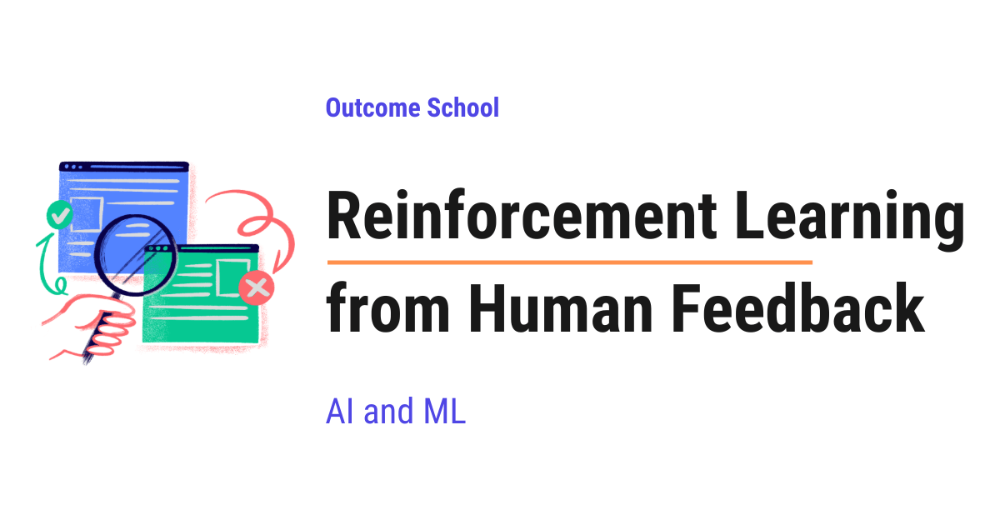

# What is RLHF? Reinforcement Learning from Human Feedback Explained

> Archived from <https://outcomeschool.com/blog/reinforcement-learning-from-human-feedback-rlhf> on 2026-11-25.

RLHF (Reinforcement Learning from Human Feedback) is a training technique where we teach a Large Language Model to produce the responses that humans prefer. We collect human preferences and turn them into a reward signal that guides further training.

In this blog, we will learn about Reinforcement Learning from Human Feedback (RLHF), the training technique that turns a raw pre-trained LLM into a helpful, honest, and safe assistant by teaching it from human preferences.

We will cover the following:
<ul><li>What is RLHF?</li><li>Why we need RLHF</li><li>The Big Picture</li><li>Stage 1: Supervised Fine-Tuning (SFT)</li><li>Stage 2: Training the Reward Model</li><li>Stage 3: RL Fine-Tuning with PPO</li><li>The KL Penalty</li><li>Putting It All Together</li><li>Reward Hacking</li><li>Common Mistakes</li><li>Best Practices</li><li>Quick Summary</li></ul>
I am <strong>Amit Shekhar</strong>, Founder @ <a target="_blank" rel="noopener noreferrer" href="https://outcomeschool.com">Outcome School</a>, I have taught and mentored many developers, and their efforts landed them high-paying tech jobs, helped many tech companies in solving their unique problems, and created many open-source libraries being used by top companies. I am passionate about sharing knowledge through open-source, blogs, and videos.

I teach <a target="_blank" rel="noopener noreferrer" href="https://outcomeschool.com/program/ai-and-machine-learning">AI and Machine Learning</a> at Outcome School.

Let&#x27;s get started.
<h2 id="what-is-rlhf">What is RLHF?</h2>
<strong>RLHF (Reinforcement Learning from Human Feedback) is a training technique where we teach a Large Language Model (LLM) to produce responses that humans prefer, by collecting human preferences and converting them into a reward signal that guides further training.</strong>

In simple words, we let the model generate responses, we ask humans which response is better, and we update the model so that its future responses look more like the preferred ones.

<strong>RLHF = Reinforcement Learning + Human Feedback</strong>

Let&#x27;s decode each part.
<ul><li><strong>Reinforcement Learning (RL)</strong> is a way of training a model where it learns by trial and error. The model takes an action, receives a reward, and adjusts its behavior to earn more reward over time. We have a detailed blog on <a target="_blank" rel="noopener noreferrer" href="reinforcement-learning.md">Reinforcement Learning</a> that goes deeper into this.</li><li><strong>Human Feedback</strong> means the reward does not come from a fixed automatic metric. It comes from real humans who compare model outputs and pick the better one.</li></ul>
So, RLHF is reinforcement learning, but the reward signal is shaped by what humans actually want. That is the whole idea.

This idea started with the 2017 paper <a target="_blank" rel="noopener noreferrer" href="decoding-deep-rl-from-human-preferences.md">Deep RL from Human Preferences</a>, which taught games and robots this way, and OpenAI later brought it to language models in the InstructGPT paper, the work that led directly to ChatGPT. We have a detailed blog on <a target="_blank" rel="noopener noreferrer" href="decoding-instructgpt.md">Decoding InstructGPT</a> that walks through that paper step by step.
<h2 id="why-we-need-rlhf">Why we need RLHF</h2>
A <a target="_blank" rel="noopener noreferrer" href="llm-pretraining.md">pre-trained LLM</a> is trained to predict the next <strong>token</strong> (a token is a small chunk of text, i.e. a word or a part of a word) from a huge amount of internet text. After pre-training, the model knows a lot about language and the world. But it does not know how to be a good assistant.

If we just ask a pre-trained model &quot;How do I bake a cake?&quot;, it can continue with another question, or with a list of recipe headlines, or with random text that looks like a web page. It is not because the model is broken. It is because the model was only trained to imitate text on the internet, not to be helpful.

We need a way to teach the model:
<ul><li>Be helpful, not random.</li><li>Follow instructions.</li><li>Be honest, not make things up.</li><li>Be safe, not produce harmful content.</li><li>Be clear, not overly verbose.</li></ul>
These goals are very hard to write down as a fixed rule or a fixed loss function. There is no formula that says &quot;this answer is helpful and that one is not&quot;.

But humans can easily look at two answers and say which one is better.

So, here comes RLHF to the rescue. RLHF is the bridge that takes simple human judgments like &quot;Answer A is better than Answer B&quot; and turns them into a training signal for the model.

Let&#x27;s take a simple analogy for the sake of understanding. Imagine a new chef who has read every cookbook in the world. The chef knows a lot of recipes, but does not know what real customers actually like. So, the restaurant gives the chef a chance to cook many dishes, lets customers taste two versions side by side, and asks them to pick the one they prefer. Over time, the chef learns to cook the food that customers actually love. RLHF is exactly this, but the chef is the LLM and the customers are the human labelers.

<strong>Planning your move into AI?</strong>

No matter which tech domain you work in today, with your effort, you can transition to these roles:
<ul><li>AI Engineer</li><li>Forward Deployed Engineer</li><li>AI Agent Engineer</li><li>Harness Engineer</li><li>Voice AI Engineer</li><li>AI Architect</li><li>LLM Engineer</li><li>LLM Inference Engineer</li><li>Gen AI Engineer</li><li>MLOps Engineer</li><li>ML Engineer</li><li>Deep Learning Engineer</li></ul>
Our <a target="_blank" rel="noopener noreferrer" href="https://outcomeschool.com/program/ai-and-machine-learning">AI and Machine Learning Program</a> at Outcome School takes you there.
<h2 id="the-big-picture">The Big Picture</h2>
Before we go into the details, let&#x27;s understand the big picture.

RLHF is not a single training step. It is a pipeline with three stages.

<strong>In simple words:</strong>

<strong>RLHF = SFT + Reward Model + RL Fine-Tuning.</strong>

Here is a high-level view of the pipeline:

<pre><code class="code-highlight">+------------------------+
|  Pre-trained Base LLM  |
+-----------+------------+
            |
            v
+------------------------+
|  Stage 1: SFT          |   &lt;- learn to follow instructions
+-----------+------------+
            |
            v
+------------------------+
|  Stage 2: Reward Model |   &lt;- learn what humans prefer
+-----------+------------+
            |
            v
+------------------------+
|  Stage 3: RL Fine-Tune |   &lt;- improve LLM using reward
+-----------+------------+
            |
            v
+------------------------+
|  Aligned LLM (final)   |
+------------------------+
</code></pre>

Each stage has a clear job:
<ul><li><strong>Stage 1 (SFT)</strong> teaches the model to behave like an assistant.</li><li><strong>Stage 2 (Reward Model)</strong> teaches a separate model to score answers the way a human would.</li><li><strong>Stage 3 (RL Fine-Tuning)</strong> uses that reward model to push the LLM toward higher-scoring answers.</li></ul>
We will learn later in the blog why we must start with SFT and not jump straight to the Reward Model or RL Fine-Tuning.

Now, let&#x27;s decode each stage.
<h2 id="stage-1-supervised-fine-tuning-sft">Stage 1: Supervised Fine-Tuning (SFT)</h2>
The first stage of RLHF is <strong><a target="_blank" rel="noopener noreferrer" href="instruction-tuning.md">Supervised Fine-Tuning</a></strong>, often called <strong>SFT</strong>.

<strong>Supervised Fine-Tuning is the step where we take the pre-trained base LLM and <a target="_blank" rel="noopener noreferrer" href="how-does-fine-tuning-work.md">fine-tune</a> it on a hand-picked dataset of high-quality prompt-response pairs written by humans.</strong>

The dataset is typically small but very high quality - around <code>10,000</code> to <code>100,000</code> carefully written prompt-response examples. We show the model many examples of &quot;this is a good question, and this is a good answer&quot;, and we train it to imitate that style. This is classic <a target="_blank" rel="noopener noreferrer" href="supervised-vs-unsupervised-learning.md">supervised learning</a> - we have inputs and we have correct outputs, and the model learns to map one to the other.

The dataset looks like this:

<pre><code class="code-highlight">Prompt:    &quot;Explain photosynthesis to a 10 year old.&quot;
Response:  &quot;Photosynthesis is how plants make their food.
            They take sunlight, water, and air, and turn
            them into energy and oxygen...&quot;

Prompt:    &quot;Write a polite email asking for a deadline extension.&quot;
Response:  &quot;Hi [Name], I hope you are doing well. I am writing
            to request...&quot;
</code></pre>

After SFT, the model has a much better starting behavior. It knows the shape of a good answer. It tries to follow instructions instead of continuing the prompt randomly.

But SFT alone is not enough. Why? Because we cannot write enough examples to cover every possible question and every possible nuance. And humans are much better at comparing two answers than at writing the perfect answer from scratch.

I have seen many beginners assume SFT is the final step. It is not. SFT is only the foundation that makes the next two stages work.

To learn Fine-tuning, PEFT, and LoRA in depth, check out our <a target="_blank" rel="noopener noreferrer" href="https://outcomeschool.com/program/ai-and-machine-learning">AI and Machine Learning Program</a> at Outcome School.

This is where the next stage comes in.
<h2 id="stage-2-training-the-reward-model">Stage 2: Training the Reward Model</h2>
This is where the <strong><a target="_blank" rel="noopener noreferrer" href="reward-model.md">Reward Model</a></strong> comes into the picture.

<strong>A Reward Model is a separate model that takes a prompt and a response and outputs a single number - a score that predicts how much a human would prefer that response.</strong>

Higher score means the human would likely prefer it. Lower score means the human would likely reject it.

<strong>How do we train the Reward Model?</strong>

We collect <strong>preference data</strong> from humans. The process is simple.
<ul><li>We pick a prompt.</li><li>We use the SFT model to generate two or more different responses to the same prompt.</li><li>We show these responses to a human labeler.</li><li>The human picks which response is better.</li></ul>
The dataset looks like this:

<pre><code class="code-highlight">Prompt:    &quot;How do I stay focused while studying?&quot;

Response A: &quot;Try the Pomodoro technique. Work for 25 minutes,
             then take a 5 minute break...&quot;

Response B: &quot;Just focus harder. Stop being lazy.&quot;

Human preference: A is better than B.
</code></pre>

We collect thousands of such pairs - typically <code>30,000</code> to <code>100,000</code> preference pairs in real systems. Each pair gives us a clear signal: &quot;A beats B for this prompt.&quot;

Now, we train the Reward Model. The Reward Model is usually started from the same SFT model, but its final layer is replaced with a small head that outputs a single number. For example, on the pair above, a trained Reward Model might output <code>Score(A) = 2.4</code> and <code>Score(B) = -1.1</code>. The exact numbers do not matter, only the gap: A scores higher than B.

The training objective is simple:
<blockquote>
Given a pair (A, B) where A is preferred, the Reward Model should give a higher score to A than to B.
</blockquote>
Here is how the training works on one preference pair:

<pre><code class="code-highlight">Reward Model Training (one pair):

  +-----------------------+
  | Prompt + Response A   | --&gt; [ Reward Model ] --&gt; Score(A)
  +-----------------------+                              |
                                                         |
                                                         | must be
                                                         | higher than
                                                         |
  +-----------------------+                              |
  | Prompt + Response B   | --&gt; [ Reward Model ] --&gt; Score(B)
  +-----------------------+

  Loss: push Score(A) above Score(B)
        (because the human picked A)
</code></pre>

We repeat this for thousands of pairs. After training, the Reward Model has learned a rich, fuzzy idea of &quot;what a good response looks like&quot;. It is not a hard rule. It is a learned function shaped by thousands of human judgments.

<strong>Note:</strong> The exact loss function used here is called the <strong>Bradley-Terry pairwise preference loss</strong>. For our purposes, the intuition &quot;push Score(A) above Score(B)&quot; is enough.

<strong>Note:</strong> The Reward Model is not the final LLM. It is a helper model. We will use it in the next stage to teach the actual LLM.

<strong>A quick note for you</strong>

No matter which tech domain you work in, get familiar with these topics:
<ul><li>LLM</li><li>RAG</li><li>MCP</li><li>Agent</li><li>Fine-tuning</li><li>Quantization</li></ul>
We put it all together in one video:

<a target="_blank" rel="noopener noreferrer" href="https://www.youtube.com/watch?v=lnfWvX66FUk">AI Engineering Explained: LLM, RAG, MCP, Agent, Fine-Tuning, and Quantization</a>

No need to stop reading - bookmark it and watch later when you get time. Future you will thank you.

Now, let&#x27;s get back to the topic.
<h2 id="stage-3-rl-fine-tuning-with-ppo">Stage 3: RL Fine-Tuning with PPO</h2>
This is the stage that puts the <strong>RL</strong> in <strong>RLHF</strong>.

<strong>In RL Fine-Tuning, we treat the LLM as a policy and use a reinforcement learning algorithm to update its weights so that it generates responses that score higher on the Reward Model.</strong>

A <strong>policy</strong>, in reinforcement learning, is simply the function that decides what action to take next given the current situation. For our LLM, the &quot;situation&quot; is the prompt plus the tokens generated so far, and the &quot;action&quot; is which token to generate next. So, the LLM itself is the policy.

The most commonly used algorithm here is <strong><a target="_blank" rel="noopener noreferrer" href="proximal-policy-optimization-ppo.md">PPO (Proximal Policy Optimization)</a></strong>. It is a popular reinforcement learning algorithm that updates the policy in small, controlled steps so that training stays stable. PPO uses a clip ratio (usually around <code>0.2</code>) which limits how much the new policy can differ from the previous policy in a single update.

Along with the policy, PPO also trains a <strong>Value Model</strong>, also called the <strong><a target="_blank" rel="noopener noreferrer" href="actor-critic.md">Critic</a></strong>. The Value Model predicts how good a response is expected to be before we see the actual reward. PPO uses the difference between the actual reward from the Reward Model and the Value Model&#x27;s prediction to compute the <strong>advantage</strong>. The advantage tells us how much better or worse the response was compared to what was expected. This advantage is what PPO uses inside the clipped objective to update the policy.

So, in RLHF with PPO, we have <strong>four models</strong> working together:
<ul><li><strong>Policy Model</strong> - the LLM being trained</li><li><strong>Value Model (Critic)</strong> - predicts expected rewards, used to compute the advantage</li><li><strong>Reward Model</strong> - scores responses based on human preferences (from Stage 2)</li><li><strong>Reference Model</strong> - a frozen copy of the SFT model, used for the KL penalty</li></ul>
This is a big part of why PPO-based RLHF is expensive. Newer algorithms like <strong><a target="_blank" rel="noopener noreferrer" href="group-relative-policy-optimization-grpo.md">GRPO (Group Relative Policy Optimization)</a></strong>, used in DeepSeek-R1, remove the Value Model entirely by computing the baseline from a group of sampled responses, which brings the count down to three models.

Let&#x27;s see how the loop works.
<ul><li>We sample a prompt from a training dataset.</li><li>The current LLM (the policy) generates a response.</li><li>The Reward Model scores that response.</li><li>PPO uses this score to update the LLM&#x27;s weights so that responses like this one become more likely if the score was high, and less likely if the score was low.</li></ul>
<pre><code class="code-highlight">RL Fine-Tuning Loop:

   +---------------------+
   |   Sample a prompt   |
   +----------+----------+
              |
              v
   +---------------------+
   |  LLM generates a    |
   |  response           |
   +----------+----------+
              |
              v
   +---------------------+
   |  Reward Model gives |
   |  a score            |
   +----------+----------+
              |
              v
   +---------------------+
   |  PPO updates the    |
   |  LLM weights        |
   +----------+----------+
              |
              v
   +---------------------+
   |  Repeat for many    |
   |  prompts            |
   +---------------------+
</code></pre>

After many such steps, the LLM becomes much better at producing responses that humans prefer. The improvement is not because we wrote better answers. It is because the model figured out, through trial and reward, what answers earn higher scores.

This is the heart of RLHF.

If we want to go deep into Reinforcement Learning, PPO, and DPO, check out our <a target="_blank" rel="noopener noreferrer" href="https://outcomeschool.com/program/ai-and-machine-learning">AI and Machine Learning Program</a> at Outcome School.
<h2 id="the-kl-penalty">The KL Penalty</h2>
There is one important detail we must understand.

If we let PPO push the LLM purely toward higher rewards, the LLM can drift very far from the SFT model. It can start generating strange, repetitive, or off-topic responses that happen to score high on the Reward Model but are actually bad.

This is a real problem in RLHF, and it is closely related to <a target="_blank" rel="noopener noreferrer" href="reward-hacking.md"><strong>reward hacking</strong></a> which we will cover next.

To prevent this drift, we add a <strong>KL penalty</strong> to the training objective. KL stands for <a target="_blank" rel="noopener noreferrer" href="kl-divergence.md"><strong>Kullback-Leibler</strong> divergence</a>, which is a way to measure how different two probability distributions are. When two distributions are identical, KL is <code>0</code>. When they are very different, KL is a large positive number.

<strong>The KL penalty is a term that punishes the LLM if its output distribution moves too far away from the original SFT model&#x27;s output distribution.</strong>

In simple words, we tell the model: &quot;Yes, try to maximize the reward. But do not stray too far from how the SFT model was talking.&quot;

The full RL objective looks roughly like this:

<pre><code class="code-highlight">Objective = Reward(response) - beta * KL(LLM, SFT_model)
</code></pre>

Here:
<ul><li><strong>Reward(response)</strong> is the score from the Reward Model. We want this to be high.</li><li><strong>KL(LLM, SFT_model)</strong> measures how different the current LLM is from the SFT model. We want this to be small.</li><li><strong>beta</strong> is a knob that controls how strong the penalty is. In practice, <code>beta</code> is small, often somewhere between <code>0.01</code> and <code>0.2</code>.</li></ul>
A small numeric example. Suppose the Reward Model gives a response a score of <code>3.0</code>, and the KL divergence between the current LLM and the SFT model on that response is <code>4.0</code>, with <code>beta = 0.1</code>. The final objective value is <code>3.0 - 0.1 * 4.0 = 2.6</code>. If the model drifts further and KL jumps to <code>20.0</code>, the objective drops to <code>3.0 - 0.1 * 20.0 = 1.0</code>. So, drifting too far costs us reward, even when the raw Reward score is high.

<strong>Note:</strong> In real implementations, the KL penalty is usually applied per-token during generation and folded into the reward signal at every step, rather than computed once on the whole response. The formula above is the high-level abstraction.

Without the KL penalty, the model can collapse into nonsense that fools the Reward Model. With the KL penalty, the model stays grounded in good language while still learning to score higher.
<h2 id="putting-it-all-together">Putting It All Together</h2>
Now, let&#x27;s put everything together to see how RLHF runs end to end.

<pre><code class="code-highlight">+--------------------------------+
|     Pre-trained Base LLM       |
+----------------+---------------+
                 |
                 | (train on high-quality
                 |  prompt-response examples)
                 v
+--------------------------------+
|          SFT Model             |
|  (knows how to follow          |
|   instructions)                |
+----------------+---------------+
                 |
                 | (generate pairs of responses,
                 |  humans pick the better one)
                 v
+--------------------------------+
|       Preference Dataset       |
|   (A is better than B, etc.)   |
+----------------+---------------+
                 |
                 v
+--------------------------------+
|       Reward Model             |
|  (predicts human preference)   |
+----------------+---------------+
                 |
                 v
+--------------------------------+
|     RL Fine-Tuning Loop        |
|                                |
|  prompt -&gt; LLM -&gt; response     |
|        -&gt; Reward Model -&gt; score|
|        -&gt; KL penalty vs SFT    |
|        -&gt; PPO updates LLM      |
+----------------+---------------+
                 |
                 v
+--------------------------------+
|       Aligned Final LLM        |
+--------------------------------+
</code></pre>

Three datasets, three models, one final aligned LLM. That is the full RLHF pipeline.

We have a detailed blog on <a target="_blank" rel="noopener noreferrer" href="direct-preference-optimization-dpo.md">Direct Preference Optimization (DPO)</a> that explains a simpler alternative which skips the reward model and PPO entirely.

<strong>Stay updated:</strong> Subscribe to our <a target="_blank" rel="noopener noreferrer" href="https://outcomeschool.substack.com/subscribe">newsletter</a> to get our latest AI and Machine Learning blogs straight to your inbox.
<h2 id="reward-hacking">Reward Hacking</h2>
Before we move on, we must talk about a very real problem in RLHF: <strong>reward hacking</strong>.

<strong>Reward hacking happens when the LLM finds a trick that earns a high score from the Reward Model, but the response is not actually good for the human.</strong>

The Reward Model is just a model. It is not a perfect judge. It has its own blind spots. If the LLM discovers one of those blind spots, it can exploit it.

Some examples:
<ul><li>The model becomes overly long and confident, because the Reward Model was trained on data where long confident answers were often preferred.</li><li>The model adds excessive &quot;I am a helpful assistant&quot; fluff, because that pattern correlated with high scores.</li><li>The model refuses harmless questions out of caution, because refusals were sometimes safer than risky answers in the preference data.</li></ul>
This is why the KL penalty matters. This is also why we keep updating the preference data, retrain the Reward Model, and run multiple rounds of RLHF in practice. The Reward Model is only a proxy for human preference, and our job is to keep that proxy honest as the LLM gets better at exploiting it.

I am sure many of us must have seen chatbots that sound overly polite but say very less of substance. That pattern itself is a classic sign of reward hacking creeping into the model.

We have a complete program on RLHF, Evaluation of LLMs, and Fine-tuning - check out our <a target="_blank" rel="noopener noreferrer" href="https://outcomeschool.com/program/ai-and-machine-learning">AI and Machine Learning Program</a> at Outcome School.
<h2 id="common-mistakes">Common Mistakes</h2>
Let&#x27;s look at the common mistakes people make when applying RLHF.

<strong>Mistake 1: Skipping SFT.</strong> Some try to run RL fine-tuning directly on a base pre-trained model. The base model is too far from being a useful assistant, and PPO struggles to find any good signal. Always start with SFT.

<strong>Mistake 2: Using a weak Reward Model.</strong> The Reward Model is the heart of RLHF. If it is small, poorly trained, or trained on noisy data, the entire pipeline learns the wrong thing. The LLM can only become as aligned as the Reward Model allows.

<strong>Mistake 3: Ignoring the KL penalty.</strong> Without the KL penalty, the LLM drifts into reward-hacked nonsense. The KL penalty is not optional. It is what keeps the model grounded.

<strong>Mistake 4: One-shot data collection.</strong> RLHF is not a single pass. The first round of RLHF reveals weaknesses in the Reward Model and in the LLM. We must collect new preference data on the new model&#x27;s outputs and retrain. Many real-world systems do this for several rounds.

<strong>Mistake 5: Confusing the Reward Model with the truth.</strong> The Reward Model is a learned approximation. It is not the ground truth of human preference. Treating it as if it were the truth leads straight to reward hacking.

<strong>Mistake 6: Ignoring the labelers.</strong> The whole pipeline rests on the quality and consistency of the human labelers. If labelers disagree a lot, or if the instructions are unclear, the Reward Model learns conflicting signals. Good RLHF starts with good labeling guidelines.
<h2 id="best-practices">Best Practices</h2>
Now, let&#x27;s see the best practices that make RLHF actually work.

<strong>Best Practice 1: Start with strong SFT.</strong> A good SFT model gives the RL stage a clean starting point. Better SFT means easier and more stable RL fine-tuning.

<strong>Best Practice 2: Invest heavily in preference data quality.</strong> Clear labeling guidelines, multiple labelers per item, and ongoing audits of label quality matter more than the size of the dataset alone.

<strong>Best Practice 3: Keep the KL penalty alive throughout training.</strong> Tune the <strong>beta</strong> value carefully. Too low and the model drifts. Too high and the model barely learns anything new. I will highly recommend starting with a small <code>beta</code>, around <code>0.01</code> to <code>0.05</code>, and adjusting based on how the model behaves.

<strong>Best Practice 4: Iterate.</strong> Run RLHF in rounds. After each round, generate new responses with the updated LLM, collect fresh preferences on those responses, and retrain the Reward Model. This keeps the Reward Model from going stale.

<strong>Best Practice 5: Evaluate beyond the reward score.</strong> A high Reward Model score is not the goal. The goal is real human preference. Keep a held-out evaluation set where humans rate the final LLM directly, so we can catch reward hacking early.

<strong>Best Practice 6: Watch for over-refusal.</strong> RLHF often pushes models to be overly cautious. Track refusal rates on normal prompts. If the model refuses harmless questions, the preference data is biased and needs rebalancing.

<strong>Best Practice 7: Mix safety and helpfulness preferences.</strong> Use preference data that covers both helpfulness (&quot;which answer is more useful&quot;) and safety (&quot;which answer is safer&quot;). This keeps the model balanced instead of drifting toward only one of the two.
<h2 id="quick-summary">Quick Summary</h2>
Let&#x27;s recap what we have learned.
<ul><li><strong>RLHF</strong> stands for <strong>Reinforcement Learning from Human Feedback</strong>. It is the technique that aligns a pre-trained LLM with what humans actually want.</li><li><strong>RLHF = SFT + Reward Model + RL Fine-Tuning.</strong></li><li><strong>Stage 1: SFT</strong> teaches the base model to follow instructions using human-written prompt-response pairs.</li><li><strong>Stage 2: Reward Model</strong> is trained on pairs of responses where humans picked the better one. It learns to score any response the way a human would.</li><li><strong>Stage 3: RL Fine-Tuning</strong> uses PPO to update the LLM so its responses earn higher scores from the Reward Model.</li><li><strong>The KL penalty</strong> keeps the LLM close to the SFT model and prevents it from drifting into nonsense.</li><li><strong>Reward hacking</strong> is the model finding tricks that fool the Reward Model. Good labeling, KL penalty, and iteration are the main defenses.</li><li><strong>Common mistakes</strong> include skipping SFT, using a weak Reward Model, ignoring the KL penalty, and treating the Reward Model as ground truth.</li><li><strong>Best practices</strong> are strong SFT, high-quality preference data, careful KL tuning, iterative rounds, real human evaluation beyond the reward score, and balanced safety plus helpfulness data.</li></ul>
This is how RLHF turns a raw pre-trained LLM into a helpful, honest, and safe assistant.
<h2 id="frequently-asked-questions">Frequently Asked Questions</h2><h3 id="why-does-rlhf-ask-humans-to-compare-answers-instead-of-writing-perfect-ones">Why does RLHF ask humans to compare answers instead of writing perfect ones?</h3>
Humans are much better at comparing two answers than at writing the perfect answer from scratch. We also cannot write enough examples to cover every possible question and nuance. So, RLHF turns simple judgments like &quot;Answer A is better than Answer B&quot; into a training signal for the model.
<h3 id="how-many-models-are-involved-in-rlhf-with-ppo">How many models are involved in RLHF with PPO?</h3>
Four models work together. The Policy Model is the LLM being trained. The Value Model, or Critic, predicts expected rewards to compute the advantage. The Reward Model scores responses based on human preferences, and the Reference Model is a frozen copy of the SFT model, used for the KL penalty.
<h3 id="is-ppo-the-only-way-to-do-the-rl-stage-of-rlhf">Is PPO the only way to do the RL stage of RLHF?</h3>
No. PPO is the most commonly used algorithm, but newer algorithms like GRPO remove the Value Model entirely by computing the baseline from a group of sampled responses, bringing the count down to three models. Direct Preference Optimization (DPO) is a simpler alternative that skips the reward model and PPO entirely.
<h3 id="is-rlhf-done-in-a-single-pass">Is RLHF done in a single pass?</h3>
No. RLHF is run in rounds. The first round reveals weaknesses in the Reward Model and in the LLM. So, we generate new responses with the updated LLM, collect fresh preferences on them, and retrain the Reward Model, which keeps it from going stale.
<h3 id="why-do-some-rlhf-trained-models-refuse-harmless-questions">Why do some RLHF-trained models refuse harmless questions?</h3>
RLHF often pushes models to be overly cautious, because refusals were sometimes safer than risky answers in the preference data. This is a sign that the preference data is biased and needs rebalancing. We track refusal rates on normal prompts and mix helpfulness and safety preferences to keep the model balanced.

That&#x27;s it for now.

Thanks

<strong>Amit Shekhar</strong> Founder @ <a target="_blank" rel="noopener noreferrer" href="https://outcomeschool.com">Outcome School</a>

You can connect with me on:
<ul><li><a target="_blank" rel="noopener noreferrer" href="https://x.com/amitiitbhu">X</a></li><li><a target="_blank" rel="noopener noreferrer" href="https://www.linkedin.com/in/amit-shekhar-iitbhu">LinkedIn</a></li><li><a target="_blank" rel="noopener noreferrer" href="https://github.com/amitshekhariitbhu">GitHub</a></li></ul>
Follow Outcome School on:
<ul><li><a target="_blank" rel="noopener noreferrer" href="https://x.com/outcome_school">X</a></li><li><a target="_blank" rel="noopener noreferrer" href="https://youtube.com/@OutcomeSchool">YouTube</a></li><li><a target="_blank" rel="noopener noreferrer" href="https://www.linkedin.com/company/outcomeschool">LinkedIn</a></li><li><a target="_blank" rel="noopener noreferrer" href="https://github.com/OutcomeSchool">GitHub</a></li></ul>
<a target="_blank" rel="noopener noreferrer" href="https://outcomeschool.com/blog"><strong>Read all of our high-quality blogs here.</strong></a>

