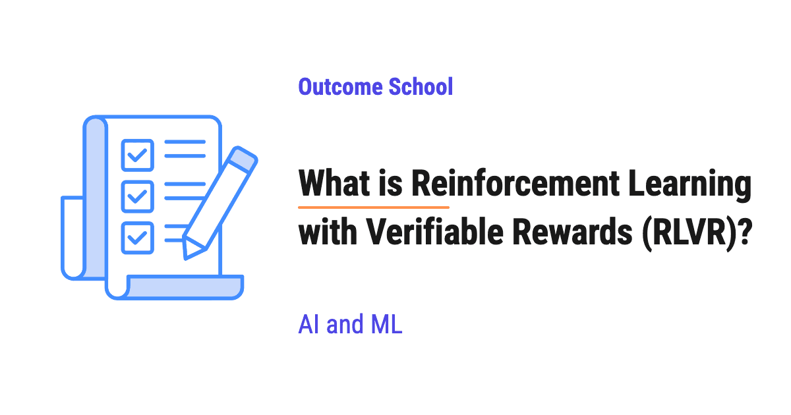

# What is Reinforcement Learning with Verifiable Rewards (RLVR)?

> Archived from <https://outcomeschool.com/blog/reinforcement-learning-with-verifiable-rewards-rlvr> on 2026-11-25.

Reinforcement Learning with Verifiable Rewards (RLVR) is a way to train an LLM where a program checks the model&#x27;s final answer and gives a reward of 1 if it is correct and 0 if it is wrong. The model then learns to produce more of the answers that got 1.

In this blog, we will learn about Reinforcement Learning with Verifiable Rewards (RLVR). We will also see the problem with learned reward models, what a verifier is, how the RLVR training loop works step by step, how GRPO compares answers within a group with a small worked example, how RLVR led to reasoning models, where it works well and where it fails, and how it differs from RLHF.

We will cover the following:
<ul><li>The problem with learned reward models</li><li>What is Reinforcement Learning with Verifiable Rewards (RLVR)?</li><li>What is a verifier?</li><li>How the RLVR training loop works</li><li>How GRPO compares answers within a group</li><li>How RLVR led to reasoning models</li><li>Limits of RLVR</li><li>RLHF vs RLVR</li></ul>
I am <strong>Amit Shekhar</strong>, Founder @ <a target="_blank" rel="noopener noreferrer" href="https://outcomeschool.com">Outcome School</a>, I have taught and mentored many developers, and their efforts landed them high-paying tech jobs, helped many tech companies in solving their unique problems, and created many open-source libraries being used by top companies. I am passionate about sharing knowledge through open-source, blogs, and videos.

I teach <a target="_blank" rel="noopener noreferrer" href="https://outcomeschool.com/program/ai-and-machine-learning">AI and Machine Learning</a> at Outcome School.

Let&#x27;s get started.
<h2 id="the-problem-with-learned-reward-models">The problem with learned reward models</h2>
In <a target="_blank" rel="noopener noreferrer" href="reinforcement-learning.md">reinforcement learning</a>, a model tries something, gets a score called a <strong>reward</strong>, and slowly learns to do more of what gets a high reward.

When we train an <a target="_blank" rel="noopener noreferrer" href="large-language-model-llm.md">LLM (Large Language Model)</a> with reinforcement learning, we need someone to give that reward for every answer the model writes. A human cannot read millions of answers. So, the common approach is to train another model, called a <strong><a target="_blank" rel="noopener noreferrer" href="reward-model.md">reward model</a></strong>, that has learned from human preferences and gives a score to each answer.

This approach is used in <a target="_blank" rel="noopener noreferrer" href="reinforcement-learning-from-human-feedback-rlhf.md">RLHF (Reinforcement Learning from Human Feedback)</a>. It works well for open-ended tasks like writing a polite email, where there is no single correct answer.

But a learned reward model has two big problems:
<ul><li><strong>It can be fooled.</strong> The reward model is itself a neural network that only guesses what humans like. The LLM being trained can find answers that get a high score without being good, for example, answers that are longer, sound more confident, or flatter the user. This is called <strong><a target="_blank" rel="noopener noreferrer" href="reward-hacking.md">reward hacking</a></strong>.</li><li><strong>It is expensive.</strong> We need to collect a lot of human preference data, train a separate large model, and run that model on every answer during training.</li></ul>
Now, the question is: for some tasks, do we even need a model to guess whether an answer is good?

Let&#x27;s say we ask the LLM: &quot;What is 12 + 30?&quot; The correct answer is 42. We do not need a neural network to judge this. A few lines of code can check whether the final answer is 42.

Here comes Reinforcement Learning with Verifiable Rewards (RLVR) into the picture.
<h2 id="what-is-reinforcement-learning-with-verifiable-rewards-rlvr">What is Reinforcement Learning with Verifiable Rewards (RLVR)?</h2>
<strong>Reinforcement Learning with Verifiable Rewards (RLVR) is a reinforcement learning method for training LLMs where the reward comes from a program that checks the answer against a known correct result, instead of from a learned reward model.</strong>

The word <strong>verifiable</strong> means &quot;can be checked&quot;. So, RLVR works on tasks where the answer can be checked automatically and exactly.

Examples of such tasks:
<ul><li><strong>Math with a final answer:</strong> We know the correct number, so we compare the model&#x27;s final number with it.</li><li><strong>Code with tests:</strong> We run the code the model wrote against test cases. If all tests pass, the answer is correct.</li><li><strong>Format rules:</strong> We check whether the output follows a required format, for example, the reasoning is inside <code>&lt;think&gt;</code> tags and the final answer is on a line starting with <code>Answer:</code>.</li></ul>
In each case, the reward is simple: <strong>1 if correct, 0 if wrong</strong>. Some setups also give a small reward for the correct format, but the idea stays the same.

Let&#x27;s see the difference in the source of the reward as a diagram:

<pre><code class="language-text code-highlight">RLHF                             RLVR

┌────────────────────────────┐   ┌────────────────────────────┐
│ Model answer: &quot;42&quot;         │   │ Model answer: &quot;42&quot;         │
└─────────────┬──────────────┘   └─────────────┬──────────────┘
              ↓                                ↓
┌────────────────────────────┐   ┌────────────────────────────┐
│ Reward model               │   │ A program that checks      │
│ (a neural network)         │   │ against 42                 │
└─────────────┬──────────────┘   └─────────────┬──────────────┘
              ↓                                ↓
┌────────────────────────────┐   ┌────────────────────────────┐
│ Score: 0.73 (a guess)      │   │ Reward: 1 (checked)        │
└────────────────────────────┘   └────────────────────────────┘
</code></pre>

Here, we can see that both receive the same answer. In RLHF, a reward model guesses how good the answer is. In RLVR, a program checks the answer against the known correct result.

The term RLVR was popularized by the Tulu 3 work from AI2 (Allen Institute for AI), which used it to improve skills like math and following precise instructions.

To learn Reinforcement Learning, Reward Models, and RLHF in depth, check out our <a target="_blank" rel="noopener noreferrer" href="https://outcomeschool.com/program/ai-and-machine-learning">AI and Machine Learning Program</a> at Outcome School.
<h2 id="what-is-a-verifier">What is a verifier?</h2>
The program that checks the answer and gives the reward is called a <strong>verifier</strong>.

The best way to learn this is by taking an example. Let&#x27;s write a simple verifier for a math answer in Python as below:

<pre><code class="code-highlight language-python">import re

def verify(model_output, correct_answer):
    match = re.search(r&quot;Answer:\s*(-?\d+)&quot;, model_output)
    if match is None:
        return 0  # no final answer found
    if int(match.group(1)) == correct_answer:
        return 1
    return 0

print(verify(&quot;12 + 30 = 42. Answer: 42&quot;, 42))
print(verify(&quot;12 + 30 = 32. Answer: 32&quot;, 42))
print(verify(&quot;I think it is around 40.&quot;, 42))
</code></pre>

Here, we have:
<ul><li><code>re.search</code> looks for the text <code>Answer:</code> followed by a whole number, positive or negative, in the model output.</li><li>If no such line exists, the verifier returns <code>0</code>, because the model did not give a final answer in the required format.</li><li>If the number matches <code>correct_answer</code>, it returns <code>1</code>. Otherwise, it returns <code>0</code>.</li></ul>
This will print the following:

<pre><code class="language-text code-highlight">1
0
0
</code></pre>

Here, we can notice that the verifier does not read the reasoning at all. It only checks the final answer. The model is free to think in any way it likes, as long as it reaches the correct answer.

For code, the verifier runs the program on test cases instead of comparing a number. The idea is the same.

<strong>Planning your move into AI?</strong>

No matter which tech domain you work in today, with your effort, you can transition to these roles:
<ul><li>AI Engineer</li><li>Forward Deployed Engineer</li><li>AI Agent Engineer</li><li>Harness Engineer</li><li>Voice AI Engineer</li><li>AI Architect</li><li>LLM Engineer</li><li>LLM Inference Engineer</li><li>Gen AI Engineer</li><li>MLOps Engineer</li><li>ML Engineer</li><li>Deep Learning Engineer</li></ul>
Our <a target="_blank" rel="noopener noreferrer" href="https://outcomeschool.com/program/ai-and-machine-learning">AI and Machine Learning Program</a> at Outcome School takes you there.
<h2 id="how-the-rlvr-training-loop-works">How the RLVR training loop works</h2>
Now, let&#x27;s understand the full training loop. We will use <strong><a target="_blank" rel="noopener noreferrer" href="group-relative-policy-optimization-grpo.md">GRPO (Group Relative Policy Optimization)</a></strong> as the learning method, because it is the one used by DeepSeek-R1. Here, the <strong>policy</strong> is the LLM being trained, because it decides which token to write next.

<strong>Step 1:</strong> We pick a prompt that has a known correct answer, for example, &quot;What is 12 + 30?&quot; with the correct answer 42.

<strong>Step 2:</strong> The model generates several answers for the same prompt, for example, 4 answers. Each answer contains some reasoning and a final answer. Because the model picks tokens with some randomness, the 4 answers are different.

<strong>Step 3:</strong> The verifier checks each answer and gives a reward of 1 or 0.

<strong>Step 4:</strong> We compare each answer with the other answers in the same group. Answers that did better than the group average get a positive score, and answers that did worse get a negative score. This score is called the <strong>advantage</strong>.

<strong>Step 5:</strong> We update the model&#x27;s parameters so that the tokens of answers with a positive advantage become more likely, and the tokens of answers with a negative advantage become less likely.

Then, we repeat this for many prompts, again and again.

We have a detailed blog on <a target="_blank" rel="noopener noreferrer" href="policy-gradient-reinforce.md">Policy Gradient and the REINFORCE algorithm</a> that explains how this kind of update works step by step.

Let&#x27;s see this as a diagram:

<pre><code class="language-text code-highlight">┌────────────────────────────────────────┐
│ Prompt: &quot;What is 12 + 30?&quot;             │
│ Correct answer: 42                     │
└───────────────────┬────────────────────┘
                    ↓
┌────────────────────────────────────────┐
│ LLM generates 4 answers                │
│ with reasoning                         │
└───────────────────┬────────────────────┘
                    ↓
┌────────────────────────────────────────┐
│ Verifier checks each answer            │
│ Rewards: 1, 0, 0, 0                    │
└───────────────────┬────────────────────┘
                    ↓
┌────────────────────────────────────────┐
│ Compare within the group (GRPO)        │
│ Advantages: +1.73, -0.58, -0.58, -0.58 │
└───────────────────┬────────────────────┘
                    ↓
┌────────────────────────────────────────┐
│ Update the LLM                         │
│ More likely: answer 1                  │
│ Less likely: answers 2, 3, 4           │
└───────────────────┬────────────────────┘
                    ↓
┌────────────────────────────────────────┐
│ Pick the next prompt and repeat        │
└────────────────────────────────────────┘
</code></pre>

Here, we can see that there is no human and no reward model inside the loop. The only judge is the verifier.
<h2 id="how-grpo-compares-answers-within-a-group">How GRPO compares answers within a group</h2>
Now, let&#x27;s see how the advantage is calculated in Step 4 with real numbers.

Let&#x27;s say the model generated 4 answers for &quot;What is 12 + 30?&quot;:
<ul><li>Answer 1 says 42. Reward = 1.</li><li>Answer 2 says 32. Reward = 0.</li><li>Answer 3 says 43. Reward = 0.</li><li>Answer 4 has no final answer. Reward = 0.</li></ul>
GRPO calculates the advantage of each answer using the mean and standard deviation of the rewards in the group:

<strong>advantage_i = (reward_i - mean(rewards)) / std(rewards)</strong>

<strong>Step 1:</strong> We find the mean of the rewards.

mean = (1 + 0 + 0 + 0) / 4 = 0.25

<strong>Step 2:</strong> We find the standard deviation. It tells us how spread out the rewards are.
<ul><li>Difference of each reward from the mean: 0.75, -0.25, -0.25, -0.25</li><li>Squares: 0.5625, 0.0625, 0.0625, 0.0625</li><li>Average of squares: 0.75 / 4 = 0.1875</li><li>Standard deviation: sqrt(0.1875) = 0.433</li></ul>
<strong>Step 3:</strong> We find the advantage of each answer.
<ul><li>Answer 1: (1 - 0.25) / 0.433 = +1.73</li><li>Answers 2, 3, and 4: (0 - 0.25) / 0.433 = -0.58</li></ul>
Here, we can notice a few things:
<ul><li>The correct answer gets a large positive advantage, so the model will move toward it.</li><li>The wrong answers get a negative advantage, so the model will move away from them.</li><li>The advantages add up to zero, because the three differences of -0.25 cancel the one difference of +0.75 before we divide by 0.433.</li><li>The group itself acts as the baseline, so we do not need a separate model to predict how good an answer should be. This is one reason GRPO is cheaper than older methods like <a target="_blank" rel="noopener noreferrer" href="proximal-policy-optimization-ppo.md">PPO</a>, which train an extra value model for this.</li></ul>
Now, one more important case. Suppose all 4 answers are correct. Then every reward is 1, the mean is 1, and every advantage is 0. The same happens if all 4 answers are wrong. Means, the model learns nothing from that prompt. It learns only when some answers in the group are correct and some are wrong.

<strong>A quick note for you</strong>

No matter which tech domain you work in, get familiar with these topics:
<ul><li>LLM</li><li>RAG</li><li>MCP</li><li>Agent</li><li>Fine-tuning</li><li>Quantization</li></ul>
We put it all together in one video:

<a target="_blank" rel="noopener noreferrer" href="https://www.youtube.com/watch?v=lnfWvX66FUk">AI Engineering Explained: LLM, RAG, MCP, Agent, Fine-Tuning, and Quantization</a>

No need to stop reading - bookmark it and watch later when you get time. Future you will thank you.

Now, let&#x27;s get back to the topic.
<h2 id="how-rlvr-led-to-reasoning-models">How RLVR led to reasoning models</h2>
Now, the next big question is: why did RLVR become so popular?

The answer is <a target="_blank" rel="noopener noreferrer" href="large-reasoning-models.md">reasoning models</a>. In January 2025, DeepSeek released <strong>DeepSeek-R1</strong>. Along with it, they described <strong>DeepSeek-R1-Zero</strong>, which was trained by applying reinforcement learning with GRPO directly on their base model, without first <a target="_blank" rel="noopener noreferrer" href="how-does-fine-tuning-work.md">fine-tuning</a> it on example answers.

For rewards, they used simple rules and no neural reward model:
<ul><li><strong>Accuracy reward:</strong> For math, the final answer had to match the correct answer. For coding problems, the code had to pass test cases.</li><li><strong>Format reward:</strong> The model had to put its thinking between <code>&lt;think&gt;</code> and <code>&lt;/think&gt;</code> tags.</li></ul>
The DeepSeek team explained that they avoided a neural reward model because it can suffer from reward hacking during large-scale training, and it makes the training more complex.

The verifier only checked the final answer. It never told the model how to think. Still, as training went on, the model on its own started writing longer reasoning, checking its own steps, and trying a different approach when it found a mistake. Thinking longer helped it reach correct answers more often, and correct answers were the only thing that got rewarded.

<strong>Note:</strong> The final DeepSeek-R1 model used more stages than R1-Zero. It was first fine-tuned on a small set of long reasoning examples, then trained with reinforcement learning, then fine-tuned again, and then trained with one more round of reinforcement learning. But R1-Zero showed that strong reasoning can come from reinforcement learning with rule-based rewards alone.

This is how RLVR became a core part of training reasoning models.
<h2 id="limits-of-rlvr">Limits of RLVR</h2>
RLVR has three limits.

<strong>Only works where answers are checkable:</strong> We need a correct answer or a test to compare against. Tasks like writing a poem, summarizing a meeting, or giving advice have no single correct answer. For these, we still need human feedback or a reward model.

<strong>Verifier bugs can be gamed:</strong> The model is trained to get reward 1, not to be correct. If the verifier has a gap, the model can learn to exploit it. For example:
<ul><li>If the verifier only checks that the code runs without crashing, the model can learn to write code that does nothing.</li><li>If the verifier only checks whether the correct number appears anywhere in the output, the model can learn to write many different numbers so that one of them matches.</li></ul>
So, the verifier must be written carefully. Reward hacking is less common than with a learned reward model, but it is still possible.

<strong>Sparse reward:</strong> The reward is only 1 or 0 at the end of a long answer. The model does not get any signal about which step in its reasoning was right or wrong. And if a problem is too hard and the model never gets it right, all rewards are 0, and the model learns nothing from it. This is why the training problems must be at the right difficulty, not too easy and not too hard.

<strong>Stay updated:</strong> Subscribe to our <a target="_blank" rel="noopener noreferrer" href="https://outcomeschool.substack.com/subscribe">newsletter</a> to get our latest AI and Machine Learning blogs straight to your inbox.
<h2 id="rlhf-vs-rlvr">RLHF vs RLVR</h2>
Let me tabulate the differences between RLHF and RLVR for your better understanding.
<table><thead><tr><th>Aspect</th><th>RLHF</th><th>RLVR</th></tr></thead><tbody><tr><td>Source of reward</td><td>A learned reward model trained on human data</td><td>A program (verifier) that checks the answer</td></tr><tr><td>Reward value</td><td>A score like 0.73</td><td>Usually 1 (correct) or 0 (wrong)</td></tr><tr><td>Best for</td><td>Open-ended tasks like writing and chat</td><td>Checkable tasks like math, code, and format</td></tr><tr><td>Human data needed</td><td>A lot of human preference data</td><td>Prompts with known answers or tests</td></tr><tr><td>Cost</td><td>High, needs a separate large model</td><td>Low, the verifier is a small program</td></tr><tr><td>Risk of being fooled</td><td>Higher, the reward model can be fooled</td><td>Lower, but verifier bugs can still be gamed</td></tr></tbody></table>
In practice, both are often used together. RLVR improves reasoning on math and code, and RLHF keeps the model helpful and safe on open-ended tasks.

Now we must have understood what Reinforcement Learning with Verifiable Rewards (RLVR) is, how it works, and where it works well and where it fails.
<h2 id="frequently-asked-questions">Frequently Asked Questions</h2><h3 id="does-the-verifier-in-rlvr-check-the-models-reasoning-steps">Does the verifier in RLVR check the model&#x27;s reasoning steps?</h3>
No. The verifier only checks the final answer and does not read the reasoning at all. The model is free to think in any way it likes, as long as it reaches the correct answer. This is also why the reward is sparse: the model gets no signal about which step in its reasoning was right or wrong.
<h3 id="what-happens-in-rlvr-when-all-answers-in-a-group-get-the-same-reward">What happens in RLVR when all answers in a group get the same reward?</h3>
The model learns nothing from that prompt. If all answers are correct, or all are wrong, the mean equals every reward, so every advantage is 0. The model learns only when some answers in the group are correct and some are wrong, which is why the training problems must be at the right difficulty.
<h3 id="can-reward-hacking-still-happen-in-rlvr">Can reward hacking still happen in RLVR?</h3>
Yes. The model is trained to get a reward of 1, not to be correct, so it can exploit any gap in the verifier. For example, if the verifier only checks that the code runs without crashing, the model can learn to write code that does nothing. Reward hacking is less common than with a learned reward model, but it is still possible.
<h3 id="are-rlvr-and-rlhf-used-together">Are RLVR and RLHF used together?</h3>
Yes. In practice, both are often used together. RLVR improves reasoning on math and code, where the answer can be checked, and RLHF keeps the model helpful and safe on open-ended tasks like writing and chat, where there is no single correct answer.

That&#x27;s it for now.

Thanks

<strong>Amit Shekhar</strong> Founder @ <a target="_blank" rel="noopener noreferrer" href="https://outcomeschool.com">Outcome School</a>

You can connect with me on:
<ul><li><a target="_blank" rel="noopener noreferrer" href="https://x.com/amitiitbhu">X</a></li><li><a target="_blank" rel="noopener noreferrer" href="https://www.linkedin.com/in/amit-shekhar-iitbhu">LinkedIn</a></li><li><a target="_blank" rel="noopener noreferrer" href="https://github.com/amitshekhariitbhu">GitHub</a></li></ul>
Follow Outcome School on:
<ul><li><a target="_blank" rel="noopener noreferrer" href="https://x.com/outcome_school">X</a></li><li><a target="_blank" rel="noopener noreferrer" href="https://youtube.com/@OutcomeSchool">YouTube</a></li><li><a target="_blank" rel="noopener noreferrer" href="https://www.linkedin.com/company/outcomeschool">LinkedIn</a></li><li><a target="_blank" rel="noopener noreferrer" href="http://github.com/OutcomeSchool">GitHub</a></li></ul>
<a target="_blank" rel="noopener noreferrer" href="https://outcomeschool.com/blog"><strong>Read all of our high-quality blogs here.</strong></a>

