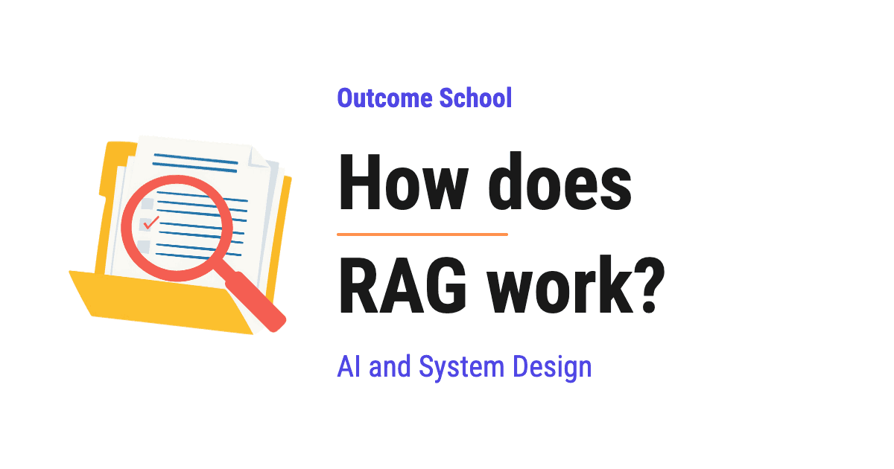

# How does RAG work?

> Archived from <https://outcomeschool.com/blog/retrieval-augmented-generation-rag> on 2026-11-25.

RAG, or Retrieval-Augmented Generation, first finds the right information for our question and then gives it to the LLM, so that the LLM can write an accurate answer.

In this blog, we will learn about how RAG works. We will also see why a plain LLM is not enough, how indexing, embeddings, retrieval, and generation work together, a complete walkthrough of the full flow, and why RAG works so well.

We will cover the following:
<ul><li>The problem with an LLM</li><li>What is RAG?</li><li>How does RAG work</li><li>Indexing: preparing the knowledge</li><li>Embeddings and the vector database</li><li>Retrieval: finding the right information</li><li>Generation: writing the final answer</li><li>A complete walkthrough</li><li>Why RAG works so well</li></ul>
I am <strong>Amit Shekhar</strong>, Founder @ <a target="_blank" rel="noopener noreferrer" href="https://outcomeschool.com">Outcome School</a>, I have taught and mentored many developers, and their efforts landed them high-paying tech jobs, helped many tech companies in solving their unique problems, and created many open-source libraries being used by top companies. I am passionate about sharing knowledge through open-source, blogs, and videos.

I teach <a target="_blank" rel="noopener noreferrer" href="https://outcomeschool.com/program/ai-and-machine-learning">AI and Machine Learning</a> at Outcome School.

Let&#x27;s get started.
<h3 id="the-problem-with-an-llm">The problem with an LLM</h3>
An <a target="_blank" rel="noopener noreferrer" href="large-language-model-llm.md">LLM (Large Language Model)</a> is powerful, but it has a big limitation.

An LLM only knows what it read during its training. Once the training is over, its knowledge is frozen.

Let&#x27;s say the LLM was trained with data up to last year. Now, we ask it about something that happened today. The LLM has no idea about it.

So, the LLM gives us a wrong answer, or it simply makes up something that sounds correct.

When an LLM makes up an answer that sounds confident but is actually wrong, we call it as a <strong><a target="_blank" rel="noopener noreferrer" href="why-do-llms-hallucinate-the-token-level-explanation.md">hallucination</a></strong>.

There is one more problem. An LLM does not know about our private data.

Suppose we run a company. We have our own internal documents, our own product manuals, and our own customer records. The LLM never read any of this. So, it cannot answer questions about our company.

So, we have two big problems:
<ul><li>The LLM does not know recent information.</li><li>The LLM does not know our private or company-specific information.</li></ul>
Now, the question is: how can we give the LLM the right information so that it answers correctly? The answer is RAG.
<h3 id="what-is-rag">What is RAG?</h3>
<strong>RAG stands for Retrieval-Augmented Generation. It is a technique where we first find the right information, and then we give that information to the LLM so that it can write an accurate answer.</strong>

Let&#x27;s decompose the term to understand it better.

<strong>RAG = Retrieval + Augmented + Generation</strong>
<ul><li><strong>Retrieval</strong> means finding and fetching the right information.</li><li><strong>Augmented</strong> means adding that information to help the LLM.</li><li><strong>Generation</strong> means the LLM generating the final answer using that information.</li></ul>
Let&#x27;s understand this with an analogy.

Suppose a student is sitting in an open-book exam. The student is smart, but the student does not remember every fact. So, before answering, the student opens the right book, finds the right page, reads it, and then writes the answer.

Here, the student is the LLM. The act of opening the book and finding the right page is the retrieval. Writing the answer using that page is the generation.

This is exactly what RAG does. It turns a closed-book exam into an open-book exam for the LLM.

Now, we have understood what RAG is. It&#x27;s time to learn how it actually works.
<h3 id="how-does-rag-work">How does RAG work</h3>
RAG works in two main phases.

The first phase is <strong>Indexing</strong>. This is the preparation phase, where we organize our knowledge so that it can be searched quickly.

The second phase is the <strong>Query</strong> phase. This phase has two steps inside it: <strong>Retrieval</strong> and <strong>Generation</strong>.

We can picture the two phases as below:

<pre><code class="language-text code-highlight">   INDEXING PHASE (done once)
   --------------------------
   Documents --&gt; Chunks --&gt; Embeddings --&gt; Vector Database

   QUERY PHASE (done for every question)
   -------------------------------------
   Question --&gt; Retrieval --&gt; Generation --&gt; Answer
                   |
                   +--&gt; reads from the Vector Database
</code></pre>

Here, we can see that the <code>Indexing</code> phase prepares our knowledge once and stores it in the <code>Vector Database</code>. The <code>Query</code> phase then uses that stored knowledge every time a user asks a question, first doing <code>Retrieval</code> and then <code>Generation</code>.

We will learn about each of them in detail.

<strong>Planning your move into AI?</strong>

No matter which tech domain you work in today, with your effort, you can transition to these roles:
<ul><li>AI Engineer</li><li>Forward Deployed Engineer</li><li>AI Agent Engineer</li><li>Harness Engineer</li><li>Voice AI Engineer</li><li>AI Architect</li><li>LLM Engineer</li><li>LLM Inference Engineer</li><li>Gen AI Engineer</li><li>MLOps Engineer</li><li>ML Engineer</li><li>Deep Learning Engineer</li></ul>
Our <a target="_blank" rel="noopener noreferrer" href="https://outcomeschool.com/program/ai-and-machine-learning">AI and Machine Learning Program</a> at Outcome School takes you there.

Let&#x27;s start with the indexing phase, because everything depends on it.
<h3 id="indexing-preparing-the-knowledge">Indexing: preparing the knowledge</h3>
Before we can search for information, we must first organize it.

Let&#x27;s say we have a big company handbook of 500 pages. We cannot give all 500 pages to the LLM for every question. It is too much. It is slow, and it is costly.

So, we break the big document into small pieces. Each small piece is called a <strong><a target="_blank" rel="noopener noreferrer" href="chunking-strategies-for-rag.md">chunk</a></strong>.

<strong>A chunk is a small piece of text, usually a paragraph or a few sentences, taken from a larger document.</strong>

Why do we break it into chunks? Because when someone asks a question, we want to find only the small piece that answers it, not the whole book.

So, we follow these steps in indexing:
<ul><li>First, we collect all our documents.</li><li>Then, we break each document into small chunks.</li><li>After that, we convert each chunk into a special number form so that the computer can search it.</li></ul>
That special number form is called an <strong><a target="_blank" rel="noopener noreferrer" href="what-are-embeddings.md">embedding</a></strong>. Let&#x27;s understand it now.
<h3 id="embeddings-and-the-vector-database">Embeddings and the vector database</h3>
<strong>An embedding is a list of numbers that represents the meaning of a piece of text.</strong>

A computer does not understand words like we do. So, we <a target="_blank" rel="noopener noreferrer" href="embedding-model.md">convert each chunk of text into a list of numbers</a>. These numbers capture the meaning of the text.

Two pieces of text that have a similar meaning will have similar numbers. We can imagine these numbers as points on a map. Points with a similar meaning sit close together, and points with a different meaning sit far apart.

Let&#x27;s take an example for the sake of understanding. Consider these three sentences:
<ul><li>&quot;How do I reset my password?&quot;</li><li>&quot;I forgot my login details and want to change them.&quot;</li><li>&quot;What is the price of the premium plan?&quot;</li></ul>
The first two sentences mean almost the same thing. So, their embeddings will be close to each other. The third sentence is about a different topic. So, its embedding will be far from the other two.

Let&#x27;s visualize this as below:

<pre><code class="language-text code-highlight">   meaning map
   -----------

      [reset my password]
            *
            * &lt;- close together (similar meaning)
      [forgot my login details]

                                  [price of premium plan]
                                          *
                                  (far away, different meaning)
</code></pre>

Here, we can see that the two sentences about login problems sit close together because their meaning is similar, while the sentence about pricing sits far away because its meaning is different. This closeness in the <code>meaning map</code> is exactly what lets the computer compare meaning instead of exact words.

Now, where do we store all these embeddings? We store them in a <strong><a target="_blank" rel="noopener noreferrer" href="how-does-a-vector-database-work.md">vector database</a></strong>.

<strong>A vector database is a special database that stores embeddings and can quickly find the ones that are most similar to a given embedding.</strong>

A list of numbers is also called a <strong>vector</strong>. That is why it is called a vector database.

So, at the end of indexing, our handbook is broken into chunks, every chunk is converted into an embedding, and all embeddings are stored in the vector database.

The indexing phase is ready now. We do this only once, or whenever our documents change.

<strong>A quick note for you</strong>

No matter which tech domain you work in, get familiar with these topics:
<ul><li>LLM</li><li>RAG</li><li>MCP</li><li>Agent</li><li>Fine-tuning</li><li>Quantization</li></ul>
We put it all together in one video:

<a target="_blank" rel="noopener noreferrer" href="https://www.youtube.com/watch?v=lnfWvX66FUk">AI Engineering Explained: LLM, RAG, MCP, Agent, Fine-Tuning, and Quantization</a>

No need to stop reading - bookmark it and watch later when you get time. Future you will thank you.

Now, let&#x27;s get back to the topic.

Now that we have prepared our knowledge, it&#x27;s time to learn how we answer a real question.
<h3 id="retrieval-finding-the-right-information">Retrieval: finding the right information</h3>
This is the first step of the query phase.

Let&#x27;s say a user asks our system a question:
<blockquote>
How do I reset my password?
</blockquote>
Now, the system must find the chunks that can answer this question.

First, we take the user&#x27;s question and convert it into an embedding too, using the same method we used for the chunks.

Then, we take this question embedding and search the vector database. The vector database compares the question embedding with all the stored chunk embeddings.

It finds the chunks whose embeddings are closest in meaning to the question. These closest chunks are the most relevant pieces of information.

This search by meaning is called a <strong><a target="_blank" rel="noopener noreferrer" href="how-does-semantic-search-work.md">semantic search</a></strong>.

<strong>A semantic search is a search that finds results based on meaning, not based on matching the exact words.</strong>

So, even if the user typed &quot;I cannot log in&quot; instead of &quot;reset my password&quot;, the semantic search can still find the right chunk, because the meaning is similar.

We usually pick the top few chunks. For example, the top three chunks that are closest in meaning. We pick a few instead of just one, because the full answer may be spread across more than one chunk.

To pick the best few chunks even more accurately, many systems add one more step that reorders them. We have a detailed blog on <a target="_blank" rel="noopener noreferrer" href="how-does-a-reranker-work.md">how a Reranker works</a> that explains this step by step.

The retrieval step is done. We now have the right pieces of information. Now, let&#x27;s move to the final step.
<h3 id="generation-writing-the-final-answer">Generation: writing the final answer</h3>
This is the second step of the query phase.

Now, we have two things in our hand:
<ul><li>The user&#x27;s original question.</li><li>The top relevant chunks that we retrieved.</li></ul>
We combine both of these into a single instruction for the LLM. This combined instruction is called a <strong>prompt</strong>.

<strong>A prompt is the full input text that we give to the LLM to tell it what to do.</strong>

The prompt looks like below:

<pre><code class="language-text code-highlight">You are a helpful assistant. Answer the question using only the
information given below.

Information:
&quot;To reset your password, go to Settings, click Security, then click
Reset Password. You will receive an email with a reset link.&quot;

Question:
How do I reset my password?
</code></pre>

Here, we can see that we did not just send the question alone. We also attached the retrieved information on top of the question. For the sake of understanding, we have shown only one chunk of information here, but in real use we would attach the top few chunks.

This is the &quot;Augmented&quot; part of RAG. The word augmented means we added the right facts to the question.

Now, the LLM reads this prompt. It already knows how to write in good human language. So, it uses the given information to write a clear and correct answer like below:

<pre><code class="language-text code-highlight">To reset your password, open Settings and click on Security. Then click
Reset Password. You will get an email with a link to set a new password.
</code></pre>

Here, we can notice that the answer is accurate. The LLM did not make up anything. It used the real facts that we retrieved and provided.

The LLM now answers based on our own data.

This is how the generation step works.

<strong>Stay updated:</strong> Subscribe to our <a target="_blank" rel="noopener noreferrer" href="https://outcomeschool.substack.com/subscribe">newsletter</a> to get our latest AI and Machine Learning blogs straight to your inbox.
<h3 id="a-complete-walkthrough">A complete walkthrough</h3>
Now, let&#x27;s connect everything in one clean flow, step by step.

<strong>Step 1:</strong> We take our documents and break them into small chunks.

<strong>Step 2:</strong> We convert each chunk into an embedding and store all of them in the vector database. This was the indexing phase.

<strong>Step 3:</strong> The user asks a question.

<strong>Step 4:</strong> We convert the question into an embedding.

<strong>Step 5:</strong> We search the vector database and retrieve the top chunks that are closest in meaning to the question.

<strong>Step 6:</strong> We combine the question and the retrieved chunks into a single prompt.

<strong>Step 7:</strong> We send this prompt to the LLM, and the LLM generates the final answer using the facts we provided.

This is the complete RAG flow. The first two steps are the one-time preparation. The last five steps happen every time a user asks a question.

We can picture the complete flow as below:

<pre><code class="language-text code-highlight">   Documents
      |
      ↓
   Chunks ---&gt; Embeddings ---&gt; +-----------------+
                               | Vector Database |
                               +-----------------+
                                        ↑
                                        | search by meaning
                                        |
   Question ---&gt; Embedding -------------+
      |                                 |
      |                                 ↓
      |                          Top relevant chunks
      |                                 |
      +-------------+-------------------+
                    |
                    ↓
                 Prompt  (question + retrieved chunks)
                    |
                    ↓
                  LLM
                    |
                    ↓
              Final Answer
</code></pre>

Here, we can see that the question and the retrieved chunks are combined into a single <code>Prompt</code>, and the <code>LLM</code> uses that prompt to write the <code>Final Answer</code>. The top part of the diagram is the one-time indexing, and the bottom part is what happens for every question.

To master RAG, Vector Databases, and Design a RAG System (Chat with Your Documents), and to build an AI Tutor from scratch, check out our <a target="_blank" rel="noopener noreferrer" href="https://outcomeschool.com/program/ai-and-machine-learning">AI and Machine Learning Program</a> at Outcome School.
<h3 id="why-rag-works-so-well">Why RAG works so well</h3>
Now, let&#x27;s understand why RAG is so useful.

<strong>It gives fresh and updated answers.</strong> We do not need to retrain the huge LLM every time our data changes. We just update the chunks in the vector database, and the answers become up to date.

<strong>It works on our private data.</strong> We can feed our own company documents into the vector database. So, the LLM can answer questions about our own products, our own policies, and our own customers.

<strong>It reduces hallucinations.</strong> Since we hand the real facts to the LLM, the LLM is much less likely to guess. It answers based on the information we gave.

<strong>It can show the source.</strong> Since we know exactly which chunks were used, we can tell the user where the answer came from. This builds trust.

<strong>It is cheaper and faster.</strong> Retraining a big LLM costs a lot of money and time. With RAG, we only update the vector database.

This way we can use RAG to solve the interesting problem of giving an LLM new and private knowledge.

Some questions need more than one search, or need to pick between many sources. We have a detailed blog on <a target="_blank" rel="noopener noreferrer" href="agentic-rag.md">Agentic RAG</a> that covers how an AI Agent drives the retrieval in a loop.

Now we must have understood how RAG works, why a plain LLM is not enough, and why RAG works so well.
<h2 id="frequently-asked-questions">Frequently Asked Questions</h2><h3 id="do-we-need-to-retrain-the-llm-to-use-rag">Do we need to retrain the LLM to use RAG?</h3>
No. We do not need to retrain the LLM. When our data changes, we just update the chunks in the vector database, and the answers become up to date. This is also why RAG is cheaper and faster than retraining, which costs a lot of money and time.
<h3 id="is-the-indexing-phase-done-for-every-question">Is the indexing phase done for every question?</h3>
No. Indexing is done only once, or whenever our documents change. In indexing, we break our documents into chunks, convert every chunk into an embedding, and store all of them in the vector database. Only retrieval and generation happen every time a user asks a question.
<h3 id="why-does-rag-retrieve-more-than-one-chunk">Why does RAG retrieve more than one chunk?</h3>
RAG usually picks the top few chunks, like the top three, because the full answer may be spread across more than one chunk. Picking a few instead of just one gives the LLM all the pieces it needs to write a complete answer.
<h3 id="can-rag-show-where-the-answer-came-from">Can RAG show where the answer came from?</h3>
Yes. Since we know exactly which chunks were used to build the prompt, we can tell the user where the answer came from. Showing the source builds trust, because the user can check the original text behind the answer.

That&#x27;s it for now.

Thanks

<strong>Amit Shekhar</strong> Founder @ <a target="_blank" rel="noopener noreferrer" href="https://outcomeschool.com">Outcome School</a>

You can connect with me on:
<ul><li><a target="_blank" rel="noopener noreferrer" href="https://x.com/amitiitbhu">X</a></li><li><a target="_blank" rel="noopener noreferrer" href="https://www.linkedin.com/in/amit-shekhar-iitbhu">LinkedIn</a></li><li><a target="_blank" rel="noopener noreferrer" href="https://github.com/amitshekhariitbhu">GitHub</a></li></ul>
Follow Outcome School on:
<ul><li><a target="_blank" rel="noopener noreferrer" href="https://x.com/outcome_school">X</a></li><li><a target="_blank" rel="noopener noreferrer" href="https://youtube.com/@OutcomeSchool">YouTube</a></li><li><a target="_blank" rel="noopener noreferrer" href="https://www.linkedin.com/company/outcomeschool">LinkedIn</a></li><li><a target="_blank" rel="noopener noreferrer" href="http://github.com/OutcomeSchool">GitHub</a></li></ul>
<a target="_blank" rel="noopener noreferrer" href="https://outcomeschool.com/blog"><strong>Read all of our high-quality blogs here.</strong></a>

