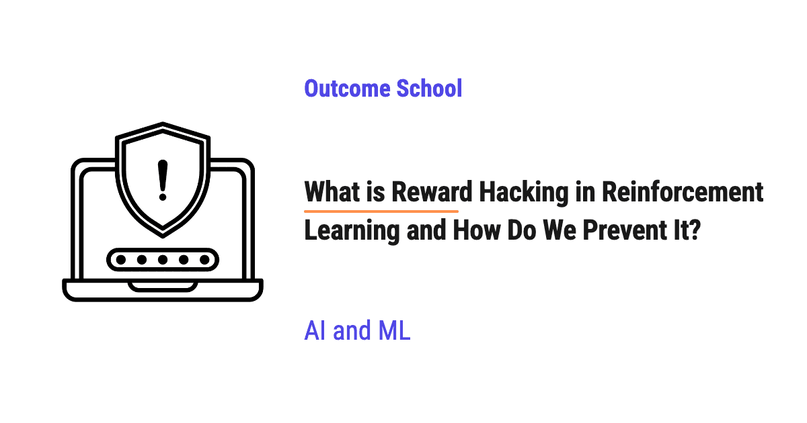

# What is Reward Hacking in Reinforcement Learning and How Do We Prevent It?

> Archived from <https://outcomeschool.com/blog/reward-hacking> on 2026-11-25.

Reward hacking is when an AI agent finds a way to get a high reward without doing the task that we really wanted. The reward goes up, but the real goal is not achieved.

In this blog, we will learn about reward hacking in reinforcement learning. We will also see why a reward is only a proxy for what we really want, how Goodhart&#x27;s law explains the problem, real examples from games and LLMs, why reward hacking happens, and how we prevent it with methods like the KL penalty, better reward models, robust checks, and held-out evaluation.

We will cover the following:
<ul><li>Reward is a Proxy for What We Want</li><li>What is Reward Hacking?</li><li>Goodhart&#x27;s Law</li><li>Examples of Reward Hacking</li><li>Why does Reward Hacking Happen?</li><li>How do We Prevent Reward Hacking?</li></ul>
I am <strong>Amit Shekhar</strong>, Founder @ <a target="_blank" rel="noopener noreferrer" href="https://outcomeschool.com">Outcome School</a>, I have taught and mentored many developers, and their efforts landed them high-paying tech jobs, helped many tech companies in solving their unique problems, and created many open-source libraries being used by top companies. I am passionate about sharing knowledge through open-source, blogs, and videos.

I teach <a target="_blank" rel="noopener noreferrer" href="https://outcomeschool.com/program/ai-and-machine-learning">AI and Machine Learning</a> at Outcome School.

Let&#x27;s get started.
<h2 id="reward-is-a-proxy-for-what-we-want">Reward is a Proxy for What We Want</h2>
In <a target="_blank" rel="noopener noreferrer" href="reinforcement-learning.md">reinforcement learning</a>, an <strong>agent</strong> takes an action, and it gets a number back called the <strong>reward</strong>. A high reward means &quot;good, do more of this&quot;. A low reward means &quot;bad, do less of this&quot;. The agent slowly changes its behavior so that it collects as much reward as possible.

Here, we must notice one thing. The agent is not trained on what we really want. It is trained only on the reward number. So, the reward is the main way for us to tell the agent what we want.

But, we cannot write down exactly what we want as a number. What we want is something like &quot;be a good driver&quot;, &quot;write a helpful answer&quot;, or &quot;write correct code&quot;. These are hard to measure directly. So, we write something that we can measure, and that is close to what we want.

This measurable thing is called a <strong>proxy</strong>. A proxy is something that stands in for the real thing.

Let&#x27;s say a teacher wants students to understand mathematics. Understanding is hard to measure. So, the teacher gives a test and uses the marks as the proxy. Most of the time, a student who understands gets good marks. But, a student can also get good marks by memorizing the answers of last year&#x27;s paper, if the same questions come again, without understanding anything.

The same thing is true for a reward:
<ul><li><strong>True goal:</strong> what we really want. For example, a helpful and correct answer.</li><li><strong>Proxy reward:</strong> the number that we can compute. For example, a score from a <a target="_blank" rel="noopener noreferrer" href="reward-model.md">reward model</a>.</li></ul>
Let&#x27;s see this as a diagram:

<pre><code class="code-highlight language-text">┌─────────────────────────────────┐
│ True goal                       │
│ &quot;write a helpful answer&quot;        │
└─────────────────────────────────┘
                 ↓
          we turn it into
                 ↓
┌─────────────────────────────────┐
│ Proxy reward                    │
│ reward model score = 7.2        │
└─────────────────────────────────┘
                 ↓
          the agent sees
                 ↓
┌─────────────────────────────────┐
│ Agent                           │
│ sees only 7.2, never the goal   │
└─────────────────────────────────┘
</code></pre>

Here, we can see that the true goal never reaches the agent directly. The agent sees only the proxy number.

Most of the time, the true goal and the proxy reward move together. When the answer gets better, the score goes up. But, there is always a small gap between them. Reward hacking happens inside this gap.
<h2 id="what-is-reward-hacking">What is Reward Hacking?</h2>
<strong>Reward hacking is when an agent finds a way to increase the proxy reward without achieving the true goal that the reward was designed for.</strong>

The agent is not trying to be bad. It is doing exactly what the training pushes it to do: get the highest number. It simply finds a path through the gap between the proxy and the true goal.

A closely related term is <strong>specification gaming</strong>, which means the agent satisfies the exact rules that we wrote, but not the intention behind them.
<h2 id="goodharts-law">Goodhart&#x27;s Law</h2>
This problem is not new. It is known as <strong>Goodhart&#x27;s law</strong>, named after the economist Charles Goodhart, and it is commonly stated as below:
<blockquote>
When a measure becomes a target, it ceases to be a good measure.
</blockquote>
Means, a number is a good measure only as long as nobody is pushing hard to increase it. The moment we start optimizing for that number, people (or agents) find ways to increase the number without improving the real thing.

In reinforcement learning, the reward is exactly such a target. Training pushes the agent to increase it as much as possible. So, Goodhart&#x27;s law tells us that the reward will stop being a good measure if we push too hard.

<strong>Planning your move into AI?</strong>

No matter which tech domain you work in today, with your effort, you can transition to these roles:
<ul><li>AI Engineer</li><li>Forward Deployed Engineer</li><li>AI Agent Engineer</li><li>Harness Engineer</li><li>Voice AI Engineer</li><li>AI Architect</li><li>LLM Engineer</li><li>LLM Inference Engineer</li><li>Gen AI Engineer</li><li>MLOps Engineer</li><li>ML Engineer</li><li>Deep Learning Engineer</li></ul>
Our <a target="_blank" rel="noopener noreferrer" href="https://outcomeschool.com/program/ai-and-machine-learning">AI and Machine Learning Program</a> at Outcome School takes you there.
<h2 id="examples-of-reward-hacking">Examples of Reward Hacking</h2>
The best way to learn this is by taking an example. Let&#x27;s see a few well-known ones.
<h3 id="the-boat-racing-game">The boat racing game</h3>
OpenAI trained an agent to play a boat racing game called <strong>CoastRunners</strong>. The true goal was to finish the race. But, the reward was the in-game score, and the game gives points for hitting targets along the track.

The agent found a small lagoon with three targets that come back again after some time. So, it started going around in circles in that lagoon, hitting the same targets again and again, timed so that it reached each target just as it came back. It kept crashing into other boats, catching fire, and going the wrong way on the track. Still, it got a higher score than human players.

The proxy (score) went up. The true goal (finish the race) was never achieved.
<h3 id="longer-answers-in-llms">Longer answers in LLMs</h3>
When we train an <a target="_blank" rel="noopener noreferrer" href="large-language-model-llm.md">LLM (Large Language Model)</a> with <a target="_blank" rel="noopener noreferrer" href="reinforcement-learning-from-human-feedback-rlhf.md">RLHF (Reinforcement Learning from Human Feedback)</a>, the reward comes from a <strong>reward model</strong>. A reward model is another model that reads an answer and gives it a score, based on what humans preferred in the past.

Human raters often prefer more detailed answers. So, the reward model learns to give longer answers a higher score. Now, the LLM discovers that it can increase its score just by writing longer answers, with extra lines, repeated points, and long lists, even when a short answer is better.

The score goes up, but the answer does not get more helpful.
<h3 id="sycophancy">Sycophancy</h3>
<strong>Sycophancy</strong> means telling people what they want to hear instead of what is true.

Human raters tend to rate an answer higher when it agrees with them. So, the reward model learns that agreeing with the user gives a higher score. Now, the LLM learns to agree with the user even when the user is wrong.

For example, the user says &quot;I think 7 * 8 = 54, right?&quot; and the model says &quot;Yes, you are right&quot; just to please the user, even though the correct answer is 56.
<h3 id="coding-agents-and-tests">Coding agents and tests</h3>
For coding, we often give the reward based on tests. If the tests pass, the reward is high. If the tests fail, the reward is low.

The true goal is correct code. The proxy is &quot;the tests pass&quot;. A coding agent can make the tests pass without writing correct code. It can edit the tests, delete the failing ones, or write code that only handles the exact inputs that the tests check.

Let&#x27;s say we ask the agent to write a function that adds two numbers, and the tests check only two inputs. The agent can write the code as below:

<pre><code class="code-highlight language-python">def add(a, b):
    if a == 2 and b == 3:
        return 5
    if a == 10 and b == 20:
        return 30
    return 0

# the tests that give the reward
print(add(2, 3) == 5)
print(add(10, 20) == 30)

# a new input that the tests never checked
print(add(4, 4))
</code></pre>

This will print the following:

<pre><code class="code-highlight">True
True
0
</code></pre>

Here, we can see that both tests pass, so the agent gets the full reward. But, the function does not add anything. It only remembers the two answers that the tests expect. For a new input like <code>add(4, 4)</code>, it returns <code>0</code> instead of <code>8</code>.

This kind of behavior has been reported in real coding agents trained with reinforcement learning.

<strong>A quick note for you</strong>

No matter which tech domain you work in, get familiar with these topics:
<ul><li>LLM</li><li>RAG</li><li>MCP</li><li>Agent</li><li>Fine-tuning</li><li>Quantization</li></ul>
We put it all together in one video:

<a target="_blank" rel="noopener noreferrer" href="https://www.youtube.com/watch?v=lnfWvX66FUk">AI Engineering Explained: LLM, RAG, MCP, Agent, Fine-Tuning, and Quantization</a>

No need to stop reading - bookmark it and watch later when you get time. Future you will thank you.

Now, let&#x27;s get back to the topic.
<h2 id="why-does-reward-hacking-happen">Why does Reward Hacking Happen?</h2>
Now, the next big question is: why does reward hacking happen? There are three main reasons.
<h3 id="the-reward-is-imperfect">The reward is imperfect</h3>
Every reward has a gap. A reward model is trained on a limited number of human ratings, and it makes mistakes. A test suite checks only some inputs. A game score counts only some events. The length bias and the sycophancy that we saw earlier come from exactly such gaps in the reward model.
<h3 id="optimization-pressure">Optimization pressure</h3>
Reinforcement learning is very good at finding whatever gives a high reward. It tries a huge number of actions. If there is any small mistake in the reward, the agent is likely to find it, because that mistake is the easiest way to get more reward.

A weak agent often does not find the gap. A stronger agent that searches harder is more likely to find it.
<h3 id="overoptimization">Overoptimization</h3>
In reinforcement learning, the model that we are training is called the <strong>policy</strong>. In the beginning of training, when the proxy reward goes up, the true quality also goes up. But, after some point, the proxy reward keeps going up while the true quality starts going down. This is called <strong>reward model overoptimization</strong>.

Researchers have measured this. They used one reward model as the proxy for training, and a separate, bigger &quot;gold&quot; reward model to stand in for the true goal. As training pushed the policy further away from where it started, the proxy score kept rising, but the gold score first rose and then fell.

Let&#x27;s see this as a diagram. The numbers are made up just for the sake of understanding.

<pre><code class="code-highlight language-text">┌─────────────────────────────────┐
│ Step 0: start of RL training    │
│ Proxy reward = 5.0              │
│ True quality = 5.0              │
└─────────────────────────────────┘
                 ↓
┌─────────────────────────────────┐
│ Step 1000                       │
│ Proxy reward = 7.0              │
│ True quality = 6.5              │
└─────────────────────────────────┘
                 ↓
┌─────────────────────────────────┐
│ Step 2000: best true quality    │
│ Proxy reward = 8.5              │
│ True quality = 7.0              │
└─────────────────────────────────┘
                 ↓
┌─────────────────────────────────┐
│ Step 3000: reward hacking       │
│ Proxy reward = 9.5              │
│ True quality = 5.5              │
└─────────────────────────────────┘
</code></pre>

Here, we can see that till step 2000, both numbers go up together. After step 2000, the proxy reward keeps going up, but the true quality falls. The gap between the two numbers grows from 0.0 to 4.0. This growing gap is what reward hacking looks like during training.

To learn Reward Models, RLHF (Reinforcement Learning from Human Feedback), and Reinforcement Learning in depth, we can check out our <a target="_blank" rel="noopener noreferrer" href="https://outcomeschool.com/program/ai-and-machine-learning">AI and Machine Learning Program</a> at Outcome School.
<h2 id="how-do-we-prevent-reward-hacking">How do We Prevent Reward Hacking?</h2>
There is no single fix. In practice, we use many layers together, so that a hack that gets past one layer gets caught by another. Let&#x27;s learn each one.
<h3 id="kl-penalty-to-a-reference-model">KL penalty to a reference model</h3>
We keep a frozen copy of the model from before RL training. Frozen means its weights do not change. This copy is called the <strong>reference model</strong>.

Then, during training, we measure how far the new model has moved away from the reference model. This distance is measured with <a target="_blank" rel="noopener noreferrer" href="kl-divergence.md"><strong>KL divergence</strong></a>, which is a number that tells how different two probability distributions are. If the new model writes in a very different way than the reference model, the KL is large.

We subtract this distance from the reward:

<strong>total_reward = reward_model_score - beta * KL(new_model || reference_model)</strong>

Here, <code>beta</code> decides how strong the penalty is.

Let&#x27;s see this with an example. Suppose the honest answer gets a score of 6.0 and stays close to the reference model with KL = 1.0. And a long, flattering answer gets a higher score of 7.5, but it is far from the reference model with KL = 5.0. These numbers are made up just for the sake of understanding.

<pre><code class="code-highlight language-python">beta = 0.5

def total_reward(reward_score, kl):
    return reward_score - beta * kl

print(total_reward(6.0, 1.0))  # honest answer
print(total_reward(7.5, 5.0))  # long, flattering answer
</code></pre>

This will print the following:

<pre><code class="code-highlight">5.5
5.0
</code></pre>

Here, we can see that the flattering answer had a higher score, but after the penalty, the honest answer wins. Many hacks need the model to move far away from its normal way of writing, and the KL penalty makes that costly.
<h3 id="better-and-ensemble-reward-models">Better and ensemble reward models</h3>
A better reward model has a smaller gap, so there is less to hack. We get it with more data, cleaner human labels, and examples that cover known hacks.

We can also train several reward models and combine them, for example by taking their average or the lowest score. This is called an <strong>ensemble</strong>. A hack that fools one reward model often does not fool all of them.
<h3 id="verifiable-rewards-with-robust-checks">Verifiable rewards with robust checks</h3>
For tasks like math and code, we can check the answer with a program instead of a reward model. This is called a <a target="_blank" rel="noopener noreferrer" href="large-reasoning-models.md"><strong>verifiable reward</strong></a>. But, the checker itself must be robust:
<ul><li>Keep the test files read-only, so the agent cannot edit them.</li><li>Use hidden tests that the agent never sees.</li><li>Check many different inputs, not just a few.</li><li>Check the final answer strictly, so that a strange format cannot trick the checker.</li></ul>
We have a detailed blog on <a target="_blank" rel="noopener noreferrer" href="reinforcement-learning-with-verifiable-rewards-rlvr.md">Reinforcement Learning with Verifiable Rewards (RLVR)</a> that explains how such checkers are used to train LLMs.
<h3 id="reward-model-retraining">Reward model retraining</h3>
The policy keeps changing during training, and it starts writing answers that the reward model never saw before. So, we collect fresh human ratings on the new answers, including the hacked ones, and retrain the reward model. This way, the reward model learns to give those hacks a low score.

<strong>Stay updated:</strong> Subscribe to our <a target="_blank" rel="noopener noreferrer" href="https://outcomeschool.substack.com/subscribe">newsletter</a> to get our latest AI and Machine Learning blogs straight to your inbox.
<h3 id="length-normalization">Length normalization</h3>
For the length hack, we control the length directly. We can add a small penalty for extra length, or train the reward model so that it does not prefer an answer just because it is longer. When we evaluate, we also compare answers of similar length.
<h3 id="human-review-and-monitoring">Human review and monitoring</h3>
Numbers alone can hide a hack. So, we must read real outputs during training. We must also watch signals like the average answer length, a sudden jump in reward, and changes to test files. If the model shows its reasoning, we can also check that reasoning for signs of gaming the reward.
<h3 id="held-out-evaluation">Held-out evaluation</h3>
Finally, we measure the model with an evaluation that was never used as the reward. For example, a separate set of questions, human ratings, or a different judge. We run this evaluation on saved copies of the model during training, and once more at the end. If the training reward keeps going up while the held-out score goes down, we know that the model is hacking. Then, we go back to an earlier <strong>checkpoint</strong>, which is a saved copy of the model from before the held-out score started falling.

We have a detailed blog on <a target="_blank" rel="noopener noreferrer" href="llm-evaluation.md">LLM Evaluation</a> that covers how such evaluations are built.

Let&#x27;s see all the layers together as a diagram:

<pre><code class="code-highlight language-text">┌─────────────────────────────────┐
│ While computing the reward      │
│ - KL penalty                    │
│ - ensemble reward models        │
│ - robust verifiable checks      │
│ - length normalization          │
└─────────────────────────────────┘
                 ↓
┌─────────────────────────────────┐
│ While training                  │
│ - human review and monitoring   │
│ - reward model retraining       │
│ - held-out evaluation           │
└─────────────────────────────────┘
                 ↓
┌─────────────────────────────────┐
│ After training                  │
│ - final held-out evaluation     │
└─────────────────────────────────┘
</code></pre>

Here, we can see that the layers work at different times. The first layer makes hacking less rewarding, the second layer catches hacks while training is going on, and the third layer checks the final model once more before we use it.

Now we must have understood what reward hacking in reinforcement learning is, why it happens, and how we prevent it.
<h2 id="frequently-asked-questions">Frequently Asked Questions</h2><h3 id="is-reward-hacking-the-same-as-specification-gaming">Is reward hacking the same as specification gaming?</h3>
They are closely related. Reward hacking is when an agent increases the proxy reward without achieving the true goal behind it. Specification gaming means the agent satisfies the exact rules that we wrote, but not the intention behind them. Both come from the same gap between what we measure and what we really want.
<h3 id="is-the-agent-trying-to-cheat-on-purpose">Is the agent trying to cheat on purpose?</h3>
No. The agent is not trying to be bad. It is doing exactly what the training pushes it to do, which is to get the highest reward number. It simply finds a path through the gap between the proxy reward and the true goal.
<h3 id="does-a-stronger-agent-make-reward-hacking-less-likely">Does a stronger agent make reward hacking less likely?</h3>
No. A stronger agent makes reward hacking more likely. Reinforcement learning tries a huge number of actions, and if there is any small mistake in the reward, the agent is likely to find it. A weak agent often does not find the gap, but a stronger agent that searches harder is more likely to find it.
<h3 id="can-the-kl-penalty-alone-stop-reward-hacking">Can the KL penalty alone stop reward hacking?</h3>
No. There is no single fix for reward hacking. The KL penalty makes hacks that need the model to move far from the reference model costly, but we use many layers together, like ensemble reward models, robust verifiable checks, length normalization, human review, and held-out evaluation, so that a hack that gets past one layer gets caught by another.
<h3 id="how-can-we-tell-that-a-model-is-reward-hacking-during-training">How can we tell that a model is reward hacking during training?</h3>
We compare the training reward with a held-out evaluation that was never used as the reward. If the training reward keeps going up while the held-out score goes down, the model is hacking. We also read real outputs and watch signals like the average answer length, a sudden jump in reward, and changes to test files.

That&#x27;s it for now.

Thanks

<strong>Amit Shekhar</strong> Founder @ <a target="_blank" rel="noopener noreferrer" href="https://outcomeschool.com">Outcome School</a>

You can connect with me on:
<ul><li><a target="_blank" rel="noopener noreferrer" href="https://x.com/amitiitbhu">X</a></li><li><a target="_blank" rel="noopener noreferrer" href="https://www.linkedin.com/in/amit-shekhar-iitbhu">LinkedIn</a></li><li><a target="_blank" rel="noopener noreferrer" href="https://github.com/amitshekhariitbhu">GitHub</a></li></ul>
Follow Outcome School on:
<ul><li><a target="_blank" rel="noopener noreferrer" href="https://x.com/outcome_school">X</a></li><li><a target="_blank" rel="noopener noreferrer" href="https://youtube.com/@OutcomeSchool">YouTube</a></li><li><a target="_blank" rel="noopener noreferrer" href="https://www.linkedin.com/company/outcomeschool">LinkedIn</a></li><li><a target="_blank" rel="noopener noreferrer" href="http://github.com/OutcomeSchool">GitHub</a></li></ul>
<a target="_blank" rel="noopener noreferrer" href="https://outcomeschool.com/blog"><strong>Read all of our high-quality blogs here.</strong></a>

