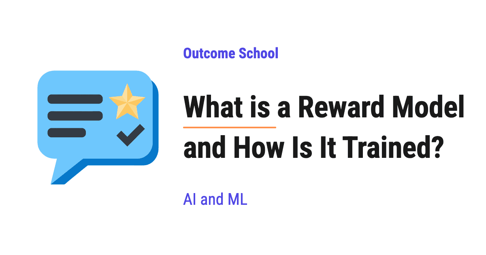

# What is a Reward Model and How Is It Trained?

> Archived from <https://outcomeschool.com/blog/reward-model> on 2026-11-25.

A Reward Model is a model that reads a prompt and an answer, and gives back one number that tells how good that answer is as per human preference. It is trained on pairs of answers where humans picked the better one.

In this blog, we will learn about what a Reward Model is and how it is trained. We will also see why we need it, how its architecture turns text into one score, how human preference data is collected, how the pairwise loss trains it step by step, how it is used in RLHF and for Best-of-N, and where it fails.

We will cover the following:
<ul><li>Why do we need a Reward Model?</li><li>What is a Reward Model?</li><li>Collecting human preference data</li><li>The pairwise loss</li><li>Worked example of the pairwise loss</li><li>How is a Reward Model trained?</li><li>How is a Reward Model used?</li><li>Limitations of a Reward Model</li></ul>
I am <strong>Amit Shekhar</strong>, Founder @ <a target="_blank" rel="noopener noreferrer" href="https://outcomeschool.com">Outcome School</a>, I have taught and mentored many developers, and their efforts landed them high-paying tech jobs, helped many tech companies in solving their unique problems, and created many open-source libraries being used by top companies. I am passionate about sharing knowledge through open-source, blogs, and videos.

I teach <a target="_blank" rel="noopener noreferrer" href="https://outcomeschool.com/program/ai-and-machine-learning">AI and Machine Learning</a> at Outcome School.

Let&#x27;s get started.
<h2 id="why-do-we-need-a-reward-model">Why do we need a Reward Model?</h2>
An <a target="_blank" rel="noopener noreferrer" href="large-language-model-llm.md">LLM (Large Language Model)</a> learns first by <a target="_blank" rel="noopener noreferrer" href="llm-pretraining.md">predicting the next token on a huge amount of text</a>. After that, it can write fluent text. But fluent text is not always a helpful, honest, and safe answer.

So, we want to train the LLM further to give answers that humans like. For that, we can use <a target="_blank" rel="noopener noreferrer" href="reinforcement-learning.md">reinforcement learning</a>. In reinforcement learning, the LLM writes an answer, gets a <strong>reward</strong> (a number that says how good the answer was), and, over many such tries, learns to write more answers that get a high reward.

Now, the question is: who gives this reward?

For a math problem, it is easy. We can check if the final answer is correct. But, for a prompt like &quot;Explain gravity to a 10-year-old&quot;, there is no simple formula that gives a score for a &quot;good answer&quot;. Being clear, correct, polite, and the right length all matter together.

Another option is to ask humans to rate every answer. But, during training, the LLM generates millions of answers. Humans cannot read and rate millions of answers live, while the training is running. It is too slow and too costly.

So, here comes the <strong>Reward Model</strong> to the rescue. We collect a limited amount of human judgment once, and we train a model to copy that judgment. After that, the model can score millions of answers quickly, without a human in the loop.
<h2 id="what-is-a-reward-model">What is a Reward Model?</h2>
<strong>A Reward Model is a model that takes a prompt and a response as input and outputs a single number, called the reward, that represents how much a human would prefer that response.</strong>

A higher number means a better answer. A lower number means a worse answer.

For example:
<ul><li>Prompt: &quot;What is the capital of France?&quot;</li><li>Response A: &quot;The capital of France is Paris.&quot; gets a reward of 2.1</li><li>Response B: &quot;I am not sure, maybe Lyon.&quot; gets a reward of -1.3</li></ul>
Here, we can see that the Reward Model prefers Response A, which matches what a human would pick.

Now, let&#x27;s understand how it is built. A Reward Model is usually an LLM itself. Often, it starts as a copy of the LLM that we want to improve, or of a smaller LLM. A normal LLM ends with a layer that gives a score for every token in its vocabulary, so that it can predict the next token. In a Reward Model, we remove that last layer and put a small new layer in its place, called the <strong>scalar head</strong>. A scalar is a single number. So, the scalar head turns the LLM&#x27;s understanding of the full text into one number.

Let&#x27;s see this as a diagram:

<pre><code class="language-text code-highlight">┌───────────────────────────────────┐
│ Prompt + Response                 │
│ &quot;What is the capital of France?   │
│  The capital of France is Paris.&quot; │
└───────────────────────────────────┘
                  ↓
┌───────────────────────────────────┐
│ LLM body (all its layers)         │
│ reads every token of the text     │
└───────────────────────────────────┘
                  ↓
┌───────────────────────────────────┐
│ Scalar head (new small layer)     │
│ looks at the last token           │
└───────────────────────────────────┘
                  ↓
┌───────────────────────────────────┐
│ Reward = 2.1                      │
└───────────────────────────────────┘
</code></pre>

Here, we can see that the prompt and the response go in together as one piece of text. The LLM body reads all of it. The scalar head takes the LLM body&#x27;s output for the last token, which has already seen the whole text, and turns it into one number.

We start from an LLM because it already understands language well. We need to teach it one new skill: judging.

If we want to go deep into LLM Fundamentals and LLM Internals and build a Large Language Model (LLM) from scratch, we can check out our <a target="_blank" rel="noopener noreferrer" href="https://outcomeschool.com/program/ai-and-machine-learning">AI and Machine Learning Program</a> at Outcome School.
<h2 id="collecting-human-preference-data">Collecting human preference data</h2>
To train the Reward Model, we need data that shows what humans prefer.

One way is to ask humans to give each answer a score from 1 to 10. But, these scores are not stable. One person gives a 7 to an answer, and another person gives a 5 to the same answer. Even the same person can give a different score on a different day. So, absolute scores are noisy.

Comparing two answers is much easier. If we show a person two answers side by side and ask &quot;Which one is better?&quot;, people decide faster, and different people agree with each other more often. This is why we collect <strong>comparisons</strong> instead of scores.

The process is as below:

<strong>Step 1:</strong> We take a prompt, for example &quot;Explain gravity to a 10-year-old.&quot;

<strong>Step 2:</strong> We let the LLM generate two different answers to it.

<strong>Step 3:</strong> A human reads both answers and picks the better one.

<strong>Step 4:</strong> We save the prompt, the better answer, and the worse answer together as one example.

The better answer is called the <strong>chosen</strong> response, and the worse answer is called the <strong>rejected</strong> response. One saved example looks like below:

<pre><code class="code-highlight language-python">example = {
    &quot;prompt&quot;: &quot;Explain gravity to a 10-year-old.&quot;,
    &quot;chosen&quot;: &quot;Gravity is an invisible pull. The Earth pulls everything toward it, which is why a ball falls down.&quot;,
    &quot;rejected&quot;: &quot;Gravity is the curvature of spacetime described by general relativity.&quot;
}
</code></pre>

Here, the rejected answer is not wrong, but it is not good for a 10-year-old. The human knows this, and the pair captures this judgment.

Sometimes, the LLM generates 4 answers, and the human ranks all 4 from best to worst. We can turn that one ranking into 6 pairs, because there are 6 ways to pick 2 answers out of 4.

We repeat this for tens of thousands or even hundreds of thousands of prompts. This collection of pairs is called the <strong>preference dataset</strong>.

We have a detailed blog on <a target="_blank" rel="noopener noreferrer" href="reinforcement-learning-from-ai-feedback-rlaif.md">RLAIF (Reinforcement Learning from AI Feedback)</a> that explains how an AI model can give these preference labels instead of humans.

<strong>Planning your move into AI?</strong>

No matter which tech domain you work in today, with your effort, you can transition to these roles:
<ul><li>AI Engineer</li><li>Forward Deployed Engineer</li><li>AI Agent Engineer</li><li>Harness Engineer</li><li>Voice AI Engineer</li><li>AI Architect</li><li>LLM Engineer</li><li>LLM Inference Engineer</li><li>Gen AI Engineer</li><li>MLOps Engineer</li><li>ML Engineer</li><li>Deep Learning Engineer</li></ul>
Our <a target="_blank" rel="noopener noreferrer" href="https://outcomeschool.com/program/ai-and-machine-learning">AI and Machine Learning Program</a> at Outcome School takes you there.
<h2 id="the-pairwise-loss">The pairwise loss</h2>
Now, we have pairs. But, the Reward Model must output a single score for a single answer. So, how can we train a model that gives scores, using data that only says &quot;A is better than B&quot;?

The answer is: we do not care about the exact score. We only want the score of the chosen answer to be higher than the score of the rejected answer.

Let&#x27;s call the score of the chosen answer <code>r_chosen</code> and the score of the rejected answer <code>r_rejected</code>. The thing that matters is the gap between them:

<strong>diff = r_chosen - r_rejected</strong>

If <code>diff</code> is a big positive number, the Reward Model agrees with the human. If <code>diff</code> is negative, the Reward Model disagrees with the human.

Next, we pass this gap through the <strong><a target="_blank" rel="noopener noreferrer" href="activation-functions.md">sigmoid</a></strong> function. Sigmoid takes any number and squeezes it into a value between 0 and 1:

<strong>sigmoid(x) = 1 / (1 + e^(-x))</strong>

Here, <code>e</code> is a fixed number, about 2.718.

So, we can read <code>sigmoid(diff)</code> as the probability, as per the Reward Model, that the chosen answer is better than the rejected answer. A big positive gap gives a value close to 1. A gap of 0 gives exactly 0.5, which means &quot;I cannot tell&quot;. A negative gap gives a value close to 0.

This idea of turning a score gap into a probability comes from the <strong>Bradley-Terry model</strong>, a method from 1952 that ranks players using only the results of matches between them. A Reward Model treats two answers like two players in a match.

Finally, we want this probability to be as high as possible. So, we take its negative log (the natural log), which turns &quot;make the probability high&quot; into &quot;make the loss small&quot;. The log also punishes a confident wrong ranking very heavily:

<strong>loss = -log(sigmoid(r_chosen - r_rejected))</strong>

This is the <strong>pairwise loss</strong>. The loss is small when the chosen answer gets a much higher score than the rejected answer. The loss is big when the Reward Model ranks them the wrong way.
<h2 id="worked-example-of-the-pairwise-loss">Worked example of the pairwise loss</h2>
The best way to learn this is by taking an example. Let&#x27;s say we have one pair, and we look at three different situations.

<strong>Case 1: The Reward Model agrees with the human.</strong>
<ul><li>r_chosen = 2.0, r_rejected = 0.5</li><li>diff = 2.0 - 0.5 = 1.5</li><li>sigmoid(1.5) = 0.8176</li><li>loss = -log(sigmoid(1.5)) = 0.2014</li></ul>
The loss is small. The Reward Model is already doing well on this pair.

<strong>Case 2: The Reward Model cannot tell.</strong>
<ul><li>r_chosen = 1.0, r_rejected = 1.0</li><li>diff = 0</li><li>sigmoid(0) = 0.5</li><li>loss = -log(0.5) = 0.6931</li></ul>
The loss is in the middle.

<strong>Case 3: The Reward Model disagrees with the human.</strong>
<ul><li>r_chosen = 0.5, r_rejected = 2.0</li><li>diff = 0.5 - 2.0 = -1.5</li><li>sigmoid(-1.5) = 0.1824</li><li>loss = -log(sigmoid(-1.5)) = 1.7014</li></ul>
The loss is big. The Reward Model has made a mistake, and the training will push hard to fix it.

Let&#x27;s see the code for this as below:

<pre><code class="code-highlight language-python">import math

def sigmoid(x):
    return 1 / (1 + math.exp(-x))

def pairwise_loss(r_chosen, r_rejected):
    return -math.log(sigmoid(r_chosen - r_rejected))

print(round(pairwise_loss(2.0, 0.5), 4))
print(round(pairwise_loss(1.0, 1.0), 4))
print(round(pairwise_loss(0.5, 2.0), 4))
</code></pre>

This will print the following:

<pre><code class="language-text code-highlight">0.2014
0.6931
1.7014
</code></pre>

Here, we can see that the three outputs match our three cases.

One more thing to notice: the loss only uses the gap. If we add 10 to both scores, the gap stays the same, and the loss stays the same. So, the reward values do not have any fixed meaning on their own. A reward of 2.1 is not &quot;good&quot; by itself. It is only good compared to other answers for the same prompt.

<strong>A quick note for you</strong>

No matter which tech domain you work in, get familiar with these topics:
<ul><li>LLM</li><li>RAG</li><li>MCP</li><li>Agent</li><li>Fine-tuning</li><li>Quantization</li></ul>
We put it all together in one video:

<a target="_blank" rel="noopener noreferrer" href="https://www.youtube.com/watch?v=lnfWvX66FUk">AI Engineering Explained: LLM, RAG, MCP, Agent, Fine-Tuning, and Quantization</a>

No need to stop reading - bookmark it and watch later when you get time. Future you will thank you.

Now, let&#x27;s get back to the topic.
<h2 id="how-is-a-reward-model-trained">How is a Reward Model trained?</h2>
Now, let&#x27;s put all the pieces together.

<strong>Step 1:</strong> We take one example from the preference dataset: a prompt, a chosen answer, and a rejected answer.

<strong>Step 2:</strong> We feed &quot;prompt + chosen answer&quot; into the Reward Model and get <code>r_chosen</code>.

<strong>Step 3:</strong> We feed &quot;prompt + rejected answer&quot; into the same Reward Model and get <code>r_rejected</code>.

<strong>Step 4:</strong> We compute the loss: <code>-log(sigmoid(r_chosen - r_rejected))</code>.

<strong>Step 5:</strong> We use <a target="_blank" rel="noopener noreferrer" href="math-behind-backpropagation.md">backpropagation</a> to find how each parameter affects the loss, and an <a target="_blank" rel="noopener noreferrer" href="optimizers-in-deep-learning.md">optimizer</a> updates the parameters a tiny bit to make the loss smaller. This pushes <code>r_chosen</code> up and <code>r_rejected</code> down.

<strong>Step 6:</strong> We repeat this for all the pairs in the dataset, in batches.

Let&#x27;s see this as a diagram:

<pre><code class="language-text code-highlight">┌────────────────────┐    ┌────────────────────┐
│ Prompt + Chosen    │    │ Prompt + Rejected  │
└────────────────────┘    └────────────────────┘
          ↓                         ↓
┌────────────────────┐    ┌────────────────────┐
│ Reward Model       │    │ Reward Model       │
│ (same parameters)  │    │ (same parameters)  │
└────────────────────┘    └────────────────────┘
          ↓                         ↓
┌────────────────────┐    ┌────────────────────┐
│ r_chosen = 2.0     │    │ r_rejected = 0.5   │
└────────────────────┘    └────────────────────┘
          ↓                         ↓
┌──────────────────────────────────────────────┐
│ diff = 2.0 - 0.5 = 1.5                       │
│ loss = -log(sigmoid(1.5)) = 0.2014           │
└──────────────────────────────────────────────┘
                       ↓
┌──────────────────────────────────────────────┐
│ Update the parameters:                       │
│ push r_chosen up, r_rejected down            │
└──────────────────────────────────────────────┘
</code></pre>

Here, we can see that both answers go through the same Reward Model with the same parameters. One model scores both answers, and the loss compares the two scores.

The size of the push depends on how wrong the model is. For this loss, the push on each score is <code>1 - sigmoid(diff)</code>. In Case 1, this is 1 - 0.8176 = 0.1824, a small push. In Case 3, this is 1 - 0.1824 = 0.8176, a big push. So, the Reward Model learns the most from the pairs it gets wrong.

Often, we train for only 1 <a target="_blank" rel="noopener noreferrer" href="epoch-batch-and-iteration.md">epoch</a>, which means one full pass over the dataset. If we train longer, the Reward Model starts to memorize the pairs instead of learning the general idea of a good answer.

To check how good the Reward Model is, we keep some pairs aside that it has never seen. We count how often it gives the chosen answer the higher score. This is called <strong>accuracy on held-out pairs</strong>. On real human data, Reward Models often reach only about 70 percent. This sounds low, but human labelers themselves often agree with each other only about 70 percent of the time on these comparisons. So, the data itself has this limit.

To master Reward Models, Loss Functions, and Backpropagation in depth, check out our <a target="_blank" rel="noopener noreferrer" href="https://outcomeschool.com/program/ai-and-machine-learning">AI and Machine Learning Program</a> at Outcome School.
<h2 id="how-is-a-reward-model-used">How is a Reward Model used?</h2>
Now that we have learned how to train a Reward Model, it&#x27;s time to learn how it is used. There are two common ways: in RLHF with PPO, and as a reranker.
<h3 id="using-it-in-rlhf-with-ppo">Using it in RLHF with PPO</h3>
<strong><a target="_blank" rel="noopener noreferrer" href="reinforcement-learning-from-human-feedback-rlhf.md">RLHF</a></strong> stands for Reinforcement Learning from Human Feedback. Here, the LLM that we want to improve is called the <strong>policy</strong>. <strong><a target="_blank" rel="noopener noreferrer" href="proximal-policy-optimization-ppo.md">PPO</a></strong> (Proximal Policy Optimization) is the reinforcement learning algorithm that updates the policy in small, controlled steps.

The loop works like below:
<ul><li>The policy reads a prompt and writes an answer.</li><li>The Reward Model scores that answer.</li><li>PPO updates the policy so that answers with high rewards become more likely.</li><li>This repeats with new prompts.</li></ul>
Let&#x27;s see the full journey as a diagram:

<pre><code class="language-text code-highlight">┌──────────────────────────────────────┐
│ Stage 1: Collect preference data     │
│ 50,000 prompts x 2 answers each      │
│ a human picks the better answer      │
└──────────────────────────────────────┘
                   ↓
┌──────────────────────────────────────┐
│ Stage 2: Train the Reward Model      │
│ pairwise loss on 50,000 pairs        │
│ chosen score up, rejected down       │
└──────────────────────────────────────┘
                   ↓
┌──────────────────────────────────────┐
│ Stage 3: RLHF with PPO               │
│ policy writes an answer              │
│ Reward Model scores it (no human)    │
│ PPO updates the policy               │
└──────────────────────────────────────┘
</code></pre>

Here, we can see that humans are needed only in the first stage. After that, the Reward Model gives the reward for every answer during RLHF. We have a detailed blog on <a target="_blank" rel="noopener noreferrer" href="decoding-instructgpt.md">InstructGPT</a> that explains how this full pipeline taught GPT-3 to follow instructions.

Now, we also add a penalty based on <strong><a target="_blank" rel="noopener noreferrer" href="kl-divergence.md">KL divergence</a></strong>, which measures how far the policy&#x27;s token probabilities have moved away from the original LLM. The final reward becomes:

<strong>final_reward = reward_model_score - beta * KL(policy || original_model)</strong>

Here, <code>beta</code> is a small number that controls how strong the penalty is. This penalty stops the policy from drifting too far from the original LLM in order to chase a higher score. We will see why this is needed in the limitations section.
<h3 id="using-it-as-a-reranker-best-of-n">Using it as a reranker (Best-of-N)</h3>
We can also use a Reward Model without any further training of the LLM. We let the LLM generate N answers for the same prompt, for example N = 4. The Reward Model scores all 4, and we show the user only the one with the highest score.

For example:
<ul><li>Answer 1: reward 0.8</li><li>Answer 2: reward 2.3</li><li>Answer 3: reward -0.4</li><li>Answer 4: reward 1.1</li></ul>
We pick Answer 2. This is called <strong>Best-of-N sampling</strong> or <strong>reranking</strong>. It is simple, and it often improves quality, but it costs N times more generation work for every prompt.

<strong>Stay updated:</strong> Subscribe to our <a target="_blank" rel="noopener noreferrer" href="https://outcomeschool.substack.com/subscribe">newsletter</a> to get our latest AI and Machine Learning blogs straight to your inbox.
<h2 id="limitations-of-a-reward-model">Limitations of a Reward Model</h2>
A Reward Model copies human judgment from a limited set of pairs. So, it has the following limitations:
<ul><li>
<strong>Bias of the labelers:</strong> If labelers often pick longer answers, the Reward Model learns that &quot;longer is better&quot;, even when a short answer is clearer. The same happens with a confident tone and with lists, even when the content is not better.
</li><li>
<strong><a target="_blank" rel="noopener noreferrer" href="reward-hacking.md">Reward hacking</a>:</strong> The policy can find answers that get a high score from the Reward Model but are not actually good for humans.
</li><li>
<strong>Overoptimization:</strong> At the beginning of RLHF, a higher reward usually means a better answer. But, if we push the policy too hard on the Reward Model&#x27;s score, the score keeps going up while the true quality, as judged by humans, starts going down. This happens because the Reward Model was trained only on answers like the ones in the preference dataset. When the policy moves far away from those answers, the Reward Model&#x27;s scores are no longer reliable. This is why we use the KL penalty and also stop the training early.
</li><li>
<strong>Cost:</strong> Collecting hundreds of thousands of human comparisons takes a lot of time and money. And, the Reward Model can be as big as the LLM itself. During RLHF, the policy, the original LLM, and the Reward Model often all sit in <a target="_blank" rel="noopener noreferrer" href="llm-gpu-memory.md">GPU memory</a> together.
</li></ul>
We have a detailed blog on <a target="_blank" rel="noopener noreferrer" href="direct-preference-optimization-dpo.md">Direct Preference Optimization (DPO)</a> that covers how to train an LLM directly on preference pairs, without a separate Reward Model.

Now we must have understood what a Reward Model is, how it is trained with human preference pairs and the pairwise loss, and how it is used in RLHF and for Best-of-N.
<h2 id="frequently-asked-questions">Frequently Asked Questions</h2><h3 id="why-do-we-collect-comparisons-instead-of-scores-to-train-a-reward-model">Why do we collect comparisons instead of scores to train a Reward Model?</h3>
Comparisons are more reliable than scores. When people give an answer a score from 1 to 10, different people give different scores, and even the same person can change the score on a different day. When people only pick the better of two answers, they decide faster and agree with each other more often.
<h3 id="does-a-reward-value-mean-anything-on-its-own">Does a reward value mean anything on its own?</h3>
No. A reward value has no fixed meaning on its own. The pairwise loss only uses the gap between two scores, so adding 10 to both scores does not change the loss. A reward of 2.1 is only good when compared to the rewards of other answers for the same prompt.
<h3 id="how-accurate-is-a-reward-model">How accurate is a Reward Model?</h3>
On real human data, a Reward Model often reaches only about 70 percent accuracy on held-out pairs. This sounds low, but human labelers themselves often agree with each other only about 70 percent of the time on these comparisons. So, the limit comes from the data itself.
<h3 id="why-is-a-kl-penalty-added-to-the-reward-in-rlhf">Why is a KL penalty added to the reward in RLHF?</h3>
The KL penalty stops the policy from drifting too far from the original LLM in order to chase a higher score. The Reward Model was trained only on answers like the ones in the preference dataset, so its scores are no longer reliable when the policy moves far away from those answers. Without this penalty, the score can keep going up while the true quality goes down.

That&#x27;s it for now.

Thanks

<strong>Amit Shekhar</strong> Founder @ <a target="_blank" rel="noopener noreferrer" href="https://outcomeschool.com">Outcome School</a>

You can connect with me on:
<ul><li><a target="_blank" rel="noopener noreferrer" href="https://x.com/amitiitbhu">X</a></li><li><a target="_blank" rel="noopener noreferrer" href="https://www.linkedin.com/in/amit-shekhar-iitbhu">LinkedIn</a></li><li><a target="_blank" rel="noopener noreferrer" href="https://github.com/amitshekhariitbhu">GitHub</a></li></ul>
Follow Outcome School on:
<ul><li><a target="_blank" rel="noopener noreferrer" href="https://x.com/outcome_school">X</a></li><li><a target="_blank" rel="noopener noreferrer" href="https://youtube.com/@OutcomeSchool">YouTube</a></li><li><a target="_blank" rel="noopener noreferrer" href="https://www.linkedin.com/company/outcomeschool">LinkedIn</a></li><li><a target="_blank" rel="noopener noreferrer" href="http://github.com/OutcomeSchool">GitHub</a></li></ul>
<a target="_blank" rel="noopener noreferrer" href="https://outcomeschool.com/blog"><strong>Read all of our high-quality blogs here.</strong></a>

