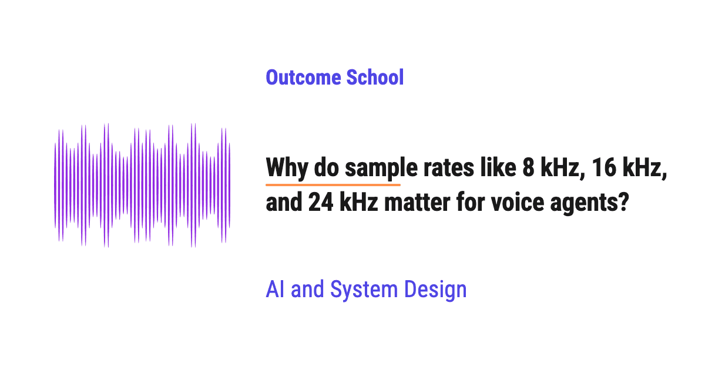

# Why do sample rates like 8 kHz, 16 kHz, and 24 kHz matter for voice agents?

> Archived from <https://outcomeschool.com/blog/sample-rates-for-voice-agents> on 2026-11-25.

Sample rates like 8 kHz, 16 kHz, and 24 kHz matter for voice agents because the sample rate decides how much detail of a voice is kept, and every part of a voice agent expects audio at a specific sample rate. If we pick the wrong one, or mix them up, the agent hears worse, sounds worse, or breaks completely.

In this blog, we will learn about why sample rates like 8 kHz, 16 kHz, and 24 kHz matter for voice agents. We will also see how a computer turns sound into numbers, what a sample rate really is, how much of our voice each sample rate keeps, where 8 kHz, 16 kHz, and 24 kHz are used inside a voice agent, what goes wrong when the sample rates do not match, and how to pick the right one for each part of the agent.

We will cover the following:
<ul><li>How Does a Computer Store Sound?</li><li>What is a Sample Rate?</li><li>How Much of Our Voice Does a Sample Rate Keep?</li><li>8 kHz: The Phone Call Sample Rate</li><li>16 kHz: The Speech Recognition Sample Rate</li><li>24 kHz: The Voice Output Sample Rate</li><li>How Sample Rates Flow Through a Voice Agent</li><li>What Happens When Sample Rates Do Not Match?</li><li>Sample Rate and the Size of the Audio</li><li>How to Pick the Right Sample Rate</li></ul>
I am <strong>Amit Shekhar</strong>, Founder @ <a target="_blank" rel="noopener noreferrer" href="https://outcomeschool.com">Outcome School</a>, I have taught and mentored many developers, and their efforts landed them high-paying tech jobs, helped many tech companies in solving their unique problems, and created many open-source libraries being used by top companies. I am passionate about sharing knowledge through open-source, blogs, and videos.

I teach <a target="_blank" rel="noopener noreferrer" href="https://outcomeschool.com/program/ai-and-machine-learning">AI and Machine Learning</a> at Outcome School.

Let&#x27;s get started.
<h2 id="how-does-a-computer-store-sound">How Does a Computer Store Sound?</h2>
Before jumping into sample rates, we must know how a computer stores sound.

When we speak, our voice pushes the air back and forth very quickly. These pushes travel as waves and reach the microphone. The microphone turns them into a smooth electrical signal that goes up and down, just like the wave.

But a computer cannot store a smooth wave. A computer can only store numbers.

So, the computer looks at the wave again and again, at fixed moments, and writes down how high or low the wave is at each moment. Each of these written-down numbers is called a <strong>sample</strong>.

Let&#x27;s say the computer takes samples of a wave like below:

<pre><code class="code-highlight">   wave height
       ↑
  high |      *  *
       |    *      *
   mid |  *          *          *
       |               *      *
   low |                 *  *
       +--------------------------→ time
</code></pre>

Here, each <code>*</code> is one sample. The computer keeps only these points, not the smooth wave. Later, when we play the audio, the speaker connects these points back into a wave.

This is how sound becomes a list of numbers inside a computer.
<h2 id="what-is-a-sample-rate">What is a Sample Rate?</h2>
<strong>The sample rate is the number of samples the computer takes every second.</strong>

It is measured in <strong>Hertz (Hz)</strong>, which means &quot;times per second&quot;. And <strong>kHz</strong> means &quot;thousand times per second&quot;.

So:
<ul><li>8 kHz means 8,000 samples every second.</li><li>16 kHz means 16,000 samples every second.</li><li>24 kHz means 24,000 samples every second.</li></ul>
The best way to learn this is by taking an example.

Suppose we want to capture a ball flying through the air by taking photos. If we take only 2 photos every second, we see the ball here and then suddenly there, and we miss everything in between. If we take 60 photos every second, we see the full smooth path of the ball.

Sound works in the same way. More samples per second means the computer catches more of the fast movements of the wave. Fewer samples per second means the fast movements are lost.

Now, the question is: which parts of our voice are the &quot;fast movements&quot;, and why do they matter?
<h2 id="how-much-of-our-voice-does-a-sample-rate-keep">How Much of Our Voice Does a Sample Rate Keep?</h2>
Our voice is not one single wave. It is a mix of many waves at the same time. Some waves move slowly, and some move very fast.

How fast a wave moves up and down is called its <strong>frequency</strong>, and it is also measured in Hz. For example, a wave at 1,000 Hz goes up and down 1,000 times every second.
<ul><li><strong>Low frequencies</strong> are the slow waves. They carry the deep, main body of our voice, and most of the energy of vowel sounds like &quot;a&quot;, &quot;o&quot;, and &quot;u&quot;.</li><li><strong>High frequencies</strong> are the fast waves. They carry the sharp, hissing sounds like &quot;s&quot;, &quot;f&quot;, &quot;sh&quot;, and &quot;th&quot;. They also carry the crispness that makes a voice sound clear and natural.</li></ul>
Now, let&#x27;s learn the rule that decides how much of our voice is kept.

<strong>A sample rate can only capture frequencies up to half of its own value.</strong>

This rule comes from the <strong>Nyquist-Shannon sampling theorem</strong>, and the half value is called the <strong>Nyquist frequency</strong>. To capture one full up-and-down movement of a wave, the computer needs at least two samples: one for the &quot;up&quot; and one for the &quot;down&quot;. So, if we take 8,000 samples per second, we can capture at most 4,000 up-and-down movements per second.

Let&#x27;s apply this rule to our three sample rates:
<table><thead><tr><th>Sample Rate</th><th>Highest Frequency It Can Keep</th></tr></thead><tbody><tr><td>8 kHz</td><td>4 kHz</td></tr><tr><td>16 kHz</td><td>8 kHz</td></tr><tr><td>24 kHz</td><td>12 kHz</td></tr></tbody></table>
Anything in our voice above that limit is not stored, and it can never be brought back later.

For comparison, the human ear can hear up to around 20 kHz. That is why music on a CD uses 44.1 kHz.

Now, let&#x27;s see what each of these three sample rates means for a voice agent.
<h2 id="8-khz-the-phone-call-sample-rate">8 kHz: The Phone Call Sample Rate</h2>
8 kHz is the sample rate of the traditional phone network.

When the phone network was designed, the goal was to make speech understandable while using as little capacity as possible. So, phone audio keeps roughly the range from 300 Hz to 3,400 Hz. An 8 kHz sample rate is enough to hold this range, because it can keep frequencies up to 4 kHz.

This is why a voice on a normal phone call sounds &quot;thin&quot;. The deep part and the sharp part of the voice are cut off.

This matters a lot for <a target="_blank" rel="noopener noreferrer" href="design-a-real-time-voice-ai-agent.md">voice agents</a>, because many voice agents <a target="_blank" rel="noopener noreferrer" href="phone-calls-in-voice-agents.md">answer real phone calls</a>. When a call comes from the phone network, the audio usually arrives at 8 kHz. For example, Twilio Media Streams send phone audio as 8 kHz audio in a format called <strong>mu-law</strong>, which is a way of squeezing each sample into 8 bits.

Remember that a large part of the &quot;s&quot; and &quot;f&quot; sounds lives in the high frequencies, above 4 kHz. At 8 kHz, that part is cut off. So, on a phone line:
<ul><li>&quot;sixty&quot; and &quot;fifty&quot; are easy to confuse.</li><li>&quot;S&quot; and &quot;F&quot; are hard to tell apart when the caller spells a name or an email.</li><li>Numbers, names, and addresses get misheard more often.</li></ul>
That is why, on a phone call, people often say &quot;S as in Sam&quot; or &quot;F as in Frank&quot;. The same problem affects a voice agent. Means, the speech recognition model receives less information, so it does more mistakes.

<strong>Note:</strong> We cannot fix this on our side. If the audio arrives at 8 kHz, the missing high frequencies are already lost before the audio reaches us.

<strong>Planning your move into AI?</strong>

No matter which tech domain you work in today, with your effort, you can transition to these roles:
<ul><li>AI Engineer</li><li>Forward Deployed Engineer</li><li>AI Agent Engineer</li><li>Harness Engineer</li><li>Voice AI Engineer</li><li>AI Architect</li><li>LLM Engineer</li><li>LLM Inference Engineer</li><li>Gen AI Engineer</li><li>MLOps Engineer</li><li>ML Engineer</li><li>Deep Learning Engineer</li></ul>
Our <a target="_blank" rel="noopener noreferrer" href="https://outcomeschool.com/program/ai-and-machine-learning">AI and Machine Learning Program</a> at Outcome School takes you there.
<h2 id="16-khz-the-speech-recognition-sample-rate">16 kHz: The Speech Recognition Sample Rate</h2>
16 kHz is the most common input sample rate for <strong>speech recognition</strong>, which is the part of the voice agent that turns speech into text. This part is also called <strong>STT (Speech-to-Text)</strong> or <strong>ASR (Automatic Speech Recognition)</strong>.

At 16 kHz, the audio keeps frequencies up to 8 kHz. This range holds almost everything that matters for understanding speech. The &quot;s&quot;, &quot;f&quot;, and &quot;sh&quot; sounds now come through clearly. 16 kHz audio is often called <strong>wideband</strong> audio, while 8 kHz phone audio is called <strong>narrowband</strong> audio.

So, why not go even higher for speech recognition?

Because, going above 16 kHz adds very less useful information for understanding words. The extra high frequencies help a voice sound rich, but they do not help much in figuring out which word was spoken. At the same time, higher sample rates mean more data to send and more numbers for the model to process.

This is why many speech recognition models are trained on 16 kHz audio. For example, OpenAI&#x27;s Whisper model expects its input audio at 16 kHz. Audio at any other sample rate must first be converted to 16 kHz.

One more thing to notice: a model trained mostly on clear 16 kHz audio <a target="_blank" rel="noopener noreferrer" href="phone-audio-and-speech-recognition.md">can struggle with 8 kHz phone audio</a>, because phone audio does not look like what the model learned from. That is why some speech recognition services offer special models tuned for phone calls.
<h2 id="24-khz-the-voice-output-sample-rate">24 kHz: The Voice Output Sample Rate</h2>
Now, it&#x27;s time to learn about the sample rate used for speaking.

When the voice agent speaks back, it uses <strong>TTS (Text-to-Speech)</strong>, which turns the reply text into audio. And here, the goal is different.

For speech recognition, the goal is to understand the words. For text-to-speech, the goal is to sound like a real, pleasant human. And a natural-sounding voice needs more of the high frequencies, the breathiness, the crisp &quot;s&quot;, and the small details that make a voice sound human.

24 kHz keeps frequencies up to 12 kHz. This is enough for a voice to sound clear and natural, while keeping the audio size reasonable. That is why 24 kHz is a very common output sample rate for modern text-to-speech models. For example, the raw audio format of the OpenAI Realtime API is 16-bit audio at 24 kHz.

Some text-to-speech models go even higher, to 44.1 kHz or 48 kHz. But for a voice agent, 24 kHz is a common balance between quality and speed.

<strong>Note:</strong> If the voice agent is talking on a phone call, the 24 kHz voice is converted down to 8 kHz before it goes to the phone network. The caller hears phone-quality audio, no matter how good the original voice was.

<strong>A quick note for you</strong>

No matter which tech domain you work in, get familiar with these topics:
<ul><li>LLM</li><li>RAG</li><li>MCP</li><li>Agent</li><li>Fine-tuning</li><li>Quantization</li></ul>
We put it all together in one video:

<a target="_blank" rel="noopener noreferrer" href="https://www.youtube.com/watch?v=lnfWvX66FUk">AI Engineering Explained: LLM, RAG, MCP, Agent, Fine-Tuning, and Quantization</a>

No need to stop reading - bookmark it and watch later when you get time. Future you will thank you.

Now, let&#x27;s get back to the topic.
<h2 id="how-sample-rates-flow-through-a-voice-agent">How Sample Rates Flow Through a Voice Agent</h2>
Now that we have learned about each sample rate, let&#x27;s put them together and see how audio moves through a voice agent that answers phone calls.

<pre><code class="code-highlight">+----------------------------+
| Caller speaks on phone |
+----------------------------+
              ↓
     8 kHz mu-law audio
              ↓
+----------------------------+
| Convert 8 kHz to 16 kHz |
+----------------------------+
              ↓
+----------------------------+
| Speech-to-Text (16 kHz) |
+----------------------------+
              ↓
            text
              ↓
+----------------------------+
| LLM writes the reply |
+----------------------------+
              ↓
            text
              ↓
+----------------------------+
| Text-to-Speech (24 kHz) |
+----------------------------+
              ↓
+----------------------------+
| Convert 24 kHz to 8 kHz |
+----------------------------+
              ↓
     8 kHz mu-law audio
              ↓
+----------------------------+
| Caller hears the reply |
+----------------------------+
</code></pre>

Here, we can see that the same conversation passes through three different sample rates:
<ul><li>The audio enters at 8 kHz from the phone network.</li><li>It is converted to 16 kHz because the speech recognition model expects 16 kHz.</li><li>The reply is generated at 24 kHz by the text-to-speech model.</li><li>It is converted back to 8 kHz because the phone connection carries only 8 kHz.</li></ul>
This conversion from one sample rate to another is called <strong>resampling</strong>. Almost every voice agent does it somewhere.

<strong>Very important:</strong> Converting 8 kHz audio to 16 kHz does not bring back the lost high frequencies. It only adds more samples by filling in the gaps between the existing ones. The audio now has the right format for the model, but it still has the quality of a phone call.

If the user talks from a web browser or a mobile app instead of a phone line, the microphone usually records at 48 kHz or 44.1 kHz. This audio is converted down to 16 kHz for speech recognition, and it keeps much more detail than phone audio.

If we want to go deep into Agent Architecture and how to Design a Real-Time Voice AI Agent, our <a target="_blank" rel="noopener noreferrer" href="https://outcomeschool.com/program/ai-and-machine-learning">AI and Machine Learning Program</a> at Outcome School covers them from the ground up.
<h2 id="what-happens-when-sample-rates-do-not-match">What Happens When Sample Rates Do Not Match?</h2>
Most of the time, we do mistakes with sample rates without noticing them, because raw audio is just a list of numbers. The list itself does not say how many of those numbers belong to one second.

Let&#x27;s say the text-to-speech model produces 24,000 samples for every second of speech. But our code tells the speaker that this audio is 16 kHz. The speaker plays only 16,000 samples per second. So, one second of speech now takes one and a half seconds to play. The voice becomes slow and deep.

Now, let&#x27;s flip it. Suppose we have 16 kHz audio, and we tell the speaker that it is 24 kHz. The speaker plays 24,000 samples per second. The speech plays one and a half times faster, and the voice becomes high-pitched and squeaky.

The same thing happens on the input side. If we send 8 kHz phone audio to a speech recognition model and tell it the audio is 16 kHz, the model hears the caller speaking at double speed with a squeaky voice. The text that comes out is wrong or completely empty.

Also, when the conversion itself is done badly, the audio sounds crackly or robotic.

This is why, at every step, we must make sure that the sample rate written in our code matches the sample rate the audio really has.

<strong>Stay updated:</strong> Subscribe to our <a target="_blank" rel="noopener noreferrer" href="https://outcomeschool.substack.com/subscribe">newsletter</a> to get our latest AI and Machine Learning blogs straight to your inbox.
<h2 id="sample-rate-and-the-size-of-the-audio">Sample Rate and the Size of the Audio</h2>
The sample rate also decides how much data we send every second.

Each sample is stored as a number. In the most common raw format, called <strong>16-bit PCM</strong>, each sample takes 2 bytes. Voice agents usually use single channel (mono) audio. So, we can calculate the data size like below:

<strong>data per second = sample rate * bytes per sample</strong>
<table><thead><tr><th>Sample Rate</th><th>Samples per Second</th><th>Data per Second (16-bit PCM)</th></tr></thead><tbody><tr><td>8 kHz</td><td>8,000</td><td>16,000 bytes (16 KB)</td></tr><tr><td>16 kHz</td><td>16,000</td><td>32,000 bytes (32 KB)</td></tr><tr><td>24 kHz</td><td>24,000</td><td>48,000 bytes (48 KB)</td></tr></tbody></table>
Here, we can see that 24 kHz audio is three times the size of 8 kHz audio. Phone networks squeeze 8 kHz audio even more with mu-law (or a similar format called A-law), which uses 1 byte per sample, so it becomes 8,000 bytes per second.

For a single call, these numbers look small. But a voice agent streams audio in both directions for the whole call, often for many calls at the same time. More data means more network usage and more samples for the models to process, and in a voice agent <a target="_blank" rel="noopener noreferrer" href="voice-agent-latency-budget.md">every millisecond of delay matters</a>.

This is the trade-off:
<ul><li>A higher sample rate keeps more detail of the voice.</li><li>A lower sample rate means less data and less processing.</li></ul>
We have a detailed blog on <a target="_blank" rel="noopener noreferrer" href="audio-frames-and-chunk-sizes.md">audio frames and chunk sizes in a real-time voice pipeline</a> that explains how this audio is cut into small pieces and passed from one step to the next.
<h2 id="how-to-pick-the-right-sample-rate">How to Pick the Right Sample Rate</h2>
Now, the next big question is: which sample rate do we choose?

The answer is: we do not choose one sample rate for the whole agent. We choose the right one for each part.

Let me tabulate the differences between 8 kHz, 16 kHz, and 24 kHz for your better understanding.
<table><thead><tr><th>Sample Rate</th><th>Keeps Up To</th><th>Where It Is Used in a Voice Agent</th><th>How It Sounds</th></tr></thead><tbody><tr><td>8 kHz</td><td>4 kHz</td><td>Phone calls coming in and going out</td><td>Thin, &quot;s&quot; and &quot;f&quot; hard to tell</td></tr><tr><td>16 kHz</td><td>8 kHz</td><td>Input to speech recognition models</td><td>Clear enough to understand words</td></tr><tr><td>24 kHz</td><td>12 kHz</td><td>Output of text-to-speech models</td><td>Natural, crisp, and pleasant</td></tr></tbody></table>
A few rules follow from this:
<ul><li>Use the sample rate that each model expects. If the speech recognition model expects 16 kHz, send it 16 kHz. If the text-to-speech model gives 24 kHz, treat it as 24 kHz.</li><li>Do not convert audio down and then back up without a reason. Every time we go down, detail is lost permanently.</li><li>For phone calls, accept that the audio is 8 kHz. Use a speech recognition model that handles phone audio well, and make the agent <a target="_blank" rel="noopener noreferrer" href="unfinished-input-in-voice-agents.md">confirm important details like numbers, names, and email addresses</a>.</li><li>For web and mobile apps, capture at a higher sample rate and convert it to 16 kHz for speech recognition.</li><li>Always pass the correct sample rate along with the audio, so that no part of the system has to guess.</li></ul>
Now we must have understood why sample rates like 8 kHz, 16 kHz, and 24 kHz matter for voice agents, how each one keeps a different amount of our voice, where each one is used, and what goes wrong when they do not match.
<h2 id="frequently-asked-questions">Frequently Asked Questions</h2><h3 id="what-is-the-nyquist-frequency">What is the Nyquist frequency?</h3>
The Nyquist frequency is half of the sample rate, and it is the highest frequency that a sample rate can capture. It comes from the Nyquist-Shannon sampling theorem. To capture one full up-and-down movement of a wave, we need at least two samples. So, 8 kHz audio keeps up to 4 kHz, and 16 kHz audio keeps up to 8 kHz.
<h3 id="what-is-the-difference-between-narrowband-and-wideband-audio">What is the difference between narrowband and wideband audio?</h3>
Narrowband audio is 8 kHz phone audio, and wideband audio is 16 kHz audio. Narrowband audio keeps frequencies only up to 4 kHz, so the voice sounds thin. Wideband audio keeps frequencies up to 8 kHz, which holds almost everything that matters for understanding speech, so sounds like &quot;s&quot;, &quot;f&quot;, and &quot;sh&quot; come through clearly.
<h3 id="why-are-s-and-f-hard-to-tell-apart-on-a-phone-call">Why are &quot;s&quot; and &quot;f&quot; hard to tell apart on a phone call?</h3>
Because a large part of the &quot;s&quot; and &quot;f&quot; sounds lives in the high frequencies, above 4 kHz. Phone audio uses an 8 kHz sample rate, which keeps frequencies only up to 4 kHz, so that part is cut off. This is why &quot;sixty&quot; and &quot;fifty&quot; are easy to confuse, and why numbers, names, and addresses get misheard more often on a phone line.
<h3 id="does-converting-8-khz-audio-to-16-khz-improve-its-quality">Does converting 8 kHz audio to 16 kHz improve its quality?</h3>
No. Converting 8 kHz audio to 16 kHz does not bring back the lost high frequencies. It only adds more samples by filling in the gaps between the existing ones. The audio now has the right format for a speech recognition model that expects 16 kHz, but it still has the quality of a phone call.
<h3 id="what-sample-rate-does-whisper-expect">What sample rate does Whisper expect?</h3>
OpenAI&#x27;s Whisper model expects its input audio at 16 kHz. Audio at any other sample rate must first be converted to 16 kHz before it goes to the model. Many speech recognition models are trained on 16 kHz audio, because going above 16 kHz adds very little useful information for understanding words, but it means more data to send and process.

That&#x27;s it for now.

Thanks

<strong>Amit Shekhar</strong> Founder @ <a target="_blank" rel="noopener noreferrer" href="https://outcomeschool.com">Outcome School</a>

You can connect with me on:
<ul><li><a target="_blank" rel="noopener noreferrer" href="https://x.com/amitiitbhu">X</a></li><li><a target="_blank" rel="noopener noreferrer" href="https://www.linkedin.com/in/amit-shekhar-iitbhu">LinkedIn</a></li><li><a target="_blank" rel="noopener noreferrer" href="https://github.com/amitshekhariitbhu">GitHub</a></li></ul>
Follow Outcome School on:
<ul><li><a target="_blank" rel="noopener noreferrer" href="https://x.com/outcome_school">X</a></li><li><a target="_blank" rel="noopener noreferrer" href="https://youtube.com/@OutcomeSchool">YouTube</a></li><li><a target="_blank" rel="noopener noreferrer" href="https://www.linkedin.com/company/outcomeschool">LinkedIn</a></li><li><a target="_blank" rel="noopener noreferrer" href="http://github.com/OutcomeSchool">GitHub</a></li></ul>
<a target="_blank" rel="noopener noreferrer" href="https://outcomeschool.com/blog"><strong>Read all of our high-quality blogs here.</strong></a>

