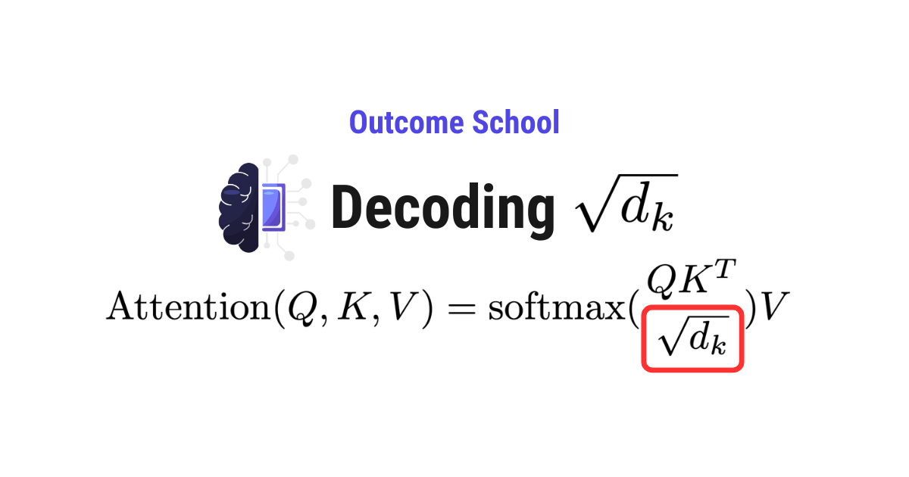

# Why Do We Scale Attention by √dₖ? The Math Behind the Scaling Factor

> Archived from <https://outcomeschool.com/blog/scaling-dot-product-attention> on 2026-11-25.

We scale the dot product attention by √dₖ because the dot products grow bigger as the dimension dₖ grows. Such big values push the softmax to extreme values, and dividing by √dₖ brings them back to a healthy range.

In this blog, we will learn about why we scale the dot product attention by √dₖ in the Transformer architecture with a step-by-step numeric example.

If you have already read our blog on <a target="_blank" rel="noopener noreferrer" href="math-behind-attention-qkv.md">Math behind Attention - Q, K, and V</a>, you know the attention formula and the computation steps. In that blog, we divided the attention scores by <code>sqrt(d_k)</code> and moved on. Now, it is time to understand <strong>why</strong> we do that. Why exactly <code>sqrt(d_k)</code>? Why not divide by 2 or 10 or any other number?

The goal is to make you understand why we scale by √dₖ, which means that there are a few simplifications done while writing this. If you understand the reasoning behind the scaling, then my mission will be accomplished. If you read this article completely, I am sure my mission will be accomplished.

We will cover the following:
<ul><li>The Attention Formula (Quick Recap)</li><li>What Happens Without Scaling?</li><li>Why Do Dot Products Grow with dₖ?</li><li>Understanding Variance of the Dot Product</li><li>Proving It Step by Step: Variance of the Dot Product is dₖ</li><li>What Large Dot Products Do to Softmax</li><li>Why √dₖ is the Right Scaling Factor</li><li>Seeing It with Real Numbers</li><li>Putting It All Together</li></ul>
I am <strong>Amit Shekhar</strong>, Founder @ <a target="_blank" rel="noopener noreferrer" href="https://outcomeschool.com">Outcome School</a>, I have taught and mentored many developers, and their efforts landed them high-paying tech jobs, helped many tech companies in solving their unique problems, and created many open-source libraries being used by top companies. I am passionate about sharing knowledge through open-source, blogs, and videos.

I teach <a target="_blank" rel="noopener noreferrer" href="https://outcomeschool.com/program/ai-and-machine-learning">AI and Machine Learning</a> at Outcome School.

Let&#x27;s get started.
<h2 id="the-attention-formula-quick-recap">The Attention Formula (Quick Recap)</h2>
This scaling step lives inside the larger <a target="_blank" rel="noopener noreferrer" href="decoding-transformer-architecture.md">Transformer architecture</a>. The formula for <strong>Scaled Dot-Product Attention</strong> is:

<pre><code class="code-highlight">Attention(Q, K, V) = softmax(Q x K^T / sqrt(d_k)) x V
</code></pre>

Here:
<ul><li><code>Q</code> is the Query matrix</li><li><code>K</code> is the Key matrix</li><li><code>V</code> is the Value matrix</li><li><code>d_k</code> is the dimension of the Key vector</li><li><code>sqrt(d_k)</code> is the square root of <code>d_k</code></li></ul>
The part we are focusing on today is <code>/ sqrt(d_k)</code>. This is the <strong>scaling factor</strong>. We divide the dot product scores by the square root of the Key dimension before passing them to <a target="_blank" rel="noopener noreferrer" href="softmax-function.md">softmax</a>.

Now, the question is: why do we need this scaling? The answer lies in understanding what happens without it.
<h2 id="what-happens-without-scaling">What Happens Without Scaling?</h2>
Let&#x27;s say we skip the scaling step and compute attention directly as below:

<pre><code class="code-highlight">Attention = softmax(Q x K^T) x V
</code></pre>

In real Transformer models, <code>d_k</code> is 64, 128, or even larger. When <code>d_k</code> is large, the scores <code>Q x K^T</code> can become very large numbers (we will see why in the next section). And when we pass very large values into softmax, something bad happens.

<strong>The softmax function (which converts scores into probabilities) produces outputs that are extremely close to 0 and 1.</strong> One word gets almost all the attention (close to 1.0), and all other words get almost no attention (close to 0.0). The model stops spreading attention across multiple relevant words. It becomes too confident about one single word.

This is a big problem because:
<ul><li>The model cannot learn from multiple words at once.</li><li>The gradients (the signals used to update the model during training) become extremely small, almost zero. This is called the <strong><a target="_blank" rel="noopener noreferrer" href="vanishing-and-exploding-gradients.md">vanishing gradient problem</a></strong>.</li><li>When gradients are too small, the model stops learning effectively.</li></ul>
So, here comes the scaling by <code>sqrt(d_k)</code> to the rescue.

Softmax has one more consequence worth knowing. Its outputs always add up to 1, so a token must give its full attention away even when nothing in the sentence deserves it. We have a detailed blog on <a target="_blank" rel="noopener noreferrer" href="how-do-attention-sinks-work.md">Attention Sinks</a> that explains where that leftover attention ends up.

But before we understand the solution, we must first understand <strong>why</strong> dot products grow when <code>d_k</code> increases.
<h2 id="why-do-dot-products-grow-with-dₖ">Why Do Dot Products Grow with dₖ?</h2>
The dot product of two vectors is computed by multiplying each pair of elements and then adding them all up.

Let&#x27;s say we have two vectors <code>q</code> and <code>k</code>, each of dimension <code>d_k</code>:

<pre><code class="code-highlight">dot_product = q_1*k_1 + q_2*k_2 + q_3*k_3 + ... + q_{d_k}*k_{d_k}
</code></pre>

Here, we are adding <code>d_k</code> number of terms together.

Now, let&#x27;s think about this simply. Each term <code>q_i * k_i</code> is a number. It can be positive or negative. When we add more and more of these numbers together, they do not always cancel out perfectly. Some add up, some cancel, but overall the total tends to grow in magnitude. The more dimensions we have, the more terms we add, and the larger the dot product can become.

For example, if <code>d_k = 4</code>, we are adding just 4 terms, so the dot product stays small. But if <code>d_k = 512</code>, we are adding 512 terms. Even though some positive and negative values cancel out, the sheer number of terms makes the total much larger in magnitude.

The dot product grows with <code>d_k</code>. This is the core problem. The larger the dimension, the larger the dot product, and the worse the softmax behaves.

Now, let&#x27;s understand this more precisely using the concept of <strong>variance</strong>.
<h2 id="understanding-variance-of-the-dot-product">Understanding Variance of the Dot Product</h2>
Do not worry, we will keep this simple.

<strong>Variance</strong> tells us how spread out a set of values can be from the average. A high variance means the values are far from the average. A low variance means the values stay close to the average.

Suppose we are measuring the height of students in a class. If all students are between 5.0 and 5.5 feet, the variance is low. If students range from 3.0 to 7.0 feet, the variance is high. Similarly, when we talk about the variance of the dot product, we are asking: how spread out can the dot product values be?

Now, let&#x27;s assume that each element in the Query vector and the Key vector is a random number with:
<ul><li>Mean (average) = 0</li><li>Variance = 1</li></ul>
This is a standard assumption in machine learning. The input values are typically normalized to have zero mean and unit variance.

Now, what is the variance of one single product <code>q_i * k_i</code>?

When we multiply two independent random numbers, each with mean 0 and variance 1, the result has:
<ul><li>Mean = 0</li><li>Variance = 1 x 1 = <strong>1</strong> (we will see why in the next section)</li></ul>
So, each individual product <code>q_i * k_i</code> has a variance of 1.

Now, the dot product is the sum of <code>d_k</code> such products:

<pre><code class="code-highlight">dot_product = q_1*k_1 + q_2*k_2 + ... + q_{d_k}*k_{d_k}
</code></pre>

When we add <code>d_k</code> independent terms, each with variance 1, the total variance is:

<pre><code class="code-highlight">Variance(dot_product) = d_k x 1 = d_k
</code></pre>

This is the key insight. <strong>The variance of the dot product is equal to dₖ.</strong> The larger the <code>d_k</code>, the more spread out the dot product values become. And more spread out values cause problems for softmax.

<strong>Planning your move into AI?</strong>

No matter which tech domain you work in today, with your effort, you can transition to these roles:
<ul><li>AI Engineer</li><li>Forward Deployed Engineer</li><li>AI Agent Engineer</li><li>Harness Engineer</li><li>Voice AI Engineer</li><li>AI Architect</li><li>LLM Engineer</li><li>LLM Inference Engineer</li><li>Gen AI Engineer</li><li>MLOps Engineer</li><li>ML Engineer</li><li>Deep Learning Engineer</li></ul>
Our <a target="_blank" rel="noopener noreferrer" href="https://outcomeschool.com/program/ai-and-machine-learning">AI and Machine Learning Program</a> at Outcome School takes you there.
<h2 id="proving-it-step-by-step-variance-of-the-dot-product-is-dₖ">Proving It Step by Step: Variance of the Dot Product is dₖ</h2>
Now, let&#x27;s prove why the variance equals <code>d_k</code>, step by step, for the sake of understanding. Do not worry, we will keep it simple.

We already know that the mean of our dot product is zero (because the average value of each <code>q_i</code> and <code>k_i</code> is zero).

Now, in general, variance is calculated as below:

<pre><code class="code-highlight">Variance = Average of (value - mean)^2
</code></pre>

But since our mean is zero, this becomes:

<pre><code class="code-highlight">Variance = Average of (value - 0)^2
         = Average of value^2
</code></pre>

So, when the mean is zero, the variance simplifies to the <strong>average of the squared values</strong>. This means we need to find the average of the squared dot product.

Now, let&#x27;s see what happens when we square the dot product. Let&#x27;s take a small example with <code>d_k = 3</code>:

<pre><code class="code-highlight">dot_product = q_1*k_1 + q_2*k_2 + q_3*k_3
</code></pre>

When we square this, we multiply the sum by itself. It is just like expanding <code>(a + b + c)^2</code>:

<pre><code class="code-highlight">(a + b + c)^2 = a*a + a*b + a*c
              + b*a + b*b + b*c
              + c*a + c*b + c*c
</code></pre>

Here, <code>a = q_1*k_1</code>, <code>b = q_2*k_2</code>, <code>c = q_3*k_3</code>. So we get 9 terms (3 x 3). Now, the key question is: what is the average value of each of these 9 terms?

These 9 terms fall into two groups:

<strong>Group 1: Terms where a term is multiplied by itself (like a*a, b*b, c*c)</strong>

These are the terms where the same pair is multiplied by itself. For example, <code>(q_1*k_1) * (q_1*k_1) = q_1^2 * k_1^2</code>. There are 3 such terms.

What is the average value of each? Let&#x27;s use the variance formula we learned above. We know that:

<pre><code class="code-highlight">Variance = Average of value^2    (when mean is zero)
</code></pre>

Since <code>q_1</code> has mean 0 and variance 1:

<pre><code class="code-highlight">1 = Average of q_1^2
Average of q_1^2 = 1
</code></pre>

Similarly, since <code>k_1</code> has mean 0 and variance 1:

<pre><code class="code-highlight">Average of k_1^2 = 1
</code></pre>

Since <code>q_1</code> and <code>k_1</code> are independent, the average of their product is the product of their averages:

<pre><code class="code-highlight">Average of (q_1^2 * k_1^2) = Average of q_1^2 * Average of k_1^2 = 1 * 1 = 1
</code></pre>

<strong>Each of these terms has an average value of 1.</strong>

<strong>Group 2: Terms where different pairs are multiplied (like a*b, a*c, b*c)</strong>

These are the terms where two different pairs are mixed together. For example, <code>(q_1*k_1) * (q_2*k_2) = q_1 * k_1 * q_2 * k_2</code>. There are 6 such terms.

What is the average value of each? Since <code>q_1</code>, <code>k_1</code>, <code>q_2</code>, <code>k_2</code> are all independent, the average of their product is the product of their averages:

<pre><code class="code-highlight">Average of (q_1 * k_1 * q_2 * k_2) = Average of q_1 * Average of k_1 * Average of q_2 * Average of k_2
                                    = 0 * 0 * 0 * 0
                                    = 0
</code></pre>

Here, since each of them has an average (mean) of zero, the entire product becomes zero.

<strong>Each of these terms has an average value of 0.</strong>

<strong>Putting it together:</strong>

Out of 9 terms:
<ul><li>3 terms (Group 1) each contribute an average of 1</li><li>6 terms (Group 2) each contribute an average of 0</li></ul>
<pre><code class="code-highlight">Variance = 3 * 1 + 6 * 0 = 3
</code></pre>

And <code>d_k = 3</code>. So the variance equals <code>d_k</code>.

Now, this same logic works for any value of <code>d_k</code>. If <code>d_k = 64</code>, we get <code>64 * 64 = 4096</code> total terms. Out of these, 64 terms (Group 1) each contribute 1, and the remaining 4032 terms (Group 2) each contribute 0. So the variance is 64, which is exactly <code>d_k</code>.

<strong>The variance of the dot product is always exactly equal to dₖ.</strong> This is not an approximation. It is mathematically exact.

If we want to go deep into the math behind Q/K/V, self-attention, and the Transformer architecture from the ground up, we have a complete program on it - check out our <a target="_blank" rel="noopener noreferrer" href="https://outcomeschool.com/program/ai-and-machine-learning">AI and Machine Learning Program</a> at Outcome School.
<h2 id="what-large-dot-products-do-to-softmax">What Large Dot Products Do to Softmax</h2>
The softmax function converts a list of numbers into probabilities. The formula is:

<pre><code class="code-highlight">softmax(x_i) = e^(x_i) / sum(e^(x_j) for all j)
</code></pre>

Here, <code>e</code> is the mathematical constant (approximately 2.718).

Now, the important thing to understand is: <code>e^x</code> grows <strong>extremely fast</strong> as <code>x</code> increases. Let&#x27;s see with real numbers to understand how fast it grows:

<pre><code class="code-highlight">e^1   = 2.718
e^5   = 148.4
e^10  = 22,026
e^20  = 485,165,195
e^50  = 5,184,705,528,587,072,045
</code></pre>

Here, we can see that the difference between <code>e^10</code> and <code>e^50</code> is astronomically large.

Now, let&#x27;s say we have three attention scores: <code>[50, 10, 5]</code> (just for the sake of understanding how softmax behaves with large numbers). When we apply softmax:

<pre><code class="code-highlight">e^50 = 5,184,705,528,587,072,045
e^10 = 22,026
e^5  = 148

softmax = [5,184,705,528,587,072,045 / total, 22,026 / total, 148 / total]
</code></pre>

The first value completely dominates. The softmax output will be approximately <code>[1.0, 0.0, 0.0]</code>.

Now, compare this with smaller scores: <code>[5, 1, 0.5]</code>. When we apply softmax:

<pre><code class="code-highlight">e^5   = 148.4
e^1   = 2.718
e^0.5 = 1.649

Sum = 152.780

softmax = [148.4/152.780, 2.718/152.780, 1.649/152.780]
        = [0.971, 0.018, 0.011]
</code></pre>

Here, we can see that even with smaller scores, the first value still gets the most attention. But the other values are not completely zero. The model can still learn from all positions.

This is the problem. When <code>d_k</code> is large and we do not scale, the dot product scores become so large that softmax outputs become almost one-hot. One-hot means one value is 1.0 and the rest are 0.0. The model acts as if only one word matters and ignores everything else. The gradients vanish, and learning stops.

<strong>A quick note for you</strong>

No matter which tech domain you work in, get familiar with these topics:
<ul><li>LLM</li><li>RAG</li><li>MCP</li><li>Agent</li><li>Fine-tuning</li><li>Quantization</li></ul>
We put it all together in one video:

<a target="_blank" rel="noopener noreferrer" href="https://www.youtube.com/watch?v=lnfWvX66FUk">AI Engineering Explained: LLM, RAG, MCP, Agent, Fine-Tuning, and Quantization</a>

No need to stop reading - bookmark it and watch later when you get time. Future you will thank you.

Now, let&#x27;s get back to the topic.
<h2 id="why-dₖ-is-the-right-scaling-factor">Why √dₖ is the Right Scaling Factor</h2>
Now that we understand the problem, the solution becomes clear. We need to keep the dot product values small enough so that softmax can produce well-distributed attention weights.

We need to bring the variance of the dot product back to 1, regardless of how large <code>d_k</code> is.

We know that:

<pre><code class="code-highlight">Variance(dot_product) = d_k
</code></pre>

If we divide the dot product by some constant <code>c</code>, the variance becomes:

<pre><code class="code-highlight">Variance(dot_product / c) = d_k / c^2
</code></pre>

<strong>Note:</strong> When we divide a random variable by a constant <code>c</code>, the variance gets divided by <code>c^2</code> (not <code>c</code>). This is a standard rule in statistics. Let&#x27;s understand why.

Variance measures how spread out values are from the mean. It is calculated using <strong>squared</strong> differences from the mean. So, when we divide all values by <code>c</code>, each difference from the mean also gets divided by <code>c</code>. But since variance squares those differences, the division by <code>c</code> becomes division by <code>c^2</code>.

Let&#x27;s see with a simple example. Suppose we have three values: <code>[2, 4, 6]</code>.

<pre><code class="code-highlight">Mean = (2 + 4 + 6) / 3 = 4

Differences from mean: [2-4, 4-4, 6-4] = [-2, 0, 2]

Squared differences: [4, 0, 4]

Variance = (4 + 0 + 4) / 3 = 2.67
</code></pre>

Now, let&#x27;s divide all values by <code>c = 2</code>. The new values are <code>[1, 2, 3]</code>.

<pre><code class="code-highlight">New Mean = (1 + 2 + 3) / 3 = 2

Differences from mean: [1-2, 2-2, 3-2] = [-1, 0, 1]

Squared differences: [1, 0, 1]

New Variance = (1 + 0 + 1) / 3 = 0.67
</code></pre>

Here, we can see that the original variance was <code>2.67</code> and the new variance is <code>0.67</code>. And <code>2.67 / 4 = 0.67</code>. We divided by <code>c = 2</code>, but the variance got divided by <code>c^2 = 4</code>.

This happens because variance uses squared differences. When each value shrinks by a factor of <code>c</code>, the squared differences shrink by a factor of <code>c^2</code>.

Now, coming back to our dot product. We had:

<pre><code class="code-highlight">Variance(dot_product / c) = d_k / c^2
</code></pre>

We want this variance to equal 1 so that the dot product values stay in a manageable range. So, we set:

<pre><code class="code-highlight">d_k / c^2 = 1
c^2 = d_k
c = sqrt(d_k)
</code></pre>

This is why we divide by <code>sqrt(d_k)</code>. It is the exact value that brings the variance back to 1.

After scaling:

<pre><code class="code-highlight">Variance(dot_product / sqrt(d_k)) = d_k / d_k = 1
</code></pre>

The scaled dot product values now have a variance of 1, meaning they stay in a manageable range regardless of how large <code>d_k</code> is. The softmax function receives reasonable inputs and produces well-distributed attention weights.

This is not an arbitrary choice. It is mathematically the correct scaling factor. The authors of the original <strong>&quot;Attention Is All You Need&quot;</strong> paper (the paper that introduced the Transformer architecture) chose this value for exactly this reason.

To master the Attention Is All You Need paper, scaled dot-product attention, and Transformer internals in depth, check out our <a target="_blank" rel="noopener noreferrer" href="https://outcomeschool.com/program/ai-and-machine-learning">AI and Machine Learning Program</a> at Outcome School.
<h2 id="seeing-it-with-real-numbers">Seeing It with Real Numbers</h2>
Now, let&#x27;s see the effect of scaling with two different dimensions.
<h3 id="example-1-small-dimension-dₖ--4">Example 1: Small dimension (dₖ = 4)</h3>
Let&#x27;s say we have:

<pre><code class="code-highlight">q = [1, 0, 1, 0]
k = [0, 1, 1, 1]
</code></pre>

<pre><code class="code-highlight">dot_product = 1*0 + 0*1 + 1*1 + 0*1 = 1
</code></pre>

<pre><code class="code-highlight">sqrt(d_k) = sqrt(4) = 2
</code></pre>

<pre><code class="code-highlight">scaled_score = 1 / 2 = 0.5
</code></pre>

The original score is <code>1</code>, the scaled score is <code>0.5</code>. Both values are small, so softmax will behave well in either case. Scaling does not matter much when <code>d_k</code> is small.
<h3 id="example-2-large-dimension-dₖ--64">Example 2: Large dimension (dₖ = 64)</h3>
Let&#x27;s say we have three words with dot product scores: <code>[14, 10, 12]</code>.

<strong>Without scaling:</strong>

<pre><code class="code-highlight">e^14 = 1,202,604
e^10 = 22,026
e^12 = 162,755

Sum = 1,387,386

softmax = [0.867, 0.016, 0.117]
</code></pre>

Here, the first word gets 86.7% of the attention. The second word gets only 1.6%. The distribution is quite extreme even though the raw scores (14, 10, 12) are not that far apart.

<strong>With scaling (divide by sqrt(64) = 8):</strong>

Scaled scores: <code>[14/8, 10/8, 12/8]</code> = <code>[1.75, 1.25, 1.5]</code>

<pre><code class="code-highlight">e^1.75 = 5.755
e^1.25 = 3.490
e^1.5  = 4.482

Sum = 13.727

softmax = [5.755/13.727, 3.490/13.727, 4.482/13.727]
        = [0.419, 0.254, 0.326]
</code></pre>

Here, we can see the difference. After scaling, the attention is distributed much more evenly: 41.9%, 25.4%, and 32.6%. The model can now learn from all three words instead of focusing almost entirely on one word.

This is how scaling by <code>sqrt(d_k)</code> solves the problem.

<strong>Stay updated:</strong> Subscribe to our <a target="_blank" rel="noopener noreferrer" href="https://outcomeschool.substack.com/subscribe">newsletter</a> to get our latest AI and Machine Learning blogs straight to your inbox.
<h2 id="putting-it-all-together">Putting It All Together</h2>
Let&#x27;s summarize what we have learned:

<strong>The Problem:</strong> The dot product of the Query and Key vectors grows in magnitude as the dimension <code>d_k</code> increases. The variance of the dot product is equal to <code>d_k</code>. Large dot product values push softmax into extreme regions where it outputs values close to 0 or 1. This causes the vanishing gradient problem and the model stops learning.

<strong>The Solution:</strong> We divide the dot product by <code>sqrt(d_k)</code> before applying softmax. This brings the variance back to 1, keeping the scores in a manageable range regardless of the dimension size.

<strong>Why sqrt(d_k)?</strong> Because when we divide a value with variance <code>d_k</code> by <code>sqrt(d_k)</code>, the new variance becomes <code>d_k / d_k = 1</code>. It is mathematically the exact right value.

The full attention formula with scaling:

<pre><code class="code-highlight">Attention(Q, K, V) = softmax(Q x K^T / sqrt(d_k)) x V
</code></pre>

This single line, <code>/ sqrt(d_k)</code>, looks simple. But without it, the Transformer architecture would struggle to learn effectively, especially with larger dimensions. It is a small but very important detail that makes the entire attention mechanism work.

Now, we must have understood why we scale the dot product attention by √dₖ.
<h2 id="frequently-asked-questions">Frequently Asked Questions</h2><h3 id="does-scaling-by-sqrtd_k-matter-when-d_k-is-small">Does scaling by sqrt(d_k) matter when d_k is small?</h3>
Not much. When <code>d_k</code> is small, the dot product stays small, so softmax behaves well with or without scaling. For example, with <code>d_k = 4</code>, a score of 1 becomes 0.5 after scaling, and both values are small. Scaling becomes important as <code>d_k</code> grows larger.
<h3 id="why-do-we-divide-by-sqrtd_k-and-not-some-other-number">Why do we divide by sqrt(d_k) and not some other number?</h3>
When we divide a value by a constant <code>c</code>, its variance gets divided by <code>c^2</code>. The variance of the dot product is <code>d_k</code>, so we need <code>d_k / c^2 = 1</code>, which gives <code>c = sqrt(d_k)</code>. It is the exact value that brings the variance back to 1.
<h3 id="is-the-variance-of-the-dot-product-only-approximately-equal-to-d_k">Is the variance of the dot product only approximately equal to d_k?</h3>
No. The variance of the dot product is exactly equal to <code>d_k</code>, not an approximation. This holds under the standard assumption that each element of the Query and Key vectors has mean 0 and variance 1, and the elements are independent.
<h3 id="who-introduced-the-sqrtd_k-scaling-factor-in-attention">Who introduced the sqrt(d_k) scaling factor in attention?</h3>
The scaling factor comes from the original &quot;Attention Is All You Need&quot; paper, which introduced the Transformer architecture. The authors chose <code>sqrt(d_k)</code> because it is mathematically the correct value to keep the variance of the scores at 1.

That&#x27;s it for now.

Thanks

<strong>Amit Shekhar</strong> Founder @ <a target="_blank" rel="noopener noreferrer" href="https://outcomeschool.com">Outcome School</a>

You can connect with me on:
<ul><li><a target="_blank" rel="noopener noreferrer" href="https://x.com/amitiitbhu">X</a></li><li><a target="_blank" rel="noopener noreferrer" href="https://www.linkedin.com/in/amit-shekhar-iitbhu">LinkedIn</a></li><li><a target="_blank" rel="noopener noreferrer" href="https://github.com/amitshekhariitbhu">GitHub</a></li></ul>
Follow Outcome School on:
<ul><li><a target="_blank" rel="noopener noreferrer" href="https://x.com/outcome_school">X</a></li><li><a target="_blank" rel="noopener noreferrer" href="https://youtube.com/@OutcomeSchool">YouTube</a></li><li><a target="_blank" rel="noopener noreferrer" href="https://www.linkedin.com/company/outcomeschool">LinkedIn</a></li><li><a target="_blank" rel="noopener noreferrer" href="https://github.com/OutcomeSchool">GitHub</a></li></ul>
<a target="_blank" rel="noopener noreferrer" href="https://outcomeschool.com/blog"><strong>Read all of our high-quality blogs here.</strong></a>

