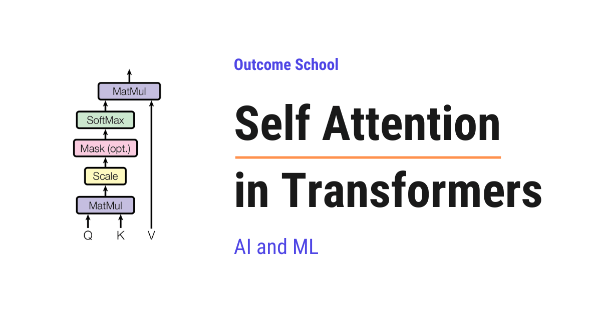

# What is Self Attention in Transformers and How Does It Work?

> Archived from <https://outcomeschool.com/blog/self-attention-in-transformers> on 2026-11-25.

Self Attention is the mechanism that lets every word in a sentence look at every other word in the same sentence to understand its meaning. It is the heart of modern Large Language Models like BERT and GPT.

In this blog, we will learn about Self Attention in Transformers. We will also see why we need it, what Query, Key, and Value are, how it works step by step with a simple example, and why it works so well.

We will cover the following:
<ul><li>What is Self Attention?</li><li>Why do we need Self Attention?</li><li>Query, Key, and Value vectors</li><li>Step-by-step working of Self Attention</li><li>A simple example walk-through</li><li>Why Self Attention works so well</li><li>Multi-Head Self Attention</li><li>Where Self Attention is used</li></ul>
I am <strong>Amit Shekhar</strong>, Founder @ <a target="_blank" rel="noopener noreferrer" href="https://outcomeschool.com">Outcome School</a>, I have taught and mentored many developers, and their efforts landed them high-paying tech jobs, helped many tech companies in solving their unique problems, and created many open-source libraries being used by top companies. I am passionate about sharing knowledge through open-source, blogs, and videos.

I teach <a target="_blank" rel="noopener noreferrer" href="https://outcomeschool.com/program/ai-and-machine-learning">AI and Machine Learning</a> at Outcome School.

Let&#x27;s get started.
<h3 id="what-is-self-attention">What is Self Attention?</h3>
<strong>Self Attention is a mechanism that allows every token in a sequence to look at every other token in the same sequence, including itself, to understand the context.</strong>

In simple words, <strong>Self Attention = Self + Attention</strong>. The word &quot;Attention&quot; means each token decides how much it should focus on the other tokens.

So, every word in a sentence looks at every other word in the same sentence and figures out which words matter the most for its meaning.
<h3 id="why-do-we-need-self-attention">Why do we need Self Attention?</h3>
The best way to learn this is by taking an example.

Consider the sentence:
<blockquote>
The animal did not cross the street because it was too tired.
</blockquote>
Now, the question is: what does the word <code>it</code> refer to?

As humans, we know that <code>it</code> refers to <code>the animal</code>, because the animal was too tired to cross.

Now, let&#x27;s read one more sentence:
<blockquote>
The animal did not cross the street because it was too wide.
</blockquote>
Same structure. Same word <code>it</code>. But now, what does <code>it</code> refer to?

Here, <code>it</code> refers to <code>the street</code>, because the street was too wide.

We changed just one word - from <code>tired</code> to <code>wide</code> - and the meaning of <code>it</code> completely changed.

So, how did our brain figure that out? Our brain looked at the surrounding words to understand the meaning of <code>it</code>. The word <code>tired</code> pulled our attention towards <code>the animal</code>. The word <code>wide</code> pulled our attention towards <code>the street</code>.

This is exactly what happens inside the <a target="_blank" rel="noopener noreferrer" href="large-language-model-llm.md">Large Language Model</a>. Every word looks at every other word in the same sentence to understand its meaning. The model gives more attention to the words that matter and less attention to the words that do not matter. This mechanism is called <strong>Attention</strong>.

Now, notice that every word here is looking at the other words within the SAME sentence. The sentence is attending to itself. This is why we call it <strong>Self Attention</strong>.

In the first sentence, <code>it</code> pays strong attention to <code>animal</code>. In the second sentence, <code>it</code> pays strong attention to <code>street</code>. That is how the model captures the true meaning of <code>it</code> in both cases.

Without Self Attention, the word <code>it</code> would just be a generic token with no real meaning. And Self Attention is the core idea behind every modern Large Language Model.
<h3 id="query-key-and-value-vectors">Query, Key, and Value vectors</h3>
For every token, Self Attention needs to answer two questions:
<ul><li>Which other tokens in this sentence are important for me?</li><li>How much should I focus on each of them?</li></ul>
To answer these questions, we create three vectors for every input token:
<ul><li><strong>Query (Q):</strong> what this token is looking for.</li><li><strong>Key (K):</strong> what this token offers to others.</li><li><strong>Value (V):</strong> the actual information this token carries.</li></ul>
The word &quot;Self&quot; in Self Attention comes from one very important fact:
<blockquote>
Query, Key, and Value all come from the SAME input sequence.
</blockquote>
This is what makes it &quot;Self&quot; Attention. The same sequence creates the questions, the same sequence creates the keys to match those questions, and the same sequence provides the values. The sequence is attending to itself.

In simple words, if our input sentence is &quot;The animal did not cross the street&quot;, then Q, K, and V are all derived from &quot;The animal did not cross the street&quot; itself.

We have a detailed blog on the <a target="_blank" rel="noopener noreferrer" href="math-behind-attention-qkv.md">Math behind Attention - Q, K, and V</a> that covers this in depth.

<strong>Note:</strong> This is the key difference between Self Attention and <a target="_blank" rel="noopener noreferrer" href="cross-attention-in-transformers.md">Cross Attention</a>. In Cross Attention, the Query comes from one sequence and the Key and Value come from another sequence. But in Self Attention, all three come from the same sequence.

For the sake of understanding, let&#x27;s take an analogy.

Suppose we are in a library and we are looking for a book on machine learning.
<ul><li>The <strong>Query</strong> is the topic we are searching for: &quot;machine learning&quot;.</li><li>The <strong>Key</strong> is the label written on every book on the shelf.</li><li>The <strong>Value</strong> is the actual content inside the book.</li></ul>
We compare our Query with every Key. The Keys that match our Query give us the most relevant Values.

Self Attention works in the same way.

<strong>Planning your move into AI?</strong>

No matter which tech domain you work in today, with your effort, you can transition to these roles:
<ul><li>AI Engineer</li><li>Forward Deployed Engineer</li><li>AI Agent Engineer</li><li>Harness Engineer</li><li>Voice AI Engineer</li><li>AI Architect</li><li>LLM Engineer</li><li>LLM Inference Engineer</li><li>Gen AI Engineer</li><li>MLOps Engineer</li><li>ML Engineer</li><li>Deep Learning Engineer</li></ul>
Our <a target="_blank" rel="noopener noreferrer" href="https://outcomeschool.com/program/ai-and-machine-learning">AI and Machine Learning Program</a> at Outcome School takes you there.
<h3 id="step-by-step-working-of-self-attention">Step-by-step working of Self Attention</h3>
Now, it&#x27;s time to learn the exact steps of Self Attention.

<strong>Step 1:</strong> We start with the input embeddings. Every token in the sentence is converted into a vector.

<strong>Step 2:</strong> We create three vectors for every token by multiplying the embedding with three different weight matrices.
<ul><li>Q = Input x W_Q</li><li>K = Input x W_K</li><li>V = Input x W_V</li></ul>
Here, <code>W_Q</code>, <code>W_K</code>, and <code>W_V</code> are weight matrices that the model learns during training.

<strong>Step 3:</strong> We compute the dot product of <code>Q</code> with the transpose of <code>K</code>. This is a <a target="_blank" rel="noopener noreferrer" href="matrix-multiplication-in-neural-networks.md">matrix multiplication</a> that gives us the attention scores. We use the transpose so that the shapes align correctly for the multiplication.
<ul><li>Scores = Q . K^T</li></ul>
The score tells us how much one token should attend to another token. A higher score means a stronger match between the Query of one token and the Key of another token.

<strong>Step 4:</strong> We scale the scores by dividing them by the square root of the dimension of the Key vectors. Here, <code>d_k</code> is the dimension of the Key vector.
<ul><li>Scaled Scores = (Q . K^T) / sqrt(d_k)</li></ul>
This scaling is done to keep the numbers in a stable range so that the <a target="_blank" rel="noopener noreferrer" href="softmax-function.md">softmax</a> does not produce extreme values. Without this scaling, the gradients can become very small during training. We have a detailed blog on the <a target="_blank" rel="noopener noreferrer" href="scaling-dot-product-attention.md">Math behind √dₖ Scaling Factor in Attention</a> that explains this step by step.

<strong>Step 5:</strong> We apply softmax on the scaled scores. This converts the scores into probabilities. Every row of the matrix now sums to 1.
<ul><li>Attention Weights = softmax((Q . K^T) / sqrt(d_k))</li></ul>
These weights tell us, for every token, how much attention it should pay to every other token.

<strong>Step 6:</strong> We multiply the attention weights by the Value matrix <code>V</code>. This gives us the final output.
<ul><li>Output = Attention Weights . V</li></ul>
The output is a new representation of every token where the meaning of the token is enriched by the context of the other tokens.

So, the full Self Attention formula is:

<strong>Attention(Q, K, V) = softmax((Q . K^T) / sqrt(d_k)) . V</strong>

Here, we can visualize the full flow of Self Attention as below:

<pre><code class="code-highlight">        Input Embeddings
               |
               ↓
   +-----------+-----------+
   |           |           |
   ↓           ↓           ↓
   Q           K           V
   |           |           |
   +-----+-----+           |
         |                 |
         ↓                 |
       Q . K^T             |
         |                 |
         ↓                 |
   Divide by sqrt(d_k)     |
         |                 |
         ↓                 |
       Softmax             |
         |                 |
         ↓                 |
   Attention Weights       |
         |                 |
         +--------+--------+
                  |
                  ↓
              Multiply
                  |
                  ↓
               Output
</code></pre>

Here, we can see that Q, K, and V are all created from the same input. Then Q and K are used to compute the attention weights, and V is used to compute the final output.

If we want to go deep into the Attention Mechanism, Q/K/V matrices, and Transformer internals, we have a complete program on it - check out our <a target="_blank" rel="noopener noreferrer" href="https://outcomeschool.com/program/ai-and-machine-learning">AI and Machine Learning Program</a> at Outcome School.
<h3 id="a-simple-example-walk-through">A simple example walk-through</h3>
Let&#x27;s take a small example to make this concrete.

Consider the sentence:
<blockquote>
I love AI
</blockquote>
We have three tokens: <code>I</code>, <code>love</code>, <code>AI</code>.

<strong>Step 1:</strong> Every token is converted into an embedding vector.

<strong>Step 2:</strong> We create Q, K, and V vectors for every token using the learned weight matrices. So now, we have:
<ul><li>Q for <code>I</code>, Q for <code>love</code>, Q for <code>AI</code></li><li>K for <code>I</code>, K for <code>love</code>, K for <code>AI</code></li><li>V for <code>I</code>, V for <code>love</code>, V for <code>AI</code></li></ul>
<strong>Step 3:</strong> For the token <code>I</code>, we take its Query vector and compute the dot product with the Key vectors of all three tokens: <code>I</code>, <code>love</code>, and <code>AI</code>. This gives us three scores.

<strong>Step 4:</strong> We scale these scores by <code>sqrt(d_k)</code>.

<strong>Step 5:</strong> We apply softmax to get the attention weights. Just for the sake of understanding, let&#x27;s say the result for the token <code>I</code> is:
<ul><li>Weight for <code>I</code> = 0.070</li><li>Weight for <code>love</code> = 0.707</li><li>Weight for <code>AI</code> = 0.223</li></ul>
This means the token <code>I</code> is paying 7% attention to itself, 70.7% to <code>love</code>, and 22.3% to <code>AI</code>.

The same calculation happens for every token. So, the full attention weight matrix looks like below:

<pre><code class="code-highlight">                  Attends to
                 I     love    AI
            +-------+-------+-------+
         I  | 0.070 | 0.707 | 0.223 |
            +-------+-------+-------+
From   love | 0.333 | 0.333 | 0.333 |
            +-------+-------+-------+
         AI | 0.168 | 0.533 | 0.299 |
            +-------+-------+-------+
</code></pre>

Here, every row sums to 1 because of softmax. The numbers are just for the sake of understanding. Each row tells us how much attention that token is paying to every other token in the sentence. Because every row must sum to 1, a token has to give its attention away even when nothing is worth attending to, which is why the first tokens end up acting as <a target="_blank" rel="noopener noreferrer" href="how-do-attention-sinks-work.md">attention sinks</a>.

<strong>Step 6:</strong> We compute the final output for <code>I</code> as a weighted sum of the Value vectors:
<ul><li>Output for <code>I</code> = 0.070 x V(<code>I</code>) + 0.707 x V(<code>love</code>) + 0.223 x V(<code>AI</code>)</li></ul>
This output is the new representation of <code>I</code> that carries the context of the entire sentence. Since <code>love</code> got the highest weight, the new representation of <code>I</code> is heavily influenced by the meaning of <code>love</code>.

The same process happens for every other token at the same time. So, in one shot, we get the new context-aware representation of every token in the sentence.

It works perfectly.

<strong>A quick note for you</strong>

No matter which tech domain you work in, get familiar with these topics:
<ul><li>LLM</li><li>RAG</li><li>MCP</li><li>Agent</li><li>Fine-tuning</li><li>Quantization</li></ul>
We put it all together in one video:

<a target="_blank" rel="noopener noreferrer" href="https://www.youtube.com/watch?v=lnfWvX66FUk">AI Engineering Explained: LLM, RAG, MCP, Agent, Fine-Tuning, and Quantization</a>

No need to stop reading - bookmark it and watch later when you get time. Future you will thank you.

Now, let&#x27;s get back to the topic.
<h3 id="why-self-attention-works-so-well">Why Self Attention works so well</h3>
Now, let&#x27;s understand why Self Attention works so well.

Before Self Attention, models like <a target="_blank" rel="noopener noreferrer" href="recurrent-neural-network.md">RNN</a> and LSTM <a target="_blank" rel="noopener noreferrer" href="how-do-rnns-and-transformers-differ.md">processed tokens one by one in a sequence</a>. This was slow and the connection between far-apart words became weak. <a target="_blank" rel="noopener noreferrer" href="evolution-of-llm-architecture.md">Self Attention solved both of these problems</a>.
<ul><li><strong>Parallelization:</strong> All tokens are processed at the same time. We do not have to wait for one token to finish before processing the next. This makes training very fast on GPUs.</li><li><strong>Long-range dependencies:</strong> Every token can directly look at every other token, even if they are very far apart in the sentence. There is no decay over distance. The price of this is cost, which is why long-context models often switch to <a target="_blank" rel="noopener noreferrer" href="how-does-sliding-window-attention-work.md">Sliding Window Attention</a>, where every token looks only at its nearby tokens.</li><li><strong>Contextual understanding:</strong> Every token gets a richer meaning based on the surrounding words. The same word can have a different representation in different sentences depending on the context.</li><li><strong>Flexibility:</strong> Self Attention does not care about the order of computation. It can handle long sequences and capture complex relationships.</li></ul>
That&#x27;s the beauty of Self Attention.

<strong>Stay updated:</strong> Subscribe to our <a target="_blank" rel="noopener noreferrer" href="https://outcomeschool.substack.com/subscribe">newsletter</a> to get our latest AI and Machine Learning blogs straight to your inbox.
<h3 id="multi-head-self-attention">Multi-Head Self Attention</h3>
Now, let&#x27;s briefly learn about <a target="_blank" rel="noopener noreferrer" href="multi-head-attention-in-transformers.md">Multi-Head Self Attention</a>.

In Self Attention, we have only one set of Q, K, and V. But one set is not enough to capture all the different types of relationships in a sentence.

So, here comes Multi-Head Self Attention into the picture.

In Multi-Head Self Attention, we run Self Attention multiple times in parallel, each with its own set of <code>W_Q</code>, <code>W_K</code>, and <code>W_V</code>. Every parallel run is called a &quot;head&quot;. Each head learns to focus on a different aspect of the sentence.

For example:
<ul><li>One head may focus on the subject-object relationship.</li><li>Another head may focus on the verb tense.</li><li>Another head may focus on long-range word dependencies.</li></ul>
After all the heads have done their work, we concatenate their outputs and pass them through one more linear layer. This gives us the final output of Multi-Head Self Attention.

We can visualize Multi-Head Self Attention as below:

<pre><code class="code-highlight">                  Input
                    |
   +--------+-------+-------+--------+
   |        |               |        |
   ↓        ↓               ↓        ↓
 Head 1   Head 2    ...   Head N-1  Head N
   |        |               |        |
   ↓        ↓               ↓        ↓
 Output1  Output2          OutputN-1 OutputN
   |        |               |        |
   +--------+-------+-------+--------+
                    |
                    ↓
              Concatenate
                    |
                    ↓
               Linear Layer
                    |
                    ↓
              Final Output
</code></pre>

Here, every head runs Self Attention in parallel with its own <code>W_Q</code>, <code>W_K</code>, and <code>W_V</code>. Their outputs are joined together and passed through a linear layer to produce the final output.

So, <strong>Multi-Head Self Attention = many Self Attentions running in parallel</strong>.

This way, the model captures many different types of relationships in the same sentence at the same time.

To master Self-Attention, Multi-Head Attention, and Transformer Architecture from the ground up, check out our <a target="_blank" rel="noopener noreferrer" href="https://outcomeschool.com/program/ai-and-machine-learning">AI and Machine Learning Program</a> at Outcome School.
<h3 id="where-self-attention-is-used">Where Self Attention is used</h3>
Now, let&#x27;s see where Self Attention is used.
<ul><li><strong>Encoder of Transformers:</strong> Self Attention is the core building block of <a target="_blank" rel="noopener noreferrer" href="encoder-vs-decoder-in-transformers.md">the encoder</a>. Every encoder layer uses Self Attention so that every input token can look at every other input token.</li><li><strong>Decoder of Transformers (Masked Self Attention):</strong> The decoder also uses Self Attention, but with a small change. The decoder generates one token at a time, and a token must not look at future tokens. So, we use <a target="_blank" rel="noopener noreferrer" href="causal-masking-in-attention.md">Masked Self Attention</a>, where the future tokens are hidden using a mask. Every token can look at itself and the tokens before it, but not the tokens after it.</li></ul>
Self Attention is the reason why models like BERT, GPT, and many other modern Large Language Models work so well. Without Self Attention, the <a target="_blank" rel="noopener noreferrer" href="decoding-transformer-architecture.md">Transformer architecture</a> would not exist as we know it today.

This was all about Self Attention in Transformers.

Now we must have understood what Self Attention is, how it works step by step, and why it works so well.
<h2 id="frequently-asked-questions">Frequently Asked Questions</h2><h3 id="what-is-the-difference-between-self-attention-and-cross-attention">What is the difference between Self Attention and Cross Attention?</h3>
In Self Attention, the Query, Key, and Value all come from the same input sequence. In Cross Attention, the Query comes from one sequence and the Key and Value come from another sequence. This is why Self Attention is described as a sequence attending to itself.
<h3 id="does-self-attention-process-tokens-one-by-one-like-an-rnn">Does Self Attention process tokens one by one like an RNN?</h3>
No. Self Attention processes all tokens at the same time, so we do not wait for one token to finish before processing the next. RNN and LSTM processed tokens one by one, which was slow. Parallel processing makes training very fast on GPUs.
<h3 id="does-a-token-pay-attention-to-itself-in-self-attention">Does a token pay attention to itself in Self Attention?</h3>
Yes. Every token looks at every other token in the same sequence, including itself. For example, in the sentence &quot;I love AI&quot;, the token <code>I</code> can pay some attention to itself along with <code>love</code> and <code>AI</code>, and the weights for each row sum to 1.
<h3 id="why-does-the-decoder-use-masked-self-attention">Why does the decoder use Masked Self Attention?</h3>
The decoder generates one token at a time, and a token must not look at future tokens. So, a mask hides the future tokens. Every token can look at itself and the tokens before it, but not the tokens after it.
<h3 id="are-the-q-k-and-v-weight-matrices-fixed">Are the Q, K, and V weight matrices fixed?</h3>
No. The weight matrices <code>W_Q</code>, <code>W_K</code>, and <code>W_V</code> are learned by the model during training. We multiply each input embedding by these three matrices to create the Query, Key, and Value vectors for every token.

That&#x27;s it for now.

Thanks

<strong>Amit Shekhar</strong> Founder @ <a target="_blank" rel="noopener noreferrer" href="https://outcomeschool.com">Outcome School</a>

You can connect with me on:
<ul><li><a target="_blank" rel="noopener noreferrer" href="https://x.com/amitiitbhu">X</a></li><li><a target="_blank" rel="noopener noreferrer" href="https://www.linkedin.com/in/amit-shekhar-iitbhu">LinkedIn</a></li><li><a target="_blank" rel="noopener noreferrer" href="https://github.com/amitshekhariitbhu">GitHub</a></li></ul>
Follow Outcome School on:
<ul><li><a target="_blank" rel="noopener noreferrer" href="https://x.com/outcome_school">X</a></li><li><a target="_blank" rel="noopener noreferrer" href="https://youtube.com/@OutcomeSchool">YouTube</a></li><li><a target="_blank" rel="noopener noreferrer" href="https://www.linkedin.com/company/outcomeschool">LinkedIn</a></li><li><a target="_blank" rel="noopener noreferrer" href="https://github.com/OutcomeSchool">GitHub</a></li></ul>
<a target="_blank" rel="noopener noreferrer" href="https://outcomeschool.com/blog"><strong>Read all of our high-quality blogs here.</strong></a>

