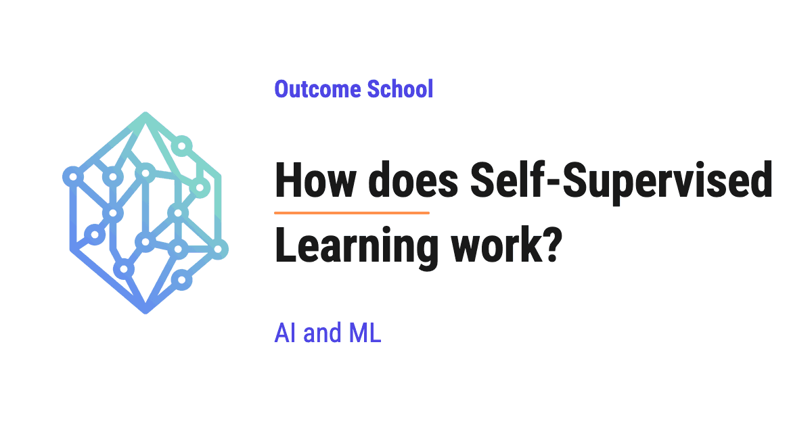

# How does Self-Supervised Learning work?

> Archived from <https://outcomeschool.com/blog/self-supervised-learning> on 2026-11-25.

Self-Supervised Learning is a way of teaching a machine where the data creates its own labels, so the machine learns from raw data with no human labeling.

In this blog, we will learn about how Self-Supervised Learning works. We will also see why plain <a target="_blank" rel="noopener noreferrer" href="supervised-vs-unsupervised-learning.md">Supervised Learning</a> runs into trouble, how Self-Supervised Learning teaches itself from raw data through pretraining and <a target="_blank" rel="noopener noreferrer" href="how-does-fine-tuning-work.md">fine-tuning</a>, and where it is used in the real world.

We will cover the following:
<ul><li>What is Supervised Learning?</li><li>What is the problem with Supervised Learning?</li><li>What is Self-Supervised Learning?</li><li>How does Self-Supervised Learning work?</li><li>A step-by-step example with text</li><li>A step-by-step example with images</li><li>The two phases: Pretraining and Fine-tuning</li><li>Why Self-Supervised Learning works so well</li><li>Where Self-Supervised Learning is used</li></ul>
I am <strong>Amit Shekhar</strong>, Founder @ <a target="_blank" rel="noopener noreferrer" href="https://outcomeschool.com">Outcome School</a>, I have taught and mentored many developers, and their efforts landed them high-paying tech jobs, helped many tech companies in solving their unique problems, and created many open-source libraries being used by top companies. I am passionate about sharing knowledge through open-source, blogs, and videos.

I teach <a target="_blank" rel="noopener noreferrer" href="https://outcomeschool.com/program/ai-and-machine-learning">AI and Machine Learning</a> at Outcome School.

Let&#x27;s get started.
<h2 id="what-is-supervised-learning">What is Supervised Learning?</h2>
<strong>Supervised Learning is a way of teaching a machine using examples where each example already has the correct answer attached to it.</strong>

A <strong>label</strong> is the correct answer for a piece of data. Let&#x27;s say we have a photo of a dog. The label for that photo is the word &quot;dog&quot;.

Consider a teacher sitting beside a student. The teacher shows a flashcard with a picture and says the correct name out loud. The student listens and learns. Here, the teacher is the supervisor, and the correct name is the label.

So, in Supervised Learning, a human first looks at each piece of data and writes down the correct answer. Then the machine learns from those answers.
<h2 id="what-is-the-problem-with-supervised-learning">What is the problem with Supervised Learning?</h2>
The problem is that labels are made by humans, and humans are slow and expensive.

Let&#x27;s say we want to teach a machine using one million photos. A human has to look at each photo and write the correct label for it. This takes a huge amount of time and money.

For some tasks, it is even harder. To label medical images, we need doctors. To label legal documents, we need lawyers. These experts are costly and rare.

So, we have a problem. The world has a massive amount of data, but most of it has no labels. We have billions of web pages, photos, and videos, and almost none of them come with correct answers attached.

What is the solution to this problem? Answer: Self-Supervised Learning.
<h2 id="what-is-self-supervised-learning">What is Self-Supervised Learning?</h2>
<strong>Self-Supervised Learning is a way of teaching a machine where the data creates its own labels, so no human is needed to label anything.</strong>

It is still learning from examples that have correct answers, but the supervisor is not a human. The data itself acts as the supervisor.

The core idea is simple. Hide a part of the data, and ask the machine to predict the hidden part. The hidden part is the correct answer, and we already know it because we are the ones who hid it.

Now, let&#x27;s understand how this actually works.
<h2 id="how-does-self-supervised-learning-work">How does Self-Supervised Learning work?</h2>
The idea is to create a puzzle out of the data itself.

Here is the recipe we follow:
<ul><li><strong>Step 1:</strong> Take a piece of data that has no label.</li><li><strong>Step 2:</strong> Hide a part of it.</li><li><strong>Step 3:</strong> Ask the machine to guess the hidden part.</li><li><strong>Step 4:</strong> Compare the machine&#x27;s guess with the part we hid. The part we hid is the correct answer.</li><li><strong>Step 5:</strong> If the guess is wrong, adjust the machine a little so that next time it guesses better.</li></ul>
We can picture this loop as below:

<pre><code class="language-text code-highlight">   +------------------------+
   |  Unlabeled data piece  |
   +------------------------+
              |
              ↓
   +------------------------+
   |   Hide a part of it    |
   +------------------------+
              |
              ↓
   +------------------------+        +------------------------+
   |  Machine guesses the   | -----&gt; |  Compare guess with    |
   |     hidden part        |        |  the part we hid       |
   +------------------------+        +------------------------+
              ^                                  |
              |                                  ↓
              |                       +------------------------+
              +---------------------- |  Wrong? Adjust the     |
            adjust and repeat         |  machine a little      |
                                      +------------------------+
</code></pre>

Here, we can see that the part we hid is the correct answer, so the machine always has something to check its guess against. We never needed a human in this loop. The data piece goes in, we hide a part, the machine guesses, we compare, and we adjust. Then we repeat.

We repeat this millions of times with millions of pieces of data.

This is why we call it self-supervised. The supervision comes from the data, not from a person.

<strong>Planning your move into AI?</strong>

No matter which tech domain you work in today, with your effort, you can transition to these roles:
<ul><li>AI Engineer</li><li>Forward Deployed Engineer</li><li>AI Agent Engineer</li><li>Harness Engineer</li><li>Voice AI Engineer</li><li>AI Architect</li><li>LLM Engineer</li><li>LLM Inference Engineer</li><li>Gen AI Engineer</li><li>MLOps Engineer</li><li>ML Engineer</li><li>Deep Learning Engineer</li></ul>
Our <a target="_blank" rel="noopener noreferrer" href="https://outcomeschool.com/program/ai-and-machine-learning">AI and Machine Learning Program</a> at Outcome School takes you there.

The best way to learn this is by taking an example.
<h2 id="a-step-by-step-example-with-text">A step-by-step example with text</h2>
Let&#x27;s take a simple sentence as our piece of data.

<pre><code class="language-text code-highlight">The cat is sitting on the mat.
</code></pre>

Here, we have a normal sentence. It has no label. Nobody told us what this sentence means or what category it belongs to.

Now, let&#x27;s create a puzzle. We hide one word like below:

<pre><code class="language-text code-highlight">The cat is sitting on the ____.
</code></pre>

Here, we have hidden the word &quot;mat&quot;. We ask the machine to guess the missing word.

Let&#x27;s visualize this puzzle as below:

<pre><code class="language-text code-highlight">   Original sentence:
   The   cat   is   sitting   on   the   [mat]
                                          |
                                          ↓
                                    hide this word
                                          |
                                          ↓
   Puzzle given to the machine:
   The   cat   is   sitting   on   the   [____]
                                          |
                                          ↓
                            machine must guess this word

   Correct answer (kept by us): mat
</code></pre>

Here, we can see that the word &quot;mat&quot; is removed from the sentence and kept aside by us. The machine only sees the blank and must fill it. Because we are the ones who hid the word, we already know the correct answer is &quot;mat&quot;, so we can check the guess without any human writing a label.

The machine reads the rest of the sentence and tries to predict the hidden word. Let&#x27;s say the machine guesses &quot;chair&quot;.

Now, we compare. The correct answer was &quot;mat&quot;, but the machine said &quot;chair&quot;. The guess is wrong, so we adjust the machine a little.

We repeat this with the next sentence, and the next, for billions of sentences from the internet.

Slowly, the machine learns how words fit together. It learns that &quot;sitting on the&quot; is usually followed by something like a &quot;mat&quot;, a &quot;chair&quot;, or a &quot;floor&quot;. It learns grammar, meaning, and facts about the world, all by playing this simple guessing game.

This is how <a target="_blank" rel="noopener noreferrer" href="large-language-model-llm.md">LLMs (Large Language Models)</a> are <a target="_blank" rel="noopener noreferrer" href="llm-pretraining.md">pretrained</a>. Depending on the model, they learn to predict the next token or a hidden token again and again.

We did not label a single sentence by hand. The missing word was always the correct answer.

<strong>A quick note for you</strong>

No matter which tech domain you work in, get familiar with these topics:
<ul><li>LLM</li><li>RAG</li><li>MCP</li><li>Agent</li><li>Fine-tuning</li><li>Quantization</li></ul>
We put it all together in one video:

<a target="_blank" rel="noopener noreferrer" href="https://www.youtube.com/watch?v=lnfWvX66FUk">AI Engineering Explained: LLM, RAG, MCP, Agent, Fine-Tuning, and Quantization</a>

No need to stop reading - bookmark it and watch later when you get time. Future you will thank you.

Now, let&#x27;s get back to the topic.
<h2 id="a-step-by-step-example-with-images">A step-by-step example with images</h2>
Now, let&#x27;s see the same idea with images.

Suppose we have a photo of a dog. There is no label on it. We do not know it is a dog yet, and that is fine.

We create a puzzle. We cover a part of the photo with a gray box. Let&#x27;s say we hide the face of the dog.

Then, we ask the machine to guess what is behind the gray box. The machine looks at the rest of the photo, the body, the ears, the tail, and tries to draw the hidden face.

We compare the machine&#x27;s drawing with the real face that we hid. If it is wrong, we adjust the machine.

Here, we can notice the same pattern again. The correct answer, which is the hidden face, was always inside the photo. We just hid it and used it to check the machine.

There is another popular image puzzle. We take one photo and create two slightly different versions of it. We crop it differently, change the colors a little, or rotate it. Then we ask the machine to understand that both versions are actually the same photo.

By solving this, the machine learns the deep features of objects, like shapes, edges, and textures, without anyone telling it what the object is. We have a detailed blog on <a target="_blank" rel="noopener noreferrer" href="contrastive-learning.md">Contrastive Learning</a> that explains this step by step.

This is how Self-Supervised Learning works for images.
<h2 id="the-two-phases-pretraining-and-fine-tuning">The two phases: Pretraining and Fine-tuning</h2>
Now that we have learned the core idea, it is time to learn how it is used in two phases.

Self-Supervised Learning usually happens in two steps.

<strong>Pretraining:</strong> This is the first phase. Here, the machine plays the guessing game on a huge amount of unlabeled data. It hides parts of the data and predicts them, millions of times. After this phase, the machine has learned a lot about language or images in general. We call this trained machine a <strong>pretrained model</strong>. A pretrained model is a model that already understands the basics very well.

<strong>Fine-tuning:</strong> This is the second phase. Now we take the pretrained model and teach it one specific task using a small amount of labeled data. Let&#x27;s say we want it to detect spam emails. We give it a few thousand labeled emails, and it quickly becomes good at this task.

Here, we can see the main benefit. The hard and expensive part, which is understanding language or images, was done using unlabeled data with no human labeling. The easy part, which is the final task, needs only a little labeled data. We have a detailed blog on <a target="_blank" rel="noopener noreferrer" href="semi-supervised-learning.md">Semi-Supervised Learning</a> that covers another way to combine a little labeled data with a lot of unlabeled data.

We can picture the flow of the two phases as below:

<pre><code class="language-text code-highlight">   Phase 1: Pretraining                Phase 2: Fine-tuning
   (no human labels)                   (small human labels)

   +---------------------+             +---------------------+
   |  Huge unlabeled     |             |  Small labeled      |
   |  data (the internet)|             |  data (few thousand)|
   +---------------------+             +---------------------+
              |                                   |
              ↓                                   ↓
   +---------------------+             +---------------------+
   |  Play the guessing  |   -----&gt;    |  Teach one specific |
   |  game millions of   |  pretrained |  task, like spam    |
   |  times              |    model    |  detection          |
   +---------------------+             +---------------------+
              |                                   |
              ↓                                   ↓
      learns general                     becomes good at
      knowledge                          our exact task
</code></pre>

Here, we can see that the pretrained model from the first phase is carried into the second phase. The expensive general learning happens once on cheap unlabeled data, and then a small amount of labeled data finishes the job for our exact task.

Let me tabulate the difference between the two phases for your better understanding.
<table><thead><tr><th>Point</th><th>Pretraining</th><th>Fine-tuning</th></tr></thead><tbody><tr><td>Data used</td><td>Huge unlabeled data</td><td>Small labeled data</td></tr><tr><td>Who makes the labels</td><td>The data itself</td><td>A human</td></tr><tr><td>Goal</td><td>Learn general knowledge</td><td>Learn one specific task</td></tr><tr><td>Cost</td><td>Cheap, no human labeling</td><td>Small, needs few labels</td></tr><tr><td>Time</td><td>Long</td><td>Short</td></tr></tbody></table>
So, the model first learns the world by itself, and then learns our exact task with a small push.

To master Self-supervised Learning and Fine-tuning, and to build a Large Language Model (LLM) from scratch, check out our <a target="_blank" rel="noopener noreferrer" href="https://outcomeschool.com/program/ai-and-machine-learning">AI and Machine Learning Program</a> at Outcome School.
<h2 id="why-self-supervised-learning-works-so-well">Why Self-Supervised Learning works so well</h2>
Now, let&#x27;s understand why this idea works so well.

The first reason is data. The internet has a huge amount of text, images, and videos. Self-Supervised Learning can use this data because it does not need human labels.

The second reason is cost. We save a huge amount of money and time because humans do not label billions of examples.

The third reason is understanding. By guessing hidden parts again and again, the model learns deep patterns about the world. It learns grammar, facts, shapes, and meaning. This general understanding makes it good at many tasks, not just one.

The LLMs used by ChatGPT and many image models start by playing this guessing game on massive unlabeled data.

<strong>Stay updated:</strong> Subscribe to our <a target="_blank" rel="noopener noreferrer" href="https://outcomeschool.substack.com/subscribe">newsletter</a> to get our latest AI and Machine Learning blogs straight to your inbox.
<h2 id="where-self-supervised-learning-is-used">Where Self-Supervised Learning is used</h2>
Here are a few real use cases:
<ul><li><strong>Language models:</strong> Models that write, translate, and answer questions learn by predicting hidden or next words.</li><li><strong>Image models:</strong> Many image models learn by predicting hidden patches of photos or by matching two versions of the same photo.</li><li><strong>Speech models:</strong> Models that understand audio learn by predicting hidden parts of sound.</li><li><strong><a target="_blank" rel="noopener noreferrer" href="recommendation-system.md">Recommendation systems</a>:</strong> Models learn what we may like next by predicting the next item in our history.</li><li><strong>Medical AI:</strong> Models first learn from huge unlabeled scans, then fine-tune on a few labeled scans from doctors.</li></ul>
In all of these, the pattern is the same. Hide a part of the data, guess it, and learn from the mistake.
<h2 id="frequently-asked-questions">Frequently Asked Questions</h2><h3 id="do-llms-use-self-supervised-learning">Do LLMs use Self-Supervised Learning?</h3>
Yes. LLMs (Large Language Models) are pretrained with Self-Supervised Learning. Depending on the model, they learn to predict the next token or a hidden token again and again, across billions of sentences from the internet. Nobody labels a single sentence by hand, because the missing word is always the correct answer.
<h3 id="does-self-supervised-learning-need-any-labeled-data-at-all">Does Self-Supervised Learning need any labeled data at all?</h3>
Not for pretraining. In pretraining, the data creates its own labels, so no human labeling is needed. Labeled data comes in only during fine-tuning, and only a small amount of it. For example, to detect spam emails, we give the pretrained model a few thousand labeled emails.
<h3 id="what-is-a-pretrained-model">What is a pretrained model?</h3>
A pretrained model is a model that has already played the guessing game on a huge amount of unlabeled data. It already understands the basics of language or images very well. We then fine-tune it on a small amount of labeled data to make it good at one specific task.
<h3 id="why-is-it-called-self-supervised">Why is it called self-supervised?</h3>
It is called self-supervised because the supervision comes from the data, not from a person. We hide a part of the data and ask the machine to guess it. Because we hid that part ourselves, we already know the correct answer, so the data itself acts as the supervisor.

That&#x27;s it for now.

Thanks

<strong>Amit Shekhar</strong> Founder @ <a target="_blank" rel="noopener noreferrer" href="https://outcomeschool.com">Outcome School</a>

You can connect with me on:
<ul><li><a target="_blank" rel="noopener noreferrer" href="https://x.com/amitiitbhu">X</a></li><li><a target="_blank" rel="noopener noreferrer" href="https://www.linkedin.com/in/amit-shekhar-iitbhu">LinkedIn</a></li><li><a target="_blank" rel="noopener noreferrer" href="https://github.com/amitshekhariitbhu">GitHub</a></li></ul>
Follow Outcome School on:
<ul><li><a target="_blank" rel="noopener noreferrer" href="https://x.com/outcome_school">X</a></li><li><a target="_blank" rel="noopener noreferrer" href="https://youtube.com/@OutcomeSchool">YouTube</a></li><li><a target="_blank" rel="noopener noreferrer" href="https://www.linkedin.com/company/outcomeschool">LinkedIn</a></li><li><a target="_blank" rel="noopener noreferrer" href="http://github.com/OutcomeSchool">GitHub</a></li></ul>
<a target="_blank" rel="noopener noreferrer" href="https://outcomeschool.com/blog"><strong>Read all of our high-quality blogs here.</strong></a>

