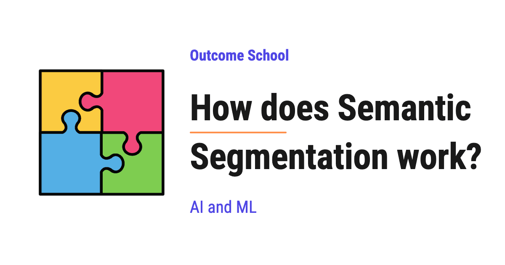

# How does Semantic Segmentation work?

> Archived from <https://outcomeschool.com/blog/semantic-segmentation> on 2026-11-25.

Semantic Segmentation labels every single pixel in an image with a class, using an encoder that understands the image and a decoder that paints a label on each pixel.

In this blog, we will learn about how Semantic Segmentation works. We will also see how it differs from Image Classification and <a target="_blank" rel="noopener noreferrer" href="object-detection.md">Object Detection</a>, why we need it, how an encoder and a decoder label every pixel in an image, how the model learns, and where it is used in the real world.

We will cover the following:
<ul><li>What is Semantic Segmentation?</li><li>Image Classification vs Object Detection vs Semantic Segmentation</li><li>Why do we need Semantic Segmentation?</li><li>How does Semantic Segmentation work step by step?</li><li>What is an Encoder and a Decoder?</li><li>A simple worked example with numbers</li><li>How does the model learn?</li><li>Real-world use cases</li></ul>
I am <strong>Amit Shekhar</strong>, Founder @ <a target="_blank" rel="noopener noreferrer" href="https://outcomeschool.com">Outcome School</a>, I have taught and mentored many developers, and their efforts landed them high-paying tech jobs, helped many tech companies in solving their unique problems, and created many open-source libraries being used by top companies. I am passionate about sharing knowledge through open-source, blogs, and videos.

I teach <a target="_blank" rel="noopener noreferrer" href="https://outcomeschool.com/program/ai-and-machine-learning">AI and Machine Learning</a> at Outcome School.

Let&#x27;s get started.
<h2 id="what-is-semantic-segmentation">What is Semantic Segmentation?</h2>
<strong>Semantic Segmentation is the task of labeling every single pixel in an image with a class.</strong>

An image is a grid of tiny dots called <strong>pixels</strong>, and for a computer, each pixel is just numbers for its color.

The word <strong>Semantic</strong> means meaning: what does this thing represent? Is it a cat, a road, or the sky? So, Semantic Segmentation divides the image into meaningful parts and gives each part a name.

The name we give to a pixel is called a <strong>class</strong>. A class is just a category. For example, the classes can be <code>cat</code>, <code>road</code>, <code>sky</code>, <code>tree</code>, and <code>person</code>. Giving a pixel its class is also called giving it a label. So, a label and a class mean the same thing here.

Let&#x27;s say we have a photo of a street. After Semantic Segmentation, every pixel will get a label. The pixels of the road become <code>road</code>. The pixels of the sky become <code>sky</code>. The pixels of a person become <code>person</code>.

So, the model does not just say &quot;there is a person in this image&quot;. It tells us exactly which pixels are the person.

Now, let&#x27;s compare it with other tasks.
<h2 id="image-classification-vs-object-detection-vs-semantic-segmentation">Image Classification vs Object Detection vs Semantic Segmentation</h2>
There are three common tasks in computer vision. Let&#x27;s understand all three with one simple example.

Consider a photo that has a dog sitting on grass.

<strong>Image Classification</strong> answers one question: what is in this image? It gives one label for the whole image. The answer is <code>dog</code>. It does not tell us where the dog is.

<strong>Object Detection</strong> goes one step further. It draws a box around the dog. This box is called a <strong>bounding box</strong>. A bounding box is a rectangle that surrounds an object. So, now we know there is a dog and roughly where it is. But the box also covers some grass in the corners. So, it is not exact.

<strong>Semantic Segmentation</strong> is the most detailed. It does not draw a rough box. It colors every pixel that belongs to the dog as <code>dog</code>, and every pixel of the grass as <code>grass</code>. So, we get the exact shape of the dog, not a rough rectangle.

Let&#x27;s visualize the three tasks side by side as below:

<pre><code class="language-text code-highlight">Image Classification     Object Detection      Semantic Segmentation
--------------------     ----------------      ---------------------
+----------------+       +----------------+    +----------------+
|                |       |    +------+    |    |     dddd       |
|     a dog      |       |    | dog  |    |    |    dddddd      |
|                |       |    +------+    |    |     dddd       |
+----------------+       +----------------+    +----------------+
Output: &quot;dog&quot;            Output: a box         Output: every pixel
(one label for the       around the dog        labeled (d = dog,
 whole image)            (covers some grass)   blank = grass)
</code></pre>

Here, we can see that Image Classification gives only one label for the whole image, Object Detection gives a rough box that also covers some grass, and Semantic Segmentation labels each pixel so we get the exact shape of the dog.

Let me tabulate the differences between these three for your better understanding.
<table><thead><tr><th>Task</th><th>What it tells us</th><th>Output</th></tr></thead><tbody><tr><td>Image Classification</td><td>What is in the image</td><td>One label for the whole image</td></tr><tr><td>Object Detection</td><td>What is in the image and roughly where</td><td>Boxes around objects</td></tr><tr><td>Semantic Segmentation</td><td>The exact shape of every object</td><td>A label for every pixel</td></tr></tbody></table>
Semantic Segmentation gives us the most detailed understanding of an image.

<strong>Note:</strong> Semantic Segmentation does not separate two objects of the same class. If there are two dogs touching each other, all their pixels are labeled <code>dog</code> together. Telling dog 1 apart from dog 2 is a different task called Instance Segmentation. We will keep our focus on Semantic Segmentation in this blog.

<strong>Planning your move into AI?</strong>

No matter which tech domain you work in today, with your effort, you can transition to these roles:
<ul><li>AI Engineer</li><li>Forward Deployed Engineer</li><li>AI Agent Engineer</li><li>Harness Engineer</li><li>Voice AI Engineer</li><li>AI Architect</li><li>LLM Engineer</li><li>LLM Inference Engineer</li><li>Gen AI Engineer</li><li>MLOps Engineer</li><li>ML Engineer</li><li>Deep Learning Engineer</li></ul>
Our <a target="_blank" rel="noopener noreferrer" href="https://outcomeschool.com/program/ai-and-machine-learning">AI and Machine Learning Program</a> at Outcome School takes you there.
<h2 id="why-do-we-need-semantic-segmentation">Why do we need Semantic Segmentation?</h2>
Now, the question is, why do we even need this?

Let&#x27;s say we are building a self-driving car. The car must know exactly where the road ends and where the footpath begins. A rough box is not enough here. The car needs the exact shape of the road, the exact shape of each person, and the exact shape of other cars.

So, here comes Semantic Segmentation to the rescue. It gives the car a pixel-perfect map of the scene.

Consider one more example. A doctor wants to measure the exact area of a tumor in a medical scan. A rough box around it is not useful. The doctor needs the exact shape. Semantic Segmentation gives exactly that.

Now that we know why we need it, it&#x27;s time to learn how it actually works.
<h2 id="how-does-semantic-segmentation-work-step-by-step">How does Semantic Segmentation work step by step?</h2>
The best way to learn this is by taking an example.

Assume that we give an image of size 4 by 4 to our model. This image is just a grid of numbers.

The job of the model is to produce another grid of the same size. But this new grid does not hold colors. It holds a class label for each pixel.

Let&#x27;s say we have only two classes for now, <code>cat</code> and <code>background</code>. The background is everything that is not the cat.

So, the input is a grid of pixels, and the output is a grid of labels.

Here is a tiny example of what the output looks like for our 4 by 4 image, where <code>C</code> means <code>cat</code> and <code>B</code> means <code>background</code>:

<pre><code class="language-text code-highlight">B B B B
B C C B
B C C B
B B B B
</code></pre>

Here, we can see that the four pixels in the middle are labeled <code>cat</code>. All the other pixels are labeled <code>background</code>. So, the model has found the exact shape of the cat, which is the middle square.

This output grid is called a <strong>segmentation map</strong>. We can show a segmentation map as a picture where each pixel is painted with the color of its class.

Now, the big question is, how does the model turn the input grid of pixels into this output grid of labels? The answer is the Encoder and the Decoder.
<h2 id="what-is-an-encoder-and-a-decoder">What is an Encoder and a Decoder?</h2>
A Semantic Segmentation model has two main parts. They work one after the other.

<strong>The Encoder</strong> is the first part. Its job is to understand the image.

The Encoder slowly shrinks the image and, at the same time, learns what objects are present.

Let&#x27;s understand this with an analogy. Suppose we look at a big photo from very close. We see tiny details like single hairs, but we lose the full picture. Now, suppose we step back. We lose the tiny details, but we clearly understand &quot;this is a cat&quot;.

The Encoder does the same thing. It steps back step by step. The image becomes smaller in size, but richer in meaning. After the Encoder, the model knows a cat is present, but it has lost the exact location of every pixel because the image is now very small.

We have a detailed blog on <a target="_blank" rel="noopener noreferrer" href="convolutional-neural-network-cnn.md">Convolutional Neural Networks</a> that explains how a neural network reads an image and turns it into a small, meaningful summary.

Our final answer must be the same size as the original image. We must label every original pixel. A small grid is not enough.

So, here comes the Decoder into the picture.

<strong>The Decoder</strong> is the second part. Its job is to grow the small grid back to the full original size.

The Decoder takes the small, meaning-rich grid from the Encoder and slowly enlarges it. While enlarging, it places the correct label on each pixel. So, the Decoder rebuilds the full-size image, but now as a segmentation map of labels.

Let me tabulate the roles for your better understanding.
<table><thead><tr><th>Part</th><th>Job</th><th>Effect on image size</th></tr></thead><tbody><tr><td>Encoder</td><td>Understand what is in the image</td><td>Makes it smaller</td></tr><tr><td>Decoder</td><td>Rebuild the full picture with labels</td><td>Makes it bigger again</td></tr></tbody></table>
So, the Encoder asks &quot;what is in this image?&quot; and the Decoder asks &quot;where exactly is each thing?&quot;. Together they give us a pixel-by-pixel answer.

This shape, where the image first shrinks and then grows back, looks like the letter U. This is why one well-known Semantic Segmentation model is called <strong>U-Net</strong>.

We can picture this shrink-then-grow flow in a diagram like below:

<pre><code class="language-text code-highlight">Input image (full size)            Segmentation map (full size)
         ↓                                      ↑
   +-----------+                          +-----------+
   |  Encoder  |                          |  Decoder  |
   |  shrinks  |                          |   grows   |
   +-----------+                          +-----------+
         ↓                                      ↑
   +-----------+                          +-----------+
   |  Encoder  |                          |  Decoder  |
   |  shrinks  |                          |   grows   |
   +-----------+                          +-----------+
         ↓                                      ↑
         +-----&gt; small, meaning-rich grid ------+
                 (&quot;a cat is present&quot;)
</code></pre>

Here, we can see that the left side is the Encoder shrinking the image step by step until it becomes a small grid that holds the meaning &quot;a cat is present&quot;, and the right side is the Decoder growing that grid back to the full size as a segmentation map. The two sides together form the U shape.

<strong>A quick note for you</strong>

No matter which tech domain you work in, get familiar with these topics:
<ul><li>LLM</li><li>RAG</li><li>MCP</li><li>Agent</li><li>Fine-tuning</li><li>Quantization</li></ul>
We put it all together in one video:

<a target="_blank" rel="noopener noreferrer" href="https://www.youtube.com/watch?v=lnfWvX66FUk">AI Engineering Explained: LLM, RAG, MCP, Agent, Fine-Tuning, and Quantization</a>

No need to stop reading - bookmark it and watch later when you get time. Future you will thank you.

Now, let&#x27;s get back to the topic.
<h2 id="a-simple-worked-example-with-numbers">A simple worked example with numbers</h2>
Let&#x27;s do a step-by-step numeric walkthrough so this becomes concrete.

Assume that for one single pixel, the model has to decide between two classes, <code>cat</code> and <code>background</code>. The model does not directly say &quot;cat&quot;. Instead, it produces a score for each class.

Let&#x27;s say for this pixel the model produces two scores like below:

<pre><code class="language-text code-highlight">cat        = 8.0
background = 2.0
</code></pre>

Here, we can see that the score for <code>cat</code> is higher than the score for <code>background</code>. But these <a target="_blank" rel="noopener noreferrer" href="logits-in-machine-learning.md">raw scores</a> are hard to read. We want them as probabilities, which means values between 0 and 1 that add up to 1.

So, here comes <a target="_blank" rel="noopener noreferrer" href="softmax-function.md"><strong>Softmax</strong></a> to the rescue. The model passes these scores through a step called Softmax. Softmax turns scores into probabilities, where a bigger score becomes a bigger probability.

After Softmax, our two scores become probabilities like below:

<pre><code class="language-text code-highlight">cat        = 0.9975
background = 0.0025
</code></pre>

Here, we can see that the probability of <code>cat</code> is 0.9975 and the probability of <code>background</code> is 0.0025. Both add up to 1. The model picks the class with the highest probability. So, this pixel is labeled <code>cat</code>.

The model does this for every single pixel in the image. Once every pixel has a label, our segmentation map is ready.

This is how the model decides, pixel by pixel, what each part of the image is.

<strong>Stay updated:</strong> Subscribe to our <a target="_blank" rel="noopener noreferrer" href="https://outcomeschool.substack.com/subscribe">newsletter</a> to get our latest AI and Machine Learning blogs straight to your inbox.
<h2 id="how-does-the-model-learn">How does the model learn?</h2>
Now, it&#x27;s time to learn how the model became good at this in the first place. How does the model know that a <code>cat</code> pixel is a <code>cat</code>?

The model is not born with this knowledge. It learns from examples. This learning process is called <strong>training</strong>.

For training, we need <a target="_blank" rel="noopener noreferrer" href="supervised-vs-unsupervised-learning.md">labeled data</a>. Labeled data means images where a human has already painted the correct label on every pixel. This correct answer is called the <strong>ground truth</strong>.

Let&#x27;s understand the training loop with a simple flow.

First, we give an image to the model. Then, the model produces its own segmentation map, which is its guess. After that, we compare the model&#x27;s guess with the ground truth. The difference between the guess and the correct answer is called the <strong>loss</strong>. A big loss means the model made a big mistake.

Finally, the model adjusts itself a little to reduce this loss. We repeat this for thousands of images, again and again.

We have a detailed blog on <a target="_blank" rel="noopener noreferrer" href="math-behind-gradient-descent.md">How Does Gradient Descent Work?</a> that explains this adjustment step by step.

We can picture this training loop as below:

<pre><code class="language-text code-highlight">+-------------------------+
|          Image          |
+-------------------------+
             ↓
+-------------------------+
|          Model          | &lt;-------+
+-------------------------+         |
             ↓                      |
+-------------------------+         |
|      Model&#x27;s guess      |         |
+-------------------------+         |
             ↓                      |
+-------------------------+         |
|  Compare with ground    |         |
|  truth to get the loss  |         |
+-------------------------+         |
             ↓                      |
+-------------------------+         |
|   Adjust the model to   | --------+
|     reduce the loss     |
+-------------------------+
</code></pre>

Here, we can see that the image goes into the model, the model produces its guess, we compare that guess with the ground truth to get the loss, and then the model adjusts itself to reduce the loss. This loop runs again and again until the loss becomes small.

Slowly, the loss becomes smaller and smaller. The model&#x27;s guesses get closer and closer to the ground truth. After enough training, the model becomes good at labeling pixels it has never seen before.

This is how the model learns Semantic Segmentation, and that too without anyone writing a rule for every shape. It learns only by looking at examples.

To master Loss Functions, Gradient Descent, and Backpropagation, which are the core of how every such model learns, check out our <a target="_blank" rel="noopener noreferrer" href="https://outcomeschool.com/program/ai-and-machine-learning">AI and Machine Learning Program</a> at Outcome School.
<h2 id="real-world-use-cases">Real-world use cases</h2>
Now, let&#x27;s see where Semantic Segmentation is used in the real world.
<ul><li><strong>Self-driving cars:</strong> to find the exact shape of the road, people, and other vehicles.</li><li><strong>Medical scans:</strong> to mark the exact area of a tumor or an organ in an X-ray, MRI, or CT scan.</li><li><strong>Satellite images:</strong> to mark exactly which area is water, forest, road, or building.</li><li><strong>Photo editing apps:</strong> to separate the person from the background so we can blur or change the background.</li><li><strong>Video calls:</strong> to find the exact shape of a person so the app can blur the room behind them.</li><li><strong>Farming:</strong> to find the exact area of crops, soil, and weeds in a field image.</li></ul>
Semantic Segmentation is useful anywhere we need the exact shape of things, not just a rough idea.

Now we must have understood how Semantic Segmentation works.
<h2 id="frequently-asked-questions">Frequently Asked Questions</h2><h3 id="what-is-the-difference-between-semantic-segmentation-and-instance-segmentation">What is the difference between Semantic Segmentation and Instance Segmentation?</h3>
Semantic Segmentation does not separate two objects of the same class. If two dogs touch each other, all their pixels are labeled <code>dog</code> together. Instance Segmentation is a different task that tells dog 1 apart from dog 2. So, Semantic Segmentation tells us what each pixel is, not which individual object it belongs to.
<h3 id="why-is-it-called-u-net">Why is it called U-Net?</h3>
U-Net is a well-known Semantic Segmentation model. Its Encoder first shrinks the image step by step, and its Decoder then grows it back to the full original size. When we draw this shrink-then-grow flow, it looks like the letter U, which is where the name comes from.
<h3 id="what-is-the-output-of-a-semantic-segmentation-model">What is the output of a Semantic Segmentation model?</h3>
The output is a segmentation map. It is a grid of the same size as the input image, where every pixel holds a class label instead of a color. We can show it as a picture where each pixel is painted with the color of its class, so we see the exact shape of every object.
<h3 id="what-training-data-does-semantic-segmentation-need">What training data does Semantic Segmentation need?</h3>
It needs labeled data, which means images where a human has already painted the correct label on every pixel. This correct answer is called the ground truth. The model compares its guess with the ground truth to get the loss, and adjusts itself to reduce that loss over thousands of images.

That&#x27;s it for now.

Thanks

<strong>Amit Shekhar</strong> Founder @ <a target="_blank" rel="noopener noreferrer" href="https://outcomeschool.com">Outcome School</a>

You can connect with me on:
<ul><li><a target="_blank" rel="noopener noreferrer" href="https://x.com/amitiitbhu">X</a></li><li><a target="_blank" rel="noopener noreferrer" href="https://www.linkedin.com/in/amit-shekhar-iitbhu">LinkedIn</a></li><li><a target="_blank" rel="noopener noreferrer" href="https://github.com/amitshekhariitbhu">GitHub</a></li></ul>
Follow Outcome School on:
<ul><li><a target="_blank" rel="noopener noreferrer" href="https://x.com/outcome_school">X</a></li><li><a target="_blank" rel="noopener noreferrer" href="https://youtube.com/@OutcomeSchool">YouTube</a></li><li><a target="_blank" rel="noopener noreferrer" href="https://www.linkedin.com/company/outcomeschool">LinkedIn</a></li><li><a target="_blank" rel="noopener noreferrer" href="http://github.com/OutcomeSchool">GitHub</a></li></ul>
<a target="_blank" rel="noopener noreferrer" href="https://outcomeschool.com/blog"><strong>Read all of our high-quality blogs here.</strong></a>

