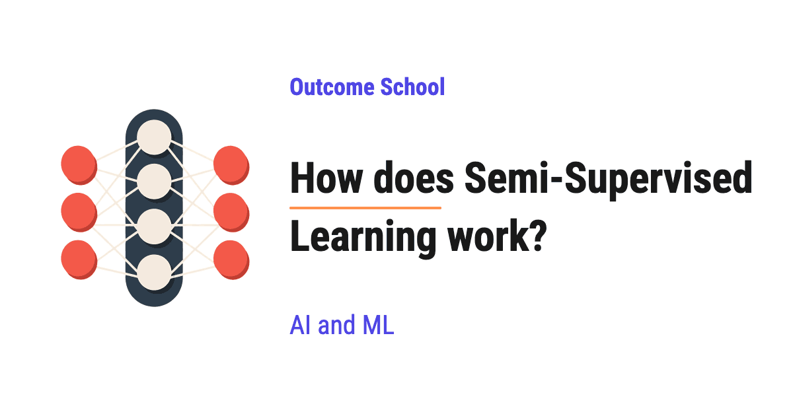

# How does Semi-Supervised Learning work?

> Archived from <https://outcomeschool.com/blog/semi-supervised-learning> on 2026-11-25.

Semi-supervised learning trains a better model by using a small amount of labeled data together with a large amount of unlabeled data, through methods like self-training.

In this blog, we will learn about how Semi-Supervised Learning works. We will also see the difference between labeled and unlabeled data, why labels are expensive, the key assumption behind it, how self-training and label propagation work, and where it is used.

We will cover the following:
<ul><li>Labeled data vs unlabeled data</li><li>The problem: labels are expensive</li><li>What is semi-supervised learning?</li><li>The key assumption behind it</li><li>How self-training works</li><li>How label propagation works</li><li>Where semi-supervised learning is used</li></ul>
I am <strong>Amit Shekhar</strong>, Founder @ <a target="_blank" rel="noopener noreferrer" href="https://outcomeschool.com">Outcome School</a>, I have taught and mentored many developers, and their efforts landed them high-paying tech jobs, helped many tech companies in solving their unique problems, and created many open-source libraries being used by top companies. I am passionate about sharing knowledge through open-source, blogs, and videos.

I teach <a target="_blank" rel="noopener noreferrer" href="https://outcomeschool.com/program/ai-and-machine-learning">AI and Machine Learning</a> at Outcome School.

Let&#x27;s get started.
<h2 id="labeled-data-vs-unlabeled-data">Labeled data vs unlabeled data</h2>
Before jumping into semi-supervised learning, we must understand two kinds of data.

<strong>Labeled data</strong> is data where we already know the answer. For example, a photo with a tag that says &quot;cat&quot;. The answer, &quot;cat&quot;, is the label.

<strong>Unlabeled data</strong> is data with no answer attached. For example, a photo with no tag. We can see it, but we do not know what it shows.

<pre><code class="language-text code-highlight">   Labeled:    [photo]  -&gt;  tag: &quot;cat&quot;      (we know the answer)
   Unlabeled:  [photo]  -&gt;  no tag          (we do not know the answer)
</code></pre>

Normal <a target="_blank" rel="noopener noreferrer" href="supervised-vs-unsupervised-learning.md">supervised learning</a> needs labeled data. It learns from examples that already have answers.
<h2 id="the-problem-labels-are-expensive">The problem: labels are expensive</h2>
Here is the real-world problem. Unlabeled data is everywhere and cheap. The internet is full of photos, text, and audio with no labels. But labeled data is expensive and slow to get, because a human has to look at each item and write the answer.

Let&#x27;s say we have one million photos. Labeling all of them by hand would cost a lot of money and take a very long time. But we can easily afford to label just a few hundred.

<pre><code class="language-text code-highlight">   1,000,000 photos with no labels   (cheap and easy to collect)
         500 photos with labels      (costly, a human tagged each one)
</code></pre>

So, we have a little labeled data and a lot of unlabeled data. The question is: can we use both together? This is exactly what semi-supervised learning does.
<h2 id="what-is-semi-supervised-learning">What is semi-supervised learning?</h2>
<strong>Semi-supervised learning uses a small amount of labeled data together with a large amount of unlabeled data to train a better model.</strong>

It sits between two other methods.
<ul><li>Supervised learning uses only labeled data.</li><li>Unsupervised learning uses only unlabeled data.</li><li>Semi-supervised learning uses both, a few labels plus lots of unlabeled data.</li></ul>
The goal is to get a model that is often close to one trained on many more labels, but by using only a few hundred labels plus the cheap unlabeled data.

We also have a detailed blog on <a target="_blank" rel="noopener noreferrer" href="self-supervised-learning.md">how Self-Supervised Learning works</a> that explains another way to learn from unlabeled data, where the data creates its own labels.

<strong>Planning your move into AI?</strong>

No matter which tech domain you work in today, with your effort, you can transition to these roles:
<ul><li>AI Engineer</li><li>Forward Deployed Engineer</li><li>AI Agent Engineer</li><li>Harness Engineer</li><li>Voice AI Engineer</li><li>AI Architect</li><li>LLM Engineer</li><li>LLM Inference Engineer</li><li>Gen AI Engineer</li><li>MLOps Engineer</li><li>ML Engineer</li><li>Deep Learning Engineer</li></ul>
Our <a target="_blank" rel="noopener noreferrer" href="https://outcomeschool.com/program/ai-and-machine-learning">AI and Machine Learning Program</a> at Outcome School takes you there.
<h2 id="the-key-assumption-behind-it">The key assumption behind it</h2>
For this to work, we rely on one assumption.

<strong>Points that are close to each other, or look similar, probably share the same label.</strong>

Means, if an unlabeled photo looks a lot like a labeled &quot;cat&quot; photo, it is probably also a cat. Similar things tend to have the same answer.

<pre><code class="language-text code-highlight">   [cat, labeled]   . . . .   [unlabeled]   . . . .   [unlabeled]
                              looks like cat         looks like cat
                              so probably cat        so probably cat
</code></pre>

This assumption lets the labels &quot;spread&quot; from the few labeled points to the many nearby unlabeled points.

<strong>A quick note for you</strong>

No matter which tech domain you work in, get familiar with these topics:
<ul><li>LLM</li><li>RAG</li><li>MCP</li><li>Agent</li><li>Fine-tuning</li><li>Quantization</li></ul>
We put it all together in one video:

<a target="_blank" rel="noopener noreferrer" href="https://www.youtube.com/watch?v=lnfWvX66FUk">AI Engineering Explained: LLM, RAG, MCP, Agent, Fine-Tuning, and Quantization</a>

No need to stop reading - bookmark it and watch later when you get time. Future you will thank you.

Now, let&#x27;s get back to the topic.
<h2 id="how-self-training-works">How self-training works</h2>
One common method is called <strong>self-training</strong>, also known as pseudo-labeling. Let&#x27;s see the steps.

<strong>Step 1:</strong> Train a first model using only the small labeled data.

<strong>Step 2:</strong> Use this model to predict labels for the unlabeled data. These guessed labels are called pseudo-labels.

<strong>Step 3:</strong> Keep only the guesses the model is most confident about. Add these confident pseudo-labels to the training data as if they were real labels.

<strong>Step 4:</strong> Train the model again on this bigger, combined data.

We can repeat these steps, and the model keeps improving.

<pre><code class="language-text code-highlight">   Small labeled data
           ↓
   Train a first model
           ↓
   Predict labels for the unlabeled data
           ↓
   Keep only the confident guesses (pseudo-labels)
           ↓
   Add them to the labeled data
           ↓
   Train again on the bigger data
           ↓
   A better model
</code></pre>

Here, we can see the idea. The model teaches itself. It labels the easy, confident cases first, then uses them to learn the harder cases. This is why it is called self-training.
<h2 id="how-label-propagation-works">How label propagation works</h2>
Another method is called <strong>label propagation</strong>. Here, we imagine all the data points connected in a graph, where similar points are linked.

We start with labels only on a few points. Then we let each label spread to its neighbors, step by step, like a color spreading across a map.

<pre><code class="language-text code-highlight">   Start:   [CAT]  -  o  -  o  -  o  -  o  -  [DOG]
                 (unlabeled points in the middle)

   Spread:  [CAT]  - cat - cat - dog - dog -  [DOG]
             (labels flow from the labeled points to neighbors)
</code></pre>

Here, we can see that the &quot;cat&quot; label spreads to points near the cat, and the &quot;dog&quot; label spreads to points near the dog. In the end, every point gets a label based on which labeled points it is most strongly connected to.

<strong>Stay updated:</strong> Subscribe to our <a target="_blank" rel="noopener noreferrer" href="https://outcomeschool.substack.com/subscribe">newsletter</a> to get our latest AI and Machine Learning blogs straight to your inbox.
<h2 id="where-semi-supervised-learning-is-used">Where semi-supervised learning is used</h2>
Now, let&#x27;s see where it helps us.
<ul><li><strong>Medical images:</strong> Expert doctors are needed to label scans, which is costly. So we label a few and use many unlabeled scans.</li><li><strong>Speech recognition:</strong> We have huge amounts of audio but few written transcripts, so labels are limited.</li><li><strong>Web page classification:</strong> There are billions of pages online, but only a few are labeled by hand.</li><li><strong>Fraud detection:</strong> Very few transactions are confirmed as fraud, but there are millions of unlabeled transactions.</li></ul><h2 id="frequently-asked-questions">Frequently Asked Questions</h2><h3 id="is-semi-supervised-learning-supervised-or-unsupervised">Is semi-supervised learning supervised or unsupervised?</h3>
It is neither, it sits between the two. Supervised learning uses only labeled data, and unsupervised learning uses only unlabeled data. Semi-supervised learning uses both, a small amount of labeled data plus a large amount of unlabeled data, to train a better model.
<h3 id="what-is-a-pseudo-label">What is a pseudo-label?</h3>
A pseudo-label is a label that the model guesses for an unlabeled example. In self-training, we first train a model on the small labeled data, use it to predict labels for the unlabeled data, and keep only the most confident guesses. These confident pseudo-labels are then added to the training data as if they were real labels.
<h3 id="why-does-semi-supervised-learning-work">Why does semi-supervised learning work?</h3>
It works because of one assumption: points that are close to each other, or look similar, probably share the same label. If an unlabeled photo looks a lot like a labeled &quot;cat&quot; photo, it is probably also a cat. This lets the labels spread from the few labeled points to the many nearby unlabeled points.
<h3 id="when-should-we-use-semi-supervised-learning">When should we use semi-supervised learning?</h3>
We should use it when labels are expensive but unlabeled data is cheap and plentiful. For example, medical scans need expert doctors to label them, and fraud detection has very few confirmed fraud cases but millions of unlabeled transactions. In such cases, we label a few examples and use the many unlabeled ones too.

That&#x27;s it for now.

Thanks

<strong>Amit Shekhar</strong> Founder @ <a target="_blank" rel="noopener noreferrer" href="https://outcomeschool.com">Outcome School</a>

You can connect with me on:
<ul><li><a target="_blank" rel="noopener noreferrer" href="https://x.com/amitiitbhu">X</a></li><li><a target="_blank" rel="noopener noreferrer" href="https://www.linkedin.com/in/amit-shekhar-iitbhu">LinkedIn</a></li><li><a target="_blank" rel="noopener noreferrer" href="https://github.com/amitshekhariitbhu">GitHub</a></li></ul>
Follow Outcome School on:
<ul><li><a target="_blank" rel="noopener noreferrer" href="https://x.com/outcome_school">X</a></li><li><a target="_blank" rel="noopener noreferrer" href="https://youtube.com/@OutcomeSchool">YouTube</a></li><li><a target="_blank" rel="noopener noreferrer" href="https://www.linkedin.com/company/outcomeschool">LinkedIn</a></li><li><a target="_blank" rel="noopener noreferrer" href="http://github.com/OutcomeSchool">GitHub</a></li></ul>
<a target="_blank" rel="noopener noreferrer" href="https://outcomeschool.com/blog"><strong>Read all of our high-quality blogs here.</strong></a>

