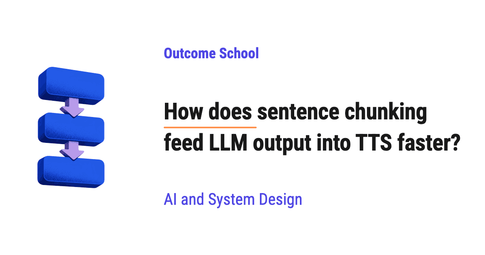

# How does sentence chunking feed LLM output into TTS faster?

> Archived from <https://outcomeschool.com/blog/sentence-chunking-for-tts> on 2026-11-25.

Sentence chunking feeds LLM output into TTS faster by cutting the reply into sentences while the LLM is still writing it, and sending each finished sentence to the TTS right away, so the voice starts speaking after the first sentence instead of after the full reply.

In this blog, we will learn about how sentence chunking feeds LLM output into TTS faster. We will also see why waiting for the full reply makes a voice agent slow, how a buffer collects tokens until a sentence is complete, how the chunker finds where a sentence ends, how it handles tricky cases like &quot;Dr.&quot; and &quot;3.5&quot;, how the first chunk is made smaller to start speaking even sooner, and where it works well and where it fails.

We will cover the following:
<ul><li>The problem: the voice waits for the full reply</li><li>What is sentence chunking?</li><li>Why not send every token to the TTS?</li><li>How does the chunker work?</li><li>Finding the end of a sentence</li><li>The tricky cases</li><li>Making the first chunk smaller</li><li>A walkthrough with numbers</li><li>What happens when the user interrupts?</li><li>Where it works well and where it fails</li></ul>
I am <strong>Amit Shekhar</strong>, Founder @ <a target="_blank" rel="noopener noreferrer" href="https://outcomeschool.com">Outcome School</a>, I have taught and mentored many developers, and their efforts landed them high-paying tech jobs, helped many tech companies in solving their unique problems, and created many open-source libraries being used by top companies. I am passionate about sharing knowledge through open-source, blogs, and videos.

I teach <a target="_blank" rel="noopener noreferrer" href="https://outcomeschool.com/program/ai-and-machine-learning">AI and Machine Learning</a> at Outcome School.

Let&#x27;s get started.
<h2 id="the-problem-the-voice-waits-for-the-full-reply">The problem: the voice waits for the full reply</h2>
A <a target="_blank" rel="noopener noreferrer" href="design-a-real-time-voice-ai-agent.md">voice agent</a> is a system that listens to us, thinks, and talks back. Most voice agents work as a <a target="_blank" rel="noopener noreferrer" href="cascaded-vs-speech-to-speech.md">pipeline of three parts</a>:
<ul><li><strong>STT (Speech-to-Text):</strong> It turns our voice into text.</li><li><strong>LLM (Large Language Model):</strong> It reads that text and writes a reply.</li><li><strong>TTS (Text-to-Speech):</strong> It turns the reply text into spoken audio.</li></ul>
The flow looks like below:

<pre><code class="code-highlight">Our voice
    ↓
   STT
    ↓
   LLM
    ↓
   TTS
    ↓
Audio we hear
</code></pre>

The LLM does not write the reply all at once. It writes one token at a time. A <strong>token</strong> is a small piece of text, usually a word or a part of a word. Tokens come out one after another, which is called <strong><a target="_blank" rel="noopener noreferrer" href="how-does-token-streaming-work.md">streaming</a></strong>.

Let&#x27;s say the LLM starts its reply like below:

&quot;Sure, I can help with that. Your order was shipped yesterday. It will reach you by Friday. ...&quot;

Suppose the full reply is long, and it takes the LLM 3 seconds to write all of it. If we wait for the full reply and only then send it to the TTS, the user hears nothing for those 3 seconds. Then, the TTS also needs time to make the audio. In a conversation, this silence feels very long.

But, the first sentence &quot;Sure, I can help with that.&quot; is ready after a fraction of a second. The TTS could already start speaking it while the LLM is still writing the rest.

Sentence chunking solves this problem.
<h2 id="what-is-sentence-chunking">What is sentence chunking?</h2>
<strong>Sentence chunking is the step that collects the tokens coming out of the LLM, cuts them into complete sentences as soon as each sentence ends, and sends each sentence to the TTS one by one.</strong>

The piece of code that does this is called the <strong>chunker</strong> (some frameworks call it an aggregator or a sentence tokenizer).

With sentence chunking, the flow becomes like below:

<pre><code class="code-highlight">LLM writes tokens
        ↓
Chunker collects tokens
        ↓
Sentence 1 is complete
        ↓
TTS speaks sentence 1
</code></pre>

And while the TTS is speaking sentence 1, the LLM keeps writing sentence 2, and the chunker keeps collecting it. Means, the three parts now work at the same time instead of waiting for each other.

The finished sentences wait in a queue, so the TTS speaks them in the same order in which the LLM wrote them. The user now waits only for the first sentence, not for the full reply.
<h2 id="why-not-send-every-token-to-the-tts">Why not send every token to the TTS?</h2>
Now, the question is: if smaller is faster, why not send every single token to the TTS the moment it arrives?

The answer is that a TTS needs some context to sound natural.

Let&#x27;s understand this with an example. Consider the word &quot;read&quot;. In &quot;I read books every day&quot; it sounds like &quot;reed&quot;. In &quot;I read that book yesterday&quot; it sounds like &quot;red&quot;. Here, the word that decides the sound comes later in the sentence. If the TTS has to speak &quot;read&quot; before it sees the rest, it can easily pick the wrong one.

The same is true for the tone of the voice. A yes-or-no question often goes up at the end, like &quot;Is it ready?&quot;. A plain statement usually goes down at the end. If the TTS gets the words one by one, it does not know how the sentence will end, so it cannot plan the rise and fall of the voice. This rise and fall is called <strong>prosody</strong>.

So, we have two extremes:
<ul><li><strong>Send the full reply:</strong> sounds natural, but the user waits too long.</li><li><strong>Send every token:</strong> starts fast, but sounds broken.</li></ul>
A sentence sits in the middle. It is short enough to be ready quickly, and it carries enough context for the TTS to say it naturally. This is why the sentence is a common unit for chunking.

<strong>Planning your move into AI?</strong>

No matter which tech domain you work in today, with your effort, you can transition to these roles:
<ul><li>AI Engineer</li><li>Forward Deployed Engineer</li><li>AI Agent Engineer</li><li>Harness Engineer</li><li>Voice AI Engineer</li><li>AI Architect</li><li>LLM Engineer</li><li>LLM Inference Engineer</li><li>Gen AI Engineer</li><li>MLOps Engineer</li><li>ML Engineer</li><li>Deep Learning Engineer</li></ul>
Our <a target="_blank" rel="noopener noreferrer" href="https://outcomeschool.com/program/ai-and-machine-learning">AI and Machine Learning Program</a> at Outcome School takes you there.
<h2 id="how-does-the-chunker-work">How does the chunker work?</h2>
The chunker keeps a <strong>buffer</strong>, which is a holding area for text.

It follows these steps:

<strong>Step 1:</strong> A new token arrives from the LLM, and the chunker adds it to the buffer.

<strong>Step 2:</strong> The chunker checks whether the buffer now contains a complete sentence.

<strong>Step 3:</strong> If yes, it cuts that sentence out, sends it to the TTS, and keeps the leftover text in the buffer.

<strong>Step 4:</strong> If no, it waits for the next token.

<strong>Step 5:</strong> When the LLM finishes, whatever is left in the buffer is sent to the TTS as the last chunk, even if it does not end with a full stop.

Let&#x27;s see the code for a simple chunker as below:

<pre><code class="code-highlight language-python">def chunk_sentences(token_stream):
    buffer = &quot;&quot;
    for token in token_stream:
        buffer += token
        # look for the end of a sentence
        while True:
            end = find_sentence_end(buffer)
            if end == -1:
                break
            sentence = buffer[:end].strip()
            buffer = buffer[end:]
            yield sentence  # send to TTS right away
    # LLM is done, send whatever is left
    if buffer.strip():
        yield buffer.strip()
</code></pre>

Here, we have a <code>buffer</code> that grows as tokens arrive. After every token, we call <code>find_sentence_end</code> to check if a sentence has ended. If it has, we cut the sentence out and <code>yield</code> it, which means we hand it to the TTS immediately without stopping the loop. The leftover text stays in the buffer for the next sentence. At the end, we send the remaining text so that the last words are not lost.

Now, let&#x27;s see how <code>find_sentence_end</code> works.
<h2 id="finding-the-end-of-a-sentence">Finding the end of a sentence</h2>
The simplest rule is: a sentence ends at a full stop, a question mark, or an exclamation mark.

But, we must be careful. The chunker sees the text token by token. When it sees a full stop, it does not yet know what comes next. For example, &quot;3.&quot; can still become &quot;3.5&quot;. So, a good chunker waits for one more thing after the punctuation: a space, a new line, or the end of the reply. Only then it decides that the sentence has really ended.

Let&#x27;s take an example. The tokens arrive like below:

<pre><code class="code-highlight">&quot;Sure&quot; &quot;,&quot; &quot; I&quot; &quot; can&quot; &quot; help&quot; &quot; with&quot; &quot; that&quot; &quot;.&quot; &quot; Your&quot; ...
</code></pre>

Here, we can see that:
<ul><li>When <code>&quot;.&quot;</code> arrives, the buffer is &quot;Sure, I can help with that.&quot; The chunker does not cut yet.</li><li>When <code>&quot; Your&quot;</code> arrives, the chunker sees that a space came after the full stop. Now, it cuts &quot;Sure, I can help with that.&quot; and sends it to the TTS.</li><li>The buffer now holds &quot; Your&quot;, and the chunker starts collecting the second sentence.</li></ul>
We can write <code>find_sentence_end</code> as below:

<pre><code class="code-highlight language-python">def find_sentence_end(text):
    for i, ch in enumerate(text):
        if ch in &quot;.?!&quot; and i + 1 &lt; len(text) and text[i + 1].isspace():
            return i + 1  # cut right after the punctuation
    return -1  # no complete sentence yet
</code></pre>

Here, we are looking for a full stop, question mark, or exclamation mark that is followed by a space. If we find one, we return the position just after the punctuation. If not, we return <code>-1</code>, which tells the chunker to wait.

This works perfectly for simple text.

<strong>A quick note for you</strong>

No matter which tech domain you work in, get familiar with these topics:
<ul><li>LLM</li><li>RAG</li><li>MCP</li><li>Agent</li><li>Fine-tuning</li><li>Quantization</li></ul>
We put it all together in one video:

<a target="_blank" rel="noopener noreferrer" href="https://www.youtube.com/watch?v=lnfWvX66FUk">AI Engineering Explained: LLM, RAG, MCP, Agent, Fine-Tuning, and Quantization</a>

No need to stop reading - bookmark it and watch later when you get time. Future you will thank you.

Now, let&#x27;s get back to the topic.
<h2 id="the-tricky-cases">The tricky cases</h2>
Not every full stop ends a sentence. If the chunker cuts at the wrong place, the TTS speaks half a sentence, pauses, and then speaks the other half, which sounds unnatural.

Let&#x27;s see the common tricky cases:
<ul><li><strong>Abbreviations:</strong> &quot;Dr. Sharma will call you.&quot; If we cut after &quot;Dr.&quot;, the TTS says &quot;Dr.&quot; alone with a pause, and then &quot;Sharma will call you.&quot; as a new sentence.</li><li><strong>Decimal numbers:</strong> &quot;The price is 3.5 dollars.&quot; Here, the full stop in &quot;3.5&quot; is not followed by a space, so our simple rule already handles it.</li><li><strong>Initials and short forms:</strong> &quot;U.S.&quot;, &quot;a.m.&quot;, &quot;p.m.&quot; in a sentence like &quot;The meeting is at 10 a.m. tomorrow.&quot;</li><li><strong>Web addresses and emails:</strong> &quot;Visit example.com for details.&quot; There is no space after the dot, so our simple rule already handles it.</li><li><strong>Ellipsis:</strong> &quot;Well... let me check.&quot; Three dots in a row are a pause, not always the end of a sentence.</li></ul>
To handle these, the chunker uses some extra rules:
<ul><li>It keeps a list of common abbreviations like &quot;Dr.&quot;, &quot;Mr.&quot;, &quot;Mrs.&quot;, and &quot;etc.&quot; and does not cut after them.</li><li>It waits for the next word and checks that it starts with a capital letter before cutting, because a new sentence usually starts with a capital letter.</li><li>It treats a group of dots as one piece of punctuation.</li></ul>
Our updated code with the abbreviation rule:

<pre><code class="code-highlight language-python">ABBREVIATIONS = {&quot;dr.&quot;, &quot;mr.&quot;, &quot;mrs.&quot;, &quot;ms.&quot;, &quot;etc.&quot;}

def find_sentence_end(text):
    for i, ch in enumerate(text):
        if ch in &quot;.?!&quot; and i + 1 &lt; len(text) and text[i + 1].isspace():
            last_word = text[:i + 1].split()[-1].lower()
            if last_word in ABBREVIATIONS:
                continue  # &quot;Dr.&quot; is not the end of a sentence
            return i + 1
    return -1
</code></pre>

Here, before cutting, we take the last word before the punctuation. If it is in our <code>ABBREVIATIONS</code> list, we skip it and keep looking. Now, &quot;Dr. Sharma will call you.&quot; stays as one sentence.

The second problem is the opposite one: some sentences take a very long time to end. An LLM can write a long sentence with many commas, or a list without any full stops. If the chunker waits only for a full stop, the TTS gets nothing for a long time, and the user hears silence again.

To solve this, the chunker also has a <strong>maximum length</strong>. If the buffer gets too long without a sentence end, the chunker cuts at the last comma, semicolon, or colon in the buffer. These are natural pause points, so the speech still sounds fine.

Similarly, the chunker can have a <strong>minimum length</strong>. In the middle of a reply, a short sentence like &quot;Ok.&quot; can be joined with the next sentence, because sending many tiny pieces to the TTS makes the speech choppy.
<h2 id="making-the-first-chunk-smaller">Making the first chunk smaller</h2>
The user is waiting in silence only <a target="_blank" rel="noopener noreferrer" href="time-to-first-audio.md">until the first audio starts</a>. After that, the TTS is busy speaking, and the LLM has time to stay ahead. So, the first chunk matters the most for speed. The later chunks only need to be ready before the previous audio finishes playing.

Let&#x27;s say the LLM&#x27;s first sentence is long:

&quot;Sure, I checked your account and I can see that your order was shipped yesterday from our warehouse.&quot;

If we wait for the full stop, the user waits for all of these tokens. Instead, the chunker can cut the first chunk at the first comma: &quot;Sure,&quot; goes to the TTS immediately. The TTS starts speaking while the rest of the sentence is still being written.

So, a common approach is to use two rules:
<ul><li><strong>For the first chunk:</strong> cut early, at a comma or after a small number of words, to start speaking as soon as possible.</li><li><strong>For the later chunks:</strong> cut at full sentences, to get the most natural voice.</li></ul>
The cost is that the short first piece has less context, so its tone can be slightly less natural.

To learn how to Design a Real-Time Voice AI Agent and the LLM Inference Performance Metrics that decide how fast it starts speaking, check out our <a target="_blank" rel="noopener noreferrer" href="https://outcomeschool.com/program/ai-and-machine-learning">AI and Machine Learning Program</a> at Outcome School.
<h2 id="a-walkthrough-with-numbers">A walkthrough with numbers</h2>
The best way to learn this is by taking an example. The numbers below are just for the sake of understanding, real numbers depend on the LLM, the TTS, and the hardware.

Let&#x27;s assume:
<ul><li>The LLM writes about 10 tokens every 0.1 seconds after its first token.</li><li>The <a target="_blank" rel="noopener noreferrer" href="prefill-vs-decode-llm-inference-optimization.md">first token</a> comes out 0.3 seconds after the LLM gets the question.</li><li>The TTS takes 0.2 seconds to start playing audio after it gets a chunk, no matter how long the chunk is.</li><li>The reply is three sentences of about 10 tokens each.</li></ul>
<strong>Without chunking:</strong>
<ul><li>The LLM finishes all 30 tokens at 0.3 + 0.3 = 0.6 seconds.</li><li>The TTS gets the full reply and starts playing at 0.6 + 0.2 = 0.8 seconds.</li><li>The user waits 0.8 seconds for the first sound.</li></ul>
<strong>With sentence chunking:</strong>
<ul><li>The first sentence is complete at about 0.3 + 0.1 = 0.4 seconds.</li><li>The TTS starts playing it at 0.4 + 0.2 = 0.6 seconds.</li><li>The user waits 0.6 seconds for the first sound.</li></ul>
Here, the gain looks small because our reply is short and the LLM is fast. Now, suppose the reply is ten sentences long. Without chunking, the LLM finishes 100 tokens at 0.3 + 1.0 = 1.3 seconds, and the user hears the first sound at 1.5 seconds. With chunking, the user still hears the first sound at 0.6 seconds. Means, the wait no longer grows with the length of the reply. It depends only on the first sentence.

For the ten-sentence reply, we can see the overlap in the diagram below:

<pre><code class="code-highlight">Time (seconds)   LLM                         TTS and speaker
0.3 to 0.4       writes sentence 1           waiting
0.4 to 0.5       writes sentence 2           makes audio for sentence 1
0.5 to 0.6       writes sentence 3           makes audio for sentence 1
0.6 to 1.3       writes sentences 4 to 10    plays sentence 1, then 2, and so on
</code></pre>

And while the first sentence is playing, which takes a couple of seconds of speech, the LLM is usually done writing the next sentences. So, as long as the LLM writes faster than the voice speaks, the TTS does not run out of text, and there are no gaps between the sentences.

We have a detailed blog on <a target="_blank" rel="noopener noreferrer" href="voice-agent-latency-budget.md">how to build a latency budget for a voice AI agent</a> that explains how each step adds to the wait.

<strong>Stay updated:</strong> Subscribe to our <a target="_blank" rel="noopener noreferrer" href="https://outcomeschool.substack.com/subscribe">newsletter</a> to get our latest AI and Machine Learning blogs straight to your inbox.
<h2 id="what-happens-when-the-user-interrupts">What happens when the user interrupts?</h2>
In a real conversation, the user can start talking while the agent is still speaking. This is called <strong><a target="_blank" rel="noopener noreferrer" href="what-is-barge-in-in-a-voice-ai-agent.md">barge-in</a></strong>.

When this happens, the agent must <a target="_blank" rel="noopener noreferrer" href="stopping-speech-on-interruption.md">stop speaking immediately</a>. With sentence chunking, there are several places where the old reply is still waiting:
<ul><li>Tokens inside the chunker buffer.</li><li>Sentences sent to the TTS but not yet turned into audio.</li><li>Audio made by the TTS but not yet played.</li></ul>
So, on interruption, the agent must clear all of them: empty the buffer, cancel the pending TTS requests, and stop the audio player. If we forget the buffer, the old reply leaks out after the user has started a new turn.

Chunking also helps here. Because the reply is already split into sentences, the agent can track which sentences were fully played before the interruption. It can save only those in the <a target="_blank" rel="noopener noreferrer" href="ai-agent-memory.md">conversation history</a>, so that the LLM knows <a target="_blank" rel="noopener noreferrer" href="truncating-context-on-interruption.md">what the user actually heard</a>.
<h2 id="where-it-works-well-and-where-it-fails">Where it works well and where it fails</h2>
<strong>Where it works well:</strong>
<ul><li>Long replies, because the wait depends only on the first sentence and not on the full reply.</li><li>TTS models that take a full sentence as input and do not accept a live stream of text.</li></ul>
<strong>Where it fails:</strong>
<ul><li>Replies with many abbreviations, numbers, web addresses, or code, where full stops do not mean the end of a sentence. The voice then pauses in odd spots.</li><li>Very long sentences without a full stop, where the chunker has to wait or fall back to cutting at commas.</li><li>Replies written in markdown, like bullet points and headings. Symbols like <code>*</code> and <code>#</code> must be cleaned before the TTS, or it reads them out loud.</li><li>Languages that do not use the same punctuation, such as Chinese or Japanese, which use their own full stop symbol <code>。</code> and usually no space after it. Our simple rule never finds a sentence end there, so the chunker needs rules for each language.</li><li>Each chunk is spoken on its own, so the TTS does not see the next sentence. The tone between two sentences can sometimes sound a little disconnected.</li></ul>
Some newer TTS models <a target="_blank" rel="noopener noreferrer" href="streaming-tts.md">accept text as a live stream</a> and keep the context across chunks by themselves. With them, the chunker can send smaller pieces without losing the natural flow. But even then, the idea stays the same: do not wait for the full reply, start speaking as soon as there is enough text to say it well.

Now we must have understood how sentence chunking feeds LLM output into TTS faster, how the chunker finds the end of a sentence, how it handles the tricky cases, and why the first chunk matters the most.
<h2 id="frequently-asked-questions">Frequently Asked Questions</h2><h3 id="why-does-the-chunker-wait-for-a-space-after-a-full-stop">Why does the chunker wait for a space after a full stop?</h3>
Because a full stop alone does not prove that the sentence has ended. The chunker sees the text token by token, so &quot;3.&quot; can still become &quot;3.5&quot;. A good chunker waits for one more thing after the punctuation, a space, a new line, or the end of the reply, and only then decides that the sentence has really ended.
<h3 id="what-happens-to-the-text-left-in-the-buffer-when-the-llm-finishes">What happens to the text left in the buffer when the LLM finishes?</h3>
It is sent to the TTS as the last chunk. When the LLM finishes, whatever is left in the buffer goes to the TTS even if it does not end with a full stop. This makes sure that the last words of the reply are not lost.
<h3 id="what-is-prosody-and-why-does-it-need-a-full-sentence">What is prosody and why does it need a full sentence?</h3>
Prosody is the rise and fall of the voice. A yes-or-no question often goes up at the end, and a plain statement usually goes down at the end. If the TTS gets the words one by one, it does not know how the sentence will end, so it cannot plan this rise and fall.
<h3 id="do-we-still-need-sentence-chunking-with-tts-models-that-accept-streaming-text">Do we still need sentence chunking with TTS models that accept streaming text?</h3>
The idea stays the same. Some newer TTS models accept text as a live stream and keep the context across chunks by themselves. With them, the chunker can send smaller pieces without losing the natural flow. But we still do not wait for the full reply, we start speaking as soon as there is enough text to say it well.

That&#x27;s it for now.

Thanks

<strong>Amit Shekhar</strong> Founder @ <a target="_blank" rel="noopener noreferrer" href="https://outcomeschool.com">Outcome School</a>

You can connect with me on:
<ul><li><a target="_blank" rel="noopener noreferrer" href="https://x.com/amitiitbhu">X</a></li><li><a target="_blank" rel="noopener noreferrer" href="https://www.linkedin.com/in/amit-shekhar-iitbhu">LinkedIn</a></li><li><a target="_blank" rel="noopener noreferrer" href="https://github.com/amitshekhariitbhu">GitHub</a></li></ul>
Follow Outcome School on:
<ul><li><a target="_blank" rel="noopener noreferrer" href="https://x.com/outcome_school">X</a></li><li><a target="_blank" rel="noopener noreferrer" href="https://youtube.com/@OutcomeSchool">YouTube</a></li><li><a target="_blank" rel="noopener noreferrer" href="https://www.linkedin.com/company/outcomeschool">LinkedIn</a></li><li><a target="_blank" rel="noopener noreferrer" href="http://github.com/OutcomeSchool">GitHub</a></li></ul>
<a target="_blank" rel="noopener noreferrer" href="https://outcomeschool.com/blog"><strong>Read all of our high-quality blogs here.</strong></a>

