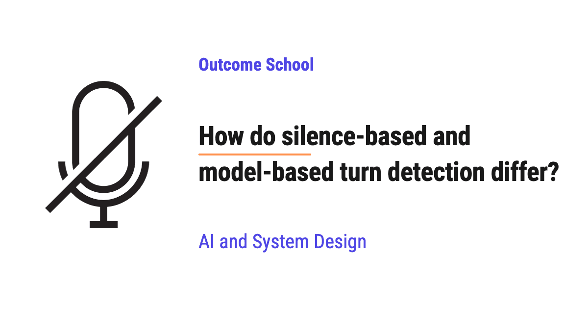

# How do silence-based and model-based turn detection differ?

> Archived from <https://outcomeschool.com/blog/silence-vs-model-based-turn-detection> on 2026-11-25.

Silence-based turn detection decides that a person has finished speaking when it hears a long enough pause. Model-based turn detection uses a trained model that looks at what was said and how it was said to decide whether the person is done.

In this blog, we will learn about how silence-based and model-based turn detection differ. We will also see what turn detection is, how silence-based turn detection works and why a fixed pause fails, how a model predicts the end of a turn from words and from sound, how both are combined in a voice pipeline, and when to use which one.

We will cover the following:
<ul><li>What is Turn Detection?</li><li>How Silence-Based Turn Detection Works</li><li>The Problems with Silence-Based Turn Detection</li><li>How Model-Based Turn Detection Works</li><li>Text-Based and Audio-Based Turn Detection Models</li><li>How Both Work Together in a Voice Pipeline</li><li>Silence-Based vs Model-Based Turn Detection</li><li>When to Use Which One</li></ul>
I am <strong>Amit Shekhar</strong>, Founder @ <a target="_blank" rel="noopener noreferrer" href="https://outcomeschool.com">Outcome School</a>, I have taught and mentored many developers, and their efforts landed them high-paying tech jobs, helped many tech companies in solving their unique problems, and created many open-source libraries being used by top companies. I am passionate about sharing knowledge through open-source, blogs, and videos.

I teach <a target="_blank" rel="noopener noreferrer" href="https://outcomeschool.com/program/ai-and-machine-learning">AI and Machine Learning</a> at Outcome School.

Let&#x27;s get started.
<h2 id="what-is-turn-detection">What is Turn Detection?</h2>
When two people talk, they take turns. One person speaks, then stops, and then the other person replies. We do this without thinking. We just know when the other person has finished.

A voice assistant has to do the same thing. It must decide when the user has finished speaking, so that it can start replying.

<strong>Turn detection is the job of deciding when the user has finished their turn in a conversation, so that the voice assistant knows when to start speaking.</strong>

The point where the user finishes is called the <strong>end of turn</strong>. Hence, turn detection is also called <strong>end-of-turn detection</strong> or <strong><a target="_blank" rel="noopener noreferrer" href="endpointing-in-voice-agents.md">endpointing</a></strong>.

Turn detection is one part of a bigger job called turn-taking. We have a detailed blog on <a target="_blank" rel="noopener noreferrer" href="what-is-turn-taking-in-a-voice-ai-agent.md">turn-taking in a voice AI agent</a> that covers how the agent decides whose turn it is to speak.

Let&#x27;s say we are talking to a voice assistant to book a table at a restaurant. We say:

&quot;I want to book a table for four people.&quot;

The assistant must decide: is the user done, or is the user going to say more? If it decides too early, it cuts us off. If it decides too late, we sit in silence and wonder if it heard us.

So, turn detection has two ways to fail:
<ul><li><strong>Too early:</strong> The assistant <a target="_blank" rel="noopener noreferrer" href="voice-agents-cutting-users-off.md">interrupts the user in the middle of a sentence</a>.</li><li><strong>Too late:</strong> The assistant waits too long, and the conversation feels slow.</li></ul>
There are two main ways to solve this problem:
<ul><li><strong>Silence-based turn detection:</strong> Wait for a pause of a fixed length.</li><li><strong>Model-based turn detection:</strong> Use a trained model to predict whether the user is done.</li></ul>
Let&#x27;s understand each of them one by one.
<h2 id="how-silence-based-turn-detection-works">How Silence-Based Turn Detection Works</h2>
The idea of silence-based turn detection is simple. If the user stops making speech sounds for long enough, we assume the user is done.

In order to know whether the user is speaking or silent, we use a <strong>Voice Activity Detector</strong>, also called a <strong>VAD</strong>.

<strong>A Voice Activity Detector is a small tool, usually a tiny model, that listens to short pieces of audio and tells us whether each piece contains human speech or not.</strong>

The audio from the microphone comes in small pieces, for example, one piece every 30 milliseconds. For each piece, the VAD says either &quot;speech&quot; or &quot;no speech&quot;.

Then, we add one rule on top of it:

<strong>If the VAD says &quot;no speech&quot; continuously for a fixed amount of time, the user has finished their turn.</strong>

This fixed amount of time is called the <strong>silence timeout</strong>. For the sake of example, let&#x27;s say the silence timeout is 700 milliseconds.

Let&#x27;s see this step by step.

<strong>Step 1:</strong> The user says &quot;I want to book a table&quot;. The VAD says &quot;speech&quot; for every piece.

<strong>Step 2:</strong> The user stops. The VAD starts saying &quot;no speech&quot;. A timer starts counting.

<strong>Step 3:</strong> The timer reaches 200 milliseconds. The user is still silent, so the system keeps waiting.

<strong>Step 4:</strong> The timer reaches 700 milliseconds. The user is still silent, so the silence timeout is reached.

<strong>Step 5:</strong> The system declares the end of turn and sends the speech to the next part of the assistant to generate a reply.

If the user starts speaking again before the timer reaches 700 milliseconds, the timer resets to zero, and the turn continues.

We can write the logic in code as below:

<pre><code class="language-python code-highlight">SILENCE_TIMEOUT_MS = 700
CHUNK_MS = 30

silence_ms = 0
user_spoke = False

for chunk in microphone_chunks():
    if vad.is_speech(chunk):
        user_spoke = True
        silence_ms = 0  # user is speaking, reset the timer
    elif user_spoke:
        silence_ms += CHUNK_MS
        if silence_ms &gt;= SILENCE_TIMEOUT_MS:
            end_of_turn()  # user is done, start replying
            user_spoke = False
            silence_ms = 0
</code></pre>

Here, we have a counter <code>silence_ms</code> that keeps track of how long the user has been silent. Every time the VAD hears speech, we reset the counter to zero. Every time the VAD hears no speech after the user has spoken, we add 30 milliseconds to the counter. When the counter reaches the silence timeout, we call <code>end_of_turn()</code>.

The flag <code>user_spoke</code> makes sure that we count silence only after the user has said something. Without it, a quiet room would keep ending empty turns again and again.

This is how silence-based turn detection works.

<strong>Advantages:</strong>
<ul><li>It is simple to build.</li><li>It is fast and cheap, because the VAD is a tiny model.</li><li>It works for almost any language, because it does not care about the words.</li><li>It is easy to tune, because there is only one main number to change.</li></ul>
<strong>Planning your move into AI?</strong>

No matter which tech domain you work in today, with your effort, you can transition to these roles:
<ul><li>AI Engineer</li><li>Forward Deployed Engineer</li><li>AI Agent Engineer</li><li>Harness Engineer</li><li>Voice AI Engineer</li><li>AI Architect</li><li>LLM Engineer</li><li>LLM Inference Engineer</li><li>Gen AI Engineer</li><li>MLOps Engineer</li><li>ML Engineer</li><li>Deep Learning Engineer</li></ul>
Our <a target="_blank" rel="noopener noreferrer" href="https://outcomeschool.com/program/ai-and-machine-learning">AI and Machine Learning Program</a> at Outcome School takes you there.
<h2 id="the-problems-with-silence-based-turn-detection">The Problems with Silence-Based Turn Detection</h2>
Silence-based turn detection only looks at one thing: the length of the pause. But humans do not only pause at the end of a turn. We pause in the middle of sentences all the time.

Let&#x27;s say the user says:

&quot;I want to book a table for... um... four people.&quot;

The user paused after &quot;for&quot; to think. If that pause is longer than 700 milliseconds, the assistant decides the user is done. It replies to &quot;I want to book a table for&quot;, which is an incomplete sentence. The user gets interrupted.

This is the first problem: <strong>the pause length does not tell us whether the sentence is complete.</strong>

Now, let&#x27;s say we increase the silence timeout to 2 seconds to stop the interruptions. Then, every time the user finishes a complete sentence, the assistant waits 2 full seconds before replying. The conversation feels slow.

So, we are stuck with a trade-off:
<ul><li><strong>Short timeout:</strong> Fast replies, but the assistant interrupts users who <a target="_blank" rel="noopener noreferrer" href="long-pauses-in-voice-agents.md">pause to think</a>.</li><li><strong>Long timeout:</strong> Fewer interruptions, but every reply feels slow.</li></ul>
No single number works well for every user and every sentence.

We have a detailed blog on <a target="_blank" rel="noopener noreferrer" href="dynamic-endpointing.md">how dynamic endpointing adapts to how fast a user talks</a> that explains how the wait can follow the normal pauses of each user.

Let&#x27;s see a few more cases where a fixed pause fails:
<ul><li><strong>Reading numbers:</strong> &quot;My phone number is 98765... 43210.&quot; People <a target="_blank" rel="noopener noreferrer" href="unfinished-input-in-voice-agents.md">pause between groups of digits</a>.</li><li><strong>Thinking aloud:</strong> &quot;Book it for, hmm, let me check, Friday.&quot;</li><li><strong>Short complete answers:</strong> The assistant asks &quot;Shall I confirm?&quot; and the user says &quot;Yes.&quot; This is clearly complete, but the system still waits for the full timeout.</li><li><strong>Background noise:</strong> A noisy room can make the VAD think the user is still speaking, so the end of turn is detected late.</li></ul>
The issue with this approach is that it listens only to silence, not to meaning. Let&#x27;s see how the next approach solve this issue.
<h2 id="how-model-based-turn-detection-works">How Model-Based Turn Detection Works</h2>
Humans do not decide the end of turn by counting milliseconds. We use clues. We listen to the words. We notice if the sentence sounds complete. We hear if the voice goes down at the end like a full stop, or stays up like the person has more to say.

This is the idea behind model-based turn detection.

<strong>Model-based turn detection uses a trained model that looks at the conversation and predicts how likely it is that the user has finished their turn.</strong>

Instead of a simple &quot;speech or no speech&quot; answer, the model gives a probability, which is a number between 0 and 1. For the sake of example, let&#x27;s say:
<ul><li>&quot;I want to book a table for&quot; gives a probability of 0.05 that the turn is over. It is very likely incomplete.</li><li>&quot;I want to book a table for four people.&quot; gives a probability of 0.92 that the turn is over. It is very likely complete.</li></ul>
The model learns this by training on a large number of conversation examples, where each example is labeled as &quot;turn complete&quot; or &quot;turn not complete&quot;. During training, it learns the patterns that humans use to signal the end of a turn.

Now, with this probability, the system can make a better decision:
<ul><li>If the probability is high, the user is likely done. The assistant can reply after a short pause.</li><li>If the probability is low, the user is likely still thinking. The assistant waits longer, even if there is silence.</li></ul>
Let&#x27;s go back to our example:

&quot;I want to book a table for... um... four people.&quot;

At the pause after &quot;for&quot;, the model sees an incomplete sentence. The probability of end of turn is low. So, the assistant keeps waiting. When the user says &quot;four people.&quot; and stops, the probability is high, and the assistant replies quickly.

The assistant does not interrupt, and it does not feel slow.

<strong>Advantages:</strong>
<ul><li>It interrupts users much less when they pause to think.</li><li>It replies faster when the sentence is clearly complete.</li><li>It uses the meaning of the words and the tone of the voice, not just the silence.</li></ul>
<strong>Disadvantages:</strong>
<ul><li>It needs an extra model, which uses more computing power.</li><li>It works well only for the languages it was trained on.</li><li>It can be wrong, so we still keep a silence timeout as a backup.</li></ul>
<strong>A quick note for you</strong>

No matter which tech domain you work in, get familiar with these topics:
<ul><li>LLM</li><li>RAG</li><li>MCP</li><li>Agent</li><li>Fine-tuning</li><li>Quantization</li></ul>
We put it all together in one video:

<a target="_blank" rel="noopener noreferrer" href="https://www.youtube.com/watch?v=lnfWvX66FUk">AI Engineering Explained: LLM, RAG, MCP, Agent, Fine-Tuning, and Quantization</a>

No need to stop reading - bookmark it and watch later when you get time. Future you will thank you.

Now, let&#x27;s get back to the topic.
<h2 id="text-based-and-audio-based-turn-detection-models">Text-Based and Audio-Based Turn Detection Models</h2>
Now, the next big question is: what does the model look at? There are two main types of turn detection models.
<h3 id="text-based-turn-detection">Text-Based Turn Detection</h3>
A text-based model looks at the words. First, a speech recognition model turns the user&#x27;s speech into text. This text is called the <strong>transcript</strong>. Then, the turn detection model, which is often a <a target="_blank" rel="noopener noreferrer" href="small-language-models-slms.md">small language model</a>, reads the transcript, and usually the last few messages of the conversation too, and predicts whether the user&#x27;s sentence is complete.

Let&#x27;s say the assistant asked &quot;What is your phone number?&quot; and the user said &quot;98765&quot;. A text-based model can use the question to understand that a phone number usually has more digits, so the user is likely not done.

<strong>Advantage:</strong> It understands meaning and the context of the conversation well.

<strong>Disadvantage:</strong> It cannot hear the tone of the voice. It also has to wait for the speech recognition model to produce the text, which adds a little delay. Mistakes in the transcript also become mistakes in the turn decision.
<h3 id="audio-based-turn-detection">Audio-Based Turn Detection</h3>
An audio-based model listens directly to the sound of the user&#x27;s voice. It does not need the text.

From the sound, it can pick up clues like:
<ul><li><strong>Pitch:</strong> Does the voice go down at the end, like a finished statement, or stay up, like an unfinished thought?</li><li><strong>Speed:</strong> Does the user slow down at the end of a sentence?</li><li><strong>Filler sounds:</strong> Sounds like &quot;um&quot; and &quot;uh&quot; usually mean the user is still thinking.</li></ul>
<strong>Advantage:</strong> It hears how something is said, not just what is said, and it does not depend on the transcript.

<strong>Disadvantage:</strong> It has less understanding of the meaning and the earlier conversation than a text-based model.

Some systems combine both the words and the sound in one model, so that they get the meaning from the words and the tone from the sound.

If we want to go deep into SLMs and Model Distillation, Multimodal AI, and how to Design a Real-Time Voice AI Agent, we can check out our <a target="_blank" rel="noopener noreferrer" href="https://outcomeschool.com/program/ai-and-machine-learning">AI and Machine Learning Program</a> at Outcome School.
<h2 id="how-both-work-together-in-a-voice-pipeline">How Both Work Together in a Voice Pipeline</h2>
Model-based turn detection usually does not replace the VAD. It works on top of it.

The VAD is cheap, so it runs all the time. The turn detection model is bigger, so we do not want to run it on every 30 millisecond piece of audio. Hence, we run the model only when the VAD detects a short pause, for example, 200 milliseconds (ms) of silence.

The flow looks like the diagram below:

<pre><code class="code-highlight">        User speaks
             ↓
+-------------------------+
|  VAD: speech or not?    |
+-------------------------+
             ↓
     200 ms of silence
             ↓
+-------------------------+
|  Turn detection model:  |
|  is the user done?      |
+-------------------------+
             ↓
   Probability above 0.8
             ↓
+-------------------------+
|  End turn and reply     |
+-------------------------+
</code></pre>

When the model says the user is likely not done, the system waits for a longer silence before replying, just in case the model is wrong.

We can write the logic in code as below:

<pre><code class="language-python code-highlight">SHORT_PAUSE_MS = 200
MAX_WAIT_MS = 3000
THRESHOLD = 0.8

def on_pause(silence_ms, conversation, audio):
    if silence_ms &lt; SHORT_PAUSE_MS:
        return  # too short, keep listening

    prob_done = turn_model.predict(conversation, audio)

    if prob_done &gt;= THRESHOLD:
        end_of_turn()  # likely done, reply quickly
    elif silence_ms &gt;= MAX_WAIT_MS:
        end_of_turn()  # long silence, reply anyway
</code></pre>

Here, we can see that:
<ul><li>The function <code>on_pause</code> is called for every piece of audio while the user is silent, and <code>silence_ms</code> tells us how long the user has been silent.</li><li>After a short pause of 200 milliseconds, we ask the turn detection model for the probability that the user is done.</li><li>If the probability is at or above the threshold of 0.8, we end the turn quickly.</li><li>If the probability is low, we keep waiting. But if the silence reaches 3 seconds, we end the turn anyway, so the assistant never gets stuck.</li></ul>
<strong>Note:</strong> This code calls the model on every check to keep it short. In a real system, we run the model once per pause and reuse the result until the user speaks again.

Now, let&#x27;s run our restaurant example through this pipeline.

<strong>Step 1:</strong> The user says &quot;I want to book a table for&quot; and pauses to think.

<strong>Step 2:</strong> After 200 milliseconds of silence, the model gives a probability of 0.05. This is below 0.8, so the assistant keeps waiting.

<strong>Step 3:</strong> The user says &quot;um... four people.&quot; The VAD hears speech, and the silence counter resets.

<strong>Step 4:</strong> The user stops. After 200 milliseconds of silence, the model gives a probability of 0.92. This is above 0.8, so the assistant ends the turn and starts replying.

With a 700 millisecond silence timeout, the assistant would interrupt at Step 2 if the thinking pause was longer than 700 milliseconds, and it would wait 700 milliseconds at Step 4. Here, it waits through the thinking pause and replies after 200 milliseconds of silence, plus the time the model takes to run.

We have a detailed blog on <a target="_blank" rel="noopener noreferrer" href="speculative-generation-in-voice-agents.md">how speculative LLM generation starts replying before the user finishes</a> that explains how to hide even this wait.
<h2 id="silence-based-vs-model-based-turn-detection">Silence-Based vs Model-Based Turn Detection</h2>
Let me tabulate the differences between silence-based and model-based turn detection for your better understanding.
<table><thead><tr><th>Feature</th><th>Silence-Based</th><th>Model-Based</th></tr></thead><tbody><tr><td>What it looks at</td><td>Only the length of the pause</td><td>Words, sound of the voice, and context</td></tr><tr><td>Main tool</td><td>VAD and a fixed silence timeout</td><td>VAD plus a trained turn detection model</td></tr><tr><td>Decision</td><td>Fixed rule: silence longer than timeout</td><td>Probability that the user is done</td></tr><tr><td>Mid-sentence pauses</td><td>Often interrupts the user</td><td>Usually waits, because the sentence is incomplete</td></tr><tr><td>Short complete answers</td><td>Still waits for the full timeout</td><td>Can reply quickly</td></tr><tr><td>Cost</td><td>Very cheap</td><td>Higher, needs an extra model</td></tr><tr><td>Language support</td><td>Works for almost any language</td><td>Depends on the languages it was trained on</td></tr><tr><td>Ease of building</td><td>Very easy</td><td>More work to set up and tune</td></tr></tbody></table>
<strong>Stay updated:</strong> Subscribe to our <a target="_blank" rel="noopener noreferrer" href="https://outcomeschool.substack.com/subscribe">newsletter</a> to get our latest AI and Machine Learning blogs straight to your inbox.
<h2 id="when-to-use-which-one">When to Use Which One</h2>
We must choose based on our use case.

<strong>Use silence-based turn detection when:</strong>
<ul><li>We are building a prototype and want something working quickly.</li><li>The users give short, simple commands, like &quot;turn on the lights&quot;.</li><li>The device has limited computing power.</li><li>We need to support many languages and do not have a turn detection model for them.</li></ul>
<strong>Use model-based turn detection when:</strong>
<ul><li>We are building a natural, human-like voice assistant.</li><li>Users speak in long sentences, pause to think, or give numbers and addresses.</li><li>Both interruptions and slow replies hurt the experience, like in customer support calls.</li></ul>
Many real voice assistants keep the VAD for detecting speech and silence, and add a turn detection model on top of it to decide whether the pause is the real end of the turn, with a long silence timeout as a backup.

Now we must have understood how silence-based and model-based turn detection differ, how each one decides the end of a turn, and when to use which one.
<h2 id="frequently-asked-questions">Frequently Asked Questions</h2><h3 id="is-turn-detection-the-same-as-endpointing">Is turn detection the same as endpointing?</h3>
Yes. Turn detection is also called end-of-turn detection or endpointing. All three names mean the same job: deciding when the user has finished their turn in a conversation, so that the voice assistant knows when to start speaking.
<h3 id="what-does-a-voice-activity-detector-vad-do-in-turn-detection">What does a Voice Activity Detector (VAD) do in turn detection?</h3>
A VAD tells us whether each short piece of audio contains human speech or not. It is a small tool, usually a tiny model, so it is cheap enough to run all the time. Silence-based turn detection counts the silence it reports, and model-based turn detection uses it to decide when to run the bigger model.
<h3 id="is-there-one-silence-timeout-that-works-for-everyone">Is there one silence timeout that works for everyone?</h3>
No. A short timeout gives fast replies but interrupts users who pause to think. A long timeout causes fewer interruptions but makes every reply feel slow. No single number works well for every user and every sentence, which is why model-based turn detection changes how long it waits based on whether the sentence looks complete.
<h3 id="does-model-based-turn-detection-work-for-every-language">Does model-based turn detection work for every language?</h3>
No. A turn detection model works well only for the languages it was trained on. Silence-based turn detection works for almost any language, because it does not care about the words. So, when we need many languages and do not have a turn detection model for them, silence-based turn detection is the safer choice.
<h3 id="why-do-we-still-keep-a-silence-timeout-with-model-based-turn-detection">Why do we still keep a silence timeout with model-based turn detection?</h3>
We keep it because the model can be wrong. If the model keeps saying the user is not done, a long silence timeout, for example 3 seconds, ends the turn anyway. This makes sure the assistant never gets stuck waiting.

That&#x27;s it for now.

Thanks

<strong>Amit Shekhar</strong> Founder @ <a target="_blank" rel="noopener noreferrer" href="https://outcomeschool.com">Outcome School</a>

You can connect with me on:
<ul><li><a target="_blank" rel="noopener noreferrer" href="https://x.com/amitiitbhu">X</a></li><li><a target="_blank" rel="noopener noreferrer" href="https://www.linkedin.com/in/amit-shekhar-iitbhu">LinkedIn</a></li><li><a target="_blank" rel="noopener noreferrer" href="https://github.com/amitshekhariitbhu">GitHub</a></li></ul>
Follow Outcome School on:
<ul><li><a target="_blank" rel="noopener noreferrer" href="https://x.com/outcome_school">X</a></li><li><a target="_blank" rel="noopener noreferrer" href="https://youtube.com/@OutcomeSchool">YouTube</a></li><li><a target="_blank" rel="noopener noreferrer" href="https://www.linkedin.com/company/outcomeschool">LinkedIn</a></li><li><a target="_blank" rel="noopener noreferrer" href="http://github.com/OutcomeSchool">GitHub</a></li></ul>
<a target="_blank" rel="noopener noreferrer" href="https://outcomeschool.com/blog"><strong>Read all of our high-quality blogs here.</strong></a>

