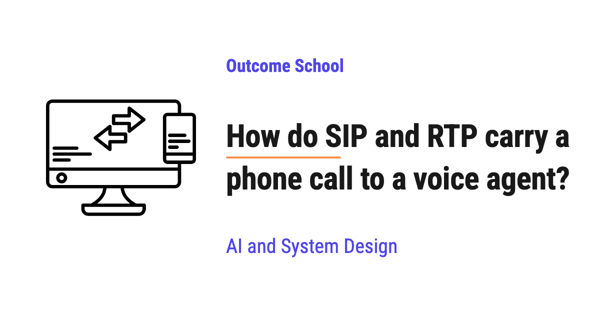

# How do SIP and RTP carry a phone call to a voice agent?

> Archived from <https://outcomeschool.com/blog/sip-and-rtp> on 2026-11-25.

SIP and RTP are the two protocols that connect a phone call to a voice agent. SIP sets up the call and ends it, and RTP carries the actual voice, in small packets, in both directions while the call is going on.

In this blog, we will learn about how SIP and RTP carry a phone call to a voice agent. We will also see how a normal phone call reaches the internet, how SIP rings the voice agent and agrees on the audio format, how RTP packs the voice into small packets, what happens inside the voice agent when those packets arrive, how the agent speaks back, and how the call finally ends.

We will cover the following:
<ul><li>The journey of a phone call to a voice agent</li><li>What is SIP?</li><li>What does a SIP call setup look like?</li><li>What is SDP?</li><li>What is RTP?</li><li>What is inside an RTP packet?</li><li>What the voice agent does with the RTP packets</li><li>How the voice agent speaks back</li><li>How the call ends</li><li>SIP vs RTP</li></ul>
I am <strong>Amit Shekhar</strong>, Founder @ <a target="_blank" rel="noopener noreferrer" href="https://outcomeschool.com">Outcome School</a>, I have taught and mentored many developers, and their efforts landed them high-paying tech jobs, helped many tech companies in solving their unique problems, and created many open-source libraries being used by top companies. I am passionate about sharing knowledge through open-source, blogs, and videos.

I teach <a target="_blank" rel="noopener noreferrer" href="https://outcomeschool.com/program/ai-and-machine-learning">AI and Machine Learning</a> at Outcome School.

Let&#x27;s get started.
<h2 id="the-journey-of-a-phone-call-to-a-voice-agent">The journey of a phone call to a voice agent</h2>
Let&#x27;s say a customer picks up a normal mobile phone and dials the support number of a company. On the other side, there is no human. There is a <a target="_blank" rel="noopener noreferrer" href="design-a-real-time-voice-ai-agent.md">voice agent</a>, which is a system that listens to the caller, understands what the caller says, and replies with a voice.

The voice agent runs on a server on the internet. But, the customer is on the normal phone network, the one that has been carrying phone calls for decades. This network is called the <strong>PSTN</strong> (Public Switched Telephone Network).

So, the first question is: how does a call on the phone network reach a server on the internet?

The answer is a <strong>SIP trunk provider</strong>. This is a company that provides phone numbers and connects the phone network to the internet. When a call comes to one of its numbers, it converts the call into internet traffic and forwards it to our server.

We have a detailed blog on <a target="_blank" rel="noopener noreferrer" href="phone-calls-in-voice-agents.md">how a voice AI agent answers a phone call</a> that covers the full call flow end to end.

From this point onwards, two protocols do the main work:
<ul><li><strong>SIP</strong> sets up the call, and later ends it.</li><li><strong>RTP</strong> carries the voice while the call is going on.</li></ul>
In many setups, the voice agent does not handle SIP and RTP directly. A media server sits in front of it, handles both of them, and passes the plain audio to the voice agent. For the sake of understanding, we will treat them as one voice agent server in this blog.

The full journey looks like below:

<pre><code class="code-highlight">+----------------------+
| Caller&#x27;s phone       |
+----------------------+
           ↓
+----------------------+
| Phone network (PSTN) |
+----------------------+
           ↓
+----------------------+
| SIP trunk provider   |
+----------------------+
           ↓
   SIP: set up the call
   RTP: carry the voice
           ↓
+----------------------+
| Voice agent server   |
+----------------------+
</code></pre>

Now, let&#x27;s understand each of these two protocols one by one.
<h2 id="what-is-sip">What is SIP?</h2>
<strong>SIP (Session Initiation Protocol) is a protocol used to start, manage, and end a call between two parties over the internet.</strong>

Let&#x27;s say we call a friend. First, the phone of our friend rings. Then, our friend picks up. Then, we talk. Finally, one of us hangs up.

SIP handles every one of these steps except the talking. It rings the other side, it learns that the other side picked up, and it handles the hang up. The talking itself is the job of RTP.

SIP does not carry any voice. It only carries messages about the call.

SIP messages are plain text, very similar to the messages a web browser sends to a website. A SIP message has a first line that says what it wants, then a few header lines, and sometimes a body.

The main SIP messages that we must know are:
<ul><li><code>INVITE</code>: &quot;I want to start a call with you.&quot;</li><li><code>100 Trying</code>: &quot;I got your request, I am working on it.&quot;</li><li><code>180 Ringing</code>: &quot;The phone is ringing.&quot;</li><li><code>200 OK</code>: &quot;Yes, the call is accepted.&quot;</li><li><code>ACK</code>: &quot;I got your OK, the call is now set up.&quot;</li><li><code>BYE</code>: &quot;I want to end the call.&quot;</li></ul>
The first few lines of a simplified <code>INVITE</code> message look like below:

<pre><code class="code-highlight">INVITE sip:+15550100@agent.example.com SIP/2.0
From: &lt;sip:+15550199@provider.example.com&gt;
To: &lt;sip:+15550100@agent.example.com&gt;
Call-ID: a84b4c76e66710
</code></pre>

Here, the first line says &quot;start a call with this number&quot;. The <code>From</code> line is the caller, the <code>To</code> line is the number that was dialed, and the <code>Call-ID</code> is a unique id that ties all the messages of this one call together.

Now, let&#x27;s see how these messages work together to set up a call.
<h2 id="what-does-a-sip-call-setup-look-like">What does a SIP call setup look like?</h2>
Let&#x27;s say the SIP trunk provider receives the customer&#x27;s call and wants to hand it over to our voice agent server.

<strong>Step 1:</strong> The SIP trunk provider sends an <code>INVITE</code> to the voice agent server. This message says who is calling, which number was dialed, and which audio formats the provider can use.

<strong>Step 2:</strong> The voice agent server replies with <code>100 Trying</code>, so that the provider knows the message has reached and does not resend it.

<strong>Step 3:</strong> The voice agent server replies with <code>180 Ringing</code>. The caller hears the ringing tone.

<strong>Step 4:</strong> The voice agent server replies with <code>200 OK</code>. This means the call is answered. This message also says which audio format the server picked and where it wants to receive the audio.

<strong>Step 5:</strong> The SIP trunk provider sends an <code>ACK</code>. Now, the call is fully set up.

The flow looks like below:

<pre><code class="code-highlight">SIP trunk provider            Voice agent server
        |                            |
        |-------- INVITE -----------&gt;|
        |&lt;------- 100 Trying --------|
        |&lt;------- 180 Ringing -------|
        |&lt;------- 200 OK ------------|
        |-------- ACK --------------&gt;|
        |                            |
        |&lt;====== RTP (voice) =======&gt;|
        |                            |
</code></pre>

Here, we can notice that once the <code>ACK</code> is sent, SIP has no more work to do for now, and the voice starts flowing as RTP packets.

<strong>Planning your move into AI?</strong>

No matter which tech domain you work in today, with your effort, you can transition to these roles:
<ul><li>AI Engineer</li><li>Forward Deployed Engineer</li><li>AI Agent Engineer</li><li>Harness Engineer</li><li>Voice AI Engineer</li><li>AI Architect</li><li>LLM Engineer</li><li>LLM Inference Engineer</li><li>Gen AI Engineer</li><li>MLOps Engineer</li><li>ML Engineer</li><li>Deep Learning Engineer</li></ul>
Our <a target="_blank" rel="noopener noreferrer" href="https://outcomeschool.com/program/ai-and-machine-learning">AI and Machine Learning Program</a> at Outcome School takes you there.

But, one question is still pending. When the provider sends the <code>INVITE</code>, how does it tell the server which audio formats it can use and where to send the voice? The answer is SDP.
<h2 id="what-is-sdp">What is SDP?</h2>
<strong>SDP (Session Description Protocol) is a short text description of a call that tells the other side where to send the audio and in which format.</strong>

SDP travels inside the body of the SIP messages. Both the <code>INVITE</code> and the <code>200 OK</code> carry one.

A simplified SDP inside the <code>INVITE</code> looks like below:

<pre><code class="code-highlight">c=IN IP4 203.0.113.10
m=audio 40000 RTP/AVP 0 8
a=rtpmap:0 PCMU/8000
a=rtpmap:8 PCMA/8000
</code></pre>

Before reading it, we must know one word. A <strong>codec</strong> is the method used to turn sound into bytes and bytes back into sound.

Here, we have the following:
<ul><li><code>c=IN IP4 203.0.113.10</code> is the internet address where the provider wants to receive audio.</li><li><code>m=audio 40000 RTP/AVP 0 8</code> says that this is an audio stream over RTP, received on port <code>40000</code>, and the provider supports formats <code>0</code> and <code>8</code>.</li><li><code>a=rtpmap:0 PCMU/8000</code> says that format <code>0</code> is <strong>PCMU</strong>, which is the G.711 μ-law codec, at <a target="_blank" rel="noopener noreferrer" href="sample-rates-for-voice-agents.md">8000 samples per second</a>.</li><li><code>a=rtpmap:8 PCMA/8000</code> says that format <code>8</code> is <strong>PCMA</strong>, which is the G.711 A-law codec, also at 8000 samples per second.</li></ul>
G.711 is the classic codec of the phone network. It is very simple and it is supported almost everywhere.

The voice agent server reads this list and picks one format. Then, it puts its own SDP inside the <code>200 OK</code>, with its own address, its own port, and the format it picked.

This is called the <strong>offer/answer model</strong>. The <code>INVITE</code> makes an offer, and the <code>200 OK</code> gives the answer.

Now, both sides know where to send the audio and in which format to send it.

Now, it&#x27;s time to learn about the part that carries the actual voice.
<h2 id="what-is-rtp">What is RTP?</h2>
<strong>RTP (Real-time Transport Protocol) is a protocol that carries audio and video over the internet in small packets, with the information needed to play them in the right order and at the right time.</strong>

The voice is cut into small pieces, and each piece goes in its own packet. For phone calls, a common size is <a target="_blank" rel="noopener noreferrer" href="audio-frames-and-chunk-sizes.md">20 milliseconds of audio per packet</a>.

So, one second of speech becomes 50 packets, because 1000 milliseconds divided by 20 milliseconds is 50.

RTP packets are usually sent over <strong>UDP</strong>, which is a fast way of sending data on the internet that does not wait for lost data to be resent.

Now, the question is: why not use a method that resends lost data?

The answer is time. In a live conversation, a piece of voice that arrives late is useless. If a packet is lost, waiting to get it again would freeze the call. It is better to skip a 20 millisecond gap and keep the conversation moving.

We have a detailed blog on <a target="_blank" rel="noopener noreferrer" href="webrtc-vs-websocket-for-voice-ai.md">how WebRTC and WebSocket differ for voice AI agents</a> that explains how UDP and TCP behave for live voice in depth.
<h2 id="what-is-inside-an-rtp-packet">What is inside an RTP packet?</h2>
Every RTP packet has a header, usually 12 bytes, followed by the audio itself.

The important fields of the header are:
<ul><li><strong>Payload type</strong>: the number of the audio format, the same number that was agreed in SDP. For example, <code>0</code> means PCMU.</li><li><strong>Sequence number</strong>: starts from a random number and goes up by 1 for every packet. The receiver uses it to put packets back in order and to find missing packets.</li><li><strong>Timestamp</strong>: tells which moment of the audio this packet belongs to. The receiver uses it to play the audio at the right time.</li><li><strong>SSRC</strong>: a random number that identifies the source of the audio, so that the receiver can tell one audio stream apart from another.</li></ul>
Let&#x27;s do the math for a G.711 call with 20 millisecond packets.

G.711 uses 8000 samples per second, and each sample takes 1 byte.

So, 20 milliseconds of audio is:

<strong>8000 samples per second * 0.020 seconds = 160 samples = 160 bytes</strong>

The timestamp goes up by 160 for every packet, because each packet carries 160 samples. In a real call, it starts from a random number, but just for the sake of understanding, we start it at 0. The packets look like below:
<table><thead><tr><th>Packet</th><th>Sequence number</th><th>Timestamp</th><th>Audio bytes</th></tr></thead><tbody><tr><td>1</td><td>1000</td><td>0</td><td>160</td></tr><tr><td>2</td><td>1001</td><td>160</td><td>160</td></tr><tr><td>3</td><td>1002</td><td>320</td><td>160</td></tr><tr><td>4</td><td>1003</td><td>480</td><td>160</td></tr></tbody></table>
Let&#x27;s say packet 3 is lost on the way. The receiver sees 1000, 1001, and then 1003. It immediately knows that 1002 is missing, and it can fill that 20 millisecond gap with a smooth guess of the missing sound instead of a click. This is called <strong><a target="_blank" rel="noopener noreferrer" href="packet-loss-concealment.md">packet loss concealment</a></strong>.

Similarly, if packet 4 arrives before packet 3, the receiver uses the sequence numbers to put them back in the right order. This waiting and reordering is done by a <a target="_blank" rel="noopener noreferrer" href="jitter-buffer.md">jitter buffer</a> on the receiving side.

<strong>A quick note for you</strong>

No matter which tech domain you work in, get familiar with these topics:
<ul><li>LLM</li><li>RAG</li><li>MCP</li><li>Agent</li><li>Fine-tuning</li><li>Quantization</li></ul>
We put it all together in one video:

<a target="_blank" rel="noopener noreferrer" href="https://www.youtube.com/watch?v=lnfWvX66FUk">AI Engineering Explained: LLM, RAG, MCP, Agent, Fine-Tuning, and Quantization</a>

No need to stop reading - bookmark it and watch later when you get time. Future you will thank you.

Now, let&#x27;s get back to the topic.
<h2 id="what-the-voice-agent-does-with-the-rtp-packets">What the voice agent does with the RTP packets</h2>
Now, the voice arrives at the voice agent server as a flow of RTP packets. Let&#x27;s see what happens next.

<strong>Step 1:</strong> The server reads each RTP packet, checks the sequence number, and puts the packets in order with a jitter buffer.

<strong>Step 2:</strong> The server removes the RTP header and takes out the 160 bytes of G.711 audio.

<strong>Step 3:</strong> The server decodes the G.711 bytes into plain audio samples.

<strong>Step 4:</strong> The server converts the audio from 8000 samples per second to the rate that the speech-to-text model expects, which is often 16000 samples per second.

<strong>Step 5:</strong> The server sends the audio to the speech-to-text model, which turns the voice into text, piece by piece, while the caller is still speaking.

<strong>Step 6:</strong> The text goes to the <a target="_blank" rel="noopener noreferrer" href="large-language-model-llm.md">LLM (Large Language Model)</a>, which decides what to reply.

The flow looks like below:

<pre><code class="code-highlight">+----------------------------+
| RTP packets (G.711, 8 kHz) |
+----------------------------+
              ↓
+----------------------------+
| Jitter buffer (reorder)    |
+----------------------------+
              ↓
+----------------------------+
| Decode G.711 to samples    |
+----------------------------+
              ↓
+----------------------------+
| Resample 8 kHz to 16 kHz   |
+----------------------------+
              ↓
+----------------------------+
| Speech-to-text             |
+----------------------------+
              ↓
+----------------------------+
| LLM                        |
+----------------------------+
</code></pre>

<strong>Note:</strong> Resampling from 8 kHz to 16 kHz does not bring back the <a target="_blank" rel="noopener noreferrer" href="phone-audio-and-speech-recognition.md">sound details that the phone network already removed</a>. It only changes the format, so that the speech-to-text model can accept the audio.

To master AI and ML System Design and learn how to Design a Real-Time Voice AI Agent, from the audio pipeline to the LLM, check out our <a target="_blank" rel="noopener noreferrer" href="https://outcomeschool.com/program/ai-and-machine-learning">AI and Machine Learning Program</a> at Outcome School.
<h2 id="how-the-voice-agent-speaks-back">How the voice agent speaks back</h2>
Now, the voice agent must send its reply back to the caller as voice.

RTP works in both directions at the same time. The provider sends the caller&#x27;s voice to the server, and the server sends the agent&#x27;s voice to the provider. Each side sends to the address and port that the other side gave in its SDP.

<strong>Step 1:</strong> The LLM writes the reply text.

<strong>Step 2:</strong> A text-to-speech model turns the text into audio. Often, it produces audio at a higher rate like 24000 samples per second.

<strong>Step 3:</strong> The server converts the audio down to 8000 samples per second.

<strong>Step 4:</strong> The server encodes the audio into G.711, the format agreed in SDP.

<strong>Step 5:</strong> The server cuts the audio into 160 byte pieces, adds an RTP header to each piece with the next sequence number and a timestamp that goes up by 160, and sends one packet every 20 milliseconds.

If the server sends all the packets at once, the receiving side gets a big burst of audio that its jitter buffer cannot hold, and parts of the reply can get dropped. So, the server sends them at the same pace at which the audio is played.

Now, let&#x27;s say the caller <a target="_blank" rel="noopener noreferrer" href="what-is-barge-in-in-a-voice-ai-agent.md">interrupts the agent</a> in the middle of a reply. The voice agent detects the caller&#x27;s voice in the incoming RTP packets, and it <a target="_blank" rel="noopener noreferrer" href="stopping-speech-on-interruption.md">immediately stops sending</a> its own outgoing RTP packets and throws away the rest of the reply audio. The caller hears the agent stop.

<strong>Stay updated:</strong> Subscribe to our <a target="_blank" rel="noopener noreferrer" href="https://outcomeschool.substack.com/subscribe">newsletter</a> to get our latest AI and Machine Learning blogs straight to your inbox.
<h2 id="how-the-call-ends">How the call ends</h2>
Finally, the call must end. This is the job of SIP again.

Let&#x27;s say the caller hangs up. The SIP trunk provider sends a <code>BYE</code> to the voice agent server. The server replies with <code>200 OK</code>. Both sides stop sending RTP packets, and the call is over.

Similarly, when the voice agent has finished helping the caller, it can <a target="_blank" rel="noopener noreferrer" href="call-ending-in-voice-agents.md">end the call itself</a> by sending the <code>BYE</code>, and the provider replies with <code>200 OK</code>.

The complete life of the call looks like below:

<pre><code class="code-highlight">SIP trunk provider            Voice agent server
        |                            |
        |-------- INVITE -----------&gt;|
        |&lt;------- 200 OK ------------|
        |-------- ACK --------------&gt;|
        |                            |
        |&lt;====== RTP (voice) =======&gt;|
        |                            |
        |-------- BYE --------------&gt;|
        |&lt;------- 200 OK ------------|
        |                            |
</code></pre>

Here, we can see that in a simple call, SIP appears only at the start and at the end, and RTP fills the whole middle part of the call.

SIP can also come back in the middle of a call. For example, when the voice agent must <a target="_blank" rel="noopener noreferrer" href="call-transfer-with-context.md">transfer the caller to a human</a>, it uses SIP messages to move the call to the human&#x27;s phone.
<h2 id="sip-vs-rtp">SIP vs RTP</h2>
Let me tabulate the differences between SIP and RTP for your better understanding.
<table><thead><tr><th>Point</th><th>SIP</th><th>RTP</th></tr></thead><tbody><tr><td>Job</td><td>Sets up, manages, and ends the call</td><td>Carries the voice during the call</td></tr><tr><td>What it carries</td><td>Text messages about the call</td><td>Small packets of audio</td></tr><tr><td>When it is used</td><td>Mostly at the start and at the end</td><td>During the whole conversation</td></tr><tr><td>Example</td><td><code>INVITE</code>, <code>200 OK</code>, <code>ACK</code>, <code>BYE</code></td><td>Packets with sequence number and audio</td></tr><tr><td>Usually runs over</td><td>UDP, TCP, or TLS</td><td>UDP</td></tr></tbody></table>
Now we must have understood how SIP and RTP carry a phone call to a voice agent, from the moment the phone rings to the moment the call ends.
<h2 id="frequently-asked-questions">Frequently Asked Questions</h2><h3 id="why-is-rtp-sent-over-udp">Why is RTP sent over UDP?</h3>
RTP is usually sent over UDP because UDP is fast and does not wait for lost data to be resent. In a live conversation, a piece of voice that arrives late is useless, and waiting for a lost packet would freeze the call. It is better to skip a 20 millisecond gap and keep the conversation moving.
<h3 id="how-many-rtp-packets-does-a-phone-call-send-every-second">How many RTP packets does a phone call send every second?</h3>
A phone call usually sends 50 RTP packets every second in each direction. Each packet carries 20 milliseconds of audio, and 1000 milliseconds divided by 20 milliseconds is 50. With G.711 at 8000 samples per second and 1 byte per sample, each packet carries 160 bytes of audio behind a header of usually 12 bytes.
<h3 id="what-happens-when-an-rtp-packet-is-lost">What happens when an RTP packet is lost?</h3>
The receiver notices the gap from the sequence numbers. For example, if it sees 1000, 1001, and then 1003, it knows that 1002 is missing. It does not wait for the packet again. Instead, it fills that 20 millisecond gap with a smooth guess of the missing sound instead of a click, which is called packet loss concealment.
<h3 id="what-is-a-sip-trunk-provider">What is a SIP trunk provider?</h3>
A SIP trunk provider is a company that provides phone numbers and connects the normal phone network, the PSTN, to the internet. When a call comes to one of its numbers, it converts the call into internet traffic and forwards it to our voice agent server, using SIP to set up the call and RTP to carry the voice.
<h3 id="does-resampling-phone-audio-to-16-khz-improve-its-quality">Does resampling phone audio to 16 kHz improve its quality?</h3>
No. Resampling phone audio from 8 kHz to 16 kHz does not bring back the sound details that the phone network already removed. It only changes the format, so that a speech-to-text model that expects 16000 samples per second can accept the audio.

That&#x27;s it for now.

Thanks

<strong>Amit Shekhar</strong> Founder @ <a target="_blank" rel="noopener noreferrer" href="https://outcomeschool.com">Outcome School</a>

You can connect with me on:
<ul><li><a target="_blank" rel="noopener noreferrer" href="https://x.com/amitiitbhu">X</a></li><li><a target="_blank" rel="noopener noreferrer" href="https://www.linkedin.com/in/amit-shekhar-iitbhu">LinkedIn</a></li><li><a target="_blank" rel="noopener noreferrer" href="https://github.com/amitshekhariitbhu">GitHub</a></li></ul>
Follow Outcome School on:
<ul><li><a target="_blank" rel="noopener noreferrer" href="https://x.com/outcome_school">X</a></li><li><a target="_blank" rel="noopener noreferrer" href="https://youtube.com/@OutcomeSchool">YouTube</a></li><li><a target="_blank" rel="noopener noreferrer" href="https://www.linkedin.com/company/outcomeschool">LinkedIn</a></li><li><a target="_blank" rel="noopener noreferrer" href="http://github.com/OutcomeSchool">GitHub</a></li></ul>
<a target="_blank" rel="noopener noreferrer" href="https://outcomeschool.com/blog"><strong>Read all of our high-quality blogs here.</strong></a>

