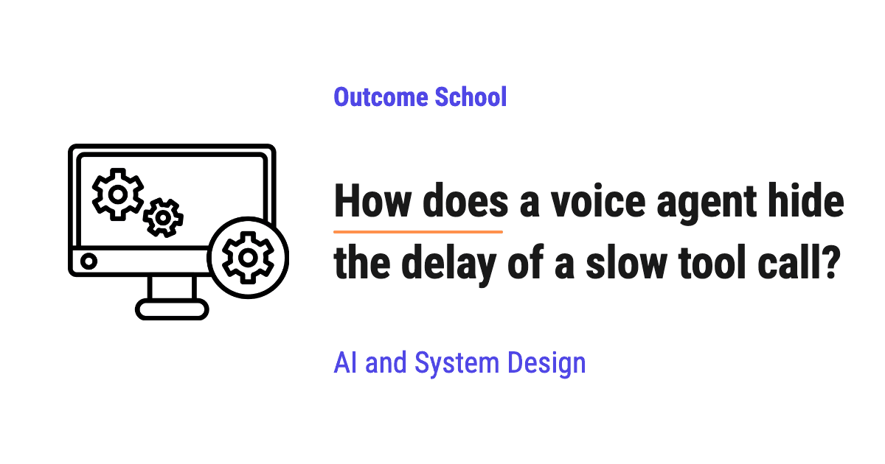

# How does a voice agent hide the delay of a slow tool call?

> Archived from <https://outcomeschool.com/blog/slow-tool-calls-in-voice-agents> on 2026-11-25.

A voice agent hides the delay of a slow tool call by never letting the line go silent. It speaks a short line while the tool runs, gives progress updates during a long wait, keeps the conversation going while the tool works in the background, and starts the tool early so that there is less delay to hide.

In this blog, we will learn about how a voice agent hides the delay of a slow tool call. We will also see why a slow tool call hurts so much on a voice call, how the agent speaks a short line right away, how it gives progress updates during a long wait, how it keeps talking while the tool runs in the background, how it starts the tool early to cut the delay itself, and what it says when the tool takes too long.

We will cover the following:
<ul><li>The problem: a slow tool call on a voice call</li><li>What is a tool call in a voice agent?</li><li>Technique 1: Speak a short line right away</li><li>Technique 2: Progress updates during a long wait</li><li>Technique 3: Keep talking while the tool runs in the background</li><li>Technique 4: Start the tool early</li><li>Technique 5: Make the tool itself faster</li><li>What if the tool takes too long?</li><li>Putting it all together in code</li></ul>
I am <strong>Amit Shekhar</strong>, Founder @ <a target="_blank" rel="noopener noreferrer" href="https://outcomeschool.com">Outcome School</a>, I have taught and mentored many developers, and their efforts landed them high-paying tech jobs, helped many tech companies in solving their unique problems, and created many open-source libraries being used by top companies. I am passionate about sharing knowledge through open-source, blogs, and videos.

I teach <a target="_blank" rel="noopener noreferrer" href="https://outcomeschool.com/program/ai-and-machine-learning">AI and Machine Learning</a> at Outcome School.

Let&#x27;s get started.
<h2 id="the-problem-a-slow-tool-call-on-a-voice-call">The problem: a slow tool call on a voice call</h2>
A <a target="_blank" rel="noopener noreferrer" href="design-a-real-time-voice-ai-agent.md">voice agent</a> is an AI agent that we talk to with our voice, and it talks back with a voice. Many voice agents work as a <a target="_blank" rel="noopener noreferrer" href="cascaded-vs-speech-to-speech.md">pipeline of three steps</a>:
<ul><li><strong>Speech-to-Text (STT):</strong> It turns what the user said into text.</li><li><strong>LLM (Large Language Model):</strong> It reads that text and decides the reply.</li><li><strong>Text-to-Speech (TTS):</strong> It turns the reply text back into a voice.</li></ul>
A good voice agent often aims to <a target="_blank" rel="noopener noreferrer" href="voice-agent-latency-budget.md">reply in around one second</a>. People are used to quick replies in a conversation, so every extra second of waiting is easy to notice.

Now, let&#x27;s say the user asks:

&quot;Can you check if my flight AI 101 to Delhi is on time?&quot;

The agent cannot answer this from memory. It has to ask the airline&#x27;s system. This lookup can take two, three, or even ten seconds.

On a chat screen, a few seconds of waiting is fine, because we can see a loading spinner. On a voice call, there is no spinner. There is only silence.

And silence on a phone call means something to us. After two or three seconds of silence, the user starts to think:
<ul><li>&quot;Did the call drop?&quot;</li><li>&quot;Did it hear me?&quot;</li></ul>
So, the user says &quot;Hello?&quot; or repeats the question. Now, the agent hears this new speech and gets confused, and the whole conversation breaks.

So, the real problem is not the delay itself. The real problem is the silence that the delay creates.
<h2 id="what-is-a-tool-call-in-a-voice-agent">What is a tool call in a voice agent?</h2>
Before jumping into the techniques, we must know what a tool call is.

<strong>A tool call is when the agent runs some code outside the LLM, like looking up a database or calling another service, to get information or to do an action.</strong>

The LLM never runs the tool itself. The LLM only <a target="_blank" rel="noopener noreferrer" href="how-does-function-calling-work-in-llms.md">recommends which tool to use and with what input</a>. Our code, which we call the agent, runs the tool and <a target="_blank" rel="noopener noreferrer" href="ai-agent-loop.md">gives the result back to the LLM</a>. Then, the LLM uses that result to write the final reply. We have a detailed blog on <a target="_blank" rel="noopener noreferrer" href="function-calling-in-voice-agents.md">how function calling works in a voice AI agent</a> that explains this step by step.

For our flight example, the flow looks like below:

<pre><code class="code-highlight">User: &quot;Is my flight AI 101 to Delhi on time?&quot;
        ↓
LLM recommends: check_flight_status(flight=&quot;AI 101&quot;)
        ↓
Agent runs the tool (this takes 3 seconds)
        ↓
Tool result: { &quot;status&quot;: &quot;delayed&quot;, &quot;new_time&quot;: &quot;6:40 PM&quot; }
        ↓
LLM writes: &quot;Your flight is delayed. It now leaves at 6:40 PM.&quot;
        ↓
TTS speaks the reply
</code></pre>

Here, we can see that the 3 seconds of the tool are added on top of the normal delay of STT, LLM, and TTS. This is the delay that we need to hide.

Now, let&#x27;s learn the techniques one by one.
<h2 id="technique-1-speak-a-short-line-right-away">Technique 1: Speak a short line right away</h2>
The first and the simplest technique is to say something as soon as the agent knows it needs a tool.

Let&#x27;s take the example of a person at a help desk. When we ask them about our flight, they do not stare at us silently while typing. They say, &quot;Sure, let me check that for you,&quot; and then they start typing. Those few words tell us that they heard us and that they are working on it.

A voice agent can do exactly the same. There are two common ways to do it.

<strong>Way 1: The LLM writes a short line along with the tool call.</strong>

We tell the LLM in <a target="_blank" rel="noopener noreferrer" href="voice-agent-system-prompt.md">its instructions</a>: &quot;Before you call any tool, first say one short sentence to the user.&quot; So, in the same reply, the LLM produces a short sentence like &quot;Sure, let me check your flight.&quot; and also the tool call. The agent sends the sentence to TTS right away and runs the tool at the same time.

<strong>Advantage:</strong> The line fits the request. For a flight, it says &quot;let me check your flight&quot;. For a refund, it says &quot;let me look at your refund&quot;.

<strong>Disadvantage:</strong> We hear this line only after the LLM starts writing and TTS turns it into a voice, so it arrives a little later than a ready-made line.

<strong>Way 2: The agent plays a ready-made line.</strong>

The agent keeps a small list of ready-made lines like &quot;One moment, please.&quot; or &quot;Let me look that up.&quot; The audio for these lines is already made, so the agent can play one instantly as soon as the LLM recommends a tool.

<strong>Advantage:</strong> It is the fastest, because no extra LLM or TTS work is needed at that moment.

<strong>Disadvantage:</strong> The same few lines repeat, and they can sound robotic after some time. So, we must rotate between several lines.

Either way, the user <a target="_blank" rel="noopener noreferrer" href="time-to-first-audio.md">hears a voice quickly</a>, and the silence is gone.

<strong>Note:</strong> If a tool usually returns in a fraction of a second, the agent can skip the short line. Otherwise, the user hears &quot;One moment, please.&quot; followed at once by the answer, which sounds odd.

We have a detailed blog on <a target="_blank" rel="noopener noreferrer" href="filler-phrases-in-voice-agents.md">how filler phrases hide latency in a voice agent</a> that explains this in depth.

<strong>Planning your move into AI?</strong>

No matter which tech domain you work in today, with your effort, you can transition to these roles:
<ul><li>AI Engineer</li><li>Forward Deployed Engineer</li><li>AI Agent Engineer</li><li>Harness Engineer</li><li>Voice AI Engineer</li><li>AI Architect</li><li>LLM Engineer</li><li>LLM Inference Engineer</li><li>Gen AI Engineer</li><li>MLOps Engineer</li><li>ML Engineer</li><li>Deep Learning Engineer</li></ul>
Our <a target="_blank" rel="noopener noreferrer" href="https://outcomeschool.com/program/ai-and-machine-learning">AI and Machine Learning Program</a> at Outcome School takes you there.
<h2 id="technique-2-progress-updates-during-a-long-wait">Technique 2: Progress updates during a long wait</h2>
Technique 1 works well when the tool takes 2 or 3 seconds. But some tools take much longer. For example, booking a ticket or checking a long list of records can take 10 seconds or more.

The issue with only one short line is that after &quot;Let me check that for you,&quot; there can still be 8 seconds of silence. The silence problem comes back.

So, here comes the progress update to the rescue.

<strong>A progress update is a short line the agent speaks at fixed points during a long wait, to tell the user that the work is still going on.</strong>

The agent uses a simple timer. The idea is like below:
<table><thead><tr><th>Time since the tool started</th><th>What the agent says</th></tr></thead><tbody><tr><td>0 seconds</td><td>&quot;Sure, let me check your flight.&quot;</td></tr><tr><td>4 seconds</td><td>&quot;I am still checking, it is taking a moment.&quot;</td></tr><tr><td>8 seconds</td><td>&quot;Almost there, thanks for waiting.&quot;</td></tr></tbody></table>
Here, we can notice that each line is different. If the agent says the same line again and again, it sounds repetitive.

If the tool finishes at 5 seconds, the agent stops the timer and speaks the real answer. The later lines are never spoken.

Some voice agents also play a soft background sound during the wait, like gentle keyboard typing. This works like hold music. It tells the user that the line is still open. But it must be quiet and simple, otherwise it becomes annoying.

<strong>Note:</strong> If the agent knows in advance that a tool is always slow, it can say so at the start: &quot;This usually takes about 10 seconds.&quot; When the user knows how long to wait, the wait often feels shorter.

<strong>A quick note for you</strong>

No matter which tech domain you work in, get familiar with these topics:
<ul><li>LLM</li><li>RAG</li><li>MCP</li><li>Agent</li><li>Fine-tuning</li><li>Quantization</li></ul>
We put it all together in one video:

<a target="_blank" rel="noopener noreferrer" href="https://www.youtube.com/watch?v=lnfWvX66FUk">AI Engineering Explained: LLM, RAG, MCP, Agent, Fine-Tuning, and Quantization</a>

No need to stop reading - bookmark it and watch later when you get time. Future you will thank you.

Now, let&#x27;s get back to the topic.
<h2 id="technique-3-keep-talking-while-the-tool-runs-in-the-background">Technique 3: Keep talking while the tool runs in the background</h2>
In the first two techniques, the agent speaks while it waits, but the conversation is still on hold. The user cannot ask anything else until the tool finishes.

Now, let&#x27;s understand a better approach. In this approach, the agent starts the tool in the background and continues to talk with the user. When the result arrives, the agent brings it into the conversation.

Let&#x27;s see an example:

<pre><code class="code-highlight">User:  &quot;Book a table for two at 8 PM.&quot;
Agent: &quot;Sure, I am booking your table now.&quot;
        ↓
(booking tool starts in the background, it takes 10 seconds)
        ↓
Agent: &quot;While I do that, should I text you the confirmation?&quot;
User:  &quot;Yes, please.&quot;
Agent: &quot;Sure, I will text it to you.&quot;
        ↓
(booking tool finishes)
        ↓
Agent: &quot;Your table for two at 8 PM is booked. The text is on its way.&quot;
</code></pre>

Here, we can see that the user never waits in silence. The 10 seconds of booking are filled with a useful question and answer, not with waiting.

To make this work, the agent must do two things:
<ul><li>It must not block the conversation while the tool runs. Our code starts the tool as a separate task and lets the LLM keep replying to the user.</li><li>When the result arrives, it must add the result to the conversation. Then, the LLM tells the user about it at the right moment, after the agent finishes its current sentence.</li></ul>
Some real-time voice model APIs support this directly. The model can keep talking with the user while a tool call is still waiting for its result.

<strong>Advantage:</strong> It is the most natural experience, because the conversation never stops.

<strong>Disadvantage:</strong> It is harder to build. The agent has to remember which tools are still running, and the LLM must not make up a result that has not arrived yet. If the user asks about it early, the LLM must say that it is still waiting.
<h2 id="technique-4-start-the-tool-early">Technique 4: Start the tool early</h2>
So far, all the techniques hide the delay. Now, let&#x27;s see how we can make the delay itself smaller.

Normally, the agent <a target="_blank" rel="noopener noreferrer" href="what-is-turn-taking-in-a-voice-ai-agent.md">waits for the user to finish speaking</a>. Then, STT gives the full text, the LLM reads it, and only then the tool starts.

But often, it is clear which tool is needed long before the user finishes.

Let&#x27;s say the user says:

&quot;Can you check my flight AI 101... I think it leaves around six...&quot;

STT gives the agent the text bit by bit while the user is still speaking. The agent can <a target="_blank" rel="noopener noreferrer" href="speculative-generation-in-voice-agents.md">show this partial text to the LLM</a>. By the time the user has said &quot;check my flight AI 101&quot;, the LLM already knows that it needs the flight status tool with the input &quot;AI 101&quot;. The rest of the sentence does not change the tool.

So, the agent can start the tool early, while the user is still speaking. This is called <strong>speculative execution</strong>, which means doing the work before we are fully sure we need it, because we are very likely to need it.

The flow looks like below:

<pre><code class="code-highlight">User is still speaking: &quot;check my flight AI 101...&quot;
        ↓
Agent starts check_flight_status(flight=&quot;AI 101&quot;) early
        ↓
User finishes speaking
        ↓
Tool result is already ready or almost ready
        ↓
Agent replies with almost no wait
</code></pre>

Here, the tool runs during the time the user is still talking. So, much of the delay is gone. And if the full sentence turns out to need a different tool, the agent throws the early result away.

<strong>Very important:</strong> We must only start a tool early when running it for nothing does no harm. Reading data is safe. Checking a flight status is safe, because if we do not need the result, we just throw it away. But booking a ticket, sending money, or cancelling an order is not safe. If the user says &quot;book a ticket... oh no, wait, do not book it,&quot; we must never have booked it already. So, we use speculative execution only for tools that read data and do not change anything.

If we want to go deep into Tool use in Agents and how to Design a Real-Time Voice AI Agent, and to build an AI Coding Agent from scratch, we have it all in our <a target="_blank" rel="noopener noreferrer" href="https://outcomeschool.com/program/ai-and-machine-learning">AI and Machine Learning Program</a> at Outcome School.
<h2 id="technique-5-make-the-tool-itself-faster">Technique 5: Make the tool itself faster</h2>
We must also make the tool itself faster wherever we can. Few common ways:
<ul><li><strong>Cache the results:</strong> If many users ask for the same thing, like today&#x27;s store timings, the agent keeps the answer for some time and reuses it instead of calling the tool again.</li><li><strong>Load data at the start of the call:</strong> If the user is calling about their account, the agent can load the account details as soon as the call starts, before the user even asks.</li><li><strong>Run tools in parallel:</strong> If the agent needs two tools, like the flight status and the weather at the destination, it runs both at the same time instead of one after the other.</li></ul>
Each of these removes some seconds from the wait, so there is less to hide.
<h2 id="what-if-the-tool-takes-too-long">What if the tool takes too long?</h2>
Sometimes, the tool is so slow that progress updates are not enough.

So, the agent must have a <strong>timeout</strong>, which is a time limit after which it stops waiting.

When the timeout is reached, the agent must not just go silent or say &quot;Error&quot;. It must tell the user honestly and give a way forward. For example:
<ul><li>&quot;The airline system is not responding right now. Can I send you the status by text message as soon as I get it?&quot;</li><li>&quot;This is taking longer than usual. Would you like me to keep trying, or can I help you with something else?&quot;</li></ul>
Here, we can see that the agent turns a failure into a clear next step, so the user knows what is going on.

<strong>Stay updated:</strong> Subscribe to our <a target="_blank" rel="noopener noreferrer" href="https://outcomeschool.substack.com/subscribe">newsletter</a> to get our latest AI and Machine Learning blogs straight to your inbox.
<h2 id="putting-it-all-together-in-code">Putting it all together in code</h2>
Now, let&#x27;s see a simple version of Technique 1, Technique 2, and the timeout together in Python. For the sake of understanding, we will keep it small.

<pre><code class="code-highlight language-python">import asyncio
import random

QUICK_LINES = [&quot;Sure, let me check that.&quot;, &quot;One moment, please.&quot;, &quot;Let me look that up.&quot;]
PROGRESS_LINES = [&quot;I am still checking.&quot;, &quot;Almost there, thanks for waiting.&quot;]

async def run_tool_with_cover(tool, args, speak):
    # start the tool as a separate task, so we do not block
    task = asyncio.create_task(tool(**args))

    # Technique 1: speak a short line right away
    await speak(random.choice(QUICK_LINES))

    # Technique 2: progress updates every 4 seconds
    for line in PROGRESS_LINES:
        done, _ = await asyncio.wait({task}, timeout=4)
        if done:
            return task.result()
        await speak(line)

    # timeout: give the tool 4 more seconds, then stop waiting
    done, _ = await asyncio.wait({task}, timeout=4)
    if done:
        return task.result()
    task.cancel()
    return None
</code></pre>

Here, we have:
<ul><li><code>QUICK_LINES</code> and <code>PROGRESS_LINES</code>, which are the ready-made lines that the agent can speak.</li><li><code>speak</code>, which is a function that sends a line to TTS and plays it to the user.</li><li><code>asyncio.create_task(...)</code>, which starts the tool as a separate task. We start it first, so the tool runs while the agent is speaking the short line.</li><li><code>asyncio.wait({task}, timeout=4)</code>, which waits for the tool for at most 4 seconds. If the tool finishes, we return the result right away. If not, we speak the next progress line.</li><li>At the end, if the tool still has not finished after about 12 seconds of waiting, we cancel it and return <code>None</code>.</li></ul>
Now, let&#x27;s see how the agent uses it:

<pre><code class="code-highlight language-python">result = await run_tool_with_cover(check_flight_status, {&quot;flight&quot;: &quot;AI 101&quot;}, speak)

if result is None:
    await speak(&quot;The airline system is not responding right now. &quot;
                &quot;Would you like me to try again?&quot;)
else:
    # give the result to the LLM, and it writes the final reply
    reply = await llm_reply_with_tool_result(result)
    await speak(reply)
</code></pre>

Here, we can see that the agent always says something. If the tool is quick, the user hears one short line and then the answer. If the tool is slow, the user hears progress updates. If the tool is too slow, the user hears an honest message with a way forward.

Now we must have understood how a voice agent hides the delay of a slow tool call, and which technique fits which kind of tool.
<h2 id="frequently-asked-questions">Frequently Asked Questions</h2><h3 id="should-a-voice-agent-speak-a-short-line-before-every-tool-call">Should a voice agent speak a short line before every tool call?</h3>
No. If a tool usually returns in a fraction of a second, the agent can skip the short line. Otherwise, the user hears &quot;One moment, please.&quot; followed at once by the answer, which sounds odd. The short line is useful when the tool takes a few seconds and the line would otherwise go silent.
<h3 id="does-speaking-while-the-tool-runs-make-the-tool-call-faster">Does speaking while the tool runs make the tool call faster?</h3>
No. A short line, progress updates, and talking while the tool runs in the background only hide the delay. They do not make it smaller. To cut the delay itself, the agent can start the tool early, cache the results, load data at the start of the call, and run tools in parallel.
<h3 id="which-tools-are-safe-to-start-early-in-a-voice-agent">Which tools are safe to start early in a voice agent?</h3>
Only the tools that read data and do not change anything, like checking a flight status. If the early result is not needed, the agent just throws it away. Tools that book a ticket, send money, or cancel an order must never start early, because the user can still change their mind before finishing the sentence.
<h3 id="what-should-a-voice-agent-say-if-the-user-asks-about-a-result-that-has-not-arrived-yet">What should a voice agent say if the user asks about a result that has not arrived yet?</h3>
It must say that it is still waiting. When the tool runs in the background, the LLM must not make up a result that has not arrived yet. The agent keeps track of which tools are still running, and it tells the user about the result only after the result is added to the conversation.
<h3 id="why-should-the-progress-updates-of-a-voice-agent-use-different-lines">Why should the progress updates of a voice agent use different lines?</h3>
If the agent says the same line again and again during a long wait, it sounds repetitive. So, each progress update uses a different line, like &quot;I am still checking&quot; and then &quot;Almost there, thanks for waiting.&quot; If a tool is always slow, the agent can also say at the start how long it usually takes.

That&#x27;s it for now.

Thanks

<strong>Amit Shekhar</strong> Founder @ <a target="_blank" rel="noopener noreferrer" href="https://outcomeschool.com">Outcome School</a>

You can connect with me on:
<ul><li><a target="_blank" rel="noopener noreferrer" href="https://x.com/amitiitbhu">X</a></li><li><a target="_blank" rel="noopener noreferrer" href="https://www.linkedin.com/in/amit-shekhar-iitbhu">LinkedIn</a></li><li><a target="_blank" rel="noopener noreferrer" href="https://github.com/amitshekhariitbhu">GitHub</a></li></ul>
Follow Outcome School on:
<ul><li><a target="_blank" rel="noopener noreferrer" href="https://x.com/outcome_school">X</a></li><li><a target="_blank" rel="noopener noreferrer" href="https://youtube.com/@OutcomeSchool">YouTube</a></li><li><a target="_blank" rel="noopener noreferrer" href="https://www.linkedin.com/company/outcomeschool">LinkedIn</a></li><li><a target="_blank" rel="noopener noreferrer" href="http://github.com/OutcomeSchool">GitHub</a></li></ul>
<a target="_blank" rel="noopener noreferrer" href="https://outcomeschool.com/blog"><strong>Read all of our high-quality blogs here.</strong></a>

