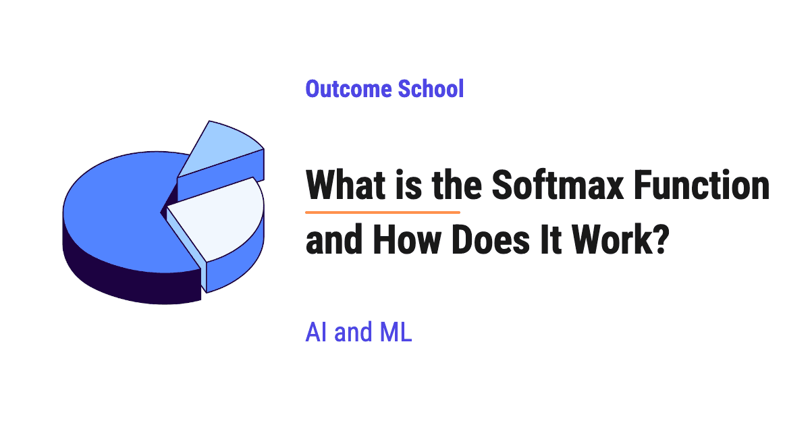

# What is the Softmax Function and How Does It Work?

> Archived from <https://outcomeschool.com/blog/softmax-function> on 2026-11-25.

The Softmax Function is a formula that turns a list of raw scores into probabilities, which means every value becomes a number between 0 and 1, and all the values add up to exactly 1.

In this blog, we will learn about the Softmax Function and how it works. We will also see why simply dividing by the sum fails, how the exponent step fixes it with a step-by-step worked example, its important properties, how temperature controls it, the trick that keeps it stable on a computer, and where it is used in classification models, LLMs, and attention.

We will cover the following:
<ul><li>The Problem: Raw Scores Are Not Probabilities</li><li>Why Not Just Divide by the Sum?</li><li>What is the Softmax Function?</li><li>A Step-by-Step Worked Example</li><li>Softmax in Python</li><li>Important Properties of Softmax</li><li>Temperature in Softmax</li><li>The Numerical Stability Trick</li><li>Where is Softmax Used?</li></ul>
I am <strong>Amit Shekhar</strong>, Founder @ <a target="_blank" rel="noopener noreferrer" href="https://outcomeschool.com">Outcome School</a>, I have taught and mentored many developers, and their efforts landed them high-paying tech jobs, helped many tech companies in solving their unique problems, and created many open-source libraries being used by top companies. I am passionate about sharing knowledge through open-source, blogs, and videos.

I teach <a target="_blank" rel="noopener noreferrer" href="https://outcomeschool.com/program/ai-and-machine-learning">AI and Machine Learning</a> at Outcome School.

Let&#x27;s get started.
<h2 id="the-problem-raw-scores-are-not-probabilities">The Problem: Raw Scores Are Not Probabilities</h2>
Let&#x27;s say we have built a model that looks at a photo and tells us whether it is a cat, a dog, or a bird.

At the end, the model gives one raw score for each option. These raw scores are called <a target="_blank" rel="noopener noreferrer" href="logits-in-machine-learning.md"><strong>logits</strong></a>. A higher score means the model believes more in that option.

Suppose the model looks at a photo and gives these scores:
<ul><li>Cat: 2.0</li><li>Dog: 1.0</li><li>Bird: 0.1</li></ul>
We can see that the model likes &quot;Cat&quot; the most. But these numbers are hard to use. Can we say the model is 2.0 sure? 2.0 out of what?

What we really want is something like this: &quot;The model is 66% sure it is a cat, 24% sure it is a dog, and 10% sure it is a bird.&quot;

Means, we want <strong>probabilities</strong>. For a list of numbers to be valid probabilities, two rules must hold:
<ul><li>Every number must be between 0 and 1.</li><li>All the numbers must add up to exactly 1.</li></ul>
Raw scores follow neither rule. A score can be 7.5, it can be -3.2, and the scores can add up to anything.

So, we need a way to convert raw scores into probabilities. Here comes the Softmax Function into the picture.
<h2 id="why-not-just-divide-by-the-sum">Why Not Just Divide by the Sum?</h2>
Before jumping into softmax, let&#x27;s try the simplest idea first. We can divide each score by the total of all the scores.

For our scores 2.0, 1.0, and 0.1, the total is 3.1. Dividing each score by 3.1 gives 0.65, 0.32, and 0.03. They add up to 1. It looks like it works.

But, scores can be negative. Let&#x27;s say the scores are 3, 1, and -2.

The total is 3 + 1 + (-2) = 2. Now, let&#x27;s divide each score by 2:
<ul><li>3 / 2 = 1.5</li><li>1 / 2 = 0.5</li><li>-2 / 2 = -1.0</li></ul>
We got 1.5, which is more than 1, and -1.0, which is a negative probability. Neither makes any sense.

Also, if the scores are 2 and -2, the total is 0, and we cannot divide by zero at all.

The issue with this approach is negative numbers. We need a way to first turn every score into a positive number, without losing the order of the scores. Let&#x27;s see how softmax solves this issue.
<h2 id="what-is-the-softmax-function">What is the Softmax Function?</h2>
<strong>The Softmax Function takes a list of raw scores, raises the number e to the power of each score, and then divides each result by the total of all the results.</strong>

Here, <strong>e</strong> is a fixed mathematical constant, roughly 2.718. Raising e to the power of a score is called taking the <strong>exponent</strong> of that score, and it is written as <code>exp(score)</code>.

The formula is as below:

<strong>softmax(x_i) = exp(x_i) / (exp(x_1) + exp(x_2) + ... + exp(x_n))</strong>

Here, <code>x_i</code> is the score of one option, and the bottom part is the sum of the exponents of all the scores.

Why the exponent? Because <code>exp</code> has two useful properties:
<ul><li>The result is always positive, even for a negative input. For example, <code>exp(-2)</code> is about 0.135, and <code>exp(-100)</code> is a tiny positive number very close to 0.</li><li>A bigger input always gives a bigger output. So, the order of the scores stays the same.</li></ul>
This fixes exactly the problem we had. First, the exponent makes every score positive. Then, dividing by the total makes everything add up to 1.

Let&#x27;s see this as a diagram:

<pre><code class="language-text code-highlight">┌──────────────────────────────┐
│ Raw scores (logits)          │
│ Cat 2.0, Dog 1.0, Bird 0.1   │
└──────────────────────────────┘
               ↓
┌──────────────────────────────┐
│ Step 1: Take exp of each     │
│ 7.389, 2.718, 1.105          │
└──────────────────────────────┘
               ↓
┌──────────────────────────────┐
│ Step 2: Add them up          │
│ Total = 11.212               │
└──────────────────────────────┘
               ↓
┌──────────────────────────────┐
│ Step 3: Divide each by total │
│ 0.66, 0.24, 0.10             │
└──────────────────────────────┘
               ↓
┌──────────────────────────────┐
│ Probabilities (sum = 1)      │
│ Cat 66%, Dog 24%, Bird 10%   │
└──────────────────────────────┘
</code></pre>

Here, we can see that softmax is a short pipeline of three steps: exponent, add, and divide. We have a detailed blog on <a target="_blank" rel="noopener noreferrer" href="activation-functions.md">Activation Functions</a> that explains how softmax compares with Sigmoid, Tanh, and ReLU.

<strong>Planning your move into AI?</strong>

No matter which tech domain you work in today, with your effort, you can transition to these roles:
<ul><li>AI Engineer</li><li>Forward Deployed Engineer</li><li>AI Agent Engineer</li><li>Harness Engineer</li><li>Voice AI Engineer</li><li>AI Architect</li><li>LLM Engineer</li><li>LLM Inference Engineer</li><li>Gen AI Engineer</li><li>MLOps Engineer</li><li>ML Engineer</li><li>Deep Learning Engineer</li></ul>
Our <a target="_blank" rel="noopener noreferrer" href="https://outcomeschool.com/program/ai-and-machine-learning">AI and Machine Learning Program</a> at Outcome School takes you there.
<h2 id="a-step-by-step-worked-example">A Step-by-Step Worked Example</h2>
The best way to learn this is by taking an example. Let&#x27;s use our scores: Cat 2.0, Dog 1.0, Bird 0.1.

<strong>Step 1:</strong> We take the exponent of each score.
<ul><li>Cat: exp(2.0) = 7.389</li><li>Dog: exp(1.0) = 2.718</li><li>Bird: exp(0.1) = 1.105</li></ul>
All three are positive now.

<strong>Step 2:</strong> We add all the exponents.

<strong>Total = 7.389 + 2.718 + 1.105 = 11.212</strong>

<strong>Step 3:</strong> We divide each exponent by the total.
<ul><li>Cat: 7.389 / 11.212 = 0.659</li><li>Dog: 2.718 / 11.212 = 0.242</li><li>Bird: 1.105 / 11.212 = 0.099</li></ul>
<strong>Step 4:</strong> We check the result.

0.659 + 0.242 + 0.099 = 1.000. Every value is between 0 and 1, and they add up to 1.

So, the model is about 66% sure it is a cat, 24% sure it is a dog, and 10% sure it is a bird. This is how softmax turns raw scores into probabilities.

Now, let&#x27;s try the scores that broke the &quot;divide by the sum&quot; approach: 3, 1, and -2.
<ul><li>exp(3) = 20.086</li><li>exp(1) = 2.718</li><li>exp(-2) = 0.135</li></ul>
The total is 22.939. Dividing gives 0.876, 0.118, and 0.006. No negative values, nothing above 1, and they add up to 1. It works perfectly.
<h2 id="softmax-in-python">Softmax in Python</h2>
Now, let&#x27;s write the code for softmax in Python using NumPy, a popular library for working with lists of numbers, as below:

<pre><code class="code-highlight language-python">import numpy as np

def softmax(scores):
    exps = np.exp(scores)
    return exps / exps.sum()

scores = np.array([2.0, 1.0, 0.1])
probs = softmax(scores)
print(probs.round(2))
print(probs.sum().round(2))
</code></pre>

Here, we have:
<ul><li><code>np.exp(scores)</code> takes the exponent of every score in one go.</li><li><code>exps.sum()</code> adds all the exponents.</li><li><code>exps / exps.sum()</code> divides each exponent by the total.</li></ul>
This will print the following:

<pre><code class="language-text code-highlight">[0.66 0.24 0.1 ]
1.0
</code></pre>

Here, we can see the same 0.66, 0.24, and 0.10 that we calculated by hand, and the sum is 1.

<strong>A quick note for you</strong>

No matter which tech domain you work in, get familiar with these topics:
<ul><li>LLM</li><li>RAG</li><li>MCP</li><li>Agent</li><li>Fine-tuning</li><li>Quantization</li></ul>
We put it all together in one video:

<a target="_blank" rel="noopener noreferrer" href="https://www.youtube.com/watch?v=lnfWvX66FUk">AI Engineering Explained: LLM, RAG, MCP, Agent, Fine-Tuning, and Quantization</a>

No need to stop reading - bookmark it and watch later when you get time. Future you will thank you.

Now, let&#x27;s get back to the topic.
<h2 id="important-properties-of-softmax">Important Properties of Softmax</h2>
Now, let&#x27;s understand the properties that make softmax so useful.

<strong>Property 1: The outputs always add up to 1.</strong> We divide every exponent by the sum of all the exponents. So, each output is a share of the total, and all the shares together make the whole. This is why we can read them as probabilities.

<strong>Property 2: It keeps the order.</strong> The highest score always gets the highest probability, and the lowest score always gets the lowest probability. In our example, Cat had the highest score and got the highest probability.

<strong>Property 3: It amplifies the gaps.</strong> When one score is higher than another score by 1, its probability is about 2.718 times bigger. In our example, Cat (2.0) is 1 more than Dog (1.0), and 0.659 / 0.242 is about 2.72. If one score is higher than another by 5, its probability is about 148 times bigger. So, a small lead in the scores becomes a bigger lead in the probabilities.

This is also where the name comes from. Softmax is a &quot;soft&quot; version of picking the maximum. A &quot;hard&quot; max would give 100% to the top option and 0% to all others. Softmax gives most of the share to the top option, but still keeps some share for the others.

<strong>Property 4: Only the differences between scores matter.</strong> If we add the same number to every score, the probabilities do not change. The scores 2.0, 1.0, 0.1 and the scores 102.0, 101.0, 100.1 give exactly the same result. We will use this property very soon.

To master Neural Networks, Activation Functions, Logits, and Cross-Entropy, and to build a Neural Network from scratch, we can check out our <a target="_blank" rel="noopener noreferrer" href="https://outcomeschool.com/program/ai-and-machine-learning">AI and Machine Learning Program</a> at Outcome School.
<h2 id="temperature-in-softmax">Temperature in Softmax</h2>
Sometimes, we want to control how &quot;sharp&quot; or how &quot;flat&quot; the probabilities are. For this, we use <strong>temperature</strong>.

Temperature is one positive number. We divide every score by the temperature before applying softmax:

<strong>softmax(x_i / T)</strong>

Here, <code>T</code> is the temperature.

Let&#x27;s see what happens with our scores 2.0, 1.0, and 0.1:
<table><thead><tr><th>Temperature</th><th>Cat</th><th>Dog</th><th>Bird</th><th>Effect</th></tr></thead><tbody><tr><td>0.5</td><td>0.86</td><td>0.12</td><td>0.02</td><td>Sharper, top option wins</td></tr><tr><td>1.0</td><td>0.66</td><td>0.24</td><td>0.10</td><td>Normal softmax</td></tr><tr><td>2.0</td><td>0.50</td><td>0.30</td><td>0.19</td><td>Flatter, options are closer</td></tr></tbody></table>
<strong>Note:</strong> The values in each row are rounded to two decimal places, so a row can add up to 0.99 instead of 1.

Here, we can notice that:
<ul><li>A <strong>low temperature</strong> (below 1) makes the gaps between scores bigger. The top option gets almost all the probability.</li><li>A <strong>high temperature</strong> (above 1) makes the gaps smaller. The probabilities become more equal.</li></ul>
Let&#x27;s see the low temperature case of T = 0.5 as a diagram:

<pre><code class="language-text code-highlight">┌──────────────────────────────┐
│ Scores: 2.0, 1.0, 0.1        │
│ Gaps: 1.0 and 0.9            │
└──────────────────────────────┘
               ↓
┌──────────────────────────────┐
│ Divide each score by 0.5     │
│ 4.0, 2.0, 0.2                │
│ Gaps: 2.0 and 1.8            │
└──────────────────────────────┘
               ↓
┌──────────────────────────────┐
│ Softmax                      │
│ 0.86, 0.12, 0.02             │
└──────────────────────────────┘
</code></pre>

Here, we can see that dividing by 0.5 doubles the gaps between the scores. Softmax amplifies these bigger gaps, so Cat jumps from 0.66 to 0.86. Dividing by 2.0 does the opposite. It halves the gaps, and the probabilities move closer together.

This is exactly the <a target="_blank" rel="noopener noreferrer" href="how-does-temperature-control-llm-output.md">&quot;temperature&quot; setting</a> we see in LLM tools. A low temperature makes the LLM pick the most likely token almost every time, so the answer is focused and predictable. A high temperature gives other tokens a fair chance, so the answer is more varied and creative.

<strong>Stay updated:</strong> Subscribe to our <a target="_blank" rel="noopener noreferrer" href="https://outcomeschool.substack.com/subscribe">newsletter</a> to get our latest AI and Machine Learning blogs straight to your inbox.
<h2 id="the-numerical-stability-trick">The Numerical Stability Trick</h2>
Now, there is a practical problem when we run softmax on a computer.

The exponent grows very fast. <code>exp(10)</code> is about 22,026. <code>exp(100)</code> is a number with 44 digits. And <code>exp(1000)</code> is so big that a computer cannot store it at all. So, the computer stores it as infinity.

Let&#x27;s say the scores are 1002.0, 1001.0, and 1000.1. Let&#x27;s run our softmax function on them:

<pre><code class="code-highlight language-python">print(softmax(np.array([1002.0, 1001.0, 1000.1])))
</code></pre>

NumPy shows an overflow warning, and then it prints the following:

<pre><code class="language-text code-highlight">[nan nan nan]
</code></pre>

Here, <code>nan</code> means &quot;not a number&quot;. Every exponent became infinity, and infinity divided by infinity has no answer.

So, how can we fix this? The answer is Property 4. Only the differences between scores matter. So, we can subtract the same number from every score, and the probabilities will not change.

The trick is to subtract the <strong>maximum score</strong> from every score before taking the exponent.
<ul><li>1002.0 - 1002.0 = 0</li><li>1001.0 - 1002.0 = -1.0</li><li>1000.1 - 1002.0 = -1.9</li></ul>
Now, the biggest score is 0, so the biggest exponent is <code>exp(0)</code> = 1. All the other exponents are between 0 and 1. Nothing can grow too large anymore.

Let&#x27;s see this as a diagram:

<pre><code class="language-text code-highlight">┌──────────────────────────────┐
│ Scores: 1002, 1001, 1000.1   │
└──────────────────────────────┘
               ↓
┌──────────────────────────────┐
│ Subtract max (1002)          │
│ 0, -1.0, -1.9                │
└──────────────────────────────┘
               ↓
┌──────────────────────────────┐
│ Take exp of each             │
│ 1.000, 0.368, 0.150          │
└──────────────────────────────┘
               ↓
┌──────────────────────────────┐
│ Divide each by total (1.518) │
│ 0.66, 0.24, 0.10             │
└──────────────────────────────┘
</code></pre>

Here, we can see that we get 0.66, 0.24, and 0.10 again. These scores have the same differences as 2.0, 1.0, and 0.1, so they give the same probabilities.

Our updated code with temperature and the stability trick:

<pre><code class="code-highlight language-python">import numpy as np

def softmax(scores, temperature=1.0):
    scores = scores / temperature
    scores = scores - scores.max()
    exps = np.exp(scores)
    return exps / exps.sum()

print(softmax(np.array([1002.0, 1001.0, 1000.1])).round(2))
print(softmax(np.array([2.0, 1.0, 0.1]), temperature=0.5).round(2))
print(softmax(np.array([2.0, 1.0, 0.1]), temperature=2.0).round(2))
</code></pre>

Here, we first divide by the temperature, then subtract the maximum score, and then do the usual exponent and divide.

This will print the following:

<pre><code class="language-text code-highlight">[0.66 0.24 0.1 ]
[0.86 0.12 0.02]
[0.5  0.3  0.19]
</code></pre>

It works perfectly. Popular libraries like PyTorch use this same trick inside their softmax.
<h2 id="where-is-softmax-used">Where is Softmax Used?</h2>
Now, let&#x27;s see where softmax is used in real AI systems.

<strong>The output of a classification model:</strong>

When a model has to pick one answer from a fixed list of options, the last step is usually softmax. Our cat, dog, and bird model is an example. Another example is a model that reads a review and says whether it is positive, negative, or neutral. Softmax turns the final scores into probabilities, and we pick the option with the highest probability. We have a detailed blog on <a target="_blank" rel="noopener noreferrer" href="math-behind-cross-entropy-loss.md">Cross-Entropy Loss</a> that explains how these probabilities are used to measure the error during training.

<strong>Next-token prediction in LLMs:</strong>

An <a target="_blank" rel="noopener noreferrer" href="large-language-model-llm.md">LLM (Large Language Model)</a> writes text <a target="_blank" rel="noopener noreferrer" href="autoregressive-models.md">one token at a time</a>. A token is a word or a piece of a word. At every step, the LLM gives a raw score to every token in its vocabulary, which is the full list of tokens it knows. This list can have more than 100,000 tokens. Softmax turns these scores into probabilities. Then, the next token is <a target="_blank" rel="noopener noreferrer" href="how-do-top-k-and-top-p-sampling-work.md">picked based on these probabilities</a>. This is also where the temperature setting comes into the picture.

<strong>Attention in Transformers:</strong>

<a target="_blank" rel="noopener noreferrer" href="decoding-transformer-architecture.md">Transformers</a> are the architecture behind LLMs. Inside them, a mechanism called <a target="_blank" rel="noopener noreferrer" href="self-attention-in-transformers.md"><strong>attention</strong></a> decides how much each token must focus on every other token. It first calculates a score for every pair of tokens. Then, softmax turns these scores into weights that add up to 1. Means, each token splits its total focus of 100% among the tokens it can see, and gives more focus to the most relevant ones.

Now we must have understood what the Softmax Function is, how it works, and where it is used.
<h2 id="frequently-asked-questions">Frequently Asked Questions</h2><h3 id="why-is-it-called-softmax">Why is it called softmax?</h3>
Softmax is called so because it is a &quot;soft&quot; version of picking the maximum. A hard max gives 100% to the top option and 0% to all the others. Softmax gives most of the share to the top option, but still keeps some share for the other options, and the highest score always gets the highest probability.
<h3 id="what-are-logits">What are logits?</h3>
Logits are the raw scores that a model gives at the end, one score for each option. A higher logit means the model believes more in that option. Logits can be any number, like 7.5 or -3.2, and they can add up to anything, so we use softmax to turn them into probabilities.
<h3 id="can-softmax-give-a-probability-of-exactly-0">Can softmax give a probability of exactly 0?</h3>
No. Softmax takes the exponent of every score, and the exponent is always positive, even for a negative score. So every option gets some share of the total. For a very low score like -100, the exponent is a tiny positive number very close to 0, so that option gets a very small share, but not exactly 0.
<h3 id="does-adding-the-same-number-to-every-score-change-the-softmax-output">Does adding the same number to every score change the softmax output?</h3>
No. Adding the same number to every score does not change the probabilities, because only the differences between the scores matter. The scores 2.0, 1.0, 0.1 and the scores 102.0, 101.0, 100.1 give exactly the same result. This is why we can subtract the maximum score before taking the exponent to keep softmax stable on a computer.

That&#x27;s it for now.

Thanks

<strong>Amit Shekhar</strong> Founder @ <a target="_blank" rel="noopener noreferrer" href="https://outcomeschool.com">Outcome School</a>

You can connect with me on:
<ul><li><a target="_blank" rel="noopener noreferrer" href="https://x.com/amitiitbhu">X</a></li><li><a target="_blank" rel="noopener noreferrer" href="https://www.linkedin.com/in/amit-shekhar-iitbhu">LinkedIn</a></li><li><a target="_blank" rel="noopener noreferrer" href="https://github.com/amitshekhariitbhu">GitHub</a></li></ul>
Follow Outcome School on:
<ul><li><a target="_blank" rel="noopener noreferrer" href="https://x.com/outcome_school">X</a></li><li><a target="_blank" rel="noopener noreferrer" href="https://youtube.com/@OutcomeSchool">YouTube</a></li><li><a target="_blank" rel="noopener noreferrer" href="https://www.linkedin.com/company/outcomeschool">LinkedIn</a></li><li><a target="_blank" rel="noopener noreferrer" href="http://github.com/OutcomeSchool">GitHub</a></li></ul>
<a target="_blank" rel="noopener noreferrer" href="https://outcomeschool.com/blog"><strong>Read all of our high-quality blogs here.</strong></a>

