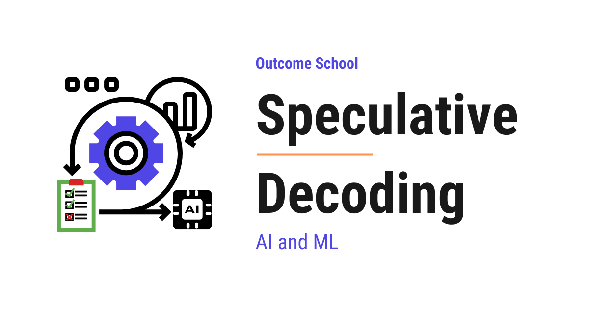

# What is Speculative Decoding and How Does It Make LLMs Faster?

> Archived from <https://outcomeschool.com/blog/speculative-decoding> on 2026-11-25.

Speculative Decoding is a technique that makes an LLM generate text faster without losing quality. A small draft model quickly guesses the next few tokens, and the big model verifies all those guesses in one single run.

In this blog, we will learn about Speculative Decoding - what it is, why LLM generation is slow without it, how a small draft model and a big target model work together to produce tokens faster, the rejection sampling math that guarantees no quality loss, real numbers showing the 2x to 3x speedup, where it is used in production, and the trade-offs to watch out for.

We will cover the following:
<ul><li>What problem does Speculative Decoding solve?</li><li>The Big Picture</li><li>Why is LLM generation slow?</li><li>The core idea behind Speculative Decoding</li><li>Step-by-step walkthrough</li><li>The verification step</li><li>Real numbers and speedup</li><li>Where it is used</li><li>Trade-offs</li><li>Quick Summary</li></ul>
I am <strong>Amit Shekhar</strong>, Founder @ <a target="_blank" rel="noopener noreferrer" href="https://outcomeschool.com">Outcome School</a>, I have taught and mentored many developers, and their efforts landed them high-paying tech jobs, helped many tech companies in solving their unique problems, and created many open-source libraries being used by top companies. I am passionate about sharing knowledge through open-source, blogs, and videos.

I teach <a target="_blank" rel="noopener noreferrer" href="https://outcomeschool.com/program/ai-and-machine-learning">AI and Machine Learning</a> at Outcome School.

Let&#x27;s get started.
<h2 id="what-problem-does-speculative-decoding-solve">What problem does Speculative Decoding solve?</h2>
When we use ChatGPT, Claude, or Gemini that use LLM internally, we notice that the model writes one word at a time. It does not write a full paragraph in one shot. It writes a token, then the next token, then the next.

This is slow.

The bigger the model, the slower it gets. Every single token forces the entire model to do one full forward pass. Billions of parameters get loaded from GPU memory just to produce one token. Then the same thing happens again for the next token. And again. And again.

Speculative Decoding is a technique that makes this faster, without changing the model and without losing any quality.
<h2 id="the-big-picture">The Big Picture</h2>
Before we go into the details, let&#x27;s understand the big picture.

Speculative Decoding uses two models. One <a target="_blank" rel="noopener noreferrer" href="small-language-models-slms.md">small model</a> that is fast but not very smart. One large model that is slow but very smart. The small model writes a quick draft of the next few tokens. The large model then verifies all those tokens in one shot.

In simple words:

<strong>Speculative Decoding = A small model drafts tokens + The big model verifies them in parallel.</strong>

If the draft is good, we get many tokens for the price of one big-model step. If the draft is bad, we throw away the wrong tokens and continue from where the draft was correct.

The output is <strong>exactly the same</strong> as if we had used the big model alone. There is no quality loss.
<h2 id="why-is-llm-generation-slow">Why is LLM generation slow?</h2>
To understand Speculative Decoding, we must first understand why normal LLM generation is slow.

LLMs generate text in an <a target="_blank" rel="noopener noreferrer" href="autoregressive-models.md">autoregressive</a> way. This means the model produces one token, then takes that token as input, and produces the next one.

Let&#x27;s say we want the model to write &quot;I love teaching AI and Machine Learning.&quot; The model does this like below:

<pre><code class="code-highlight">Step 1: Input &quot;I&quot;               -&gt; Output &quot;love&quot;
Step 2: Input &quot;I love&quot;          -&gt; Output &quot;teaching&quot;
Step 3: Input &quot;I love teaching&quot; -&gt; Output &quot;AI&quot;
... and so on
</code></pre>

For each step, the entire large model runs once. If the model has 70 billion parameters, then for every single token, those 70 billion parameters are read from GPU memory.

Now, here is the interesting part. The GPU is not slow at math. The GPU is slow at moving memory. Most of the time during a single token generation is spent loading the model weights into the compute units, not doing the actual math.

This means the GPU has a lot of free compute power that is sitting idle while it waits for memory.

Do you see the problem? We are paying the full memory cost for every single token, but we are barely using the GPU&#x27;s compute.

This is the gap that Speculative Decoding fills.

To learn LLM Internals, KV Cache, and Speculative Decoding, check out our <a target="_blank" rel="noopener noreferrer" href="https://outcomeschool.com/program/ai-and-machine-learning">AI and Machine Learning Program</a> at Outcome School.
<h2 id="the-core-idea-behind-speculative-decoding">The core idea behind Speculative Decoding</h2>
Speculative Decoding has a very simple idea behind it.

Let&#x27;s say we have two models:
<ul><li>A small model called the <strong>draft model</strong>. It is fast. Say, 1 billion parameters.</li><li>A large model called the <strong>target model</strong>. It is the smart one. Say, 70 billion parameters.</li></ul>
The plan is:
<ul><li>The draft model writes the next 4 or 5 tokens quickly, one after the other.</li><li>The target model takes all those draft tokens together and checks them in a single forward pass.</li><li>For each draft token, the target model decides: &quot;Yes, I would have written this too&quot; or &quot;No, this is wrong.&quot;</li><li>We keep all the tokens that the target model accepts. We throw away the rest. We continue from there.</li></ul>
Here is the flow at a high level as below:

<pre><code class="code-highlight">                 [ draft model ]
                       |
             writes 4 tokens sequentially
                       v
           +--------------------------+
           |  draft: t1  t2  t3  t4   |
           +--------------------------+
                       |
                       v
                [ target model ]
                       |
            single forward pass on all 4
                       |
                       v
       +----------------------------------+
       | accept t1, accept t2, reject t3, |
       |     fix t3, drop t4              |
       +----------------------------------+
                       |
                       v
              continue from accepted prefix
</code></pre>

Here, the magic is in the second step. The target model is checking 4 or 5 tokens at once in a single pass. It is using the GPU&#x27;s compute power that was sitting idle. The memory cost of loading the model weights is paid only once, but we get multiple tokens back.

Let&#x27;s use a real-world analogy.

Suppose there is a senior engineer who is very careful and very slow. There is also a junior engineer who is fast but makes some mistakes. Without Speculative Decoding, the senior engineer writes every single line of code by themselves. With Speculative Decoding, the junior engineer writes a quick draft of 5 lines. The senior engineer then reads all 5 lines together and approves the correct ones, fixes the first wrong one, and continues from there. Most of the time, the junior gets at least the first few lines right. So the senior gets to review a batch instead of writing every line from scratch.

That is the entire idea.

<strong>Planning your move into AI?</strong>

No matter which tech domain you work in today, with your effort, you can transition to these roles:
<ul><li>AI Engineer</li><li>Forward Deployed Engineer</li><li>AI Agent Engineer</li><li>Harness Engineer</li><li>Voice AI Engineer</li><li>AI Architect</li><li>LLM Engineer</li><li>LLM Inference Engineer</li><li>Gen AI Engineer</li><li>MLOps Engineer</li><li>ML Engineer</li><li>Deep Learning Engineer</li></ul>
Our <a target="_blank" rel="noopener noreferrer" href="https://outcomeschool.com/program/ai-and-machine-learning">AI and Machine Learning Program</a> at Outcome School takes you there.
<h2 id="step-by-step-walkthrough">Step-by-step walkthrough</h2>
Now, let&#x27;s walk through one round of Speculative Decoding to see how this looks in practice. Suppose the prompt so far is &quot;I love teaching AI&quot; and the draft length is 4.

<strong>Step 1:</strong> The draft model takes &quot;I love teaching AI&quot; and generates 4 tokens one by one as below:

<pre><code class="code-highlight">Draft tokens: &quot;and&quot;, &quot;Machine&quot;, &quot;Learning&quot;, &quot;today&quot;
</code></pre>

The draft model is small, so this is very fast.

<strong>Step 2:</strong> The target model takes the prompt plus the 4 draft tokens together. In a single forward pass, the target model produces the probability distribution for each position as below:

<pre><code class="code-highlight">Position 1 (after &quot;AI&quot;):                          target predicts &quot;and&quot;      -&gt; matches draft
Position 2 (after &quot;AI and&quot;):                      target predicts &quot;Machine&quot;  -&gt; matches draft
Position 3 (after &quot;AI and Machine&quot;):              target predicts &quot;Learning&quot; -&gt; matches draft
Position 4 (after &quot;AI and Machine Learning&quot;):     target predicts &quot;everyday&quot; -&gt; does NOT match &quot;today&quot;
</code></pre>

<strong>Step 3:</strong> We accept the tokens until the first rejection.
<ul><li>&quot;and&quot; is accepted</li><li>&quot;Machine&quot; is accepted</li><li>&quot;Learning&quot; is accepted</li><li>&quot;today&quot; is rejected. The target model wanted &quot;everyday&quot; instead.</li></ul>
<strong>Step 4:</strong> We replace the rejected token with the target model&#x27;s choice. So we accept &quot;and Machine Learning everyday&quot;.

<strong>Step 5:</strong> We start the next round with the prompt &quot;I love teaching AI and Machine Learning everyday&quot;.

Before we see the verification visually, let&#x27;s see all the inputs that go into the target model at the same time in one parallel forward pass, as below:

<pre><code class="code-highlight">All 8 inputs go into the target model in parallel (one forward pass):

  Position:     1       2        3            4       5       6          7           8
  Input:       &quot;I&quot;    &quot;love&quot;  &quot;teaching&quot;    &quot;AI&quot;    &quot;and&quot;  &quot;Machine&quot;  &quot;Learning&quot;  &quot;today&quot;
              \____________ prompt ____________/    \___________ 4 draft tokens ____________/
                |       |        |           |       |        |          |           |
                v       v        v           v       v        v          v           v
              +---------------------------------------------------------------------+
              |              Target model (ONE parallel forward pass)               |
              +---------------------------------------------------------------------+
                |       |        |           |       |        |          |           |
                v       v        v           v       v        v          v           v
  Predicts     next    next     next        next    next     next       next        next
  next token:  token   token    token       token   token    token      token       token
</code></pre>

All 8 positions are processed at the same time. At every position, the target model predicts what the NEXT token should be. So we get 8 next-token predictions in one shot, in a single parallel forward pass. We compare these predictions against the 4 draft tokens to decide which ones to accept - all 4 verified at the same time, not one by one.

Here is the same round shown visually as below:

<pre><code class="code-highlight">+----------+--------+----------+------------+------------+
| Position |   1    |    2     |     3      |     4      |
+----------+--------+----------+------------+------------+
| Draft    | &quot;and&quot;  |&quot;Machine&quot; | &quot;Learning&quot; |  &quot;today&quot;   |
| Target   | &quot;and&quot;  |&quot;Machine&quot; | &quot;Learning&quot; | &quot;everyday&quot; |
| Decision |  [OK]  |  [OK]    |    [OK]    |   [FIX]    |
+----------+--------+----------+------------+------------+

What happens:
  - Positions 1, 2, 3: accepted (draft matches target)
  - Position 4: rejected, replaced with target&#x27;s &quot;everyday&quot;

Tokens added this round: &quot;and&quot; + &quot;Machine&quot; + &quot;Learning&quot; + &quot;everyday&quot;  =  4 tokens
Target model forward passes used: 1
</code></pre>

In one round, we got 4 tokens instead of just 1. The target model only ran once. That is the speedup.

If all 4 draft tokens had been accepted, we would have got 5 tokens in one round. That is 4 draft tokens plus 1 bonus token. The bonus comes for free because the target model&#x27;s single forward pass produces a probability distribution at every position, including the one right after the last draft token. So we get one more token at no extra cost.

It works perfectly.

<strong>A quick note for you</strong>

No matter which tech domain you work in, get familiar with these topics:
<ul><li>LLM</li><li>RAG</li><li>MCP</li><li>Agent</li><li>Fine-tuning</li><li>Quantization</li></ul>
We put it all together in one video:

<a target="_blank" rel="noopener noreferrer" href="https://www.youtube.com/watch?v=lnfWvX66FUk">AI Engineering Explained: LLM, RAG, MCP, Agent, Fine-Tuning, and Quantization</a>

No need to stop reading - bookmark it and watch later when you get time. Future you will thank you.

Now, let&#x27;s get back to the topic.
<h2 id="the-verification-step">The verification step</h2>
Now, a natural question arises - how does the target model decide whether to accept or reject a draft token?

The simple version is: if the draft token is the same as what the target model would have picked, accept it.

But this is not the full story. LLMs are probabilistic. They do not always pick the single most likely token. They <a target="_blank" rel="noopener noreferrer" href="how-does-temperature-control-llm-output.md">sample from a probability distribution</a>. So we cannot just check &quot;did the draft token match the top choice of the target.&quot; We need a smarter rule.

So, here comes <strong>rejection sampling</strong> into the picture. The rule works like this:

For each draft token, we have two probabilities:
<ul><li><code>q(x)</code> = probability that the draft model would pick this token</li><li><code>p(x)</code> = probability that the target model would pick this token</li></ul>
The accept rule is as below:

<pre><code class="code-highlight">If p(x) &gt;= q(x):
    Always accept
Else:
    Accept with probability p(x) / q(x)
</code></pre>

Let&#x27;s see this with concrete numbers.

<strong>Example 1: Draft token &quot;Machine&quot; - target agrees strongly.</strong>
<ul><li><code>q(&quot;Machine&quot;) = 0.6</code> (the draft model picks &quot;Machine&quot; with 60% probability)</li><li><code>p(&quot;Machine&quot;) = 0.8</code> (the target model picks &quot;Machine&quot; with 80% probability)</li></ul>
Since <code>p &gt;= q</code> (0.8 &gt;= 0.6), we always accept &quot;Machine&quot;. The target model agrees, even more strongly than the draft model. So no reason to reject.

<strong>Example 2: Draft token &quot;today&quot; - target disagrees.</strong>
<ul><li><code>q(&quot;today&quot;) = 0.5</code> (the draft model picks &quot;today&quot; with 50% probability)</li><li><code>p(&quot;today&quot;) = 0.1</code> (the target model picks &quot;today&quot; with only 10% probability)</li></ul>
Since <code>p &lt; q</code> (0.1 &lt; 0.5), we do not always accept. We accept with probability:

<pre><code class="code-highlight">p / q = 0.1 / 0.5 = 0.2
</code></pre>

So 20% of the time we accept &quot;today&quot;, and 80% of the time we reject it. We flip a biased coin to decide.

The intuition is simple. When the target model agrees with the draft (<code>p &gt;= q</code>), the draft is fine - accept it. When the target model disagrees (<code>p &lt; q</code>), the draft is risky - we accept it only sometimes, proportional to how much the target model still believes in it.

If the token is rejected, we do not just give up. We sample a fresh token from a corrected distribution that fills the gap between the two models. This gap is calculated as <code>max(0, p(x) - q(x))</code> and then normalized.

Let&#x27;s see this with numbers. Suppose at the rejected position, three tokens are possible: &quot;everyday&quot;, &quot;today&quot;, &quot;tomorrow&quot;. The draft and target probabilities are as below:

<pre><code class="code-highlight">              q(x)    p(x)
&quot;everyday&quot;    0.2     0.5
&quot;today&quot;       0.5     0.1
&quot;tomorrow&quot;    0.3     0.4
</code></pre>

The draft picked &quot;today&quot; but it got rejected by the accept rule. Now we compute the corrected distribution <code>max(0, p - q)</code> for every token, then normalize, as below:

<pre><code class="code-highlight">&quot;everyday&quot;: max(0, 0.5 - 0.2) = 0.3
&quot;today&quot;:    max(0, 0.1 - 0.5) = 0
&quot;tomorrow&quot;: max(0, 0.4 - 0.3) = 0.1

Sum = 0.4

corrected(&quot;everyday&quot;) = 0.3 / 0.4 = 0.75
corrected(&quot;today&quot;)    = 0
corrected(&quot;tomorrow&quot;) = 0.1 / 0.4 = 0.25
</code></pre>

So the replacement is sampled from this corrected distribution: &quot;everyday&quot; with 75% probability and &quot;tomorrow&quot; with 25% probability. The mass shifts toward the tokens the target model wanted more than the draft did. &quot;today&quot; gets nothing because the target did not want it - the draft over-favored it.

The math here is carefully designed so that the final output of Speculative Decoding has <strong>exactly the same probability distribution</strong> as if we had run the target model alone, token by token. This is not an approximation. It is mathematically the exact right value.

<strong>Note:</strong> We have intentionally skipped the full mathematical proof here to keep this blog short and accessible. The proof shows that the probability of ending up with any token <code>x</code> works out to exactly <code>p(x)</code>, no matter which path the algorithm takes. If you are curious about the details, you can find the full proof in the original Speculative Decoding papers.

This is the most important property of Speculative Decoding. We get the speed benefit, and we lose nothing in quality. That&#x27;s the beauty of Speculative Decoding.

Not every technique leaves this distribution untouched, though. Some shift it on purpose by a tiny amount. We have a detailed blog on <a target="_blank" rel="noopener noreferrer" href="how-does-llm-watermarking-work.md">How Does LLM Watermarking Work?</a> that explains how such a small shift hides a signal inside the generated text.
<h2 id="real-numbers-and-speedup">Real numbers and speedup</h2>
Let&#x27;s put this into perspective with real numbers so we can clearly see how much time we are saving.

Suppose:
<ul><li>The target model takes 50 milliseconds per token</li><li>The draft model takes 5 milliseconds per token</li><li>We use a draft length of 4 tokens</li></ul>
<strong>Without Speculative Decoding (the baseline):</strong>

Each token forces one full target-model pass.

<pre><code class="code-highlight">1 token = 1 target pass = 50 ms
</code></pre>

So generating any N tokens takes <code>N x 50 ms</code>.

<strong>With Speculative Decoding, one round costs:</strong>

<pre><code class="code-highlight">4 draft tokens x 5 ms = 20 ms  (drafting)
1 target verification = 50 ms  (verification of all 4 in parallel)
Total per round        = 70 ms
</code></pre>

The cost per round is fixed at 70 ms. What changes is how many tokens we produce in that round, which depends on how many draft tokens get accepted.

Let&#x27;s see all three cases.

<strong>Best case - all 4 draft tokens are accepted.</strong> We get 4 accepted tokens plus 1 free bonus token from the target model, so 5 tokens in 70 ms.

<pre><code class="code-highlight">Without spec dec: 5 tokens x 50 ms = 250 ms
With spec dec:                      = 70 ms
Speedup: 250 / 70 = 3.57x
</code></pre>

<strong>Average case - 3 of 4 draft tokens are accepted.</strong> The first 3 draft tokens are accepted, and the 4th is rejected and replaced by the target model&#x27;s choice. So we get 3 accepted + 1 corrected = 4 tokens forward (this is the same case shown in our walkthrough above).

<pre><code class="code-highlight">Without spec dec: 4 tokens x 50 ms = 200 ms
With spec dec:                      = 70 ms
Speedup: 200 / 70 = 2.86x
</code></pre>

<strong>Worst case - 0 draft tokens accepted.</strong> Even here, we still move 1 token forward. When the very first draft token is rejected, we sample a replacement from the corrected distribution <code>max(0, p - q)</code> at that position, so progress is guaranteed and never zero. But we wasted the drafting time.

<pre><code class="code-highlight">Without spec dec: 1 token x 50 ms = 50 ms
With spec dec:                     = 70 ms
Speedup: 50 / 70 = 0.71x  (slower!)
</code></pre>

So Speculative Decoding is a bet. When the draft model agrees with the target model, we win big. When it disagrees, we pay a small penalty. The bet pays off as long as the average acceptance rate is high enough, which it usually is for similar model families.

<strong>Now, let&#x27;s see the user-visible impact</strong> for a full response.

Suppose the user asks a question and the target model needs to generate a 200-token answer. As an example, take the average case from above where the agent moves 4 tokens forward per round (3 draft tokens accepted plus 1 corrected token at the rejection position). In real workloads this number can be anywhere from 1 to 5 - we are using 4 just as an illustrative example. The math works out as below:

<pre><code class="code-highlight">Without Speculative Decoding:
  200 tokens x 50 ms = 10,000 ms = 10.0 seconds

With Speculative Decoding:
  Cost per round: 4 draft tokens x 5 ms + 1 target pass x 50 ms = 70 ms
  Tokens per round (average): 4
  Rounds needed: 200 tokens / 4 tokens per round = 50 rounds
  Total time: 50 rounds x 70 ms = 3,500 ms = 3.5 seconds

Time saved: 6.5 seconds (a 2.86x speedup)
</code></pre>

Here is the same comparison shown on a timeline as below:

<pre><code class="code-highlight">Time (seconds):  0    1    2    3    4    5    6    7    8    9    10

Without:         |==================================================|  10.0s
                 (200 target passes, one per token)

With:            |==================|                                   3.5s
                 (50 rounds, 4 tokens each)

                                     &lt;-------- 6.5s saved --------&gt;
</code></pre>

The user waits 3.5 seconds instead of 10 seconds for the same answer. That is the user-visible win.

In practice, the speedup ranges from 2x to 3x for most workloads. The exact number depends on:
<ul><li>How well the small draft model matches the big target model</li><li>How long the draft is</li><li>How similar the input style is to what the draft model has seen</li></ul>
The closer the draft model behaves like the target model, the higher the acceptance rate, and the bigger the speedup.

<strong>Stay updated:</strong> Subscribe to our <a target="_blank" rel="noopener noreferrer" href="https://outcomeschool.substack.com/subscribe">newsletter</a> to get our latest AI and Machine Learning blogs straight to your inbox.
<h2 id="where-it-is-used">Where it is used</h2>
Speculative Decoding is used in many production LLM systems today.

Some real examples:
<ul><li><a target="_blank" rel="noopener noreferrer" href="how-does-vllm-work.md"><strong>vLLM</strong></a>, <a target="_blank" rel="noopener noreferrer" href="how-does-sglang-work.md"><strong>SGLang</strong></a>, and <a target="_blank" rel="noopener noreferrer" href="how-does-tensorrt-llm-work.md"><strong>TensorRT-LLM</strong></a> support Speculative Decoding out of the box for serving large models.</li><li><strong>Llama</strong> models often pair a small Llama with a large Llama to speed up inference.</li><li><strong>DeepSeek-V3</strong> trains the model with an auxiliary objective called <a target="_blank" rel="noopener noreferrer" href="decoding-deepseek-v4.md">Multi-Token Prediction (MTP)</a>, which adds a lightweight extra module (a transformer layer plus an output head) that learns to predict the next token at a future position. At inference, this module acts as a built-in drafter for speculative decoding, so no separate draft model is needed. DeepSeek reports about 1.8x generation speedup from this.</li></ul>
The idea has so many variants because it is one of the cheapest ways to get a 2x to 3x speedup on LLM serving without retraining the big model.

If we want to go deep into vLLM, LLM Inference Engineering, and Model Deployment and Serving end to end, we have a complete program on this - check out our <a target="_blank" rel="noopener noreferrer" href="https://outcomeschool.com/program/ai-and-machine-learning">AI and Machine Learning Program</a> at Outcome School.
<h2 id="trade-offs">Trade-offs</h2>
Speculative Decoding makes generation faster, but it comes with a trade-off:
<ul><li>We need a second model. The draft model takes extra GPU memory. For very large deployments, this matters.</li><li>The two models must share the same <a target="_blank" rel="noopener noreferrer" href="tokenization-in-llms.md">tokenizer</a>. If their token vocabularies are different, the draft tokens will not line up with the target model&#x27;s expected input.</li><li>The acceptance rate depends on how well the draft and target models agree. If the draft model is too different from the target, most draft tokens get rejected, and we waste time.</li><li>For very short outputs, the overhead of running two models can cancel out the speedup.</li><li>The draft length must be tuned. Too short and we do not get much speedup. Too long and we waste tokens that get rejected.</li><li>The speedup shows up best at low batch sizes, where decoding is memory-bandwidth bound and the GPU&#x27;s compute is sitting idle. At very high batch sizes, the GPU is already kept busy by <a target="_blank" rel="noopener noreferrer" href="continuous-batching-in-llms.md">Continuous Batching</a>, so the spare compute that Speculative Decoding feeds on is no longer there. The gain shrinks, and in some cases it can even invert.</li></ul>
For most large-model serving workloads, the trade-off is worth it. The user sees a faster response, and the GPU is used more efficiently.

Later methods drop the second model altogether by letting the big model draft for itself. We have a detailed blog on <a target="_blank" rel="noopener noreferrer" href="decoding-medusa.md">Medusa</a> that explains how extra decoding heads do the drafting.

EAGLE takes that a step further by drafting the model&#x27;s smooth internal features instead of its noisy output tokens. We have a detailed blog on <a target="_blank" rel="noopener noreferrer" href="decoding-eagle.md">EAGLE</a> that covers this end to end.

<a target="_blank" rel="noopener noreferrer" href="n-gram-speculation-in-llms.md">N-gram Speculation</a> goes the other way and needs no model for drafting at all. It looks up the last few tokens in the prompt, copies whatever came after them as the draft, and lets the big model verify, which works very well when the answer repeats the input.
<h2 id="quick-summary">Quick Summary</h2>
Let&#x27;s recap what we have learned:
<ul><li><strong>The problem:</strong> LLMs generate one token at a time. Each token forces the full big model to run once. The GPU&#x27;s compute power sits idle while memory is loaded. This is slow.</li><li><strong>The core idea:</strong> Use a small fast draft model to write a few tokens. Use the big slow target model to verify all of them in a single parallel pass.</li><li><strong>The accept rule:</strong> Each draft token is accepted or rejected based on a math rule called rejection sampling. The math guarantees the final output matches what the big model would have produced alone.</li><li><strong>The benefit:</strong> A 2x to 3x speedup with no quality loss.</li><li><strong>The cost:</strong> Extra GPU memory for the draft model, and the speedup depends on how well the two models agree.</li><li><strong>In simple words:</strong> Speculative Decoding = A small model drafts tokens + The big model verifies them in parallel.</li></ul>
Speculative Decoding is one of those rare techniques that gives us speed without giving up quality. It does not change the model. It does not change the output. It just uses the GPU more cleverly.

This is why almost every modern LLM serving system supports it today.
<h2 id="frequently-asked-questions">Frequently Asked Questions</h2><h3 id="does-speculative-decoding-reduce-the-quality-of-the-output">Does Speculative Decoding reduce the quality of the output?</h3>
No. The rejection sampling rule is designed so that the final output has exactly the same probability distribution as running the target model alone, token by token. This is not an approximation. We get the speed benefit and lose nothing in quality.
<h3 id="can-speculative-decoding-make-generation-slower">Can Speculative Decoding make generation slower?</h3>
Yes, in some cases. If no draft tokens are accepted, a round costs more than a single target pass, for example 70 ms instead of 50 ms. The gain can also shrink or even invert at very high batch sizes, and very short outputs may not benefit because of the overhead of two models.
<h3 id="do-the-draft-model-and-the-target-model-need-the-same-tokenizer">Do the draft model and the target model need the same tokenizer?</h3>
Yes. The two models must share the same tokenizer. If their token vocabularies are different, the draft tokens will not line up with the target model&#x27;s expected input.
<h3 id="do-we-always-need-a-separate-draft-model">Do we always need a separate draft model?</h3>
No. DeepSeek-V3 uses Multi-Token Prediction, where a lightweight extra module acts as a built-in drafter. Medusa lets the big model draft for itself using extra decoding heads. N-gram Speculation needs no model for drafting at all, as it copies the draft from the prompt.

That&#x27;s it for now.

Thanks

<strong>Amit Shekhar</strong> Founder @ <a target="_blank" rel="noopener noreferrer" href="https://outcomeschool.com">Outcome School</a>

You can connect with me on:
<ul><li><a target="_blank" rel="noopener noreferrer" href="https://x.com/amitiitbhu">X</a></li><li><a target="_blank" rel="noopener noreferrer" href="https://www.linkedin.com/in/amit-shekhar-iitbhu">LinkedIn</a></li><li><a target="_blank" rel="noopener noreferrer" href="https://github.com/amitshekhariitbhu">GitHub</a></li></ul>
Follow Outcome School on:
<ul><li><a target="_blank" rel="noopener noreferrer" href="https://x.com/outcome_school">X</a></li><li><a target="_blank" rel="noopener noreferrer" href="https://youtube.com/@OutcomeSchool">YouTube</a></li><li><a target="_blank" rel="noopener noreferrer" href="https://www.linkedin.com/company/outcomeschool">LinkedIn</a></li><li><a target="_blank" rel="noopener noreferrer" href="https://github.com/OutcomeSchool">GitHub</a></li></ul>
<a target="_blank" rel="noopener noreferrer" href="https://outcomeschool.com/blog"><strong>Read all of our high-quality blogs here.</strong></a>

