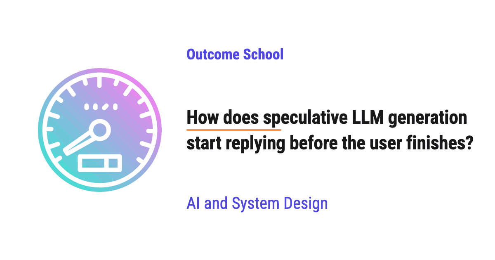

# How does speculative LLM generation start replying before the user finishes?

> Archived from <https://outcomeschool.com/blog/speculative-generation-in-voice-agents> on 2026-11-25.

Speculative LLM generation is a technique where a voice agent starts preparing its reply while the user is still finishing their sentence, keeps that reply hidden, and plays it only if the user&#x27;s final words match what the reply was based on.

In this blog, we will learn about how speculative LLM generation starts replying before the user finishes. We will also see where the waiting time goes in a normal voice agent, how the agent makes an early guess from the words it has so far, what happens when the guess is right or wrong, how it can prepare the voice early too, what it costs, and when to use it.

We will cover the following:
<ul><li>The normal way a voice agent replies</li><li>Where the waiting time goes</li><li>What is speculative LLM generation?</li><li>How speculative LLM generation works step by step</li><li>What happens when the guess is right</li><li>What happens when the guess is wrong</li><li>How does the agent know that the words changed?</li><li>Preparing the voice early too</li><li>The cost of speculative LLM generation</li><li>When to use it and when not to</li></ul>
I am <strong>Amit Shekhar</strong>, Founder @ <a target="_blank" rel="noopener noreferrer" href="https://outcomeschool.com">Outcome School</a>, I have taught and mentored many developers, and their efforts landed them high-paying tech jobs, helped many tech companies in solving their unique problems, and created many open-source libraries being used by top companies. I am passionate about sharing knowledge through open-source, blogs, and videos.

I teach <a target="_blank" rel="noopener noreferrer" href="https://outcomeschool.com/program/ai-and-machine-learning">AI and Machine Learning</a> at Outcome School.

Let&#x27;s get started.
<h2 id="the-normal-way-a-voice-agent-replies">The normal way a voice agent replies</h2>
Before jumping into speculative LLM generation, we must know how a normal voice agent replies.

A <a target="_blank" rel="noopener noreferrer" href="design-a-real-time-voice-ai-agent.md">voice agent</a> is a system that we can talk to with our voice, and it talks back with a voice. Many voice agents work as a <a target="_blank" rel="noopener noreferrer" href="cascaded-vs-speech-to-speech.md">chain of three parts</a>:
<ul><li><strong>Speech-to-Text (STT):</strong> It listens to the user&#x27;s voice and turns it into text.</li><li><strong>LLM (Large Language Model):</strong> It reads that text and writes a reply.</li><li><strong>Text-to-Speech (TTS):</strong> It turns the reply text back into a voice.</li></ul>
There is one more part that works next to the STT. It decides when the user has finished speaking. We call this <strong><a target="_blank" rel="noopener noreferrer" href="what-is-turn-taking-in-a-voice-ai-agent.md">end-of-turn detection</a></strong>. It looks at things like <a target="_blank" rel="noopener noreferrer" href="silence-vs-model-based-turn-detection.md">silence and the words spoken so far</a>, and then it says, &quot;Okay, the user is done. Now it is our turn.&quot;

So, the normal flow looks like below:

<pre><code class="code-highlight">User speaks
     ↓
STT turns voice into text
     ↓
End-of-turn detection waits and says &quot;user is done&quot;
     ↓
LLM starts writing the reply
     ↓
TTS turns the reply into voice
     ↓
User hears the reply
</code></pre>

Here, we can notice that the LLM does not start until the end-of-turn detection says &quot;user is done&quot;. Everything waits in a line.
<h2 id="where-the-waiting-time-goes">Where the waiting time goes</h2>
Let&#x27;s say the user says, &quot;What is the weather in Delhi today?&quot;

Now, the agent cannot reply the very moment the user stops. It must first <a target="_blank" rel="noopener noreferrer" href="endpointing-in-voice-agents.md">be sure that the user has really finished</a>. It is possible that the user is only taking a breath and will continue with &quot;...and tomorrow?&quot; So, the end-of-turn detection waits for a short period of silence before it says &quot;user is done&quot;.

After that, the LLM needs some time to produce the <a target="_blank" rel="noopener noreferrer" href="how-does-token-streaming-work.md">first few tokens</a> of the reply. A <a target="_blank" rel="noopener noreferrer" href="tokenization-in-llms.md">token</a> is a small piece of text, like a word or a part of a word. Then, the TTS needs some time to produce the first bit of audio.

So, the user waits for all of these, one after the other:
<ul><li>The silence wait of end-of-turn detection</li><li>The time the LLM takes to produce its first tokens</li><li>The time the TTS takes to produce its first audio</li></ul>
In a real conversation between two people, the gap between one person stopping and the other person starting is usually well under a second. When a voice agent adds up all these waits, the <a target="_blank" rel="noopener noreferrer" href="voice-to-voice-latency.md">gap</a> becomes long, and the conversation feels slow and robotic. We have a detailed blog on <a target="_blank" rel="noopener noreferrer" href="voice-agent-latency-budget.md">how to build a latency budget for a voice AI agent</a> that explains how each of these waits adds up.

The silence wait and the LLM time happen one after the other. Now, the question is: can we make them happen at the same time?

The answer is yes. Here comes speculative LLM generation into the picture.
<h2 id="what-is-speculative-llm-generation">What is speculative LLM generation?</h2>
<strong>Speculative LLM generation means that the agent sends the user&#x27;s words to the LLM before it is sure that the user has finished speaking, and keeps the reply ready but unplayed.</strong>

The word <strong>speculative</strong> means &quot;based on a guess&quot;. The agent guesses that the words it has right now are the final words of the user. It starts the work based on that guess. Later, when the end-of-turn detection confirms the turn has ended, the agent checks whether its guess was correct.
<ul><li>If the guess was correct, the reply is already ready, and the agent plays it at once.</li><li>If the guess was wrong, the agent throws away the early reply and starts again with the correct words.</li></ul>
Let&#x27;s say we are at a tea shop that we visit every day. As soon as we walk in and say, &quot;One cup of...&quot;, the shop owner already starts boiling the tea, because that is what we order most of the time. If we finish with &quot;...tea&quot;, the tea comes out very fast. If we finish with &quot;...coffee&quot;, he puts that tea aside and starts the coffee. He wastes one cup of tea, but most days, we get our tea much faster.

This is exactly what speculative LLM generation does with the reply. Some of this work gets thrown away, but most of the time, the user gets the reply faster.

<strong>Note:</strong> The term &quot;<a target="_blank" rel="noopener noreferrer" href="speculative-decoding.md">speculative decoding</a>&quot; is a different idea. Speculative decoding makes the LLM itself produce tokens faster by letting a smaller, faster model guess a few tokens ahead. Here, we are talking about starting the LLM early in a voice agent, before the user&#x27;s turn is confirmed. Some voice agent frameworks call this idea <strong>preemptive generation</strong>.

<strong>Planning your move into AI?</strong>

No matter which tech domain you work in today, with your effort, you can transition to these roles:
<ul><li>AI Engineer</li><li>Forward Deployed Engineer</li><li>AI Agent Engineer</li><li>Harness Engineer</li><li>Voice AI Engineer</li><li>AI Architect</li><li>LLM Engineer</li><li>LLM Inference Engineer</li><li>Gen AI Engineer</li><li>MLOps Engineer</li><li>ML Engineer</li><li>Deep Learning Engineer</li></ul>
Our <a target="_blank" rel="noopener noreferrer" href="https://outcomeschool.com/program/ai-and-machine-learning">AI and Machine Learning Program</a> at Outcome School takes you there.
<h2 id="how-speculative-llm-generation-works-step-by-step">How speculative LLM generation works step by step</h2>
The best way to learn this is by taking an example.

Let&#x27;s say the user says, &quot;Book a table for two at 8 PM.&quot;

The STT does not wait for the whole sentence. It keeps sending text while the user is still speaking. We call these early pieces of text <strong>interim transcripts</strong> (or partial transcripts). When the STT is confident about a piece of speech, it sends a <strong>final transcript</strong> for it.

<strong>Step 1:</strong> The user is speaking. The STT sends interim text like &quot;Book a&quot;, then &quot;Book a table&quot;, then &quot;Book a table for two&quot;.

<strong>Step 2:</strong> The user says &quot;...at 8 PM&quot; and stops. The STT sends the final transcript &quot;Book a table for two at 8 PM.&quot;

<strong>Step 3:</strong> The agent does not wait for the end-of-turn detection. It sends &quot;Book a table for two at 8 PM.&quot; to the LLM right away. This is the speculative request.

<strong>Step 4:</strong> The LLM starts writing the reply: &quot;Sure, let me check if a table for two is free at 8 PM.&quot; The agent stores this reply in a holding area. We call this holding area a <strong>buffer</strong>. Nothing is played to the user yet.

<strong>Step 5:</strong> At the same time, the end-of-turn detection is still waiting through its silence period.

<strong>Step 6:</strong> The silence wait ends, and the end-of-turn detection says &quot;user is done&quot;. By this time, the first part of the reply is already in the buffer.

<strong>Step 7:</strong> The agent compares the words it used for the speculative request with the final words of the turn. They are the same. So, the agent plays the reply from the buffer at once.

We can see the two timelines one after the other as below:

<pre><code class="code-highlight">Normal agent:

User stops
     ↓
Silence wait
     ↓
End of turn confirmed
     ↓
LLM starts
     ↓
First LLM tokens ready
     ↓
TTS makes the first audio
     ↓
Reply starts playing

Speculative agent:

User stops
     ↓
LLM work and silence wait run at the same time
     ↓
End of turn confirmed, first LLM tokens already in the buffer
     ↓
TTS makes the first audio
     ↓
Reply starts playing
</code></pre>

Here, we can see that in the speculative agent, the LLM work and the silence wait overlap. The time that the LLM needs gets hidden inside the time that the agent was going to wait anyway.

This is how speculative LLM generation starts replying before the user finishes.
<h2 id="what-happens-when-the-guess-is-right">What happens when the guess is right</h2>
When the guess is right, the final words match the words that were sent to the LLM, so the reply in the buffer is exactly the reply the agent would have produced anyway.

Means, the user gets the same answer, only faster.

The saving can be up to the time the LLM needs to produce its first tokens, because that work now runs inside the silence wait. In many voice agents, that is one of the biggest waits in the whole chain. So, hiding it makes the agent feel much more natural.

Let&#x27;s take some numbers just for the sake of understanding. Assume that the silence wait is 500 milliseconds, and the LLM needs 400 milliseconds to produce its first tokens.
<ul><li><strong>Normal agent:</strong> 500 + 400 = 900 milliseconds before the TTS can even start.</li><li><strong>Speculative agent:</strong> The 400 milliseconds of LLM work run inside the 500 milliseconds of silence wait. So, the TTS can start after 500 milliseconds.</li></ul>
Here, we can see that the agent saves 400 milliseconds on every turn where the guess is right. If the LLM needs more time than the silence wait, the saving is equal to the silence wait, because only that part can overlap.

<strong>A quick note for you</strong>

No matter which tech domain you work in, get familiar with these topics:
<ul><li>LLM</li><li>RAG</li><li>MCP</li><li>Agent</li><li>Fine-tuning</li><li>Quantization</li></ul>
We put it all together in one video:

<a target="_blank" rel="noopener noreferrer" href="https://www.youtube.com/watch?v=lnfWvX66FUk">AI Engineering Explained: LLM, RAG, MCP, Agent, Fine-Tuning, and Quantization</a>

No need to stop reading - bookmark it and watch later when you get time. Future you will thank you.

Now, let&#x27;s get back to the topic.
<h2 id="what-happens-when-the-guess-is-wrong">What happens when the guess is wrong</h2>
Now, let&#x27;s see the other case.

Let&#x27;s say the user says, &quot;Book a table for two...&quot; and takes a <a target="_blank" rel="noopener noreferrer" href="long-pauses-in-voice-agents.md">pause to think</a>. The STT sends a final transcript for these words, and the agent treats this pause as a possible end. It sends &quot;Book a table for two&quot; to the LLM. The LLM starts writing: &quot;Sure, for what time?&quot;

But the user continues: &quot;...at 8 PM, near the window.&quot;

Now, the words have changed. The early reply &quot;Sure, for what time?&quot; is wrong for the new words. If the agent plays it, the user will be confused, because they have already told the time.

So, as soon as the new words arrive from the STT, the agent does the following:
<ul><li>It cancels the running LLM request, so it stops producing more tokens.</li><li>It throws away everything in the buffer.</li><li>When the STT sends the final transcript for the full words &quot;Book a table for two at 8 PM, near the window.&quot;, it sends them to the LLM as a fresh speculative request.</li></ul>
<strong>The user never hears the wrong reply.</strong> The early reply was only in the buffer. It was never played.

In this case, the first request is wasted, but the fresh request still starts before the end of the turn is confirmed. So, the agent loses nothing in correctness. The only loss is the wasted LLM work of the first request.
<h2 id="how-does-the-agent-know-that-the-words-changed">How does the agent know that the words changed?</h2>
The agent keeps a copy of the exact words it sent with the speculative request. When the end-of-turn detection says &quot;user is done&quot;, the agent compares that copy with the final words of the turn.
<ul><li>If both are the same, the agent uses the buffered reply.</li><li>If they are different, the agent throws the buffered reply away and makes a new request.</li></ul>
Some agents also look at the other things that were sent with the request, not only the words. For example, the conversation history and the list of <a target="_blank" rel="noopener noreferrer" href="how-does-function-calling-work-in-llms.md">tools that the LLM can recommend</a>. A tool is a function that our agent code can run, like checking a booking system. If any of these changed in between, the early reply is no longer valid, and it must be thrown away too.

<strong>Note:</strong> The agent must never play a speculative reply until the end of the turn is confirmed. The whole idea is safe only because the early reply stays hidden until the check passes.

We have a complete program on Tool use in Agents, Agent Architecture, and how to Design a Real-Time Voice AI Agent - check out our <a target="_blank" rel="noopener noreferrer" href="https://outcomeschool.com/program/ai-and-machine-learning">AI and Machine Learning Program</a> at Outcome School.
<h2 id="preparing-the-voice-early-too">Preparing the voice early too</h2>
Now, it&#x27;s time to learn about starting the voice early.

We can apply the same idea to the TTS. As soon as the LLM produces the first sentence of the speculative reply, the agent can <a target="_blank" rel="noopener noreferrer" href="sentence-chunking-for-tts.md">send that sentence to the TTS</a> and keep the produced audio in the buffer too.

Then, when the end of the turn is confirmed and the words match, the agent does not even need to wait for the TTS. The <a target="_blank" rel="noopener noreferrer" href="time-to-first-audio.md">first audio</a> is already ready, and it starts playing immediately.

If the words do not match, the agent throws away both the buffered text and the buffered audio.

<strong>Advantage:</strong> The reply can start playing almost the very moment the turn is confirmed.

<strong>Disadvantage:</strong> If the guess is wrong, the agent wastes both LLM work and TTS work.

This is why many setups run only the LLM early by default, and run the TTS early only when the extra speed is worth the extra waste.

<strong>Stay updated:</strong> Subscribe to our <a target="_blank" rel="noopener noreferrer" href="https://outcomeschool.substack.com/subscribe">newsletter</a> to get our latest AI and Machine Learning blogs straight to your inbox.
<h2 id="the-cost-of-speculative-llm-generation">The cost of speculative LLM generation</h2>
Speculative LLM generation has a cost. Every wrong guess is a request that we pay for but never use.

Let&#x27;s say the user pauses three times in the middle of a long sentence. The agent can end up sending four speculative requests for one single turn, one for each pause and one for the real end, and only the last one gets used. If our LLM provider charges per token, those thrown-away tokens still cost money. The same is true for TTS.

The other cost is load. More requests mean more work for the LLM servers. If many users talk at the same time, this extra load can slow down replies for everyone.

So, the agent must balance two things:
<ul><li>Starting early, so that the reply is fast.</li><li>Not starting too often, so that the waste stays low.</li></ul>
A common way to keep the waste low is to start the speculative request only on a final transcript from the STT, not on every interim transcript. Interim transcripts change very often while the user speaks, so starting on each of them would cause a lot of thrown-away work.
<h2 id="when-to-use-it-and-when-not-to">When to use it and when not to</h2>
Speculative LLM generation works well when:
<ul><li>The users speak in short, clear sentences, like booking, ordering, and simple questions.</li><li>Fast replies matter a lot, like in customer support calls.</li><li>The extra cost of some wasted requests is acceptable.</li></ul>
It works less well when:
<ul><li>The users speak in long sentences with many pauses, like telling a story or dictating a message, because the guess keeps going wrong and most of the work gets thrown away.</li><li>The LLM request is very expensive, and every wasted request hurts the budget.</li></ul>
One more thing to notice. A speculative request must only prepare a reply. It must never take an action in the real world, because the guess can still turn out to be wrong.

Let&#x27;s say the speculative reply includes a tool call to place an order. The LLM only recommends the tool call, and our agent code runs it. So, the agent must hold that tool call and run it only after the turn is confirmed, never during the speculative step.

We have a detailed blog on <a target="_blank" rel="noopener noreferrer" href="slow-tool-calls-in-voice-agents.md">how a voice agent hides the delay of a slow tool call</a> that explains which tools are safe to start early.

Now we must have understood how speculative LLM generation starts replying before the user finishes, how it hides the LLM time inside the silence wait, what happens when the guess is right or wrong, and when to use it.
<h2 id="frequently-asked-questions">Frequently Asked Questions</h2><h3 id="what-is-the-difference-between-speculative-llm-generation-and-speculative-decoding">What is the difference between speculative LLM generation and speculative decoding?</h3>
They solve different problems. Speculative decoding makes the LLM itself produce tokens faster by letting a smaller, faster model guess a few tokens ahead. Speculative LLM generation starts the LLM early in a voice agent, before the end of the user&#x27;s turn is confirmed, so that the LLM time overlaps with the silence wait.
<h3 id="how-much-time-can-speculative-llm-generation-save">How much time can speculative LLM generation save?</h3>
It can save up to the time the LLM needs to produce its first tokens, because that work runs inside the silence wait. If the LLM needs more time than the silence wait, the saving is equal to the silence wait, because only that part can overlap. For example, with a 500 millisecond silence wait and 400 milliseconds of LLM work, the agent saves 400 milliseconds.
<h3 id="should-the-agent-start-a-speculative-request-on-every-interim-transcript">Should the agent start a speculative request on every interim transcript?</h3>
No. A common way to keep the waste low is to start the speculative request only on a final transcript from the STT. Interim transcripts change very often while the user speaks, so starting on each of them would cause a lot of thrown-away work and extra cost.
<h3 id="can-a-speculative-request-run-a-tool-call">Can a speculative request run a tool call?</h3>
No. A speculative request must only prepare a reply, because the guess can still turn out to be wrong. The LLM only recommends a tool call, like placing an order, and our agent code runs it. So, the agent holds that tool call and runs it only after the end of the turn is confirmed.
<h3 id="what-is-preemptive-generation-in-a-voice-agent">What is preemptive generation in a voice agent?</h3>
Preemptive generation is the name some voice agent frameworks use for the same idea as speculative LLM generation. The agent sends the user&#x27;s words to the LLM before it is sure the user has finished, keeps the reply in a buffer, and plays it only if the final words match.

That&#x27;s it for now.

Thanks

<strong>Amit Shekhar</strong> Founder @ <a target="_blank" rel="noopener noreferrer" href="https://outcomeschool.com">Outcome School</a>

You can connect with me on:
<ul><li><a target="_blank" rel="noopener noreferrer" href="https://x.com/amitiitbhu">X</a></li><li><a target="_blank" rel="noopener noreferrer" href="https://www.linkedin.com/in/amit-shekhar-iitbhu">LinkedIn</a></li><li><a target="_blank" rel="noopener noreferrer" href="https://github.com/amitshekhariitbhu">GitHub</a></li></ul>
Follow Outcome School on:
<ul><li><a target="_blank" rel="noopener noreferrer" href="https://x.com/outcome_school">X</a></li><li><a target="_blank" rel="noopener noreferrer" href="https://youtube.com/@OutcomeSchool">YouTube</a></li><li><a target="_blank" rel="noopener noreferrer" href="https://www.linkedin.com/company/outcomeschool">LinkedIn</a></li><li><a target="_blank" rel="noopener noreferrer" href="http://github.com/OutcomeSchool">GitHub</a></li></ul>
<a target="_blank" rel="noopener noreferrer" href="https://outcomeschool.com/blog"><strong>Read all of our high-quality blogs here.</strong></a>

