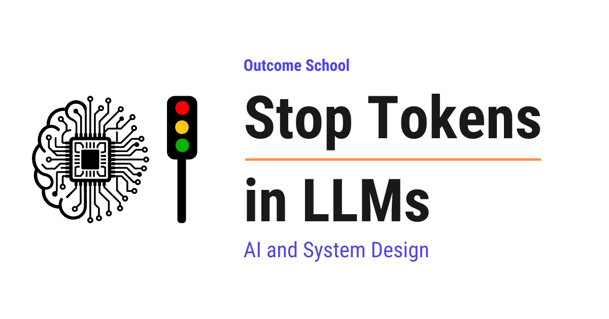

# Stop Tokens in LLMs

> Archived from <https://outcomeschool.com/blog/stop-tokens-in-llms> on 2026-11-25.

A Stop Token is a special token in the vocabulary of an LLM that means the text ends here. When the model produces it, the generation loop stops writing.

In this blog, we will learn about Stop Tokens in LLMs. We will also see why an LLM needs to be told when to stop, how the model learns to produce the stop token during training, how it is different from a stop sequence that we set ourselves, what happens when the model never stops, how chat models use it, and the common mistakes we do while using it.

We will cover the following:
<ul><li>What is a Token?</li><li>How does an LLM generate text?</li><li>Why does an LLM need to stop?</li><li>What is a Stop Token?</li><li>How does the model learn to produce a Stop Token?</li><li>Stop Token vs Stop Sequence</li><li>What happens if the model never stops?</li><li>Stop Tokens in Chat Models</li><li>Common mistakes with Stop Tokens</li></ul>
I am <strong>Amit Shekhar</strong>, Founder @ <a target="_blank" rel="noopener noreferrer" href="https://outcomeschool.com">Outcome School</a>, I have taught and mentored many developers, and their efforts landed them high-paying tech jobs, helped many tech companies in solving their unique problems, and created many open-source libraries being used by top companies. I am passionate about sharing knowledge through open-source, blogs, and videos.

I teach <a target="_blank" rel="noopener noreferrer" href="https://outcomeschool.com/program/ai-and-machine-learning">AI and Machine Learning</a> at Outcome School.

Let&#x27;s get started.
<h2 id="what-is-a-token">What is a Token?</h2>
Before jumping into Stop Tokens, we must know what a token is.

<strong>A token is a small piece of text that an <a target="_blank" rel="noopener noreferrer" href="large-language-model-llm.md">LLM (Large Language Model)</a> reads and writes.</strong>

An LLM does not read text letter by letter, and it does not read text word by word. It reads text in small pieces called tokens.

A token can be a full word, a part of a word, a single character, a space, or a punctuation mark.

Let&#x27;s say we have a sentence as below:

<pre><code class="code-highlight">I love learning.
</code></pre>

An LLM breaks it into tokens like below:

<pre><code class="code-highlight">[&quot;I&quot;, &quot; love&quot;, &quot; learning&quot;, &quot;.&quot;]
</code></pre>

Here, we can see that each piece is one token. The space before &quot;love&quot; is part of the token itself. This is how the model keeps track of where one word ends and the next one begins.

Every token has a number attached to it. The model does not work with the text directly, it works with these numbers. The full list of all the tokens that a model knows is called its <strong>vocabulary</strong>.

For the sake of understanding, think of the vocabulary as a big dictionary where every entry has a serial number. The model only sees the serial numbers.

We have a detailed blog on <a target="_blank" rel="noopener noreferrer" href="tokenization-in-llms.md">Tokenization in LLMs</a> that explains step by step how text is broken into tokens.

Now that we know what a token is, let&#x27;s see how an LLM uses tokens to write text.
<h2 id="how-does-an-llm-generate-text">How does an LLM generate text?</h2>
<strong>An LLM writes text one token at a time.</strong> This writing is called generation.

It does not write the full answer in one go. It picks one token, adds it to the text, and then picks the next token by looking at everything written so far.

The best way to learn this is by taking an example.

The text we give to the model is called a <strong>prompt</strong>. Let&#x27;s say our prompt is as below:

<pre><code class="code-highlight">The capital of India is
</code></pre>

The model works like below:

<strong>Step 1:</strong> It looks at &quot;The capital of India is&quot; and picks the next token: &quot; New&quot;

<strong>Step 2:</strong> It looks at &quot;The capital of India is New&quot; and picks the next token: &quot; Delhi&quot;

<strong>Step 3:</strong> It looks at &quot;The capital of India is New Delhi&quot; and picks the next token: &quot;.&quot;

At every step, the model does the same thing. It looks at the full text so far and gives a score to every token in its vocabulary. A token with a high score is more likely to come next. Then one token is <a target="_blank" rel="noopener noreferrer" href="how-do-top-k-and-top-p-sampling-work.md">picked based on these scores</a> and added to the text.

This loop has a name, <strong><a target="_blank" rel="noopener noreferrer" href="autoregressive-models.md">autoregressive generation</a></strong>.

Autoregressive = Auto + Regressive

Auto means self. Regressive here means going back to what has already been produced. So, the model feeds its own output back as its input, again and again.

<strong>Planning your move into AI?</strong>

No matter which tech domain you work in today, with your effort, you can transition to these roles:
<ul><li>AI Engineer</li><li>Forward Deployed Engineer</li><li>AI Agent Engineer</li><li>Harness Engineer</li><li>Voice AI Engineer</li><li>AI Architect</li><li>LLM Engineer</li><li>LLM Inference Engineer</li><li>Gen AI Engineer</li><li>MLOps Engineer</li><li>ML Engineer</li><li>Deep Learning Engineer</li></ul>
Our <a target="_blank" rel="noopener noreferrer" href="https://outcomeschool.com/program/ai-and-machine-learning">AI and Machine Learning Program</a> at Outcome School takes you there.

We can write this loop as below:

<pre><code class="code-highlight language-python">tokens = tokenize(prompt)

while True:
    next_token = model.predict_next(tokens)
    tokens.append(next_token)
</code></pre>

Here, <code>tokenize</code> breaks the prompt into tokens. <code>while True</code> means the loop runs again and again without any end. Inside the loop, we ask the model for the next token, add it to the list, and ask again.

Look at the loop carefully. When does it end?
<h2 id="why-does-an-llm-need-to-stop">Why does an LLM need to stop?</h2>
The loop we just saw has no exit. There is nothing in it that says &quot;you are done&quot;.

If nothing stops it, the model will keep going. After &quot;New Delhi.&quot; it will pick another token, and another, and another. It will start writing about the history of Delhi, then about the weather, then about something else. It will never stop on its own.

So, we need a way to tell the model when the answer is complete.

There are two ways to stop the loop:
<ul><li>We set a fixed limit. Say, stop after 100 tokens.</li><li>We let the model itself say &quot;I am done&quot;.</li></ul>
The first way is simple, but it is not enough on its own. If the answer needs only 5 tokens, we waste time and money producing 95 more tokens of junk. And if the answer needs 200 tokens, we cut it in the middle.

The second way is much better. The model knows when the answer is complete. It just needs a way to say so.

So, here comes the Stop Token to the rescue.
<h2 id="what-is-a-stop-token">What is a Stop Token?</h2>
<strong>A Stop Token is a special token in the vocabulary of the model that means &quot;the text ends here&quot;.</strong>

It is not a normal word. It is not part of the answer that we read. It is a hidden marker that the model produces when it believes the answer is complete.

When the generation loop sees this token, it stops. No more tokens are produced.

A normal full stop &quot;.&quot; ends a sentence. A stop token ends the entire response.

Different models give different names to this token. Some common ones are:
<ul><li><code>&lt;|endoftext|&gt;</code> used by GPT-2 and many older models</li><li><code>&lt;/s&gt;</code> used by Llama 2 and many models built on top of it</li><li><code>&lt;|eot_id|&gt;</code> used by Llama 3</li><li><code>&lt;|im_end|&gt;</code> used by Qwen and many other chat models</li><li><code>&lt;end_of_turn&gt;</code> used by Gemma</li></ul>
The name of the token does not matter. What matters is that it is one token in the vocabulary with its own number, and the generation loop treats it as a signal to stop.

Many people also call it the <strong>EOS token</strong>. EOS stands for End Of Sequence. A sequence is just the full piece of text. So, End Of Sequence means the end of the text. Stop Token and EOS token are often used to mean the same thing.

Our updated loop with the stop token:

<pre><code class="code-highlight language-python">tokens = tokenize(prompt)

while True:
    next_token = model.predict_next(tokens)
    if next_token == STOP_TOKEN:
        break
    tokens.append(next_token)

print(detokenize(tokens))
</code></pre>

Here, we have added a check. Before adding the token to the list, we see if it is the stop token. If yes, we <code>break</code>, which means we come out of the loop and it stops. The stop token is never added to the list, so it never shows up in the final text. At the end, <code>detokenize</code> joins the tokens back into text.

Let&#x27;s see our example again with the stop token.

<strong>Step 1:</strong> &quot; New&quot;

<strong>Step 2:</strong> &quot; Delhi&quot;

<strong>Step 3:</strong> &quot;.&quot;

<strong>Step 4:</strong> <code>&lt;|endoftext|&gt;</code> and the loop stops.

The output shown to us: &quot;The capital of India is New Delhi.&quot;

It works perfectly.

Here, we can notice that the stop token is produced by the model just like any other token. It gets a score at every step. At Step 1, the stop token gets a very low score, because &quot;The capital of India is&quot; is clearly not complete. At Step 4, it gets the highest score, because the answer is complete now.

To learn Tokenization, LLM Fundamentals, and LLM Internals, and build a Large Language Model (LLM) from scratch, check out our <a target="_blank" rel="noopener noreferrer" href="https://outcomeschool.com/program/ai-and-machine-learning">AI and Machine Learning Program</a> at Outcome School.

Now, the next big question is: how does the model know when to produce this token?
<h2 id="how-does-the-model-learn-to-produce-a-stop-token">How does the model learn to produce a Stop Token?</h2>
The model is not given a rule like &quot;stop after answering the question&quot;. The model learns this from data, just like it learns everything else.

Let&#x27;s understand how.

An LLM is trained on a huge amount of text. This text is made of many separate documents like articles, books, web pages, code files, conversations, and etc.

Before training, a stop token is attached at the end of every document. So, the training data looks like below:

<pre><code class="code-highlight">This is the full text of document one. &lt;|endoftext|&gt;
This is the full text of document two. &lt;|endoftext|&gt;
This is the full text of document three. &lt;|endoftext|&gt;
</code></pre>

During training, the model has only one job. It looks at the text so far and tries to guess the next token. When it guesses wrong, it gets corrected a little. This happens billions of times.

Now, think about what happens at the end of each document. The text so far is the full document, and the correct next token is the stop token. Every time the model fails to guess the stop token here, it gets corrected.

The stop token also does one more job here. It marks where one document ends and the next one begins. So, the model learns that the text after the stop token is a fresh start.

Slowly, the model learns a pattern. When a piece of text feels complete, which means the story has ended, or the question is answered, or the code file is closed, the next token is very likely the stop token.

<strong>This is why the model can stop on its own. It has seen millions of endings, and it has learned what an ending looks like.</strong>

For the sake of understanding, think of a child who has been read thousands of stories. After a while, the child knows that &quot;and they lived happily ever after&quot; is followed by closing the book. Nobody taught this rule directly. The child picked it up from seeing it many times.

The stop token works the same way. It is learned, not written as a fixed rule.

For chat models, there is one more <a target="_blank" rel="noopener noreferrer" href="instruction-tuning.md">round of training</a> where the data looks like a conversation between a user and an assistant. Every assistant reply ends with a stop token. So, the model learns to produce the stop token when its reply is done, and this hands the turn back to the user. We will see this in detail in a later section.

<strong>A quick note for you</strong>

No matter which tech domain you work in, get familiar with these topics:
<ul><li>LLM</li><li>RAG</li><li>MCP</li><li>Agent</li><li>Fine-tuning</li><li>Quantization</li></ul>
We put it all together in one video:

<a target="_blank" rel="noopener noreferrer" href="https://www.youtube.com/watch?v=lnfWvX66FUk">AI Engineering Explained: LLM, RAG, MCP, Agent, Fine-Tuning, and Quantization</a>

No need to stop reading - bookmark it and watch later when you get time. Future you will thank you.

Now, let&#x27;s get back to the topic.

Now that we know how the model learns to produce the stop token, let&#x27;s see one more concept that is very often confused with it.
<h2 id="stop-token-vs-stop-sequence">Stop Token vs Stop Sequence</h2>
Many times, people use these two terms as if they are the same. They are not.

<strong>A Stop Token is a single special token built into the vocabulary of the model. The model learns to produce it during training.</strong>

<strong>A Stop Sequence is any piece of text that we, as users of the model, ask the system to watch for. When that text appears in the output, generation stops.</strong>

Let&#x27;s say we are using an LLM through an API. Most LLM APIs allow us to pass a list of stop sequences as below:

<pre><code class="code-highlight language-python">response = client.completions.create(
    model=&quot;some-model&quot;,
    prompt=&quot;Q: What is 2 + 2?\nA:&quot;,
    stop=[&quot;\n&quot;, &quot;Q:&quot;]
)
</code></pre>

Here, <code>\n</code> means a new line. We have passed <code>stop=[&quot;\n&quot;, &quot;Q:&quot;]</code>. This tells the system: if the model writes a new line or writes &quot;Q:&quot;, stop right there.

The model does not know anything about our stop sequence. It keeps producing tokens as usual. The system around the model checks the output after every token, and when it finds a match, it cuts the generation.

Why do we need this? Because sometimes the model does not produce a stop token where we want it to.

In the above example, without a stop sequence, the model often answers &quot;4&quot; and then keeps going. It starts writing &quot;Q: What is 3 + 3?&quot; on its own, because it is just continuing the pattern it sees. In its training data, a list of questions and answers usually continues with more questions. So, the stop token does not get a high score here.

The stop sequence &quot;Q:&quot; catches this and stops it.

We can add this check to our loop as below:

<pre><code class="code-highlight language-python">tokens = tokenize(prompt)

while True:
    next_token = model.predict_next(tokens)
    if next_token == STOP_TOKEN:
        break
    tokens.append(next_token)
    text = detokenize(tokens)
    if ends_with_any(text, stop_sequences):
        break
</code></pre>

Here, after adding each token, we convert the tokens back to text. Then <code>ends_with_any</code> checks if the text ends with any one of our stop sequences. If yes, we break out of the loop.

Let me tabulate the differences between Stop Token and Stop Sequence for your better understanding.
<table><thead><tr><th></th><th>Stop Token</th><th>Stop Sequence</th></tr></thead><tbody><tr><td>What is it?</td><td>One special token in the vocabulary</td><td>Any piece of text we choose</td></tr><tr><td>Who decides it?</td><td>Decided during the training of the model</td><td>Decided by us at the time of use</td></tr><tr><td>Who produces it?</td><td>The model itself</td><td>The model does not know about it</td></tr><tr><td>Who checks it?</td><td>The generation loop</td><td>The code around the model</td></tr><tr><td>Shown in output?</td><td>No, it is removed</td><td>Usually removed from the output</td></tr><tr><td>Example</td><td><code>&lt;/s&gt;</code>, <code>&lt;end_of_turn&gt;</code></td><td><code>&quot;\n&quot;</code>, <code>&quot;Q:&quot;</code>, <code>&quot;###&quot;</code></td></tr></tbody></table>
In practice, both work together. The stop token is always active. The stop sequence is an extra check that we add based on our use case.
<h2 id="what-happens-if-the-model-never-stops">What happens if the model never stops?</h2>
Now, let&#x27;s think about a bad case. What if the model never produces the stop token, and no stop sequence appears either?

This can happen. Sometimes the model gets into a loop where it repeats the same phrase again and again. Sometimes it is a badly trained model. Sometimes the prompt is so unusual that the model never feels the text is complete.

If we rely only on the stop token, the generation will run forever. It will waste time, memory, and money.

Remember the fixed limit we set aside earlier? It comes back now, but as a backup, not as the main way to stop.

This is why every system also sets a <strong>maximum token limit</strong>. It is usually called <code>max_tokens</code> or <code>max_new_tokens</code>.

Our updated loop with all three checks:

<pre><code class="code-highlight language-python">tokens = tokenize(prompt)
generated = 0

while generated &lt; max_tokens:
    next_token = model.predict_next(tokens)
    if next_token == STOP_TOKEN:
        break
    tokens.append(next_token)
    generated += 1
    text = detokenize(tokens)
    if ends_with_any(text, stop_sequences):
        break
</code></pre>

Here, the loop now runs only while the count of generated tokens is less than <code>max_tokens</code>. So, generation stops when any one of the following happens first:
<ul><li>The model produces the stop token.</li><li>A stop sequence appears in the output.</li><li>The maximum token limit is reached.</li></ul>
So, there are three brakes on the generation loop. The stop token is the natural brake. The stop sequence is the brake we add. The maximum token limit is the emergency brake.

Most APIs also tell us which brake was used. This is returned as <code>finish_reason</code> or <code>stop_reason</code>. A value like <code>stop</code> or <code>end_turn</code> means the model ended on its own with the stop token, or a stop sequence was found. A value like <code>length</code> or <code>max_tokens</code> means the limit cut it.

If we see <code>length</code> too often, it means our limit is too small and the answers are getting cut in the middle. We must increase the limit.

We have a complete program on LLM Fundamentals, Fine-tuning, and LLM Inference Engineering - check out our <a target="_blank" rel="noopener noreferrer" href="https://outcomeschool.com/program/ai-and-machine-learning">AI and Machine Learning Program</a> at Outcome School to master them in depth.
<h2 id="stop-tokens-in-chat-models">Stop Tokens in Chat Models</h2>
Now, let&#x27;s take a real use-case. When we chat with an AI assistant, how does it know when its turn is over?

The chat is formatted with special tokens that mark who is speaking. A simplified version looks like below:

<pre><code class="code-highlight">&lt;|user|&gt;
What is the capital of India?
&lt;|end|&gt;
&lt;|assistant|&gt;
The capital of India is New Delhi.
&lt;|end|&gt;
</code></pre>

Here, <code>&lt;|user|&gt;</code> and <code>&lt;|assistant|&gt;</code> mark who is speaking, and <code>&lt;|end|&gt;</code> marks the end of a turn. All three are special tokens in the vocabulary, just like the stop token we saw earlier.

During training, the model sees many conversations in this format. Every assistant reply ends with <code>&lt;|end|&gt;</code>. So, when the model is answering, it produces <code>&lt;|end|&gt;</code> as soon as it feels the reply is complete. The system sees this token, stops the generation, removes the token, and shows the reply to us. Then it waits for our next message.

Here, <code>&lt;|end|&gt;</code> is the stop token for this chat model. In Llama 3, it is <code>&lt;|eot_id|&gt;</code>. In Qwen, it is <code>&lt;|im_end|&gt;</code>. The idea is the same.

<strong>Note:</strong> Some models have more than one stop token. Llama 3 uses <code>&lt;|end_of_text|&gt;</code> to mark the end of a document and <code>&lt;|eot_id|&gt;</code> to mark the end of a turn in a chat. Both are treated as signals to stop.

This is how a chat model knows when its turn is over. It does not keep talking forever, and it does not start writing our next question for us. It stops, because it has learned that its turn ends with this token.

<strong>Stay updated:</strong> Subscribe to our <a target="_blank" rel="noopener noreferrer" href="https://outcomeschool.substack.com/subscribe">newsletter</a> to get our latest AI and Machine Learning blogs straight to your inbox.
<h2 id="common-mistakes-with-stop-tokens">Common mistakes with Stop Tokens</h2>
Most of the time, we do mistakes while using stop tokens. Let&#x27;s see the common ones.

<strong>Mistake 1: Using the wrong stop token for the model.</strong>

When we download a model and run it on our own machine, we must use the stop token that the model was trained with. Let&#x27;s say the model was trained to end its turn with <code>&lt;|eot_id|&gt;</code>, but our setup is waiting for <code>&lt;/s&gt;</code>. The model will produce <code>&lt;|eot_id|&gt;</code>, our setup will not recognize it, and the model will keep going. It will start writing the user&#x27;s next message on its own.

Many people faced this exact issue when Llama 3 was released. The fix is to set the correct stop token in the generation settings.

<strong>Mistake 2: Setting the maximum token limit too small.</strong>

If the limit is too small, the answer gets cut in the middle of a sentence. The model never gets the chance to produce the stop token. We must always check the <code>finish_reason</code>. If it says <code>length</code>, we must increase the limit.

<strong>Mistake 3: Forgetting the stop token in fine-tuning data.</strong>

<strong><a target="_blank" rel="noopener noreferrer" href="how-does-fine-tuning-work.md">Fine-tuning</a></strong> means training an already trained model a little more on our own data. When we fine-tune a model, every training example must end with the stop token. If we forget it, the model never learns when to stop for our type of data. After fine-tuning, it will keep rambling after every answer.

<strong>Mistake 4: Showing the stop token to the user.</strong>

Sometimes the code that converts tokens back to text does not remove the special tokens. Then the user sees <code>&lt;|endoftext|&gt;</code> or <code>&lt;/s&gt;</code> at the end of every answer. Most tools have an option like <code>skip_special_tokens=True</code> to handle this. We must make sure it is turned on.

Now we must have understood what Stop Tokens in LLMs are, how the model learns to produce them, and how they work together with stop sequences and the maximum token limit.
<h2 id="frequently-asked-questions">Frequently Asked Questions</h2><h3 id="is-the-stop-token-shown-in-the-final-answer">Is the stop token shown in the final answer?</h3>
No. The stop token is a hidden marker, not part of the answer we read. The generation loop stops when it sees the token and does not add it to the text. If the code that converts tokens back to text does not remove special tokens, the user may see it, so an option like <code>skip_special_tokens=True</code> must be turned on.
<h3 id="is-a-stop-token-the-same-as-an-eos-token">Is a Stop Token the same as an EOS token?</h3>
Yes. Stop Token and EOS token are often used to mean the same thing. EOS stands for End Of Sequence, and a sequence is just the full piece of text. Different models give this token different names, like <code>&lt;|endoftext|&gt;</code>, <code>&lt;/s&gt;</code>, or <code>&lt;|eot_id|&gt;</code>, but the name does not matter.
<h3 id="why-does-an-llm-keep-writing-the-users-next-message-on-its-own">Why does an LLM keep writing the user&#x27;s next message on its own?</h3>
This usually happens when our setup waits for the wrong stop token. If the model ends its turn with <code>&lt;|eot_id|&gt;</code> but our setup waits for <code>&lt;/s&gt;</code>, the model&#x27;s stop token is not recognized and it keeps going. Many people faced this when Llama 3 was released. The fix is to set the correct stop token in the generation settings.
<h3 id="can-a-model-have-more-than-one-stop-token">Can a model have more than one stop token?</h3>
Yes. Some models have more than one stop token. Llama 3 uses <code>&lt;|end_of_text|&gt;</code> to mark the end of a document and <code>&lt;|eot_id|&gt;</code> to mark the end of a turn in a chat. Both are treated as signals to stop the generation.
<h3 id="what-does-a-finish_reason-of-length-mean">What does a finish_reason of length mean?</h3>
It means the maximum token limit cut the answer, not the model. The model never got the chance to produce the stop token, so the answer may end in the middle of a sentence. If we see <code>length</code> too often, our limit is too small and we must increase it.

That&#x27;s it for now.

Thanks

<strong>Amit Shekhar</strong> Founder @ <a target="_blank" rel="noopener noreferrer" href="https://outcomeschool.com">Outcome School</a>

You can connect with me on:
<ul><li><a target="_blank" rel="noopener noreferrer" href="https://x.com/amitiitbhu">X</a></li><li><a target="_blank" rel="noopener noreferrer" href="https://www.linkedin.com/in/amit-shekhar-iitbhu">LinkedIn</a></li><li><a target="_blank" rel="noopener noreferrer" href="https://github.com/amitshekhariitbhu">GitHub</a></li></ul>
Follow Outcome School on:
<ul><li><a target="_blank" rel="noopener noreferrer" href="https://x.com/outcome_school">X</a></li><li><a target="_blank" rel="noopener noreferrer" href="https://youtube.com/@OutcomeSchool">YouTube</a></li><li><a target="_blank" rel="noopener noreferrer" href="https://www.linkedin.com/company/outcomeschool">LinkedIn</a></li><li><a target="_blank" rel="noopener noreferrer" href="http://github.com/OutcomeSchool">GitHub</a></li></ul>
<a target="_blank" rel="noopener noreferrer" href="https://outcomeschool.com/blog"><strong>Read all of our high-quality blogs here.</strong></a>

