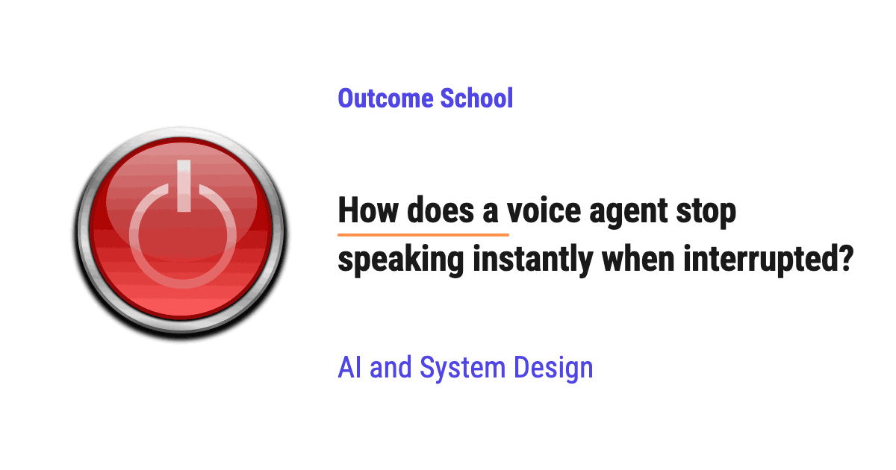

# How does a voice agent stop speaking instantly when interrupted?

> Archived from <https://outcomeschool.com/blog/stopping-speech-on-interruption> on 2026-11-25.

A voice agent stops speaking instantly when interrupted by throwing away every piece of audio that is waiting to be played, at every step between the agent and our ear, and by cancelling the work that would create more audio.

In this blog, we will learn about how a voice agent stops speaking instantly when interrupted. We will also see where the agent&#x27;s audio waits before we hear it, why stopping only the LLM is not enough, how the agent clears every waiting area in the right order, how it ignores late audio that is still on the way, how it remembers only what we actually heard, and where it works well and where it fails.

We will cover the following:
<ul><li>What does stopping instantly mean?</li><li>How a voice agent speaks</li><li>Where the audio waits before we hear it</li><li>Why stopping the LLM is not enough</li><li>Step 1: Stop the sound at our ear</li><li>Step 2: Clear the server buffer</li><li>Step 3: Cancel the work that makes new audio</li><li>Step 4: Ignore late audio with a reply number</li><li>Step 5: Remember only what was heard</li><li>Keeping the waiting areas small</li><li>A complete example</li><li>Where it works well and where it fails</li></ul>
I am <strong>Amit Shekhar</strong>, Founder @ <a target="_blank" rel="noopener noreferrer" href="https://outcomeschool.com">Outcome School</a>, I have taught and mentored many developers, and their efforts landed them high-paying tech jobs, helped many tech companies in solving their unique problems, and created many open-source libraries being used by top companies. I am passionate about sharing knowledge through open-source, blogs, and videos.

I teach <a target="_blank" rel="noopener noreferrer" href="https://outcomeschool.com/program/ai-and-machine-learning">AI and Machine Learning</a> at Outcome School.

Let&#x27;s get started.
<h2 id="what-does-stopping-instantly-mean">What does stopping instantly mean?</h2>
When we start speaking while the <a target="_blank" rel="noopener noreferrer" href="design-a-real-time-voice-ai-agent.md">voice agent</a> is still talking, it is called <a target="_blank" rel="noopener noreferrer" href="what-is-barge-in-in-a-voice-ai-agent.md"><strong>barge-in</strong></a>. The agent first has to detect that we really want to interrupt. That part is called <a target="_blank" rel="noopener noreferrer" href="interruption-vs-background-noise.md">barge-in detection</a>.

This blog is about what happens right after that. The agent has decided, &quot;The user is interrupting me.&quot; Now, it must go silent.

<strong>Stopping instantly means that the agent&#x27;s voice goes quiet within a fraction of a second after the agent decides to stop.</strong>

Let&#x27;s say we call a voice agent to book a flight. The agent says, &quot;We have flights at 6 AM, 9 AM, 1 PM, and 5 PM.&quot; After &quot;9 AM&quot;, we say, &quot;9 AM works.&quot;

If the agent goes silent right away, the call feels natural. If it keeps talking for two more seconds, &quot;1 PM, and 5 PM&quot;, we feel ignored. We start talking louder, or we repeat ourselves.

So, the question is: why would an agent keep talking after it has already decided to stop? To answer this, we must first see how a voice agent speaks.
<h2 id="how-a-voice-agent-speaks">How a voice agent speaks</h2>
A typical voice agent has three main parts:
<ul><li><strong>STT (Speech-to-Text):</strong> It listens to our voice and turns it into text.</li><li><strong><a target="_blank" rel="noopener noreferrer" href="large-language-model-llm.md">LLM (Large Language Model)</a>:</strong> It reads that text and writes a reply.</li><li><strong>TTS (Text-to-Speech):</strong> It turns the reply text into audio.</li></ul>
The agent keeps listening to our microphone even while it is speaking. This is how the agent notices that we have started to talk.

The LLM does not write the full reply at once. It writes it <a target="_blank" rel="noopener noreferrer" href="how-does-token-streaming-work.md">token by token</a>. The TTS does not wait for the full reply either. It <a target="_blank" rel="noopener noreferrer" href="streaming-tts.md">starts making audio as soon as it gets the first few words</a>. This is called <strong>streaming</strong>, and it helps the agent <a target="_blank" rel="noopener noreferrer" href="time-to-first-audio.md">start speaking quickly</a>.

The audio is made in <a target="_blank" rel="noopener noreferrer" href="audio-frames-and-chunk-sizes.md">small pieces called <strong>chunks</strong></a>. A chunk is often as small as 20 milliseconds of sound. These chunks travel from the agent&#x27;s server, over the internet or the phone network, to our phone or browser, and finally to our speaker.

Now, the TTS often makes audio several times faster than we can listen to it. Means, the audio is created faster than it is played. So, the extra audio has to wait somewhere.
<h2 id="where-the-audio-waits-before-we-hear-it">Where the audio waits before we hear it</h2>
A place where data waits before it is used is called a <strong>buffer</strong>. A voice agent has buffers at many steps.

The audio travels like below:

<pre><code class="code-highlight">+--------------------+
|        LLM         |
|  reply text queue  |
+--------------------+
          ↓
+--------------------+
|        TTS         |
|  audio being made  |
+--------------------+
          ↓
+--------------------+
|   Server buffer    |
|  chunks to send    |
+--------------------+
          ↓
+--------------------+
|      Network       |
|  chunks on the way |
+--------------------+
          ↓
+--------------------+
|   Device buffer    |
|  chunks to play    |
+--------------------+
          ↓
+--------------------+
|      Speaker       |
|   sound we hear    |
+--------------------+
</code></pre>

Here, we can see that the audio passes through many waiting areas:
<ul><li><strong>LLM text queue:</strong> Words the LLM has written, but the TTS has not turned into audio yet.</li><li><strong>TTS:</strong> Audio that the TTS is making right now.</li><li><strong>Server buffer:</strong> Audio chunks ready on the server, waiting to be sent.</li><li><strong>Network:</strong> Audio chunks already sent, travelling to our device.</li><li><strong>Device buffer:</strong> Audio chunks that reached our phone or browser and are waiting to be played. The phone network and the browser keep a small buffer on purpose, so that the sound does not break up when some chunks arrive late. This is often called a <a target="_blank" rel="noopener noreferrer" href="jitter-buffer.md"><strong>jitter buffer</strong></a>. On a phone call, a similar buffer also sits on the phone platform that connects the agent to the call.</li><li><strong>Speaker:</strong> The sound that is playing right now.</li></ul>
Each of these holds some audio. Together, they can hold several seconds of speech that the agent has already &quot;said&quot; but we have not heard yet.

<strong>Planning your move into AI?</strong>

No matter which tech domain you work in today, with your effort, you can transition to these roles:
<ul><li>AI Engineer</li><li>Forward Deployed Engineer</li><li>AI Agent Engineer</li><li>Harness Engineer</li><li>Voice AI Engineer</li><li>AI Architect</li><li>LLM Engineer</li><li>LLM Inference Engineer</li><li>Gen AI Engineer</li><li>MLOps Engineer</li><li>ML Engineer</li><li>Deep Learning Engineer</li></ul>
Our <a target="_blank" rel="noopener noreferrer" href="https://outcomeschool.com/program/ai-and-machine-learning">AI and Machine Learning Program</a> at Outcome School takes you there.
<h2 id="why-stopping-the-llm-is-not-enough">Why stopping the LLM is not enough</h2>
Most of the time, we do mistakes while building the stop logic for the first time. A common mistake is to stop only the LLM.

Let&#x27;s see what happens. The agent detects barge-in and stops the LLM. No new words are written. But the TTS is still turning the last sentence into audio. The server buffer still has 2 seconds of audio. The device buffer still has half a second of audio.

So, the user hears the agent continue for 2 or 3 more seconds after saying &quot;stop&quot;.

Another common mistake is to stop only on the server. The server stops sending, but the device still plays everything in its own buffer.

<strong>To stop instantly, the agent must empty every waiting area, starting from the one closest to our ear.</strong>

In practice, the agent does all the steps below within a few milliseconds of each other. But the order still matters, because the user notices the sound at the ear first. Now, let&#x27;s go through each step.
<h2 id="step-1-stop-the-sound-at-our-ear">Step 1: Stop the sound at our ear</h2>
The fastest way to make the agent go quiet is to stop the sound closest to the user. So, the first thing the agent does is stop the playback on the device and empty the device buffer.

If the device is a browser or a mobile app that we control, our code can do it directly. It stops the audio player and throws away the chunks waiting to be played.

If the user is on a phone call, our code cannot reach inside the user&#x27;s phone. Here, the audio first goes to a <a target="_blank" rel="noopener noreferrer" href="phone-calls-in-voice-agents.md">phone platform</a>, which holds its own buffer and then plays the audio into the call.

So, the agent sends a special message to the phone platform that says &quot;clear&quot;. For example, Twilio Media Streams supports a <code>clear</code> message. When the platform gets it, it throws away all the audio it was holding for that call.

There is one more detail. If we cut a sound wave suddenly in the middle, the speaker makes a tiny click. So, the agent can fade the volume down to zero over a few milliseconds instead of cutting it. A few milliseconds is too short for us to notice as a delay, but long enough to remove the click.
<h2 id="step-2-clear-the-server-buffer">Step 2: Clear the server buffer</h2>
Now, the sound at our ear has stopped. But the server buffer still has chunks that are ready to be sent. If we do nothing, the server will keep sending them, and the device will start playing again.

Let&#x27;s say the server buffer has 2 seconds of audio for the words &quot;1 PM, and 5 PM&quot;. So, the agent empties the server buffer as well. Every chunk that was waiting to be sent is thrown away, and those words never leave the server.

Many voice agent frameworks do this with a special <strong>interruption message</strong> that flows through the whole pipeline. Every part of the pipeline gets this message, drops whatever it was holding, and passes the message to the next part. This way, no part is forgotten.

<strong>A quick note for you</strong>

No matter which tech domain you work in, get familiar with these topics:
<ul><li>LLM</li><li>RAG</li><li>MCP</li><li>Agent</li><li>Fine-tuning</li><li>Quantization</li></ul>
We put it all together in one video:

<a target="_blank" rel="noopener noreferrer" href="https://www.youtube.com/watch?v=lnfWvX66FUk">AI Engineering Explained: LLM, RAG, MCP, Agent, Fine-Tuning, and Quantization</a>

No need to stop reading - bookmark it and watch later when you get time. Future you will thank you.

Now, let&#x27;s get back to the topic.
<h2 id="step-3-cancel-the-work-that-makes-new-audio">Step 3: Cancel the work that makes new audio</h2>
The waiting areas are empty now. But the LLM and the TTS are still working. If they keep going, they will fill the buffers again.

So, the agent cancels both of them:
<ul><li>It cancels the TTS request, so that no new audio is made.</li><li>It cancels the LLM request, so that no new words are written.</li></ul>
This has one more benefit. Many LLM and TTS services charge us for every token or every character they process. If the agent cancels them early, we do not pay for a reply that nobody will hear.

We have a detailed blog on <a target="_blank" rel="noopener noreferrer" href="sentence-chunking-for-tts.md">how sentence chunking feeds LLM output into TTS faster</a> that explains how the reply text moves from the LLM to the TTS step by step.
<h2 id="step-4-ignore-late-audio-with-a-reply-number">Step 4: Ignore late audio with a reply number</h2>
Now, there is one more case to handle. The agent cleared everything and cancelled the TTS. But a few chunks were already in the network when the agent cleared the buffers. They arrive at the device a moment later.

If the device plays them, the user hears a small piece of the old reply after silence.

So, here comes the reply number to the rescue. The agent gives every reply a number. Let&#x27;s say the old reply was reply number 7. Every chunk of that reply carries the number 7. When the user interrupts, the agent moves to reply number 8 and tells the device about it together with the stop message.

Now, the device follows one rule: <strong>play a chunk only if its reply number matches the current reply.</strong> Any late chunk with number 7 is thrown away.

We can write the code on the device as below:

<pre><code class="code-highlight language-python">current_reply = 8

def on_audio_chunk(chunk):
    if chunk.reply_number != current_reply:
        return  # old reply, throw it away
    player.play(chunk.audio)
</code></pre>

Here, we can see that the device checks the reply number of every chunk before playing it. A late chunk from reply 7 does not match the current reply 8, so it is dropped. This way, old audio is never played after the stop.
<h2 id="step-5-remember-only-what-was-heard">Step 5: Remember only what was heard</h2>
The agent is silent now. But there is one more thing to fix, and this one is about memory.

The LLM wrote the full sentence: &quot;We have flights at 6 AM, 9 AM, 1 PM, and 5 PM.&quot; But the user only heard &quot;We have flights at 6 AM, 9 AM&quot;. If the agent saves the full sentence in the <a target="_blank" rel="noopener noreferrer" href="ai-agent-memory.md">conversation history</a>, the LLM will believe it already told the user about 1 PM and 5 PM.

So, the agent must <a target="_blank" rel="noopener noreferrer" href="truncating-context-on-interruption.md">cut the saved reply to only the part that was actually played</a>. To do this, it needs to know how much audio was played before the stop. In an app, the device keeps count of the milliseconds of audio it played. On a phone call, the agent can send a <code>mark</code> message after its chunks, and Twilio sends that <code>mark</code> back when the audio before it has finished playing. Some TTS services also return timestamps that tell when each word starts in the audio. By matching the played time with the word timestamps, the agent finds the last word the user heard.

Then, the agent saves only that part in the history, like below:

<pre><code class="code-highlight">Agent: We have flights at 6 AM, 9 AM
User: 9 AM works.
</code></pre>

Now, the LLM knows exactly what the user heard, and its next reply makes sense. Some realtime APIs give us a direct way to do this. For example, the OpenAI Realtime API has a <code>conversation.item.truncate</code> event, where we send how many milliseconds of the reply were played, and it removes the rest.

To learn Memory in Agents, Agent Architecture, and how to Design a Real-Time Voice AI Agent, check out our <a target="_blank" rel="noopener noreferrer" href="https://outcomeschool.com/program/ai-and-machine-learning">AI and Machine Learning Program</a> at Outcome School.
<h2 id="keeping-the-waiting-areas-small">Keeping the waiting areas small</h2>
Now, there is a better approach too: do not let the waiting areas grow big in the first place.

The server does not need to send all the audio to the device the moment it is ready. Instead, it can send the audio at the same speed at which it is played, with only a small amount kept ahead. This is called <a target="_blank" rel="noopener noreferrer" href="tts-audio-buffering.md"><strong>pacing</strong></a>. It matters even more on phone calls, because some phone platforms accept many minutes of audio at once and queue all of it.

Let&#x27;s say the server keeps only about 200 milliseconds of audio ahead of the speaker. Then, even in the worst case, the device has very less audio to throw away. The rest stays on the server, where the agent can delete it right away.

But, if the waiting area is too small, a slow network makes the sound break up, because the next chunk does not arrive in time. So, there is a balance:
<ul><li><strong>Big buffer:</strong> Smooth sound on a slow network, but a slow stop.</li><li><strong>Small buffer:</strong> Fast stop, but the sound can break up on a slow network.</li></ul>
So, a good agent keeps a small buffer on the device and keeps the rest on the server.
<h2 id="a-complete-example">A complete example</h2>
Let&#x27;s put everything together with our flight booking call.

<strong>Step 1:</strong> The agent is saying, &quot;We have flights at 6 AM, 9 AM, 1 PM, and 5 PM.&quot; This is reply number 7.

<strong>Step 2:</strong> Right after &quot;9 AM&quot;, the user says, &quot;9 AM works.&quot; The agent detects a real interruption.

<strong>Step 3:</strong> In an app, the agent fades out the sound in a few milliseconds and empties the device buffer. On a phone call, it sends the <code>clear</code> message instead.

<strong>Step 4:</strong> The agent empties the server buffer.

<strong>Step 5:</strong> The agent cancels the TTS request and the LLM request.

<strong>Step 6:</strong> The agent moves to reply number 8 and tells the device. A late chunk from reply 7 arrives at the device and is thrown away.

<strong>Step 7:</strong> The device reports that it played 2,400 milliseconds of audio. The agent matches this with the word timestamps and saves &quot;We have flights at 6 AM, 9 AM&quot; in the history.

<strong>Step 8:</strong> The agent listens to the user&#x27;s full sentence and sends it to the LLM. Then, the agent replies: &quot;Great, I will book the 9 AM flight for you.&quot;

We can write the stop logic of the agent as below:

<pre><code class="code-highlight language-python">def on_interruption():
    device.fade_out_and_clear()   # stop the sound at the ear
    server_buffer.clear()         # drop chunks waiting to be sent
    tts.cancel()                  # no new audio
    llm.cancel()                  # no new words
    agent.reply_number += 1       # late chunks will be ignored
    heard = text_played_so_far()  # only what the user heard
    history.save_agent_reply(heard)
</code></pre>

Here, we can see that the lines follow Step 3 to Step 7 of the example, in the same order, starting from the one closest to the ear.

The user hears the agent stop right away, and the next reply makes sense. This is how a voice agent stops speaking instantly when interrupted.

<strong>Stay updated:</strong> Subscribe to our <a target="_blank" rel="noopener noreferrer" href="https://outcomeschool.substack.com/subscribe">newsletter</a> to get our latest AI and Machine Learning blogs straight to your inbox.
<h2 id="where-it-works-well-and-where-it-fails">Where it works well and where it fails</h2>
It works well when:
<ul><li>The agent controls the device, like a browser or a mobile app, so it can empty the device buffer directly.</li><li>The server paces the audio and keeps the device buffer small.</li><li>The TTS returns word timestamps, so the agent can save exactly what was heard.</li></ul>
It fails or gets harder when:
<ul><li>The phone network or the user&#x27;s phone adds its own small buffer that no message from the agent can clear, so the user hears a tiny bit of extra audio.</li><li>The network is slow and the device buffer must be large to keep the sound smooth.</li><li>The TTS does not return word timestamps, so the agent can only estimate where the user stopped listening, for example by assuming that every word takes the same time.</li><li>One part of the pipeline does not handle the interruption message, so old audio leaks through from that part.</li><li>The barge-in detection fires on a cough or a background noise, so the agent stops for nothing and its reply is thrown away. This is why some agents first lower the volume and <a target="_blank" rel="noopener noreferrer" href="false-interruption-recovery.md">stop fully only after the interruption is confirmed</a>.</li></ul>
Now we must have understood how a voice agent stops speaking instantly when interrupted, where the audio waits, how the agent clears it in the right order, and how it remembers only what we actually heard.
<h2 id="frequently-asked-questions">Frequently Asked Questions</h2><h3 id="what-is-the-clear-message-in-twilio-media-streams">What is the clear message in Twilio Media Streams?</h3>
The <code>clear</code> message tells the phone platform to throw away all the audio it was holding for that call. On a phone call, our code cannot reach inside the user&#x27;s phone, because the audio first goes to a phone platform that holds its own buffer. So, the agent sends <code>clear</code> to the platform, and the waiting audio is never played.
<h3 id="why-does-a-voice-agent-fade-out-its-voice-instead-of-cutting-it">Why does a voice agent fade out its voice instead of cutting it?</h3>
A voice agent fades out its voice to avoid a click. If we cut a sound wave suddenly in the middle, the speaker makes a tiny click. So, the agent fades the volume down to zero over a few milliseconds. This is too short for us to notice as a delay, but long enough to remove the click.
<h3 id="how-does-a-voice-agent-know-how-much-of-its-reply-was-played-on-a-phone-call">How does a voice agent know how much of its reply was played on a phone call?</h3>
It uses the <code>mark</code> message. The agent sends a <code>mark</code> message after its audio chunks, and Twilio sends that <code>mark</code> back when the audio before it has finished playing. Some TTS services also return timestamps for each word, so the agent can match the played time with the words and find the last word the user heard.
<h3 id="does-cancelling-the-llm-and-the-tts-early-save-money">Does cancelling the LLM and the TTS early save money?</h3>
Yes. Many LLM and TTS services charge us for every token or every character they process. When the agent cancels them as soon as the user interrupts, they stop processing the rest of the reply. So, we do not pay for a reply that nobody will hear.
<h3 id="what-is-a-jitter-buffer-in-a-voice-agent">What is a jitter buffer in a voice agent?</h3>
A jitter buffer is a small buffer that the phone network and the browser keep on purpose, so that the sound does not break up when some audio chunks arrive late. It holds a little audio before playing it. But this also means that some of the agent&#x27;s audio is still waiting there when the user interrupts.

That&#x27;s it for now.

Thanks

<strong>Amit Shekhar</strong> Founder @ <a target="_blank" rel="noopener noreferrer" href="https://outcomeschool.com">Outcome School</a>

You can connect with me on:
<ul><li><a target="_blank" rel="noopener noreferrer" href="https://x.com/amitiitbhu">X</a></li><li><a target="_blank" rel="noopener noreferrer" href="https://www.linkedin.com/in/amit-shekhar-iitbhu">LinkedIn</a></li><li><a target="_blank" rel="noopener noreferrer" href="https://github.com/amitshekhariitbhu">GitHub</a></li></ul>
Follow Outcome School on:
<ul><li><a target="_blank" rel="noopener noreferrer" href="https://x.com/outcome_school">X</a></li><li><a target="_blank" rel="noopener noreferrer" href="https://youtube.com/@OutcomeSchool">YouTube</a></li><li><a target="_blank" rel="noopener noreferrer" href="https://www.linkedin.com/company/outcomeschool">LinkedIn</a></li><li><a target="_blank" rel="noopener noreferrer" href="http://github.com/OutcomeSchool">GitHub</a></li></ul>
<a target="_blank" rel="noopener noreferrer" href="https://outcomeschool.com/blog"><strong>Read all of our high-quality blogs here.</strong></a>

