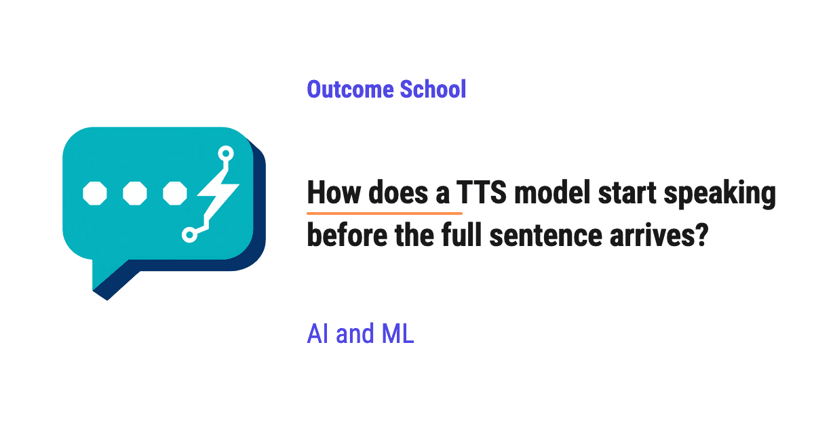

# How does a TTS model start speaking before the full sentence arrives?

> Archived from <https://outcomeschool.com/blog/streaming-tts> on 2026-11-25.

A TTS model starts speaking before the full sentence arrives by reading the text in small pieces as it comes in, staying only a few words behind the text, and turning each piece into sound while the rest of the sentence is still being written.

In this blog, we will learn about how a TTS model starts speaking before the full sentence arrives. We will also see why waiting for the full sentence makes a voice assistant feel slow, why a TTS model wants to see the future words, how speaking sentence by sentence and word by word compare, how a small lookahead of a few words solves the problem, how newer models read text and speak at the same time, and where it works well and where it fails.

We will cover the following:
<ul><li>The problem: the text arrives slowly</li><li>Why does a TTS model want the full sentence?</li><li>Approach 1: Wait for the full reply</li><li>Approach 2: Speak sentence by sentence</li><li>Approach 3: Speak word by word</li><li>Approach 4: Speak with a small lookahead</li><li>Approach 5: Models that read and speak at the same time</li><li>A walkthrough with numbers</li><li>Where it works well and where it fails</li></ul>
I am <strong>Amit Shekhar</strong>, Founder @ <a target="_blank" rel="noopener noreferrer" href="https://outcomeschool.com">Outcome School</a>, I have taught and mentored many developers, and their efforts landed them high-paying tech jobs, helped many tech companies in solving their unique problems, and created many open-source libraries being used by top companies. I am passionate about sharing knowledge through open-source, blogs, and videos.

I teach <a target="_blank" rel="noopener noreferrer" href="https://outcomeschool.com/program/ai-and-machine-learning">AI and Machine Learning</a> at Outcome School.

Let&#x27;s get started.
<h2 id="the-problem-the-text-arrives-slowly">The problem: the text arrives slowly</h2>
<strong>TTS (Text-to-Speech)</strong> is a model that takes text as input and gives us spoken audio as output.

Let&#x27;s say we are talking to a <a target="_blank" rel="noopener noreferrer" href="design-a-real-time-voice-ai-agent.md">voice assistant</a>. We ask a question. The assistant works like below:

<pre><code class="code-highlight">Our voice
    ↓
ASR (speech to text)
    ↓
LLM (writes the reply)
    ↓
TTS (text to speech)
    ↓
Speaker
</code></pre>

Here, the LLM (Large Language Model) does not write the whole reply at once. It writes the reply <a target="_blank" rel="noopener noreferrer" href="how-does-token-streaming-work.md">one token at a time</a>. A <a target="_blank" rel="noopener noreferrer" href="tokenization-in-llms.md">token</a> is a small piece of text, often a word or a part of a word.

So, the text reaches the TTS model a little at a time, like below:

<pre><code class="code-highlight">&quot;Sure,&quot;
&quot;Sure, the&quot;
&quot;Sure, the weather&quot;
&quot;Sure, the weather in&quot;
&quot;Sure, the weather in Delhi&quot;
&quot;Sure, the weather in Delhi is&quot;
...
</code></pre>

Now, the question is: when should the TTS model start speaking?

If it waits for the full reply, we sit in silence. If it starts too early, the voice sounds wrong.

Before jumping into the approaches, we must know why a TTS model wants the full sentence in the first place.
<h2 id="why-does-a-tts-model-want-the-full-sentence">Why does a TTS model want the full sentence?</h2>
A human reader looks ahead while reading aloud. Our eyes are always a few words ahead of our mouth. A TTS model also needs this future context, for three reasons.

<strong>Reason 1: Pronunciation depends on the next words.</strong>

Consider the word &quot;read&quot;.
<ul><li>&quot;I read books every day.&quot; Here, &quot;read&quot; sounds like &quot;reed&quot;.</li><li>&quot;I read that book last year.&quot; Here, &quot;read&quot; sounds like &quot;red&quot;.</li></ul>
When the TTS model sees only &quot;I read&quot;, it cannot know which sound is correct. The answer is in the words that come later.

<strong>Reason 2: The tune of the sentence depends on the end.</strong>

The rise and fall of our voice is called <strong>prosody</strong>. It includes pitch, speed, pauses, and stress on words.

Consider these two sentences:
<ul><li>&quot;You are coming tomorrow.&quot;</li><li>&quot;You are coming tomorrow?&quot;</li></ul>
The words are the same. Only the last mark is different. But, the second one is a question, so our voice rises at the end. The TTS model learns this only when it sees the question mark at the very end.

<strong>Reason 3: Numbers and short forms depend on context.</strong>

Consider &quot;Dr.&quot; and &quot;St.&quot;. &quot;Dr.&quot; can mean &quot;Doctor&quot; or &quot;Drive&quot;. And, a number like &quot;2025&quot; can be read as &quot;two thousand twenty-five&quot; or &quot;twenty twenty-five&quot;. The TTS model needs the nearby words to decide.

Most TTS models are trained on full sentences, so they always see the future words. This is the reason they sound natural, and this is also the reason they are slow to start.

Now, let&#x27;s see the approaches one by one.
<h2 id="approach-1-wait-for-the-full-reply">Approach 1: Wait for the full reply</h2>
This is the simplest approach. We wait until the LLM finishes the whole reply, and then give the full text to the TTS model.

<pre><code class="code-highlight">LLM writes the full reply (3 seconds)
    ↓
TTS creates the full audio (1 second)
    ↓
Audio starts playing
</code></pre>

Here, the user hears nothing for about 4 seconds. In a conversation, this feels very slow. A normal <a target="_blank" rel="noopener noreferrer" href="what-is-turn-taking-in-a-voice-ai-agent.md">pause between two people talking</a> is usually well under a second.

<strong>Advantage:</strong> The voice sounds the most natural, because the TTS model sees everything.

<strong>Disadvantage:</strong> The silence before the first sound grows with the length of the reply. A long reply means a long wait.

The time from the end of our question to the first sound we hear is called <strong><a target="_blank" rel="noopener noreferrer" href="time-to-first-audio.md">time to first audio</a></strong>. This is the number we want to make small. We have a detailed blog on <a target="_blank" rel="noopener noreferrer" href="voice-agent-latency-budget.md">how to build a latency budget for a voice AI agent</a> that explains how each step adds to the wait.

The issue with this approach is that the user waits for the whole reply. Let&#x27;s see how the next approach solve this issue.
<h2 id="approach-2-speak-sentence-by-sentence">Approach 2: Speak sentence by sentence</h2>
Here, we wait only for the first full sentence. We keep collecting the text from the LLM in a buffer until a sentence is complete. As soon as we see a sentence-ending mark like &quot;.&quot;, &quot;?&quot; or &quot;!&quot;, we send that sentence to the TTS model.

Let&#x27;s see the idea in code as below:

<pre><code class="code-highlight language-python">buffer = &quot;&quot;

for token in llm_stream():
    buffer += token
    if buffer.strip().endswith((&quot;.&quot;, &quot;?&quot;, &quot;!&quot;)):
        audio = tts.synthesize(buffer)
        play(audio)
        buffer = &quot;&quot;
</code></pre>

Here, we have:
<ul><li><code>llm_stream()</code> gives us one token at a time from the LLM.</li><li><code>buffer</code> collects the tokens.</li><li>When the buffer ends with a sentence-ending mark, we send it to <code>tts.synthesize()</code>.</li><li>We play the audio and empty the buffer for the next sentence.</li></ul>
For the sake of understanding, the code is kept simple. In a real system, <code>play()</code> runs in the background, so the loop keeps reading new tokens while the audio plays.

So, while the first sentence is playing, the LLM keeps writing the second sentence, and the next audio is usually ready by the time the first one ends.

<strong>Planning your move into AI?</strong>

No matter which tech domain you work in today, with your effort, you can transition to these roles:
<ul><li>AI Engineer</li><li>Forward Deployed Engineer</li><li>AI Agent Engineer</li><li>Harness Engineer</li><li>Voice AI Engineer</li><li>AI Architect</li><li>LLM Engineer</li><li>LLM Inference Engineer</li><li>Gen AI Engineer</li><li>MLOps Engineer</li><li>ML Engineer</li><li>Deep Learning Engineer</li></ul>
Our <a target="_blank" rel="noopener noreferrer" href="https://outcomeschool.com/program/ai-and-machine-learning">AI and Machine Learning Program</a> at Outcome School takes you there.

<strong>Advantage:</strong> Each sentence is complete, so the model gets all the hints it needs for the pronunciation and the tune.

<strong>Disadvantage:</strong> We still wait for the full first sentence. If the first sentence is long, the wait is long.

<strong>Note:</strong> Real systems also split at commas when a sentence grows too long, but the wait still depends on how long the first piece is. Also, a simple rule like ours splits wrongly at short forms like &quot;Dr.&quot;, so real systems use better sentence splitters.

This approach is very common in voice assistants, because it is simple and it works with any TTS model. We have a detailed blog on <a target="_blank" rel="noopener noreferrer" href="sentence-chunking-for-tts.md">how sentence chunking feeds LLM output into TTS faster</a> that explains this step by step.

The issue with this approach is that the time to first audio still depends on the length of the first sentence. Let&#x27;s see how the next approach solve this issue.
<h2 id="approach-3-speak-word-by-word">Approach 3: Speak word by word</h2>
Now, let&#x27;s go to the other extreme. We send every word to the TTS model the moment it arrives.

<pre><code class="code-highlight">Arrives: &quot;Sure,&quot;     Speaks: &quot;Sure,&quot;
Arrives: &quot;the&quot;       Speaks: &quot;the&quot;
Arrives: &quot;weather&quot;   Speaks: &quot;weather&quot;
</code></pre>

<strong>Advantage:</strong> The time to first audio is very small. We start speaking right after the first word.

<strong>Disadvantage:</strong> The voice sounds broken and robotic.

Why? Because each word is spoken alone, without any idea of what comes next. All three reasons that we learned earlier come back:
<ul><li>&quot;I read&quot; is said with a guess, and the guess is often wrong.</li><li>The voice does not rise for a question, because the question mark has not arrived yet.</li><li>&quot;Dr.&quot; is read without knowing whether it means &quot;Doctor&quot; or &quot;Drive&quot;.</li></ul>
On top of this, each word gets its own little start and end, so there is no smooth flow between words.

The issue with this approach is that the TTS model sees no future at all. Let&#x27;s see how the next approach solve this issue.
<h2 id="approach-4-speak-with-a-small-lookahead">Approach 4: Speak with a small lookahead</h2>
Here comes the lookahead into the picture.

<strong>Lookahead means that before the TTS model speaks a word, it waits until it has seen a few more words after it.</strong>

So, we do not wait for the full sentence, and we do not speak each word alone. We stay just a few words behind the text, like a human reader whose eyes are a little ahead of the mouth.

<strong>A quick note for you</strong>

No matter which tech domain you work in, get familiar with these topics:
<ul><li>LLM</li><li>RAG</li><li>MCP</li><li>Agent</li><li>Fine-tuning</li><li>Quantization</li></ul>
We put it all together in one video:

<a target="_blank" rel="noopener noreferrer" href="https://www.youtube.com/watch?v=lnfWvX66FUk">AI Engineering Explained: LLM, RAG, MCP, Agent, Fine-Tuning, and Quantization</a>

No need to stop reading - bookmark it and watch later when you get time. Future you will thank you.

Now, let&#x27;s get back to the topic.

Researchers from Baidu described this idea in the 2020 paper &quot;Incremental Text-to-Speech Synthesis with Prefix-to-Prefix Framework&quot;. <strong>Incremental TTS</strong> means creating speech piece by piece as the text arrives. A <strong>prefix</strong> is the beginning part of a sentence. Means, the model creates the beginning of the audio from only the beginning of the text, and it keeps going as more text arrives. In their tests on English and Chinese, a lookahead of just 1 or 2 words gave speech that sounded close to full-sentence TTS.

Let&#x27;s say our lookahead is 2 words. Then, it works like below:

<pre><code class="code-highlight">Text seen so far:  &quot;I&quot;
Spoken so far:     (nothing yet)

Text seen so far:  &quot;I read&quot;
Spoken so far:     (nothing yet)

Text seen so far:  &quot;I read that&quot;
Spoken so far:     &quot;I&quot;

Text seen so far:  &quot;I read that book&quot;
Spoken so far:     &quot;I read&quot;

Text seen so far:  &quot;I read that book last&quot;
Spoken so far:     &quot;I read that&quot;
</code></pre>

Here, we can see that the word &quot;read&quot; is spoken only after the model has seen &quot;that book&quot;. Now, the model has more context to pick the right sound. But, the clearest hint here is &quot;last year&quot;, which is 4 words away. A lookahead of 2 words does not reach it, so the model must still guess. We will come back to this in the failure cases.

One more thing to notice: the model does not throw away the audio it has already made. It keeps the earlier audio and continues smoothly from where it left off. So, the joins between words sound natural.

The best part is that the wait no longer depends on the length of the sentence. It depends only on the lookahead. Whether the sentence has 5 words or 50 words, we start speaking after the first few words.

Let me tabulate the differences between the first four approaches for your better understanding.
<table><thead><tr><th>Approach</th><th>When does speech start?</th><th>How natural is the voice?</th></tr></thead><tbody><tr><td>Wait for full reply</td><td>After the whole reply</td><td>Most natural</td></tr><tr><td>Sentence by sentence</td><td>After the first sentence</td><td>Natural</td></tr><tr><td>Word by word</td><td>After the first word</td><td>Broken and robotic</td></tr><tr><td>Small lookahead</td><td>After the first few words</td><td>Close to natural</td></tr></tbody></table>
The issue with this approach is that the TTS model was trained on full sentences. When we feed it half sentences, it is seeing something they did not see during training, and this can hurt the quality. Let&#x27;s see how the next approach solve this issue.
<h2 id="approach-5-models-that-read-and-speak-at-the-same-time">Approach 5: Models that read and speak at the same time</h2>
The newer idea is to train the model itself to take in text and give out audio at the same time. Such models are often called <strong>dual-streaming</strong> or <strong>bistreaming</strong> TTS models. These models handle two streams at once: text coming in and audio going out.

Before jumping into how they work, we must know about <strong>speech tokens</strong>. Many modern TTS models do not create sound waves directly. First, they create speech tokens, which are small codes, and each code stands for a tiny slice of sound. Then, a second part turns these codes into the actual sound wave, chunk by chunk, so the sound can start playing early.

Now, let&#x27;s see two ways to do this.

<strong>Way 1: Interleaving text tokens and speech tokens.</strong>

CosyVoice 2, a TTS model from Alibaba, does this. During training, it mixes text tokens and speech tokens in a fixed ratio. In the paper, the ratio is 5 text tokens followed by 15 speech tokens. CosyVoice 2 makes 25 speech tokens for every second of audio, so 15 speech tokens are about 0.6 seconds of speech.

<pre><code class="code-highlight">5 text tokens
    ↓
15 speech tokens
    ↓
next 5 text tokens
    ↓
next 15 speech tokens
    ↓
...
</code></pre>

Here, the model learns a simple habit: read a little text, speak a little audio, read a little more, speak a little more. So, at the time of use, it does not need the full sentence. It needs only the next 5 text tokens to produce the next 15 speech tokens. When the model is ready for more text, it outputs a special <strong>filling token</strong>, which tells the system to bring in the next 5 text tokens.

<strong>Way 2: A fixed delay between the text and the audio.</strong>

Delayed Streams Modeling from Kyutai, an AI research lab in Paris, does this. It puts text and audio on the same clock, and the audio stream is kept a fixed number of steps behind the text stream. So, when the model speaks a moment of audio, it has already read a little bit of the text that comes after it.

This is the same lookahead idea from Approach 4. The difference is that the model is trained with this delay from the very start, so the half sentence is normal for it, not a surprise.

<strong>Advantage:</strong> The voice sounds natural, and the first audio comes quickly.

<strong>Disadvantage:</strong> We need a model that is trained this way. We cannot take any TTS model and get this behavior.

To learn Multimodal Generative Models and how to Design a Real-Time Voice AI Agent end to end, check out our <a target="_blank" rel="noopener noreferrer" href="https://outcomeschool.com/program/ai-and-machine-learning">AI and Machine Learning Program</a> at Outcome School.

Now, let&#x27;s see a walkthrough with numbers.
<h2 id="a-walkthrough-with-numbers">A walkthrough with numbers</h2>
Let&#x27;s say the LLM writes 10 tokens per second, and the reply is:

&quot;Sure, the weather in Delhi is sunny today, with a high of thirty degrees.&quot;

For the sake of understanding, let&#x27;s treat every word as one token. This reply has 14 tokens. Let&#x27;s also assume that the TTS model takes 0.2 seconds to create the first piece of audio once it has the text it needs.

<strong>Approach 1: Wait for the full reply.</strong>
<ul><li>The LLM takes 14 / 10 = 1.4 seconds to write all 14 tokens.</li><li>Then, the TTS model takes 0.2 seconds to create the first piece of audio.</li><li>The first sound comes at about 1.4 + 0.2 = 1.6 seconds.</li></ul>
<strong>Approach 2: Sentence by sentence.</strong>
<ul><li>This reply is one sentence, so this is the same as Approach 1.</li><li>The first sound comes at about 1.6 seconds.</li></ul>
<strong>Approach 4: Lookahead of 2 words.</strong>
<ul><li>To speak the first word &quot;Sure,&quot;, we need to see 2 more words, &quot;the weather&quot;. That is 3 tokens.</li><li>The LLM takes 3 / 10 = 0.3 seconds to write them.</li><li>The first sound comes at about 0.3 + 0.2 = 0.5 seconds.</li></ul>
<strong>Approach 5: Interleaving 5 text tokens with 15 speech tokens.</strong>
<ul><li>The model needs the first 5 text tokens before it speaks.</li><li>The LLM takes 5 / 10 = 0.5 seconds to write them.</li><li>The first sound comes at about 0.5 + 0.2 = 0.7 seconds.</li></ul>
Here, we can notice that reading ahead by only a few tokens brings the first sound from 1.6 seconds down to 0.5 or 0.7 seconds. And, if the reply had 3 sentences, Approach 1 would get much slower, but Approach 4 and Approach 5 would still start at the same time.

<strong>Stay updated:</strong> Subscribe to our <a target="_blank" rel="noopener noreferrer" href="https://outcomeschool.substack.com/subscribe">newsletter</a> to get our latest AI and Machine Learning blogs straight to your inbox.
<h2 id="where-it-works-well-and-where-it-fails">Where it works well and where it fails</h2>
<strong>It works well when:</strong>
<ul><li>The reply comes from an LLM, token by token, in a live conversation.</li><li>The hints that a word needs are close to it, within the next few words.</li><li>The text is plain and simple, without many numbers or short forms.</li></ul>
<strong>It fails or struggles when:</strong>
<ul><li>The meaning of an early word depends on a word far ahead. A lookahead of 2 or 3 words cannot see that far, so the model must guess.</li><li>The question mark arrives at the very end. With a short lookahead, the model learns that it is a question only near the end, so the earlier part of the sentence is already spoken in the tune of a normal statement.</li><li>In some languages, like Hindi and Japanese, the verb often comes at the end of the sentence. The model sees the main action only at the end, and the tune of the whole sentence depends on it.</li><li>The text has things like &quot;2025&quot;, &quot;Dr.&quot; or &quot;$5.50&quot; that often need the words after them to be read correctly.</li></ul>
So, there is always a balance between speed and quality. A bigger lookahead gives better speech but a longer wait. A smaller lookahead gives a faster start but more mistakes. We must choose the lookahead based on our use case.

Now we must have understood how a TTS model starts speaking before the full sentence arrives, why it wants the future words, and how a small lookahead lets it speak early while still sounding natural.
<h2 id="frequently-asked-questions">Frequently Asked Questions</h2><h3 id="what-is-time-to-first-audio-in-a-voice-assistant">What is time to first audio in a voice assistant?</h3>
Time to first audio is the time from the end of our question to the first sound we hear. This is the number we want to make small. When we wait for the full reply, it grows with the length of the reply. With a small lookahead, it depends only on the lookahead, not on the length of the sentence.
<h3 id="what-is-prosody-in-tts">What is prosody in TTS?</h3>
Prosody is the rise and fall of our voice. It includes pitch, speed, pauses, and stress on words. For example, in &quot;You are coming tomorrow?&quot; our voice rises at the end because it is a question. A TTS model learns this only when it sees the question mark at the very end of the sentence.
<h3 id="what-are-speech-tokens-in-a-tts-model">What are speech tokens in a TTS model?</h3>
Speech tokens are small codes, and each code stands for a tiny slice of sound. Many modern TTS models do not create sound waves directly. First, they create speech tokens. Then, a second part turns these codes into the actual sound wave, chunk by chunk, so the sound can start playing early.
<h3 id="how-many-words-of-lookahead-does-a-tts-model-need">How many words of lookahead does a TTS model need?</h3>
Only a few. In the Baidu paper on incremental TTS, a lookahead of just 1 or 2 words gave speech that sounded close to full-sentence TTS in their tests on English and Chinese. A bigger lookahead gives better speech but a longer wait, and a smaller lookahead gives a faster start but more mistakes.
<h3 id="what-is-a-filling-token-in-cosyvoice-2">What is a filling token in CosyVoice 2?</h3>
A filling token is a special token that CosyVoice 2 outputs when it is ready for more text. It tells the system to bring in the next 5 text tokens. This fits the habit the model learns during training: read a little text, speak a little audio, read a little more, and speak a little more.

That&#x27;s it for now.

Thanks

<strong>Amit Shekhar</strong> Founder @ <a target="_blank" rel="noopener noreferrer" href="https://outcomeschool.com">Outcome School</a>

You can connect with me on:
<ul><li><a target="_blank" rel="noopener noreferrer" href="https://x.com/amitiitbhu">X</a></li><li><a target="_blank" rel="noopener noreferrer" href="https://www.linkedin.com/in/amit-shekhar-iitbhu">LinkedIn</a></li><li><a target="_blank" rel="noopener noreferrer" href="https://github.com/amitshekhariitbhu">GitHub</a></li></ul>
Follow Outcome School on:
<ul><li><a target="_blank" rel="noopener noreferrer" href="https://x.com/outcome_school">X</a></li><li><a target="_blank" rel="noopener noreferrer" href="https://youtube.com/@OutcomeSchool">YouTube</a></li><li><a target="_blank" rel="noopener noreferrer" href="https://www.linkedin.com/company/outcomeschool">LinkedIn</a></li><li><a target="_blank" rel="noopener noreferrer" href="http://github.com/OutcomeSchool">GitHub</a></li></ul>
<a target="_blank" rel="noopener noreferrer" href="https://outcomeschool.com/blog"><strong>Read all of our high-quality blogs here.</strong></a>

