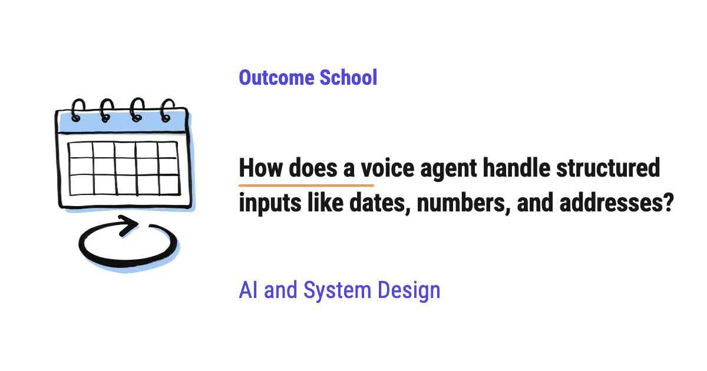

# How does a voice agent handle structured inputs like dates, numbers, and addresses?

> Archived from <https://outcomeschool.com/blog/structured-inputs-in-voice-agents> on 2026-11-25.

A voice agent handles structured inputs like dates, numbers, and addresses by converting the spoken words into a fixed format, checking that the value is valid, and reading it back to the caller to confirm it before using it.

In this blog, we will learn about how a voice agent handles structured inputs like dates, numbers, and addresses. We will also see why these inputs are hard to capture over a call, how spoken words are turned into written values, how the LLM fills the right fields, how the agent checks and confirms each value, how it speaks these values back clearly, and the tricks that make dates, phone numbers, spellings, and addresses work reliably.

We will cover the following:
<ul><li>What is a structured input?</li><li>Why structured inputs are hard for a voice agent</li><li>The journey of a spoken value</li><li>Turning spoken words into written values</li><li>Filling the fields with the LLM</li><li>Checking the value</li><li>Confirming with the caller</li><li>Speaking structured values back</li><li>Handling dates</li><li>Handling numbers and phone numbers</li><li>Handling names, spellings, and addresses</li></ul>
I am <strong>Amit Shekhar</strong>, Founder @ <a target="_blank" rel="noopener noreferrer" href="https://outcomeschool.com">Outcome School</a>, I have taught and mentored many developers, and their efforts landed them high-paying tech jobs, helped many tech companies in solving their unique problems, and created many open-source libraries being used by top companies. I am passionate about sharing knowledge through open-source, blogs, and videos.

I teach <a target="_blank" rel="noopener noreferrer" href="https://outcomeschool.com/program/ai-and-machine-learning">AI and Machine Learning</a> at Outcome School.

Let&#x27;s get started.
<h2 id="what-is-a-structured-input">What is a structured input?</h2>
<strong>A structured input is a piece of information that must follow a fixed format, so that a computer can use it directly.</strong>

A date, a phone number, an order ID, an amount of money, a zip code, and an address are all structured inputs. Each one has rules. A date has a day, a month, and a year. A phone number has a fixed number of digits. An order ID has an exact set of letters and digits.

Let&#x27;s say a caller wants to book a doctor&#x27;s appointment. The booking system does not understand &quot;sometime next Tuesday afternoon&quot;. It needs a value like below:

<pre><code class="code-highlight language-json">{ &quot;date&quot;: &quot;2026-10-27&quot;, &quot;time&quot;: &quot;15:00&quot; }
</code></pre>

So, the voice agent must listen to the caller, who speaks freely, and produce this exact value. If even one digit is wrong, the appointment is booked on the wrong day.
<h2 id="why-structured-inputs-are-hard-for-a-voice-agent">Why structured inputs are hard for a voice agent</h2>
In a chat app, the user types &quot;27/10/2026&quot; and the text is already there. On a phone call, the agent only gets sound. Many things can go wrong between the sound and the final value.
<ul><li><strong>Many ways to say the same thing:</strong> &quot;October twenty seventh&quot;, &quot;the twenty seventh of October&quot;, &quot;next Tuesday&quot;, and &quot;27th&quot; can all mean the same date.</li><li><strong>Sounds that are close to each other:</strong> &quot;fifteen&quot; and &quot;fifty&quot;, &quot;B&quot; and &quot;D&quot;, &quot;M&quot; and &quot;N&quot; sound very similar, and that too over a noisy phone line.</li><li><strong>Phone audio is poor:</strong> a phone call carries less sound detail than a normal recording, so the <a target="_blank" rel="noopener noreferrer" href="phone-audio-and-speech-recognition.md">speech recognition makes more mistakes</a>.</li><li><strong>No screen to look at:</strong> the caller cannot see what the agent heard. A wrong digit stays hidden unless the agent says it back.</li><li><strong>People correct themselves:</strong> &quot;My number is 98... sorry, 89...&quot; The agent must keep the corrected value, not the first one.</li></ul>
One wrong word in a normal conversation is usually fine, because the meaning still comes through. One wrong digit in a phone number is not fine, because the whole value becomes useless. This is why structured inputs need special handling.
<h2 id="the-journey-of-a-spoken-value">The journey of a spoken value</h2>
Before jumping into each step, we must see the full path that a spoken value takes inside a voice agent.

<pre><code class="code-highlight">Caller speaks into the phone
        ↓
Speech-to-Text (STT)
        ↓
Spoken form: &quot;my birthday is march fifth nineteen ninety&quot;
        ↓
Inverse Text Normalization (ITN)
        ↓
Written form: &quot;my birthday is March 5th 1990&quot;
        ↓
LLM extracts the field
        ↓
{ &quot;date_of_birth&quot;: &quot;1990-03-05&quot; }
        ↓
Our code checks the value
        ↓
Agent confirms: &quot;That is March fifth, nineteen ninety. Is that right?&quot;
        ↓
Caller says: &quot;Yes&quot;
        ↓
Value is saved
</code></pre>

Here, we can see five steps: hearing, converting, extracting, checking, and confirming. We have a detailed blog on <a target="_blank" rel="noopener noreferrer" href="design-a-real-time-voice-ai-agent.md">how to design a real-time voice AI agent</a> that covers the full pipeline end to end.

Now, let&#x27;s understand each step one by one.
<h2 id="turning-spoken-words-into-written-values">Turning spoken words into written values</h2>
The first step is Speech-to-Text (STT), which turns the caller&#x27;s voice into text.

When we speak, we never say digits or symbols. We say words. So, the raw output of speech recognition is often in <strong>spoken form</strong> like below:

<pre><code class="code-highlight">five hundred dollars on october twenty seventh at three thirty pm
</code></pre>

But our code needs the <strong>written form</strong> like below:

<pre><code class="code-highlight">$500 on October 27 at 3:30 PM
</code></pre>

The process of converting the spoken form into the written form is called <strong>Inverse Text Normalization (ITN)</strong>.

For example, ITN turns &quot;twenty seven&quot; into &quot;27&quot;, &quot;three thirty pm&quot; into &quot;3:30 PM&quot;, and &quot;at gmail dot com&quot; into &quot;@gmail.com&quot;.

It is called &quot;inverse&quot; because <strong>Text Normalization</strong> is the opposite direction. Text Normalization turns &quot;$500&quot; into &quot;five hundred dollars&quot; so that a voice can speak it. We will see that direction later in this blog.

Many speech recognition services provide ITN as an option, often called smart formatting.

<strong>Note:</strong> ITN also has to guess. &quot;One twenty&quot; can be &quot;120&quot; or &quot;1:20&quot;. &quot;Twenty twenty&quot; can be the year &quot;2020&quot; or the two numbers &quot;20 20&quot;. So, ITN gives us a better starting point, but it does not give us a final, trusted value.

<strong>Planning your move into AI?</strong>

No matter which tech domain you work in today, with your effort, you can transition to these roles:
<ul><li>AI Engineer</li><li>Forward Deployed Engineer</li><li>AI Agent Engineer</li><li>Harness Engineer</li><li>Voice AI Engineer</li><li>AI Architect</li><li>LLM Engineer</li><li>LLM Inference Engineer</li><li>Gen AI Engineer</li><li>MLOps Engineer</li><li>ML Engineer</li><li>Deep Learning Engineer</li></ul>
Our <a target="_blank" rel="noopener noreferrer" href="https://outcomeschool.com/program/ai-and-machine-learning">AI and Machine Learning Program</a> at Outcome School takes you there.
<h2 id="filling-the-fields-with-the-llm">Filling the fields with the LLM</h2>
Now, we have text. The next step is to pull the exact value out of that text and put it in the right place.

The process of picking out each required value from what the caller says is called <strong>slot filling</strong>. Each required value is a slot. For a booking, the slots are the date, the time, and the patient name.

Here comes the <a target="_blank" rel="noopener noreferrer" href="large-language-model-llm.md">LLM (Large Language Model)</a> into the picture. We describe the slots to the LLM as a <a target="_blank" rel="noopener noreferrer" href="function-calling-in-voice-agents.md">tool</a>. A tool is a function in our code, and the LLM can recommend calling it with the right input. We describe the tool with a clear format, like below:

<pre><code class="code-highlight language-json">{
  &quot;name&quot;: &quot;book_appointment&quot;,
  &quot;parameters&quot;: {
    &quot;date&quot;: { &quot;type&quot;: &quot;string&quot;, &quot;description&quot;: &quot;Date in YYYY-MM-DD format&quot; },
    &quot;time&quot;: { &quot;type&quot;: &quot;string&quot;, &quot;description&quot;: &quot;Time in 24-hour HH:MM format&quot; },
    &quot;patient_name&quot;: { &quot;type&quot;: &quot;string&quot; }
  }
}
</code></pre>

Here, we have told the LLM exactly what each slot looks like. The <code>description</code> field tells the LLM to write the date as &quot;2026-10-27&quot; and not as &quot;Tuesday the twenty seventh&quot;.

When the caller says &quot;Book me for Tuesday the twenty seventh at three in the afternoon&quot;, the slots that the LLM has filled so far look like below:

<pre><code class="code-highlight language-json">{ &quot;date&quot;: &quot;2026-10-27&quot;, &quot;time&quot;: &quot;15:00&quot;, &quot;patient_name&quot;: null }
</code></pre>

Here, we can notice that the patient name is missing. We instruct the LLM to leave a slot empty when the caller has not said it, instead of inventing a value. So, before recommending the tool, the agent asks the next question: &quot;Sure. May I have the patient&#x27;s name, please?&quot;

The LLM also sees the full text of what the caller said. So, when the caller says &quot;My number is 98... sorry, 89...&quot;, the LLM can keep only the corrected digits.

This is how the agent collects the slots one by one, in a natural conversation, until all the required slots are filled. We have a detailed blog on <a target="_blank" rel="noopener noreferrer" href="conversation-state-in-voice-agents.md">how a voice agent manages conversation state across a long call</a> that explains how these slots stay exact even when the call goes on for a long time.

<strong>Note:</strong> The LLM never runs the booking itself. The LLM recommends the tool and its input, and our code runs it. This gives our code a chance to check the value first.

To learn AI Agents, Tool use in Agents, and Prompt Engineering, and to build an AI Coding Agent from scratch, check out our <a target="_blank" rel="noopener noreferrer" href="https://outcomeschool.com/program/ai-and-machine-learning">AI and Machine Learning Program</a> at Outcome School.
<h2 id="checking-the-value">Checking the value</h2>
The LLM can still make mistakes. It can write &quot;2026-02-30&quot;, which is not a real date. It can drop a digit from a phone number. So, before we use any value, our code must check it.

We can write the check as below:

<pre><code class="code-highlight language-python">from datetime import date

def check_appointment_date(value):
    try:
        booking_date = date.fromisoformat(value)
    except ValueError:
        return &quot;invalid_format&quot;
    if booking_date &lt; date.today():
        return &quot;date_in_past&quot;
    return &quot;ok&quot;
</code></pre>

Here, we have done two checks:
<ul><li><code>date.fromisoformat</code> checks that the value is a real date in the YYYY-MM-DD format. &quot;2026-02-30&quot; fails here.</li><li>The second check makes sure the date is not in the past, because we cannot book an appointment for yesterday.</li></ul>
If the check fails, our code sends the reason back to the LLM. The LLM then asks the caller again in a polite way: &quot;Sorry, that date does not look right. Could you tell me the date again?&quot;

Similarly, we can check other values:
<ul><li>A phone number must have the right number of digits for its country.</li><li>An order ID must match the pattern our system uses, for example two letters and six digits.</li><li>An amount must be a positive number within our allowed limit.</li><li>An address can be checked with an address lookup service to see that it exists.</li></ul>
This way, a wrong value is caught by our code before it reaches the booking system.
<h2 id="confirming-with-the-caller">Confirming with the caller</h2>
A value can pass every check and still be wrong. &quot;March fifth&quot; and &quot;March fifteenth&quot; are both valid dates. Only the caller knows which one is correct.

So, the agent needs a <a target="_blank" rel="noopener noreferrer" href="confirm-and-correct-in-voice-agents.md">confirmation step</a>. The agent reads the value back and asks the caller to confirm it.

There are two common ways to confirm:
<ul><li><strong>Explicit confirmation:</strong> the agent asks a direct yes or no question. &quot;I have your phone number as nine eight seven six five, four three two one zero. Is that correct?&quot;</li><li><strong>Implicit confirmation:</strong> the agent repeats the value inside the next sentence and moves on. &quot;Great, booking you for Tuesday, October twenty seventh at three PM. And what is the patient&#x27;s name?&quot; If the value is wrong, the caller can correct it right away.</li></ul>
For values where a mistake is costly, like a phone number, an amount of money, or a card number, we use explicit confirmation. For values where a mistake is cheap and easy to fix, we use implicit confirmation, so that the call does not feel slow.

When the caller says &quot;No, it is fifteenth, not fifth&quot;, the agent updates only that one slot and confirms it again. If the caller only says &quot;No&quot;, the agent asks for that one value again. It does not start the whole process from the beginning.

<strong>A quick note for you</strong>

No matter which tech domain you work in, get familiar with these topics:
<ul><li>LLM</li><li>RAG</li><li>MCP</li><li>Agent</li><li>Fine-tuning</li><li>Quantization</li></ul>
We put it all together in one video:

<a target="_blank" rel="noopener noreferrer" href="https://www.youtube.com/watch?v=lnfWvX66FUk">AI Engineering Explained: LLM, RAG, MCP, Agent, Fine-Tuning, and Quantization</a>

No need to stop reading - bookmark it and watch later when you get time. Future you will thank you.

Now, let&#x27;s get back to the topic.
<h2 id="speaking-structured-values-back">Speaking structured values back</h2>
Now, it&#x27;s time to learn about the opposite direction. When the agent reads a value back, it uses Text-to-Speech (TTS), which turns text into voice.

If we give the TTS the text &quot;Your appointment is on 10/27 at 3:30&quot;, it has to guess how to read &quot;10/27&quot;. It can say &quot;ten slash twenty seven&quot; or &quot;ten twenty seven&quot;. Neither one sounds natural.

This is where <strong>Text Normalization</strong> comes into the picture. It turns the written form into the spoken form before the voice speaks it. Most TTS engines try to do this on their own, but they can guess wrong for dates, IDs, and phone numbers. A few examples of the correct spoken form:
<table><thead><tr><th>Written form</th><th>Spoken form</th></tr></thead><tbody><tr><td>10/27</td><td>October twenty seventh</td></tr><tr><td>3:30 PM</td><td>three thirty P M</td></tr><tr><td>$1,250.50</td><td>one thousand two hundred fifty dollars and fifty cents</td></tr><tr><td>9876543210</td><td>nine eight seven six five, four three two one zero</td></tr><tr><td>221B Baker St.</td><td>two twenty one B Baker Street</td></tr></tbody></table>
One common way to do this is to tell the LLM to write its reply in spoken form already. We can add an instruction in the <a target="_blank" rel="noopener noreferrer" href="voice-agent-system-prompt.md">system prompt</a> like below:

<pre><code class="code-highlight">When you say dates, times, amounts, or phone numbers,
write them as words, the way a person would say them aloud.
Read phone numbers and IDs one digit at a time, in small groups.
</code></pre>

Here, we are asking the LLM to write &quot;October twenty seventh&quot; instead of &quot;10/27&quot; in its reply. Now, the TTS has much less to guess. Reading long numbers in small groups also makes it easier for the caller to check the number in their head.

Many TTS engines also support <strong>SSML</strong> (Speech Synthesis Markup Language), which lets us tell the voice how to read a value, like below:

<pre><code class="code-highlight language-xml">&lt;speak&gt;
  Your order ID is &lt;say-as interpret-as=&quot;characters&quot;&gt;AB12&lt;/say-as&gt;.
&lt;/speak&gt;
</code></pre>

Here, the <code>say-as</code> tag with <code>interpret-as=&quot;characters&quot;</code> tells the voice to read &quot;A B one two&quot; letter by letter, instead of trying to read &quot;AB12&quot; as one word. Support for these tags is different for each TTS engine, so we must check what our engine supports.
<h2 id="handling-dates">Handling dates</h2>
<strong>Relative dates:</strong> callers often say &quot;tomorrow&quot;, &quot;next Friday&quot;, or &quot;the day after&quot;. The LLM cannot know what &quot;tomorrow&quot; means unless it knows today&#x27;s date. So, we must always put the current date, the day of the week, and the caller&#x27;s time zone in the system prompt, like below:

<pre><code class="code-highlight">Today is Sunday, October 18, 2026. The caller&#x27;s time zone is Asia/Kolkata.
</code></pre>

Without this line, the LLM has no reliable way to know today&#x27;s date, and &quot;next Friday&quot; can turn into the wrong date.

<strong>Unclear dates:</strong> &quot;next Friday&quot; can mean the coming Friday or the Friday of the week after. Instead of guessing, the agent must say the exact date back: &quot;That is Friday, October 23rd. Is that right?&quot;

<strong>Different formats:</strong> &quot;05/03&quot; is the 3rd of May in some countries and the 5th of March in others. This is one more reason to always store dates in one fixed format like YYYY-MM-DD and to read the month back as a word, never as a number.

<strong>Stay updated:</strong> Subscribe to our <a target="_blank" rel="noopener noreferrer" href="https://outcomeschool.substack.com/subscribe">newsletter</a> to get our latest AI and Machine Learning blogs straight to your inbox.
<h2 id="handling-numbers-and-phone-numbers">Handling numbers and phone numbers</h2>
Long numbers are where many mistakes happen. A phone number, a card number, or an account number has many digits, and missing one digit breaks the whole value.

The following tricks make it reliable:
<ul><li><strong>Ask in groups:</strong> the agent can ask for the number in parts. &quot;Please tell me the first five digits.&quot; Then, &quot;And the last five digits.&quot; Shorter parts mean fewer mistakes.</li><li><strong>Handle the way people speak:</strong> people say &quot;double seven&quot; for &quot;77&quot;, &quot;triple zero&quot; for &quot;000&quot;, and &quot;oh&quot; for &quot;0&quot;. The LLM can turn these into digits, and we can mention this in the system prompt.</li><li><strong>Count the digits:</strong> our code checks the digit count. If a 10-digit number comes with 9 digits, the agent asks for the number again.</li><li><strong>Use the keypad:</strong> for sensitive numbers, like a card number or a PIN, the agent can say &quot;Please enter your card number using the keypad.&quot; The keypad sends exact digits as tones, called <a target="_blank" rel="noopener noreferrer" href="dtmf-in-voice-agents.md">DTMF tones</a>, so speech recognition is not needed for it.</li><li><strong>Use the caller ID:</strong> if the caller is calling from the same phone number we need, the agent can ask &quot;Can we use the number you are calling from?&quot; Then there is nothing to recognize.</li></ul>
Similarly, for amounts, &quot;fifteen&quot; and &quot;fifty&quot; sound very close. So, the agent confirms the amount and also says its digits: &quot;That is fifteen dollars, one five. Correct?&quot;
<h2 id="handling-names-spellings-and-addresses">Handling names, spellings, and addresses</h2>
Names, email addresses, and street names are often the hardest, because many of them are not normal dictionary words. The speech recognition can turn the name &quot;Kavya&quot; into &quot;cave ya&quot; or &quot;Gavya&quot;.

The following tricks help here:
<ul><li><strong>Ask the caller to spell:</strong> &quot;Could you spell your last name for me, please?&quot; Then the LLM joins the letters into one word.</li><li><strong>Use a spelling alphabet:</strong> letters like &quot;B&quot;, &quot;D&quot;, &quot;E&quot;, &quot;P&quot;, and &quot;T&quot; sound almost the same over the phone. So, many agents accept or offer words like &quot;B as in Bravo&quot; and &quot;D as in Delta&quot;. The LLM turns &quot;S as in Sierra, H as in Hotel&quot; into &quot;SH&quot;.</li><li><strong>Give hints to speech recognition:</strong> many STT services let us pass a list of expected words, often called keyword boosting or custom vocabulary. If we pass the street names of a city or the product names of our company, the STT is more likely to hear them correctly.</li><li><strong>Collect addresses in parts:</strong> instead of asking for the full address in one go, the agent asks for the zip code first, then the street and house number. The zip code usually tells us the city and the state, so the caller does not have to say them.</li><li><strong>Look up the address:</strong> our code can send the collected address to an address lookup service. If the service finds a close match, the agent confirms it: &quot;I found 221B Baker Street, London. Is that your address?&quot;</li></ul>
Let&#x27;s say a caller is giving an email address. The agent hears &quot;kavya dot sharma at gmail dot com&quot;. The LLM turns it into <code>kavya.sharma@gmail.com</code>, our code checks that it has a valid email format, and then the agent reads it back letter by letter for the part before the &quot;@&quot;: &quot;K A V Y A dot S H A R M A at gmail dot com. Is that correct?&quot;

Now we must have understood how a voice agent handles structured inputs like dates, numbers, and addresses, from the spoken words all the way to a value that our system can trust.
<h2 id="frequently-asked-questions">Frequently Asked Questions</h2><h3 id="what-is-the-difference-between-inverse-text-normalization-and-text-normalization">What is the difference between Inverse Text Normalization and Text Normalization?</h3>
Inverse Text Normalization turns the spoken form into the written form, like &quot;twenty seven&quot; into &quot;27&quot;. Text Normalization goes the other way and turns the written form into the spoken form, like &quot;$500&quot; into &quot;five hundred dollars&quot;, so that a voice can speak it. A voice agent uses the first after Speech-to-Text and the second before Text-to-Speech.
<h3 id="should-a-voice-agent-confirm-every-value-the-caller-gives">Should a voice agent confirm every value the caller gives?</h3>
No. For values where a mistake is costly, like a phone number, an amount of money, or a card number, the agent uses explicit confirmation with a direct yes or no question. For values where a mistake is cheap and easy to fix, it uses implicit confirmation, so that the call does not feel slow.
<h3 id="how-does-a-voice-agent-understand-relative-dates-like-tomorrow-or-next-friday">How does a voice agent understand relative dates like &quot;tomorrow&quot; or &quot;next Friday&quot;?</h3>
The LLM cannot know what &quot;tomorrow&quot; means unless it knows today&#x27;s date. So, we put the current date, the day of the week, and the caller&#x27;s time zone in the system prompt. For unclear dates like &quot;next Friday&quot;, the agent says the exact date back and asks the caller to confirm it.
<h3 id="why-should-a-voice-agent-ask-for-a-card-number-or-a-pin-on-the-keypad">Why should a voice agent ask for a card number or a PIN on the keypad?</h3>
The keypad sends exact digits as DTMF tones, so speech recognition is not needed for them. This avoids mistakes like hearing &quot;fifteen&quot; as &quot;fifty&quot; or dropping a digit. For sensitive numbers, like a card number or a PIN, the agent can ask the caller to enter them using the keypad.

That&#x27;s it for now.

Thanks

<strong>Amit Shekhar</strong> Founder @ <a target="_blank" rel="noopener noreferrer" href="https://outcomeschool.com">Outcome School</a>

You can connect with me on:
<ul><li><a target="_blank" rel="noopener noreferrer" href="https://x.com/amitiitbhu">X</a></li><li><a target="_blank" rel="noopener noreferrer" href="https://www.linkedin.com/in/amit-shekhar-iitbhu">LinkedIn</a></li><li><a target="_blank" rel="noopener noreferrer" href="https://github.com/amitshekhariitbhu">GitHub</a></li></ul>
Follow Outcome School on:
<ul><li><a target="_blank" rel="noopener noreferrer" href="https://x.com/outcome_school">X</a></li><li><a target="_blank" rel="noopener noreferrer" href="https://youtube.com/@OutcomeSchool">YouTube</a></li><li><a target="_blank" rel="noopener noreferrer" href="https://www.linkedin.com/company/outcomeschool">LinkedIn</a></li><li><a target="_blank" rel="noopener noreferrer" href="http://github.com/OutcomeSchool">GitHub</a></li></ul>
<a target="_blank" rel="noopener noreferrer" href="https://outcomeschool.com/blog"><strong>Read all of our high-quality blogs here.</strong></a>

