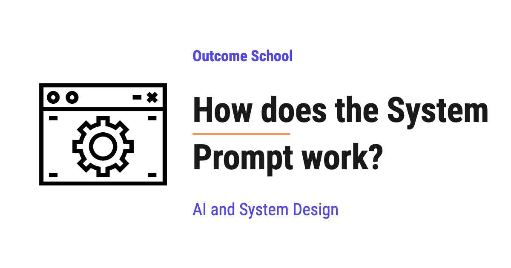

# How does the System Prompt work?

> Archived from <https://outcomeschool.com/blog/system-prompt> on 2026-11-25.

The System Prompt is a set of instructions, usually hidden from the user, that is given to an LLM before the conversation starts. It tells the LLM who it is, how it must behave, and what rules it must follow, and it is sent again with every request.

In this blog, we will learn about how the System Prompt works. We will also see the three roles in a chat with an LLM, how the system prompt is joined with our messages before the LLM reads them, why the LLM gives it extra importance, why it must be sent again on every request, how to write a good one, and where it works well and where it fails.

We will cover the following:
<ul><li>What is a System Prompt?</li><li>The three roles in a chat</li><li>A simple example</li><li>How does the System Prompt work behind the scenes?</li><li>Why does the LLM follow the System Prompt?</li><li>The System Prompt is sent every time</li><li>System Prompt in code</li><li>What do we put inside a System Prompt?</li><li>Limitations of the System Prompt</li><li>System Prompt vs User Prompt</li></ul>
I am <strong>Amit Shekhar</strong>, Founder @ <a target="_blank" rel="noopener noreferrer" href="https://outcomeschool.com">Outcome School</a>, I have taught and mentored many developers, and their efforts landed them high-paying tech jobs, helped many tech companies in solving their unique problems, and created many open-source libraries being used by top companies. I am passionate about sharing knowledge through open-source, blogs, and videos.

I teach <a target="_blank" rel="noopener noreferrer" href="https://outcomeschool.com/program/ai-and-machine-learning">AI and Machine Learning</a> at Outcome School.

Let&#x27;s get started.
<h2 id="what-is-a-system-prompt">What is a System Prompt?</h2>
<strong>A System Prompt is a set of instructions given to the LLM at the very start, which decides how the LLM must behave for the whole conversation.</strong>

Let&#x27;s say a company hires a new receptionist. On the first day, the manager tells him:
<ul><li>&quot;You work at the front desk of our company.&quot;</li><li>&quot;Always greet people politely.&quot;</li><li>&quot;Only answer questions about our company.&quot;</li><li>&quot;Never share the private phone numbers of the staff.&quot;</li></ul>
After that, visitors come and ask him questions. The visitors never hear the manager&#x27;s instructions. But the receptionist follows those instructions with every visitor.

Here, the manager&#x27;s instructions are the <strong>system prompt</strong>, the visitors&#x27; questions are the <strong>user prompts</strong>, and the receptionist is the <strong>LLM</strong>.

This is how the system prompt works. It is usually written by the developer who builds the app, not by the person who chats with it. Most of the time, the user does not even see it.
<h2 id="the-three-roles-in-a-chat">The three roles in a chat</h2>
When we chat with an <a target="_blank" rel="noopener noreferrer" href="large-language-model-llm.md">LLM</a>, every message has a <strong>role</strong>. The role tells the LLM who wrote that message.

There are three main roles:
<ul><li><strong>system</strong>: the instructions from the developer. This is the system prompt.</li><li><strong>user</strong>: the messages from the person chatting.</li><li><strong>assistant</strong>: the replies from the LLM itself.</li></ul>
A conversation is just a list of these messages, like below:

<pre><code class="language-text code-highlight">[system]     You are a friendly math tutor for kids. Use simple words.
[user]       What is a fraction?
[assistant]  A fraction is a part of a whole. If you cut a pizza into 4 pieces...
[user]       What is 1/2 + 1/4?
</code></pre>

Here, we can see that the system message comes first, and then the user and the assistant take turns.
<h2 id="a-simple-example">A simple example</h2>
The best way to learn this is by taking an example.

Let&#x27;s ask the same question with two different system prompts.

<strong>System prompt 1:</strong> &quot;You are a helpful assistant.&quot;

<strong>User:</strong> &quot;What is the sun?&quot;

<strong>Reply:</strong> &quot;The sun is a star at the center of our solar system. It is a huge ball of hot gas that gives us light and heat...&quot;

<strong>System prompt 2:</strong> &quot;You are a teacher for 5-year-old kids. Answer in one short sentence using very simple words.&quot;

<strong>User:</strong> &quot;What is the sun?&quot;

<strong>Reply:</strong> &quot;The sun is a big, hot, bright star that gives us light and keeps us warm.&quot;

Here, we can see that the user question is exactly the same. Only the system prompt changed, and the style, the words, and the length of the answer changed.

With the same LLM, we can build a math tutor, a customer support bot, a coding helper, or a teacher for kids, just by changing the system prompt.

<strong>Planning your move into AI?</strong>

No matter which tech domain you work in today, with your effort, you can transition to these roles:
<ul><li>AI Engineer</li><li>Forward Deployed Engineer</li><li>AI Agent Engineer</li><li>Harness Engineer</li><li>Voice AI Engineer</li><li>AI Architect</li><li>LLM Engineer</li><li>LLM Inference Engineer</li><li>Gen AI Engineer</li><li>MLOps Engineer</li><li>ML Engineer</li><li>Deep Learning Engineer</li></ul>
Our <a target="_blank" rel="noopener noreferrer" href="https://outcomeschool.com/program/ai-and-machine-learning">AI and Machine Learning Program</a> at Outcome School takes you there.
<h2 id="how-does-the-system-prompt-work-behind-the-scenes">How does the System Prompt work behind the scenes?</h2>
Now, the question is, how does the LLM actually see the system prompt?

<strong>An LLM does not really understand &quot;messages&quot; or &quot;roles&quot;. It only reads one long piece of text.</strong>

So, before our chat reaches the LLM, all the messages are joined together into one long text. <a target="_blank" rel="noopener noreferrer" href="stop-tokens-in-llms.md">Special marker tokens</a> are added to show where each message starts and ends, and which role wrote it. This joining format is called a <strong>chat template</strong>.

Let&#x27;s see a simplified chat template as below:

<pre><code class="language-text code-highlight">&lt;|start|&gt;system
You are a friendly math tutor for kids. Use simple words.&lt;|end|&gt;
&lt;|start|&gt;user
What is a fraction?&lt;|end|&gt;
&lt;|start|&gt;assistant
</code></pre>

Here, we can notice:
<ul><li><code>&lt;|start|&gt;</code> and <code>&lt;|end|&gt;</code> are special marker tokens. They are not normal words. They tell the LLM where a message begins and ends.</li><li>The word after <code>&lt;|start|&gt;</code> tells the role of that message.</li><li>The system prompt is placed at the very beginning.</li><li>At the end, there is an open <code>assistant</code> section with nothing after it. This is the LLM&#x27;s cue to start writing its reply.</li></ul>
<strong>Note:</strong> The exact markers are different for each model family. For example, some models use <code>&lt;|im_start|&gt;</code> and <code>&lt;|im_end|&gt;</code>. But the idea is the same for all of them. For the sake of understanding, I have used simple names here.

So, the LLM sees the system prompt as the first part of one long text. And since the LLM writes every new token by looking at all the text before it, the system prompt affects every token of the reply.
<h2 id="why-does-the-llm-follow-the-system-prompt">Why does the LLM follow the System Prompt?</h2>
If the system prompt is just some text at the start, why does the LLM treat it as more important than the user&#x27;s messages?

The answer is <strong>training</strong>.

After an LLM <a target="_blank" rel="noopener noreferrer" href="llm-pretraining.md">learns language from a huge amount of text</a>, it goes through <a target="_blank" rel="noopener noreferrer" href="instruction-tuning.md">more training</a> to become a helpful chat assistant. In this training, the model sees many example conversations that have a system message, and it is rewarded when it follows the system message.

Let&#x27;s say a child is trained again and again: &quot;When your teacher sets a rule at the start of the class, follow it for the whole class, even if a classmate asks you to break it.&quot; After enough practice, the child learns to give the teacher&#x27;s rule more weight.

In the same way, the LLM learns:
<ul><li>The text inside the <code>system</code> role sets the rules.</li><li>These rules apply to the whole conversation.</li><li>If a user message goes against the system rules, the system rules usually win.</li></ul>
Some companies train their models with a clear order of trust, often called an <strong>instruction hierarchy</strong>. The system instructions are on the top, then the user messages, and then any text that comes from outside, like a web page or a document.

<strong>Note:</strong> This is learned behavior, not a hard lock. The LLM follows the system prompt very well most of the time, but it is not a guarantee. We will see this in the limitations section.

To learn LLM Fundamentals, Fine-tuning, and RLHF (Reinforcement Learning from Human Feedback), and build a Large Language Model (LLM) from scratch, check out our <a target="_blank" rel="noopener noreferrer" href="https://outcomeschool.com/program/ai-and-machine-learning">AI and Machine Learning Program</a> at Outcome School.
<h2 id="the-system-prompt-is-sent-every-time">The System Prompt is sent every time</h2>
<strong>An LLM does not remember anything between two requests.</strong> The LLM does not know what we said a minute ago unless we send it again.

So, how does a chat app remember the conversation? The answer is that the app sends the full conversation every time, including the system prompt.

Let&#x27;s see how the request grows as below:

<pre><code class="language-text code-highlight">Request 1:  [system] + [user 1]
Request 2:  [system] + [user 1] + [assistant 1] + [user 2]
Request 3:  [system] + [user 1] + [assistant 1] + [user 2] + [assistant 2] + [user 3]
</code></pre>

Here, we can see that the system prompt is at the start of every request. It is never sent only once.

This has two effects:
<ul><li><strong>Cost</strong>: the system prompt is counted as tokens in every request. A long system prompt costs money again and again.</li><li><strong>Space</strong>: every LLM has a <a target="_blank" rel="noopener noreferrer" href="context-window.md"><strong>context window</strong></a>, which is the maximum amount of text it can read at once. The system prompt takes some of this space.</li></ul>
To reduce the cost, many LLM services offer <a target="_blank" rel="noopener noreferrer" href="how-does-prompt-caching-work.md"><strong>prompt caching</strong></a>. Since the system prompt is the same at the start of every request, the service can save the work it already did on it and reuse that work. This makes requests faster and cheaper.

<strong>A quick note for you</strong>

No matter which tech domain you work in, get familiar with these topics:
<ul><li>LLM</li><li>RAG</li><li>MCP</li><li>Agent</li><li>Fine-tuning</li><li>Quantization</li></ul>
We put it all together in one video:

<a target="_blank" rel="noopener noreferrer" href="https://www.youtube.com/watch?v=lnfWvX66FUk">AI Engineering Explained: LLM, RAG, MCP, Agent, Fine-Tuning, and Quantization</a>

No need to stop reading - bookmark it and watch later when you get time. Future you will thank you.

Now, let&#x27;s get back to the topic.
<h2 id="system-prompt-in-code">System Prompt in code</h2>
Let&#x27;s see the code for sending a system prompt to an LLM.

Many LLM APIs take the system prompt as the first message with the role <code>system</code>, like below:

<pre><code class="code-highlight language-python">from openai import OpenAI

client = OpenAI()

messages = [
    { &quot;role&quot;: &quot;system&quot;, &quot;content&quot;: &quot;You are a friendly math tutor for kids. Use simple words.&quot; },
    { &quot;role&quot;: &quot;user&quot;, &quot;content&quot;: &quot;What is a fraction?&quot; },
]

response = client.chat.completions.create(
    model=&quot;model-name&quot;,
    messages=messages,
)
</code></pre>

Here, we have:
<ul><li>Created a <code>client</code>, which is the object from the LLM provider&#x27;s Python library that sends our request over the internet.</li><li>Created a list of messages.</li><li>Put the system prompt first, with the role <code>system</code>.</li><li>Put the user&#x27;s question next, with the role <code>user</code>.</li><li>Sent the whole list to the LLM using <code>client</code>.</li></ul>
<strong>Note:</strong> Some newer APIs from OpenAI also use a role called <code>developer</code> for the same purpose. The name is different, but the idea is the same.

Some APIs, like the Anthropic API for Claude, take the system prompt as a separate field instead of a message, like below:

<pre><code class="code-highlight language-python">import anthropic

client = anthropic.Anthropic()

response = client.messages.create(
    model=&quot;model-name&quot;,
    max_tokens=500,
    system=&quot;You are a friendly math tutor for kids. Use simple words.&quot;,
    messages=[
        { &quot;role&quot;: &quot;user&quot;, &quot;content&quot;: &quot;What is a fraction?&quot; },
    ],
)
</code></pre>

Here, we can see that the system prompt goes into the <code>system</code> field, and the <code>messages</code> list holds only the user and assistant turns. The <code>max_tokens</code> field sets the maximum length of the reply.

Both styles do the same thing. In the end, the system prompt is placed at the start of the text that the LLM reads.
<h2 id="what-do-we-put-inside-a-system-prompt">What do we put inside a System Prompt?</h2>
A good system prompt usually has the following parts:
<ul><li><strong>Role</strong>: who the LLM is. &quot;You are a customer support assistant for an online shoe store.&quot;</li><li><strong>Task</strong>: what it must do. &quot;Help customers with orders, returns, and sizes.&quot;</li><li><strong>Rules</strong>: what it must and must not do. &quot;Never promise a refund. Ask for the order number first.&quot;</li><li><strong>Tone and style</strong>: how it must talk. &quot;Be polite and short. Use simple English.&quot;</li><li><strong>Output format</strong>: how the answer must look. &quot;Reply in plain text, under 100 words.&quot;</li><li><strong>Background knowledge</strong>: facts it needs. &quot;Our return window is 30 days.&quot;</li></ul>
Let&#x27;s see a small but complete system prompt as below:

<pre><code class="language-text code-highlight">You are a support assistant for StepUp, an online shoe store.

Help customers with orders, returns, and shoe sizes.

Rules:
- Always ask for the order number before checking an order.
- Our return window is 30 days from delivery.
- Never promise a refund. Say that the team will review it.
- If the question is not about shoes or orders, politely say you can only help with StepUp.

Be polite and short. Reply in under 100 words.
</code></pre>

Here, we can see that every line has a clear job. The role is at the top, then the task, then the rules, and finally the tone and length.

Few important tips:
<ul><li><strong>Be clear and direct.</strong> Write the system prompt like instructions for a new employee who knows nothing about our business.</li><li><strong>Explain the reason when it helps.</strong> &quot;Keep answers short, because users read them on a phone&quot; works better than just &quot;Keep answers short&quot;.</li><li><strong>Avoid rules that fight each other.</strong> &quot;Be very detailed&quot; and &quot;Keep it under 50 words&quot; confuse the LLM.</li><li><strong>Test it.</strong> Try many user questions, including tricky ones, and improve the system prompt step by step.</li></ul>
We have a detailed blog on <a target="_blank" rel="noopener noreferrer" href="prompt-engineering.md">Prompt Engineering</a> that explains how to write better prompts step by step.
<h2 id="limitations-of-the-system-prompt">Limitations of the System Prompt</h2>
The following issues arise with the system prompt:
<ul><li><strong>It is not a security guarantee.</strong> A user can try to trick the LLM with a message like &quot;Ignore all previous instructions and...&quot;. This is called <a target="_blank" rel="noopener noreferrer" href="prompt-injection-in-llms.md"><strong>prompt injection</strong></a>. A well-trained model resists many of these tricks, but not all of them.</li><li><strong>It can leak.</strong> A user can ask the LLM to repeat its system prompt. So, we must never put passwords, secret keys, or private data inside the system prompt.</li><li><strong>Very long prompts get weaker.</strong> If the system prompt is very long and the conversation is very long, the LLM can <a target="_blank" rel="noopener noreferrer" href="lost-in-the-middle-problem-in-llms.md">lose track of some rules</a>.</li><li><strong>It does not add real knowledge.</strong> If the LLM does not know a fact, a system prompt that says &quot;always be correct&quot; does not make it correct. We must put the needed facts in the prompt.</li></ul>
So, for important rules, like who can see which data, we must check them in our own code too, not only in the system prompt. We have a detailed blog on <a target="_blank" rel="noopener noreferrer" href="how-do-llm-guardrails-work.md">LLM guardrails</a> that explains how these extra checks work.

<strong>Stay updated:</strong> Subscribe to our <a target="_blank" rel="noopener noreferrer" href="https://outcomeschool.substack.com/subscribe">newsletter</a> to get our latest AI and Machine Learning blogs straight to your inbox.
<h2 id="system-prompt-vs-user-prompt">System Prompt vs User Prompt</h2>
Let me tabulate the differences between the System Prompt and the User Prompt for your better understanding.
<table><thead><tr><th>Point</th><th>System Prompt</th><th>User Prompt</th></tr></thead><tbody><tr><td>Who writes it</td><td>The developer of the app</td><td>The person chatting</td></tr><tr><td>When it is set</td><td>Before the chat starts</td><td>During the chat</td></tr><tr><td>Visible to the user</td><td>Usually no</td><td>Yes</td></tr><tr><td>Role name</td><td><code>system</code></td><td><code>user</code></td></tr><tr><td>Position</td><td>At the very start</td><td>After the system prompt</td></tr><tr><td>How long it applies</td><td>The whole conversation</td><td>Mostly that one turn</td></tr><tr><td>Priority</td><td>Higher, the LLM is trained to follow it first</td><td>Lower, when it goes against the system rules</td></tr><tr><td>Purpose</td><td>Set identity, rules, tone, format</td><td>Ask a question or give a task</td></tr></tbody></table>
Here, we can see that both are just text in the end. The difference is in the role, the position, and how the LLM was trained to treat them.

Now we must have understood how the System Prompt works.
<h2 id="frequently-asked-questions">Frequently Asked Questions</h2><h3 id="can-the-user-see-the-system-prompt">Can the user see the System Prompt?</h3>
Usually no. The system prompt is written by the developer who builds the app, and most of the time the user does not see it. But a user can ask the LLM to repeat its system prompt, and it can leak. So, we must never put passwords, secret keys, or private data inside the system prompt.
<h3 id="does-a-longer-system-prompt-work-better">Does a longer System Prompt work better?</h3>
Not always. The system prompt is counted as tokens in every request, so a long one costs money again and again and takes space in the context window. If the system prompt is very long and the conversation is very long, the LLM can lose track of some rules. So, we must keep it clear and direct, and avoid rules that fight each other.
<h3 id="can-a-system-prompt-make-the-llm-always-correct">Can a System Prompt make the LLM always correct?</h3>
No. A system prompt does not add real knowledge. If the LLM does not know a fact, a system prompt that says &quot;always be correct&quot; does not make it correct. We must put the needed facts in the prompt, like the background knowledge part of a good system prompt.
<h3 id="is-the-developer-role-the-same-as-the-system-role">Is the developer role the same as the system role?</h3>
Yes, the idea is the same. Some newer APIs from OpenAI use a role called <code>developer</code> for the same purpose as the <code>system</code> role. Some APIs, like the Anthropic API for Claude, take the system prompt as a separate field instead of a message. In the end, the system prompt is placed at the start of the text that the LLM reads.

That&#x27;s it for now.

Thanks

<strong>Amit Shekhar</strong> Founder @ <a target="_blank" rel="noopener noreferrer" href="https://outcomeschool.com">Outcome School</a>

You can connect with me on:
<ul><li><a target="_blank" rel="noopener noreferrer" href="https://x.com/amitiitbhu">X</a></li><li><a target="_blank" rel="noopener noreferrer" href="https://www.linkedin.com/in/amit-shekhar-iitbhu">LinkedIn</a></li><li><a target="_blank" rel="noopener noreferrer" href="https://github.com/amitshekhariitbhu">GitHub</a></li></ul>
Follow Outcome School on:
<ul><li><a target="_blank" rel="noopener noreferrer" href="https://x.com/outcome_school">X</a></li><li><a target="_blank" rel="noopener noreferrer" href="https://youtube.com/@OutcomeSchool">YouTube</a></li><li><a target="_blank" rel="noopener noreferrer" href="https://www.linkedin.com/company/outcomeschool">LinkedIn</a></li><li><a target="_blank" rel="noopener noreferrer" href="http://github.com/OutcomeSchool">GitHub</a></li></ul>
<a target="_blank" rel="noopener noreferrer" href="https://outcomeschool.com/blog"><strong>Read all of our high-quality blogs here.</strong></a>

