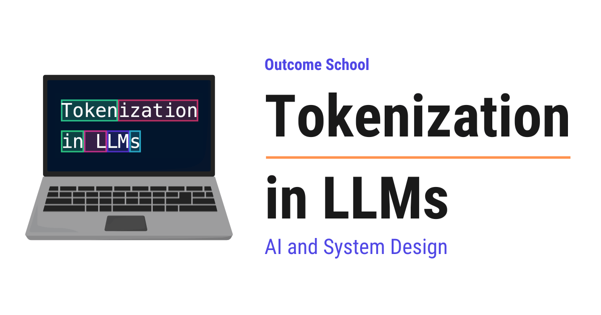

# Tokenization in LLMs

> Archived from <https://outcomeschool.com/blog/tokenization-in-llms> on 2026-11-25.

Tokenization in LLMs is the process of breaking text into small pieces called tokens and then converting each token into a number that the model can work with.

In this blog, we will learn about Tokenization in LLMs, the very first step where a model breaks our text into small pieces before it can understand anything. We will also see why we need it, what a token is, the different ways to break text into tokens, how Byte Pair Encoding builds a vocabulary step by step, how tokens become numbers and back into text, and where it works well and where it fails.

We will cover the following:
<ul><li>What is Tokenization?</li><li>Why do we need Tokenization?</li><li>What is a Token?</li><li>Approach 1: Character-level Tokenization</li><li>Approach 2: Word-level Tokenization</li><li>Approach 3: Subword-level Tokenization</li><li>How does Byte Pair Encoding (BPE) work?</li><li>Vocabulary and Token IDs</li><li>Decoding: From Tokens back to Text</li><li>Tokenization in action with code</li><li>Special Tokens</li><li>How Tokenization affects LLMs in practice</li><li>Where it works well and where it fails</li></ul>
I am <strong>Amit Shekhar</strong>, Founder @ <a target="_blank" rel="noopener noreferrer" href="https://outcomeschool.com">Outcome School</a>, I have taught and mentored many developers, and their efforts landed them high-paying tech jobs, helped many tech companies in solving their unique problems, and created many open-source libraries being used by top companies. I am passionate about sharing knowledge through open-source, blogs, and videos.

I teach <a target="_blank" rel="noopener noreferrer" href="https://outcomeschool.com/program/ai-and-machine-learning">AI and Machine Learning</a> at Outcome School.

Let&#x27;s get started.
<h2 id="what-is-tokenization">What is Tokenization?</h2>
<strong>Tokenization is the process of breaking a piece of text into small pieces called tokens and then converting each token into a number.</strong>

Let&#x27;s say we type the sentence &quot;I love learning&quot; into an <a target="_blank" rel="noopener noreferrer" href="large-language-model-llm.md">LLM (Large Language Model)</a>.

We see the sentence as three words. But the model does not see it the way we see it. The model does not understand letters or words. It only understands numbers.

So, before anything else happens, the sentence is broken into small pieces like below:

<pre><code class="code-highlight">&quot;I&quot; | &quot; love&quot; | &quot; learning&quot;
</code></pre>

Then, each piece is converted into a number like below:

<pre><code class="code-highlight">40 | 3021 | 6975
</code></pre>

These numbers are what the model actually receives. The text never reaches the model. Only the numbers do.

<strong>Note:</strong> These numbers are just for the sake of understanding. The actual numbers depend on which tokenizer we use.

The program that does this job is called a <strong>tokenizer</strong>. Every LLM has its own tokenizer.
<h2 id="why-do-we-need-tokenization">Why do we need Tokenization?</h2>
An LLM is a machine learning model. At its core, it does a lot of mathematics. It multiplies numbers, adds numbers, and compares numbers. Mathematics works on numbers, not on letters.

So, we have a problem. We have text, and the model needs numbers.

We need something that converts text into numbers. So, here comes the tokenizer into the picture.

But, the tokenizer has one more job. The model must have a fixed list of pieces it knows. When the model generates a reply, it <a target="_blank" rel="noopener noreferrer" href="autoregressive-models.md">picks one piece at a time</a> from that fixed list. If the list is too big, the model becomes slow and heavy. If the list is too small, every sentence becomes a very long chain of tiny pieces.

So, the real question is: what is the right size of each piece?

We will see three approaches, one by one, and understand why the third one is used in modern LLMs.
<h2 id="what-is-a-token">What is a Token?</h2>
<strong>A token is the smallest unit of text that the model works with.</strong>

A token can be a whole word, a part of a word, a single character, a punctuation mark, or a word along with the space before it.

Let&#x27;s see a few examples:
<ul><li>&quot;cat&quot; is one token.</li><li>&quot;unbelievable&quot; becomes three tokens: &quot;un&quot;, &quot;believ&quot;, &quot;able&quot;.</li><li>&quot;!&quot; is one token.</li><li>&quot; love&quot; (with the space before it) is one token.</li></ul>
Here, we can notice that the space is attached to the word. This is how most modern tokenizers work. The space becomes part of the token that comes after it. This way, the model knows where a new word begins.

A simple rule of thumb for English: one token is roughly 4 characters, or about three-fourths of a word. So, 100 tokens is around 75 words.

Now, let&#x27;s see the different ways to break text into tokens.
<h2 id="approach-1-character-level-tokenization">Approach 1: Character-level Tokenization</h2>
The simplest idea is to make every character a token.

Let&#x27;s take the word &quot;learning&quot;. The tokens will be as below:

<pre><code class="code-highlight">&quot;l&quot; | &quot;e&quot; | &quot;a&quot; | &quot;r&quot; | &quot;n&quot; | &quot;i&quot; | &quot;n&quot; | &quot;g&quot;
</code></pre>

Here, we have 8 tokens for one word.

<strong>Advantage:</strong> The list of known pieces is very small. For English, it is just the letters, the digits, and a few punctuation marks. And, the model can never face a word it does not know, because every word is made of characters.

<strong>Disadvantage:</strong> Every sentence becomes very long. A short paragraph of 100 words becomes around 500 tokens. The model has to process each one of them. And, each character carries very less meaning on its own. The letter &quot;l&quot; alone tells us nothing. The model has to work very hard to learn that &quot;l&quot;, &quot;e&quot;, &quot;a&quot;, &quot;r&quot;, &quot;n&quot; together means learn.

The issue with this approach is that the sequences become very long and each token carries very less meaning. Let&#x27;s see how the next approach solve this issue.
<h2 id="approach-2-word-level-tokenization">Approach 2: Word-level Tokenization</h2>
The next idea is to make every word a token. We simply split the text at spaces.

Let&#x27;s take the sentence &quot;I love learning&quot;. The tokens will be as below:

<pre><code class="code-highlight">&quot;I&quot; | &quot;love&quot; | &quot;learning&quot;
</code></pre>

Here, we have 3 tokens for three words.

<strong>Advantage:</strong> Each token carries full meaning. The sequences are short.

<strong>Disadvantage:</strong> The list of known words becomes huge. English alone has hundreds of thousands of words. Add names of people, names of places, other languages, code, and new words that appear every day. The list never ends.

What happens when the model sees a word that is not in the list?

Let&#x27;s say the list does not have the word &quot;tokenization&quot;. The tokenizer has no choice. It replaces the word with a special token called unknown, usually written as <code>&lt;UNK&gt;</code>. The model sees <code>&lt;UNK&gt;</code> and has no idea what we said.

One more thing to notice. The words &quot;learn&quot;, &quot;learning&quot;, &quot;learned&quot;, and &quot;learner&quot; are all separate tokens in this approach. The model does not know that they are related. It has to learn each one from scratch.

The issue with this approach is the huge list of words and the unknown word problem. Let&#x27;s see how the next approach solve this issue.
<h2 id="approach-3-subword-level-tokenization">Approach 3: Subword-level Tokenization</h2>
Now, we take the middle path.

The idea is simple. Common words stay as one token. Rare words get broken into smaller pieces that are common.

Let&#x27;s see with an example:
<ul><li>&quot;the&quot; is very common, so it stays as one token: &quot;the&quot;</li><li>&quot;learning&quot; is common, so it stays as one token: &quot;learning&quot;</li><li>&quot;tokenization&quot; is rare, so it breaks into two: &quot;token&quot;, &quot;ization&quot;</li><li>&quot;unbelievable&quot; is rare, so it breaks into three: &quot;un&quot;, &quot;believ&quot;, &quot;able&quot;</li></ul>
Here, we can see that the pieces are meaningful. &quot;token&quot; is a real piece. &quot;ization&quot; is a real piece. Means, the model can learn that &quot;ization&quot; usually means the act of doing something, and reuse that learning for &quot;organization&quot;, &quot;civilization&quot;, and many more. Hence, the model learns faster.

<strong>Advantage:</strong> The list of known pieces is manageable, usually between 50,000 and 200,000. There is no unknown word problem, because any rare word can be broken down until we reach pieces we know, in the worst case single characters. And, related words share pieces, so the model does not have to learn each one from scratch.

<strong>Disadvantage:</strong> Sometimes a word breaks at a place that does not look natural to us.

This is what almost every modern LLM uses.

Let me tabulate the differences between the three approaches for your better understanding.
<table><thead><tr><th></th><th>Character-level</th><th>Word-level</th><th>Subword-level</th></tr></thead><tbody><tr><td>Size of the known list</td><td>Very small</td><td>Very large</td><td>Medium</td></tr><tr><td>Tokens per sentence</td><td>Very many</td><td>Few</td><td>Few</td></tr><tr><td>Unknown word problem</td><td>Never</td><td>Often</td><td>Never</td></tr><tr><td>Meaning per token</td><td>Very less</td><td>Full</td><td>Good</td></tr><tr><td>Used in modern LLMs</td><td>No</td><td>No</td><td>Yes</td></tr></tbody></table>
<strong>Planning your move into AI?</strong>

No matter which tech domain you work in today, with your effort, you can transition to these roles:
<ul><li>AI Engineer</li><li>Forward Deployed Engineer</li><li>AI Agent Engineer</li><li>Harness Engineer</li><li>Voice AI Engineer</li><li>AI Architect</li><li>LLM Engineer</li><li>LLM Inference Engineer</li><li>Gen AI Engineer</li><li>MLOps Engineer</li><li>ML Engineer</li><li>Deep Learning Engineer</li></ul>
Our <a target="_blank" rel="noopener noreferrer" href="https://outcomeschool.com/program/ai-and-machine-learning">AI and Machine Learning Program</a> at Outcome School takes you there.

Now, the question is, how does the tokenizer decide which pieces are common and which are rare? Who makes that list?

So, here comes the <a target="_blank" rel="noopener noreferrer" href="bpe-in-llms.md">Byte Pair Encoding</a> to the rescue.
<h2 id="how-does-byte-pair-encoding-bpe-work">How does Byte Pair Encoding (BPE) work?</h2>
<strong>Byte Pair Encoding, or BPE, is an algorithm that builds the list of tokens by starting from single characters and repeatedly merging the pair of pieces that appears together most often.</strong>

In simple words, BPE looks at a huge amount of text, finds two pieces that sit next to each other most often, glues them into one new piece, and repeats.

The best way to learn this is by taking an example.

Let&#x27;s say our training text has only three words, appearing with the following counts:
<ul><li>&quot;hug&quot; appears 10 times</li><li>&quot;pug&quot; appears 5 times</li><li>&quot;hugs&quot; appears 5 times</li></ul>
<strong>Step 0:</strong> Split every word into characters.

<pre><code class="code-highlight">h u g      (10 times)
p u g      (5 times)
h u g s    (5 times)
</code></pre>

Our starting list of tokens: <code>h</code>, <code>u</code>, <code>g</code>, <code>p</code>, <code>s</code>. That is 5 tokens.

<strong>Step 1:</strong> Count every pair. A pair means two pieces that sit next to each other inside a word.
<ul><li>&quot;h&quot; + &quot;u&quot; appears 10 + 5 = 15 times</li><li>&quot;u&quot; + &quot;g&quot; appears 10 + 5 + 5 = 20 times</li><li>&quot;p&quot; + &quot;u&quot; appears 5 times</li><li>&quot;g&quot; + &quot;s&quot; appears 5 times</li></ul>
The most frequent pair is &quot;u&quot; + &quot;g&quot; with 20. So, we merge them into a new token <code>ug</code>.

Our list of tokens: <code>h</code>, <code>u</code>, <code>g</code>, <code>p</code>, <code>s</code>, <code>ug</code>. That is 6 tokens.

Our words now look like below:

<pre><code class="code-highlight">h ug       (10 times)
p ug       (5 times)
h ug s     (5 times)
</code></pre>

<strong>Step 2:</strong> Count the pairs again.
<ul><li>&quot;h&quot; + &quot;ug&quot; appears 10 + 5 = 15 times</li><li>&quot;p&quot; + &quot;ug&quot; appears 5 times</li><li>&quot;ug&quot; + &quot;s&quot; appears 5 times</li></ul>
The most frequent pair is &quot;h&quot; + &quot;ug&quot; with 15. So, we merge them into a new token <code>hug</code>.

Our list of tokens: <code>h</code>, <code>u</code>, <code>g</code>, <code>p</code>, <code>s</code>, <code>ug</code>, <code>hug</code>. That is 7 tokens.

Our words now look like below:

<pre><code class="code-highlight">hug        (10 times)
p ug       (5 times)
hug s      (5 times)
</code></pre>

<strong>Step 3:</strong> Count the pairs again.
<ul><li>&quot;p&quot; + &quot;ug&quot; appears 5 times</li><li>&quot;hug&quot; + &quot;s&quot; appears 5 times</li></ul>
Both are equal. In such a case, the tokenizer follows a fixed rule to pick one. Let&#x27;s merge &quot;p&quot; + &quot;ug&quot; into <code>pug</code>.

Our list of tokens: <code>h</code>, <code>u</code>, <code>g</code>, <code>p</code>, <code>s</code>, <code>ug</code>, <code>hug</code>, <code>pug</code>. That is 8 tokens.

We keep doing this until our list reaches the size we want. In real tokenizers, that size is decided beforehand, for example 100,000 tokens.

Here, we have done three merges. Every merge is saved as a rule, in order:

<pre><code class="code-highlight">Rule 1: u + g  -&gt; ug
Rule 2: h + ug -&gt; hug
Rule 3: p + ug -&gt; pug
</code></pre>

Now, when a new piece of text comes in, the tokenizer does not count anything. It simply splits the text into characters and applies these rules in the same order.

Let&#x27;s say the new text is &quot;pugs&quot;. The tokenizer works as below:
<ul><li>Start: <code>p</code>, <code>u</code>, <code>g</code>, <code>s</code></li><li>Apply Rule 1: <code>p</code>, <code>ug</code>, <code>s</code></li><li>Apply Rule 2: nothing to merge, because &quot;h&quot; + &quot;ug&quot; is not here</li><li>Apply Rule 3: <code>pug</code>, <code>s</code></li><li>Final tokens: <code>pug</code>, <code>s</code></li></ul>
And, the word &quot;pugs&quot; never appeared in our training text. Still, we got meaningful tokens.

<strong>Note:</strong> In many modern tokenizers, like the ones used by GPT models, the starting list is not the letters. It is all 256 possible byte values. Every character in every language, every emoji, and every symbol is stored as bytes. So, the tokenizer can never face something unknown. This variant is called byte-level BPE.

One more thing to notice. The tokenizer is trained separately, before the LLM is trained. Once the list of tokens is ready, it is frozen. The LLM is then trained using that frozen list. The LLM never changes the tokenizer.

<strong>A quick note for you</strong>

No matter which tech domain you work in, get familiar with these topics:
<ul><li>LLM</li><li>RAG</li><li>MCP</li><li>Agent</li><li>Fine-tuning</li><li>Quantization</li></ul>
We put it all together in one video:

<a target="_blank" rel="noopener noreferrer" href="https://www.youtube.com/watch?v=lnfWvX66FUk">AI Engineering Explained: LLM, RAG, MCP, Agent, Fine-Tuning, and Quantization</a>

No need to stop reading - bookmark it and watch later when you get time. Future you will thank you.

Now, let&#x27;s get back to the topic.
<h2 id="vocabulary-and-token-ids">Vocabulary and Token IDs</h2>
<strong>The vocabulary is the complete list of all tokens that the tokenizer knows.</strong>

Each token in the vocabulary gets a unique number. This number is called the <strong>Token ID</strong>.

Think of it as a dictionary where every entry has a serial number. The tokenizer looks up the piece, finds the serial number, and hands over the number to the model.

For our small example, the vocabulary looks like below:
<table><thead><tr><th>Token</th><th>Token ID</th></tr></thead><tbody><tr><td>h</td><td>0</td></tr><tr><td>u</td><td>1</td></tr><tr><td>g</td><td>2</td></tr><tr><td>p</td><td>3</td></tr><tr><td>s</td><td>4</td></tr><tr><td>ug</td><td>5</td></tr><tr><td>hug</td><td>6</td></tr><tr><td>pug</td><td>7</td></tr></tbody></table>
So, the text &quot;pugs&quot; becomes tokens <code>pug</code>, <code>s</code>, and then Token IDs <code>7</code>, <code>4</code>.

This is the complete journey:

<pre><code class="code-highlight">Text   -&gt; Tokens        -&gt; Token IDs
&quot;pugs&quot; -&gt; [&quot;pug&quot;, &quot;s&quot;]  -&gt; [7, 4]
</code></pre>

Here, <code>[7, 4]</code> is what goes into the LLM.

Now, why does the vocabulary size matter? When the LLM generates a reply, at every step it <a target="_blank" rel="noopener noreferrer" href="how-do-top-k-and-top-p-sampling-work.md">picks one token from this vocabulary</a>. So, a vocabulary of 100,000 tokens means the model chooses from 100,000 options at every step. Bigger vocabulary means fewer tokens per sentence but a heavier model. Smaller vocabulary means a lighter model but longer sequences. Real models pick a size somewhere in between, based on their use case.

<strong>Note:</strong> Inside the model, each Token ID is used to look up a long list of numbers called an <a target="_blank" rel="noopener noreferrer" href="what-are-embeddings.md">embedding</a>. That is where the real understanding begins, and it is a topic for another blog. For now, we just need to know that Tokenization is the step that comes before it.

If we want to go deep into Tokenization, LLM Fundamentals, and LLM Internals, and build a Large Language Model (LLM) from scratch, check out our <a target="_blank" rel="noopener noreferrer" href="https://outcomeschool.com/program/ai-and-machine-learning">AI and Machine Learning Program</a> at Outcome School.
<h2 id="decoding-from-tokens-back-to-text">Decoding: From Tokens back to Text</h2>
Now, let&#x27;s see how text comes out of the model.

The LLM does not produce text. It produces Token IDs, one at a time.

Let&#x27;s say the model produces <code>6</code>, <code>4</code>. The tokenizer looks up the vocabulary in reverse:
<ul><li><code>6</code> is <code>hug</code></li><li><code>4</code> is <code>s</code></li></ul>
Then, it joins them: &quot;hugs&quot;.

This reverse step is called <strong>decoding</strong>. It is the exact opposite of what we did earlier.

<pre><code class="code-highlight">Token IDs -&gt; Tokens        -&gt; Text
[6, 4]    -&gt; [&quot;hug&quot;, &quot;s&quot;]  -&gt; &quot;hugs&quot;
</code></pre>

This is why, when we <a target="_blank" rel="noopener noreferrer" href="how-does-token-streaming-work.md">watch an LLM type its answer on the screen</a>, sometimes we see half a word appear first and then the rest. That is a token boundary. The model produced one token, the tokenizer decoded it, and it was shown to us.

<strong>Stay updated:</strong> Subscribe to our <a target="_blank" rel="noopener noreferrer" href="https://outcomeschool.substack.com/subscribe">newsletter</a> to get our latest AI and Machine Learning blogs straight to your inbox.
<h2 id="tokenization-in-action-with-code">Tokenization in action with code</h2>
Let&#x27;s see the whole thing in action. We will use <code>tiktoken</code>, which is OpenAI&#x27;s library that contains the tokenizers used by OpenAI models.

<pre><code class="code-highlight language-python">import tiktoken

encoding = tiktoken.get_encoding(&quot;cl100k_base&quot;)

token_ids = encoding.encode(&quot;I love learning&quot;)
print(token_ids)

text = encoding.decode(token_ids)
print(text)
</code></pre>

It will print something like the following:

<pre><code class="code-highlight">[40, 3021, 6975]
I love learning
</code></pre>

Here, we have used <code>cl100k_base</code>, which is the name of one tokenizer with around 100,000 tokens in its vocabulary. The <code>encode</code> function converts our text into Token IDs. The <code>decode</code> function converts the Token IDs back into text. We got the exact same sentence back.

Now, let&#x27;s see which piece of text each Token ID stands for.

<pre><code class="code-highlight language-python">for token_id in token_ids:
    print(token_id, &quot;-&gt;&quot;, &quot;[&quot; + encoding.decode([token_id]) + &quot;]&quot;)
</code></pre>

It will print the following:

<pre><code class="code-highlight">40 -&gt; [I]
3021 -&gt; [ love]
6975 -&gt; [ learning]
</code></pre>

Here, we can see that the space is attached to the word, exactly as we discussed earlier. &quot; love&quot; is one token and &quot; learning&quot; is one token.

<strong>Note:</strong> The exact Token IDs depend on the tokenizer. A different model with a different tokenizer will give different numbers for the same sentence.
<h2 id="special-tokens">Special Tokens</h2>
Along with the tokens that come from text, the vocabulary has a few <strong>special tokens</strong>. These are not words. They are signals.

Few important ones:
<ul><li><strong>End of text:</strong> tells the model that the text has ended. Usually written as <code>&lt;|endoftext|&gt;</code> or <code>&lt;eos&gt;</code>. When the model produces this token, it <a target="_blank" rel="noopener noreferrer" href="stop-tokens-in-llms.md">stops generating</a>.</li><li><strong>Beginning of text:</strong> marks where the text starts. Usually written as <code>&lt;bos&gt;</code>.</li><li><strong>Padding:</strong> a filler token used to make many inputs the same length when the model processes them together.</li><li><strong>Chat markers:</strong> tokens that mark where the user&#x27;s message begins and ends, and where the assistant&#x27;s reply begins. This is how a chat model knows who said what.</li></ul>
Here, we can notice that a special token is never produced by breaking normal text. It is added on purpose by the tokenizer or by the system around the model.
<h2 id="how-tokenization-affects-llms-in-practice">How Tokenization affects LLMs in practice</h2>
Tokenization happens before the model, and the model can never look inside a token. This one fact explains many strange things that LLMs do.

<strong>Counting letters:</strong> Let&#x27;s say we ask, how many times does the letter &quot;r&quot; appear in &quot;strawberry&quot;? The tokenizer breaks the word into something like &quot;str&quot;, &quot;aw&quot;, &quot;berry&quot;. The model sees three Token IDs. It never sees the individual letters. So, it has to guess from memory how many &quot;r&quot; are inside those pieces. This is why LLMs sometimes get such questions wrong.

<strong>Math on numbers:</strong> The number &quot;12345&quot; is split into pieces like &quot;123&quot; and &quot;45&quot;. The model does not see five digits. It sees two tokens. Doing addition on such pieces is much harder than doing it digit by digit.

<strong>Cost and limits:</strong> Every LLM has a limit on how many tokens it can read at once. This is called the <strong><a target="_blank" rel="noopener noreferrer" href="context-window.md">context window</a></strong>. And, the pricing of an LLM is also per token. So, the number of tokens decides both what fits and what it costs.

<strong>Other languages:</strong> Most tokenizers are trained on text that is mostly English. So, English words get compact tokens. A sentence in Hindi, Tamil, or Japanese is broken into many more small pieces. The same sentence can take several times more tokens in these languages. This means it costs more and fills the context window faster.

<strong>Code:</strong> Spaces and indentation are tokens too. Four spaces of indentation can become one token or four tokens depending on the tokenizer. This affects how well a model reads and writes code.
<h2 id="where-it-works-well-and-where-it-fails">Where it works well and where it fails</h2>
Let me summarize where subword tokenization works well:
<ul><li>It handles any input without an unknown word problem.</li><li>It keeps sequences short for common text.</li><li>It shares meaningful pieces across related words, so the model learns faster.</li><li>It works for text, code, and many languages with one single vocabulary.</li></ul>
And where it fails:
<ul><li>Tasks that need to see individual letters, like counting letters or reversing a word.</li><li>Math on long numbers, because digits get grouped in unnatural ways.</li><li>Languages that were less present in the training text, because they get more tokens, which means higher cost and less room in the context window.</li><li>Any word broken at a strange place can confuse the model, because the pieces do not carry the meaning we expect.</li></ul>
Now we must have understood what Tokenization in LLMs is, how BPE builds the vocabulary, how text becomes Token IDs and back, and where it works well and where it fails.
<h2 id="frequently-asked-questions">Frequently Asked Questions</h2><h3 id="do-all-llms-use-the-same-tokenizer">Do all LLMs use the same tokenizer?</h3>
No. Every LLM has its own tokenizer. A different model with a different tokenizer will give different Token IDs for the same sentence. So, the exact numbers we get always depend on which tokenizer we use.
<h3 id="does-the-llm-change-its-tokenizer-during-training">Does the LLM change its tokenizer during training?</h3>
No. The tokenizer is trained separately, before the LLM is trained. Once the list of tokens is ready, it is frozen, and the LLM is then trained using that frozen list. The LLM never changes the tokenizer.
<h3 id="how-many-words-are-100-tokens">How many words are 100 tokens?</h3>
For English, 100 tokens is around 75 words. A simple rule of thumb is that one token is roughly 4 characters, or about three-fourths of a word.
<h3 id="why-do-llms-struggle-to-count-letters-in-a-word">Why do LLMs struggle to count letters in a word?</h3>
Because the model never sees the individual letters. A word like &quot;strawberry&quot; is broken into pieces like &quot;str&quot;, &quot;aw&quot;, &quot;berry&quot;, and the model sees only their Token IDs. So, it has to guess from memory how many times a letter appears inside those pieces.
<h3 id="why-does-text-in-hindi-or-japanese-use-more-tokens-than-english">Why does text in Hindi or Japanese use more tokens than English?</h3>
Most tokenizers are trained on text that is mostly English, so English words get compact tokens. A sentence in Hindi, Tamil, or Japanese is broken into many more small pieces. This means it costs more and fills the context window faster.

That&#x27;s it for now.

Thanks

<strong>Amit Shekhar</strong> Founder @ <a target="_blank" rel="noopener noreferrer" href="https://outcomeschool.com">Outcome School</a>

You can connect with me on:
<ul><li><a target="_blank" rel="noopener noreferrer" href="https://x.com/amitiitbhu">X</a></li><li><a target="_blank" rel="noopener noreferrer" href="https://www.linkedin.com/in/amit-shekhar-iitbhu">LinkedIn</a></li><li><a target="_blank" rel="noopener noreferrer" href="https://github.com/amitshekhariitbhu">GitHub</a></li></ul>
Follow Outcome School on:
<ul><li><a target="_blank" rel="noopener noreferrer" href="https://x.com/outcome_school">X</a></li><li><a target="_blank" rel="noopener noreferrer" href="https://youtube.com/@OutcomeSchool">YouTube</a></li><li><a target="_blank" rel="noopener noreferrer" href="https://www.linkedin.com/company/outcomeschool">LinkedIn</a></li><li><a target="_blank" rel="noopener noreferrer" href="http://github.com/OutcomeSchool">GitHub</a></li></ul>
<a target="_blank" rel="noopener noreferrer" href="https://outcomeschool.com/blog"><strong>Read all of our high-quality blogs here.</strong></a>

