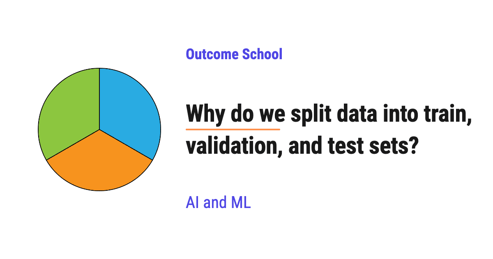

# Why do we split data into train, validation, and test sets?

> Archived from <https://outcomeschool.com/blog/train-validation-test-split> on 2026-11-25.

We split data into train, validation, and test sets so that the model learns from one part, gets tuned on a second part, and gets judged fairly on a third part it has never seen before.

In this blog, we will learn about why we split data into train, validation, and test sets. We will also see what each of the three sets does, what goes wrong when we test a model on the data it has already seen, why one test set is not enough when we tune a model, how much data goes into each set, the common mistakes that leak information between the sets, and when to use which split for our use case.

We will cover the following:
<ul><li>The problem of testing on seen data</li><li>What is the training set?</li><li>What is the test set?</li><li>Why do we need a validation set?</li><li>How the three sets work together</li><li>How much data goes into each set?</li><li>Common mistakes: data leakage</li><li>When the simple split is not enough</li></ul>
I am <strong>Amit Shekhar</strong>, Founder @ <a target="_blank" rel="noopener noreferrer" href="https://outcomeschool.com">Outcome School</a>, I have taught and mentored many developers, and their efforts landed them high-paying tech jobs, helped many tech companies in solving their unique problems, and created many open-source libraries being used by top companies. I am passionate about sharing knowledge through open-source, blogs, and videos.

I teach <a target="_blank" rel="noopener noreferrer" href="https://outcomeschool.com/program/ai-and-machine-learning">AI and Machine Learning</a> at Outcome School.

Let&#x27;s get started.
<h2 id="the-problem-of-testing-on-seen-data">The problem of testing on seen data</h2>
Let&#x27;s say we want to build a model that looks at a house and predicts its price. Each example in our data is one house. The inputs are things like the size of the house, the number of rooms, and the location. The correct answer is the price at which that house was sold.
<table><thead><tr><th>Size (sq ft)</th><th>Rooms</th><th>Location</th><th>Price (correct answer)</th></tr></thead><tbody><tr><td>1200</td><td>2</td><td>City</td><td>50 lakh</td></tr><tr><td>2000</td><td>3</td><td>Suburb</td><td>70 lakh</td></tr><tr><td>900</td><td>1</td><td>City</td><td>35 lakh</td></tr><tr><td>...</td><td>...</td><td>...</td><td>...</td></tr></tbody></table>
Here, we can see that each row is one house. The model looks at many such rows and learns the pattern between the inputs and the price.

We have a detailed blog on <a target="_blank" rel="noopener noreferrer" href="supervised-vs-unsupervised-learning.md">Supervised vs Unsupervised Learning</a> that covers this kind of learning from correct answers in depth.

Now, the question is: once the model has learned, how do we know whether it learned well? The best way to learn this is by taking an example.

Suppose a teacher is preparing students for an exam. The teacher gives the students 100 practice questions along with the answers. The students study these 100 questions again and again.

Now, on the exam day, the teacher gives the exact same 100 questions.

Every student scores 100 out of 100.

Did the students really learn the subject, or did they just remember the answers? We cannot tell. A student who memorized the answers and a student who truly understood the subject both get the same score.

The same thing happens with a <a target="_blank" rel="noopener noreferrer" href="machine-learning.md">Machine Learning</a> model. If we check the model on the same data that it learned from, it can remember the answers. It will look perfect, but it can fail badly on new data.

This problem of remembering instead of learning is called <strong><a target="_blank" rel="noopener noreferrer" href="regularization-in-machine-learning.md">overfitting</a></strong>.

<strong>Overfitting means the model has learned the training examples so closely that it does not work well on new examples.</strong>

For example, suppose one house in our data sold at a very low price because the owner was in a hurry to move. That low price was an accident, not a pattern. An overfitted model remembers even this accident, and then wrongly predicts low prices for similar houses in the future.

So, the score on seen data tells us nothing useful. We need some data that the model has never seen. This is why we split our data.
<h2 id="what-is-the-training-set">What is the training set?</h2>
<strong>The training set is the part of the data from which the model learns.</strong>

The training set is like the practice book of the model.

The model looks at the examples in the training set, makes predictions, sees how wrong it is, and adjusts itself again and again. This adjusting process is called training.

We have a detailed blog on <a target="_blank" rel="noopener noreferrer" href="math-behind-gradient-descent.md">Gradient Descent</a> that explains how this adjusting works step by step.

The training set is usually the biggest part of our data, because the model needs a lot of examples to learn the pattern well.

<strong>Planning your move into AI?</strong>

No matter which tech domain you work in today, with your effort, you can transition to these roles:
<ul><li>AI Engineer</li><li>Forward Deployed Engineer</li><li>AI Agent Engineer</li><li>Harness Engineer</li><li>Voice AI Engineer</li><li>AI Architect</li><li>LLM Engineer</li><li>LLM Inference Engineer</li><li>Gen AI Engineer</li><li>MLOps Engineer</li><li>ML Engineer</li><li>Deep Learning Engineer</li></ul>
Our <a target="_blank" rel="noopener noreferrer" href="https://outcomeschool.com/program/ai-and-machine-learning">AI and Machine Learning Program</a> at Outcome School takes you there.
<h2 id="what-is-the-test-set">What is the test set?</h2>
<strong>The test set is the part of the data that we keep locked away and use only once, at the very end, to measure how good the final model is.</strong>

The test set is like the final exam with questions the students have never seen.

Going back to our teacher example, the teacher now gives 100 practice questions for studying, but keeps 20 completely new questions for the exam. If a student scores well on these 20 new questions, we can trust that the student really understood the subject.

Similarly, if our model does well on the test set, we can trust that it will do well on real-world data that it has never seen.

<strong>Very important:</strong> The test set must stay untouched until the very end. If we keep looking at the test set while building the model, it slowly stops being a fair exam.

Now, at this point, we can think that two sets are enough: one to learn and one to test. Let&#x27;s see why that is not true.
<h2 id="why-do-we-need-a-validation-set">Why do we need a validation set?</h2>
While building a model, we have to make many choices. For example:
<ul><li>How big is the model going to be?</li><li>For how long do we train it?</li><li>How fast does it learn from each mistake?</li></ul>
These choices are not learned by the model itself. We, the builders, set them before training. These choices are called <strong>hyperparameters</strong>.

<strong>Hyperparameters are the settings that we choose for the model, as opposed to the values that the model learns on its own.</strong>

Let&#x27;s say we want to pick the best model size. We try a small model, a medium model, and a large model. We need some data to compare them.

Suppose we use the test set for this comparison. We check all three on the test set and pick the one with the best score.

The issue with this approach is that we have now used the test set to make a decision. We picked the model that happened to do best on those exact test examples. So, the test score is no longer a fair exam. It is a little too good, because we chose the winner by looking at it.

So, here comes the <strong>validation set</strong> to the rescue.

<strong>The validation set is a separate part of the data that we use to compare models and tune hyperparameters, so that the test set stays clean for the final check.</strong>

The validation set is like the mock exam. Students take mock exams many times to see where they stand and to adjust how they study. The real final exam happens only once.

<strong>A quick note for you</strong>

No matter which tech domain you work in, get familiar with these topics:
<ul><li>LLM</li><li>RAG</li><li>MCP</li><li>Agent</li><li>Fine-tuning</li><li>Quantization</li></ul>
We put it all together in one video:

<a target="_blank" rel="noopener noreferrer" href="https://www.youtube.com/watch?v=lnfWvX66FUk">AI Engineering Explained: LLM, RAG, MCP, Agent, Fine-Tuning, and Quantization</a>

No need to stop reading - bookmark it and watch later when you get time. Future you will thank you.

Now, let&#x27;s get back to the topic.
<h2 id="how-the-three-sets-work-together">How the three sets work together</h2>
Now, let&#x27;s put everything together. Let&#x27;s say we have 10,000 houses in our data. We can split it as below:

<pre><code class="language-text code-highlight">   All data: 10,000 houses
   +--------------------------------------+-----------+-----------+
   |           Training set               | Validation|   Test    |
   |           7,000 houses               |   1,500   |   1,500   |
   +--------------------------------------+-----------+-----------+
     Model learns from here                Tune here   Final exam
                                                       (used once)
</code></pre>

Here, we can see that the biggest part goes to training, and two smaller parts go to validation and test.

The full workflow looks like below:

<strong>Step 1:</strong> Train a model on the training set.

<strong>Step 2:</strong> Check the model on the validation set and note the score.

<strong>Step 3:</strong> Change a hyperparameter, such as the model size, train again on the training set, and check on the validation set again.

<strong>Step 4:</strong> Repeat Step 3 many times. Pick the settings that give the best validation score.

<strong>Step 5:</strong> Finally, check the chosen model on the test set exactly once. This number is the honest estimate of how the model will do in the real world.

Let me tabulate the role of each set for your better understanding.
<table><thead><tr><th>Set</th><th>Used for</th><th>How often we look at it</th></tr></thead><tbody><tr><td>Training</td><td>Learning the pattern</td><td>All the time</td></tr><tr><td>Validation</td><td>Comparing models and tuning settings</td><td>Many times</td></tr><tr><td>Test</td><td>Honest final score</td><td>Only once, at the end</td></tr></tbody></table>
Let&#x27;s see the code for this split in Python as below:

<pre><code class="code-highlight language-python">from sklearn.model_selection import train_test_split

# First, keep 15% aside as the test set
X_temp, X_test, y_temp, y_test = train_test_split(
    X, y, test_size=0.15, random_state=42
)

# Then, split the rest into training and validation
X_train, X_val, y_train, y_val = train_test_split(
    X_temp, y_temp, test_size=0.176, random_state=42
)
</code></pre>

Here, we have:
<ul><li><code>X</code> is the inputs, like size, rooms, and location. <code>y</code> is the correct answers, like the prices.</li><li>The first call takes out 15% of the data as the test set and keeps it aside.</li><li>The second call splits the remaining 85% into training and validation. Taking 17.6% of 85% gives us about 15% of the whole data for validation, so we end up close to 70%, 15%, and 15%.</li><li><code>random_state=42</code> makes the shuffle repeatable, so we get the same split every time we run the code.</li></ul>
To learn Hyperparameter Tuning, Model Development and Training, and Evaluation and Testing in depth, check out our <a target="_blank" rel="noopener noreferrer" href="https://outcomeschool.com/program/ai-and-machine-learning">AI and Machine Learning Program</a> at Outcome School.
<h2 id="how-much-data-goes-into-each-set">How much data goes into each set?</h2>
The right split depends on how much data we have.

<strong>When we have a small or medium amount of data:</strong> A common choice is 70% for training, 15% for validation, and 15% for test. Another common choice is 80%, 10%, and 10%.

<strong>When we have a huge amount of data:</strong> Let&#x27;s say we have 10 million examples. Even 1% of that is 100,000 examples, which is more than enough to get a reliable score. So, we can use something like 98% for training, 1% for validation, and 1% for test. And, more examples for training generally give us a better model.

The validation and test sets need to be big enough to give a trustworthy score. Everything else can go to training.

Let me tabulate this for your better understanding.
<table><thead><tr><th>Amount of data</th><th>Training</th><th>Validation</th><th>Test</th></tr></thead><tbody><tr><td>A few thousand examples</td><td>70%</td><td>15%</td><td>15%</td></tr><tr><td>Tens of thousands of examples</td><td>80%</td><td>10%</td><td>10%</td></tr><tr><td>Millions of examples</td><td>98%</td><td>1%</td><td>1%</td></tr></tbody></table><h2 id="common-mistakes-data-leakage">Common mistakes: data leakage</h2>
Most of the time, we do mistakes while splitting data, and the most dangerous mistake is called <strong>data leakage</strong>.

<strong>Data leakage means some information from the validation or test set sneaks into the training process, so the scores look better than they really are.</strong>

It is like a student who has secretly seen a few of the final exam questions.

Let&#x27;s see the common ways leakage happens.

<strong>Mistake 1: Duplicate examples.</strong> If the same house appears twice in our data, one copy can land in training and the other in test. The model has already seen that exact house, so the test score is too good. We must remove duplicates before splitting.

<strong>Mistake 2: Preparing data before splitting.</strong> Before training, we often bring all the numbers to a similar range, for example by subtracting the average size from every house size. Suppose we calculate this average using the full data. Now the training data carries a small hint about the test data, because the average included the test examples. We must split first, then calculate such values only from the training set.

<strong>Mistake 3: Ignoring time.</strong> Let&#x27;s say we are predicting tomorrow&#x27;s sales. If we shuffle randomly, the model can train on next month&#x27;s data and get tested on last month&#x27;s data. That is like seeing the future. In real life, we never have future data. So, for time-based data, we must train on the past and test on the later period.

<pre><code class="language-text code-highlight">   Wrong for time data (random shuffle):
   Train: Jan, Mar, May, Jul ...   Test: Feb, Apr, Jun ...

   Right for time data (split by time):
   Train: Jan - Sep            Validation: Oct     Test: Nov - Dec
</code></pre>

Here, we can see that in the right approach, the model always learns from the past and gets checked on the future, just like in the real world.

<strong>Mistake 4: Same person in two sets.</strong> Suppose we have many photos of each patient. If photos of the same patient go into both training and test, the model can recognize the patient instead of the disease. We must keep all the photos of one person inside the same set.

<strong>Mistake 5: Peeking at the test set again and again.</strong> If we check the test score after every change, we slowly tune the model to the test set. The test set becomes a second validation set. We must look at it only once.

<strong>Stay updated:</strong> Subscribe to our <a target="_blank" rel="noopener noreferrer" href="https://outcomeschool.substack.com/subscribe">newsletter</a> to get our latest AI and Machine Learning blogs straight to your inbox.
<h2 id="when-the-simple-split-is-not-enough">When the simple split is not enough</h2>
Sometimes we have very little data, say only 500 examples. Keeping 15% aside for validation gives us only 75 examples to judge with, and the score can change a lot depending on which examples landed in the validation set by luck.

Here comes <strong><a target="_blank" rel="noopener noreferrer" href="cross-validation.md">cross-validation</a></strong> into the picture. In cross-validation, we split the data that is not in the test set into, say, 5 equal parts. We train 5 times, and each time a different part acts as the validation set. Then we take the average of the 5 scores. This gives a much more stable score.

Even with cross-validation, we still keep a separate test set aside for the final check.

<strong>Note:</strong> When some answers are rare, for example only 2% of emails are spam, a random split can put almost no spam in the test set. So, we use a <strong>stratified split</strong>, which means each set keeps the same mix of answers as the full data. In the code, we can pass <code>stratify=y</code> to <code>train_test_split</code> to do this.

Now we must have understood why we split data into train, validation, and test sets.
<h2 id="frequently-asked-questions">Frequently Asked Questions</h2><h3 id="what-is-overfitting-in-machine-learning">What is overfitting in Machine Learning?</h3>
Overfitting means the model has learned the training examples so closely that it does not work well on new examples. It remembers the answers instead of learning the pattern. If we check such a model on the same data it learned from, it looks perfect, but it can fail badly on new data.
<h3 id="what-is-the-difference-between-the-validation-set-and-the-test-set">What is the difference between the validation set and the test set?</h3>
The validation set is used many times to compare models and tune hyperparameters, like a mock exam. The test set is kept locked away and used only once, at the very end, like the real final exam. Keeping them separate means the final test score stays an honest estimate.
<h3 id="can-we-check-the-test-set-more-than-once">Can we check the test set more than once?</h3>
No. We should look at the test set only once. If we check the test score after every change, we slowly tune the model to the test set, and it becomes a second validation set. Then the test score is a little too good and no longer a fair exam.
<h3 id="should-we-shuffle-time-based-data-before-splitting">Should we shuffle time-based data before splitting?</h3>
No. For time-based data, a random shuffle lets the model train on later data and get tested on earlier data, which is like seeing the future. Instead, we split by time: we train on the past, validate on the next period, and test on the later period, just like in the real world.
<h3 id="what-is-a-stratified-split">What is a stratified split?</h3>
A stratified split means each set keeps the same mix of answers as the full data. We use it when some answers are rare, for example when only 2% of emails are spam, because a random split can put almost no spam in the test set. In the code, we pass <code>stratify=y</code> to <code>train_test_split</code>.

That&#x27;s it for now.

Thanks

<strong>Amit Shekhar</strong> Founder @ <a target="_blank" rel="noopener noreferrer" href="https://outcomeschool.com">Outcome School</a>

You can connect with me on:
<ul><li><a target="_blank" rel="noopener noreferrer" href="https://x.com/amitiitbhu">X</a></li><li><a target="_blank" rel="noopener noreferrer" href="https://www.linkedin.com/in/amit-shekhar-iitbhu">LinkedIn</a></li><li><a target="_blank" rel="noopener noreferrer" href="https://github.com/amitshekhariitbhu">GitHub</a></li></ul>
Follow Outcome School on:
<ul><li><a target="_blank" rel="noopener noreferrer" href="https://x.com/outcome_school">X</a></li><li><a target="_blank" rel="noopener noreferrer" href="https://youtube.com/@OutcomeSchool">YouTube</a></li><li><a target="_blank" rel="noopener noreferrer" href="https://www.linkedin.com/company/outcomeschool">LinkedIn</a></li><li><a target="_blank" rel="noopener noreferrer" href="http://github.com/OutcomeSchool">GitHub</a></li></ul>
<a target="_blank" rel="noopener noreferrer" href="https://outcomeschool.com/blog"><strong>Read all of our high-quality blogs here.</strong></a>

