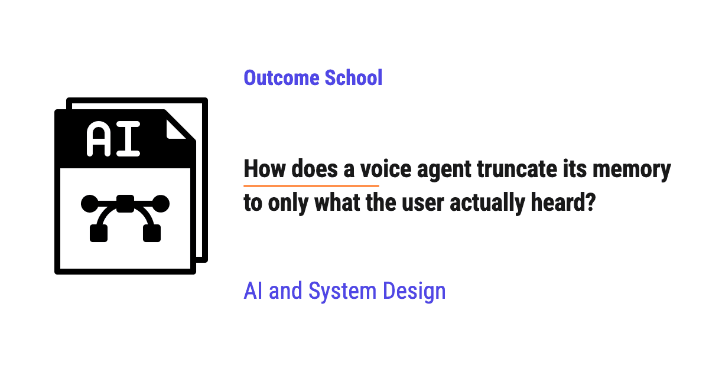

# How does a voice agent truncate its memory to only what the user actually heard?

> Archived from <https://outcomeschool.com/blog/truncating-context-on-interruption> on 2026-11-25.

A voice agent truncates its memory by finding out how much of its reply was actually played through the speaker before the user interrupted, and then cutting its saved reply down to only those words, so that its memory matches what the user really heard.

In this blog, we will learn about how a voice agent truncates its memory to only what the user actually heard. We will also see what the memory of a voice agent is, why the agent prepares its reply faster than it speaks it, what goes wrong when the memory is not cut, how the agent measures what was played and turns that time into words, how a speech-to-speech API does the same thing, and which edge cases the agent must handle.

We will cover the following:
<ul><li>What is the memory of a voice agent?</li><li>The problem: the agent remembers more than the user heard</li><li>Why the reply is ready before it is spoken</li><li>What goes wrong if we do not truncate</li><li>How the agent knows what the user actually heard</li><li>Turning played time into words</li><li>Truncating the memory step by step</li><li>A complete walkthrough</li><li>How a speech-to-speech API does this</li><li>Edge cases</li></ul>
I am <strong>Amit Shekhar</strong>, Founder @ <a target="_blank" rel="noopener noreferrer" href="https://outcomeschool.com">Outcome School</a>, I have taught and mentored many developers, and their efforts landed them high-paying tech jobs, helped many tech companies in solving their unique problems, and created many open-source libraries being used by top companies. I am passionate about sharing knowledge through open-source, blogs, and videos.

I teach <a target="_blank" rel="noopener noreferrer" href="https://outcomeschool.com/program/ai-and-machine-learning">AI and Machine Learning</a> at Outcome School.

Let&#x27;s get started.
<h2 id="what-is-the-memory-of-a-voice-agent">What is the memory of a voice agent?</h2>
A <strong>voice agent</strong> is a system that talks with us using voice. We speak, it listens, it thinks, and it speaks back.

Many voice agents work as a pipeline of three parts:
<ul><li><strong>Speech-to-Text (STT):</strong> It turns the user&#x27;s voice into text.</li><li><strong>LLM (Large Language Model):</strong> It reads the text and writes a reply.</li><li><strong>Text-to-Speech (TTS):</strong> It turns the reply text into voice.</li></ul>
We have a detailed blog on <a target="_blank" rel="noopener noreferrer" href="design-a-real-time-voice-ai-agent.md">how to design a real-time voice AI agent</a> that explains this pipeline end to end.

Now, the LLM does not remember anything on its own. Every time it writes a reply, we must send it the full conversation so far. This saved conversation is the <strong>memory</strong> of the voice agent. Many people also call it the <a target="_blank" rel="noopener noreferrer" href="ai-agent-memory.md"><strong>conversation history</strong></a> or the <strong>context</strong>.

The memory is a list of turns, like below:

<pre><code class="code-highlight">User:  Hi, I want to book a table for tonight.
Agent: Sure. For how many people?
User:  Four people.
</code></pre>

Each time the user speaks, the agent adds the user&#x27;s words to this list. Each time the agent replies, it adds its own reply to this list. Then, for the next reply, the LLM reads the whole list.

So, the memory is the agent&#x27;s record of what has been said so far. And the LLM writes the next reply based on this record. If the record is wrong, the next reply is wrong too.
<h2 id="the-problem-the-agent-remembers-more-than-the-user-heard">The problem: the agent remembers more than the user heard</h2>
The best way to learn this is by taking an example.

Let&#x27;s say the agent replies to &quot;Four people.&quot; with a long reply:

&quot;We have three tables free tonight. One at 7 PM, one at 8 PM, and one at 9 PM. Which one would you like?&quot;

The agent starts speaking. The user hears &quot;We have three tables free tonight. One at 7 PM,&quot; and then the user cuts in and says:

&quot;7 PM is perfect.&quot;

This is called <a target="_blank" rel="noopener noreferrer" href="what-is-barge-in-in-a-voice-ai-agent.md"><strong>barge-in</strong></a>. The user interrupts, and the agent <a target="_blank" rel="noopener noreferrer" href="stopping-speech-on-interruption.md">stops speaking right away</a>.

The LLM had already written the full reply. And a simple agent saves the full reply in its memory. So, the memory now looks like below:

<pre><code class="code-highlight">Agent: We have three tables free tonight. One at 7 PM, one at 8 PM,
       and one at 9 PM. Which one would you like?
User:  7 PM is perfect.
</code></pre>

The user never heard &quot;one at 8 PM, and one at 9 PM. Which one would you like?&quot; But the agent believes the user heard all of it.

Now, the memory of the agent and the experience of the user do not match. This mismatch is the problem we must solve.
<h2 id="why-the-reply-is-ready-before-it-is-spoken">Why the reply is ready before it is spoken</h2>
Before jumping into the solution, we must know why the agent has more words than it spoke.

The reason is speed. The LLM writes text much faster than a human speaks. A full reply of 30 words can be written in a second or two. But speaking those 30 words out loud takes around 12 seconds.

The TTS is also fast. It often creates the audio faster than the audio plays. So, the audio is sent ahead and waits in a queue, which is called a <a target="_blank" rel="noopener noreferrer" href="tts-audio-buffering.md"><strong>buffer</strong></a>, on the user&#x27;s device or in the phone connection. The speaker plays this buffer at normal human speed.

Let&#x27;s see this as a diagram:

<pre><code class="code-highlight">+-------------------------------+
|  LLM writes the full reply    |
|  in about 1 second            |
+-------------------------------+
                ↓
+-------------------------------+
|  TTS creates all the audio    |
|  in about 2 seconds           |
+-------------------------------+
                ↓
+-------------------------------+
|  Audio waits in the buffer    |
+-------------------------------+
                ↓
+-------------------------------+
|  Speaker plays the audio      |
|  in about 12 seconds          |
+-------------------------------+
</code></pre>

Here, we can see that the text and the audio are ready long before the speaker finishes playing. In real systems, these steps overlap, because the text and the audio are <a target="_blank" rel="noopener noreferrer" href="streaming-tts.md">streamed piece by piece</a>. But creating is still much faster than playing. So, at the moment of barge-in, there is always a gap between what was <strong>generated</strong> and what was <strong>played</strong>.

Only the played part reached the user.

<strong>Planning your move into AI?</strong>

No matter which tech domain you work in today, with your effort, you can transition to these roles:
<ul><li>AI Engineer</li><li>Forward Deployed Engineer</li><li>AI Agent Engineer</li><li>Harness Engineer</li><li>Voice AI Engineer</li><li>AI Architect</li><li>LLM Engineer</li><li>LLM Inference Engineer</li><li>Gen AI Engineer</li><li>MLOps Engineer</li><li>ML Engineer</li><li>Deep Learning Engineer</li></ul>
Our <a target="_blank" rel="noopener noreferrer" href="https://outcomeschool.com/program/ai-and-machine-learning">AI and Machine Learning Program</a> at Outcome School takes you there.
<h2 id="what-goes-wrong-if-we-do-not-truncate">What goes wrong if we do not truncate</h2>
If the agent keeps the full reply in its memory, the next reply goes wrong in many ways.

<strong>Problem 1: The agent assumes the user knows something.</strong> In our example, the agent thinks it has already offered 8 PM and 9 PM. Later, if the user changes the plan and asks, &quot;Do you have anything later?&quot;, the agent replies, &quot;As I said, we have 8 PM and 9 PM.&quot; But the user never heard that. The agent sounds confused.

<strong>Problem 2: The agent misreads the user&#x27;s answer.</strong> Suppose the agent was saying, &quot;Your total is 500 rupees. Shall I confirm the order?&quot; The user interrupts after &quot;Your total is 500 rupees&quot; and says &quot;Yes.&quot; The user only meant &quot;Yes, I understand the total.&quot; But the agent&#x27;s memory contains the question &quot;Shall I confirm the order?&quot; So, the agent treats &quot;Yes&quot; as a confirmation and places the order. This is a costly mistake.

<strong>Problem 3: The agent skips information.</strong> Suppose the agent planned to say, &quot;Please bring an ID card with you.&quot; The user interrupted before that sentence. The agent thinks it already said it, so it does not repeat it. The user never gets that information at all.

So, the memory must hold only what the user actually heard. Here comes <strong>truncation</strong> into the picture.
<h2 id="how-the-agent-knows-what-the-user-actually-heard">How the agent knows what the user actually heard</h2>
<strong>Truncation means cutting the agent&#x27;s last reply in the memory so that it ends exactly where the user stopped hearing it.</strong>

To do this, the agent must answer one question: how much of the audio was played before the barge-in?

The answer comes from the playback side. The part of the system that plays the audio keeps track of time. When the reply starts playing, it notes the start time. When the user barges in, the agent stops the audio and notes the stop time.

The difference between the two gives the <strong>played duration</strong>:

<strong>played duration = stop time - start time</strong>

For example, if the reply started playing 12.0 seconds into the call and stopped at 15.2 seconds, then the played duration is 3.2 seconds, which is 3200 milliseconds.

<strong>Note:</strong> The played duration must be measured at the point of playback, not at the moment the audio was sent. Audio that was sent but was still waiting in the buffer was never heard.

Now, we know how many milliseconds the user heard. But the memory is text, not milliseconds. So, the next question is: which words were spoken in those 3200 milliseconds?
<h2 id="turning-played-time-into-words">Turning played time into words</h2>
Here comes the <strong>word timestamp</strong> into the picture.

Many TTS systems can return a timestamp for each word they speak. A timestamp tells us at what time a word starts in the audio. Some TTS systems give timestamps for each character instead, and we can build word timestamps from them.

For our reply, the TTS returns timestamps like below. Here, only the first 14 words are shown for the sake of understanding.
<table><thead><tr><th>Word</th><th>Starts at (ms)</th></tr></thead><tbody><tr><td>We</td><td>0</td></tr><tr><td>have</td><td>200</td></tr><tr><td>three</td><td>400</td></tr><tr><td>tables</td><td>700</td></tr><tr><td>free</td><td>1100</td></tr><tr><td>tonight.</td><td>1400</td></tr><tr><td>One</td><td>2100</td></tr><tr><td>at</td><td>2400</td></tr><tr><td>7</td><td>2600</td></tr><tr><td>PM,</td><td>2900</td></tr><tr><td>one</td><td>3400</td></tr><tr><td>at</td><td>3600</td></tr><tr><td>8</td><td>3800</td></tr><tr><td>PM,</td><td>4100</td></tr></tbody></table>
Now, the played duration is 3200 milliseconds. So, we keep every word that started before 3200 milliseconds. The words &quot;We have three tables free tonight. One at 7 PM,&quot; started before 3200 milliseconds. The word &quot;one&quot; starts at 3400 milliseconds, which is after the stop. So, the user did not hear it.

This gives us the truncated reply:

&quot;We have three tables free tonight. One at 7 PM,&quot;

When a TTS system does not give timestamps, the agent can estimate. It assumes that the voice speaks at a steady speed. For example, if the full audio is 10 seconds long and 3 seconds were played, the agent keeps about the first 30 percent of the characters of the reply. This estimate is less accurate, but it is much better than keeping the full reply.

<strong>A quick note for you</strong>

No matter which tech domain you work in, get familiar with these topics:
<ul><li>LLM</li><li>RAG</li><li>MCP</li><li>Agent</li><li>Fine-tuning</li><li>Quantization</li></ul>
We put it all together in one video:

<a target="_blank" rel="noopener noreferrer" href="https://www.youtube.com/watch?v=lnfWvX66FUk">AI Engineering Explained: LLM, RAG, MCP, Agent, Fine-Tuning, and Quantization</a>

No need to stop reading - bookmark it and watch later when you get time. Future you will thank you.

Now, let&#x27;s get back to the topic.
<h2 id="truncating-the-memory-step-by-step">Truncating the memory step by step</h2>
Now that we have learned how to turn played time into words, let&#x27;s put all the pieces together. The agent follows these steps when the user barges in.

<strong>Step 1:</strong> The agent stops the audio right away and clears the buffer, so that no more words are played. It also stops the LLM and the TTS from creating any more of the reply.

<strong>Step 2:</strong> The playback side reports the played duration, for example 3200 milliseconds.

<strong>Step 3:</strong> The agent looks at the word timestamps and keeps only the words that started before the played duration.

<strong>Step 4:</strong> The agent replaces its last reply in the memory with the truncated reply.

<strong>Step 5:</strong> The agent adds the user&#x27;s new words to the memory, and the LLM writes the next reply from this corrected memory.

Let&#x27;s see the code for the truncation as below:

<pre><code class="code-highlight language-python">def truncate_reply(words, played_ms):
    # words is a list of (word, start_ms) from the TTS
    heard = []
    for word, start_ms in words:
        if start_ms &lt; played_ms:
            heard.append(word)
        else:
            break
    return &quot; &quot;.join(heard)

def on_barge_in(memory, words, played_ms):
    heard_text = truncate_reply(words, played_ms)
    # replace the last agent reply with only what was heard
    memory[-1] = {&quot;role&quot;: &quot;assistant&quot;, &quot;content&quot;: heard_text}
    return memory
</code></pre>

Here, the memory is a list of messages, where each message has a <code>role</code> and a <code>content</code>. And we have two functions:
<ul><li><code>truncate_reply</code> goes through the words in order. It keeps a word only if that word started before the played duration. As soon as it finds a word that started after the stop, it breaks out of the loop, because every later word also started after the stop.</li><li><code>on_barge_in</code> calls <code>truncate_reply</code> to get the heard text, and then it replaces the last agent reply in the memory with only that heard text.</li></ul>
If we call <code>truncate_reply</code> with the timestamps from our table and <code>played_ms</code> as 3200, it will return the following:

<pre><code class="code-highlight">We have three tables free tonight. One at 7 PM,
</code></pre>

This is how the agent makes its memory match what the user actually heard.

Some agents also add a marker at the end of the truncated reply, such as &quot;[interrupted by the user]&quot;. This tells the LLM that its last reply did not finish. Then, the LLM knows that it must not assume the rest was said.

Some agents solve the same problem from the other side. They do not save the full reply first and cut it later. Instead, they add words to the memory only as those words are played. At barge-in, the memory already holds only the played words.

To master Memory in Agents, Context Engineering, and how to Design a Real-Time Voice AI Agent, check out our <a target="_blank" rel="noopener noreferrer" href="https://outcomeschool.com/program/ai-and-machine-learning">AI and Machine Learning Program</a> at Outcome School.
<h2 id="a-complete-walkthrough">A complete walkthrough</h2>
First, the user says, &quot;Four people.&quot; The STT turns this into text, and the agent adds it to the memory.

Then, the LLM writes the full reply: &quot;We have three tables free tonight. One at 7 PM, one at 8 PM, and one at 9 PM. Which one would you like?&quot; The TTS turns it into audio along with word timestamps.

After that, the speaker starts playing the audio. At 3200 milliseconds, the user says, &quot;7 PM is perfect.&quot;

The agent detects the barge-in. It stops the audio and clears the buffer. The playback side reports that 3200 milliseconds of audio were played.

The agent looks at the word timestamps and keeps only &quot;We have three tables free tonight. One at 7 PM,&quot; in the memory.

Finally, the agent adds &quot;7 PM is perfect.&quot; to the memory. The memory now looks like below:

<pre><code class="code-highlight">User:  Four people.
Agent: We have three tables free tonight. One at 7 PM,
User:  7 PM is perfect.
</code></pre>

The LLM reads this and replies, &quot;Great. Let me book a table for four people at 7 PM tonight.&quot;

It works perfectly. The agent does not believe that it has offered 8 PM and 9 PM, so it can offer them later as new information.
<h2 id="how-a-speech-to-speech-api-does-this">How a speech-to-speech API does this</h2>
Now, it&#x27;s time to learn about <a target="_blank" rel="noopener noreferrer" href="cascaded-vs-speech-to-speech.md">speech-to-speech models</a>.

A <strong>speech-to-speech model</strong> takes the user&#x27;s audio in and gives the agent&#x27;s audio out directly, without a separate STT step and TTS step. The same problem exists here too. The model creates audio faster than it plays, so at barge-in, the model has generated more than the user heard.

For example, the OpenAI Realtime API provides the <code>conversation.item.truncate</code> event for this. The agent sends three things:
<ul><li><code>item_id</code>: which reply to cut.</li><li><code>content_index</code>: which audio part of that reply to cut.</li><li><code>audio_end_ms</code>: how many milliseconds of the audio were played.</li></ul>
The API then cuts the audio of that reply after <code>audio_end_ms</code>. As per the official documentation, it also deletes the server-side text transcript of that reply, so that there is no text in the context that the user has not heard. If <code>audio_end_ms</code> is longer than the actual audio, the API returns an error.

Here, we can notice that when our code receives the audio and plays it, the API does not know by itself how much audio was played. Only the playback side knows that. This is why the agent must measure the played duration and send it.

The idea is the same. The agent measures what was played, and then the memory is cut to match it, either by our code or by the API.

<strong>Stay updated:</strong> Subscribe to our <a target="_blank" rel="noopener noreferrer" href="https://outcomeschool.substack.com/subscribe">newsletter</a> to get our latest AI and Machine Learning blogs straight to your inbox.
<h2 id="edge-cases">Edge cases</h2>
The agent must handle a few cases carefully.

<strong>A word was cut in the middle.</strong> Suppose the user barges in while the agent is saying &quot;tonight&quot;. The user heard &quot;toni&quot;. One common choice is to keep a word if it started before the stop, because the user heard at least a part of it. Some agents keep a word only if it finished before the stop. The first choice keeps more words. The second choice never saves a word that the user did not fully hear.

<strong>The interruption was not real.</strong> Sometimes the agent pauses because of <a target="_blank" rel="noopener noreferrer" href="interruption-vs-background-noise.md">a cough, a background noise</a>, or a short <a target="_blank" rel="noopener noreferrer" href="backchannels-in-voice-agents.md">&quot;uh-huh&quot;</a>. If the agent decides that it was not a real interruption and <a target="_blank" rel="noopener noreferrer" href="false-interruption-recovery.md">continues the same reply</a>, it must not truncate the memory. It truncates only when the reply actually stopped for good.

<strong>The playback time is not exact.</strong> On a phone call, the audio passes through the network and the phone line before it reaches the user. So, the time when the agent thinks audio was played and the time when the user heard it can be a little different. The agent must measure as close to the user as possible.

<strong>The reply had a tool action.</strong> Sometimes the LLM <a target="_blank" rel="noopener noreferrer" href="how-does-function-calling-work-in-llms.md">recommends an action</a>, such as booking the table, inside the same reply. If the user interrupts before hearing the confirmation, the agent must check whether that action already ran. The memory must hold the result of the action, even if the user did not hear the sentence about it. Then, in the next reply, the agent can tell the user about it.

Now we must have understood how a voice agent truncates its memory to only what the user actually heard, why it needs to do it, and how it turns played time into words.
<h2 id="frequently-asked-questions">Frequently Asked Questions</h2><h3 id="can-a-voice-agent-truncate-its-memory-without-word-timestamps">Can a voice agent truncate its memory without word timestamps?</h3>
Yes. When the TTS system does not give word timestamps, the agent can estimate. It assumes the voice speaks at a steady speed and keeps the same share of characters as the share of audio that was played. For example, if 3 of 10 seconds were played, it keeps about the first 30 percent of the reply. This is less accurate, but much better than keeping the full reply.
<h3 id="should-the-agent-keep-a-word-that-was-cut-in-the-middle">Should the agent keep a word that was cut in the middle?</h3>
It depends on the choice the agent makes. One common choice is to keep a word if it started before the stop, because the user heard at least a part of it. Some agents keep a word only if it finished before the stop. The first choice keeps more words, and the second choice never saves a word that the user did not fully hear.
<h3 id="why-should-the-played-duration-be-measured-at-playback-and-not-when-the-audio-was-sent">Why should the played duration be measured at playback and not when the audio was sent?</h3>
Because audio that was sent but was still waiting in the buffer was never heard. The TTS creates audio faster than the speaker plays it, so a lot of audio can be sent ahead and wait in the buffer. Only the part that was actually played reached the user, so the agent must measure at the point of playback, as close to the user as possible.
<h3 id="should-the-agent-truncate-its-memory-when-the-user-only-coughs-or-says-uh-huh">Should the agent truncate its memory when the user only coughs or says &quot;uh-huh&quot;?</h3>
No. If the agent decides that a cough, a background noise, or a short &quot;uh-huh&quot; was not a real interruption and continues the same reply, it must not truncate the memory. It truncates only when the reply actually stopped for good.

That&#x27;s it for now.

Thanks

<strong>Amit Shekhar</strong> Founder @ <a target="_blank" rel="noopener noreferrer" href="https://outcomeschool.com">Outcome School</a>

You can connect with me on:
<ul><li><a target="_blank" rel="noopener noreferrer" href="https://x.com/amitiitbhu">X</a></li><li><a target="_blank" rel="noopener noreferrer" href="https://www.linkedin.com/in/amit-shekhar-iitbhu">LinkedIn</a></li><li><a target="_blank" rel="noopener noreferrer" href="https://github.com/amitshekhariitbhu">GitHub</a></li></ul>
Follow Outcome School on:
<ul><li><a target="_blank" rel="noopener noreferrer" href="https://x.com/outcome_school">X</a></li><li><a target="_blank" rel="noopener noreferrer" href="https://youtube.com/@OutcomeSchool">YouTube</a></li><li><a target="_blank" rel="noopener noreferrer" href="https://www.linkedin.com/company/outcomeschool">LinkedIn</a></li><li><a target="_blank" rel="noopener noreferrer" href="http://github.com/OutcomeSchool">GitHub</a></li></ul>
<a target="_blank" rel="noopener noreferrer" href="https://outcomeschool.com/blog"><strong>Read all of our high-quality blogs here.</strong></a>

