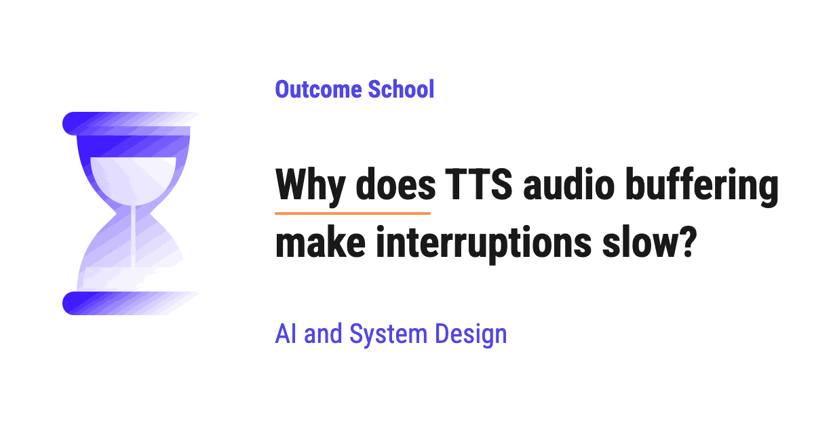

# Why does TTS audio buffering make interruptions slow?

> Archived from <https://outcomeschool.com/blog/tts-audio-buffering> on 2026-11-25.

TTS (Text-to-Speech) audio buffering makes interruptions slow because the voice agent creates its speech faster than we can listen to it, and all that extra speech waits in buffers. When we interrupt, everything already waiting in those buffers still has to be thrown away, and whatever cannot be thrown away keeps playing.

In this blog, we will learn about why TTS audio buffering makes interruptions slow. We will also see how a TTS model creates audio faster than real time, where the extra audio waits before we hear it, how much delay a full buffer adds when we interrupt, why we cannot simply remove all the buffers, how pacing the audio keeps the buffers small, and where this works well and where it fails.

We will cover the following:
<ul><li>What is TTS audio buffering?</li><li>TTS creates audio faster than we can hear it</li><li>Where the extra audio waits</li><li>What happens when we interrupt</li><li>How much delay does the buffer add?</li><li>Why we cannot remove the buffers</li><li>The fix: send audio at the speed of speech</li><li>Clearing what is left</li><li>A complete example</li><li>Where it works well and where it fails</li></ul>
I am <strong>Amit Shekhar</strong>, Founder @ <a target="_blank" rel="noopener noreferrer" href="https://outcomeschool.com">Outcome School</a>, I have taught and mentored many developers, and their efforts landed them high-paying tech jobs, helped many tech companies in solving their unique problems, and created many open-source libraries being used by top companies. I am passionate about sharing knowledge through open-source, blogs, and videos.

I teach <a target="_blank" rel="noopener noreferrer" href="https://outcomeschool.com/program/ai-and-machine-learning">AI and Machine Learning</a> at Outcome School.

Let&#x27;s get started.
<h2 id="what-is-tts-audio-buffering">What is TTS audio buffering?</h2>
A <a target="_blank" rel="noopener noreferrer" href="design-a-real-time-voice-ai-agent.md">voice agent</a> is a system that talks with us over a phone call or in an app. A typical voice agent has three main parts:
<ul><li><strong>STT (Speech-to-Text):</strong> It listens to our voice and turns it into text.</li><li><strong><a target="_blank" rel="noopener noreferrer" href="large-language-model-llm.md">LLM (Large Language Model)</a>:</strong> It reads that text and writes a reply.</li><li><strong>TTS (Text-to-Speech):</strong> It turns the reply text into audio.</li></ul>
When we start talking while the agent is still speaking, it is called an <strong>interruption</strong>, or <a target="_blank" rel="noopener noreferrer" href="what-is-barge-in-in-a-voice-ai-agent.md"><strong>barge-in</strong></a>. A good agent must <a target="_blank" rel="noopener noreferrer" href="stopping-speech-on-interruption.md">go silent right away</a> when we interrupt.

Now, a <strong>buffer</strong> is a place where data waits before it is used. Think of a water tank on the roof of a house. Water comes into the tank from the pipe, and it waits there until someone opens a tap.

<strong>TTS audio buffering means that the audio created by the TTS waits in one or more buffers before it reaches our speaker.</strong>

Once the water is in the tank, closing the pipe does not empty the tank. While the tap is open, the water already in the tank keeps flowing out until the tank is empty. In the same way, audio already in the buffer keeps playing even after the agent decides to stop.

To understand why so much audio ends up in the buffers, we must first see how fast the TTS works.
<h2 id="tts-creates-audio-faster-than-we-can-hear-it">TTS creates audio faster than we can hear it</h2>
We listen to speech at a fixed speed. One second of audio takes one second to hear. This speed is called <strong>real time</strong>.

A modern TTS model, running on a good GPU, often creates audio much faster than real time. For the sake of example, let&#x27;s say our TTS creates 1 second of audio in 0.2 seconds. Means, it is 5 times faster than real time.

This speed helps the agent <a target="_blank" rel="noopener noreferrer" href="time-to-first-audio.md">start speaking quickly</a>, because the first piece of audio is ready almost immediately.

But, this speed creates a side effect. The TTS keeps creating audio 5 times faster than we can listen to it. So, until the reply is complete, every second, 5 seconds of audio are created, but only 1 second is played. The other 4 seconds must wait somewhere.

The audio is created and sent in <a target="_blank" rel="noopener noreferrer" href="audio-frames-and-chunk-sizes.md">small pieces called <strong>chunks</strong></a>. On a phone call, a chunk is often 20 milliseconds of sound, and we will use the same size in this blog. These chunks pile up in the buffers, one after another.
<h2 id="where-the-extra-audio-waits">Where the extra audio waits</h2>
The audio does not travel straight from the TTS to our ear. It passes through many waiting areas on the way.

The audio travels like below:

<pre><code class="code-highlight">+----------------------+
|         TTS          |
|  creates the audio   |
+----------------------+
           ↓
+----------------------+
|    Server buffer     |
|   chunks to send     |
+----------------------+
           ↓
+----------------------+
|       Network        |
|  chunks on the way   |
+----------------------+
           ↓
+----------------------+
|    Device buffer     |
|   chunks to play     |
+----------------------+
           ↓
+----------------------+
|       Speaker        |
|   sound we hear      |
+----------------------+
</code></pre>

Here, we can see the waiting areas:
<ul><li><strong>Server buffer:</strong> Audio chunks that are ready on the agent&#x27;s server and are waiting to be sent.</li><li><strong>Network:</strong> Audio chunks that are already sent and are travelling to our device.</li><li><strong>Device buffer:</strong> Audio chunks that reached our phone or browser and are waiting to be played.</li><li><strong>Speaker:</strong> The sound that is playing right now.</li></ul>
On a phone call, there is one more waiting area. The <a target="_blank" rel="noopener noreferrer" href="phone-calls-in-voice-agents.md">telephony platform that connects the agent to the phone call</a> also keeps its own buffer.

Here, we can notice that the agent&#x27;s server fully controls only the first waiting area, the server buffer. The farther the audio travels, the harder it is for the agent to take it back.
<h2 id="what-happens-when-we-interrupt">What happens when we interrupt</h2>
Let&#x27;s take an example. We call a voice agent to book a flight. The agent says, &quot;We have flights at 6 AM, 9 AM, 1 PM, 5 PM, and 9 PM.&quot; After &quot;9 AM&quot;, we say, &quot;9 AM works.&quot;

The agent hears us and decides to stop. Now, the question is: when does the sound actually stop?

The answer is: only when every buffer between the agent and our ear is empty or cleared.

Suppose the agent stops the LLM and the TTS, but does nothing about the buffers. No new audio is created. But the device buffer still holds &quot;1 PM, 5 PM, and 9 PM&quot;. So, our speaker keeps playing it. We hear the agent talk over us for 2 or 3 more seconds.

This makes a voice agent feel unnatural. We said &quot;9 AM works&quot;, and the agent kept reading the list. Many people then talk louder or repeat themselves, and the agent has to deal with that extra speech too.

So, the slowness does not come from the LLM or the TTS being slow. It comes from the audio that was already created and already sent.

<strong>Planning your move into AI?</strong>

No matter which tech domain you work in today, with your effort, you can transition to these roles:
<ul><li>AI Engineer</li><li>Forward Deployed Engineer</li><li>AI Agent Engineer</li><li>Harness Engineer</li><li>Voice AI Engineer</li><li>AI Architect</li><li>LLM Engineer</li><li>LLM Inference Engineer</li><li>Gen AI Engineer</li><li>MLOps Engineer</li><li>ML Engineer</li><li>Deep Learning Engineer</li></ul>
Our <a target="_blank" rel="noopener noreferrer" href="https://outcomeschool.com/program/ai-and-machine-learning">AI and Machine Learning Program</a> at Outcome School takes you there.
<h2 id="how-much-delay-does-the-buffer-add">How much delay does the buffer add?</h2>
The best way to learn this is by taking an example with numbers.

Let&#x27;s say the agent&#x27;s full reply is 10 seconds long. The TTS is 5 times faster than real time. The server sends every chunk to the device the moment it is created.

<strong>Step 1:</strong> The TTS creates the full 10 seconds of audio in about 2 seconds.

<strong>Step 2:</strong> The server sends all of it right away. Playback starts almost immediately, so after about 2 seconds, we have heard 2 seconds, and the remaining 8 seconds are sitting in the device buffer.

<strong>Step 3:</strong> We interrupt at the 3-second mark. The device plays at real time, so we have heard 3 seconds of speech. The device buffer still holds 10 - 3 = 7 seconds of audio.

If the device has no way to empty its buffer, we hear the agent talk for 7 more seconds.

Now, let&#x27;s compare it with a server that sends audio only a little ahead of playback. Let&#x27;s say it keeps the device buffer at only 0.2 seconds of audio. Everything else stays on the server.

At the 3-second mark, the device buffer holds only 0.2 seconds of audio. The server throws away its own buffer instantly, because it fully controls it. So, the extra speech we hear is at most about 0.2 seconds.

We can write the rule like below:

<strong>Extra speech after interrupt = audio waiting where the agent cannot clear it</strong>

Here, we can notice that the delay is not about how fast the LLM or the TTS works. It is about where the extra audio is waiting.

Let me tabulate the differences between the two approaches for your better understanding.
<table><thead><tr><th>Approach</th><th>Device buffer at 3 seconds</th><th>Extra speech after interrupt</th></tr></thead><tbody><tr><td>Send everything immediately</td><td>7 seconds</td><td>Up to 7 seconds</td></tr><tr><td>Send only 0.2 seconds ahead</td><td>0.2 seconds</td><td>Up to 0.2 seconds</td></tr></tbody></table><h2 id="why-we-cannot-remove-the-buffers">Why we cannot remove the buffers</h2>
Now, the next big question is: why not remove all the buffers? Then, there is nothing to throw away.

The answer is that the buffers protect the sound quality.

The network does not deliver chunks at a perfectly steady speed. Some chunks arrive a little late. Some arrive in a bunch. This unevenness in arrival time is called <strong>jitter</strong>.

If the device has no buffer, and the next chunk is late, the speaker has nothing to play. The sound breaks up for a moment. This is called an <strong>underrun</strong>. We hear a gap, a click, or a robotic stutter.

So, the device keeps a small buffer on purpose. It holds a little audio in reserve, so that a late chunk does not cause a gap. This is called a <a target="_blank" rel="noopener noreferrer" href="jitter-buffer.md"><strong>jitter buffer</strong></a>, and it usually holds somewhere between a few tens of milliseconds and a couple of hundred milliseconds of audio.

Here is the trade-off:
<ul><li><strong>Big buffer:</strong> Smooth sound, but slow to stop when we interrupt.</li><li><strong>Small buffer:</strong> Fast to stop, but the sound can break up when the network is uneven.</li></ul>
We cannot make the buffer zero. We can only make it as small as the network allows. This is why the goal is not &quot;no buffers&quot;. The goal is &quot;small buffers far from the agent, and big buffers only where the agent can clear them&quot;.

<strong>A quick note for you</strong>

No matter which tech domain you work in, get familiar with these topics:
<ul><li>LLM</li><li>RAG</li><li>MCP</li><li>Agent</li><li>Fine-tuning</li><li>Quantization</li></ul>
We put it all together in one video:

<a target="_blank" rel="noopener noreferrer" href="https://www.youtube.com/watch?v=lnfWvX66FUk">AI Engineering Explained: LLM, RAG, MCP, Agent, Fine-Tuning, and Quantization</a>

No need to stop reading - bookmark it and watch later when you get time. Future you will thank you.

Now, let&#x27;s get back to the topic.
<h2 id="the-fix-send-audio-at-the-speed-of-speech">The fix: send audio at the speed of speech</h2>
Here comes <strong>pacing</strong> into the picture.

<strong>Pacing means that the server sends audio to the device at the same speed it will be played, keeping only a small amount of audio ahead of the speaker.</strong>

The TTS can still create audio 5 times faster than real time. But the extra audio stays in the server buffer. The server releases it at real time, like a tap that lets out only a little water at a time.

Let&#x27;s see how it works:
<ul><li>The TTS creates audio as fast as it can and puts it in the server buffer.</li><li>The server keeps track of how much audio the device has not played yet. This is called the <strong>lead</strong>.</li><li>If the lead is smaller than the target, for example 200 milliseconds, the server sends the next chunk.</li><li>If the lead is already at the target, the server waits.</li></ul>
At the very start, the lead is zero. So, the server sends the first 200 milliseconds of audio right away, and playback begins without any extra wait.

This way, the device always has enough audio to cover small network delays, but never several seconds of it.

The best part is that the server buffer is the easiest buffer to clear. It sits in the agent&#x27;s own memory. When we interrupt, the agent empties it in a single step, and that audio is never sent.
<h2 id="clearing-what-is-left">Clearing what is left</h2>
Pacing keeps the far buffers small. But they are still not empty. So, when we interrupt, the agent must also clear what is left, in order from nearest to farthest:
<ul><li><strong>Stop the TTS and the LLM:</strong> No new audio gets created.</li><li><strong>Empty the server buffer:</strong> The agent drops every chunk that is waiting to be sent.</li><li><strong>Tell the device to clear its buffer:</strong> In an app, the agent sends a message to the app, and the app stops its audio player and empties its buffer. On a phone call, some telephony platforms support a &quot;clear&quot; message that drops the audio they are holding.</li></ul>
One more thing to notice. Even after the agent sends the &quot;clear&quot; message, a few chunks of the old reply can still arrive. For example, a chunk that the sender was already sending at the moment of the stop can reach the device after the message. So, the device must ignore audio that belongs to the old reply. A common way is to give each reply a number. When the agent stops reply number 5, the device drops any chunk marked with number 5.

If we want to go deep into AI and ML System Design, including how to Design a Real-Time Voice AI Agent, check out our <a target="_blank" rel="noopener noreferrer" href="https://outcomeschool.com/program/ai-and-machine-learning">AI and Machine Learning Program</a> at Outcome School.
<h2 id="a-complete-example">A complete example</h2>
Let&#x27;s see the code for a paced sender. It keeps only the important parts.

We can write the code as below:

<pre><code class="code-highlight language-python">import asyncio
import time

CHUNK_MS = 20         # each chunk is 20 milliseconds of audio
TARGET_LEAD_MS = 200  # keep only 200 ms ahead of the speaker

async def paced_sender(server_buffer, send_to_device, stop_event):
    start = time.monotonic()
    sent_ms = 0
    while not stop_event.is_set():
        played_ms = (time.monotonic() - start) * 1000
        lead_ms = sent_ms - played_ms
        if lead_ms &gt;= TARGET_LEAD_MS or not server_buffer:
            await asyncio.sleep(0.005)  # wait a little and check again
            continue
        chunk = server_buffer.pop(0)
        await send_to_device(chunk)
        sent_ms += CHUNK_MS
</code></pre>

Here, we have a loop that sends one chunk at a time:
<ul><li><code>sent_ms</code> is how much audio we have sent to the device so far.</li><li><code>played_ms</code> is how much audio the device has played so far. For the sake of understanding, we guess it from the time passed since the sender started, and we assume that playback starts at the same moment.</li><li><code>lead_ms</code> is the audio waiting on the device. It is what we have sent minus what has been played.</li><li>If the lead is already 200 milliseconds or more, or the server buffer has no chunk yet, we wait for 5 milliseconds and check again. Otherwise, we send the next chunk.</li><li>The loop ends as soon as <code>stop_event</code> is set.</li></ul>
Now, let&#x27;s see the code that runs when the user interrupts:

<pre><code class="code-highlight language-python">async def on_interrupt(tts_task, server_buffer, stop_event, device):
    tts_task.cancel()                       # stop creating new audio
    stop_event.set()                        # stop the paced sender
    dropped_ms = len(server_buffer) * CHUNK_MS
    server_buffer.clear()                   # drop audio not sent yet
    await device.send_clear()               # ask the device to drop its buffer
    print(f&quot;Dropped {dropped_ms} ms of audio on the server&quot;)
</code></pre>

Here, we can see that the agent clears the buffers from nearest to farthest. It stops the TTS, stops the sender, empties the server buffer, and asks the device to clear its own buffer.

Let&#x27;s say the reply was 10 seconds long, and we interrupt at the 3-second mark. The TTS has already finished, so the server buffer holds about 10 - 3 - 0.2 = 6.8 seconds of audio. It will print the following:

<pre><code class="code-highlight">Dropped 6800 ms of audio on the server
</code></pre>

Here, we can notice that 6.8 seconds of audio were thrown away on the server, before they were ever sent. Without pacing, most of that audio would have been sitting on the device already. With pacing, the user hears at most about 0.2 seconds of the old reply, and often less, because the device also clears its buffer.

In a real system, the device reports how much it has actually played, instead of the server guessing it from the clock. But the idea stays the same.

<strong>Stay updated:</strong> Subscribe to our <a target="_blank" rel="noopener noreferrer" href="https://outcomeschool.substack.com/subscribe">newsletter</a> to get our latest AI and Machine Learning blogs straight to your inbox.
<h2 id="where-it-works-well-and-where-it-fails">Where it works well and where it fails</h2>
Pacing and clearing work well in these cases:
<ul><li>When the agent controls the full path, like its own app, it can clear every buffer and make the stop feel instant.</li><li>When the network is steady, the lead can be small, so the stop is fast.</li><li>When the TTS is much faster than real time, the server buffer always has audio ready. So, the paced sender never runs out, and the extra audio waits on the server, where it is easy to drop.</li></ul>
It fails, or works less well, in these cases:
<ul><li>On a phone call, the phone network and the telephony platform keep their own buffers. The agent cannot always clear them fully, so a small delay remains.</li><li>On a weak or uneven network, the lead must be bigger to avoid gaps in the sound. A bigger lead means a slower stop.</li><li>If the device or the platform does not support a &quot;clear&quot; message, the audio already sent will play out to the end.</li><li>If the agent guesses the playback position from the clock, and the playback started late or paused for a moment, the guess drifts. Then, the agent thinks the device has less audio than it really has.</li></ul>
Now we must have understood why TTS audio buffering makes interruptions slow, where the audio waits, and how pacing and clearing keep the agent quick to stop.
<h2 id="frequently-asked-questions">Frequently Asked Questions</h2><h3 id="does-a-faster-tts-model-make-interruptions-faster">Does a faster TTS model make interruptions faster?</h3>
No. A faster TTS model does not make interruptions faster on its own. The delay after an interruption is not about how fast the LLM or the TTS works. It is about where the extra audio is waiting. Audio waiting on the device keeps playing, but audio waiting on the server can be dropped by the agent in a single step.
<h3 id="what-is-a-jitter-buffer-in-a-voice-agent">What is a jitter buffer in a voice agent?</h3>
A jitter buffer is a small buffer that the device keeps on purpose, so that a late audio chunk does not cause a gap in the sound. The network does not deliver chunks at a perfectly steady speed. So, the jitter buffer holds a little audio in reserve, usually between a few tens of milliseconds and a couple of hundred milliseconds.
<h3 id="what-is-an-underrun-in-audio-playback">What is an underrun in audio playback?</h3>
An underrun happens when the speaker has nothing to play because the next audio chunk is late. The sound breaks up for a moment, and we hear a gap, a click, or a robotic stutter. This is why the device keeps a small buffer on purpose instead of having no buffer at all.
<h3 id="why-does-a-voice-agent-give-each-reply-a-number">Why does a voice agent give each reply a number?</h3>
A voice agent gives each reply a number so that the device can ignore late audio from an old reply. Even after the agent sends the &quot;clear&quot; message, a chunk that was already being sent can reach the device. When the agent stops reply number 5, the device drops any chunk marked with number 5.
<h3 id="can-a-voice-agent-clear-all-the-buffered-audio-on-a-phone-call">Can a voice agent clear all the buffered audio on a phone call?</h3>
Not always. On a phone call, the phone network and the telephony platform keep their own buffers. Some telephony platforms support a &quot;clear&quot; message that drops the audio they are holding, but the agent cannot always clear these buffers fully. So, a small delay remains.

That&#x27;s it for now.

Thanks

<strong>Amit Shekhar</strong> Founder @ <a target="_blank" rel="noopener noreferrer" href="https://outcomeschool.com">Outcome School</a>

You can connect with me on:
<ul><li><a target="_blank" rel="noopener noreferrer" href="https://x.com/amitiitbhu">X</a></li><li><a target="_blank" rel="noopener noreferrer" href="https://www.linkedin.com/in/amit-shekhar-iitbhu">LinkedIn</a></li><li><a target="_blank" rel="noopener noreferrer" href="https://github.com/amitshekhariitbhu">GitHub</a></li></ul>
Follow Outcome School on:
<ul><li><a target="_blank" rel="noopener noreferrer" href="https://x.com/outcome_school">X</a></li><li><a target="_blank" rel="noopener noreferrer" href="https://youtube.com/@OutcomeSchool">YouTube</a></li><li><a target="_blank" rel="noopener noreferrer" href="https://www.linkedin.com/company/outcomeschool">LinkedIn</a></li><li><a target="_blank" rel="noopener noreferrer" href="http://github.com/OutcomeSchool">GitHub</a></li></ul>
<a target="_blank" rel="noopener noreferrer" href="https://outcomeschool.com/blog"><strong>Read all of our high-quality blogs here.</strong></a>

