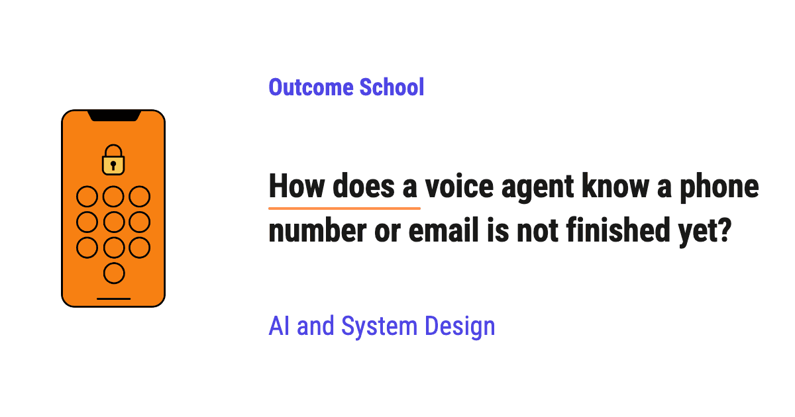

# How does a voice agent know a phone number or email is not finished yet?

> Archived from <https://outcomeschool.com/blog/unfinished-input-in-voice-agents> on 2026-11-25.

A voice agent knows that a phone number or email is not finished yet by combining a few signals: how long the person has been silent, what question the agent just asked, and whether the words heard so far look like a complete phone number or email. If the value still looks incomplete, the agent keeps listening instead of replying.

In this blog, we will learn about how a voice agent knows a phone number or email is not finished yet. We will also see why people pause in the middle of numbers and emails, why waiting for silence alone fails, how the agent uses the question it just asked, how it checks whether the value looks complete, how a turn detection model reads the words, and where this works well and where it fails.

We will cover the following:
<ul><li>The problem: people pause in the middle</li><li>What is endpointing?</li><li>Approach 1: Wait for a fixed silence</li><li>Approach 2: Wait longer for everyone</li><li>Approach 3: Use the question the agent just asked</li><li>Approach 4: Check if the value looks complete</li><li>Approach 5: A turn detection model that reads the words</li><li>How all the signals work together</li><li>What the agent does when it is still unsure</li><li>Where it works well and where it fails</li></ul>
I am <strong>Amit Shekhar</strong>, Founder @ <a target="_blank" rel="noopener noreferrer" href="https://outcomeschool.com">Outcome School</a>, I have taught and mentored many developers, and their efforts landed them high-paying tech jobs, helped many tech companies in solving their unique problems, and created many open-source libraries being used by top companies. I am passionate about sharing knowledge through open-source, blogs, and videos.

I teach <a target="_blank" rel="noopener noreferrer" href="https://outcomeschool.com/program/ai-and-machine-learning">AI and Machine Learning</a> at Outcome School.

Let&#x27;s get started.
<h2 id="the-problem-people-pause-in-the-middle">The problem: people pause in the middle</h2>
The best way to learn this is by taking an example. Let&#x27;s say we call a pizza shop, and a <a target="_blank" rel="noopener noreferrer" href="design-a-real-time-voice-ai-agent.md">voice agent</a> answers the phone. The agent asks:

&quot;Can I have your phone number, please?&quot;

Most of us do not say all ten digits in one breath. We say it in small groups, like below:

<pre><code class="code-highlight">&quot;five five five&quot;   (pause)   &quot;one two three&quot;   (pause)   &quot;four five six seven&quot;
</code></pre>

Each pause can last close to one second. We pause because we are reading the number from a card, or remembering it, or breathing.

The same thing happens with an email address:

<pre><code class="code-highlight">&quot;john&quot;   (pause)   &quot;dot smith&quot;   (pause)   &quot;at gmail&quot;   (pause)   &quot;dot com&quot;
</code></pre>

Now, the question is: how does the agent know that &quot;five five five&quot; is only the beginning and not the full answer?

If the agent gets this wrong, it jumps in after the first pause and says something like &quot;Sorry, that does not look like a valid phone number.&quot; The person gets interrupted, gets annoyed, and has to start again. This is a common problem in voice agents.

To solve this, we must first understand how a voice agent decides that a person has stopped talking.
<h2 id="what-is-endpointing">What is endpointing?</h2>
<strong>Endpointing is the job of deciding the exact moment when a person has finished their turn of speaking, so that the agent can start replying.</strong>

The agent is always asking itself one question: &quot;Is the person done, or should I keep listening?&quot; This job is also called <a target="_blank" rel="noopener noreferrer" href="what-is-turn-taking-in-a-voice-ai-agent.md"><strong>turn detection</strong></a>.

A typical voice agent works in a flow like below:

<pre><code class="code-highlight">Person speaks
      ↓
Speech-to-Text (audio to text)
      ↓
Endpointing (is the person done?)
      ↓
LLM (decides what to reply)
      ↓
Text-to-Speech (text to audio)
      ↓
Agent speaks
</code></pre>

Here, the <a target="_blank" rel="noopener noreferrer" href="large-language-model-llm.md">LLM (Large Language Model)</a> writes the reply, and the endpointing step sits between hearing and replying. If it says &quot;done&quot; too early, <a target="_blank" rel="noopener noreferrer" href="voice-agents-cutting-users-off.md">the agent interrupts</a>. If it says &quot;done&quot; too late, the agent feels slow, and the person can think that the call has dropped.

The phone number and email problem is a special case of <a target="_blank" rel="noopener noreferrer" href="endpointing-in-voice-agents.md">endpointing</a>. Now, let&#x27;s see the different approaches one by one, from the simplest to the best.
<h2 id="approach-1-wait-for-a-fixed-silence">Approach 1: Wait for a fixed silence</h2>
The simplest way is to use a <strong>Voice Activity Detector</strong>, called <strong>VAD</strong> in short. A VAD listens to the audio and tells us one thing: is someone speaking right now, or is it silence?

So, the rule becomes:

&quot;If the person has been silent for more than a fixed time, they are done.&quot;

This fixed time is often around half a second to one second. We can write the logic as below:

<pre><code class="language-python code-highlight">SILENCE_LIMIT = 0.6  # seconds

def is_turn_finished(silence_duration):
    return silence_duration &gt; SILENCE_LIMIT
</code></pre>

Here, we are checking only how long the person has been quiet. We are not looking at what they said.

This works well for normal answers like &quot;Yes&quot;, &quot;No&quot;, or &quot;I want a large pizza.&quot; But for a phone number, the person says &quot;five five five&quot; and pauses for 0.8 seconds. The rule says the person is done. The agent replies too early.

The issue with this approach is that a pause in the middle of a number looks exactly like a pause at the end of a sentence. Silence alone cannot tell the difference. Let&#x27;s see how the next approach solve this issue.
<h2 id="approach-2-wait-longer-for-everyone">Approach 2: Wait longer for everyone</h2>
The first fix that comes to mind is to make the silence limit longer, say 2 seconds.

<pre><code class="language-python code-highlight">SILENCE_LIMIT = 2.0  # seconds
</code></pre>

Now, the person can pause between &quot;five five five&quot; and &quot;one two three&quot;, and the agent keeps listening.

But, every answer now has a 2-second wait at the end. When the person says &quot;Yes&quot;, the agent waits 2 full seconds before replying. The whole conversation feels slow, and people start saying &quot;Hello? Are you there?&quot;

The issue with this approach is that we made every turn slow just to fix a few special turns. Let&#x27;s see how the next approach solve this issue.
<h2 id="approach-3-use-the-question-the-agent-just-asked">Approach 3: Use the question the agent just asked</h2>
The agent knows what it just asked.

If the agent just asked &quot;Can I have your phone number?&quot;, then it already knows that the next answer is a phone number. We also know that people pause while saying phone numbers. So, the agent can wait longer only for this one answer.

This is called <strong>context-aware endpointing</strong>. The <a target="_blank" rel="noopener noreferrer" href="dynamic-endpointing.md">silence limit changes</a> based on what the agent is expecting.

<strong>Planning your move into AI?</strong>

No matter which tech domain you work in today, with your effort, you can transition to these roles:
<ul><li>AI Engineer</li><li>Forward Deployed Engineer</li><li>AI Agent Engineer</li><li>Harness Engineer</li><li>Voice AI Engineer</li><li>AI Architect</li><li>LLM Engineer</li><li>LLM Inference Engineer</li><li>Gen AI Engineer</li><li>MLOps Engineer</li><li>ML Engineer</li><li>Deep Learning Engineer</li></ul>
Our <a target="_blank" rel="noopener noreferrer" href="https://outcomeschool.com/program/ai-and-machine-learning">AI and Machine Learning Program</a> at Outcome School takes you there.

We can write the logic as below:

<pre><code class="language-python code-highlight">SILENCE_LIMITS = {
    &quot;normal&quot;: 0.6,
    &quot;phone_number&quot;: 1.5,
    &quot;email&quot;: 2.0,
}

def is_turn_finished(silence_duration, expected_answer):
    limit = SILENCE_LIMITS.get(expected_answer, SILENCE_LIMITS[&quot;normal&quot;])
    return silence_duration &gt; limit
</code></pre>

Here, we have:
<ul><li><code>expected_answer</code>: what kind of answer the agent is waiting for. Our code sets this at the moment the agent asks the question.</li><li><code>SILENCE_LIMITS</code>: a different waiting time for each kind of answer.</li><li>For a normal answer, or any kind of answer not in the list, the agent waits 0.6 seconds.</li><li>For a phone number, it waits longer, and for an email, even longer, because people often spell parts of an email letter by letter.</li></ul>
The numbers here are just for the sake of understanding. Every team tunes them for their own users.

Now, &quot;Yes&quot; gets a quick reply, and the phone number gets more patience.

The issue with this approach is that it still only looks at silence. If the person says all ten digits quickly and stops, the agent still waits the full 1.5 seconds for nothing. And if the person <a target="_blank" rel="noopener noreferrer" href="long-pauses-in-voice-agents.md">pauses for 2 seconds while searching for their card</a>, the agent still cuts in. Let&#x27;s see how the next approach solve this issue.
<h2 id="approach-4-check-if-the-value-looks-complete">Approach 4: Check if the value looks complete</h2>
Now, let&#x27;s use the words themselves. Speech-to-Text gives us the text while the person is still speaking. These early pieces of text are called <strong>partial transcripts</strong>. So, at every pause, we can look at the text heard so far and ask: &quot;Does this look like a full phone number yet?&quot;

<strong>For a phone number</strong>, the check is simple. We count the digits.

Let&#x27;s say we expect a 10-digit phone number. We can write the code as below:

<pre><code class="language-python code-highlight">def phone_looks_complete(text):
    digits = [ch for ch in text if ch.isdigit()]
    return len(digits) &gt;= 10
</code></pre>

Here, we are taking only the digits from the text and counting them. Speech-to-Text often turns spoken &quot;five five five&quot; into the digits &quot;555&quot;, so counting works. If it gives the words instead, we first turn the words into digits. For a country where phone numbers have a different length, we change the number 10 in the code.

Let&#x27;s see a step-by-step walkthrough of the phone number from our example:

<strong>Step 1:</strong> The person says &quot;five five five&quot; and pauses. Text so far: &quot;555&quot;. Digits: 3. Not complete, so the agent keeps listening.

<strong>Step 2:</strong> The person says &quot;one two three&quot; and pauses. Text so far: &quot;555 123&quot;. Digits: 6. Not complete, so the agent keeps listening.

<strong>Step 3:</strong> The person says &quot;four five six seven&quot; and pauses. Text so far: &quot;555 123 4567&quot;. Digits: 10. Complete, so the agent can reply after a short silence.

<strong>For an email</strong>, we look for the shape of an email. A complete email has a name part, then &quot;at&quot;, then a domain, then &quot;dot&quot;, then an ending like &quot;com&quot; or &quot;org&quot;.

We can write the code as below:

<pre><code class="language-python code-highlight">import re

EMAIL_PATTERN = re.compile(r&quot;^[\w.+-]+@[\w-]+(\.[\w-]+)*\.[a-z]{2,}$&quot;)

def email_looks_complete(text):
    email = (
        text.lower()
        .replace(&quot; at &quot;, &quot;@&quot;)
        .replace(&quot; dot &quot;, &quot;.&quot;)
        .replace(&quot; &quot;, &quot;&quot;)
    )
    return bool(EMAIL_PATTERN.match(email))
</code></pre>

Here, we have:
<ul><li>First, we turn the spoken words &quot;at&quot; and &quot;dot&quot; into the symbols <code>@</code> and <code>.</code>.</li><li>Then, we remove the spaces.</li><li>Finally, we check the result against a pattern that describes the shape of an email. The pattern says: some letters or numbers, then <code>@</code>, then a domain name, then a dot and an ending of at least two letters.</li></ul>
Let&#x27;s see the walkthrough for &quot;john dot smith at gmail dot com&quot;:

<strong>Step 1:</strong> Text so far: &quot;john dot smith&quot;. After the conversion: &quot;john.smith&quot;. There is no <code>@</code>. Not complete.

<strong>Step 2:</strong> Text so far: &quot;john dot smith at gmail&quot;. After the conversion: &quot;john.smith@gmail&quot;. There is no ending like &quot;.com&quot;. Not complete.

<strong>Step 3:</strong> Text so far: &quot;john dot smith at gmail dot com&quot;. After the conversion: &quot;<a target="_blank" rel="noopener noreferrer" href="mailto:john.smith@gmail.com">john.smith@gmail.com</a>&quot;. It matches the pattern. Complete.

<strong>A quick note for you</strong>

No matter which tech domain you work in, get familiar with these topics:
<ul><li>LLM</li><li>RAG</li><li>MCP</li><li>Agent</li><li>Fine-tuning</li><li>Quantization</li></ul>
We put it all together in one video:

<a target="_blank" rel="noopener noreferrer" href="https://www.youtube.com/watch?v=lnfWvX66FUk">AI Engineering Explained: LLM, RAG, MCP, Agent, Fine-Tuning, and Quantization</a>

No need to stop reading - bookmark it and watch later when you get time. Future you will thank you.

Now, let&#x27;s get back to the topic.

Now, we combine this with Approach 3. The final rule becomes:
<ul><li>If the value looks incomplete, wait longer, even beyond the normal limit for this kind of answer.</li><li>If the value looks complete, reply after a short silence.</li></ul>
We can write the combined logic as below:

<pre><code class="language-python code-highlight">def is_turn_finished(silence_duration, expected_answer, text):
    if expected_answer == &quot;phone_number&quot;:
        if phone_looks_complete(text):
            return silence_duration &gt; 0.5
        return silence_duration &gt; 3.0
    if expected_answer == &quot;email&quot;:
        if email_looks_complete(text):
            return silence_duration &gt; 0.7
        return silence_duration &gt; 4.0
    return silence_duration &gt; 0.6
</code></pre>

Here, we can notice that the agent is now both faster and more patient. It is faster when the value is complete, and more patient when the value is clearly not finished. Now, if the person has said 6 digits and pauses for 2 seconds to look at their card, the agent does not cut in, because it waits up to 3 seconds for an incomplete number.

<strong>Note:</strong> We still keep a maximum waiting time, which is 3 seconds for an incomplete phone number in our code. The agent must not wait forever. If the person stays silent for that long with only 6 digits, the agent replies and asks for the rest of the number.

The issue with this approach is that rules are rigid. Phone numbers have different lengths in different countries. People add extensions. People say &quot;double five&quot; instead of &quot;five five&quot;. People correct themselves, like &quot;five five... no wait, five six&quot;. Writing a rule for every case is hard. Let&#x27;s see how the next approach solve this issue.
<h2 id="approach-5-a-turn-detection-model-that-reads-the-words">Approach 5: A turn detection model that reads the words</h2>
<strong>A turn detection model is a small AI model that reads the conversation so far and predicts how likely it is that the person has finished their turn.</strong>

Instead of writing rules by hand, we train the model on many real conversations. It learns patterns like:
<ul><li>&quot;My number is five five five&quot; usually means the person is not done.</li><li>&quot;My email is john at&quot; usually means the person is not done.</li><li>&quot;My number is five five five, one two three, four five six seven&quot; usually means the person is done.</li></ul>
The model reads the conversation, including the question the agent asked, and gives back a number between 0 and 1. A number close to 1 means &quot;the person is done&quot;. A number close to 0 means &quot;the person is still talking&quot;.

Some turn detection models read only the text from Speech-to-Text. Others listen to the audio as well, because the voice carries extra clues. For example, when we pause in the middle of a number, our voice often stays flat or goes up, as if to say &quot;more is coming&quot;. When we finish, our voice often drops down. This rise and fall of the voice is called <strong>intonation</strong>.

We have a detailed blog on <a target="_blank" rel="noopener noreferrer" href="silence-vs-model-based-turn-detection.md">how silence-based and model-based turn detection differ</a> that explains this in depth.

We can use the model like below:

<pre><code class="language-python code-highlight">def is_turn_finished(silence_duration, conversation):
    done_probability = turn_model.predict(conversation)

    if done_probability &gt; 0.8:
        return silence_duration &gt; 0.3
    if done_probability &gt; 0.4:
        return silence_duration &gt; 1.0
    return silence_duration &gt; 3.0
</code></pre>

Here, we have:
<ul><li><code>turn_model</code>: the trained turn detection model.</li><li><code>turn_model.predict(conversation)</code>: the model reads the conversation and gives back the chance that the person is done.</li><li>If the model is very sure the person is done, the agent replies after a very short silence.</li><li>If the model is not sure, the agent waits a medium time.</li><li>If the model is sure the person is still talking, the agent waits a long time.</li></ul>
The best part is that the model can handle messy cases that rules miss, like &quot;double five&quot;, extensions, and self-corrections, as long as it has seen enough such examples while training.

<strong>Stay updated:</strong> Subscribe to our <a target="_blank" rel="noopener noreferrer" href="https://outcomeschool.substack.com/subscribe">newsletter</a> to get our latest AI and Machine Learning blogs straight to your inbox.
<h2 id="how-all-the-signals-work-together">How all the signals work together</h2>
In a real voice agent, these approaches are often stacked together. The flow looks like the diagram below:

<pre><code class="code-highlight">Person pauses while speaking
      ↓
VAD detects silence and starts a timer
      ↓
Check what the agent asked last
(phone number, email, or normal answer)
      ↓
Check if the value looks complete
(digit count, email pattern)
      ↓
Turn detection model gives a score
      ↓
Decide how long to wait
      ↓
Silence longer than the wait time?
      ↓
Yes: agent replies
No: agent keeps listening
</code></pre>

Here, each signal covers a weakness of the others:
<ul><li>The VAD knows when there is silence, but not why.</li><li>The question the agent asked tells us what kind of answer is coming.</li><li>The completeness check tells us if the value has all its parts.</li><li>The turn detection model can handle the messy cases that rules do not cover.</li></ul>
To learn how to Design a Real-Time Voice AI Agent, including SLMs and Model Distillation for small and fast turn detection models, we can check out our <a target="_blank" rel="noopener noreferrer" href="https://outcomeschool.com/program/ai-and-machine-learning">AI and Machine Learning Program</a> at Outcome School.
<h2 id="what-the-agent-does-when-it-is-still-unsure">What the agent does when it is still unsure</h2>
Even with all these signals, the agent will sometimes be wrong. So, good voice agents add a safety step after the person finishes: they <strong>read the value back</strong>.

For example:

&quot;Thanks. I have your number as five five five, one two three, four five six seven. Is that correct?&quot;

This gives the person a chance to fix any mistake. For emails, the agent can also spell the tricky part letter by letter, because &quot;m&quot; and &quot;n&quot;, or &quot;b&quot; and &quot;d&quot;, <a target="_blank" rel="noopener noreferrer" href="sample-rates-for-voice-agents.md">sound very similar on a phone line</a>.

Another useful trick is to let the person interrupt. If the agent starts replying too early and the person keeps speaking, the agent must stop talking right away and keep listening. This is called <a target="_blank" rel="noopener noreferrer" href="what-is-barge-in-in-a-voice-ai-agent.md"><strong>barge-in</strong></a>. With barge-in, even an early reply does not ruin the call, because the person can continue.
<h2 id="where-it-works-well-and-where-it-fails">Where it works well and where it fails</h2>
<strong>Where it works well:</strong>
<ul><li>Phone numbers with a known, fixed length, because counting digits is simple and reliable.</li><li>Emails with common endings like &quot;.com&quot; or &quot;.org&quot;, because the pattern clearly shows when the email is complete.</li><li>Calls where the agent asks one clear question at a time, because the agent knows exactly what kind of answer to expect.</li></ul>
<strong>Where it fails:</strong>
<ul><li>When the person adds something after a complete-looking value, like &quot;five five five, one two three, four five six seven, extension two&quot;. The value looks complete after &quot;seven&quot;, so the agent replies too early.</li><li>When the person gives a number of an unexpected length, like an international number with a country code.</li><li>When Speech-to-Text makes a mistake, like hearing &quot;for&quot; instead of &quot;four&quot;, so the digit count is wrong.</li><li>When an email ending looks complete but is not, like &quot;john at company dot co&quot; when the person was about to add &quot;dot uk&quot;.</li><li>When there is a lot of background noise, because the VAD can mistake the noise for speech, so the silence timer does not start at the right time.</li></ul>
The read-back step and barge-in catch the cases that endpointing gets wrong.

Now we must have understood how a voice agent knows that a phone number or email is not finished yet.
<h2 id="frequently-asked-questions">Frequently Asked Questions</h2><h3 id="what-is-context-aware-endpointing-in-a-voice-agent">What is context-aware endpointing in a voice agent?</h3>
Context-aware endpointing means the silence limit changes based on what kind of answer the agent is expecting. If the agent just asked for a phone number or an email, it waits longer before replying. For a normal answer like &quot;Yes&quot;, it still replies quickly.
<h3 id="what-are-partial-transcripts-in-a-voice-agent">What are partial transcripts in a voice agent?</h3>
Partial transcripts are the early pieces of text that Speech-to-Text gives us while the person is still speaking. At every pause, the voice agent can look at the text heard so far and check whether it already looks like a full phone number or email.
<h3 id="can-a-voice-agent-use-the-tone-of-the-voice-to-tell-that-a-number-is-not-finished">Can a voice agent use the tone of the voice to tell that a number is not finished?</h3>
Yes. Some turn detection models listen to the audio as well as reading the text. When we pause in the middle of a number, our voice often stays flat or goes up, as if more is coming. When we finish, our voice often drops down. This rise and fall of the voice is called intonation.
<h3 id="should-a-voice-agent-wait-forever-for-an-incomplete-phone-number">Should a voice agent wait forever for an incomplete phone number?</h3>
No. The agent still keeps a maximum waiting time, even when the value looks incomplete. If the person stays silent for that long with only part of the number, the agent replies and asks for the rest of the number.
<h3 id="why-is-barge-in-useful-when-a-voice-agent-collects-a-phone-number">Why is barge-in useful when a voice agent collects a phone number?</h3>
Because the agent will sometimes start replying too early. With barge-in, if the person keeps speaking, the agent stops talking right away and keeps listening. So, an early reply does not ruin the call, because the person can continue with the rest of the number.

That&#x27;s it for now.

Thanks

<strong>Amit Shekhar</strong> Founder @ <a target="_blank" rel="noopener noreferrer" href="https://outcomeschool.com">Outcome School</a>

You can connect with me on:
<ul><li><a target="_blank" rel="noopener noreferrer" href="https://x.com/amitiitbhu">X</a></li><li><a target="_blank" rel="noopener noreferrer" href="https://www.linkedin.com/in/amit-shekhar-iitbhu">LinkedIn</a></li><li><a target="_blank" rel="noopener noreferrer" href="https://github.com/amitshekhariitbhu">GitHub</a></li></ul>
Follow Outcome School on:
<ul><li><a target="_blank" rel="noopener noreferrer" href="https://x.com/outcome_school">X</a></li><li><a target="_blank" rel="noopener noreferrer" href="https://youtube.com/@OutcomeSchool">YouTube</a></li><li><a target="_blank" rel="noopener noreferrer" href="https://www.linkedin.com/company/outcomeschool">LinkedIn</a></li><li><a target="_blank" rel="noopener noreferrer" href="http://github.com/OutcomeSchool">GitHub</a></li></ul>
<a target="_blank" rel="noopener noreferrer" href="https://outcomeschool.com/blog"><strong>Read all of our high-quality blogs here.</strong></a>

