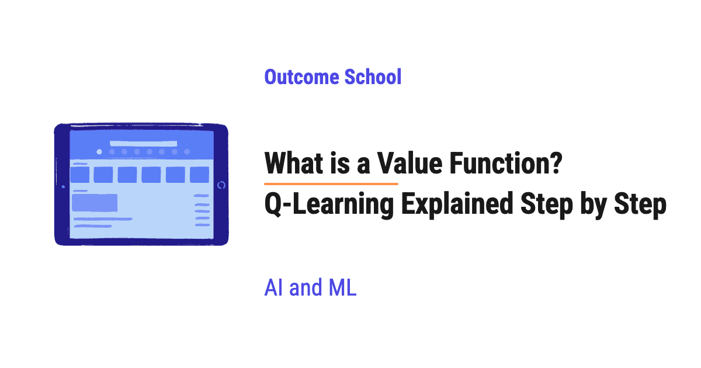

# What is a Value Function? Q-Learning Explained Step by Step

> Archived from <https://outcomeschool.com/blog/value-function-and-q-learning> on 2026-11-25.

A Value Function gives a number that tells an agent how much total reward it can expect from a situation, and Q-Learning is a method that learns these numbers for every situation and action by trial and error.

In this blog, we will learn about what a Value Function is and how Q-Learning works step by step. We will also see what return and discount mean, the State Value Function and the Action Value Function, the Bellman idea, the Q-table and the Q-Learning update rule, a step-by-step walkthrough on a tiny corridor, and a short Python implementation along with where the Q-table fails.

We will cover the following:
<ul><li>Return and Discount</li><li>What is a Value Function?</li><li>State Value Function V(s)</li><li>Action Value Function Q(s, a)</li><li>The Bellman Idea</li><li>What is Q-Learning?</li><li>The Q-Learning Update Rule</li><li>Our Tiny Corridor</li><li>Q-Learning Step by Step</li><li>Epsilon-Greedy</li><li>Q-Learning in Python</li><li>Limitation of the Q-table and Deep Q-Network</li></ul>
I am <strong>Amit Shekhar</strong>, Founder @ <a target="_blank" rel="noopener noreferrer" href="https://outcomeschool.com">Outcome School</a>, I have taught and mentored many developers, and their efforts landed them high-paying tech jobs, helped many tech companies in solving their unique problems, and created many open-source libraries being used by top companies. I am passionate about sharing knowledge through open-source, blogs, and videos.

I teach <a target="_blank" rel="noopener noreferrer" href="https://outcomeschool.com/program/ai-and-machine-learning">AI and Machine Learning</a> at Outcome School.

Let&#x27;s get started.
<h2 id="return-and-discount">Return and Discount</h2>
In <a target="_blank" rel="noopener noreferrer" href="reinforcement-learning.md">Reinforcement Learning</a>, an <strong>agent</strong> is in a <strong>state</strong> (the situation it is in), picks an <strong>action</strong>, gets a <strong>reward</strong> (a number that says how good that move was), and lands in the next state. The goal of the agent is to collect as much reward as possible over time.

The <strong>return</strong> is the total reward the agent collects from now until the end. A reward that comes later is worth a little less than a reward that comes now, so we multiply each future reward by a <strong>discount factor</strong> called <code>gamma</code> (a number between 0 and 1, for example 0.9).

<strong>G = r1 + gamma * r2 + gamma^2 * r3 + ...</strong>

Here, <code>r1</code> is the reward from the next move, <code>r2</code> is the reward from the move after that, and so on. Each extra step of waiting adds one more <code>gamma</code>.

Let&#x27;s say the agent gets a reward of 10 after 3 moves and nothing before that. With <code>gamma = 0.9</code>, the return is <code>0 + 0.9 * 0 + 0.81 * 10 = 8.1</code>. The same reward of 10 after 1 move gives a return of 10. Hence, the discount makes the agent prefer reaching the reward sooner.

We have a detailed blog on <a target="_blank" rel="noopener noreferrer" href="markov-decision-process-mdp.md">Markov Decision Process (MDP)</a> that explains how states, actions, rewards, and the discount factor fit into one framework.
<h2 id="what-is-a-value-function">What is a Value Function?</h2>
<strong>A Value Function tells us how good it is for the agent to be in a state, or to take an action in a state, measured as the return the agent can expect from there.</strong>

Let&#x27;s say we are playing a board game. Being two squares away from the finish line is a better position than being twenty squares away, even though we have not won anything yet. A Value Function puts a number on that &quot;better position&quot; feeling.

There are two kinds of Value Functions. Let&#x27;s learn about each of them.
<h2 id="state-value-function-vs">State Value Function V(s)</h2>
<strong>The State Value Function <code>V(s)</code> is the return the agent can expect if it starts in state <code>s</code> and then keeps following its way of choosing actions.</strong>

That way of choosing actions is called the <strong>policy</strong>. So, <code>V(s)</code> depends on the policy. A good policy gives high values, and a bad policy gives low values.

<code>V(s)</code> answers the question: &quot;How good is this state?&quot;
<h2 id="action-value-function-qs-a">Action Value Function Q(s, a)</h2>
<strong>The Action Value Function <code>Q(s, a)</code> is the return the agent can expect if it is in state <code>s</code>, takes action <code>a</code> right now, and then keeps following its policy.</strong>

<code>Q(s, a)</code> answers a more detailed question: &quot;How good is this action in this state?&quot;

The letter Q comes from the word &quot;quality&quot;. <code>Q(s, a)</code> is the quality of action <code>a</code> in state <code>s</code>.

Now, the relation between the two is simple. If the agent always picks the best action, then the value of a state is the value of its best action:

<strong>V(s) = max over a of Q(s, a)</strong>

Means, if we know <code>Q</code> for every action, we also know <code>V</code>. And with <code>Q</code>, we can choose the action directly: in each state, pick the action with the highest <code>Q</code>. With only <code>V</code>, the agent would also need to know where each action leads. This is why Q-Learning learns <code>Q</code> and not <code>V</code>.

To learn Reinforcement Learning and how an agent judges its states and actions from the ground up, check out our <a target="_blank" rel="noopener noreferrer" href="https://outcomeschool.com/program/ai-and-machine-learning">AI and Machine Learning Program</a> at Outcome School.
<h2 id="the-bellman-idea">The Bellman Idea</h2>
Now, the next big question is: how do we compute these values?

The answer is the <strong>Bellman idea</strong>, which in plain words says:

<strong>The value of where we are now = the reward we get now + the discounted value of where we land next.</strong>

For <code>Q</code>, when the agent picks the best action from the next state onward, it becomes:

<strong>Q(s, a) = r + gamma * max Q(s&#x27;, a&#x27;)</strong>

Here, <code>s&#x27;</code> is the next state and <code>a&#x27;</code> is any action in that next state. <code>max Q(s&#x27;, a&#x27;)</code> is the value of the best action from the next state. For the sake of understanding, we assume that the same action in the same state always gives the same reward and the same next state. If the result is random, we take the average over all the possible results.

We do not need to look all the way to the end of the game. We need one step of real reward plus our current guess of the value of the next state.
<h2 id="what-is-q-learning">What is Q-Learning?</h2>
<strong>Q-Learning is a Reinforcement Learning method in which the agent learns the <code>Q(s, a)</code> value for every state and action by trying actions, seeing the rewards, and improving its guesses using the Bellman idea.</strong>

The agent keeps all its guesses in a table called the <strong>Q-table</strong>. Each row is a state, each column is an action, and each cell holds the current guess of <code>Q(s, a)</code>.

At the start, every cell is 0. The agent updates the cells one by one as it practices, and in the end, it picks the action with the highest value in each state.

<strong>Planning your move into AI?</strong>

No matter which tech domain you work in today, with your effort, you can transition to these roles:
<ul><li>AI Engineer</li><li>Forward Deployed Engineer</li><li>AI Agent Engineer</li><li>Harness Engineer</li><li>Voice AI Engineer</li><li>AI Architect</li><li>LLM Engineer</li><li>LLM Inference Engineer</li><li>Gen AI Engineer</li><li>MLOps Engineer</li><li>ML Engineer</li><li>Deep Learning Engineer</li></ul>
Our <a target="_blank" rel="noopener noreferrer" href="https://outcomeschool.com/program/ai-and-machine-learning">AI and Machine Learning Program</a> at Outcome School takes you there.
<h2 id="the-q-learning-update-rule">The Q-Learning Update Rule</h2>
Every time the agent takes one action, it updates one cell of the Q-table using this rule:

<strong>Q(s,a) &lt;- Q(s,a) + alpha * (r + gamma * max Q(s&#x27;,a&#x27;) - Q(s,a))</strong>

Let&#x27;s understand each term:
<ul><li><code>&lt;-</code>: replace the old value in the cell with the new value on the right side.</li><li><code>Q(s,a)</code>: the current guess for taking action <code>a</code> in state <code>s</code>.</li><li><code>r</code>: the reward the agent just got.</li><li><code>gamma</code>: the discount factor, for example 0.9.</li><li><code>max Q(s&#x27;,a&#x27;)</code>: the best value the agent currently believes it can get from the next state <code>s&#x27;</code>. If <code>s&#x27;</code> is the end of the game, this is 0.</li><li><code>r + gamma * max Q(s&#x27;,a&#x27;)</code>: the <strong>target</strong>. This is the Bellman idea, a better guess built from one real reward.</li><li><code>target - Q(s,a)</code>: the <strong>error</strong>. It tells how far the old guess is from the target.</li><li><code>alpha</code>: the <strong>learning rate</strong>, a number between 0 and 1, for example 0.5. It decides how big a step we take toward the target.</li></ul>
So, the rule moves the old guess a part of the way toward the target.

Let&#x27;s see this as a diagram, with <code>gamma = 0.9</code> and <code>alpha = 0.5</code>:

<pre><code class="language-text code-highlight">┌─────────────────────────────────┐
│ Agent is in state s             │
└─────────────────────────────────┘
                 ↓
┌─────────────────────────────────┐
│ Pick action a                   │
└─────────────────────────────────┘
                 ↓
┌─────────────────────────────────┐
│ Get reward r, land in state s&#x27;  │
└─────────────────────────────────┘
                 ↓
┌─────────────────────────────────┐
│ target = r + 0.9 * max Q(s&#x27;,a&#x27;) │
└─────────────────────────────────┘
                 ↓
┌─────────────────────────────────┐
│ error = target - Q(s,a)         │
└─────────────────────────────────┘
                 ↓
┌─────────────────────────────────┐
│ Q(s,a) = Q(s,a) + 0.5 * error   │
└─────────────────────────────────┘
                 ↓
┌─────────────────────────────────┐
│ s&#x27; becomes s, repeat until goal │
└─────────────────────────────────┘
</code></pre>

Here, we can see that one action gives one update. The agent repeats this loop again and again until it reaches the goal, and then starts a new attempt from the beginning. Each attempt from start to end is called an <strong>episode</strong>.

<strong>A quick note for you</strong>

No matter which tech domain you work in, get familiar with these topics:
<ul><li>LLM</li><li>RAG</li><li>MCP</li><li>Agent</li><li>Fine-tuning</li><li>Quantization</li></ul>
We put it all together in one video:

<a target="_blank" rel="noopener noreferrer" href="https://www.youtube.com/watch?v=lnfWvX66FUk">AI Engineering Explained: LLM, RAG, MCP, Agent, Fine-Tuning, and Quantization</a>

No need to stop reading - bookmark it and watch later when you get time. Future you will thank you.

Now, let&#x27;s get back to the topic.
<h2 id="our-tiny-corridor">Our Tiny Corridor</h2>
The best way to learn this is by taking an example.

Consider a corridor of 4 cells. The agent starts in Cell 0. The goal is in Cell 3. Let&#x27;s see this as a diagram:

<pre><code class="language-text code-highlight">┌────────┬────────┬────────┬────────┐
│ Cell 0 │ Cell 1 │ Cell 2 │ Cell 3 │
│ Start  │        │        │ Goal   │
│        │        │        │ +10    │
└────────┴────────┴────────┴────────┘
</code></pre>

Here, we can see the 4 cells in a row, with the start on the left and the goal, worth a reward of 10, on the right. The rules are:
<ul><li>The agent has two actions: Left and Right.</li><li>Moving Right goes to the next cell. Moving Left goes to the previous cell. Moving Left in Cell 0 hits the wall, and the agent stays in Cell 0.</li><li>Reaching Cell 3 gives a reward of 10, and the episode ends.</li><li>Every other move gives a reward of 0.</li><li>We use <code>alpha = 0.5</code> and <code>gamma = 0.9</code>.</li></ul>
Cell 3 is the end, so the agent never takes an action there. Hence, our Q-table has 3 rows (Cell 0, Cell 1, Cell 2) and 2 columns (Left, Right). At the start, every cell is 0:
<table><thead><tr><th>State</th><th>Left</th><th>Right</th></tr></thead><tbody><tr><td>Cell 0</td><td>0</td><td>0</td></tr><tr><td>Cell 1</td><td>0</td><td>0</td></tr><tr><td>Cell 2</td><td>0</td><td>0</td></tr></tbody></table><h2 id="q-learning-step-by-step">Q-Learning Step by Step</h2>
For the sake of understanding, let&#x27;s say the agent moves Right every time in the first few episodes. Let&#x27;s update the Q-table after each move.

<strong>Episode 1</strong>

<strong>Step 1:</strong> The agent is in Cell 0 and moves Right to Cell 1. The reward is 0. The best value in Cell 1 is 0.
<ul><li>target = 0 + 0.9 * 0 = 0</li><li>Q(Cell 0, Right) = 0 + 0.5 * (0 - 0) = 0</li></ul>
Nothing changes. The Q-table is still all zeros.

<strong>Step 2:</strong> The agent is in Cell 1 and moves Right to Cell 2. The reward is 0, and the best value in Cell 2 is 0. So, the target is 0, and <code>Q(Cell 1, Right)</code> stays 0. Nothing changes, because the agent has not found any reward yet.

<strong>Step 3:</strong> The agent is in Cell 2 and moves Right to Cell 3, the goal. The reward is 10. Cell 3 is the end, so its best value is 0.
<ul><li>target = 10 + 0.9 * 0 = 10</li><li>Q(Cell 2, Right) = 0 + 0.5 * (10 - 0) = 5</li></ul><table><thead><tr><th>State</th><th>Left</th><th>Right</th></tr></thead><tbody><tr><td>Cell 0</td><td>0</td><td>0</td></tr><tr><td>Cell 1</td><td>0</td><td>0</td></tr><tr><td>Cell 2</td><td>0</td><td>5</td></tr></tbody></table>
Here, we can see that the first useful number appears right next to the goal. The episode ends, and the agent starts again from Cell 0.

<strong>Episode 2</strong>

<strong>Step 4:</strong> The agent is in Cell 0 and moves Right to Cell 1. The reward is 0, and the best value in Cell 1 is still 0. So, <code>Q(Cell 0, Right)</code> stays 0, and the Q-table does not change.

<strong>Step 5:</strong> The agent is in Cell 1 and moves Right to Cell 2. The reward is 0. But now, the best value in Cell 2 is 5.
<ul><li>target = 0 + 0.9 * 5 = 4.5</li><li>Q(Cell 1, Right) = 0 + 0.5 * (4.5 - 0) = 2.25</li></ul><table><thead><tr><th>State</th><th>Left</th><th>Right</th></tr></thead><tbody><tr><td>Cell 0</td><td>0</td><td>0</td></tr><tr><td>Cell 1</td><td>0</td><td>2.25</td></tr><tr><td>Cell 2</td><td>0</td><td>5</td></tr></tbody></table>
Here, we can notice that the reward was 0 in this move, but <code>Q(Cell 1, Right)</code> still went up. This is because the agent now knows that Cell 2 is a good place. This is the Bellman idea at work.

<strong>Step 6:</strong> The agent is in Cell 2 and moves Right to the goal. The reward is 10, and the best value of the goal is 0.
<ul><li>target = 10 + 0.9 * 0 = 10</li><li>Q(Cell 2, Right) = 5 + 0.5 * (10 - 5) = 7.5</li></ul><table><thead><tr><th>State</th><th>Left</th><th>Right</th></tr></thead><tbody><tr><td>Cell 0</td><td>0</td><td>0</td></tr><tr><td>Cell 1</td><td>0</td><td>2.25</td></tr><tr><td>Cell 2</td><td>0</td><td>7.5</td></tr></tbody></table>
The guess moved from 5 to 7.5, halfway toward the target of 10, because <code>alpha</code> is 0.5.

<strong>Episode 3</strong>

<strong>Step 7:</strong> The agent is in Cell 0 and moves Right to Cell 1. The reward is 0, but the best value in Cell 1 is now 2.25.
<ul><li>target = 0 + 0.9 * 2.25 = 2.025</li><li>Q(Cell 0, Right) = 0 + 0.5 * (2.025 - 0) = 1.0125</li></ul><table><thead><tr><th>State</th><th>Left</th><th>Right</th></tr></thead><tbody><tr><td>Cell 0</td><td>0</td><td>1.0125</td></tr><tr><td>Cell 1</td><td>0</td><td>2.25</td></tr><tr><td>Cell 2</td><td>0</td><td>7.5</td></tr></tbody></table>
If the agent finishes Episode 3 by moving Right two more times, the Right column after each episode looks like below:
<table><thead><tr><th>After</th><th>Cell 0</th><th>Cell 1</th><th>Cell 2</th></tr></thead><tbody><tr><td>Episode 1</td><td>0</td><td>0</td><td>5</td></tr><tr><td>Episode 2</td><td>0</td><td>2.25</td><td>7.5</td></tr><tr><td>Episode 3</td><td>1.0125</td><td>4.5</td><td>8.75</td></tr></tbody></table>
Here, we can see that the reward at the goal flows backward, one cell at a time, until it reaches the start.

If we keep going for many episodes, and the agent also tries Left sometimes (we will see how in the next section), the values settle at:
<table><thead><tr><th>State</th><th>Left</th><th>Right</th></tr></thead><tbody><tr><td>Cell 0</td><td>7.29</td><td>8.1</td></tr><tr><td>Cell 1</td><td>7.29</td><td>9</td></tr><tr><td>Cell 2</td><td>8.1</td><td>10</td></tr></tbody></table>
Here, Right is higher than Left in every cell, so the agent has learned to always move Right. Using <code>V(s) = max over a of Q(s, a)</code>, the state values are <code>V(Cell 0) = 8.1</code>, <code>V(Cell 1) = 9</code>, and <code>V(Cell 2) = 10</code>. The closer the cell is to the goal, the higher its value. Also, <code>Q(Cell 0, Right) = 8.1</code>, which is exactly the return we computed earlier for a reward of 10 after 3 moves.

<strong>Stay updated:</strong> Subscribe to our <a target="_blank" rel="noopener noreferrer" href="https://outcomeschool.substack.com/subscribe">newsletter</a> to get our latest AI and Machine Learning blogs straight to your inbox.
<h2 id="epsilon-greedy">Epsilon-Greedy</h2>
If the agent always picks the action with the highest <code>Q</code>, it can get stuck with the first good path it finds and never try others. So, we use <strong><a target="_blank" rel="noopener noreferrer" href="exploration-vs-exploitation.md">epsilon-greedy</a></strong>: with a small probability <code>epsilon</code> (for example 0.2), the agent picks a random action to explore, and otherwise it picks the action with the highest <code>Q</code>.
<h2 id="q-learning-in-python">Q-Learning in Python</h2>
Now, let&#x27;s see the code for Q-Learning on our corridor.

<pre><code class="code-highlight language-python">import random

random.seed(0)
alpha, gamma, epsilon = 0.5, 0.9, 0.2
Q = [[0.0, 0.0] for _ in range(3)]  # 3 cells, 2 actions: 0 = Left, 1 = Right

for episode in range(200):
    s = 0
    while s != 3:
        if random.random() &lt; epsilon or Q[s][0] == Q[s][1]:
            a = random.choice([0, 1])               # explore (or break a tie)
        else:
            a = 0 if Q[s][0] &gt; Q[s][1] else 1       # exploit
        s_next = max(0, s - 1) if a == 0 else s + 1
        r = 10 if s_next == 3 else 0
        best_next = 0 if s_next == 3 else max(Q[s_next])
        Q[s][a] += alpha * (r + gamma * best_next - Q[s][a])
        s = s_next

for s in range(3):
    print(f&quot;Cell {s}: Left = {Q[s][0]:.2f}, Right = {Q[s][1]:.2f}&quot;)
</code></pre>

Here, we have:
<ul><li><code>random.seed(0)</code>: makes the random choices the same on every run, so we get the same output.</li><li><code>Q</code>: the Q-table with 3 rows and 2 columns, all starting at 0.</li><li><code>for episode in range(200)</code>: 200 episodes, each starting in Cell 0 and ending when the agent reaches Cell 3.</li><li>The <code>if</code> block: epsilon-greedy. With probability 0.2, or when both actions have the same value, the agent picks a random action. Otherwise, it picks the action with the higher value.</li><li><code>s_next</code> and <code>r</code>: the corridor rules. Left in Cell 0 stays in Cell 0, and reaching Cell 3 gives 10.</li><li><code>best_next</code>: <code>max Q(s&#x27;, a&#x27;)</code>, which is 0 when the next state is the goal.</li><li>The line <code>Q[s][a] += ...</code>: the Q-Learning update rule, exactly as we wrote it above.</li></ul>
It will print the following:

<pre><code class="language-text code-highlight">Cell 0: Left = 7.29, Right = 8.10
Cell 1: Left = 7.29, Right = 9.00
Cell 2: Left = 8.10, Right = 10.00
</code></pre>

Here, we can see that the agent has learned the same values as our table above. It works perfectly.

If we want to go deep into Reinforcement Learning and Exploration vs Exploitation, our <a target="_blank" rel="noopener noreferrer" href="https://outcomeschool.com/program/ai-and-machine-learning">AI and Machine Learning Program</a> at Outcome School covers it in depth.
<h2 id="limitation-of-the-q-table-and-deep-q-network">Limitation of the Q-table and Deep Q-Network</h2>
The Q-table works well when there are only a few states and actions, like our corridor with 3 states and 2 actions. But in a video game, every screen is a different state, so there are far too many states to store in a table, and the agent never sees most of them even once.

So, here comes the <strong>Deep Q-Network (DQN)</strong> to the rescue. Instead of a table, DQN uses a <a target="_blank" rel="noopener noreferrer" href="neural-network.md">neural network</a> that takes the state as input and outputs one <code>Q</code> value for each action. It trains that network with the same Q-Learning target, so it can also give useful values for new states that look similar to the ones it has already seen.

Q-Learning and DQN are value-based methods. The other big family skips the values and learns the policy directly. We have a detailed blog on <a target="_blank" rel="noopener noreferrer" href="policy-gradient-reinforce.md">Policy Gradient and the REINFORCE Algorithm</a> that explains it step by step. We also have a detailed blog on <a target="_blank" rel="noopener noreferrer" href="actor-critic.md">Actor-Critic</a> that covers how the two families come together.

Now we must have understood what a Value Function is, how Q-Learning learns it with the update rule, and how the Q-table fills up step by step.
<h2 id="frequently-asked-questions">Frequently Asked Questions</h2><h3 id="why-does-q-learning-learn-q-instead-of-v">Why does Q-Learning learn Q instead of V?</h3>
Q-Learning learns <code>Q</code> because, with <code>Q</code>, the agent can choose the action directly: in each state, it picks the action with the highest <code>Q</code>. With only <code>V</code>, the agent would also need to know where each action leads. And if we know <code>Q</code> for every action, we also know <code>V</code>, because the value of a state is the value of its best action.
<h3 id="what-does-the-learning-rate-alpha-do-in-q-learning">What does the learning rate alpha do in Q-Learning?</h3>
The learning rate <code>alpha</code> decides how big a step the agent takes toward the target in each update. It is a number between 0 and 1, for example 0.5. With <code>alpha = 0.5</code>, the old guess moves halfway toward the target, so a guess of 5 with a target of 10 becomes 7.5.
<h3 id="why-does-a-q-value-go-up-even-when-the-reward-is-0">Why does a Q value go up even when the reward is 0?</h3>
A Q value can go up with a reward of 0 because the target also includes the discounted value of the next state. If the agent lands in a state that it already knows is good, the target becomes higher than the old guess. This is how the reward at the goal flows backward, one state at a time, until it reaches the start.

That&#x27;s it for now.

Thanks

<strong>Amit Shekhar</strong> Founder @ <a target="_blank" rel="noopener noreferrer" href="https://outcomeschool.com">Outcome School</a>

You can connect with me on:
<ul><li><a target="_blank" rel="noopener noreferrer" href="https://x.com/amitiitbhu">X</a></li><li><a target="_blank" rel="noopener noreferrer" href="https://www.linkedin.com/in/amit-shekhar-iitbhu">LinkedIn</a></li><li><a target="_blank" rel="noopener noreferrer" href="https://github.com/amitshekhariitbhu">GitHub</a></li></ul>
Follow Outcome School on:
<ul><li><a target="_blank" rel="noopener noreferrer" href="https://x.com/outcome_school">X</a></li><li><a target="_blank" rel="noopener noreferrer" href="https://youtube.com/@OutcomeSchool">YouTube</a></li><li><a target="_blank" rel="noopener noreferrer" href="https://www.linkedin.com/company/outcomeschool">LinkedIn</a></li><li><a target="_blank" rel="noopener noreferrer" href="http://github.com/OutcomeSchool">GitHub</a></li></ul>
<a target="_blank" rel="noopener noreferrer" href="https://outcomeschool.com/blog"><strong>Read all of our high-quality blogs here.</strong></a>

