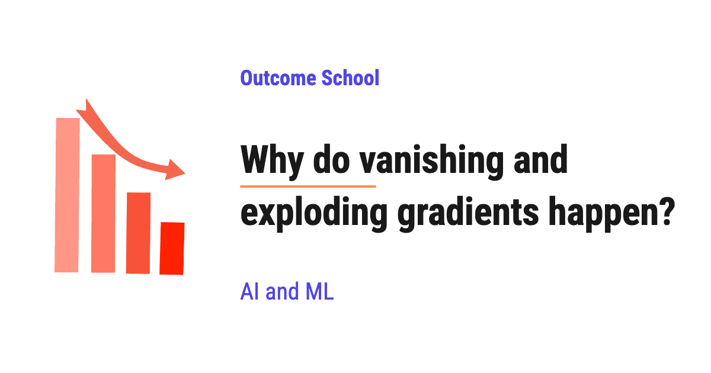

# Why do vanishing and exploding gradients happen?

> Archived from <https://outcomeschool.com/blog/vanishing-and-exploding-gradients> on 2026-11-25.

Vanishing and exploding gradients happen because, during training, the learning signal of a neural network gets multiplied by many numbers, one for each layer, on its way back. If those numbers are mostly smaller than 1, the signal shrinks to almost nothing, and if they are mostly bigger than 1, the signal blows up to a huge value.

In this blog, we will learn about why vanishing and exploding gradients happen. We will also see how the gradient travels backward through the layers, why repeated multiplication is the root cause, what makes it worse, what symptoms we notice during training, and how we fix each problem.

We will cover the following:
<ul><li>What is a gradient?</li><li>How does the gradient travel backward?</li><li>The root cause: repeated multiplication</li><li>What is the vanishing gradient problem?</li><li>What is the exploding gradient problem?</li><li>What makes the numbers smaller or bigger than 1?</li><li>Why do RNNs suffer the most?</li><li>Seeing it in code</li><li>How do we know it is happening?</li><li>How do we fix vanishing gradients?</li><li>How do we fix exploding gradients?</li><li>Comparison of vanishing and exploding gradients</li></ul>
I am <strong>Amit Shekhar</strong>, Founder @ <a target="_blank" rel="noopener noreferrer" href="https://outcomeschool.com">Outcome School</a>, I have taught and mentored many developers, and their efforts landed them high-paying tech jobs, helped many tech companies in solving their unique problems, and created many open-source libraries being used by top companies. I am passionate about sharing knowledge through open-source, blogs, and videos.

I teach <a target="_blank" rel="noopener noreferrer" href="https://outcomeschool.com/program/ai-and-machine-learning">AI and Machine Learning</a> at Outcome School.

Let&#x27;s get started.
<h2 id="what-is-a-gradient">What is a gradient?</h2>
Before jumping into vanishing and exploding gradients, we must know what a gradient is.

A <a target="_blank" rel="noopener noreferrer" href="neural-network.md">neural network</a> is made of many layers. The connections inside it have numbers called <strong>weights</strong>, which decide how much each input matters.

Training a network means adjusting its weights again and again until its answers become correct. At every training step, the network makes a guess, and we measure how wrong the guess is. This measure of wrongness is a single number called the <strong>loss</strong>.

<strong>A gradient tells each weight in which direction to move, and how strongly, to reduce the loss.</strong>

Let&#x27;s take a real-world comparison. Imagine we are standing on a hill in thick fog, and we want to reach the lowest point of the valley. We cannot see anything, but we can feel the slope under our feet. The slope tells us which way is downhill and how steep it is. The gradient is that slope.

Then, each weight is updated as below:

<pre><code class="language-text code-highlight">new_weight = old_weight - learning_rate x gradient
</code></pre>

Here, the <strong>learning rate</strong> is a small number that controls the step size. The gradient decides the direction and the strength of the change.

So, the gradient is the learning signal. If the gradient is healthy, the weight learns. If the gradient is almost 0, the weight barely changes. If the gradient is huge, the weight jumps wildly.

We have a detailed blog on <a target="_blank" rel="noopener noreferrer" href="math-behind-gradient-descent.md">How Does Gradient Descent Work?</a> that explains how this update rule reduces the loss step by step.
<h2 id="how-does-the-gradient-travel-backward">How does the gradient travel backward?</h2>
A network has many layers stacked one after another. Let&#x27;s say we have 4 layers.

<pre><code class="language-text code-highlight"> Forward pass (making a guess):

 input --&gt; Layer 1 --&gt; Layer 2 --&gt; Layer 3 --&gt; Layer 4 --&gt; guess --&gt; loss

 Backward pass (sending the learning signal):

 Layer 1 &lt;-- Layer 2 &lt;-- Layer 3 &lt;-- Layer 4 &lt;-- loss
</code></pre>

Here, we can see two directions:
<ul><li>In the <strong>forward pass</strong>, the input goes through every layer, and the network makes a guess. Then, we compute the loss.</li><li>In the <strong>backward pass</strong>, the learning signal starts from the loss and travels backward, from the last layer to the first. This backward journey is called <strong><a target="_blank" rel="noopener noreferrer" href="math-behind-backpropagation.md">backpropagation</a></strong>.</li></ul>
Now, the important question is, how does Layer 1 find out how much it contributed to the mistake? Layer 1 does not touch the loss directly. Its output goes to Layer 2, which goes to Layer 3, which goes to Layer 4, which produces the guess.

So, Layer 1 must receive the signal through all the layers after it. At every layer, the signal gets multiplied by a <strong>local slope</strong>. The local slope of a layer tells how much the output of that layer changes when its input changes a little.

This rule of multiplying the local slopes along the path is called the <strong>chain rule</strong>.

<pre><code class="language-text code-highlight">gradient at Layer 1 = slope4 x slope3 x slope2 x slope1 x (signal from loss)
</code></pre>

Here, we can see that the gradient reaching Layer 1 is the result of multiplying the slopes of all the layers along the way.

Let&#x27;s take a real-world comparison. Think of a chain of gears. When we turn the last gear, the turn passes through every gear to reach the first one. If each gear slows the turn down a little, the first gear barely moves. If each gear speeds the turn up a little, the first gear spins out of control. The gradient travels through the layers in exactly this way.

To learn Backpropagation, Gradient Descent, and how to build a Neural Network from scratch, check out our <a target="_blank" rel="noopener noreferrer" href="https://outcomeschool.com/program/ai-and-machine-learning">AI and Machine Learning Program</a> at Outcome School.
<h2 id="the-root-cause-repeated-multiplication">The root cause: repeated multiplication</h2>
<strong>When we multiply many numbers together, a small difference from 1 grows into a huge effect.</strong>

Let&#x27;s see what happens when we multiply the same number again and again:
<table><thead><tr><th>Number</th><th>10 times</th><th>20 times</th><th>50 times</th></tr></thead><tbody><tr><td>0.25</td><td>0.00000095</td><td>0.0000000000009</td><td>almost 0</td></tr><tr><td>0.5</td><td>0.00098</td><td>0.00000095</td><td>almost 0</td></tr><tr><td>1.0</td><td>1</td><td>1</td><td>1</td></tr><tr><td>1.5</td><td>57.7</td><td>3,325</td><td>about 638 million</td></tr><tr><td>2.0</td><td>1,024</td><td>about 1 million</td><td>about 1 million billion</td></tr></tbody></table>
Here, we can see three cases:
<ul><li>Numbers below 1 shrink towards 0, and they shrink faster with more layers.</li><li>The number 1 stays exactly the same, no matter how many times we multiply.</li><li>Numbers above 1 grow to giant values.</li></ul>
Notice that 0.5 and 1.5 are not extreme numbers at all. They are close to 1. But after 50 multiplications, one becomes almost nothing, and the other becomes hundreds of millions.

This is why vanishing and exploding gradients happen. The gradient reaching an early layer is a product of many local slopes. If they are mostly below 1, the product vanishes. If they are mostly above 1, the product explodes.
<h2 id="what-is-the-vanishing-gradient-problem">What is the vanishing gradient problem?</h2>
<strong>The vanishing gradient problem is when the gradient becomes so small by the time it reaches the early layers that those layers almost stop learning.</strong>

Let&#x27;s say we have a 20-layer network, and every layer multiplies the signal by 0.5 on the way back. Then, the gradient reaching Layer 1 is about one millionth of the gradient at the last layer.

Means, the last layers learn normally, but the early layers barely change. They stay close to their random starting values.

Coming back to the gear chain, the last gear turns, but the first gear barely moves.

This is a big problem because the early layers do important work. In an image model, the early layers learn simple things like edges and corners. The later layers build on top of them. If the early layers do not learn, the later layers have poor inputs to build on.

<strong>Planning your move into AI?</strong>

No matter which tech domain you work in today, with your effort, you can transition to these roles:
<ul><li>AI Engineer</li><li>Forward Deployed Engineer</li><li>AI Agent Engineer</li><li>Harness Engineer</li><li>Voice AI Engineer</li><li>AI Architect</li><li>LLM Engineer</li><li>LLM Inference Engineer</li><li>Gen AI Engineer</li><li>MLOps Engineer</li><li>ML Engineer</li><li>Deep Learning Engineer</li></ul>
Our <a target="_blank" rel="noopener noreferrer" href="https://outcomeschool.com/program/ai-and-machine-learning">AI and Machine Learning Program</a> at Outcome School takes you there.
<h2 id="what-is-the-exploding-gradient-problem">What is the exploding gradient problem?</h2>
<strong>The exploding gradient problem is when the gradient becomes so large on its way back that the weight updates become huge and the training breaks.</strong>

Let&#x27;s say every layer multiplies the signal by 1.5 on the way back. With 50 layers, the gradient reaching Layer 1 is hundreds of millions of times bigger than at the last layer.

Remember the update rule: <code>new_weight = old_weight - learning_rate x gradient</code>. When the gradient is huge, the step is huge. The weight jumps to a very bad value. The next guess becomes terrible, the loss shoots up, and the gradients become even bigger. Very soon, the numbers become too big for the computer to store, and they show up as <code>NaN</code>, which means &quot;Not a Number&quot;. At this point, the training fails.

Now, let&#x27;s understand what makes those local slopes smaller or bigger than 1.
<h2 id="what-makes-the-numbers-smaller-or-bigger-than-1">What makes the numbers smaller or bigger than 1?</h2>
Each local slope depends on two things: the <strong><a target="_blank" rel="noopener noreferrer" href="activation-functions.md">activation function</a></strong> and the <strong>weights</strong>. On top of that, the <strong>depth</strong> of the network decides how many of them get multiplied.

<strong>Cause 1:</strong> The activation function.

An activation function is a small rule inside each neuron that bends its output. Every activation function has its own slope, and that slope gets multiplied into the gradient.

Let&#x27;s take <strong>Sigmoid</strong>, which was very popular in early networks. It squeezes any number into the range 0 to 1, using an S-shaped curve.

<pre><code class="language-text code-highlight">output
  1 |                ________
    |              /
0.5 |            /
    |          /
  0 |________/
    +------------0----------- input
</code></pre>

Here, we can see that the steepest point of Sigmoid has a slope of only 0.25. At the flat ends, the slope is almost 0. So, even in the best case, every Sigmoid layer multiplies the gradient by 0.25 or less. After 10 layers, that is less than one millionth. This is the classic cause of the vanishing gradient problem.

<strong>Tanh</strong>, another S-shaped activation function, has a steepest slope of 1, which is better, but its flat ends still have a slope close to 0.

<strong>Cause 2:</strong> The weights.

The gradient also gets multiplied by the weights of each layer on its way back. If the weights are too small, they shrink the gradient. If the weights are too big, they grow it. This is why the starting values of the weights, called <strong><a target="_blank" rel="noopener noreferrer" href="random-weight-initialization.md">weight initialization</a></strong>, matter so much.

<strong>Cause 3:</strong> The depth.

More layers means more multiplications. A 3-layer network with a slope of 0.5 per layer only shrinks the gradient to 0.125. A 50-layer network with the same slope shrinks it to almost 0. So, the deeper the network, the stronger both problems become.
<h2 id="why-do-rnns-suffer-the-most">Why do RNNs suffer the most?</h2>
An <strong>RNN</strong>, which stands for <a target="_blank" rel="noopener noreferrer" href="recurrent-neural-network.md">Recurrent Neural Network</a>, is a network that reads a sequence, like a sentence, one word at a time. It keeps a memory and updates it after every word, using the same weights again and again.

Let&#x27;s say the RNN reads a sentence of 100 words. To learn how the first word affects the final answer, the gradient must travel back through all 100 steps. At every step, it gets multiplied by the same weights.

This is like a network with 100 layers that all share the same weights. Multiplying by the same number 100 times makes vanishing or exploding very likely.

This is why plain RNNs forget the beginning of long sentences. The learning signal from the end of the sentence vanishes before it reaches the beginning. This is the problem that <a target="_blank" rel="noopener noreferrer" href="lstm-and-gru.md">LSTMs</a> were introduced to solve. We will see them in the fixes below.

<strong>A quick note for you</strong>

No matter which tech domain you work in, get familiar with these topics:
<ul><li>LLM</li><li>RAG</li><li>MCP</li><li>Agent</li><li>Fine-tuning</li><li>Quantization</li></ul>
We put it all together in one video:

<a target="_blank" rel="noopener noreferrer" href="https://www.youtube.com/watch?v=lnfWvX66FUk">AI Engineering Explained: LLM, RAG, MCP, Agent, Fine-Tuning, and Quantization</a>

No need to stop reading - bookmark it and watch later when you get time. Future you will thank you.

Now, let&#x27;s get back to the topic.
<h2 id="seeing-it-in-code">Seeing it in code</h2>
The best way to learn this is by taking an example. Let&#x27;s simulate a gradient traveling backward through many layers, where each layer multiplies it by the same local slope.

<pre><code class="code-highlight language-python">def gradient_at_first_layer(num_layers, slope_per_layer):
    gradient = 1.0  # signal at the last layer
    for _ in range(num_layers):
        gradient = gradient * slope_per_layer
    return gradient

for slope in [0.25, 0.5, 1.0, 1.5]:
    for layers in [10, 50]:
        g = gradient_at_first_layer(layers, slope)
        print(f&quot;slope {slope}, {layers} layers -&gt; gradient {g:.3g}&quot;)
</code></pre>

Here, we have:
<ul><li><code>gradient</code> starts at 1.0, which is the learning signal at the last layer.</li><li>In each loop, we multiply it by <code>slope_per_layer</code>, just like the chain rule does at every layer.</li><li>We try four slopes: 0.25 (the best case of Sigmoid), 0.5, 1.0, and 1.5, for 10 and 50 layers.</li></ul>
This will print the following:

<pre><code class="language-text code-highlight">slope 0.25, 10 layers -&gt; gradient 9.54e-07
slope 0.25, 50 layers -&gt; gradient 7.89e-31
slope 0.5, 10 layers -&gt; gradient 0.000977
slope 0.5, 50 layers -&gt; gradient 8.88e-16
slope 1.0, 10 layers -&gt; gradient 1
slope 1.0, 50 layers -&gt; gradient 1
slope 1.5, 10 layers -&gt; gradient 57.7
slope 1.5, 50 layers -&gt; gradient 6.38e+08
</code></pre>

Here, <code>e-07</code> means &quot;divide by 10 seven times&quot;, and <code>e+08</code> means &quot;multiply by 10 eight times&quot;. So, <code>7.89e-31</code> is a number with 30 zeros after the decimal point, and <code>6.38e+08</code> is about 638 million.

So, we can notice that only the slope of 1.0 keeps the gradient healthy, while everything below 1 vanishes and everything above 1 explodes.
<h2 id="how-do-we-know-it-is-happening">How do we know it is happening?</h2>
Now, let&#x27;s see the symptoms during training.

<strong>Signs of vanishing gradients:</strong>
<ul><li>The loss goes down very slowly, or stops going down early.</li><li>The weights of the early layers barely change from their starting values.</li><li>The gradients of the early layers are tiny compared to the later layers.</li></ul>
<strong>Signs of exploding gradients:</strong>
<ul><li>The loss jumps up and down wildly, or suddenly shoots up.</li><li>The loss or the weights become <code>NaN</code>.</li><li>The gradients become very large numbers.</li></ul>
A simple habit is to print the size of the gradients of each layer during training. This makes the problem visible.
<h2 id="how-do-we-fix-vanishing-gradients">How do we fix vanishing gradients?</h2>
Now that we have learned why the problems happen, it&#x27;s time to learn the fixes. Each fix attacks one cause.

<strong>Fix 1:</strong> Use ReLU instead of Sigmoid.

<strong>ReLU</strong> is an activation function that keeps positive numbers as they are and turns negative numbers into 0. For positive numbers, its slope is exactly 1. As we saw, multiplying by 1 again and again keeps the gradient healthy. This change made deep networks much easier to train.

<strong>Fix 2:</strong> Use good weight initialization.

Methods like <strong>Xavier initialization</strong> and <strong>He initialization</strong> pick the starting weights at the right size, based on how many inputs each neuron has. This keeps the signal size close to steady through the layers from the very first step.

<strong>Fix 3:</strong> Use residual connections.

<strong>A residual connection is a shortcut that adds the input of a block directly to its output, skipping over the block.</strong>

<pre><code class="language-text code-highlight">           +---------------------------+
           |        (shortcut)         |
           |                           ↓
 input ----+--&gt; [ layers of block ] --(+)--&gt; output
</code></pre>

Here, we can see that the input has two paths: one through the block, and one straight across the shortcut. On the way back, the gradient also gets two paths. Even if the path through the block shrinks the gradient, the shortcut carries it back almost untouched.

Let&#x27;s take a real-world comparison. In a city with only narrow lanes, traffic slows down at every turn. A highway lets cars skip all of those turns. Residual connections are highways for the gradient.

Residual connections were made famous by <strong>ResNet</strong> in 2015, which trained image networks with more than 100 layers. <a target="_blank" rel="noopener noreferrer" href="decoding-transformer-architecture.md">Transformers</a>, which are used in <a target="_blank" rel="noopener noreferrer" href="large-language-model-llm.md">LLMs (Large Language Models)</a>, also use them.

<strong>Fix 4:</strong> Use normalization.

<strong>Normalization is a step that rescales the numbers inside the network so that they keep a steady size, with an average near 0 and a typical spread near 1.</strong>

<a target="_blank" rel="noopener noreferrer" href="batch-normalization-vs-layer-normalization.md"><strong>Batch Normalization</strong> and <strong>Layer Normalization</strong></a> are the two popular types. By keeping the numbers at a steady size at every layer, they help stop the signal from drifting too small or too big. Transformers use Layer Normalization.

<strong>Fix 5:</strong> Use LSTM or GRU instead of a plain RNN.

An <strong>LSTM</strong> (Long Short-Term Memory) and a <strong>GRU</strong> (Gated Recurrent Unit) are special kinds of RNNs. They carry their memory forward mostly by adding new information to it, controlled by small switches called <strong>gates</strong>, instead of multiplying the whole memory again and again. Addition does not shrink the signal the way repeated multiplication does. So, the gradient can travel back across many more words.

If we want to go deep into Activation Functions, Layer Normalization and Batch Normalization, and the rest of Deep Learning, we have a complete program - check out our <a target="_blank" rel="noopener noreferrer" href="https://outcomeschool.com/program/ai-and-machine-learning">AI and Machine Learning Program</a> at Outcome School.
<h2 id="how-do-we-fix-exploding-gradients">How do we fix exploding gradients?</h2>
Good initialization, normalization, and residual connections also help here. But there is one popular fix made for exploding gradients.

<strong>Gradient clipping is a technique that limits the size of the gradient, so that it can never go above a chosen maximum.</strong>

Let&#x27;s take a real-world comparison. A car can have a speed limiter. No matter how hard we press the pedal, the car never goes above, say, 100 km per hour. Gradient clipping is a speed limiter for the gradient.

The most common type is <strong>clipping by norm</strong>. The <strong>norm</strong> is the overall size of all the gradients together, measured like the length of an arrow. If the norm is bigger than the maximum, we shrink the whole gradient down to the maximum, but keep its direction the same.

Let&#x27;s see the code for it as below:

<pre><code class="code-highlight language-python">import numpy as np

def clip_by_norm(gradient, max_norm):
    norm = np.linalg.norm(gradient)       # overall size of the gradient
    if norm &gt; max_norm:
        gradient = gradient * (max_norm / norm)
    return gradient

g = np.array([300.0, 400.0])               # an exploding gradient
print(np.linalg.norm(g))                   # size before clipping
print(clip_by_norm(g, max_norm=1.0))       # after clipping
</code></pre>

Here, we have:
<ul><li><code>np.linalg.norm(gradient)</code> computes the overall size. For <code>[300, 400]</code>, the size is 500, just like the long side of a right-angled triangle with sides 300 and 400.</li><li>If the size is above <code>max_norm</code>, we multiply the whole gradient by <code>max_norm / norm</code>. This shrinks it to the allowed size.</li><li>The direction stays the same, because both numbers shrink by the same factor.</li></ul>
This will print the following:

<pre><code class="language-text code-highlight">500.0
[0.6 0.8]
</code></pre>

Here, we can see that the gradient shrank from size 500 to size 1, and <code>[0.6, 0.8]</code> still points in exactly the same direction as <code>[300, 400]</code>.

<strong>Note:</strong> In <a target="_blank" rel="noopener noreferrer" href="how-does-pytorch-work.md">PyTorch</a>, this is one line: <code>torch.nn.utils.clip_grad_norm_(model.parameters(), max_norm=1.0)</code>. A maximum of 1.0 is a common choice when training LLMs.

A lower learning rate and a short <a target="_blank" rel="noopener noreferrer" href="learning-rate-schedules-and-warmup.md"><strong>warmup</strong></a>, which starts training with tiny steps and slowly increases them, also help keep the updates under control in the early, unstable steps.

<strong>Stay updated:</strong> Subscribe to our <a target="_blank" rel="noopener noreferrer" href="https://outcomeschool.substack.com/subscribe">newsletter</a> to get our latest AI and Machine Learning blogs straight to your inbox.
<h2 id="comparison-of-vanishing-and-exploding-gradients">Comparison of vanishing and exploding gradients</h2>
Let me tabulate the differences between vanishing and exploding gradients for your better understanding.
<table><thead><tr><th>Point</th><th>Vanishing gradients</th><th>Exploding gradients</th></tr></thead><tbody><tr><td>What happens</td><td>Gradient shrinks to almost 0</td><td>Gradient grows to a huge value</td></tr><tr><td>Root cause</td><td>Local slopes mostly below 1, multiplied many times</td><td>Local slopes mostly above 1, multiplied many times</td></tr><tr><td>Common triggers</td><td>Sigmoid or Tanh, tiny weights, deep networks, long sequences</td><td>Big weights, deep networks, long sequences</td></tr><tr><td>Effect</td><td>Early layers stop learning</td><td>Training becomes unstable and breaks</td></tr><tr><td>Symptoms</td><td>Loss goes down very slowly or stops</td><td>Loss jumps wildly, becomes <code>NaN</code></td></tr><tr><td>Main fixes</td><td>ReLU, good initialization, residual connections, normalization, LSTM or GRU</td><td>Gradient clipping, good initialization, normalization, lower learning rate</td></tr></tbody></table>
Now, we must have understood why vanishing and exploding gradients happen.
<h2 id="frequently-asked-questions">Frequently Asked Questions</h2><h3 id="why-does-sigmoid-cause-vanishing-gradients">Why does Sigmoid cause vanishing gradients?</h3>
Sigmoid causes vanishing gradients because its slope is very small. At its steepest point, the slope is only 0.25, and at its flat ends, the slope is almost 0. So, every Sigmoid layer multiplies the gradient by 0.25 or less, and after 10 layers, the gradient becomes less than one millionth of its size.
<h3 id="how-do-transformers-avoid-vanishing-gradients">How do Transformers avoid vanishing gradients?</h3>
Transformers use residual connections and Layer Normalization. A residual connection adds the input of a block directly to its output, so on the way back, the shortcut carries the gradient almost untouched. Layer Normalization keeps the numbers at a steady size at every layer, which helps stop the signal from drifting too small or too big.
<h3 id="does-gradient-clipping-change-the-direction-of-the-gradient">Does gradient clipping change the direction of the gradient?</h3>
No. Clipping by norm does not change the direction of the gradient. If the overall size of the gradient is above the chosen maximum, every number in the gradient is shrunk by the same factor. For example, the gradient <code>[300, 400]</code> clipped to a maximum size of 1 becomes <code>[0.6, 0.8]</code>, which points in exactly the same direction.
<h3 id="what-maximum-value-is-commonly-used-for-gradient-clipping">What maximum value is commonly used for gradient clipping?</h3>
A maximum of 1.0 is a common choice when training LLMs. In PyTorch, gradient clipping by norm is one line: <code>torch.nn.utils.clip_grad_norm_(model.parameters(), max_norm=1.0)</code>. A lower learning rate and a short warmup also help keep the weight updates under control in the early, unstable steps of training.

That&#x27;s it for now.

Thanks

<strong>Amit Shekhar</strong> Founder @ <a target="_blank" rel="noopener noreferrer" href="https://outcomeschool.com">Outcome School</a>

You can connect with me on:
<ul><li><a target="_blank" rel="noopener noreferrer" href="https://x.com/amitiitbhu">X</a></li><li><a target="_blank" rel="noopener noreferrer" href="https://www.linkedin.com/in/amit-shekhar-iitbhu">LinkedIn</a></li><li><a target="_blank" rel="noopener noreferrer" href="https://github.com/amitshekhariitbhu">GitHub</a></li></ul>
Follow Outcome School on:
<ul><li><a target="_blank" rel="noopener noreferrer" href="https://x.com/outcome_school">X</a></li><li><a target="_blank" rel="noopener noreferrer" href="https://youtube.com/@OutcomeSchool">YouTube</a></li><li><a target="_blank" rel="noopener noreferrer" href="https://www.linkedin.com/company/outcomeschool">LinkedIn</a></li><li><a target="_blank" rel="noopener noreferrer" href="http://github.com/OutcomeSchool">GitHub</a></li></ul>
<a target="_blank" rel="noopener noreferrer" href="https://outcomeschool.com/blog"><strong>Read all of our high-quality blogs here.</strong></a>

