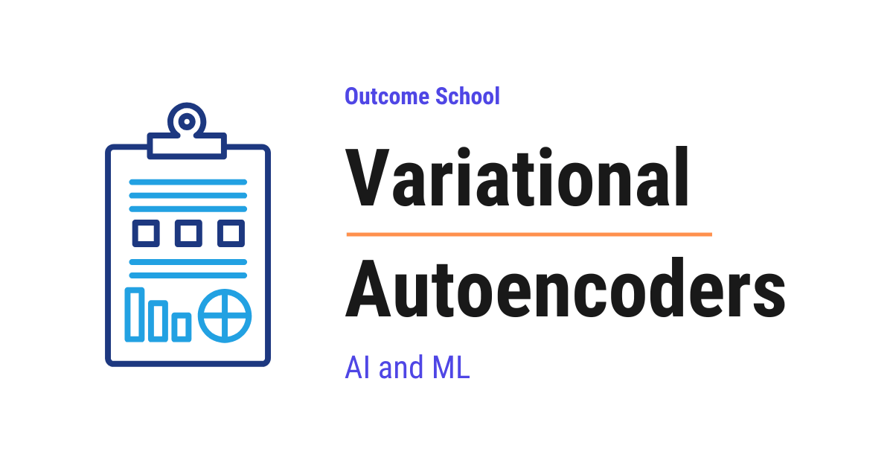

# What are Variational Autoencoders (VAEs) and How Do They Work?

> Archived from <https://outcomeschool.com/blog/variational-autoencoders> on 2026-11-25.

A Variational Autoencoder (VAE) is a special type of Autoencoder that learns a smooth and organized latent space, so that we can pick any random point from it and generate brand new, meaningful data like images.

In this blog, we will learn about Variational Autoencoders. We will understand what they are, why we need them, how they work step by step, and how they are able to generate brand new data like images that never existed before.

We will cover the following:
<ul><li>What is an Autoencoder?</li><li>The problem with a normal Autoencoder</li><li>What is a Variational Autoencoder?</li><li>The encoder, the latent space, and the decoder</li><li>The reparameterization trick</li><li>The loss function of a Variational Autoencoder</li><li>A simple example walk-through</li><li>A simple code example</li><li>Advantages of Variational Autoencoders</li><li>Where Variational Autoencoders are used</li></ul>
I am <strong>Amit Shekhar</strong>, Founder @ <a target="_blank" rel="noopener noreferrer" href="https://outcomeschool.com">Outcome School</a>, I have taught and mentored many developers, and their efforts landed them high-paying tech jobs, helped many tech companies in solving their unique problems, and created many open-source libraries being used by top companies. I am passionate about sharing knowledge through open-source, blogs, and videos.

I teach <a target="_blank" rel="noopener noreferrer" href="https://outcomeschool.com/program/ai-and-machine-learning">AI and Machine Learning</a> at Outcome School.

Let&#x27;s get started.
<h3 id="what-is-an-autoencoder">What is an Autoencoder?</h3>
Before jumping into Variational Autoencoders, we must first understand a normal Autoencoder.

In simple words, <strong>Autoencoder = Encoder + Decoder</strong>.

An Autoencoder is a <a target="_blank" rel="noopener noreferrer" href="neural-network.md">neural network</a> that learns to compress data into a small form and then rebuild the original data back from that small form.

It has two parts:
<ul><li><strong>Encoder:</strong> It takes the input, like an image, and squeezes it down into a small set of numbers. This small set of numbers is called the <strong>latent vector</strong> or the <strong>code</strong>.</li><li><strong>Decoder:</strong> It takes that small set of numbers and tries to rebuild the original input from it.</li></ul>
Let&#x27;s say we have a photo of a handwritten digit <code>7</code>. The encoder reads this photo and compresses it into a small list of numbers, for example just 2 numbers. The decoder then takes these 2 numbers and tries to draw the digit <code>7</code> back.

The space where these small numbers live is called the <strong>latent space</strong>. The word &quot;latent&quot; simply means &quot;hidden&quot;. So, the latent space is the hidden compressed space where the encoder stores the most important features of the data.

So, why do we even compress the data? Because by forcing the network to squeeze everything into a few numbers, we force it to learn only the most important features of the data and throw away the noise.

We train the Autoencoder by comparing the rebuilt output with the original input. If they are different, we tell the network to fix itself. Over time, the network gets very good at rebuilding the input. This is called <strong>reconstruction</strong>.
<h3 id="the-problem-with-a-normal-autoencoder">The problem with a normal Autoencoder</h3>
Now, here is the catch.

A normal Autoencoder is great at rebuilding the inputs it has already seen. But it is bad at creating new data that it has never seen.

Let&#x27;s understand why.

When a normal Autoencoder learns, it places each input at some point in the latent space. The image of a <code>7</code> goes to one point. The image of a <code>3</code> goes to another point. But these points can be scattered all over the place with big empty gaps between them.

Now, suppose we want to generate a brand new digit that the model has never seen. To do this, we would pick a random point in the latent space and ask the decoder to draw something from it.

But here is the problem. If we pick a random point, it could easily land in one of those empty gaps. The decoder has never seen anything in that gap during training. So, it produces garbage, which means a blurry mess that does not look like any digit.

So, the latent space of a normal Autoencoder is <strong>not continuous and not organized</strong>. There are holes and gaps everywhere. We cannot safely pick a random point and expect a meaningful output.

We needed a solution for that, and the Variational Autoencoder was introduced to solve this problem. So, here comes the Variational Autoencoder to the rescue.
<h3 id="what-is-a-variational-autoencoder">What is a Variational Autoencoder?</h3>
<strong>A Variational Autoencoder, also called a VAE, is a special type of Autoencoder that learns a smooth and organized latent space, so that we can pick any random point from it and generate brand new, meaningful data.</strong>

In simple words, <strong>Variational Autoencoder = Autoencoder + a smooth, organized latent space</strong>.

So, what is the key difference?

A normal Autoencoder maps each input to a single point in the latent space.

But a Variational Autoencoder maps each input to a small region in the latent space, not a single point. It describes this region using a probability distribution.

Do not worry if the word &quot;distribution&quot; sounds heavy. Let&#x27;s understand it in simple words.

A <strong>distribution</strong> is just a way of saying &quot;the value is most likely around here, and a little less likely as we move away&quot;. For example, the heights of people follow a distribution. Most people are around the average height, and very few people are extremely short or extremely tall.

The most common distribution is the <strong>normal distribution</strong>, also called the <strong>Gaussian distribution</strong> or the <strong>bell curve</strong>. A normal distribution is fully described by just two numbers:
<ul><li><strong>Mean, written as <code>mu</code>:</strong> the center of the distribution.</li><li><strong>Standard deviation, written as <code>sigma</code>:</strong> how spread out the distribution is around the center.</li></ul>
So, instead of saying &quot;this <code>7</code> lives exactly at point 1.5&quot;, the Variational Autoencoder says &quot;this <code>7</code> lives somewhere around 1.5, give or take a little&quot;. This little spread is the key trick.

Because every input now covers a small region instead of a single point, these regions start to overlap and fill the gaps. So, the latent space becomes smooth and continuous with no holes. And when there are no holes, we can pick any random point and the decoder will produce something meaningful.

<strong>Planning your move into AI?</strong>

No matter which tech domain you work in today, with your effort, you can transition to these roles:
<ul><li>AI Engineer</li><li>Forward Deployed Engineer</li><li>AI Agent Engineer</li><li>Harness Engineer</li><li>Voice AI Engineer</li><li>AI Architect</li><li>LLM Engineer</li><li>LLM Inference Engineer</li><li>Gen AI Engineer</li><li>MLOps Engineer</li><li>ML Engineer</li><li>Deep Learning Engineer</li></ul>
Our <a target="_blank" rel="noopener noreferrer" href="https://outcomeschool.com/program/ai-and-machine-learning">AI and Machine Learning Program</a> at Outcome School takes you there.
<h3 id="the-encoder-the-latent-space-and-the-decoder">The encoder, the latent space, and the decoder</h3>
Now, let&#x27;s understand the three parts of a Variational Autoencoder.

The best way to learn this is by taking an example.

Suppose we feed an image of a handwritten digit into the Variational Autoencoder.

<strong>The encoder.</strong> The encoder reads the image. But instead of outputting one latent vector, it outputs two things: a mean <code>mu</code> and a standard deviation <code>sigma</code>. Together, these two numbers describe a normal distribution in the latent space. So, the encoder is telling us, &quot;this digit lives in this region of the latent space&quot;.

<strong>The latent space.</strong> From the distribution given by <code>mu</code> and <code>sigma</code>, we pick a random sample. This random sample is our latent vector <code>z</code>. Because we pick <code>z</code> randomly from the region, the same input can produce slightly different <code>z</code> values each time. So, the decoder learns to rebuild the input not just from one exact point, but from the whole small region around it. This is what fills the gaps and makes the space smooth.

<strong>The decoder.</strong> The decoder takes the sampled latent vector <code>z</code> and rebuilds the image from it. The goal is for the rebuilt image to look like the original input.

We can visualize the full flow of a Variational Autoencoder as below:

<pre><code class="code-highlight">        Input Image
             |
             v
         Encoder
             |
        +----+----+
        |         |
        v         v
       mu       sigma
        |         |
        +----+----+
             |
             v
   Sample z from the distribution
             |
             v
         Decoder
             |
             v
      Rebuilt Image
</code></pre>

Here, we can see that the encoder turns the input into <code>mu</code> and <code>sigma</code>. Then we sample a latent vector <code>z</code> from the distribution described by <code>mu</code> and <code>sigma</code>. Finally, the decoder rebuilds the image from <code>z</code>.

If we want to go deep into the Encoder-Decoder Architecture and how models learn compact Embeddings of data, we cover these in our <a target="_blank" rel="noopener noreferrer" href="https://outcomeschool.com/program/ai-and-machine-learning">AI and Machine Learning Program</a> at Outcome School.
<h3 id="the-reparameterization-trick">The reparameterization trick</h3>
Now, there is one problem we must solve.

We just said we pick a random sample <code>z</code> from the distribution. But picking a random sample is a random operation. And during training, a neural network learns using a method called <a target="_blank" rel="noopener noreferrer" href="math-behind-backpropagation.md"><strong>backpropagation</strong></a>, which needs to flow gradients smoothly through every step.

In simple words, backpropagation is how the network figures out how to adjust itself to reduce its mistakes. It must be able to trace the path from the output back to every input. But a random sampling step blocks this path, because we cannot take a gradient through pure randomness.

So, here comes the <strong>reparameterization trick</strong> to the rescue.

The idea is simple. Instead of directly picking a random <code>z</code> from the distribution, we rewrite the sampling as below:

<pre><code class="code-highlight">z = mu + sigma * epsilon
</code></pre>

Here:
<ul><li><code>mu</code> is the mean from the encoder.</li><li><code>sigma</code> is the standard deviation from the encoder.</li><li><code>epsilon</code> is a random number drawn from a standard normal distribution with mean 0 and standard deviation 1. This is the same bell curve we learned about above, centered at 0.</li></ul>
Here, we have moved all the randomness into <code>epsilon</code>. And <code>epsilon</code> does not depend on the network at all. It is just an outside random number.

So now, <code>mu</code> and <code>sigma</code> are clean, smooth values that the network can learn. The randomness sits only in <code>epsilon</code>, which is outside the path of learning. This means backpropagation can now flow smoothly through <code>mu</code> and <code>sigma</code>, while the randomness is handled separately by <code>epsilon</code>.

We can visualize the trick like below:

<pre><code class="code-highlight">   Before (random step lies on the path):

   forward    mu, sigma  ====&gt;  [ random sampling ]  ====&gt;  z
   backward   mu, sigma  &lt;==X==   blocked            &lt;====  z

   After (random step moved off the path):

                                  epsilon
                                     |
                                     v
   forward    mu, sigma  ====&gt;  mu + sigma * epsilon  ====&gt;  z
   backward   mu, sigma  &lt;==============================  z
</code></pre>

Here, the top row is the forward path and the bottom row is the backward gradient. In the &quot;Before&quot; case, the gradient hits the random sampling step and gets blocked, so <code>mu</code> and <code>sigma</code> never learn. In the &quot;After&quot; case, the path from <code>mu</code> and <code>sigma</code> to <code>z</code> is plain multiply and add, so the gradient flows all the way back. The only random part, <code>epsilon</code>, sits off to the side. This is how the reparameterization trick keeps the network trainable.

This simple trick is what makes the whole Variational Autoencoder trainable. It is the heart of the VAE.

<strong>A quick note for you</strong>

No matter which tech domain you work in, get familiar with these topics:
<ul><li>LLM</li><li>RAG</li><li>MCP</li><li>Agent</li><li>Fine-tuning</li><li>Quantization</li></ul>
We put it all together in one video:

<a target="_blank" rel="noopener noreferrer" href="https://www.youtube.com/watch?v=lnfWvX66FUk">AI Engineering Explained: LLM, RAG, MCP, Agent, Fine-Tuning, and Quantization</a>

No need to stop reading - bookmark it and watch later when you get time. Future you will thank you.

Now, let&#x27;s get back to the topic.
<h3 id="the-loss-function-of-a-variational-autoencoder">The loss function of a Variational Autoencoder</h3>
Now, let&#x27;s understand how a Variational Autoencoder learns. The network learns by reducing a loss. The loss is made of two parts added together.

<strong>Part 1: Reconstruction loss.</strong> This part checks how close the rebuilt image is to the original image. If the rebuilt image is very different from the original, this loss is high. If the rebuilt image looks just like the original, this loss is low. So, this part pushes the decoder to rebuild the input correctly.

<strong>Part 2: KL divergence loss.</strong> This is the new and special part of a Variational Autoencoder.

In simple words, <a target="_blank" rel="noopener noreferrer" href="kl-divergence.md"><strong>KL divergence</strong></a> measures how different one distribution is from another distribution. Here, it measures how different the distribution produced by the encoder is from a standard normal distribution with mean 0 and standard deviation 1.

So, this part gently pulls every encoded region towards the center of the latent space and keeps them all neatly packed together around one common point. This is exactly what removes the gaps and makes the latent space smooth and organized. Without this part, the encoder would push the regions far apart and the gaps would come back.

So, the full loss is:

<strong>Total Loss = Reconstruction Loss + KL Divergence Loss</strong>

Now, notice the balance between these two parts.
<ul><li>The reconstruction loss wants each input to be perfectly rebuilt, which pushes the regions apart so they do not get confused with each other.</li><li>The KL divergence loss wants all the regions to be packed neatly around the center.</li></ul>
These two parts pull against each other. The network finds a healthy balance between them. This balance is what gives us a latent space that is both accurate and smooth.

To learn how Loss Functions and Optimizers work together to train a model, check out our <a target="_blank" rel="noopener noreferrer" href="https://outcomeschool.com/program/ai-and-machine-learning">AI and Machine Learning Program</a> at Outcome School.
<h3 id="a-simple-example-walk-through">A simple example walk-through</h3>
Let&#x27;s take a small example to make this concrete.

Suppose we feed an image of the digit <code>7</code> into the Variational Autoencoder. For the sake of understanding, let&#x27;s say our latent space has just 1 dimension, which means <code>mu</code>, <code>sigma</code>, and <code>z</code> are all single numbers.

<strong>Step 1:</strong> The encoder reads the image of <code>7</code> and outputs:
<ul><li><code>mu</code> = 1.5</li><li><code>sigma</code> = 0.2</li></ul>
So, the encoder is saying, &quot;the digit <code>7</code> lives around 1.5 in the latent space, with a small spread of 0.2&quot;.

<strong>Step 2:</strong> We draw a random <code>epsilon</code> from a standard normal distribution. Let&#x27;s say we get:
<ul><li><code>epsilon</code> = 0.5</li></ul>
<strong>Step 3:</strong> We compute the latent vector <code>z</code> using the reparameterization trick:
<ul><li><code>z</code> = <code>mu</code> + <code>sigma</code> * <code>epsilon</code></li><li><code>z</code> = 1.5 + 0.2 * 0.5</li><li><code>z</code> = 1.5 + 0.1</li><li><code>z</code> = 1.6</li></ul>
<strong>Step 4:</strong> We feed <code>z</code> = 1.6 into the decoder. The decoder rebuilds an image of the digit <code>7</code>.

<strong>Step 5:</strong> We compare the rebuilt <code>7</code> with the original <code>7</code> to get the reconstruction loss. We also compute the KL divergence loss to keep the distribution close to the standard normal. We add both losses and update the network.

Now, here is the beautiful part. The next time we feed the same <code>7</code>, the random <code>epsilon</code> will be different, so <code>z</code> becomes a slightly different value like 1.55 or 1.62 or 1.48. This means the whole small region around 1.5 learns to produce a <code>7</code>. There are no sharp holes. This is what makes the space smooth.

So, after training, if we want to generate a brand new digit, we simply pick any random point from the center region of the latent space and feed it straight to the decoder. We can pick from the center because the KL divergence loss packed all the regions around the center. Since the space is smooth and has no gaps, the decoder produces a clean, meaningful digit that never existed before.

It works perfectly.
<h3 id="a-simple-code-example">A simple code example</h3>
Let&#x27;s see a simple code example of a Variational Autoencoder in <a target="_blank" rel="noopener noreferrer" href="how-does-pytorch-work.md">PyTorch</a> as below:

<pre><code class="code-highlight language-python">import torch
import torch.nn as nn

class VAE(nn.Module):
    def __init__(self):
        super().__init__()
        self.encoder = nn.Linear(784, 400)
        self.fc_mu = nn.Linear(400, 2)      # produces mu
        self.fc_sigma = nn.Linear(400, 2)   # produces log of sigma
        self.decoder = nn.Sequential(
            nn.Linear(2, 400), nn.ReLU(),
            nn.Linear(400, 784), nn.Sigmoid()
        )
</code></pre>

Here, we have defined the building blocks. The <code>encoder</code> reads the input image, which is <code>784</code> numbers for a 28 by 28 pixel image. From the encoder, <code>fc_mu</code> produces the mean <code>mu</code> and <code>fc_sigma</code> produces the spread, which we keep in the log form for stability. Our latent space has <code>2</code> dimensions. The <code>decoder</code> takes the <code>2</code> latent numbers and rebuilds the <code>784</code> pixels back.

Now, let&#x27;s add the forward pass with the reparameterization trick as below:

<pre><code class="code-highlight language-python">    def forward(self, x):
        h = torch.relu(self.encoder(x))
        mu = self.fc_mu(h)
        log_sigma = self.fc_sigma(h)
        epsilon = torch.randn_like(mu)              # random number
        z = mu + torch.exp(log_sigma) * epsilon     # reparameterization
        return self.decoder(z), mu, log_sigma
</code></pre>

Here, we can see the full flow. First, the encoder reads the input <code>x</code>. Then we get <code>mu</code> and <code>log_sigma</code>. After that, we draw a random <code>epsilon</code> using <code>torch.randn_like</code>. Then we apply the reparameterization trick to get <code>z</code>. Finally, the decoder rebuilds the image from <code>z</code>, and we also return <code>mu</code> and <code>log_sigma</code> so we can compute the loss.

<strong>Note:</strong> We let the network output <code>log_sigma</code> instead of <code>sigma</code> directly. This is a common trick to keep the training stable and to make sure the spread is always a positive number. The meaning stays the same as our simple formula <code>z = mu + sigma * epsilon</code>. We just recover <code>sigma</code> from <code>log_sigma</code> using <code>torch.exp</code>.

Now, let&#x27;s see the loss function as below:

<pre><code class="code-highlight language-python">def vae_loss(rebuilt, original, mu, log_sigma):
    recon = nn.functional.mse_loss(rebuilt, original, reduction=&#x27;sum&#x27;)
    kl = -0.5 * torch.sum(1 + 2 * log_sigma - mu.pow(2) - torch.exp(2 * log_sigma))
    return recon + kl
</code></pre>

Here, we have the two parts of the loss. The <code>recon</code> is the reconstruction loss that checks how close the rebuilt image is to the original. The <code>kl</code> is the KL divergence loss that keeps the distribution close to a standard normal. We add both and return the total loss. This is exactly the <strong>Total Loss = Reconstruction Loss + KL Divergence Loss</strong> that we learned above.

<strong>Stay updated:</strong> Subscribe to our <a target="_blank" rel="noopener noreferrer" href="https://outcomeschool.substack.com/subscribe">newsletter</a> to get our latest AI and Machine Learning blogs straight to your inbox.
<h3 id="advantages-of-variational-autoencoders">Advantages of Variational Autoencoders</h3>
Now, let&#x27;s see the advantages of Variational Autoencoders.
<ul><li><strong>Generation of new data:</strong> A Variational Autoencoder can create brand new data, like new images, that never existed before. We simply pick a random point in the latent space and the decoder draws something meaningful.</li><li><strong>Smooth latent space:</strong> The latent space is smooth and continuous with no holes. So, if we slowly move from one point to another point, the generated output also changes slowly and smoothly. For example, a digit can slowly morph from a <code>4</code> into a <code>9</code>, passing through shapes that look in between.</li><li><strong>Organized structure:</strong> Similar inputs end up close to each other in the latent space. This makes the space easy to understand and explore.</li><li><strong>Stable training:</strong> Compared to some other <a target="_blank" rel="noopener noreferrer" href="what-is-generative-ai.md">generative models</a>, a Variational Autoencoder is easier and more stable to train, because its loss is clear and well behaved.</li></ul>
That&#x27;s the beauty of a Variational Autoencoder.

To master Variational Autoencoders and Diffusion Models, we have a complete program - check out our <a target="_blank" rel="noopener noreferrer" href="https://outcomeschool.com/program/ai-and-machine-learning">AI and Machine Learning Program</a> at Outcome School.
<h3 id="where-variational-autoencoders-are-used">Where Variational Autoencoders are used</h3>
Now, let&#x27;s see where Variational Autoencoders are used.
<ul><li><strong>Image generation:</strong> They are used to generate new images such as faces, digits, and objects.</li><li><strong>Anomaly detection:</strong> A Variational Autoencoder learns what normal data looks like. So, if it sees something it cannot rebuild well, that data is likely an anomaly. This is used to detect fraud and faults.</li><li><strong>Data compression:</strong> Since the encoder squeezes data into a small latent vector, it can be used to compress data.</li><li><strong>Drug discovery:</strong> They are used to generate new molecule structures that could become new medicines.</li><li><strong>Denoising:</strong> A Variational Autoencoder can take a noisy input and produce a clean version of it.</li></ul>
Variational Autoencoders are one of the foundation ideas behind modern generative models. The core idea of learning a smooth latent space and sampling from it is used in many advanced systems today, including modern <a target="_blank" rel="noopener noreferrer" href="diffusion-models.md">diffusion models</a> such as Stable Diffusion, which use a Variational Autoencoder to build the latent space they work in. Other generative model families take a different route - for example, <a target="_blank" rel="noopener noreferrer" href="generative-adversarial-networks.md">Generative Adversarial Networks (GANs)</a> learn by pitting two networks against each other, and <a target="_blank" rel="noopener noreferrer" href="autoregressive-models.md">autoregressive models</a> build new data one piece at a time instead of sampling from a latent space all at once.

The same encoder idea also powers AI agents that compress raw observations into a compact latent state, and we have a detailed blog on <a target="_blank" rel="noopener noreferrer" href="how-do-world-models-work.md">How do World Models work?</a> that explains this end to end.

This was all about Variational Autoencoders.

Now we must have understood what a Variational Autoencoder is, why we need it, how it works step by step, and how it generates brand new data.
<h2 id="frequently-asked-questions">Frequently Asked Questions</h2><h3 id="can-a-normal-autoencoder-generate-new-data">Can a normal Autoencoder generate new data?</h3>
Not reliably. A normal Autoencoder is great at rebuilding inputs it has already seen, but it is bad at creating new data. Its latent space has big empty gaps between points. If we pick a random point that lands in a gap, the decoder produces a blurry mess that does not look like any real data.
<h3 id="what-happens-if-we-remove-the-kl-divergence-loss-from-a-vae">What happens if we remove the KL divergence loss from a VAE?</h3>
The gaps in the latent space come back. The KL divergence loss gently pulls every encoded region towards the center and keeps them packed together. Without it, the reconstruction loss would push the regions far apart, and we could no longer pick a random point and expect a meaningful output.
<h3 id="why-does-a-vae-encoder-output-log-sigma-instead-of-sigma">Why does a VAE encoder output log sigma instead of sigma?</h3>
It outputs log sigma to keep training stable and to make sure the spread is always a positive number. The meaning stays the same as the formula z equals mu plus sigma times epsilon. We simply recover sigma from log sigma using the exponential function before applying the reparameterization trick.
<h3 id="how-is-a-vae-different-from-a-gan">How is a VAE different from a GAN?</h3>
A VAE learns a smooth latent space and generates new data by sampling a point from it and passing it to the decoder. A GAN learns by pitting two networks against each other instead. Compared to some other generative models, a VAE is easier and more stable to train, because its loss is clear and well behaved.
<h3 id="how-is-a-vae-related-to-stable-diffusion">How is a VAE related to Stable Diffusion?</h3>
Stable Diffusion uses a Variational Autoencoder to build the latent space it works in. The core idea of a VAE, learning a smooth latent space and sampling from it, is used in many advanced systems today. Variational Autoencoders are one of the foundation ideas behind modern generative models.

That&#x27;s it for now.

Thanks

<strong>Amit Shekhar</strong> Founder @ <a target="_blank" rel="noopener noreferrer" href="https://outcomeschool.com">Outcome School</a>

You can connect with me on:
<ul><li><a target="_blank" rel="noopener noreferrer" href="https://x.com/amitiitbhu">X</a></li><li><a target="_blank" rel="noopener noreferrer" href="https://www.linkedin.com/in/amit-shekhar-iitbhu">LinkedIn</a></li><li><a target="_blank" rel="noopener noreferrer" href="https://github.com/amitshekhariitbhu">GitHub</a></li></ul>
Follow Outcome School on:
<ul><li><a target="_blank" rel="noopener noreferrer" href="https://x.com/outcome_school">X</a></li><li><a target="_blank" rel="noopener noreferrer" href="https://youtube.com/@OutcomeSchool">YouTube</a></li><li><a target="_blank" rel="noopener noreferrer" href="https://www.linkedin.com/company/outcomeschool">LinkedIn</a></li><li><a target="_blank" rel="noopener noreferrer" href="https://github.com/OutcomeSchool">GitHub</a></li></ul>
<a target="_blank" rel="noopener noreferrer" href="https://outcomeschool.com/blog"><strong>Read all of our high-quality blogs here.</strong></a>

