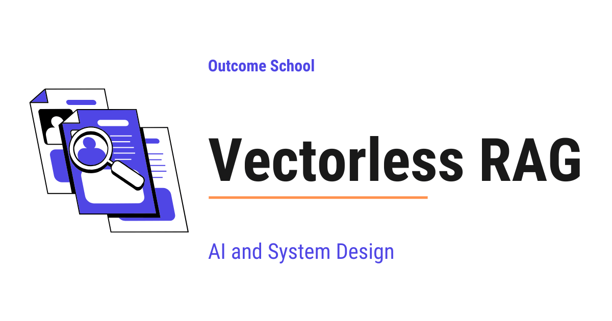

# What is Vectorless RAG? RAG Without Embeddings or a Vector Database

> Archived from <https://outcomeschool.com/blog/vectorless-rag> on 2026-11-25.

Vectorless RAG is a way of answering questions from our own documents without converting them into vectors and without any vector database. Instead, the LLM looks at the structure of the document, like a human reading a book, and decides which part to open.

In this blog, we will learn about Vectorless RAG, a way of answering questions from our own documents without converting those documents into numbers and without using any vector database. We will also see how the normal RAG works, why the vector part creates problems, how a Vectorless RAG system reads a document the way a human reads a book, how the tree structure and the search happen step by step, what the advantages and disadvantages are, and when to use which one.

We will cover the following:
<ul><li>What is an LLM?</li><li>What is RAG?</li><li>How the normal Vector RAG works</li><li>Problems with Vector RAG</li><li>What is Vectorless RAG?</li><li>How Vectorless RAG works</li><li>An example of Vectorless RAG</li><li>Other Vectorless approaches</li><li>Advantages of Vectorless RAG</li><li>Disadvantages of Vectorless RAG</li><li>Vector RAG vs Vectorless RAG</li><li>When to use which one</li></ul>
I am <strong>Amit Shekhar</strong>, Founder @ <a target="_blank" rel="noopener noreferrer" href="https://outcomeschool.com">Outcome School</a>, I have taught and mentored many developers, and their efforts landed them high-paying tech jobs, helped many tech companies in solving their unique problems, and created many open-source libraries being used by top companies. I am passionate about sharing knowledge through open-source, blogs, and videos.

I teach <a target="_blank" rel="noopener noreferrer" href="https://outcomeschool.com/program/ai-and-machine-learning">AI and Machine Learning</a> at Outcome School.

Let&#x27;s get started.
<h2 id="what-is-an-llm">What is an LLM?</h2>
Before jumping into Vectorless RAG, we must know what an LLM is.

<strong>LLM = Large Language Model.</strong>

In simple words, an LLM is an AI Model that has read a huge amount of text and learned how language works. When we ask it something, it writes an answer one word at a time.

ChatGPT, Claude, and Gemini are all based on LLMs.

But there is a catch. An LLM only knows what it read during its training. It has never seen our office documents, our insurance policy, our company handbook, or the report we wrote last week.

So, if we ask an LLM a question about our own document, it cannot answer. It was never taught that.

We needed a solution for that, and RAG was introduced to solve this problem.
<h2 id="what-is-rag">What is RAG?</h2>
<strong>RAG = Retrieval + Augmented + Generation.</strong>

Let&#x27;s break it down in simple words:
<ul><li><strong>Retrieval</strong>: find the useful part of our document.</li><li><strong>Augmented</strong>: add that part to the question.</li><li><strong>Generation</strong>: let the LLM write the answer using it.</li></ul>
So, <a target="_blank" rel="noopener noreferrer" href="retrieval-augmented-generation-rag.md">RAG</a> is a very simple idea. We do not teach the model anything new. We just hand it the right page at the right time.

Let&#x27;s take an example.

Suppose we have a 300 page insurance policy. We ask, &quot;Is dental treatment covered?&quot;

Instead of sending all 300 pages to the LLM, we find the two pages that talk about dental treatment, and we send only those two pages along with our question.

The LLM reads those two pages and answers.

Think of it like an open book exam. The LLM is the student. Our document is the book. Retrieval is the act of finding the correct page.

Now, the following question arises. Why do we not simply hand over all the 300 pages every single time?

There are three reasons. First, an LLM can read only a limited amount of text at one time, and a large pile of documents will never fit. Second, we pay for every word we send, so sending the whole book for every small question becomes very costly. Third, and the most important one, when we bury the useful two pages inside 300 pages, the model gets distracted and the answer becomes worse.

We have a detailed blog on <a target="_blank" rel="noopener noreferrer" href="lost-in-the-middle-problem-in-llms.md">The Lost in the Middle Problem in LLMs</a> that explains this third reason in depth.

So, we must send less text, and that less text must be the correct text.

Now, the question is, how do we find the correct page? This is exactly where the two approaches differ.
<h2 id="how-the-normal-vector-rag-works">How the normal Vector RAG works</h2>
Most RAG systems today use vectors. Let&#x27;s understand this first, because Vectorless RAG only makes sense once we know what it is replacing.

Before that, we must know what a vector is.

A <strong>vector</strong> is just a long list of numbers, something like <code>[0.12, -0.88, 0.45, ...]</code>. There can be hundreds or thousands of numbers in that list.

There is a special model called an <strong><a target="_blank" rel="noopener noreferrer" href="what-are-embeddings.md">embedding model</a></strong>. We give it a piece of text, and it gives back a vector. The important part is this: text with a similar meaning gets a similar list of numbers.

So, the sentence &quot;I love dogs&quot; and the sentence &quot;I like puppies&quot; will get two lists of numbers that are very close to each other. The sentence &quot;The stock market crashed&quot; will get a list of numbers that is far away from both.

Means, the meaning of a sentence has been turned into a position. Close numbers mean close meaning.

This way of searching by meaning instead of by exact words is called semantic search. We have a detailed blog on <a target="_blank" rel="noopener noreferrer" href="how-does-semantic-search-work.md">How does Semantic Search work?</a> that covers this end to end.

Now, let&#x27;s see how a Vector RAG system is built. It happens in two phases. Do not worry, we will learn about each of them in detail.

<strong>Phase 1: Preparing the document.</strong>

First, we take our 300 page document and cut it into small pieces. Each piece is usually a few hundred words. These pieces are called <strong><a target="_blank" rel="noopener noreferrer" href="chunking-strategies-for-rag.md">chunks</a></strong>.

Then, we pass every chunk through the embedding model and get one vector for each chunk.

After that, we store all these vectors in a <strong><a target="_blank" rel="noopener noreferrer" href="how-does-a-vector-database-work.md">vector database</a></strong>. A vector database is a special storage that is very fast at one job, which is finding the vectors that are closest to a given vector.

Now our document is ready for searching.

<strong>Phase 2: Answering the question.</strong>

First, the user asks a question.

Then, we pass the question through the same embedding model and get a vector for the question.

After that, we ask the vector database to find the chunks whose vectors are <a target="_blank" rel="noopener noreferrer" href="how-does-approximate-nearest-neighbor-ann-search-work.md">closest to the question vector</a>. Usually we ask for the closest 5 or 10 chunks. This number is called <strong>top-k</strong>.

Finally, we put those chunks and the question together and send them to the LLM, and the LLM writes the answer.

This is how Vector RAG works. It is a good approach, and it powers a huge number of products today.

<strong>Planning your move into AI?</strong>

No matter which tech domain you work in today, with your effort, you can transition to these roles:
<ul><li>AI Engineer</li><li>Forward Deployed Engineer</li><li>AI Agent Engineer</li><li>Harness Engineer</li><li>Voice AI Engineer</li><li>AI Architect</li><li>LLM Engineer</li><li>LLM Inference Engineer</li><li>Gen AI Engineer</li><li>MLOps Engineer</li><li>ML Engineer</li><li>Deep Learning Engineer</li></ul>
Our <a target="_blank" rel="noopener noreferrer" href="https://outcomeschool.com/program/ai-and-machine-learning">AI and Machine Learning Program</a> at Outcome School takes you there.

But the following issues arise.
<h2 id="problems-with-vector-rag">Problems with Vector RAG</h2>
<strong>Problem 1: Chunking breaks the meaning.</strong>

We cut the document into pieces using a fixed size. The document does not care about our fixed size. A sentence can get cut in half. A table can get separated from its heading. A rule can get separated from its exception.

Let&#x27;s say the policy says on one page, &quot;Dental treatment is covered.&quot; And two pages later it says, &quot;All treatments mentioned in Chapter 3 apply only after a waiting period of one year.&quot;

These two lines live in two different chunks. The system may pick the first chunk and miss the second one. The answer will be confidently wrong.

<strong>Problem 2: Similar is not the same as correct.</strong>

The vector database finds text that sounds similar to the question. Sounding similar is not the same as being the right answer.

If we ask, &quot;Which policy does not cover dental treatment?&quot;, the word &quot;not&quot; is a tiny word. It barely moves the numbers. So, the system happily returns the chunks about policies that do cover dental treatment.

<strong>Problem 3: There is no thinking during the search.</strong>

The search is pure mathematics. It measures distance. It does not reason. It cannot say, &quot;This question is about a rule and its exception, so I must look in two different chapters.&quot;

<strong>Problem 4: We cannot explain the result.</strong>

When a wrong chunk is picked, we cannot ask the vector database why. It returns numbers. Debugging becomes very hard.

<strong>Problem 5: There is a whole system to maintain.</strong>

We need an embedding model, a vector database, a chunking strategy, and a re-embedding job that runs every time a document changes. If we ever want to switch to a better embedding model, we must rebuild everything from the start.

<strong>Problem 6: Special words and numbers suffer.</strong>

Product codes, invoice numbers, medical terms, legal clause numbers, and tables do not carry much meaning for an embedding model. <code>Clause 14.2.b</code> and <code>Clause 14.3.b</code> look almost identical to it.

<strong>Problem 7: The number of chunks is fixed.</strong>

We decide the top-k value once, and it stays the same for every question. But one question may need a single line, and another question may need six full sections. A fixed number is either bringing too little or bringing too much noise.

So, here comes Vectorless RAG to the rescue.
<h2 id="what-is-vectorless-rag">What is Vectorless RAG?</h2>
<strong>Vectorless RAG = RAG without the vectors.</strong>

<strong>Vectorless RAG is a way of doing retrieval without converting our documents into vectors and without using any vector database. Instead of searching by number similarity, we let the LLM itself look at the structure of the document and decide which part to open, exactly the way a human finds an answer in a book.</strong>

In simple words, we replace mathematics with reading, and that too without cutting our document into pieces.

Let&#x27;s understand this with something that we all must have done at some point.

Suppose we buy a washing machine and we want to know about the warranty. We get a 200 page manual.

What do we do? We do not measure the similarity of anything. We open the table of contents at the front. We run our eyes down the chapter names. We see &quot;Chapter 9: Warranty and Service&quot;. We jump to page 154. We read it. We answer.

That is it. That is the whole idea of Vectorless RAG.

We give the LLM the table of contents, and we let it choose the page.

<strong>Note:</strong> The word &quot;Vectorless&quot; only means that we are not using embedding vectors for the search. We are still using an LLM to read and to write the final answer.

To learn RAG, Vector Databases, and Embeddings, check out our <a target="_blank" rel="noopener noreferrer" href="https://outcomeschool.com/program/ai-and-machine-learning">AI and Machine Learning Program</a> at Outcome School, where we also build an AI Tutor from scratch.
<h2 id="how-vectorless-rag-works">How Vectorless RAG works</h2>
Let&#x27;s see how this happens step by step. It also has two phases.

<strong>Phase 1: Preparing the document.</strong>

So, here comes the <strong>tree</strong> into the picture. Instead of cutting the document into equal pieces, we build a tree out of it.

A tree here means the same thing as a table of contents. The book is at the top. Chapters come under the book. Sections come under the chapters. Sub-sections come under the sections.

For every node of this tree, we store three things:
<ul><li>The title of that section, for example &quot;3.4 Dental Treatment&quot;.</li><li>A short summary of what that section says, written in one or two lines.</li><li>The location of the real text, for example pages 41 to 43.</li></ul>
We do not store any numbers. We do not cut anything. The original document stays as it is, whole and untouched.

Building this tree is a one time job. If the document already has a table of contents, we can use it directly. If it does not have one, we let the LLM read section by section and write the titles and the summaries for us.

<strong>Phase 2: Answering the question.</strong>

<strong>Step 1:</strong> The user asks a question.

<strong>Step 2:</strong> We show the LLM only the top level of the tree, which is just the chapter names and their one line summaries. This is very small, maybe one page of text, even for a document of 300 pages. So, this step stays cheap and fast.

<strong>Step 3:</strong> We ask the LLM a simple question: &quot;Based on these chapter names and summaries, which chapters can hold the answer?&quot; The LLM picks one or more chapters and also tells us why it picked them.

<strong>Step 4:</strong> We open only the chosen chapters and show the LLM the sections inside them. The LLM picks again.

<strong>Step 5:</strong> We keep going down, level by level, until we reach the actual sections. This walking down the tree is called <strong>tree search</strong>.

<strong>Step 6:</strong> Now we pull the real, full text of those chosen sections. Nothing is cut in the middle, because we are taking complete sections.

<strong>Step 7:</strong> We send the question and that full text to the LLM, and it writes the final answer, along with the section number it used.

Here, we can notice one beautiful thing. At every step, a thinking model made the decision, and at every step it told us why. So, if the answer is wrong, we can open the trail and see exactly where it took the wrong turn.

<strong>Note:</strong> This is also called reasoning based retrieval, because the system reasons its way to the answer instead of measuring a distance between numbers.

<strong>A quick note for you</strong>

No matter which tech domain you work in, get familiar with these topics:
<ul><li>LLM</li><li>RAG</li><li>MCP</li><li>Agent</li><li>Fine-tuning</li><li>Quantization</li></ul>
We put it all together in one video:

<a target="_blank" rel="noopener noreferrer" href="https://www.youtube.com/watch?v=lnfWvX66FUk">AI Engineering Explained: LLM, RAG, MCP, Agent, Fine-Tuning, and Quantization</a>

No need to stop reading - bookmark it and watch later when you get time. Future you will thank you.

Now, let&#x27;s get back to the topic.
<h2 id="an-example-of-vectorless-rag">An example of Vectorless RAG</h2>
The best way to learn this is by taking an example.

Let&#x27;s come back to our 300 page insurance policy. Our question is, &quot;Is dental treatment covered in the first year?&quot;

Assume that we have already built the tree of this policy, kept short here just for the sake of understanding, like below:

<pre><code class="language-text code-highlight">Insurance Policy
|
|-- Chapter 1: Definitions
|-- Chapter 2: How to Buy the Policy
|-- Chapter 3: What is Covered
|     |-- 3.1 Hospital Stay
|     |-- 3.2 Surgery
|     |-- 3.3 Eye Care
|     |-- 3.4 Dental Treatment
|-- Chapter 4: What is Not Covered
|-- Chapter 5: Waiting Periods
|-- Chapter 6: How to Claim
</code></pre>

Let&#x27;s first see what a Vector RAG system does.

It looks for chunks that sound like &quot;dental treatment covered first year&quot;. The word &quot;dental&quot; appears in Chapter 3 many times, so it returns five chunks from <code>3.4 Dental Treatment</code>. All five chunks talk about dental treatment being covered.

Chapter 5 says, &quot;Dental treatment has a waiting period of 12 months.&quot; But that single line was sitting inside a long chunk about many different waiting periods, and it did not sound close enough to our question.

So, the LLM sees only the chunks that say yes, and it answers, &quot;Yes, dental treatment is covered.&quot;

The answer is wrong.

Now, let&#x27;s see what a Vectorless RAG system does.

The LLM sees the six chapter names. It thinks like this: &quot;The user is asking two things. One, is dental treatment covered. Two, is it covered in the first year. The first part is in Chapter 3. The second part is about time, so it is in Chapter 5.&quot;

It picks Chapter 3 and Chapter 5.

Then it goes one level down inside Chapter 3 and picks <code>3.4 Dental Treatment</code>.

Then we pull the full text of <code>3.4</code> and the full text of Chapter 5, and we send both to the LLM.

Now the LLM has both halves of the truth in front of it, and it answers, &quot;Dental treatment is covered, but not in the first year. There is a waiting period of 12 months, as per Chapter 5.&quot;

The answer is correct. Problem Solved!

Here, we can see the real difference. The vector system searched for words that sound alike. The vectorless system understood the question and went to look for the rule and its exception, the way a careful human would.
<blockquote>
In Vector RAG, we search with mathematics. In Vectorless RAG, we search with reading.
</blockquote>
This way we can use Vectorless RAG to solve the interesting problem of finding an answer that is hiding in two different places at once.

If we want to go deep into how to design a RAG System (Chat with Your Documents), along with AI Agent and Agentic AI, check out our <a target="_blank" rel="noopener noreferrer" href="https://outcomeschool.com/program/ai-and-machine-learning">AI and Machine Learning Program</a> at Outcome School.
<h2 id="other-vectorless-approaches">Other Vectorless approaches</h2>
The tree search is the most popular way, but it is not the only vectorless way. Let&#x27;s see a few more.

<strong>Keyword search.</strong> This is the old and trusted way of matching the actual words, the same way we search inside a file. If the user asks for <code>Invoice INV-2024-8891</code>, keyword search will find that exact string every single time, while an embedding model may bring back a hundred similar looking invoice numbers.

<strong>Filtering on structured data.</strong> If our data lives in a normal database with columns like date, city, and amount, we do not need any search at all. We let the LLM write a query, we run it, and we give the rows back to the LLM. Numbers and dates are handled perfectly this way.

<strong>Giving the full document.</strong> Modern LLMs can read a very large amount of text in one go. If our document is small enough to fit, we can simply give the whole thing along with the question. There is no retrieval step at all. It is the simplest approach, and for a single contract or a single report, it works perfectly.

<strong>Letting the model browse the files.</strong> We can also give the LLM a set of tools, such as list the folders, open a file, and search inside a file. Then the LLM explores our files on its own, one step at a time, the way a developer explores a new codebase. This is often called <a target="_blank" rel="noopener noreferrer" href="agentic-rag.md">agentic search</a>.

All of these are vectorless. Not a single vector is created in any of them.

A coding agent works exactly this way inside our codebase. We have a detailed blog on <a target="_blank" rel="noopener noreferrer" href="how-does-claude-code-work.md">how Claude Code works</a> that explains how it finds the right file without creating a single embedding.

This was all about the different vectorless approaches. Now, let&#x27;s discuss the advantages and the disadvantages of Vectorless RAG.
<h2 id="advantages-of-vectorless-rag">Advantages of Vectorless RAG</h2><ul><li><strong>No chunking.</strong> We always read complete sections, so a rule never gets separated from its exception.</li><li><strong>No vector database and no embedding model.</strong> There is one less system to build, to pay for, and to maintain.</li><li><strong>Easy updates.</strong> When a document changes, we update the summary of that one section. There is no re-embedding of anything.</li><li><strong>We can see the reasoning.</strong> At every step, the LLM tells us why it opened a particular chapter. Debugging becomes simple.</li><li><strong>Special words work well.</strong> Clause numbers, product codes, and medical terms are read as real words, not turned into a blur of numbers.</li><li><strong>Better answers on long and structured documents.</strong> Reports, policies, manuals, and legal papers already have a clean structure, and this approach uses that structure instead of throwing it away.</li><li><strong>Real reasoning during the search.</strong> The system can decide to look in two far apart chapters because the question needs both.</li></ul>
In short, it makes our life easy when the documents are long and the answers must be correct.

<strong>Stay updated:</strong> Subscribe to our <a target="_blank" rel="noopener noreferrer" href="https://outcomeschool.substack.com/subscribe">newsletter</a> to get our latest AI and Machine Learning blogs straight to your inbox.
<h2 id="disadvantages-of-vectorless-rag">Disadvantages of Vectorless RAG</h2><ul><li><strong>It is slower.</strong> Walking down the tree needs a few LLM calls, one for each level. A vector search finishes in milliseconds.</li><li><strong>It costs more per question.</strong> Every LLM call costs money. A vector search is close to free once the vectors are stored.</li><li><strong>It needs structure.</strong> If our data is ten million random support chat messages with no titles and no sections, there is no meaningful tree to build.</li><li><strong>The quality depends on the summaries.</strong> If a section summary is written poorly, the LLM may skip that section. The summary is doing the job that the vector used to do.</li><li><strong>It does not scale to millions of documents on its own.</strong> Searching inside one long document is easy. Choosing between five million documents needs some cheap first filter before the tree search can begin.</li></ul><h2 id="vector-rag-vs-vectorless-rag">Vector RAG vs Vectorless RAG</h2>
Now that we have learned about both of them, it&#x27;s time to put them side by side.

Let me tabulate the differences between Vector RAG and Vectorless RAG for your better understanding so that you can decide which one to use based on your use case.
<table><thead><tr><th>Vector RAG</th><th>Vectorless RAG</th></tr></thead><tbody><tr><td>Documents are converted into vectors.</td><td>Documents are kept as they are.</td></tr><tr><td>Needs an embedding model.</td><td>Does not need an embedding model.</td></tr><tr><td>Needs a vector database.</td><td>Does not need a vector database.</td></tr><tr><td>Documents are cut into fixed size chunks.</td><td>Documents are kept whole and read section by section.</td></tr><tr><td>Search happens by measuring distance between numbers.</td><td>Search happens by the LLM reading titles and summaries and choosing.</td></tr><tr><td>There is no reasoning during the search.</td><td>There is reasoning at every step of the search.</td></tr><tr><td>Very fast, in milliseconds.</td><td>Slower, because it needs a few LLM calls.</td></tr><tr><td>Very cheap for each question.</td><td>Costlier for each question.</td></tr><tr><td>Hard to explain why a chunk was picked.</td><td>Easy to explain, because the LLM gives its reason.</td></tr><tr><td>Scales very well to millions of documents.</td><td>Works best on long and well structured documents.</td></tr><tr><td>Updating a document needs re-embedding.</td><td>Updating a document needs only a summary update.</td></tr><tr><td>Struggles with exact codes, numbers, and negation.</td><td>Handles exact codes, numbers, and negation well.</td></tr></tbody></table><h2 id="when-to-use-which-one">When to use which one</h2>
We must use <strong>Vector RAG</strong> when we have a very large number of documents, when the questions are simple lookups, when speed matters a lot, and when the cost of each question must stay very low. A help center with a million short articles is a good example.

We must use <strong>Vectorless RAG</strong> when we have long documents that already have a clean structure, when a wrong answer is expensive, and when the questions need reasoning across different parts of the same document. Insurance policies, legal contracts, annual reports, medical guidelines, and technical manuals are good examples.

So, now we know where we can use the Vectorless RAG.

Many strong systems use both. They use a cheap vector search or a keyword search to narrow five million documents down to twenty, and then they use the tree search inside those twenty to find the exact section. This is called a <a target="_blank" rel="noopener noreferrer" href="how-does-hybrid-search-work.md">hybrid approach</a>, and we get the speed of one and the accuracy of the other.

Now we must have understood Vectorless RAG, why it exists, how it works, and where it fits.
<h2 id="frequently-asked-questions">Frequently Asked Questions</h2><h3 id="does-vectorless-rag-still-use-an-llm">Does Vectorless RAG still use an LLM?</h3>
Yes. The word &quot;Vectorless&quot; only means that we do not use embedding vectors for the search. We still use an LLM to read the table of contents, pick the right chapters and sections, and write the final answer. In fact, the LLM does the job of finding the right part of the document.
<h3 id="can-we-use-vectorless-rag-if-our-document-has-no-table-of-contents">Can we use Vectorless RAG if our document has no table of contents?</h3>
Yes. If the document already has a table of contents, we can use it directly to build the tree. If it does not have one, we let the LLM read the document section by section and write the titles and short summaries for us. Building this tree is a one time job.
<h3 id="is-vectorless-rag-the-same-as-keyword-search">Is Vectorless RAG the same as keyword search?</h3>
No. Keyword search is only one of the vectorless approaches. The most popular vectorless approach is tree search, where the LLM walks down the table of contents level by level. Keyword search instead matches the actual words, which makes it very good at finding exact strings like invoice numbers.
<h3 id="do-we-always-need-a-retrieval-step-in-rag">Do we always need a retrieval step in RAG?</h3>
No. If our document is small enough to fit into what the LLM can read in one go, we can simply give the whole document along with the question. There is no retrieval step at all. It is the simplest approach, and it works perfectly for a single contract or a single report.
<h3 id="why-is-vectorless-rag-called-reasoning-based-retrieval">Why is Vectorless RAG called reasoning based retrieval?</h3>
It is called reasoning based retrieval because the system reasons its way to the answer instead of measuring a distance between numbers. At every step, the LLM decides which part to open and tells us why. So, if the answer is wrong, we can open the trail and see exactly where it took the wrong turn.

That&#x27;s it for now.

Thanks

<strong>Amit Shekhar</strong> Founder @ <a target="_blank" rel="noopener noreferrer" href="https://outcomeschool.com">Outcome School</a>

You can connect with me on:
<ul><li><a target="_blank" rel="noopener noreferrer" href="https://x.com/amitiitbhu">X</a></li><li><a target="_blank" rel="noopener noreferrer" href="https://www.linkedin.com/in/amit-shekhar-iitbhu">LinkedIn</a></li><li><a target="_blank" rel="noopener noreferrer" href="https://github.com/amitshekhariitbhu">GitHub</a></li></ul>
Follow Outcome School on:
<ul><li><a target="_blank" rel="noopener noreferrer" href="https://x.com/outcome_school">X</a></li><li><a target="_blank" rel="noopener noreferrer" href="https://youtube.com/@OutcomeSchool">YouTube</a></li><li><a target="_blank" rel="noopener noreferrer" href="https://www.linkedin.com/company/outcomeschool">LinkedIn</a></li><li><a target="_blank" rel="noopener noreferrer" href="http://github.com/OutcomeSchool">GitHub</a></li></ul>
<a target="_blank" rel="noopener noreferrer" href="https://outcomeschool.com/blog"><strong>Read all of our high-quality blogs here.</strong></a>

