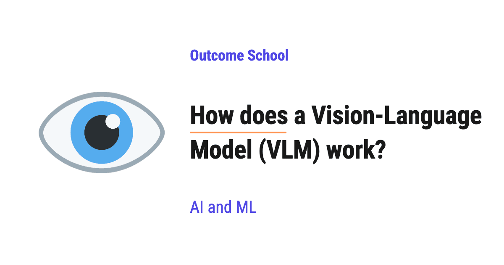

# How does a Vision-Language Model (VLM) work?

> Archived from <https://outcomeschool.com/blog/vision-language-model-vlm> on 2026-11-25.

A Vision-Language Model (VLM) is an AI model that can look at an image and read text together, and then answer in text. It works by turning the image into a list of numbers that look like word tokens to a language model, so the language model can read the image just like it reads our question.

In this blog, we will learn about how a Vision-Language Model (VLM) works. We will also see how a computer sees an image as numbers, how a vision encoder cuts an image into patches and understands them, how CLIP connected images and text, how a projector turns image patches into tokens that an LLM can read, how a VLM is trained, and where VLMs work well and where they fail.

We will cover the following:
<ul><li>What is a Vision-Language Model?</li><li>How does a computer see an image?</li><li>The main problem: images are not words</li><li>The three parts of a VLM</li><li>Part 1: The vision encoder</li><li>How did CLIP teach images and text the same language?</li><li>Part 2: The projector</li><li>Part 3: The language model</li><li>VLM in code</li><li>How is a VLM trained?</li><li>Other ways to connect vision and language</li><li>Where VLMs work well and where they fail</li></ul>
I am <strong>Amit Shekhar</strong>, Founder @ <a target="_blank" rel="noopener noreferrer" href="https://outcomeschool.com">Outcome School</a>, I have taught and mentored many developers, and their efforts landed them high-paying tech jobs, helped many tech companies in solving their unique problems, and created many open-source libraries being used by top companies. I am passionate about sharing knowledge through open-source, blogs, and videos.

I teach <a target="_blank" rel="noopener noreferrer" href="https://outcomeschool.com/program/ai-and-machine-learning">AI and Machine Learning</a> at Outcome School.

Let&#x27;s get started.
<h2 id="what-is-a-vision-language-model">What is a Vision-Language Model?</h2>
<strong>A Vision-Language Model, or VLM, is an AI model that takes both an image and text as input, understands them together, and gives text as output.</strong>

Let&#x27;s say we give a VLM a photo of a kitchen and ask, &quot;What can I cook with the things on this table?&quot;. The VLM looks at the photo, sees eggs, tomatoes, and onions, and replies, &quot;You can make an omelette with tomatoes and onions.&quot;

We use VLMs every day. When we upload a photo to ChatGPT, Claude, or Gemini and ask a question about it, a VLM is doing the work.

A VLM is one kind of model that works with more than one type of data. We have a detailed blog on <a target="_blank" rel="noopener noreferrer" href="multimodal-ai.md">Multimodal AI</a> that covers this bigger family end to end.

Some common tasks of a VLM:
<ul><li>Describing what is in a photo.</li><li>Answering questions about an image.</li><li><a target="_blank" rel="noopener noreferrer" href="optical-character-recognition-ocr.md">Reading text</a> from a screenshot, a bill, or a document.</li><li>Understanding charts and diagrams.</li></ul>
Now, to understand how a VLM works, we must first understand how a computer sees an image.
<h2 id="how-does-a-computer-see-an-image">How does a computer see an image?</h2>
A computer does not see a cat or a tree. It sees only numbers.

An image is a grid of tiny colored dots called <strong>pixels</strong>. Each pixel has three numbers: how much <strong>R</strong>ed, <strong>G</strong>reen, and <strong>B</strong>lue light it has. Each number goes from 0 to 255.

For example, a pure red pixel is <code>[255, 0, 0]</code>, and a white pixel is <code>[255, 255, 255]</code>.

So, a photo of size 336 x 336 pixels is a big grid of 336 x 336 = 112,896 pixels, and each pixel has 3 numbers. That is 338,688 numbers in total.

<pre><code class="code-highlight">A cat photo (what we see)
            ↓
What the computer sees:

[[ [120, 85, 60], [122, 88, 61], ... ],
 [ [118, 84, 59], [121, 86, 60], ... ],
 ... ]
</code></pre>

These raw numbers do not directly say &quot;cat&quot;. Something must turn these raw numbers into meaning.
<h2 id="the-main-problem-images-are-not-words">The main problem: images are not words</h2>
An <a target="_blank" rel="noopener noreferrer" href="large-language-model-llm.md">LLM</a> breaks text into small pieces called <strong><a target="_blank" rel="noopener noreferrer" href="tokenization-in-llms.md">tokens</a></strong>, and turns each token into a list of numbers called an <strong><a target="_blank" rel="noopener noreferrer" href="what-are-embeddings.md">embedding</a></strong>. The LLM only understands a sequence of these embeddings, and it predicts the answer one token at a time. An image is a grid of pixels. These are two completely different forms of data.

Let&#x27;s understand this with an analogy. Suppose a writer knows only English. We show the writer a painting and ask for a story about it. But the writer is blind to paintings and can only read English text. What do we do?

We hire two helpers:
<ul><li>A <strong>painting expert</strong> who looks at the painting and notes down its details in their own private notes.</li><li>A <strong>translator</strong> who converts those private notes into English sentences that the writer can read.</li></ul>
Now, the writer reads the English notes plus our question, and writes the story.

This is exactly how a VLM works. The question is: how do we convert an image into something that looks like word tokens? The answer is the three parts of a VLM.
<h2 id="the-three-parts-of-a-vlm">The three parts of a VLM</h2>
Most popular VLMs are made of three parts:

<pre><code class="code-highlight">          Image                          Text question
            ↓                                  ↓
   [ Vision Encoder ]                          ↓
    (painting expert)                          ↓
            ↓                                  ↓
      patch vectors                            ↓
            ↓                                  ↓
      [ Projector ]                            ↓
      (translator)                             ↓
            ↓                                  ↓
      visual tokens                       text tokens
            ↓                                  ↓
            +-----------------+----------------+
                              ↓
                     [ Language Model ]
                          (writer)
                              ↓
                         Text answer
</code></pre>

Here, we have:
<ul><li><strong>Vision encoder:</strong> Understands the image and turns it into a set of vectors, which are lists of numbers.</li><li><strong>Projector:</strong> Converts those vectors into the same &quot;language&quot; as the LLM&#x27;s word embeddings.</li><li><strong>Language model:</strong> Reads the image tokens and the text tokens together and writes the answer.</li></ul>
Now, let&#x27;s understand each part one by one.
<h2 id="part-1-the-vision-encoder">Part 1: The vision encoder</h2>
The most common vision encoder is the <strong><a target="_blank" rel="noopener noreferrer" href="decoding-vision-transformer-vit.md">Vision Transformer</a></strong>, also called <strong>ViT</strong>. The <strong><a target="_blank" rel="noopener noreferrer" href="decoding-transformer-architecture.md">Transformer</a></strong> is the same architecture used inside LLMs. ViT uses it for images.

<strong>Step 1:</strong> The image is cut into small squares called <strong>patches</strong>. For example, a 336 x 336 image cut into 14 x 14 pixel patches gives 24 patches per side. That is 24 x 24 = 576 patches.

<pre><code class="code-highlight">+----+----+----+----+
| P1 | P2 | P3 | P4 |
+----+----+----+----+
| P5 | P6 | P7 | P8 |
+----+----+----+----+
| ...               |
+-------------------+
</code></pre>

Here, each square is one patch. The patches are read in order, row by row, just like words in a sentence.

<strong>Step 2:</strong> Each patch is turned into a vector. Each 14 x 14 patch has 14 x 14 x 3 = 588 numbers. These are laid out in one long list and passed through a learned layer that turns them into a vector. Now, each patch is like one &quot;word&quot; of the image.

<strong>Step 3:</strong> The model adds a <strong>position embedding</strong> to each patch, so that it knows where the patch was in the image. Without this, the model would not know if the sky patch was at the top or the bottom.

<strong>Step 4:</strong> The patches pass through many Transformer layers. In each layer, using a step called <strong><a target="_blank" rel="noopener noreferrer" href="self-attention-in-transformers.md">attention</a></strong>, every patch looks at every other patch. A patch showing an ear looks at the patch showing an eye and the patch showing fur, and together they understand &quot;this is a cat&#x27;s face&quot;.

At the end, we get one vector for each patch. Each vector now carries meaning, not just raw colors. These are our painting expert&#x27;s private notes.

<strong>Planning your move into AI?</strong>

No matter which tech domain you work in today, with your effort, you can transition to these roles:
<ul><li>AI Engineer</li><li>Forward Deployed Engineer</li><li>AI Agent Engineer</li><li>Harness Engineer</li><li>Voice AI Engineer</li><li>AI Architect</li><li>LLM Engineer</li><li>LLM Inference Engineer</li><li>Gen AI Engineer</li><li>MLOps Engineer</li><li>ML Engineer</li><li>Deep Learning Engineer</li></ul>
Our <a target="_blank" rel="noopener noreferrer" href="https://outcomeschool.com/program/ai-and-machine-learning">AI and Machine Learning Program</a> at Outcome School takes you there.

Now, the next big question is: how does the vision encoder learn what things are? Here comes CLIP into the picture.
<h2 id="how-did-clip-teach-images-and-text-the-same-language">How did CLIP teach images and text the same language?</h2>
Many VLMs use a vision encoder taken from a model called <strong>CLIP</strong>, which was released by OpenAI in 2021. CLIP stands for <strong>Contrastive Language-Image Pre-training</strong>.

CLIP was trained on about 400 million pairs of images and their captions collected from the internet. For example, a photo of a dog with the caption &quot;a brown dog playing in the park&quot;.

CLIP has two parts: an image encoder and a text encoder. The training works as below:
<ul><li>Take a batch of images and their captions.</li><li>Turn every image into a vector and every caption into a vector.</li><li>Make the vector of each image <strong>close</strong> to the vector of its own caption.</li><li>Make it <strong>far</strong> from the vectors of all the other captions in the batch.</li></ul>
This is called <strong><a target="_blank" rel="noopener noreferrer" href="contrastive-learning.md">contrastive learning</a></strong>, because the model learns by contrasting the correct match with the wrong ones.

After this training, the image encoder of CLIP produces vectors that carry real meaning about the image, and that meaning is already connected to language. This is why it works well as the painting expert for a VLM.
<h2 id="part-2-the-projector">Part 2: The projector</h2>
Now, we have the patch vectors from the vision encoder. But they are still in the vision encoder&#x27;s own private language. The LLM cannot read them directly.

For example, the vision encoder can produce vectors of size 1,024, while the LLM expects embeddings of size 4,096. Even the meaning of each number is different.

So, here comes the <strong>projector</strong> to the rescue.

<strong>The projector is a small <a target="_blank" rel="noopener noreferrer" href="neural-network.md">neural network</a> that converts each patch vector into a vector that looks like a word embedding to the LLM.</strong>

The projector can be very simple. In the popular model <strong>LLaVA</strong>, the first version used a single <strong>linear layer</strong>, which means a multiplication by one learned table of numbers. The next version, LLaVA-1.5, used a small two-layer network called an <strong><a target="_blank" rel="noopener noreferrer" href="multilayer-perceptron-mlp.md">MLP</a></strong>, which stands for Multi-Layer Perceptron.

After the projector, each patch becomes a <strong>visual token</strong>. For the LLM, a visual token looks just like a word token, even though it came from an image. This is our translator at work.

<strong>A quick note for you</strong>

No matter which tech domain you work in, get familiar with these topics:
<ul><li>LLM</li><li>RAG</li><li>MCP</li><li>Agent</li><li>Fine-tuning</li><li>Quantization</li></ul>
We put it all together in one video:

<a target="_blank" rel="noopener noreferrer" href="https://www.youtube.com/watch?v=lnfWvX66FUk">AI Engineering Explained: LLM, RAG, MCP, Agent, Fine-Tuning, and Quantization</a>

No need to stop reading - bookmark it and watch later when you get time. Future you will thank you.

Now, let&#x27;s get back to the topic.
<h2 id="part-3-the-language-model">Part 3: The language model</h2>
Now, the LLM receives one long sequence:

<pre><code class="code-highlight">[visual token 1] [visual token 2] ... [visual token 576] [What] [is] [in] [this] [image] [?]
</code></pre>

The LLM reads this sequence exactly like it reads normal text. Through attention, the text tokens look at the visual tokens. The word &quot;this&quot; looks at the visual tokens and finds the cat patches.

Then the LLM generates the answer, one token at a time:

<pre><code class="code-highlight">&quot;This is an orange cat sleeping on a blue sofa.&quot;
</code></pre>

This is our writer at work. The LLM never sees pixels. It only sees tokens. Some tokens came from words, and some came from the image.
<h2 id="vlm-in-code">VLM in code</h2>
Let&#x27;s see the code for the shapes of the data as it flows through a VLM, using Python and NumPy. We are using random numbers, just for the sake of understanding the flow.

<pre><code class="code-highlight language-python">import numpy as np

image = np.random.rand(336, 336, 3)      # height, width, 3 colors (RGB)
patch = 14                               # each patch is 14 x 14 pixels

patches_per_side = 336 // patch          # 24
num_patches = patches_per_side ** 2      # 576
print(&quot;Patches:&quot;, num_patches)

vision_dim, llm_dim = 1024, 4096
patch_vectors = np.random.rand(num_patches, vision_dim)    # output of the vision encoder
projector = np.random.rand(vision_dim, llm_dim)            # learned during training
visual_tokens = patch_vectors @ projector
print(&quot;Visual tokens:&quot;, visual_tokens.shape)

text_tokens = np.random.rand(8, llm_dim)                   # &quot;What is in this image?&quot;
llm_input = np.concatenate([visual_tokens, text_tokens])
print(&quot;LLM input:&quot;, llm_input.shape)
</code></pre>

Here, we have:
<ul><li><code>image</code> is a 336 x 336 picture with 3 color numbers per pixel.</li><li>We cut it into 14 x 14 patches, which gives 24 x 24 = 576 patches.</li><li><code>patch_vectors</code> stands in for the output of the vision encoder: one vector of size 1,024 for each patch.</li><li><code>projector</code> is a learned table. The <code>@</code> symbol means <a target="_blank" rel="noopener noreferrer" href="matrix-multiplication-in-neural-networks.md">matrix multiplication</a>. It converts each 1,024-size vector into a 4,096-size vector, the size the LLM expects.</li><li><code>text_tokens</code> stands in for the embeddings of our 8 question tokens.</li><li><code>np.concatenate</code> joins the visual tokens and the text tokens into one sequence.</li></ul>
This will print the following:

<pre><code class="code-highlight">Patches: 576
Visual tokens: (576, 4096)
LLM input: (584, 4096)
</code></pre>

Here, we can see that the LLM receives 584 tokens: 576 from the image and 8 from the text. All of them have the same size, so the LLM can read them together.

<strong>Note:</strong> One image used 576 tokens here, far more than our 8-token question. This is why images make a VLM slower and more costly than plain text.

<strong>Stay updated:</strong> Subscribe to our <a target="_blank" rel="noopener noreferrer" href="https://outcomeschool.substack.com/subscribe">newsletter</a> to get our latest AI and Machine Learning blogs straight to your inbox.
<h2 id="how-is-a-vlm-trained">How is a VLM trained?</h2>
Now, let&#x27;s understand how all three parts learn to work together. LLaVA is a good example because its recipe is simple.

We start with two parts that are already trained: a vision encoder from CLIP and an LLM that already knows language. Only the projector is new.

<strong>Step 1:</strong> We teach the translator. The vision encoder and the LLM are <strong>frozen</strong>, which means their parameters are not updated. Only the projector is trained on a large set of image-caption pairs. The task is to look at the image and produce its caption. This teaches the projector to convert image vectors into the LLM&#x27;s language.

<strong>Step 2:</strong> We teach the model to follow instructions. The model is trained on examples of images with questions and good answers. For example, an image of a street with the question &quot;Is it safe to cross?&quot; and a helpful answer. In this step, the projector and the LLM are both trained. The vision encoder usually stays frozen. This teaches the VLM to have useful conversations about images.
<table><thead><tr><th>Part</th><th>Step 1</th><th>Step 2</th></tr></thead><tbody><tr><td>Vision encoder</td><td>Frozen</td><td>Frozen</td></tr><tr><td>Projector</td><td>Trained</td><td>Trained</td></tr><tr><td>LLM</td><td>Frozen</td><td>Trained</td></tr></tbody></table>
This is how a VLM is trained cheaply, by reusing parts that are already good at their jobs.

To master Multimodal AI, Fine-tuning, and Large Language Models (LLMs) in depth, check out our <a target="_blank" rel="noopener noreferrer" href="https://outcomeschool.com/program/ai-and-machine-learning">AI and Machine Learning Program</a> at Outcome School.
<h2 id="other-ways-to-connect-vision-and-language">Other ways to connect vision and language</h2>
The projector design is the most common, but it is not the only one. Let me tabulate the main designs for your better understanding.
<table><thead><tr><th>Design</th><th>How it connects the image</th><th>Example</th></tr></thead><tbody><tr><td>Projector</td><td>Turns every patch into a visual token and puts it in front of the text</td><td>LLaVA</td></tr><tr><td>Query-based connector</td><td>A small set of learned queries pulls the important information from the image, giving fewer tokens</td><td>BLIP-2 (Q-Former)</td></tr><tr><td>Cross-attention</td><td>The image is not added as tokens. Extra layers inside the LLM look at the image while reading text</td><td>Flamingo</td></tr><tr><td>Native multimodal</td><td>The model is trained on image and text tokens together from the very beginning</td><td>Chameleon</td></tr></tbody></table>
Here, we can notice the tradeoff. The projector design is simple and keeps all the details, but it uses many tokens. The query-based design uses fewer tokens, but it can lose small details.

The Flamingo design is built on cross attention, where the text looks at the image from inside the LLM. We have a detailed blog on <a target="_blank" rel="noopener noreferrer" href="cross-attention-in-transformers.md">Cross Attention in Transformers</a> that explains how it works.
<h2 id="where-vlms-work-well-and-where-they-fail">Where VLMs work well and where they fail</h2>
<strong>Where they work well:</strong>
<ul><li>Describing photos and answering general questions about them.</li><li>Reading text in screenshots, receipts, and documents.</li><li>Understanding charts, tables, and diagrams.</li><li>Helping people with low vision understand what is around them.</li></ul>
<strong>Where they fail:</strong>
<ul><li><strong><a target="_blank" rel="noopener noreferrer" href="why-do-llms-hallucinate-the-token-level-explanation.md">Hallucination</a>:</strong> A VLM can describe things that are not in the image. For example, it can say there is a cup on the table when there is none. One big reason is that the LLM has strong habits from text. Cups are usually on kitchen tables, so it fills the gap with what is usually there.</li><li><strong>Counting and exact positions:</strong> Questions like &quot;How many birds are in the sky?&quot; or &quot;Is the key to the left of the phone?&quot; are often answered wrongly.</li><li><strong>Tiny details:</strong> When a big image is shrunk to fit the vision encoder, small text and small objects get blurred. Many newer VLMs fix this by cutting a large image into several tiles and encoding each tile, but that uses even more tokens.</li><li><strong>Cost:</strong> Each image adds hundreds or even thousands of tokens, which makes the model slower and more expensive.</li></ul>
Now we must have understood how a Vision-Language Model (VLM) works.
<h2 id="frequently-asked-questions">Frequently Asked Questions</h2><h3 id="does-the-language-model-inside-a-vlm-see-the-pixels-of-the-image">Does the language model inside a VLM see the pixels of the image?</h3>
No. The language model never sees pixels. It only sees tokens. The vision encoder turns the image patches into vectors, and the projector turns those vectors into visual tokens that look like word tokens. The language model then reads the visual tokens and the text tokens together as one sequence.
<h3 id="why-does-sending-an-image-to-a-vlm-cost-more-than-sending-text">Why does sending an image to a VLM cost more than sending text?</h3>
An image adds hundreds or even thousands of tokens to the input. For example, a 336 x 336 image cut into 14 x 14 patches gives 576 visual tokens, far more than a short 8-token question. More tokens make the model slower and more expensive.
<h3 id="why-do-vlms-struggle-to-read-small-text-in-a-large-image">Why do VLMs struggle to read small text in a large image?</h3>
When a big image is shrunk to fit the vision encoder, small text and small objects get blurred. Many newer VLMs fix this by cutting a large image into several tiles and encoding each tile on its own. This keeps the small details, but it uses even more tokens.
<h3 id="is-the-vision-encoder-trained-again-when-we-build-a-vlm">Is the vision encoder trained again when we build a VLM?</h3>
Usually not. In a simple recipe like LLaVA, the vision encoder comes from CLIP and is already trained. It stays frozen while the projector is trained first, and then the projector and the LLM are trained together on images with questions and good answers. This reuse is what keeps VLM training cheap.

That&#x27;s it for now.

Thanks

<strong>Amit Shekhar</strong> Founder @ <a target="_blank" rel="noopener noreferrer" href="https://outcomeschool.com">Outcome School</a>

You can connect with me on:
<ul><li><a target="_blank" rel="noopener noreferrer" href="https://x.com/amitiitbhu">X</a></li><li><a target="_blank" rel="noopener noreferrer" href="https://www.linkedin.com/in/amit-shekhar-iitbhu">LinkedIn</a></li><li><a target="_blank" rel="noopener noreferrer" href="https://github.com/amitshekhariitbhu">GitHub</a></li></ul>
Follow Outcome School on:
<ul><li><a target="_blank" rel="noopener noreferrer" href="https://x.com/outcome_school">X</a></li><li><a target="_blank" rel="noopener noreferrer" href="https://youtube.com/@OutcomeSchool">YouTube</a></li><li><a target="_blank" rel="noopener noreferrer" href="https://www.linkedin.com/company/outcomeschool">LinkedIn</a></li><li><a target="_blank" rel="noopener noreferrer" href="http://github.com/OutcomeSchool">GitHub</a></li></ul>
<a target="_blank" rel="noopener noreferrer" href="https://outcomeschool.com/blog"><strong>Read all of our high-quality blogs here.</strong></a>

