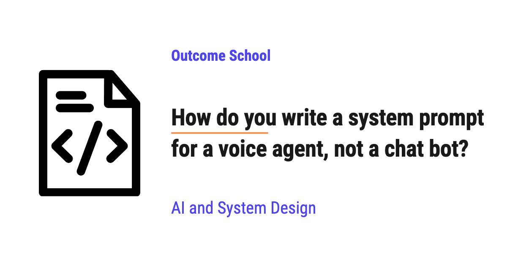

# How do you write a system prompt for a voice agent, not a chat bot?

> Archived from <https://outcomeschool.com/blog/voice-agent-system-prompt> on 2026-11-25.

A system prompt for a voice agent is a set of instructions that tells the LLM its replies will be spoken out loud, so it asks for short, plain, spoken answers that sound natural to the ear, unlike a chat bot prompt that is written for answers people read on a screen.

In this blog, we will learn about how to write a system prompt for a voice agent, not a chat bot. We will also see what a system prompt is, why text written for a screen fails on a call, how to keep replies short and free of formatting, how to make the agent speak numbers and names correctly, how to handle mishearing, tool waits, and the end of the call, and how to put all of it together into one complete prompt.

We will cover the following:
<ul><li>What is a system prompt?</li><li>How is a voice agent different from a chat bot?</li><li>Why does a chat bot prompt fail on a voice call?</li><li>Rule 1: Keep every reply short</li><li>Rule 2: No formatting, only plain spoken text</li><li>Rule 3: Write numbers, dates, and symbols the way we speak them</li><li>Rule 4: Ask one question at a time</li><li>Rule 5: Plan for mishearing</li><li>Rule 6: Confirm the important details</li><li>Rule 7: Fill the silence while a tool runs</li><li>Rule 8: Know how to end the call</li><li>Putting it all together: a complete voice agent system prompt</li></ul>
I am <strong>Amit Shekhar</strong>, Founder @ <a target="_blank" rel="noopener noreferrer" href="https://outcomeschool.com">Outcome School</a>, I have taught and mentored many developers, and their efforts landed them high-paying tech jobs, helped many tech companies in solving their unique problems, and created many open-source libraries being used by top companies. I am passionate about sharing knowledge through open-source, blogs, and videos.

I teach <a target="_blank" rel="noopener noreferrer" href="https://outcomeschool.com/program/ai-and-machine-learning">AI and Machine Learning</a> at Outcome School.

Let&#x27;s get started.
<h2 id="what-is-a-system-prompt">What is a system prompt?</h2>
<strong>A system prompt is the set of instructions that we give to an LLM (Large Language Model) before the conversation starts. It tells the model who it is, what its job is, and how it must behave.</strong>

The user never sees the <a target="_blank" rel="noopener noreferrer" href="system-prompt.md">system prompt</a>. But the model gets it along with the conversation every time it writes a reply.

Let&#x27;s say we are hiring a new person for the front desk of a clinic. On the first day, we give them a page of instructions: &quot;You work at City Clinic. Greet every caller politely. Help them book appointments. Never give medical advice.&quot; The system prompt is that page of instructions for the model. We have a detailed blog on <a target="_blank" rel="noopener noreferrer" href="prompt-engineering.md">Prompt Engineering</a> that explains how the system prompt and the user prompt work together.
<h2 id="how-is-a-voice-agent-different-from-a-chat-bot">How is a voice agent different from a chat bot?</h2>
A <strong>chat bot</strong> talks with us through text. We type a message, it types back. We read its answer on a screen.

A <strong>voice agent</strong> talks with us through sound. We speak, it listens, and it speaks back. There is no screen. Very often, it is <a target="_blank" rel="noopener noreferrer" href="phone-calls-in-voice-agents.md">answering a phone call</a>.

Inside <a target="_blank" rel="noopener noreferrer" href="design-a-real-time-voice-ai-agent.md">a typical voice agent</a>, three parts work together like below:

<pre><code class="code-highlight">+-------------------------------+
|        Caller speaks          |
+-------------------------------+
                ↓
+-------------------------------+
|  Speech-to-Text (STT)         |
|  turns voice into text        |
+-------------------------------+
                ↓
+-------------------------------+
|  LLM + System Prompt          |
|  decides what to say          |
+-------------------------------+
                ↓
+-------------------------------+
|  Text-to-Speech (TTS)         |
|  turns text into voice        |
+-------------------------------+
                ↓
+-------------------------------+
|        Caller hears           |
+-------------------------------+
</code></pre>

Here, we can see that the LLM sits in the middle. It still reads and writes text. But a person does not read its text. It is read aloud by the Text-to-Speech engine. Some newer voice models <a target="_blank" rel="noopener noreferrer" href="cascaded-vs-speech-to-speech.md">handle speech directly without separate parts</a>, but the same rule holds: whatever the model produces, the caller hears it instead of reading it.

Means, <strong>in a voice agent, the caller hears the output of the LLM instead of reading it.</strong> This difference changes how we write the system prompt.

To learn Prompt Engineering, Context Engineering, and how to Design a Real-Time Voice AI Agent in depth, check out our <a target="_blank" rel="noopener noreferrer" href="https://outcomeschool.com/program/ai-and-machine-learning">AI and Machine Learning Program</a> at Outcome School.
<h2 id="why-does-a-chat-bot-prompt-fail-on-a-voice-call">Why does a chat bot prompt fail on a voice call?</h2>
The best way to learn this is by taking an example.

Suppose we take a normal chat bot prompt like below:

<pre><code class="code-highlight">You are a helpful assistant for City Clinic.
Answer the user&#x27;s questions about appointments.
</code></pre>

Now, a caller asks: &quot;What are your timings?&quot;

The LLM writes a reply that looks great on a screen:

<pre><code class="code-highlight">**Our Clinic Timings:**
- Mon-Fri: 9:00 AM - 6:00 PM
- Sat: 10:00 AM - 2:00 PM
- Sun: Closed

For more details, visit https://cityclinic.com/timings 😊
</code></pre>

Now, imagine the Text-to-Speech engine reading this out loud. Some engines read the symbols out, like &quot;asterisk asterisk Our Clinic Timings&quot;. Some skip them. The web address gets read piece by piece, and the emoji is either skipped or read by its name, like &quot;smiling face&quot;. Different engines handle these symbols differently, but none of them sound like a human receptionist.

The following issues arise:
<ul><li>The bold marks, bullets, and emoji make no sense in sound.</li><li>&quot;Mon-Fri&quot; and &quot;9:00 AM - 6:00 PM&quot; can be read in strange ways.</li><li>A web link is useless on a phone call. The caller cannot click it.</li><li>The reply has too many pieces to hold in memory after hearing it once.</li></ul>
The LLM did what it usually does for text. We never told it that it is speaking. So, the system prompt must tell it.

Now, let&#x27;s learn the rules that fix these problems, one by one.
<h2 id="rule-1-keep-every-reply-short">Rule 1: Keep every reply short</h2>
When we read, we can skim, jump back, and read again. When we listen, we hear each word only once. If the agent speaks for 40 seconds, the caller often forgets the first half.

Also, a phone call is a back-and-forth conversation. A long reply feels like a speech, and the caller has to <a target="_blank" rel="noopener noreferrer" href="what-is-turn-taking-in-a-voice-ai-agent.md">wait for their turn</a>.

So, we add an instruction like below:

<pre><code class="code-highlight">Keep every reply to one or two short sentences.
Give the most important information first.
If the caller wants more detail, they will ask.
</code></pre>

Here, we are telling the model to speak like a person on the phone. The most important part comes first, so even a caller who stops listening early gets the answer.
<h2 id="rule-2-no-formatting-only-plain-spoken-text">Rule 2: No formatting, only plain spoken text</h2>
A screen can show headings, bold text, bullet points, tables, links, code, and emoji. A voice cannot show any of these. LLMs usually write this formatting using <strong>markdown</strong>, which is a set of symbols like <code>**</code> for bold and <code>-</code> for bullets.

So, we forbid them like below:

<pre><code class="code-highlight">Your replies will be converted to speech.
Never use markdown, bullet points, numbered lists,
headings, bold text, emojis, or links.
Write only plain sentences that sound natural when spoken aloud.
</code></pre>

Here, the first line gives the reason behind the rule. When the model knows the reason, it often follows the rule better, even in situations that our rule did not list.

But what about a list, like the clinic timings? We tell the model to turn it into a spoken sentence like below:

<pre><code class="code-highlight">If you need to share several items, say them in one
natural sentence using words like &quot;and&quot; and &quot;then&quot;.
</code></pre>

Now, the earlier timings reply becomes:

&quot;We are open from nine in the morning to six in the evening on weekdays, from ten to two on Saturday, and we are closed on Sunday.&quot;

A caller can understand this in one hearing.

<strong>Planning your move into AI?</strong>

No matter which tech domain you work in today, with your effort, you can transition to these roles:
<ul><li>AI Engineer</li><li>Forward Deployed Engineer</li><li>AI Agent Engineer</li><li>Harness Engineer</li><li>Voice AI Engineer</li><li>AI Architect</li><li>LLM Engineer</li><li>LLM Inference Engineer</li><li>Gen AI Engineer</li><li>MLOps Engineer</li><li>ML Engineer</li><li>Deep Learning Engineer</li></ul>
Our <a target="_blank" rel="noopener noreferrer" href="https://outcomeschool.com/program/ai-and-machine-learning">AI and Machine Learning Program</a> at Outcome School takes you there.
<h2 id="rule-3-write-numbers-dates-and-symbols-the-way-we-speak-them">Rule 3: Write numbers, dates, and symbols the way we speak them</h2>
On a screen, &quot;$1,250.50&quot; is clear. But when spoken, a Text-to-Speech engine can read it in odd ways. The same is true for dates like &quot;12/04&quot;, phone numbers like &quot;9876543210&quot;, and short forms like &quot;Dr.&quot; or &quot;St.&quot;.

The safest way is to ask the LLM to write these in words, the way a human would say them. Let&#x27;s see the instructions as below:

<pre><code class="code-highlight">Write all numbers, prices, dates, and times in words,
the way a person would say them out loud.
- Say &quot;one thousand two hundred fifty dollars and fifty cents&quot;,
  not &quot;$1,250.50&quot;.
- Say &quot;the fourth of December&quot;, not &quot;12/04&quot;.
- Say &quot;three thirty in the afternoon&quot;, not &quot;15:30&quot;.
- Read phone numbers and booking codes one digit at a time,
  in small groups, like &quot;nine eight seven, six five four&quot;.
- Never use short forms like &quot;Dr.&quot; or &quot;St.&quot;. Say &quot;Doctor&quot; and &quot;Street&quot;.
</code></pre>

Here, we can notice that phone numbers are a special case. &quot;9876543210&quot; read as one big number is &quot;nine billion eight hundred seventy six million...&quot;, which is useless. When it is read digit by digit in small groups, a caller can write it down.

<strong>Note:</strong> Some Text-to-Speech engines already convert many numbers to words on their own. But the conversion is not always what we want, so writing them in words in the LLM output gives us control.
<h2 id="rule-4-ask-one-question-at-a-time">Rule 4: Ask one question at a time</h2>
In a chat, a chat bot can ask:

&quot;Please share your full name, phone number, and preferred appointment day.&quot;

The user reads it and types all three. But on a call, the caller hears three questions, answers the first one, and forgets the rest.

So, we add:

<pre><code class="code-highlight">Ask only one question at a time.
Wait for the answer before asking the next question.
</code></pre>

Now, the agent asks &quot;May I have your full name?&quot;, waits, then asks &quot;And your phone number?&quot;, and so on.
<h2 id="rule-5-plan-for-mishearing">Rule 5: Plan for mishearing</h2>
In a chat bot, the text the user typed is exactly what the LLM gets. In a voice agent, the LLM gets what the Speech-to-Text engine thinks the caller said.

<a target="_blank" rel="noopener noreferrer" href="phone-audio-and-speech-recognition.md">Phone lines are noisy</a>. People have different accents. Names are hard to recognize. So, the text can be wrong. For example, the caller says &quot;I want to book for Friday,&quot; but the <strong>transcript</strong>, which is the text that the Speech-to-Text engine produces, says &quot;I want to look for Friday.&quot;

The LLM must know this. Otherwise, it often treats every transcript as perfect and acts on a wrong word with full confidence.

So, we add instructions like below:

<pre><code class="code-highlight">The caller&#x27;s words come from a speech recognition system
and may contain mistakes.
If something sounds odd or does not make sense,
guess the most likely meaning from the context.
If you still cannot understand, politely ask the caller to repeat.
Never mention &quot;transcript&quot; or &quot;speech recognition&quot; to the caller.
Say something natural like &quot;Sorry, I did not catch that.&quot;
</code></pre>

Here, we are telling the model that the input is not always correct, and how to ask for a repeat in a human way.

In our example, the agent works for a clinic that books appointments. So, when the transcript says &quot;I want to look for Friday&quot;, the model can guess that the caller means &quot;book for Friday&quot;.

<strong>A quick note for you</strong>

No matter which tech domain you work in, get familiar with these topics:
<ul><li>LLM</li><li>RAG</li><li>MCP</li><li>Agent</li><li>Fine-tuning</li><li>Quantization</li></ul>
We put it all together in one video:

<a target="_blank" rel="noopener noreferrer" href="https://www.youtube.com/watch?v=lnfWvX66FUk">AI Engineering Explained: LLM, RAG, MCP, Agent, Fine-Tuning, and Quantization</a>

No need to stop reading - bookmark it and watch later when you get time. Future you will thank you.

Now, let&#x27;s get back to the topic.
<h2 id="rule-6-confirm-the-important-details">Rule 6: Confirm the important details</h2>
Because mishearing happens, some details are too important to trust after hearing them once. A wrong spelling of a name, a wrong date, or a wrong phone number can ruin a booking.

So, we tell the agent to repeat these back like below:

<pre><code class="code-highlight">Before booking, read back the caller&#x27;s name, phone number,
date, and time in one sentence, and ask if it is correct.
For names that are hard to hear, ask the caller to spell them.
</code></pre>

Now, the agent says: &quot;So, that is Rahul Verma, phone number nine eight seven, six five four, three two one zero, on Friday the fourth of December at three thirty in the afternoon. Is that correct?&quot;

If the caller says &quot;No, it is Varma, V A R M A,&quot; the agent <a target="_blank" rel="noopener noreferrer" href="confirm-and-correct-in-voice-agents.md">fixes it</a> before anything goes into the system.

But we must not confirm everything. If the agent repeats every small answer, the call becomes slow. We confirm only the details that matter. We have a detailed blog on <a target="_blank" rel="noopener noreferrer" href="structured-inputs-in-voice-agents.md">how a voice agent handles structured inputs like dates, numbers, and addresses</a> that explains how to capture and confirm these values step by step.
<h2 id="rule-7-fill-the-silence-while-a-tool-runs">Rule 7: Fill the silence while a tool runs</h2>
Many voice agents <a target="_blank" rel="noopener noreferrer" href="function-calling-in-voice-agents.md">use tools</a>, like checking the calendar for free slots or looking up an order. Here, the <a target="_blank" rel="noopener noreferrer" href="how-does-function-calling-work-in-llms.md">LLM recommends which tool to use and with what input</a>, and our code runs that tool and gives the result back to the LLM.

This takes time, often a second or more. In a chat, the user sees a &quot;typing&quot; indicator. On a call, the caller hears only silence, and silence on a phone call can feel like the line has dropped.

So, we add:

<pre><code class="code-highlight">Before using a tool that may take time, first say a short
phrase like &quot;Let me check that for you&quot; or &quot;One moment please&quot;.
When the result comes back, share it in one short spoken sentence.
</code></pre>

Now, the caller hears the agent speak while the tool runs, and then the answer comes. We have a detailed blog on <a target="_blank" rel="noopener noreferrer" href="slow-tool-calls-in-voice-agents.md">how a voice agent hides the delay of a slow tool call</a> that covers this end to end.

The second line is also important. A tool often returns data in a format meant for code, with field names and long lists. The agent must turn it into a sentence like &quot;We have a slot at four in the afternoon&quot;, not read out the raw data.

If we want to go deep into Tool use in Agents, and to build an AI Coding Agent from scratch, we have it all in our <a target="_blank" rel="noopener noreferrer" href="https://outcomeschool.com/program/ai-and-machine-learning">AI and Machine Learning Program</a> at Outcome School.
<h2 id="rule-8-know-how-to-end-the-call">Rule 8: Know how to end the call</h2>
A chat stops when the user closes the window. A phone call must be ended on purpose. If the agent does not know when to stop, it can keep asking &quot;Is there anything else?&quot; again and again.

So, we tell it like below:

<pre><code class="code-highlight">When the caller&#x27;s request is done, ask once if they need
anything else. If they say no, thank them, say goodbye,
and end the call.
If the caller asks for a human, or you cannot help them,
tell them you are transferring them and transfer the call.
</code></pre>

Here, <a target="_blank" rel="noopener noreferrer" href="call-ending-in-voice-agents.md">ending the call</a> and <a target="_blank" rel="noopener noreferrer" href="call-transfer-with-context.md">transferring the call</a> are usually tools that our code provides. The system prompt tells the model when to recommend them.

<strong>Stay updated:</strong> Subscribe to our <a target="_blank" rel="noopener noreferrer" href="https://outcomeschool.substack.com/subscribe">newsletter</a> to get our latest AI and Machine Learning blogs straight to your inbox.
<h2 id="putting-it-all-together-a-complete-voice-agent-system-prompt">Putting it all together: a complete voice agent system prompt</h2>
Now, let&#x27;s combine all the rules into one complete system prompt for our clinic. We will organize it in clear sections.

<pre><code class="code-highlight"># Role
You are Asha, the AI phone receptionist for City Clinic.
If a caller asks, say honestly that you are an AI assistant.
You speak with callers on a live phone call.
Your job is to help callers book, change, or cancel appointments.

# Clinic details
Open Monday to Friday, nine in the morning to six in the evening.
Open Saturday, ten in the morning to two in the afternoon.
Closed on Sunday.

# How you speak
Your replies will be converted to speech.
Sound warm, calm, and friendly, like a real receptionist.
Keep every reply to one or two short sentences.
Give the most important information first.
Never use markdown, lists, headings, bold text, emojis, or links.
If you need to share several items, say them in one natural sentence.

# Numbers and names
Write all numbers, prices, dates, and times in words.
Read phone numbers and booking codes one digit at a time, in small groups.
Never use short forms. Say &quot;Doctor&quot;, not &quot;Dr.&quot;.

# Conversation flow
Ask only one question at a time and wait for the answer.
To book, collect the caller&#x27;s full name, phone number, and preferred day.
Before booking, read back the name, phone number, day, and time,
and ask if it is correct.
Ask the caller to spell names that are hard to hear.

# Mishearing
The caller&#x27;s words come from speech recognition and may contain mistakes.
Guess the likely meaning from context.
If you still cannot understand, say &quot;Sorry, I did not catch that&quot;
and ask them to repeat.

# Tools
Before checking the calendar, say &quot;Let me check that for you&quot;.
Share the result in one short spoken sentence.

# Limits
Never give medical advice. If asked, say that a doctor will
help them during the visit.
If the caller asks for a human, transfer the call.

# Ending
When the request is done, ask once if they need anything else.
If not, thank them, say goodbye, and end the call.
</code></pre>

<strong>Note:</strong> The section headings with <code>#</code> are inside the system prompt only. They help the model read the instructions. The model does not speak them, because we have told it to reply in plain sentences.

Now, when the caller asks &quot;What are your timings?&quot;, the agent says:

&quot;We are open from nine in the morning to six in the evening on weekdays, from ten to two on Saturday, and we are closed on Sunday. Would you like to book a visit?&quot;

Finally, the best way to improve this prompt is to call the agent ourselves and listen. Many problems are easy to miss on a screen and obvious when we hear them. When something sounds wrong, we add or fix one rule and call again.

Now we must have understood how to write a system prompt for a voice agent, not a chat bot, and why every rule in it comes from one fact: the caller hears the answer instead of reading it.
<h2 id="frequently-asked-questions">Frequently Asked Questions</h2><h3 id="can-we-use-the-same-system-prompt-for-a-chat-bot-and-a-voice-agent">Can we use the same system prompt for a chat bot and a voice agent?</h3>
No. A chat bot prompt is written for answers people read on a screen, so the LLM replies with bold text, bullets, links, and emoji. In a voice agent, the Text-to-Speech engine reads the reply aloud, and none of this makes sense in sound. The voice agent prompt must tell the model that its replies will be spoken.
<h3 id="does-the-text-to-speech-engine-not-convert-numbers-to-words-on-its-own">Does the Text-to-Speech engine not convert numbers to words on its own?</h3>
Some Text-to-Speech engines do convert many numbers to words on their own. But the conversion is not always what we want. A phone number read as one big number is useless to the caller. So, asking the LLM to write numbers, prices, dates, and times in words gives us control over how they are spoken.
<h3 id="should-a-voice-agent-confirm-every-answer-the-caller-gives">Should a voice agent confirm every answer the caller gives?</h3>
No. The agent must confirm only the details that matter, like the caller&#x27;s name, phone number, date, and time, because a mistake in them can ruin a booking. If the agent repeats every small answer, the call becomes slow. So, we confirm the important details in one sentence and move on.
<h3 id="why-should-a-rule-in-the-system-prompt-include-its-reason">Why should a rule in the system prompt include its reason?</h3>
When the model knows the reason behind a rule, it often follows the rule better, even in situations that the rule did not list. For example, the line &quot;Your replies will be converted to speech&quot; tells the model why it must avoid formatting, so it can apply the same idea to cases we did not write down.
<h3 id="how-do-we-test-and-improve-a-voice-agent-system-prompt">How do we test and improve a voice agent system prompt?</h3>
The best way is to call the agent ourselves and listen. Many problems are easy to miss on a screen and obvious when we hear them. When something sounds wrong, we add or fix one rule and call again, and we keep repeating this until the agent sounds right.

That&#x27;s it for now.

Thanks

<strong>Amit Shekhar</strong> Founder @ <a target="_blank" rel="noopener noreferrer" href="https://outcomeschool.com">Outcome School</a>

You can connect with me on:
<ul><li><a target="_blank" rel="noopener noreferrer" href="https://x.com/amitiitbhu">X</a></li><li><a target="_blank" rel="noopener noreferrer" href="https://www.linkedin.com/in/amit-shekhar-iitbhu">LinkedIn</a></li><li><a target="_blank" rel="noopener noreferrer" href="https://github.com/amitshekhariitbhu">GitHub</a></li></ul>
Follow Outcome School on:
<ul><li><a target="_blank" rel="noopener noreferrer" href="https://x.com/outcome_school">X</a></li><li><a target="_blank" rel="noopener noreferrer" href="https://youtube.com/@OutcomeSchool">YouTube</a></li><li><a target="_blank" rel="noopener noreferrer" href="https://www.linkedin.com/company/outcomeschool">LinkedIn</a></li><li><a target="_blank" rel="noopener noreferrer" href="http://github.com/OutcomeSchool">GitHub</a></li></ul>
<a target="_blank" rel="noopener noreferrer" href="https://outcomeschool.com/blog"><strong>Read all of our high-quality blogs here.</strong></a>

